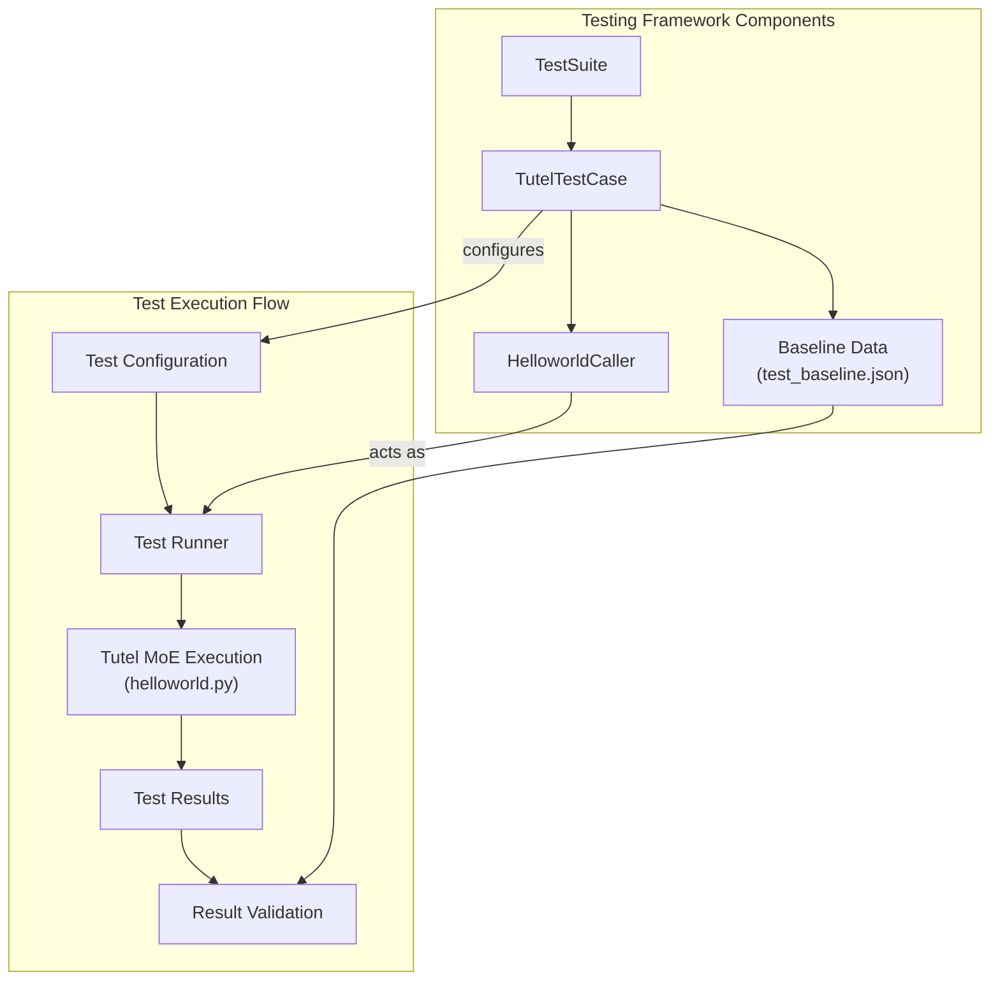
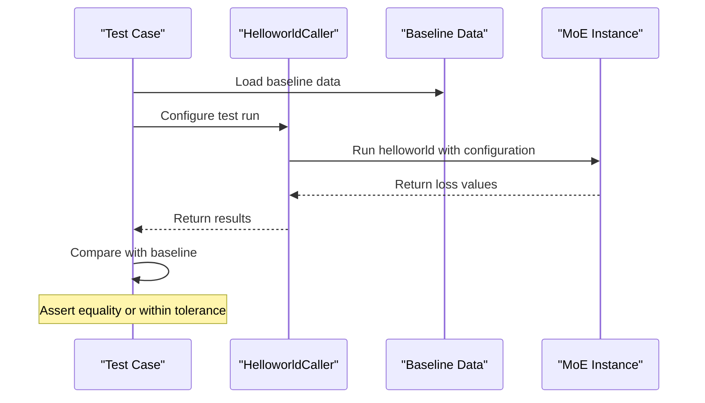
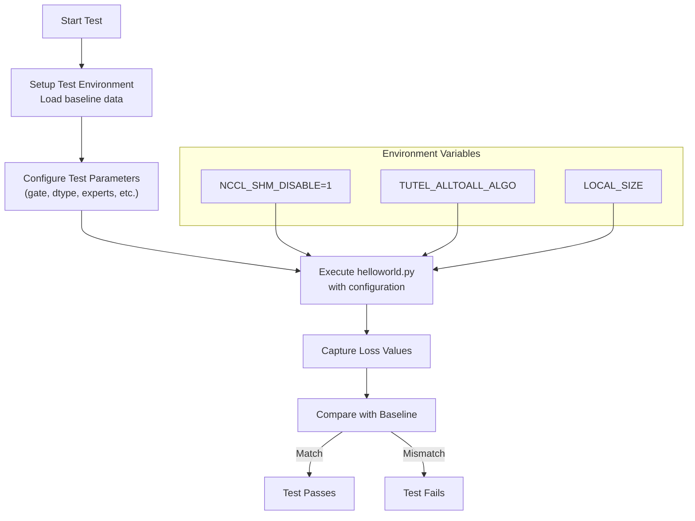
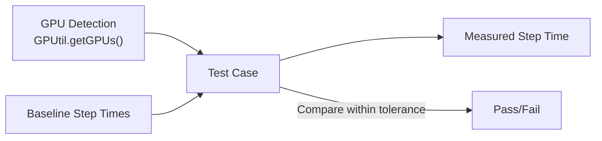

<!-- source: DeepWiki mcp.deepwiki.com · repo microsoft/Tutel · page 7.1 Testing Framework · fetched 2026-10-26 -->

# Testing Framework

Relevant source files

The following files were used as context for generating this wiki page:

- [tests/test_baseline.json](tests/test_baseline.json)
- [tests/test_tutel.py](tests/test_tutel.py)

## Purpose and Scope

The Tutel Testing Framework is a comprehensive system designed to verify the correctness and performance of the Tutel Mixture-of-Experts (MoE) implementation. It provides mechanisms to validate that model behaviors are consistent across various configurations, hardware platforms, and optimization settings. This document covers the testing architecture, baseline comparison methodology, and the various test categories implemented in the Tutel repository.

For information about performance benchmarking methodology specifically, see [Benchmarking](#7.2).

Sources: [tests/test_tutel.py:1-12]()

## Testing Architecture

The Tutel testing framework is built on Python's standard `unittest` library and follows a structured approach to validate the MoE implementation's behavior against expected results. The architecture consists of two main components: the test runner (`HelloworldCaller`) and the test case definitions (`TutelTestCase`).

The test framework runs the Tutel helloworld example with different configurations and compares the resulting loss values with expected baseline results. This ensures that changes to the implementation do not unexpectedly alter model behavior.

Sources: [tests/test_tutel.py:20-69](), [tests/test_tutel.py:70-84]()

## Test Configuration

Tests in Tutel can be configured with various parameters to verify different aspects of the implementation. The `HelloworldCaller` class manages these configurations and handles test execution.

### Key Configuration Parameters

| Parameter | Description | Default Value |
|-----------|-------------|---------------|
| `nproc_per_node` | Number of processes per node | 1 |
| `top` | Top-k value for routing | 2 |
| `dtype` | Data type (float16, float32, float64) | 'float32' |
| `num_local_experts` | Number of local experts | '2' |
| `hidden_size` | Hidden dimension size | 2048 |
| `batch_size` | Batch size | 16 |
| `a2a_ffn_overlap_degree` | Degree of all-to-all and FFN computation overlap | 1 |
| `num_steps` | Number of training steps | 100 |
| `use_model_parallel` | Whether to use model parallelism | False |
| `device` | Computation device (cuda, cpu) | 'cuda' |

The test configuration allows for comprehensive coverage of the Tutel MoE implementation's behavior under different settings.

Sources: [tests/test_tutel.py:20-36]()

## Baseline Testing Methodology

Tutel uses a baseline comparison methodology to ensure consistency across code changes. Expected results are stored in a baseline JSON file, which contains loss values and step times for different configurations.

The baseline file (`test_baseline.json`) contains expected loss values for each test configuration, allowing the framework to verify that the implementation maintains consistent behavior even as optimizations are added.

Sources: [tests/test_tutel.py:74-76](), [tests/test_baseline.json:1-1051]()

## Test Categories

The Tutel testing framework covers several categories of tests to ensure comprehensive validation of the MoE implementation.

### Hardware Compatibility Tests

Tests that verify the implementation works correctly across different hardware platforms:

- **CPU vs. GPU consistency test**: Verifies that CPU and GPU implementations produce consistent results
  - `test_cpu_kernel`

Sources: [tests/test_tutel.py:85-92]()

### Gating Mechanism Tests

Tests for different gating mechanisms and expert configurations:

- **Top-1 gating tests**: Single expert selection
  - `test_top1_fp32_1_expert`
  - `test_top1_fp32_2_experts`
  - `test_top1_fp16_1_expert`
  - `test_top1_fp16_2_experts`
- **Top-2 gating tests**: Multiple expert selection
  - `test_top2_fp32_1_expert`
  - `test_top2_fp32_2_experts`
  - `test_top2_fp16_1_expert`
  - `test_top2_fp16_2_experts`
  - `test_top2_fp64_2_experts`

Sources: [tests/test_tutel.py:94-152]()

### Parallel Execution Tests

Tests that validate parallel execution strategies:

- **Data vs. Model Parallelism**: Verifies that data parallel and model parallel implementations produce identical results
  - `test_compare_data_model_parallel`

Sources: [tests/test_tutel.py:154-159]()

### Communication Optimization Tests

Tests for communication optimizations:

- **All-to-All & FFN Overlap**: Validates that overlapping all-to-all communication with FFN computation works correctly
  - `test_a2a_ffn_overlap`
- **All-to-All Algorithms**: Tests different all-to-all communication algorithms (LINEAR, 2D)
  - `test_a2a_algos`

Sources: [tests/test_tutel.py:161-209]()

## Test Execution Workflow

The following diagram illustrates the workflow for executing tests in the Tutel testing framework:

This workflow ensures that any changes to the implementation are thoroughly tested against baseline expectations, maintaining consistent behavior and performance.

Sources: [tests/test_tutel.py:38-51](), [tests/test_tutel.py:178-209]()

## GPU Detection and Performance Benchmarking

The testing framework attempts to detect the GPU model being used for testing and compares step times with expected values for known GPU types. This helps validate that performance optimizations maintain or improve execution speed.

Step times are compared with baseline values for specific GPU models (e.g., V100, RTX 2080 Ti) to ensure that performance remains consistent or improves across code changes.

Sources: [tests/test_tutel.py:14-18](), [tests/test_tutel.py:102-105]()

## Running the Tests

The testing framework is designed to be easy to use and can be run using standard Python unittest commands. The tests are organized in the `tests/` directory and can be run individually or as a complete test suite.

### Example Test Run Output

When running tests, the output provides information about:
- Test configuration (gate type, data type, number of experts)
- Expected step time for the detected GPU
- Loss values for each step
- Comparison with baseline results

The framework provides clear pass/fail indications for each test case, making it easy to identify any regressions or inconsistencies.

Sources: [tests/test_tutel.py:96-105]()

## Test Baseline Data Structure

The baseline data file (`test_baseline.json`) contains a structured representation of expected results for different test configurations. Each configuration entry includes:

1. Test parameters (top-k, data type, number of experts)
2. Expected step times for different GPU models
3. Expected loss values for each training step

This structured approach allows for precise validation of both functional correctness and performance characteristics across different hardware and software configurations.

Sources: [tests/test_baseline.json:1-1051]()

---

