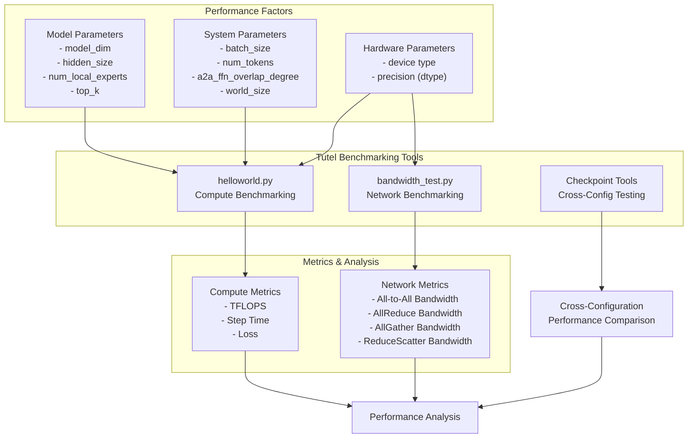
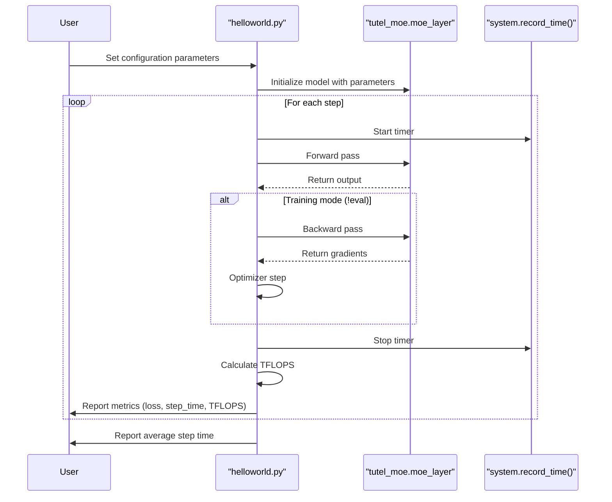
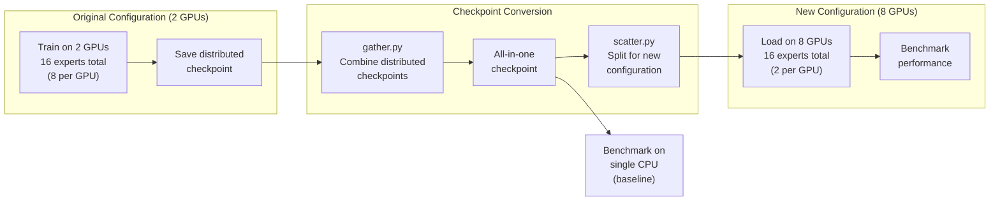
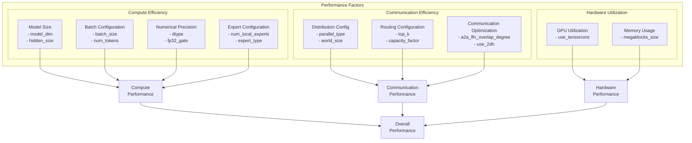

<!-- source: DeepWiki mcp.deepwiki.com · repo microsoft/Tutel · page 7.2 Benchmarking · fetched 2026-10-26 -->

# Benchmarking

<details>
<summary>Relevant source files</summary>

The following files were used as context for generating this wiki page:

- [doc/CHECKPOINT.md](doc/CHECKPOINT.md)
- [tutel/checkpoint/__init__.py](tutel/checkpoint/__init__.py)
- [tutel/checkpoint/gather.py](tutel/checkpoint/gather.py)
- [tutel/checkpoint/scatter.py](tutel/checkpoint/scatter.py)
- [tutel/examples/bandwidth_test.py](tutel/examples/bandwidth_test.py)
- [tutel/examples/helloworld.py](tutel/examples/helloworld.py)

</details>


## Purpose and Scope

This document describes the benchmarking capabilities and methodologies available in the Tutel framework for evaluating Mixture of Experts (MoE) model performance. It covers compute performance benchmarking, network bandwidth testing, and cross-configuration performance comparison. For information about the testing framework itself, see [Testing Framework](#7.1).

## Overview of Tutel Benchmarking

Tutel provides several tools for measuring and analyzing performance of MoE models across different hardware configurations, model architectures, and distributed setups. These benchmarking capabilities are essential for:

1. Evaluating raw computational throughput (measured in TFLOPS)
2. Measuring communication bandwidth between distributed nodes
3. Comparing model performance across different hardware configurations 
4. Optimizing configuration parameters for specific hardware setups

### Benchmarking Architecture



Sources:
- [tutel/examples/helloworld.py:117-157]()
- [tutel/examples/bandwidth_test.py:31-84]()
- [tutel/checkpoint/gather.py:1-82]()
- [tutel/checkpoint/scatter.py:1-76]()

## Compute Performance Benchmarking

The primary tool for compute performance benchmarking is the HelloWorld example, which provides a complete implementation of an MoE model with built-in benchmarking capabilities.

### HelloWorld Benchmarking Parameters

The HelloWorld example accepts numerous parameters that allow benchmarking under different configurations:

| Parameter | Description | Default | Impact on Benchmarking |
|-----------|-------------|---------|------------------------|
| `batch_size` | Number of samples per batch | 16 | Directly affects throughput and memory usage |
| `num_tokens` | Number of tokens per sample | 512 | Affects total computation per batch |
| `model_dim` | Model embedding dimension | 2048 | Affects parameter count and computation |
| `hidden_size` | Hidden layer dimension | 2048 | Affects parameter count and computation |
| `num_local_experts` | Number of experts per device | 2 | Affects model capacity and communication |
| `dtype` | Data precision (float32, float16, bfloat16) | float32 | Affects computation speed and memory usage |
| `top` | Top-k experts to route tokens to | 2 | Affects routing complexity and communication |
| `a2a_ffn_overlap_degree` | All-to-all/FFN overlap degree | 1 | Affects communication-computation overlap |
| `num_steps` | Number of steps to benchmark | 100 | Affects benchmark duration and accuracy |
| `eval` | Run in evaluation mode | False | Affects computation (no backward pass if True) |

Sources:
- [tutel/examples/helloworld.py:17-40]()

### Benchmarking Workflow



Sources:
- [tutel/examples/helloworld.py:126-157]()

### TFLOPS Calculation

The HelloWorld example calculates TFLOPS based on the model configuration, batch size, and step time. The formula used is:

```
tflops = (batch_size * num_tokens * model_dim * hidden_size) * 4 * mm_ceof * cap_ceof * 1e-12 / step_time
```

Where:
- `mm_ceof` is 1 for evaluation mode and 3 for training mode (accounting for forward and backward passes)
- `cap_ceof` is min(top_k, num_global_experts) representing the routing capacity

Sources:
- [tutel/examples/helloworld.py:148-151]()

## Network Bandwidth Benchmarking

Communication performance is a critical factor in distributed MoE models. Tutel provides a dedicated network benchmarking tool for measuring communication bandwidth.

### Bandwidth Test Tool

The `bandwidth_test.py` script measures the performance of key collective communication operations:

1. **All-to-All** - Critical for token routing between experts across devices
2. **AllReduce** - Used for gradient synchronization in distributed training
3. **AllGather** - Used for collecting distributed parameters
4. **ReduceScatter** - Used for distributed parameter updates

### Bandwidth Test Parameters

| Parameter | Description | Default |
|-----------|-------------|---------|
| `device` | Target device (cuda/cpu) | cuda if available, otherwise cpu |
| `size_mb` | Data size for testing in MB | 256 |
| `loop` | Number of test iterations | 50 |
| `warmup` | Number of warmup iterations | 5 |

Sources:
- [tutel/examples/bandwidth_test.py:11-16]()

### Network Benchmarking Workflow

```mermaid
flowchart TD
    subgraph "Bandwidth Test Workflow"
        Init["Initialize data parallel<br>environment"]
        CreateTensor["Create test tensor<br>of specified size"]
        Warmup["Perform warmup iterations"]
        
        subgraph "Measure Loop"
            TestA2A["Test All-to-All<br>Communication"]
            TestAR["Test AllReduce<br>Communication"]
            TestAG["Test AllGather<br>Communication"]
            TestRS["Test ReduceScatter<br>Communication"]
        end
        
        CalcBandwidth["Calculate average<br>bandwidth for each operation"]
        Report["Report results"]
    end
    
    Init --> CreateTensor
    CreateTensor --> Warmup
    Warmup --> TestA2A
    TestA2A --> TestAR
    TestAR --> TestAG
    TestAG --> TestRS
    TestRS --> CalcBandwidth
    CalcBandwidth --> Report
```



Sources:
- [tutel/examples/bandwidth_test.py:18-84]()

### Bandwidth Calculation

The bandwidth for each collective operation is calculated as:

```
bandwidth = (tensor_size_bytes * num_iterations) / total_time_seconds
```

Results are reported in GB/s for each collective operation.

Sources:
- [tutel/examples/bandwidth_test.py:69-83]()

## Cross-Configuration Benchmarking

Tutel provides checkpoint tools that allow comparing the same model across different hardware configurations, making it possible to benchmark how model performance scales with different distributed setups.

### Checkpoint Conversion for Benchmarking

The checkpoint conversion tools can be used to:

1. Convert models trained on N devices to run on M devices
2. Create a single all-in-one checkpoint from a distributed checkpoint
3. Split an all-in-one checkpoint for distributed execution

This functionality enables benchmarking the same model on different hardware configurations to evaluate scaling behavior.



Sources:
- [tutel/checkpoint/gather.py:1-82]()
- [tutel/checkpoint/scatter.py:1-76]()
- [doc/CHECKPOINT.md:1-47]()

### Cross-Configuration Example

The following example demonstrates how to use checkpoint tools for cross-configuration benchmarking:

1. Train a model on 2 GPUs with 8 experts per GPU (16 total)
2. Convert to an all-in-one checkpoint
3. Test on a single CPU as baseline
4. Split for 8 GPUs with 2 experts per GPU
5. Benchmark performance on the 8 GPU configuration

Sources:
- [doc/CHECKPOINT.md:3-26]()

## Performance Factors and Optimization

Several factors significantly impact the performance of MoE models in Tutel:

### Critical Performance Factors



Sources:
- [tutel/examples/helloworld.py:19-40]()
- [tutel/examples/helloworld.py:72-85]()

### Optimization Parameters

The following parameters can be tuned to optimize MoE performance:

| Parameter | Description | Performance Impact |
|-----------|-------------|-------------------|
| `a2a_ffn_overlap_degree` | Controls overlap between communication and computation | Reduces communication overhead |
| `parallel_type` | Type of parallelism strategy (data, expert, or adaptive) | Affects communication pattern and scalability |
| `use_2dh` | Whether to use 2D hierarchical All-to-All | Can improve communication efficiency |
| `capacity_factor` | Controls expert capacity and load balancing | Affects routing efficiency and memory usage |
| `allreduce_degree` | Controls gradient synchronization frequency | Balances computation and communication |

Sources:
- [tutel/examples/helloworld.py:28-35]()
- [tutel/examples/helloworld.py:76-85]()

## Best Practices for Benchmarking

When benchmarking Tutel MoE models, consider the following best practices:

1. **Warmup iterations**: Always include warmup iterations to exclude initial compilation overhead
2. **Multiple runs**: Run benchmarks multiple times and report average performance
3. **Consistent environment**: Use the same hardware and software environment for comparative benchmarks
4. **Realistic configurations**: Use model configurations that match real-world use cases
5. **Monitor all metrics**: Track not only TFLOPS but also memory usage, communication overhead, and load balancing
6. **Benchmark communication separately**: Use the bandwidth test tool to identify potential communication bottlenecks
7. **Compare against baselines**: Benchmark against non-MoE models or different MoE configurations

Sources:
- [tutel/examples/helloworld.py:119-157]()
- [tutel/examples/bandwidth_test.py:28-84]()

## Example Benchmarking Commands

### Compute Benchmarking

Basic compute benchmarking example:

```bash
python -m tutel.examples.helloworld --batch_size=32 --num_tokens=512 --model_dim=1024 --hidden_size=4096 --num_local_experts=4 --dtype=float16 --device=cuda
```

Distributed compute benchmarking:

```bash
python -m torch.distributed.run --nproc_per_node=8 -m tutel.examples.helloworld --batch_size=16 --model_dim=2048 --num_local_experts=2 --a2a_ffn_overlap_degree=2 --device=cuda
```

### Network Bandwidth Benchmarking

```bash
python -m tutel.examples.bandwidth_test --size_mb=512 --loop=100 --warmup=10 --device=cuda
```

### Cross-Configuration Benchmarking

```bash
# Train on 2 GPUs
python -m torch.distributed.run --nproc_per_node=2 -m tutel.examples.helloworld --num_local_experts=8 --checkpoint=./states/{rank}-of-{size}.ckpt --device=cuda

# Gather checkpoint
python -m tutel.checkpoint.gather --inputs=./states/{rank}-of-{size}.ckpt --input_size=2 --output ./model-all-in-one.ckpt

# Scatter for 8 GPUs
python -m tutel.checkpoint.scatter --input=./model-all-in-one.ckpt --output_size=8 --outputs=./adapted-for-8-gpus/{rank}-of-{size}.ckpt

# Benchmark on 8 GPUs
python -m torch.distributed.run --nproc_per_node=8 -m tutel.examples.helloworld --num_local_experts=2 --checkpoint=./adapted-for-8-gpus/{rank}-of-{size}.ckpt --device=cuda --eval
```

Sources:
- [doc/CHECKPOINT.md:3-26]()
- [tutel/examples/helloworld.py:1-161]()
- [tutel/examples/bandwidth_test.py:1-84]()