# Page: Overview

# Overview

<details>
<summary>Relevant source files</summary>

The following files were used as context for generating this wiki page:

- [README.md](README.md)

</details>


This document provides a high-level overview of Tutel, an optimized Mixture-of-Experts (MoE) implementation designed for deep learning frameworks, with a primary focus on PyTorch. Tutel delivers high-performance infrastructure for training and serving large language models with MoE architectures, including specialized optimizations for models like DeepSeek 671B.

For more detailed information about specific components, please refer to the [Core Components](#2) section. For usage examples, see the [Examples and Usage](#5) section.

## What is Tutel?

Tutel is a specialized library that implements the Mixture-of-Experts (MoE) architecture with numerous optimizations for performance and flexibility. MoE is a neural network technique that uses a gating mechanism to selectively activate a subset of specialized sub-networks (experts) for each input token, enabling models to scale to massive parameter counts while keeping compute requirements manageable.

Tutel is particularly notable for introducing "No-penalty Parallelism/Sparsity/Capacity Switching" that allows dynamic behavior changes during training and inference without performance penalties.

**Key features:**
- Support for multiple frameworks (primarily PyTorch ≥ 1.10)
- Hardware support for CUDA GPUs, ROCm GPUs, and CPUs
- Specialized optimizations for DeepSeek 671B model inference
- Multiple parallelism strategies for distributed training and inference
- Optimized communication patterns for all-to-all operations
- Custom CUDA/ROCm kernels for maximum performance
- Flexible expert and gate configurations

Sources: [README.md:3-7]()

## System Architecture

The following diagram provides a high-level overview of Tutel's architecture:

**Tutel High-Level Architecture**
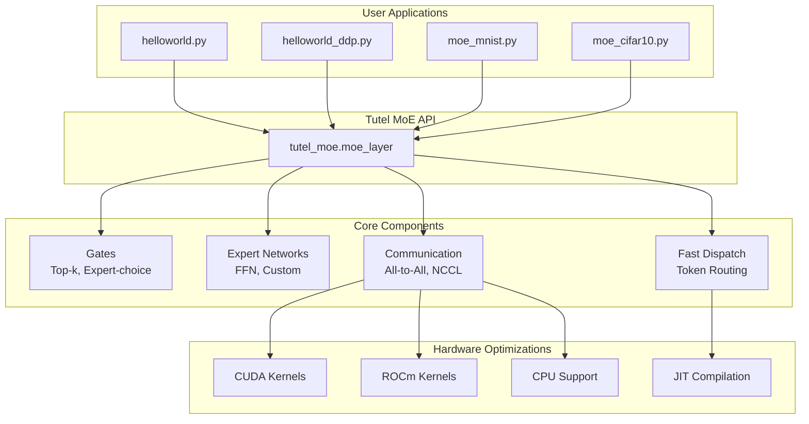

Sources: [README.md:3-8](), [README.md:237-249]()

## How MoE Works in Tutel

Mixture of Experts (MoE) is a technique where only a subset of a neural network (the "experts") processes each input token, allowing models to scale to enormous parameter counts while keeping computation manageable. Tutel implements this architecture with high-performance optimizations.

**MoE Data Flow in Tutel**
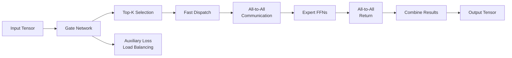

During forward pass:
1. The input tensor is processed by a gate network
2. The gate selects the top-k experts for each token
3. Tokens are dispatched to their assigned experts
4. All-to-all communication distributes tokens to the right devices
5. Experts process their assigned tokens
6. Results are gathered through another all-to-all operation
7. Final outputs are combined and returned

This architecture allows the model to dynamically route different parts of the input to specialized sub-networks, improving efficiency and capacity.

Sources: [README.md:234-264]()

## Hardware Support and Performance

Tutel supports a variety of hardware platforms:

- NVIDIA GPUs (CUDA): A100/A800, H100/H800
- AMD GPUs (ROCm): MI300
- CPU: Both multi-core and single-core

Performance varies by hardware platform. For example, with DeepSeek 671B FP4 models:

| Hardware Configuration | Performance (Decode TPS) |
|------------------------|--------------------------|
| A100/A800 × 8          | 57 Decode TPS           |
| H100/H800 × 8          | 81 Decode TPS           |
| MI300 × 8 (FP4)        | 107 Decode TPS          |
| MI300 × 8 (FP8)        | 110 Decode TPS          |

Tutel includes specialized optimizations for each hardware platform, ensuring maximum performance across different environments.

Sources: [README.md:5-7](), [README.md:12-23]()

## Key Components

**MOE Layer**
The central component of Tutel is the `moe_layer` class, which implements the Mixture-of-Experts architecture. This layer handles:
- Expert selection through gating mechanisms
- Token routing to appropriate experts
- Parallel execution of experts
- Result combination and auxiliary loss calculation

**Fast Dispatch**
Optimized token routing and expert selection mechanisms that efficiently map tokens to experts, particularly important for performance at scale.

**Gates**
Gating mechanisms determine which experts process which tokens. Tutel provides various gate implementations:
- Top-k gating (selects k experts per token)
- Expert-choice routing
- Custom gate implementations

**Experts**
The actual neural networks that process tokens. Tutel provides built-in implementations:
- FFN (Feed-Forward Network) experts
- Custom expert implementations

**Communication Primitives**
Optimized communication operations:
- All-to-all operations for token exchange
- NCCL-based communication
- Overlapped communication and computation

Sources: [README.md:280-307]()

## Distributed Execution

Tutel supports various parallelism strategies for distributed execution:

**Distributed Execution Model**
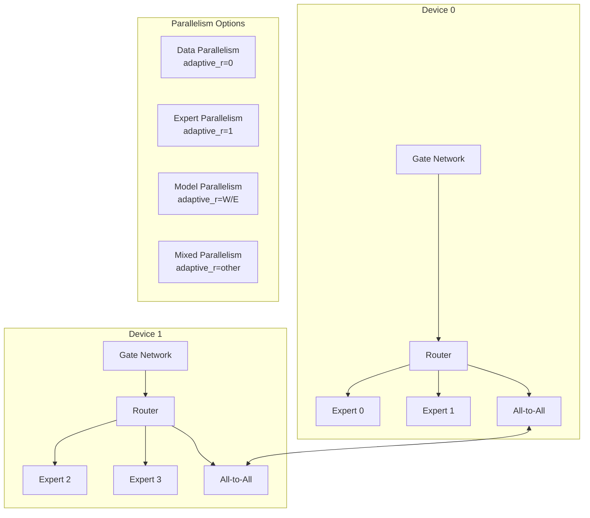

Tutel introduces the concept of "No-penalty Parallelism/Sparsity/Capacity Switching," allowing dynamic changes to parallelism strategies:
- Data Parallelism (DP): Each device has a complete set of experts
- Expert Parallelism (EP): Experts are sharded across devices
- Model Parallelism (MP): Model layers are distributed across devices
- Mixed parallelism: Combinations of the above strategies

These parallelism strategies can be adjusted dynamically during execution via the `adaptive_r` parameter.

Sources: [README.md:136-146]()

## Installation and Usage

Tutel requires PyTorch (recommended version ≥ 1.10) and can be installed either from source or via pip:

```
# Install Tutel Online:
python3 -m pip uninstall tutel -y
python3 -m pip install -v -U --no-build-isolation git+https://github.com/microsoft/tutel@main

# Build Tutel from Source:
git clone https://github.com/microsoft/tutel --branch main
python3 -m pip uninstall tutel -y
python3 ./tutel/setup.py install --user
```

Basic usage example:

```python
import torch
from tutel import moe as tutel_moe

# Create input tensor
x = torch.ones([6, 1024], device='cuda:0')

# Create MoE layer
moe_layer = tutel_moe.moe_layer(
    gate_type={'type': 'top', 'k': 2},
    model_dim=x.shape[-1],
    experts={
        'num_experts_per_device': 2,
        'type': 'ffn', 
        'hidden_size_per_expert': 2048, 
        'activation_fn': lambda x: torch.nn.functional.relu(x)
    },
    scan_expert_func = lambda name, param: setattr(param, 'skip_allreduce', True),
)

# Move to GPU
moe_layer = moe_layer.to('cuda:0')

# Forward pass
y = moe_layer(x)
```

For distributed training and more advanced usage, see the [Examples and Usage](#5) section.

Sources: [README.md:156-198](), [README.md:234-264]()

## Dynamic Configuration

One of Tutel's unique features is its ability to dynamically adjust various parameters without recompilation or model reinitialization:

| Parameter | Description | Usage |
|-----------|-------------|-------|
| `a2a_ffn_overlap_degree` | Controls overlap between all-to-all communication and computation | Set to 1 for no overlap, >1 for increasing degrees of overlap |
| `adaptive_r` | Controls parallelism strategy | 0 for DP, 1 for DP+EP, W/E for MP+EP, others for mixed parallelism |
| `capacity_factor` | Controls token capacity | Positive for padding, negative for no-padding, 0 for dropless MoE |
| `top_k` | Controls sparsity | Number of experts to route each token to |
| `megablocks_size` | Controls use of Megablocks optimization | 0 for disabled, >0 for block size |

These parameters can be adjusted on-the-fly during the forward pass:

```python
# Dynamically adjust configuration during forward pass
output = moe_layer.forward(
    x, 
    a2a_ffn_overlap_degree=2,
    adaptive_r=1,
    capacity_factor=1.0,
    top_k=2
)
```

This dynamic configuration capability enables flexible experimentation and adaptation to different workloads without model reinitialization.

Sources: [README.md:136-146](), [README.md:122-134]()

## DeepSeek Integration

Tutel includes specialized optimizations for DeepSeek models, particularly the 671B parameter variants:

**DeepSeek Integration**
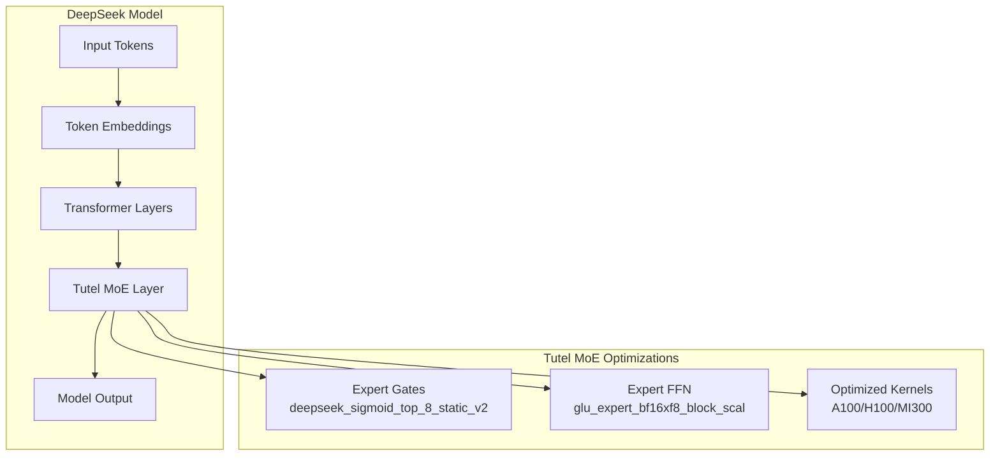

Tutel provides specific optimizations for different hardware platforms when running DeepSeek models:
- Custom kernels for A100/A800, H100/H800, and MI300 GPUs
- Support for FP4 and FP8 quantization
- Specialized operations like `deepseek_sigmoid_top_8_static_v2` for gating and `glu_expert_bf16xf8_block_scal` for expert FFNs

These optimizations enable efficient inference of the massive 671B parameter DeepSeek models across various hardware platforms.

Sources: [README.md:9-23](), [README.md:27-49]()

## Summary

Tutel provides a highly optimized implementation of the Mixture-of-Experts architecture, with specialized support for various hardware platforms and model architectures. Key features include:

1. Flexible parallelism strategies that can be dynamically adjusted
2. Optimized communication primitives for efficient distributed execution
3. Custom CUDA/ROCm kernels for maximum performance
4. Specialized support for DeepSeek 671B models
5. Dynamic configuration of various parameters without model reinitialization

Tutel is particularly valuable for scaling large language models efficiently across distributed hardware, with special focus on performance optimization and flexibility.

For more details on specific components and usage examples, please refer to the other sections of this documentation.

Sources: [README.md:3-8](), [README.md:267-279]()

---

# Page: Core Components

# Core Components

<details>
<summary>Relevant source files</summary>

The following files were used as context for generating this wiki page:

- [README.md](README.md)
- [tutel/impls/moe_layer.py](tutel/impls/moe_layer.py)

</details>


This page provides an overview of the main components that make up Tutel's Mixture-of-Experts (MoE) implementation. It focuses on the core classes and functions that enable efficient MoE operation across various hardware platforms, including CUDA, ROCm, and CPU environments.

For information about system infrastructure and low-level optimizations, see [System Infrastructure](#3). For usage examples, see [Examples and Usage](#5).

## Core Architecture Overview

Tutel's MoE implementation consists of several key components working together to efficiently route tokens to specialized expert networks. The following diagram illustrates how these components interact:

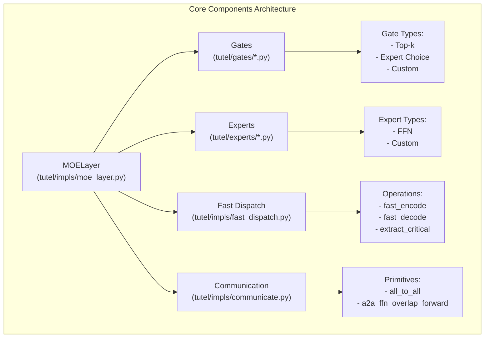

Sources: [tutel/impls/moe_layer.py:42-366]()

## MOELayer

The `MOELayer` class is the central component of Tutel's MoE implementation. It orchestrates the routing of input tokens to experts and the aggregation of expert outputs.

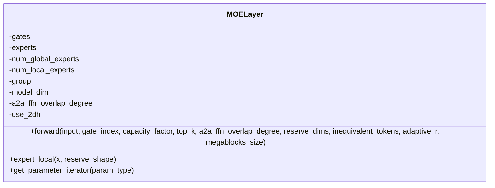

The `MOELayer` accepts various configuration parameters in its constructor that define the behavior of the MoE system:

| Parameter | Description |
|-----------|-------------|
| `gate_type` | Dictionary or list of dictionaries specifying gating mechanism (e.g., `{'type': 'top', 'k': 2}`) |
| `model_dim` | Number of channels for MOE's input tensor |
| `experts` | Dictionary specifying expert network configuration |
| `scan_expert_func` | Lambda function to iterate over expert parameters (e.g., for parameter tagging) |
| `result_func` | Lambda function to format MoE output and auxiliary loss |
| `group` | Specific communication group for all-to-all operations |
| `seeds` | Tuple of seeds for deterministic initialization |
| `a2a_ffn_overlap_degree` | Controls the overlap of communication and computation |
| `parallel_type` | Parallelism method ('auto', 'data', 'model', or 'adaptive:N') |

The `forward` method implements the MoE execution flow, orchestrating:
1. Input reshaping and type conversion
2. Token routing via gates
3. Expert selection and token dispatch
4. Parallel expert execution
5. Result collection and reshaping

Sources: [tutel/impls/moe_layer.py:42-364](), [README.md:280-307]()

## Gates

Gates are responsible for determining which experts should process each token. They produce scores that are used to route tokens to the most appropriate experts.

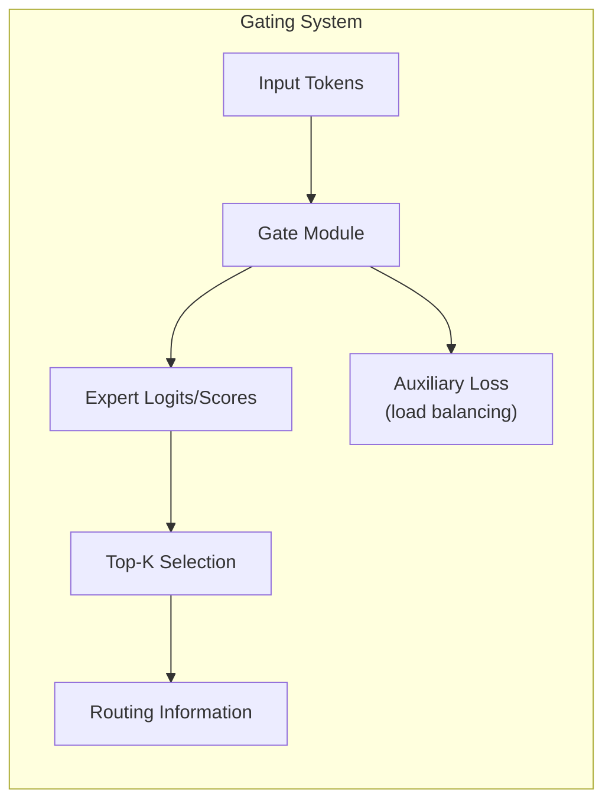

Tutel supports several gating mechanisms:

| Gate Type | Description | Configuration |
|-----------|-------------|---------------|
| Top-k | Routes each token to the top k experts | `{'type': 'top', 'k': 2, 'capacity_factor': 1.0}` |
| Expert Choice | Experts select tokens rather than tokens selecting experts | `{'type': 'expert_choice', ...}` |
| Custom | User-defined gating mechanism | `{'type': 'custom', 'module': YourGateClass}` |

Gate parameters also include:
- `gate_noise`: Noise added to logits during training (default: 0.0)
- `capacity_factor`: Controls expert capacity (default: 1.0)
- `batch_prioritized_routing`: Prioritizes token routing based on batch (default: False)
- `normalize_gate`: Normalizes gate scores (default: True)

Sources: [tutel/impls/moe_layer.py:196-230](), [README.md:284-289]()

## Experts

Experts are specialized neural networks that process subsets of the input data. In a typical MoE system, each expert specializes in different aspects of the input space.

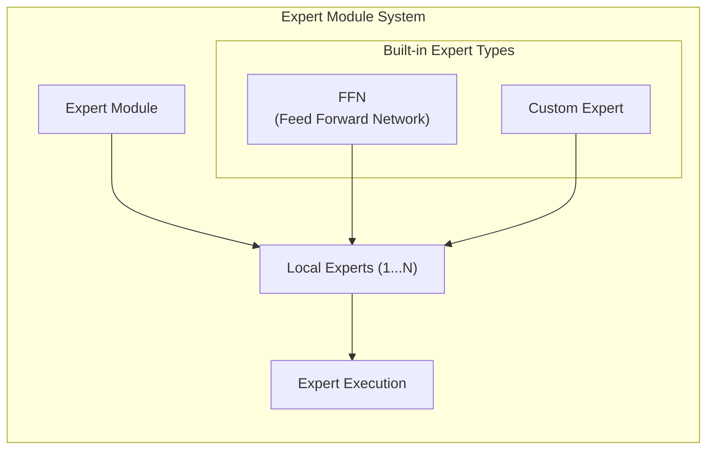

The default expert type is FFN (Feed-Forward Network), but Tutel also supports custom expert implementations. Expert configuration is specified in the `experts` dictionary:

| Parameter | Description |
|-----------|-------------|
| `type` | Expert type ('ffn' or 'custom') |
| `num_experts_per_device` | Number of local experts per device (default: 1) |
| `hidden_size_per_expert` | Hidden dimension size for FFN experts |
| `activation_fn` | Activation function for FFN |
| `has_fc1_bias` | Whether to include bias in first FC layer (default: True) |
| `has_fc2_bias` | Whether to include bias in second FC layer (default: True) |

For custom experts, additional configuration options include:
- `module`: The custom expert module class
- Other custom parameters specific to the expert implementation

Sources: [tutel/impls/moe_layer.py:160-195](), [README.md:299-307]()

## Fast Dispatch

The Fast Dispatch system efficiently routes tokens to experts and collects results. It's implemented in the `fast_dispatch.py` module and consists of several key functions:

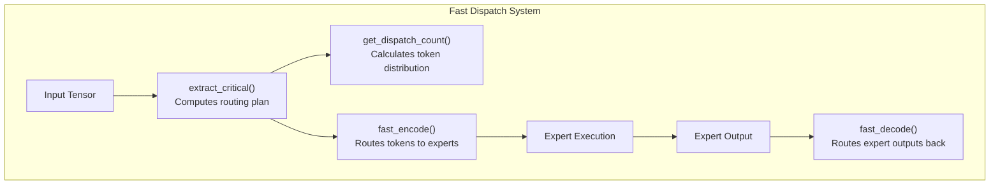

Key functions in the Fast Dispatch system:

| Function | Purpose |
|----------|---------|
| `extract_critical` | Computes the routing plan based on gate scores, including indices, locations, and token weights |
| `fast_encode` | Efficiently routes tokens to their assigned experts based on the routing plan |
| `fast_decode` | Collects outputs from experts and combines them according to the routing plan |
| `get_dispatch_count` | Calculates how many tokens are dispatched to each expert |

The dispatch system handles various routing strategies:
- Top-k routing (each token goes to k experts)
- Load balancing across experts
- Capacity management (padding or dropping tokens)

Sources: [tutel/impls/moe_layer.py:304-359]()

## Communication Infrastructure

In distributed training settings, Tutel implements efficient communication primitives to move data between devices.

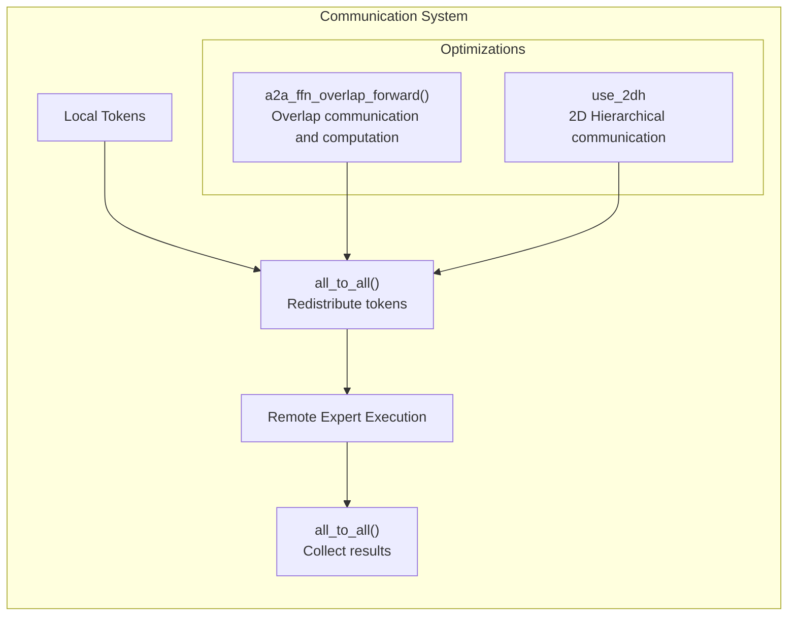

Key communication features:

| Feature | Description |
|---------|-------------|
| `all_to_all` | Primitive for redistributing tokens to devices that own the required experts |
| `a2a_ffn_overlap_forward` | Overlaps communication with computation for improved efficiency |
| `use_2dh` | 2D Hierarchical communication for better scaling at large node counts |
| `adaptive_r` | Controls the parallelism strategy (data parallelism, model parallelism, or hybrid) |

The `a2a_ffn_overlap_degree` parameter controls the granularity of overlap between communication and computation. When set to values greater than 1, it divides the work into smaller chunks to enable pipelining.

Sources: [tutel/impls/moe_layer.py:344-351](), [README.md:136-146]()

## MoE Execution Flow

The following diagram illustrates the end-to-end execution flow within Tutel's MoE implementation:

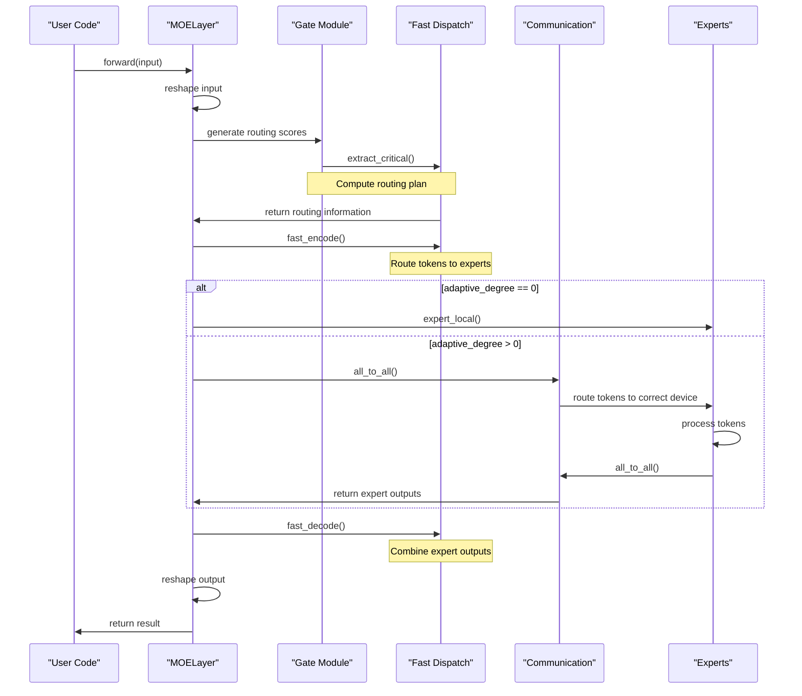

Sources: [tutel/impls/moe_layer.py:255-363]()

## Parameter Configuration

The `MOELayer` provides extensive configuration options that control the behavior of the MoE system:

| Category | Parameter | Dynamic? | Description |
|----------|-----------|----------|-------------|
| Routing | `top_k` | Yes | Number of experts per token |
| Routing | `capacity_factor` | Yes | Controls expert capacity |
| Parallelism | `adaptive_r` | Yes | Controls parallelism strategy |
| Communication | `a2a_ffn_overlap_degree` | Yes | Controls overlap of communication and computation |
| Communication | `use_2dh` | No | Enables 2D hierarchical communication |
| Optimization | `megablocks_size` | Yes | Enables megablocks optimization for inference |

Many parameters can be dynamically changed during inference by passing them to the `forward` method:

```python
# Example of dynamic parameter switching
moe_layer.forward(x, top_k=2)  # Change top-k at runtime
moe_layer.forward(x, capacity_factor=1.5)  # Change capacity factor at runtime
moe_layer.forward(x, a2a_ffn_overlap_degree=2)  # Change overlap degree at runtime
moe_layer.forward(x, adaptive_r=1)  # Change parallelism strategy at runtime
```

Sources: [tutel/impls/moe_layer.py:255-363](), [README.md:136-146]()

---

# Page: MOE Layer

# MOE Layer

<details>
<summary>Relevant source files</summary>

The following files were used as context for generating this wiki page:

- [tutel/impls/moe_layer.py](tutel/impls/moe_layer.py)

</details>


The MOE (Mixture of Experts) Layer is the central component of Tutel's architecture, providing an optimized implementation of the mixture of experts pattern for deep learning models. This document details the implementation, interfaces, and behaviors of the MOE Layer, which serves as the backbone for efficient distributed execution of expert-based neural networks.

For information about specific gating mechanisms used within MOE Layers, see [Gates](#2.3). For information about expert network implementations, see [Experts](#2.4).

## Overview

The MOE Layer orchestrates the routing of tokens to specialized expert networks and combines their outputs. It implements the core functionality of selecting which experts process which tokens, distributing the computation across available devices, and collecting the results.

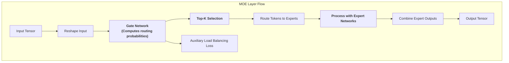

Sources: [tutel/impls/moe_layer.py:250-363]()

## Implementation

The MOE Layer is implemented as a PyTorch module (`torch.nn.Module`) in the Tutel codebase. It combines gating mechanisms for expert selection with distributed communication primitives for efficient routing of tokens.

```mermaid
classDiagram
    class MOELayer {
        +gates: ModuleList
        +experts: ModuleList
        +group: ProcessGroup
        +num_global_experts: int
        +num_local_experts: int
        +model_dim: int
        +forward(input, gate_index, capacity_factor, top_k, ...)
        +expert_local(x, reserve_shape)
        +get_parameter_iterator(param_type)
    }
    MOELayer --|> torch.nn.Module : inherits from
    MOELayer --o "Gate" : contains 1+
    MOELayer --o "ExpertModule" : contains
    
    class Gate {
        +top_k: int
        +gate_noise: float
        +capacity_factor: float
        +forward(x)
    }

    class ExpertModule {
        +forward(x, ctx)
    }
```

Sources: [tutel/impls/moe_layer.py:42-365]()

## Initialization and Configuration

The MOE Layer requires several parameters to be configured during initialization:

| Parameter | Description |
|-----------|-------------|
| `gate_type` | Configuration for routing mechanism (top-k/expert-choice) |
| `model_dim` | Embedding dimension of input data |
| `experts` | Expert networks configuration |
| `group` | Process group for distributed training |
| `a2a_ffn_overlap_degree` | Degree of overlap between communication and computation |
| `normalize_gate` | Whether to normalize gate scores |
| `parallel_type` | Parallelism strategy (data/model/adaptive) |
| `use_2dh` | Whether to use 2D hierarchical all-to-all |

The initialization process sets up gate networks, expert networks, and configures the distributed execution strategy based on the provided parameters.

Sources: [tutel/impls/moe_layer.py:84-234]()

## Expert and Gate Configuration

The MOE Layer supports multiple types of expert networks and gating mechanisms:

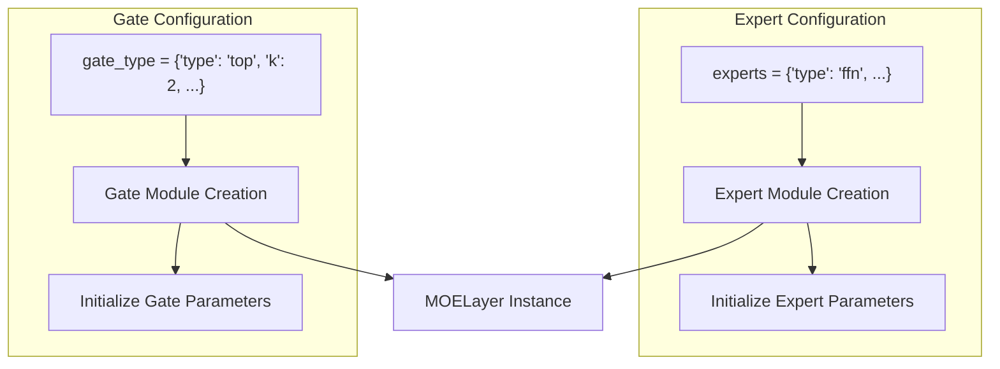

The MOE Layer can load experts and gates from built-in implementations or custom modules:

1. **Built-in experts**: Specified with `type` (e.g., 'ffn')
2. **Custom experts**: Specified with `type: 'custom'` and a `module` parameter
3. **Built-in gates**: Specified with `type` (e.g., 'top', 'hash')
4. **Custom gates**: Specified with `type: 'custom'` and a `module` parameter

Sources: [tutel/impls/moe_layer.py:156-230]()

## Forward Pass Execution Flow

The forward pass of the MOE Layer follows these steps:

1. **Input reshaping**: Reshape input tensor for gate network
2. **Gate computation**: Compute routing probabilities
3. **Top-K selection**: Select top-k experts for each token
4. **Token dispatching**: Route tokens to selected experts
5. **Expert execution**: Process tokens with expert networks
6. **Output combination**: Combine expert outputs according to routing probabilities

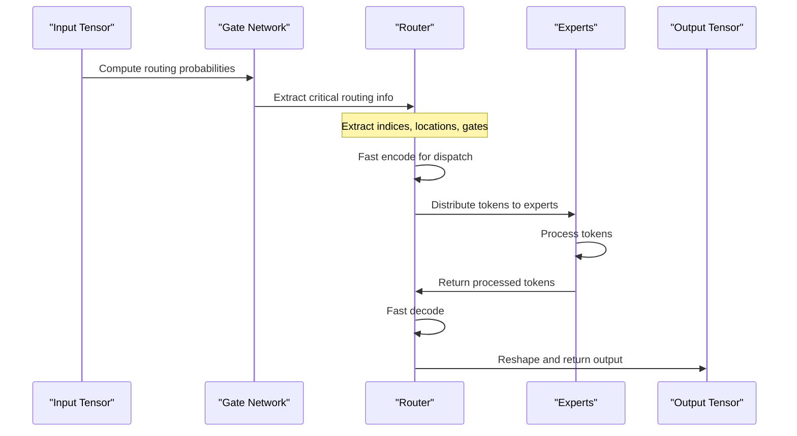

Sources: [tutel/impls/moe_layer.py:255-363]()

## Distributed Execution

The MOE Layer supports distributed execution across multiple devices, with several parallelism strategies:

| Parallelism Strategy | Description |
|------------|-------------|
| Data Parallelism | Each device has a complete set of experts |
| Model Parallelism | Experts are partitioned across devices |
| Adaptive Parallelism | Dynamic adjustment between data and model parallelism |

The distributed execution uses All-to-All communication primitives to route tokens between devices:

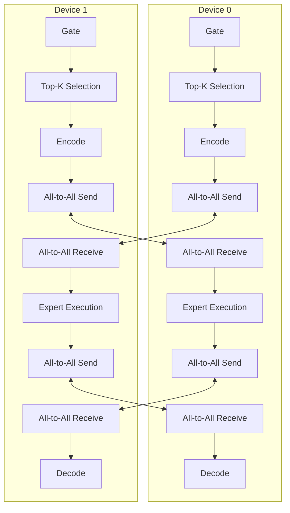

Sources: [tutel/impls/moe_layer.py:330-358]()

## Performance Optimizations

The MOE Layer includes several optimizations to improve performance:

1. **All-to-All and FFN Overlap**: Configurable with `a2a_ffn_overlap_degree`
2. **2D Hierarchical Communication**: Enabled with `use_2dh`
3. **Adaptive Routing**: Controlled with `adaptive_r`
4. **Batch Prioritized Routing**: Prioritizes tokens based on gate scores
5. **MegaBlocks**: Efficient routing for when the number of local experts is greater than 1

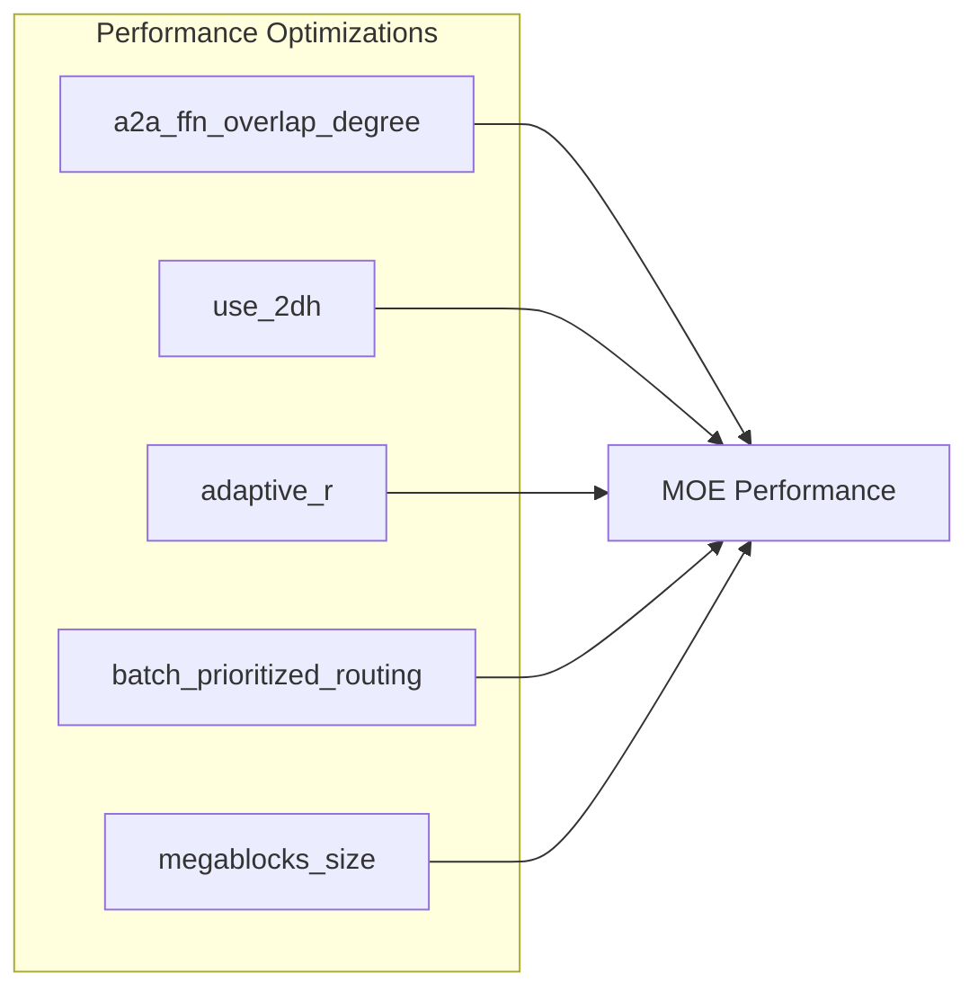

Sources: [tutel/impls/moe_layer.py:274-325]()

## Load Balancing and Auxiliary Losses

The MOE Layer supports auxiliary losses to promote balanced expert utilization:

1. **GShard Loss**: Based on the paper "GShard: Scaling Giant Models with Conditional Computation"
2. **Load Importance Loss**: Alternative loss that considers importance of tokens

These losses encourage uniform utilization of experts and discourage tokens from always selecting the same experts.

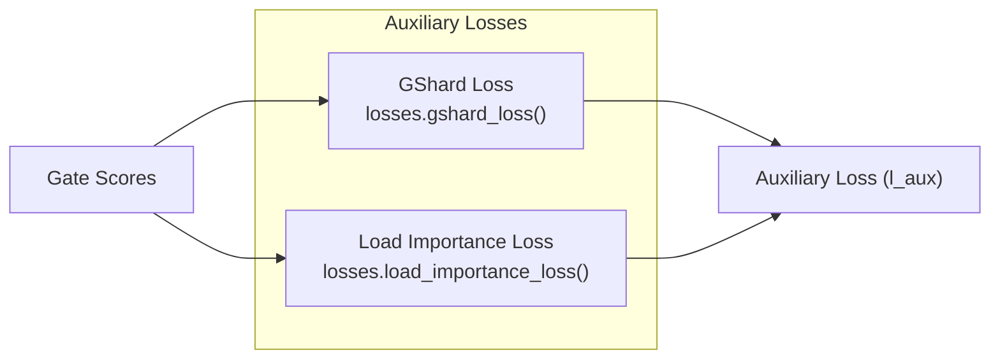

Sources: [tutel/impls/moe_layer.py:291-296]()

## Integration with PyTorch and Tutel Components

The MOE Layer is designed to integrate seamlessly with PyTorch and other Tutel components:

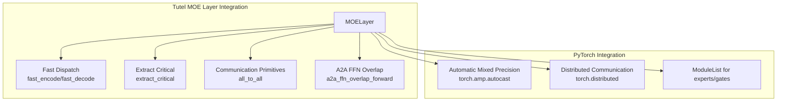

Sources: [tutel/impls/moe_layer.py:21-25](), [tutel/impls/moe_layer.py:314-359]()

## Usage Example

The MOELayer is typically used as a replacement for a standard feedforward network in transformer architectures. It accepts an input tensor and returns an output tensor of the same shape as the input (with potentially different dimensions along the feature axis, depending on the expert implementation).

Basic usage pattern:

1. Initialize the MOELayer with gate and expert configurations
2. Pass input tensors through the layer as part of a neural network
3. Optionally use the auxiliary loss (`l_aux`) for load balancing

The auxiliary loss is attached to the output tensor as `output.l_aux` and can be accessed for inclusion in the overall training loss.

Sources: [tutel/impls/moe_layer.py:255-363]()

## Conclusion

The MOE Layer is the cornerstone of Tutel's implementation of the Mixture of Experts pattern. It provides a highly optimized and configurable approach to expert-based computation, with support for distributed execution, various parallelism strategies, and performance optimizations. The layer's design allows it to scale efficiently to large-scale models and distributed training environments.

---

# Page: Fast Dispatch

# Fast Dispatch

<details>
<summary>Relevant source files</summary>

The following files were used as context for generating this wiki page:

- [tutel/impls/fast_dispatch.py](tutel/impls/fast_dispatch.py)

</details>


## Purpose and Scope

Fast Dispatch is a core component of the Tutel Mixture of Experts (MoE) implementation that handles efficient token routing between the input tensor and expert networks. This component is responsible for sending each token to its selected experts during the forward pass and gathering results during the backward pass. Fast Dispatch provides optimized implementations of the token routing mechanisms with support for various hardware platforms and data types.

For information about the gating mechanisms that determine which experts handle which tokens, see [Gates](#2.3). For the expert network implementations that process the routed tokens, see [Experts](#2.4).

## Architecture Overview

Fast Dispatch sits at the critical junction between gate networks and expert execution in the MoE architecture, acting as the "traffic controller" that efficiently routes tokens to their designated experts.

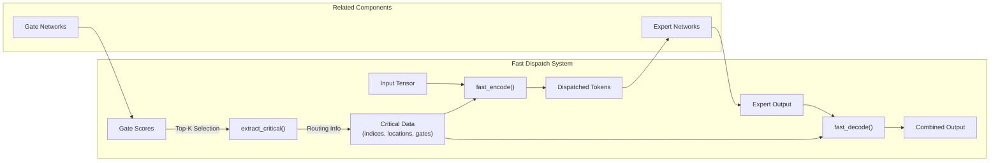

Sources: [tutel/impls/fast_dispatch.py:143-221]()

## Key Components

The Fast Dispatch system consists of several key components that work together to enable efficient token routing:

### TutelMoeFastDispatcher

The central class that manages the token routing process. It initializes and maintains the dispatch state and provides methods for token encoding (input to experts) and decoding (experts back to output).

```mermaid
classDiagram
    class TutelMoeFastDispatcher {
        +num_global_experts: int
        +capacity: int
        +model_dim: int
        +dtype: torch.dtype
        +aligned_dim: int
        +indices_: List[Tensor]
        +locations_: List[Tensor]
        +gates_: List[Tensor]
        +update(indices_, locations_, gates_, capacity, is_postscore)
        +encode(data): Tensor
        +decode(data): Tensor
    }
    
    class GatingEncoder {
        +forward(ctx, config, reshaped_input, *gates_): Tensor
        +backward(ctx, dispatched_input): Tuple[Tensor]
    }
    
    class GatingDecoder {
        +forward(ctx, config, expert_output, *gates_): Tensor
        +backward(ctx, combined_output): Tuple[Tensor]
    }
    
    TutelMoeFastDispatcher --> GatingEncoder: uses
    TutelMoeFastDispatcher --> GatingDecoder: uses
```

Sources: [tutel/impls/fast_dispatch.py:85-136]()

### Routing Information Extraction

The `extract_critical` function processes gate scores to produce the essential routing information needed by the dispatcher:

```
routing_info = (num_global_experts, indices_s, locations_s, gates_s, capacity, locations2)
```

Where:
- `indices_s`: Which expert should process each token
- `locations_s`: Where each token should be placed within each expert's buffer
- `gates_s`: The weight/importance of each expert for each token
- `capacity`: Maximum number of tokens per expert

Sources: [tutel/impls/fast_dispatch.py:143-204]()

## Token Routing Workflow

The Fast Dispatch token routing process consists of several distinct steps:

### 1. Critical Information Extraction

```mermaid
flowchart TB
    subgraph "extract_critical()"
        GateScores["Gate Scores"] --> TopK["Top-K Selection"]
        TopK --> TokenIndices["Token-to-Expert\nIndices"]
        TopK --> GateValues["Gate Values"]
        
        TokenIndices --> |"Compute token\npositions"| Locations["Token Locations"]
        
        GateScores --> |"Optional"| LossFunction["Auxiliary Loss\n(load balancing)"]
        
        TopK --> |"Compute required\ncapacity"| CapacityCalc["Capacity Calculation"]
    end
    
    GateScores -.-> |"Generated by"| GateNetwork["Gate Network"]
    
    TokenIndices --> RoutingInfo["Routing Information"]
    Locations --> RoutingInfo
    GateValues --> RoutingInfo
    CapacityCalc --> RoutingInfo
```

Sources: [tutel/impls/fast_dispatch.py:143-204]()

### 2. Token Encoding (Forward Pass)

The encoding process routes input tokens to their assigned experts based on the routing information:

```mermaid
flowchart TB
    subgraph "fast_encode()"
        Input["Input Tensor"] --> Dispatcher["TutelMoeFastDispatcher"]
        CriticalData["Routing Information"] --> Dispatcher
        
        Dispatcher --> |"via GatingEncoder"| DispatchedInput["Dispatched Input"]
    end
    
    DispatchedInput --> |"Sent to"| Experts["Expert Networks"]
```

Sources: [tutel/impls/fast_dispatch.py:209-214]()

### 3. Token Decoding (Backward Pass)

The decoding process combines the outputs from experts back into the original sequence order:

```mermaid
flowchart TB
    subgraph "fast_decode()"
        ExpertOutput["Expert Output"] --> Dispatcher["TutelMoeFastDispatcher"]
        CriticalData["Routing Information"] --> Dispatcher
        
        Dispatcher --> |"via GatingDecoder"| CombinedOutput["Combined Output"]
    end
    
    Experts["Expert Networks"] --> |"Produces"| ExpertOutput
```

Sources: [tutel/impls/fast_dispatch.py:216-221]()

## Implementation Details

### Custom CUDA Kernels

Fast Dispatch relies on optimized CUDA/ROCm kernels for high-performance token routing. These kernels are dynamically compiled and cached for efficient execution:

```mermaid
flowchart TB
    subgraph "Kernel Management"
        FastDispatcher["TutelMoeFastDispatcher"] --> |"Uses"| JITKernels["JIT Compiled Kernels"]
        
        JITKernels --> Forward["func_fwd\nroute tokens to experts"]
        JITKernels --> BackwardData["func_bwd_data\nbackprop through token routing"]
        JITKernels --> BackwardGate["func_bwd_gate\nbackprop gate gradients"]
        
        JITKernels --> |"Cached in"| KernelPool["kernel_pool"]
    end
```

Sources: [tutel/impls/fast_dispatch.py:109-116]()

### Autograd Functions

The `GatingEncoder` and `GatingDecoder` classes are custom PyTorch autograd functions that enable efficient forward and backward pass operations with proper gradient tracking:

| Function | Forward Operation | Backward Operation |
|----------|------------------|-------------------|
| `GatingEncoder` | Routes tokens from input to experts based on routing info | Computes gradients for input tensor and gate values |
| `GatingDecoder` | Combines expert outputs back to original sequence | Computes gradients for expert outputs and gate values |

Sources: [tutel/impls/fast_dispatch.py:16-82]()

## Data Flow Details

The following diagram shows the detailed data flow through the Fast Dispatch system, highlighting how tokens are routed from input to experts and back:

```mermaid
flowchart TB
    Input["Input Tensor\n[batch_size, seq_len, hidden_dim]"] --> Reshape["Reshape\n[batch_size*seq_len, hidden_dim]"]
    
    Gates["Gate Scores\n[batch_size*seq_len, num_experts]"] --> TopK["Top-K Selection"]
    
    TopK --> Indices["Expert Indices\nfor each token"]
    TopK --> GateValues["Gate Values\nfor selected experts"]
    
    Indices --> |"Compute token\npositions"| Locations["Token Locations\nwithin expert buffers"]
    
    Reshape --> GatingEncoder["GatingEncoder"]
    Indices --> GatingEncoder
    Locations --> GatingEncoder
    GateValues --> GatingEncoder
    
    GatingEncoder --> DispatchedTokens["Dispatched Tokens\n[num_experts*capacity, hidden_dim]"]
    
    DispatchedTokens --> |"Process by experts"| ExpertOutput["Expert Output\n[num_experts*capacity, hidden_dim]"]
    
    ExpertOutput --> GatingDecoder["GatingDecoder"]
    Indices --> GatingDecoder
    Locations --> GatingDecoder
    GateValues --> GatingDecoder
    
    GatingDecoder --> CombinedOutput["Combined Output\n[batch_size*seq_len, hidden_dim]"]
    
    CombinedOutput --> Reshape2["Reshape Back\n[batch_size, seq_len, hidden_dim]"]
```

Sources: [tutel/impls/fast_dispatch.py:16-82](), [tutel/impls/fast_dispatch.py:209-221]()

## Performance Considerations

### Dispatch Type Handling

Fast Dispatch automatically handles different data types and adjusts the internal processing accordingly:

- For HIP (ROCm) devices or non-float16 inputs, it uses float32 internally
- For float16 inputs on CUDA devices, it optimizes for half-precision
- The aligned_dim calculation ensures proper memory alignment for different data types

Sources: [tutel/impls/fast_dispatch.py:95-98]()

### Capacity Management

The system provides flexible capacity management to balance routing efficiency and memory usage:

- `capacity_factor > 0`: Capacity is calculated as a factor of the average number of tokens per expert
- `capacity_factor < 0`: Capacity is determined dynamically based on actual token distribution, but capped
- `capacity_factor = 0`: Capacity is set to the maximum number of tokens routed to any expert
- Additional alignment adjustment to ensure memory alignment requirements are met

Sources: [tutel/impls/fast_dispatch.py:189-199]()

### Batch Prioritized Routing

An optional routing strategy that prioritizes tokens based on their importance scores:

- When enabled, tokens with lower maximum gate scores are processed first
- This can help balance the load across experts and improve training stability
- Implemented via the `compute_sorted_location` function

Sources: [tutel/impls/fast_dispatch.py:138-141](), [tutel/impls/fast_dispatch.py:155-159]()

## Integration with Other Components

Fast Dispatch integrates with other components of the Tutel MoE system:

```mermaid
flowchart TB
    subgraph "Tutel MoE System"
        Gates["Gate Networks\ntutel/gates"] --> |"Gate Scores"| FastDispatch["Fast Dispatch\ntutel/impls/fast_dispatch.py"]
        
        FastDispatch --> |"Dispatched Tokens"| Experts["Expert Networks\ntutel/experts"]
        
        Experts --> |"Expert Output"| FastDispatch
        
        FastDispatch --> |"Combined Output"| MOELayer["MOE Layer\ntutel/impls/moe_layer.py"]
        
        FastDispatch --> |"Uses"| JITCompiler["JIT Compiler\ntutel/impls/jit_compiler.py"]
        FastDispatch --> |"Uses"| JITKernels["JIT Kernels\ntutel/jit_kernels/"]
    end
```

Sources: [tutel/impls/fast_dispatch.py:10-14]()

## Common Usage Patterns

Fast Dispatch is typically used within the MOE Layer implementation, but can also be used directly for custom token routing implementations:

```python
# Extract critical routing information
routing_info, aux_loss = extract_critical(
    scores=gate_scores,         # Gate scores from gate network
    top_k=top_k,                # Number of experts per token
    capacity_factor=1.5,        # Buffer factor for expert capacity
    batch_prioritized_routing=True  # Whether to prioritize by importance
)

# Route tokens to experts
dispatched_input = fast_encode(input_tensor, routing_info)

# Each expert processes its assigned tokens
expert_output = process_by_experts(dispatched_input)

# Combine expert outputs back to original sequence
combined_output = fast_decode(expert_output, routing_info)
```

Sources: [tutel/impls/fast_dispatch.py:143-221]()

## Summary

Fast Dispatch is a critical component in the Tutel MoE architecture that handles the efficient routing of tokens between the input and expert networks. It provides optimized implementations for token dispatching with support for various hardware and data types. The component includes features for efficient token routing, load balancing, capacity management, and gradient computation.

---

# Page: Gates

# Gates

<details>
<summary>Relevant source files</summary>

The following files were used as context for generating this wiki page:

- [tutel/experts/__init__.py](tutel/experts/__init__.py)
- [tutel/gates/__init__.py](tutel/gates/__init__.py)
- [tutel/gates/cosine_top.py](tutel/gates/cosine_top.py)
- [tutel/gates/top.py](tutel/gates/top.py)
- [tutel/impls/losses.py](tutel/impls/losses.py)

</details>


## Purpose and Scope

This document details the gating mechanisms in Tutel's Mixture of Experts (MoE) implementation. Gates are responsible for routing input tokens to the appropriate experts, functioning as the "router" that determines which expert(s) should process each token. This page covers the implemented gating algorithms, their parameters, and associated load balancing losses. For information about the experts themselves, see [Experts](#2.4), and for details on how gates integrate with the MoE layer, see [MOE Layer](#2.1).

## Overview of Gates in Tutel

Gates in Mixture of Experts models serve as the routers that select which experts will process each input token. Typically, they compute a score for each expert based on the input, select the top-K experts with the highest scores, and route the input to those experts with appropriate weighting.

```mermaid
flowchart LR
    subgraph "Gate Mechanism"
        Input["Input Tokens"] --> GateNetwork["Gate Network"]
        GateNetwork --> Scores["Expert Scores"]
        Scores --> TopK["Top-K Selection"]
        TopK --> Dispatch["Dispatch to Experts"]
        
        Scores --> AuxLoss["Auxiliary Losses<br>Load Balancing"]
    end
    
    Dispatch --> E1["Expert 1"]
    Dispatch --> E2["Expert 2"]
    Dispatch --> E3["Expert N"]
    
    E1 --> Combine["Combine Results"]
    E2 --> Combine
    E3 --> Combine
    Combine --> Output["Output"]
```

Sources: [tutel/gates/top.py](), [tutel/gates/cosine_top.py](), [tutel/impls/losses.py]()

## Gate Types

Tutel implements multiple gating mechanisms to accommodate different routing strategies, each with its own characteristics and trade-offs.

### LinearTopKGate

The `LinearTopKGate` is the simplest and most commonly used gating mechanism. It uses a linear projection to calculate scores for each expert.

```mermaid
flowchart LR
    Input["Input x<br>(B, model_dim)"] --> Linear["Linear Layer<br>wg: model_dim → num_experts"]
    Linear --> Scores["Expert Scores<br>(B, num_experts)"]
    Scores --> TopK["Select Top-K<br>Experts"]
    TopK --> Routing["Routing Information<br>- Expert indices<br>- Routing weights"]
```

**Key Features:**
- Simple linear projection from input dimension to the number of experts
- Optional floating-point precision control via `fp32_gate` parameter
- Returns raw logits which are later processed for top-K selection

Sources: [tutel/gates/top.py:6-25]()

### CosineTopKGate

The `CosineTopKGate` uses cosine similarity between projected input features and learned expert embeddings to determine routing scores.

```mermaid
flowchart LR
    Input["Input x<br>(B, model_dim)"] --> Projector["Cosine Projector<br>model_dim → proj_dim"]
    Projector --> Normalize1["Normalize<br>L2 Norm"]
    
    SimMatrix["Similarity Matrix<br>(proj_dim, num_experts)"] --> Normalize2["Normalize<br>L2 Norm"]
    
    Normalize1 --> MatMul["Matrix Multiply"]
    Normalize2 --> MatMul
    
    MatMul --> Scale["Scale by<br>Temperature"]
    Scale --> Scores["Expert Scores<br>(B, num_experts)"]
    Scores --> TopK["Select Top-K<br>Experts"]
    TopK --> Routing["Routing Information"]
```

**Key Features:**
- Projects inputs to a lower-dimensional space (default: 256)
- Uses cosine similarity rather than direct linear mapping
- Includes a learnable temperature parameter to control the sharpness of the distribution
- Normalizes both the projected input and expert embeddings

Sources: [tutel/gates/cosine_top.py:7-37]()

## Gate Parameters and Configuration

Both gate types share common parameters while having some specific configurations.

| Parameter | Description | Applies To |
|-----------|-------------|------------|
| `model_dim` | Dimension of input features | Both |
| `num_global_experts` | Total number of experts | Both |
| `k` | Number of experts to route each token to | Both |
| `fp32_gate` | Whether to compute gate logits in FP32 | Both |
| `proj_dim` | Dimension for projecting input features | CosineTopKGate |
| `init_t` | Initial temperature value (1/init_t) | CosineTopKGate |
| `capacity_factor` | Scaling factor for expert capacity | Both (optional) |
| `gate_noise` | Noise added to scores for load balancing | Both (optional) |

Sources: [tutel/gates/top.py:7-14](), [tutel/gates/cosine_top.py:8-16]()

## Gate Integration in MOE Layer

Gates are instantiated and used within the MOE layer. The typical flow of a gate operation in the MOE layer is:

```mermaid
sequenceDiagram
    participant Input as "Input Tensor"
    participant Gate as "Gate Network"
    participant Router as "Router/Dispatcher"
    participant Experts as "Expert Networks"
    participant Output as "Output Tensor"
    
    Input->>Gate: Forward Pass
    Gate->>Gate: Compute Expert Scores
    Gate->>Router: Return Logits/Scores
    Router->>Router: Compute Top-K Experts
    Router->>Router: Calculate Load Balance Loss
    Router->>Experts: Dispatch Tokens to Experts
    Experts->>Output: Combine Expert Outputs
```

Sources: [tutel/gates/top.py:20-22](), [tutel/gates/cosine_top.py:22-34]()

## Load Balancing and Auxiliary Losses

One of the challenges in MoE models is ensuring balanced expert utilization. Tutel implements two types of auxiliary losses to encourage balanced routing:

### GShard Loss

The GShard loss encourages uniform assignment of tokens to experts.

```python
# Simplified pseudocode for GShard loss
def gshard_loss(scores, top_expert_ids):
    # Create one-hot mask for selected experts
    mask = one_hot(top_expert_ids, num_experts) * (num_experts / batch_size)
    
    # Compute mean importance per expert
    mean_importance = sum(scores, dim=0)  # Sum over batch
    
    # Compute expert assignment counts
    expert_counts = sum(mask, dim=0)  # Sum over batch
    
    # The loss is the dot product of importance and counts, normalized
    loss = sum(mean_importance * expert_counts) / batch_size
    return loss
```

Sources: [tutel/impls/losses.py:12-19]()

### Load Importance Loss

This loss balances both expert importance (how often they're selected) and load (how much computation they perform).

```mermaid
flowchart TD
    subgraph "Load Importance Loss"
        Scores["Expert Scores<br>Without Noise"] --> Split

        Split --> ImpLoss["Importance Loss<br>Variance of expert importance"]
        Split --> LoadLoss["Load Loss<br>Variance of expert load"]
        
        ImpLoss --> Combine["Average"]
        LoadLoss --> Combine
        Combine --> FinalLoss["Final Loss"]
    end
```

Sources: [tutel/impls/losses.py:21-43]()

## Comparison of Gate Mechanisms

| Feature | LinearTopKGate | CosineTopKGate |
|---------|----------------|----------------|
| Computation Complexity | Lower | Higher |
| Parameters | Fewer | More |
| Similarity Measure | Direct Linear Projection | Cosine Similarity |
| Temperature Scaling | No | Yes |
| Feature Normalization | No | Yes |
| Use Cases | General Purpose | When input magnitudes vary |

Both gates serve the same purpose but have different characteristics that make them suitable for different scenarios. LinearTopKGate is simpler and computationally more efficient, while CosineTopKGate provides potentially better routing when dealing with inputs of varying magnitudes due to its normalization properties.

Sources: [tutel/gates/top.py](), [tutel/gates/cosine_top.py]()

## Gate and Expert Selection Process

The gate's output (logits) is used to select experts through the following process:

```mermaid
flowchart LR
    Input["Input Tensor<br>(B, model_dim)"] --> Gate["Gate Network"]
    Gate --> Logits["Expert Logits<br>(B, num_experts)"]
    
    subgraph "Expert Selection"
        Logits --> AddNoise["Add Noise<br>(Optional)"]
        AddNoise --> TopK["Select Top-K<br>Values & Indices"]
        TopK --> Normalize["Normalize<br>Weights (Softmax)"]
        Normalize --> Dispatch["Create Dispatch<br>Tensors"]
    end
    
    Logits --> AuxLoss["Compute<br>Auxiliary Loss"]
```

The expert selection and routing process:

1. The gate computes logits (scores) for each expert
2. Optional noise is added to scores for better load balancing
3. Top-K experts are selected for each token
4. The weights for these experts are normalized (typically with softmax)
5. Dispatch tensors are created to route tokens to their assigned experts
6. Auxiliary losses are computed to encourage balanced routing

Sources: [tutel/gates/top.py](), [tutel/gates/cosine_top.py](), [tutel/impls/losses.py]()

## Summary

Gates are a crucial component of the Mixture of Experts architecture, determining which experts process each token. Tutel provides multiple gating mechanisms with different characteristics, allowing users to choose the most appropriate one for their specific needs. The gating process is complemented by auxiliary loss functions that help ensure balanced expert utilization, which is essential for efficient computation in MoE models.

---

# Page: Experts

# Experts

<details>
<summary>Relevant source files</summary>

The following files were used as context for generating this wiki page:

- [tutel/examples/helloworld_custom_expert_sharded.py](tutel/examples/helloworld_custom_expert_sharded.py)
- [tutel/examples/helloworld_switch.py](tutel/examples/helloworld_switch.py)
- [tutel/experts/ffn.py](tutel/experts/ffn.py)
- [tutel/experts/llama_ffn.py](tutel/experts/llama_ffn.py)

</details>


## Purpose and Scope
This document describes the expert networks implementation in Tutel's Mixture of Experts (MoE) architecture. Expert networks are specialized neural network modules that process the tokens routed to them by the gate mechanism. In the MoE paradigm, each expert specializes in a different part of the input space, and the gate determines which expert should process which input tokens. For information about the gating mechanisms that route tokens to experts, see [Gates](#2.3). For information about the overall MoE layer implementation, see [MOE Layer](#2.1).

## Expert Implementations

Tutel provides several built-in expert network implementations, with the two main ones being:

1. **FusedExpertsNetwork** - The standard Feed-Forward Network (FFN) expert
2. **LlamaFFNNetwork** - A specialized implementation for LLaMA-style models

### FusedExpertsNetwork

The `FusedExpertsNetwork` is the default expert implementation, consisting of a two-layer feed-forward network with customizable activation functions and optional bias terms.

```mermaid
flowchart LR
    subgraph "FusedExpertsNetwork"
        Input["Input (x)"] --> FC1["FC1 Layer\nbatched_fc1_w"]
        FC1 --> Add1["Add Bias\n(if batched_fc1_bias != None)"]
        Add1 --> Activation["Activation Function\nself.activation_fn"]
        Activation --> FC2["FC2 Layer\nbatched_fc2_w"]
        FC2 --> Add2["Add Bias\n(if batched_fc2_bias != None)"]
        Add2 --> Output["Output (y)"]
    end
```

Sources: [tutel/experts/ffn.py:7-121]()

Key features of `FusedExpertsNetwork`:
- Supports parameter sharding across devices
- Handles both single-device and multi-device execution
- Includes optimizations for sparse computation (megablocks)
- Supports custom activation functions
- Configurable hidden size and output dimensions
- Optional bias terms

### LlamaFFNNetwork

The `LlamaFFNNetwork` implements the specific FFN architecture used in LLaMA models, which involves a gated activation pattern.

```mermaid
flowchart LR
    subgraph "LlamaFFNNetwork"
        Input["Input (x)"] --> Split["Split paths"]
        Split --> FC1["FC1 Layer\nW_fc1"]
        Split --> FC2["FC2 Layer\nW_fc2"]
        FC1 --> Activation["Activation\nactivation_fn"]
        Activation --> Multiply["Element-wise\nMultiplication"]
        FC2 --> Multiply
        Multiply --> FC3["FC3 Layer\nW_fc3"]
        FC3 --> Output["Output (y)"]
    end
```

Sources: [tutel/experts/llama_ffn.py:7-48]()

Key features of `LlamaFFNNetwork`:
- Implements a gated FFN architecture specific to LLaMA models
- Uses SiLU activation by default
- Supports parameter sharding like the standard FFN

## Parameter Sharding Architecture

Expert parameter sharding is a key optimization in Tutel that enables efficient distributed execution of MoE models.

```mermaid
flowchart TD
    subgraph "Parameter Sharding"
        Init["Parameter Initialization"] --> Shard["Divide Parameters\nacross devices"]
        
        subgraph "Forward Pass"
            Input["Input Tensor"] --> Gather["Gather Sharded Parameters\n(Zero Gather)"]
            Gather --> Compute["Compute Forward Pass\nwith Complete Parameters"]
            Compute --> Output["Return Output"]
        end
    end
```

Sources: [tutel/experts/ffn.py:83-110](), [tutel/experts/llama_ffn.py:9-16]()

The sharding process:
1. During initialization, parameters are divided into chunks across devices
2. In the forward pass, the sharded parameters are gathered to form complete matrices
3. Computation is performed using the complete matrices
4. Results are returned to the MoE layer for further processing

## Expert Execution in MoE Context

To understand how experts fit into the overall MoE execution, here's the data flow during the forward pass:

```mermaid
flowchart LR
    subgraph "MoE Layer"
        Gate["Gate Network"] --> Route["Token Routing"]
        Route --> Dispatch["Dispatch Tokens\nto Experts"]
        
        subgraph "Expert Execution"
            Dispatch --> Expert1["Expert 1\nFusedExpertsNetwork"]
            Dispatch --> Expert2["Expert 2\nFusedExpertsNetwork"]
            Dispatch --> ExpertN["Expert N\nFusedExpertsNetwork"]
            
            Expert1 --> Combine["Combine Results"]
            Expert2 --> Combine
            ExpertN --> Combine
        end
        
        Combine --> Output["Return Output"]
    end
```

Sources: [tutel/experts/ffn.py:57-121]()

During the MoE forward pass:
1. The gate network determines which experts should process each token
2. Tokens are dispatched to assigned experts using the routing information
3. Each expert processes its assigned tokens independently
4. Results are combined according to the original routing decisions

## Custom Expert Implementation

Tutel supports custom expert implementations through a flexible interface. Custom experts must:
1. Inherit from `torch.nn.Module`
2. Implement `__init__` method with parameters matching the expected signature
3. Implement `forward` method that accepts input tensor and context object

Here's an example of a simple custom expert from the example code:

```mermaid
flowchart TD
    subgraph "CustomExpertDemo"
        Init["Initialize Parameters\nW matrix"] --> Forward["Forward Method"]
        Forward --> GetParams["Gather Sharded Parameters"]
        GetParams --> Matmul["Matrix Multiplication\ny = torch.matmul(x, W)"]
        Matmul --> Activate["Apply Activation\n(if specified)"]
        Activate --> Return["Return Output"]
    end
```

Sources: [tutel/examples/helloworld_custom_expert_sharded.py:63-90]()

To use a custom expert with the MoE layer:

```python
# Configure MoE layer with custom expert
moe_layer = tutel_moe.moe_layer(
    gate_type = {'type': 'top', 'k': top_value, 'fp32_gate': args.fp32_gate},
    experts = {'type': 'custom', 'module': CustomExpertDemo, 'num_experts_per_device': num_local_experts, 'my_config': None},
    model_dim = model_dim,
    ...
)
```

## Special Optimizations

### Megablocks Optimization

The `FusedExpertsNetwork` includes an optimization based on the Megablocks paper (https://arxiv.org/pdf/2211.15841.pdf) that benefits decoder inference on single-GPU when there are multiple local experts. This optimizes sparse computation by using specialized sparse matrix multiplication kernels.

```mermaid
flowchart LR
    subgraph "Megablocks Optimization"
        Check["Check if ctx.megablocks_size > 0"] --> |"Yes"| SparseOp["Use sparse_bmm_infer operation"]
        Check --> |"No"| StandardOp["Use standard matrix multiplication"]
        
        SparseOp --> SparseBMM1["sparse_bmm_infer\n(x, batched_fc1_w)"]
        SparseBMM1 --> Activate["Apply activation"]
        Activate --> SparseBMM2["sparse_bmm_infer\n(y, batched_fc2_w)"]
    end
```

Sources: [tutel/experts/ffn.py:68-81]()

### Adaptive Degree

When running in a distributed setting, the `FusedExpertsNetwork` supports an "adaptive degree" parameter that controls how parameters are sharded and gathered. This allows Tutel to balance computation and communication based on the execution environment.

## Integration with MoE Layer

To use the built-in expert networks in an MoE layer:

```python
# Configure MoE layer with standard FFN experts
moe_layer = tutel_moe.moe_layer(
    gate_type = {'type': 'top', 'k': top_value},
    experts = {
        'type': 'ffn', 
        'num_experts_per_device': num_local_experts, 
        'hidden_size_per_expert': hidden_size, 
        'activation_fn': lambda x: F.relu(x)
    },
    model_dim = model_dim,
    ...
)
```

Sources: [tutel/examples/helloworld_switch.py:68-76]()

## Performance Considerations

When using expert networks in Tutel, consider the following factors that impact performance:

| Factor | Impact on Performance |
|--------|----------------------|
| Number of experts | More experts increase model capacity but require more memory |
| Hidden size | Larger hidden sizes provide more capacity but increase computation |
| Sharded count | Higher sharding can reduce memory per device but increases communication |
| Activation function | Choice affects both computation speed and model performance |
| Expert type | Different expert implementations have different computational profiles |
| Adaptive degree | Controls trade-off between computation and communication |

---

# Page: System Infrastructure

# System Infrastructure

<details>
<summary>Relevant source files</summary>

The following files were used as context for generating this wiki page:

- [setup.py](setup.py)
- [tutel/custom/custom_kernel.cpp](tutel/custom/custom_kernel.cpp)
- [tutel/system.py](tutel/system.py)

</details>


This page documents the technical infrastructure that powers Tutel's Mixture-of-Experts (MoE) implementation. The system infrastructure provides the foundation for high-performance execution across different hardware platforms, enabling efficient distributed training and inference of MoE models. For information about the MoE layer implementation itself, see [MOE Layer](#2.1), and for details on communication primitives, see [Communication Primitives](#3.3).

## Core Components Overview

The Tutel system infrastructure consists of several interconnected components that work together to provide a robust foundation for MoE operations.

**System Infrastructure Architecture**
```mermaid
graph TB
    subgraph "Tutel System Infrastructure"
        CustomKernel["Custom CUDA/ROCm Kernels<br>tutel_custom_kernel"] --> JIT["JIT Compilation System<br>jit::inject_source, jit::jit_activate"]
        CustomKernel --> NCCLComm["NCCL Communication<br>init_nccl, nccl_all_to_all_2d_async"]
        
        SysUtils["System Utilities<br>tutel.system"] --> Affinity["NUMA Affinity<br>init_affinity_at_program_beginning"]
        SysUtils --> ParallelInit["Parallel Initialization<br>init_data_model_parallel"]
        SysUtils --> CacheUtil["Caching Utilities<br>LocalCache"]
        
        BuildSys["Build System<br>setup.py"] --> PlatformDet["Platform Detection<br>torch.version.cuda, IS_HIP_EXTENSION"]
        BuildSys --> ExtCompile["Extension Compilation<br>CUDAExtension, BuildExtension"]
    end
    
    CustomKernel -.-> BuildSys
    SysUtils -.-> CustomKernel
```

Sources: [tutel/custom/custom_kernel.cpp:1-861](), [tutel/system.py:1-101](), [setup.py:1-153]()

## Build and Installation System

Tutel's build system is designed to adapt to different hardware configurations, automatically detecting the presence of CUDA/ROCm and NCCL/RCCL to optimize compilation for the target platform.

**Build System Flow**
```mermaid
flowchart TD
    Start["setup.py install"] --> DetectGPU{"torch.version.cuda or<br>torch.version.hip?"}
    
    DetectGPU -->|"Yes"| DetectNCCL{"NO_NCCL=0?"}
    DetectGPU -->|"No"| CPUOnly["Install CPU-only version"]
    
    DetectNCCL -->|"Yes"| CudaNCCL["Install with CUDA+NCCL<br>USE_GPU, USE_NCCL flags"]
    DetectNCCL -->|"No"| CudaOnly["Install with CUDA only<br>USE_GPU flag"]
    
    CudaNCCL --> BuildExt["BuildExtension with<br>libraries=['cuda','nvrtc','nccl']"]
    CudaOnly --> BuildExt2["BuildExtension with<br>libraries=['cuda','nvrtc']"]
    CPUOnly --> BuildExt3["BuildExtension with<br>CppExtension"]
    
    BuildExt --> CompileCustomKernel["Compile tutel_custom_kernel.cpp"]
    BuildExt2 --> CompileCustomKernel
    BuildExt3 --> CompileCustomKernel
    
    CompileCustomKernel --> InstallPackage["Install Tutel package"]
```

The build process follows these steps:

1. Detects hardware capabilities (CUDA/ROCm availability)
2. Determines NCCL/RCCL availability
3. Selects appropriate compilation options (`CUDAExtension` or `CppExtension`)
4. Compiles the custom kernel with necessary flags and dependencies
5. Installs the Tutel package with optimized extensions

The `setup.py` script dynamically selects compilation flags based on the detected capabilities:

```python
if torch.version.cuda or torch.version.hip:
    if int(os.environ.get('NO_NCCL', 0)) == 0:
        # Install with NCCL support
        install(use_cuda=True, use_nccl=True)
    else:
        # Install without NCCL
        install(use_cuda=True, use_nccl=False)
else:
    # CPU-only installation
    install(use_cuda=False, use_nccl=False)
```

Sources: [setup.py:58-152]()

## JIT Compilation System

Tutel employs a Just-In-Time (JIT) compilation system that dynamically generates and compiles CUDA/ROCm kernels at runtime, enabling optimized execution without pre-compiling multiple variants.

**JIT Compilation Flow**
```mermaid
sequenceDiagram
    participant App as "Application"
    participant JIT as "jit::inject_source"
    participant Compiler as "NVCC/HIPCC/NVRTC"
    participant Cache as "ModuleConfig"
    participant GPU as "GPU Execution"
    
    App->>JIT: Submit kernel source code
    JIT->>JIT: Extract thread/block dimensions
    JIT->>JIT: Generate unique kernel ID
    JIT->>Cache: Store in _gms vector
    
    App->>GPU: Call jit_execute with kernel ID
    GPU->>Cache: Look up kernel in _gms
    
    alt Kernel not compiled for device
        Cache->>GPU: Get device compute capability
        GPU->>Compiler: Compile with NVRTC or nvcc_compile
        Compiler->>Cache: Store CUfunction in hFunc vector
    end
    
    Cache->>GPU: Provide compiled kernel
    GPU->>GPU: Launch kernel with cuLaunchKernel
```

The JIT compilation system has three key components:

1. **Source Injection and Parsing** (`jit::inject_source`): Processes source code to extract thread/block dimensions and register the kernel.
2. **Kernel Activation** (`jit::jit_activate`): Compiles the kernel for a specific device if not already compiled.
3. **Kernel Execution** (`jit::jit_execute`): Prepares arguments and launches the compiled kernel.

The `ModuleConfig` struct maintains state for each kernel, including:
- Compiled function handles per device (`hFunc`)
- Block and thread dimensions
- Source code and function name

This system supports both NVRTC (runtime compilation) and NVCC/HIPCC (command-line compilation) paths, with automatic fallback mechanisms.

Sources: [tutel/custom/custom_kernel.cpp:54-286]()

## NCCL Communication Framework

Tutel's distributed communication framework leverages NCCL (NVIDIA Collective Communication Library) or RCCL (ROCm Collective Communication Library) to provide high-performance collective operations for distributed MoE training.

**NCCL Communication Infrastructure**
```mermaid
graph TB
    subgraph "NCCL Communication Framework"
        Init["init_nccl<br>init_shared_nccl"] --> UniqueID["get_nccl_unique_id"]
        Init --> CommCreate["ncclCommInitRank"]
        
        Streams["Stream Management<br>get_nccl_stream, get_default_stream"] --> Events["CUDA Events<br>g_cuda_events"]
        
        AllToAll["All-to-All Operations"] --> A2AScatter["nccl_all_to_all_scatter_async"]
        AllToAll --> A2AGather["nccl_all_to_all_gather_async"]
        AllToAll --> A2A2D["nccl_all_to_all_2d_async"]
        
        VarSize["Variable-Size Collectives"] --> BatchA2AV["batch_all_to_all_v"]
        VarSize --> BatchAGV["batch_all_gather_v"]
        
        SyncPrims["Synchronization Primitives"] --> StreamRelease["*_stream_release"]
        SyncPrims --> StreamAcquire["*_stream_acquire"]
    end
    
    Init --> Streams
    Streams --> AllToAll
    Streams --> VarSize
    Streams --> SyncPrims
```

### NCCL Initialization

NCCL communication begins with initialization:

1. Generate a unique ID (`get_nccl_unique_id`)
2. Initialize NCCL communicators with `ncclCommInitRank`
3. Set up stream and event infrastructure for asynchronous operations

Tutel supports both global world communicators (`init_nccl`) and shared communicators (`init_shared_nccl`) for different collective operation scopes.

### Stream Management

Efficient GPU operations require careful management of execution streams:

- `get_default_stream()`: Returns the default CUDA stream
- `get_nccl_stream()`: Returns a dedicated stream for NCCL operations
- CUDA events (`g_cuda_events`) provide synchronization points between streams

### All-to-All Communication Optimizations

A critical aspect of MoE performance is the All-to-All communication pattern for token routing. Tutel implements multiple optimized variants:

1. **Scatter-based All-to-All** (`nccl_all_to_all_scatter_async`): 
   - Divides data into slices and scatters them asynchronously
   - Supports pipelining via event-based synchronization
   
2. **Gather-based All-to-All** (`nccl_all_to_all_gather_async`):
   - Inverse of scatter-based operation
   - Efficiently aggregates partial results
   
3. **2D All-to-All** (`nccl_all_to_all_2d_async`):
   - Hierarchical approach for multi-node, multi-GPU setups
   - Optimizes communication by first performing intra-node All-to-All, then inter-node

The 2D All-to-All significantly reduces communication overhead for multi-node scenarios by leveraging the hierarchical nature of distributed systems.

Sources: [tutel/custom/custom_kernel.cpp:334-784]()

## Data-Model Parallelism

Tutel provides an infrastructure for managing data parallelism and model parallelism in distributed training scenarios through the `init_data_model_parallel` function in the system module.

**Data-Model Parallelism Architecture**
```mermaid
graph TB
    subgraph "Data-Model Parallelism"
        InitFunc["init_data_model_parallel"] --> CreateGroups["create_groups_from_world"]
        InitFunc --> RankAssign["Assign data_rank and model_rank"]
        
        CreateGroups --> DataParallel["Data Parallel Group"]
        CreateGroups --> ModelParallel["Model Parallel Group"]
        
        RankAssign --> LocalDevice["local_device setup"]
        RankAssign --> GlobalRank["global_rank assignment"]
    end
    
    subgraph "Process Group Usage"
        DataParallel --> AllReduce["AllReduce for gradients"]
        ModelParallel --> AllToAll["All-to-All for MoE routing"]
    end
```

The parallelism system provides:

1. **Process Group Creation**: Creates process groups for both data and model parallelism
2. **Rank Assignment**: Assigns appropriate ranks within each parallel dimension
3. **Device Mapping**: Associates processes with the correct GPU devices
4. **Clean Shutdown**: Ensures proper process group destruction on exit

This infrastructure enables MoE models to efficiently scale across multiple nodes and GPUs by optimizing both data and model distribution.

Sources: [tutel/system.py:27-47]()

## System Utilities

### NUMA Affinity Management

For multi-socket systems, Tutel provides NUMA affinity management to ensure optimal hardware utilization:

```python
def init_affinity_at_program_beginning():
    # ...
    group_rank = int(os.environ.get('LOCAL_RANK', '0'))
    nodes = sorted([int(x[4:]) for x in os.listdir('/sys/devices/system/node') if re.match('node[0-9]+', x)])
    cpus = [sorted([int(x[3:]) for x in os.listdir('/sys/devices/system/node/node%d' % node_id) if re.match('cpu[0-9]+', x)]) for node_id in nodes]
    sel_node = (group_rank // numa_type) % len(nodes)
    os.sched_setaffinity(0, cpus[sel_node])
    # ...
```

This function:
1. Detects available NUMA nodes
2. Identifies CPUs associated with each NUMA node
3. Assigns processes to specific NUMA nodes based on their local rank
4. Sets CPU affinity to ensure processes use the correct CPU cores

### Performance Measurement

The system module includes utilities for performance measurement:

- `record_time()`: Records timestamps with appropriate CUDA synchronization
- `perform()`: Benchmarks functions with statistical reporting

### Local Cache

The `LocalCache` class provides a simple key-value caching mechanism:

```python
class LocalCache:
    _CACHE = dict()
    
    @staticmethod
    def reset():
        LocalCache._CACHE = dict()
        
    @staticmethod
    def set(key, val):
        LocalCache._CACHE[key] = val
        
    @staticmethod
    def get(key=None):
        if key not in LocalCache._CACHE:
            return [LocalCache._CACHE[x] for x in LocalCache._CACHE]
        return LocalCache._CACHE[key]
```

This cache is used throughout Tutel to store and retrieve frequently accessed data and configuration information.

Sources: [tutel/system.py:10-100]()

## Custom CUDA Kernels

Beyond the JIT compilation system, Tutel includes several specialized CUDA kernels optimized for MoE operations:

1. **Fast Cumulative Sum** (`warp_cumsum`): Optimized parallel implementation of cumulative sum operations
2. **Sparse Batch Matrix Multiplication** (`warp_sparse_bmm_infer`): Efficient sparse matrix operations for MoE inference
3. **Type Conversion Operations**:
   - `warp_to_float32`: Converts tensors to FP32 with scaling
   - `warp_to_bfloat16`: Converts tensors to BF16 with scaling
4. **DeepSeek-Specific Operations**:
   - `warp_gemm_nt_bf16xfp8_block_scal`: Optimized matrix multiplication for mixed precision
   - `warp_rmsnorm_bf16`: RMSNorm operation with BF16 support
   - `warp_deepseek_sigmoid_top_8_static_v2`: Specialized gating operation

These kernels provide highly optimized implementations for critical operations in MoE models, enabling efficient execution on GPU hardware.

Sources: [tutel/custom/custom_kernel.cpp:863-1535]()

## Hardware Support and Optimizations

Tutel supports a variety of hardware platforms with platform-specific optimizations:

| Hardware Platform | Support Level | Key Optimizations |
|------------------|---------------|-------------------|
| NVIDIA CUDA | Full | JIT CUDA kernels, NVRTC compilation, NCCL communication |
| AMD ROCm | Full | HIP kernels, RCCL communication, adapted memory management |
| CPU | Basic | Fallback implementations for all operations |

The system detects hardware capabilities at build time and runtime to ensure optimal execution:

```python
# At build time
if torch.version.cuda or torch.version.hip:
    # Configure for GPU
else:
    # Configure for CPU

# At runtime
if USE_GPU:
    # Use GPU-optimized path
else:
    # Use CPU fallback
```

Additionally, the system provides specialized optimizations for different NVIDIA GPU architectures by detecting compute capability and generating appropriate JIT-compiled code.

Sources: [tutel/custom/custom_kernel.cpp:46-53](), [setup.py:58-152]()

## Conclusion

The Tutel system infrastructure provides a comprehensive foundation for high-performance MoE execution through:

1. A flexible build system that adapts to different hardware platforms
2. An efficient JIT compilation system for dynamic kernel generation
3. Optimized NCCL-based communication primitives for distributed execution
4. Data-model parallelism infrastructure for scalable training
5. System-level optimizations including NUMA affinity and custom CUDA kernels

These components work together to enable efficient training and inference of large-scale MoE models across various hardware platforms. For more details on specific subsystems, refer to the dedicated pages for [Custom CUDA Kernels](#3.1), [JIT Compilation](#3.2), and [Communication Primitives](#3.3).

---

# Page: Custom CUDA Kernels

# Custom CUDA Kernels

<details>
<summary>Relevant source files</summary>

The following files were used as context for generating this wiki page:

- [doc/DeepSeekR1-tutel-accel.png](doc/DeepSeekR1-tutel-accel.png)
- [tutel/custom/antares_ops.h](tutel/custom/antares_ops.h)
- [tutel/custom/backend.hpp](tutel/custom/backend.hpp)
- [tutel/custom/custom_kernel.cpp](tutel/custom/custom_kernel.cpp)

</details>


## Purpose and Scope

This document describes the custom CUDA kernel infrastructure within Tutel, which provides high-performance GPU implementations for critical operations in Mixture-of-Experts (MoE) models. These kernels are particularly important for efficient token routing, sparse operations, and distributed communication in MoE architectures. For information about the JIT compilation system that powers these kernels, see [JIT Compilation](#3.2).

## Architecture Overview

Tutel's custom CUDA kernel system provides specialized GPU operations for critical MoE operations. The architecture is designed to optimize performance by implementing operations closer to the hardware level, with support for both NVIDIA CUDA and AMD ROCm platforms.

```mermaid
flowchart TD
    subgraph "Python Interface Layer"
        PyAPI["Python API"] --> CustomKernel["tutel_custom_kernel Module"]
    end
    
    subgraph "Kernel Management Layer"
        CustomKernel --> KernelCompilation["JIT Compilation"]
        CustomKernel --> KernelInvocation["Kernel Invocation"]
        KernelCompilation --> KernelCache["Kernel Cache"]
        KernelCache --> KernelInvocation
    end
    
    subgraph "Operation Types"
        KernelInvocation --> SparseOps["Sparse Operations"]
        KernelInvocation --> NCCLOps["NCCL Communication"]
        KernelInvocation --> MathOps["Math Operations"]
    end
    
    subgraph "Hardware Abstraction"
        SparseOps --> CUDA["CUDA Execution"]
        NCCLOps --> CUDA
        MathOps --> CUDA
        SparseOps --> ROCm["ROCm Execution"]
        NCCLOps --> ROCm
        MathOps --> ROCm
    end
    
    classDef core fill:#f9f,stroke:#333,stroke-width:1px;
    class CustomKernel,KernelCompilation,KernelInvocation core;
```

Sources: [tutel/custom/custom_kernel.cpp:4-23](). [tutel/custom/custom_kernel.cpp:45-102]().

## Kernel Compilation System

The custom kernel module provides Just-In-Time (JIT) compilation capabilities, allowing for dynamic compilation and execution of CUDA/ROCm kernels.

```mermaid
sequenceDiagram
    participant User as "Python User Code"
    participant TCUS as "tutel_custom_kernel"
    participant JIT as "JIT Compiler"
    participant KCache as "Kernel Cache"
    participant GPU as "GPU Runtime"
    
    User->>TCUS: "inject_source()" with kernel code
    TCUS->>JIT: Parse kernel dimensions<br>and parameters
    JIT-->>TCUS: Return kernel ID
    
    User->>TCUS: "invoke()" with tensors and args
    TCUS->>KCache: Look up cached kernel
    
    alt Kernel not in cache
        KCache-->>TCUS: Not found
        TCUS->>JIT: Compile kernel
        Note over JIT: Try NVRTC first, <br>fall back to NVCC
        JIT->>KCache: Store compiled kernel
    else Kernel in cache
        KCache-->>TCUS: Return compiled kernel
    end
    
    TCUS->>GPU: Launch kernel with args
    GPU-->>TCUS: Execution complete
    TCUS-->>User: Return result
```

The JIT compilation system supports two compilation methods:
1. NVRTC (NVIDIA Runtime Compilation) - Preferred for faster compilation
2. NVCC (NVIDIA CUDA Compiler) - Fallback when NVRTC fails

The system caches compiled kernels to avoid recompilation overhead during repeated invocations. Kernel metadata (block/thread dimensions) is parsed from the source code.

Sources: [tutel/custom/custom_kernel.cpp:103-134](). [tutel/custom/custom_kernel.cpp:242-262](). [tutel/custom/custom_kernel.cpp:788-802]().

## Kernel Invocation Interface

The module provides two primary functions for users:

1. **Inject Source**: Adds a kernel to the system
   ```
   inject_source(headless_code) -> kernel_id
   ```

2. **Invoke**: Executes a kernel with provided arguments
   ```
   invoke(tensors, arguments, blocks, kernel_id)
   ```

When invoking kernels, the system:
1. Verifies tensor devices match the target CUDA device
2. Sets up kernel arguments from tensor pointers and scalar values
3. Determines appropriate block/grid dimensions
4. Executes the kernel on the current CUDA stream

Sources: [tutel/custom/custom_kernel.cpp:264-286](). [tutel/custom/custom_kernel.cpp:788-802]().

## Core Operations

### Sparse Operations

Tutel provides optimized sparse operations for MoE routing, which are critical for dispatching tokens to experts efficiently:

| Operation | Description | CPU Fallback |
|-----------|-------------|--------------|
| Forward | Routes tokens to experts based on gating scores | ✓ |
| Backward Data | Collects expert outputs back to input layout | ✓ |
| Backward Gate | Computes gradients for the gating mechanism | ✓ |

These operations implement the core routing mechanisms for MoE architectures, handling the sparse activation patterns that make MoE models efficient.

Sources: [tutel/custom/custom_kernel.cpp:289-332]().

### NCCL Communication Operations

The custom kernel module provides optimized wrapper functions for NCCL operations, which are essential for distributed MoE training:

| Operation | Description |
|-----------|-------------|
| All-to-All Scatter Async | Distributes tokens to appropriate devices |
| All-to-All Gather Async | Collects processed tokens back from devices |
| All-to-All 2D Async | 2D implementation for improved hierarchical communication |
| Batch All-to-All-V | Batched variant of All-to-All with variable message sizes |
| Batch All-Gather-V | Batched variant of All-Gather with variable message sizes |

These operations enable efficient communication for distributed MoE implementations, with specific optimizations for 2D device topologies and pipelined execution.

Sources: [tutel/custom/custom_kernel.cpp:566-784]().

### Additional Utility Operations

The module also provides several utility operations:

1. **Fast Cumulative Sum**: Optimized cumsum implementation using shared memory
2. **Sparse Block Matrix Multiplication**: Efficient sparse BMM for expert computation
3. **Memory Stride Copy**: Optimized memory copy for communication

These operations support the core MoE functionality and provide performance-critical building blocks for the overall system.

Sources: [tutel/custom/custom_kernel.cpp:866-935]().

## Hardware Support and Abstraction

The custom kernel system is designed to support both NVIDIA CUDA and AMD ROCm platforms through a unified interface. This is achieved through conditional compilation and API abstraction.

```mermaid
flowchart LR
    subgraph "Platform Detection"
        Platform["Platform Detection"] --> IsNVIDIA{"IS_NVIDIA_GPU?"}
        IsNVIDIA -->|Yes| CUDA["CUDA APIs"]
        IsNVIDIA -->|No| ROCm["ROCm APIs"]
    end
    
    subgraph "Compiler Selection"
        CUDA --> NVRTC["NVRTC JIT Compiler"]
        CUDA --> NVCC["NVCC Compiler"]
        ROCm --> HIPRTC["HIPRTC JIT Compiler"]
        ROCm --> HIPCC["HIPCC Compiler"]
    end
    
    subgraph "Runtime APIs"
        NVRTC --> CUDARuntime["CUDA Runtime"]
        NVCC --> CUDARuntime
        HIPRTC --> ROCmRuntime["ROCm Runtime"]
        HIPCC --> ROCmRuntime
    end
    
    CUDARuntime --> GPUExecution["GPU Kernel Execution"]
    ROCmRuntime --> GPUExecution
```

Key hardware abstraction features:
1. Platform detection via preprocessor macros
2. API call remapping for ROCm compatibility
3. Fallback compilation strategies
4. Architecture-specific optimizations

Sources: [tutel/custom/custom_kernel.cpp:6-53](). [tutel/custom/backend.hpp:24-61]().

## Integration with Antares

Tutel includes optional integration with the Antares framework for additional operator capabilities through the `antares_ops.h` interface. This provides:

1. Dynamic loading of pre-compiled operator modules
2. Efficient argument handling and type conversion
3. Output shape inference

The Antares integration extends Tutel's capabilities with more specialized operations, particularly for newer hardware features and custom operations.

Sources: [tutel/custom/antares_ops.h:82-260](). [tutel/custom/backend.hpp:64-224]().

## DeepSeek-Specific Optimizations

The custom kernel system includes specialized operations for DeepSeek models:

1. **BF16/FP8 Block Scaling**: Operations for quantized expert networks
2. **Sigmoid Top-K Gating**: Custom gating implementation for DeepSeek
3. **Multi-head Latent RoPE**: Efficient implementation of rotary position embeddings

These optimizations are designed specifically for DeepSeek model architectures and enable efficient execution on various hardware platforms.

Sources: [tutel/custom/custom_kernel.cpp:1054-1116]().

## Memory Management

The kernel system includes careful memory management to ensure optimal performance:

1. **Event-based Synchronization**: Coordination between computation and communication streams
2. **CUDA Stream Management**: Separation of compute and communication for overlap
3. **Memory Recording**: Tracking tensor usage across streams

These techniques enable efficient pipelining of communication and computation, a critical optimization for distributed MoE models.

Sources: [tutel/custom/custom_kernel.cpp:430-458](). [tutel/custom/backend.hpp:97-133]().

## Performance Considerations

When using custom CUDA kernels, several factors affect performance:

1. **JIT Compilation Overhead**: First-time kernel invocation includes compilation time
2. **Stream Management**: Proper synchronization impacts throughput
3. **Device Selection**: Operations must target the correct GPU device
4. **Memory Layout**: Contiguous tensors provide best performance

For optimal performance, ensure tensors are contiguous and reuse compiled kernels where possible.

Sources: [tutel/custom/custom_kernel.cpp:105-172](). [tutel/custom/custom_kernel.cpp:227-233]().

---

# Page: JIT Compilation

# JIT Compilation

<details>
<summary>Relevant source files</summary>

The following files were used as context for generating this wiki page:

- [tutel/impls/jit_compiler.py](tutel/impls/jit_compiler.py)
- [tutel/jit_kernels/gating.py](tutel/jit_kernels/gating.py)
- [tutel/jit_kernels/sparse.py](tutel/jit_kernels/sparse.py)
- [tutel/launcher/run.py](tutel/launcher/run.py)

</details>


## Introduction

The Just-In-Time (JIT) Compilation system in Tutel provides runtime compilation capabilities for optimized GPU kernel execution. This component is responsible for dynamically generating, compiling, and caching hardware-specific kernels that power critical operations in the Mixture-of-Experts (MoE) architecture. The JIT compilation system primarily targets CUDA and ROCm platforms but also provides CPU fallback mechanisms when GPU acceleration is unavailable.

For information about the custom CUDA kernels that are compiled using this system, see [Custom CUDA Kernels](#3.1).

Sources: [tutel/impls/jit_compiler.py:24-54]()

## Architecture Overview

The JIT compilation system in Tutel follows a template-based approach for kernel generation and utilizes platform-specific compilers (NVRTC/NVCC for CUDA, HIP for ROCm) to produce optimized machine code. The system interacts with the `tutel_custom_kernel` C++ extension module, which handles the low-level compilation and kernel invocation details.

### JIT Compilation Workflow

```mermaid
flowchart TD
    A["Python API"] --> B["JitCompiler"]
    B --> C["generate_kernel()"]
    B --> D["generate_cpu_kernel()"]
    B --> E["create_raw()"]
    
    C --> F["Template Substitution"]
    F --> E
    
    E --> G["tutel_custom_kernel.inject_source()"]
    G --> H["Compiled Kernel"]
    H --> I["Kernel Invocation Function"]
    
    D --> J["CPU Kernel Handler"]
    J --> K["tutel_custom_kernel.invoke_cpu_fp32/fp64()"]
    
    I --> L["tutel_custom_kernel.invoke()"]
    
    classDef component stroke-width:2px;
    class B,E,G,H component;
```

Sources: [tutel/impls/jit_compiler.py:24-54]()

## Key Components

### JitCompiler Class

The `JitCompiler` class is the central component of the JIT compilation system. It provides static methods for kernel creation and management:

1. `create_raw(source)` - Creates a kernel directly from CUDA/ROCm source code
2. `generate_kernel(keyword_dict, template)` - Generates a kernel by substituting variables in a template
3. `generate_cpu_kernel(kernel_type)` - Creates a CPU fallback implementation for a specific kernel type

The class abstracts away the complex details of kernel compilation, providing a simple interface for the rest of the codebase.

Sources: [tutel/impls/jit_compiler.py:24-53]()

### Module Dependencies

```mermaid
graph TD
    A["tutel_moe.moe_layer"] --> B["Fast Dispatch"]
    B --> C["JIT Compilation System"]
    C --> D["tutel_custom_kernel<br>C++ Extension"]
    D --> E["NVRTC/NVCC<br>Compiler Interface"]
    D --> F["HIP/ROCm<br>Compiler Interface"]
    D --> G["CPU Kernel<br>Implementation"]
    
    C --> H["Kernel Cache"]
    H --> I["Kernel Invocation"]
    
    J["jit_kernels/sparse.py"] --> C
    K["jit_kernels/gating.py"] --> C
    
    classDef core stroke-width:2px;
    class C,D core;
```

Sources: [tutel/impls/jit_compiler.py:9-21](), [tutel/jit_kernels/gating.py:1-24](), [tutel/jit_kernels/sparse.py:1-15]()

## Kernel Generation Process

### Template-Based Compilation

The JIT compiler uses a template substitution approach where kernel code contains placeholders (`@VARIABLE@`) that are replaced with actual values during compilation. This allows for creating specialized variants of the same kernel for different data types, block sizes, or algorithm parameters.

For example, when creating a sparse operator, the system:

1. Determines the appropriate CUDA/ROCm type based on the tensor's data type
2. Substitutes template variables in the kernel source
3. Compiles the resulting source code
4. Returns a callable function that invokes the compiled kernel

Sources: [tutel/impls/jit_compiler.py:36-40](), [tutel/jit_kernels/sparse.py:8-15]()

### Kernel Invocation Interface

```mermaid
sequenceDiagram
    participant P as "Python Code"
    participant JC as "JitCompiler"
    participant TCK as "tutel_custom_kernel"
    participant GPU as "GPU Runtime"
    
    P->>JC: create_cuda_kernel(source, keyword_dict)
    JC->>JC: generate_kernel(keyword_dict, template)
    JC->>TCK: inject_source(source)
    TCK->>GPU: Compile kernel
    TCK-->>JC: Return context
    JC-->>P: Return callable function
    
    P->>TCK: invoke(inputs, extra, blocks, context)
    TCK->>GPU: Launch kernel
    GPU-->>P: Return results
```

Sources: [tutel/impls/jit_compiler.py:24-34]()

## Kernel Types

### CUDA/ROCm Kernels

The JIT compilation system primarily targets GPU acceleration through CUDA (for NVIDIA GPUs) and ROCm (for AMD GPUs). The `create_cuda_kernel` function (a thin wrapper around `JitCompiler.generate_kernel`) is the main entry point for creating GPU-accelerated kernels.

Sources: [tutel/impls/jit_compiler.py:54-56]()

### CPU Fallback Kernels

For environments without GPU support, the system provides CPU fallback implementations through `generate_cpu_kernel`. These kernels are specialized for different floating-point precisions (fp32 and fp64) and are implemented natively in the `tutel_custom_kernel` extension.

Sources: [tutel/impls/jit_compiler.py:42-52]()

## Integration with Tutel Operations

### Gating Operations

The JIT compilation system plays a crucial role in optimizing gating operations, which are fundamental to MoE models. The `tutel/jit_kernels/gating.py` module uses JIT compilation for fast cumulative sum operations that are essential for token routing.

When possible, the system uses specialized GPU kernels exposed through `torch.ops.tutel_ops.cumsum` for maximum performance, with fallback to PyTorch's native implementation when necessary.

Sources: [tutel/jit_kernels/gating.py:1-24]()

### Sparse Operations

The `tutel/jit_kernels/sparse.py` module contains several JIT-compiled kernels for critical sparse operations in MoE models:

1. **Forward Pass** - Dispatches input tokens to selected experts
2. **Backward Data** - Computes gradients for the input data
3. **Backward Gate** - Computes gradients for the gating network

Each of these operations is implemented with specialized kernels for different data types (float16, float32) and platforms (CUDA, CPU).

Sources: [tutel/jit_kernels/sparse.py:16-134]()

## Performance Optimizations

### Environment Detection

The JIT compiler automatically detects the available GPU runtime environment (CUDA or ROCm) and configures itself accordingly. It uses the `torch.utils.cpp_extension` module to identify the SDK home directory and communicates this information to the `tutel_custom_kernel` extension.

```python
SDK_HOME = CUDA_HOME if not IS_HIP_EXTENSION else ROCM_HOME
tutel_custom_kernel.update_sdk_home(torch.tensor([ord(x) for x in SDK_HOME] + [0], dtype=torch.int8, device='cpu'))
```

Sources: [tutel/impls/jit_compiler.py:9-21]()

### Error Handling

The JIT compiler includes robust error handling to manage cases where CUDA support is unavailable or the `tutel_custom_kernel` extension cannot be loaded. In such cases, it provides informative error messages and falls back to CPU implementations when possible.

Sources: [tutel/impls/jit_compiler.py:9-21](), [tutel/impls/jit_compiler.py:27-29]()

## Technical Implementation Details

### Kernel Execution Configuration

The JIT-compiled kernels are carefully designed with optimal execution configurations, including thread block sizes and grid dimensions. For example, sparse operations use thread block sizes of 1024 or 32 depending on the specific kernel requirements.

The `JitCompiler.create_raw` method generates a callable function that handles kernel invocation with the appropriate execution configuration:

```python
def func(*inputs, extra=[], blocks=[]):
    tutel_custom_kernel.invoke(inputs, extra, blocks, __ctx__)
```

Sources: [tutel/impls/jit_compiler.py:32-34](), [tutel/jit_kernels/sparse.py:21-35](), [tutel/jit_kernels/sparse.py:71-134]()

### Dataflow in JIT Compilation System

```mermaid
graph TD
    subgraph "Developer Interface"
        A["create_cuda_kernel()"]
        B["JitCompiler.generate_kernel()"]
        C["JitCompiler.generate_cpu_kernel()"]
    end
    
    subgraph "Kernel Generation"
        D["Template Substitution"]
        E["JitCompiler.create_raw()"]
    end
    
    subgraph "C++ Extension Interface"
        F["tutel_custom_kernel.inject_source()"]
        G["tutel_custom_kernel.invoke()"]
        H["tutel_custom_kernel.invoke_cpu_fp32/fp64()"]
    end
    
    subgraph "Hardware Execution"
        I["CUDA Runtime"]
        J["ROCm Runtime"]
        K["CPU Execution"]
    end
    
    A --> B
    B --> D
    D --> E
    E --> F
    F --> G
    
    C --> H
    
    G --> I
    G --> J
    H --> K
    
    classDef primary stroke-width:2px;
    class A,E,F,G primary;
```

Sources: [tutel/impls/jit_compiler.py:24-56]()

## Conclusion

The JIT compilation system in Tutel is a critical component that bridges the gap between high-level MoE operations and optimized hardware execution. By dynamically generating and compiling specialized kernels, it enables maximum performance on diverse hardware platforms while maintaining a clean, high-level API for the rest of the codebase.

The system's design emphasizes flexibility (supporting multiple platforms and data types), performance (through optimized kernel implementations), and fallback mechanisms (ensuring operation even when GPU acceleration is unavailable).

---

# Page: Communication Primitives

# Communication Primitives

<details>
<summary>Relevant source files</summary>

The following files were used as context for generating this wiki page:

- [tutel/examples/helloworld_from_scratch.py](tutel/examples/helloworld_from_scratch.py)
- [tutel/impls/communicate.py](tutel/impls/communicate.py)
- [tutel/net.py](tutel/net.py)

</details>


## Purpose and Scope

This document describes the communication primitives in Tutel, which provide essential distributed communication capabilities for Mixture-of-Experts (MoE) models. These primitives enable efficient token routing across multiple devices and support various distributed execution patterns. For information about how these primitives integrate with the MoE layer implementation, see [MOE Layer](#2.1).

## Overview

Tutel's communication primitives are a collection of functions and classes that facilitate distributed training and inference in MoE models. They handle communication patterns such as all-to-all, all-reduce, all-gather, and reduce-scatter operations, with special optimizations for the MoE architecture.

```mermaid
flowchart TD
    subgraph "Communication Primitives Architecture"
        CP["communicate.py"]
        
        subgraph "Basic Operations"
            BO1["get_world_size/rank"]
            BO2["barrier"]
            BO3["create_groups_from_world"]
        end
        
        subgraph "Simple Operations"
            SO1["simple_all_reduce"]
            SO2["simple_all_to_all"]
            SO3["simple_split"]
            SO4["simple_reduce_scatter"]
            SO5["simple_all_gather"]
        end
        
        subgraph "Autograd Operations"
            AO1["PrimAllToAll"]
            AO2["PrimBwdAllreduce"]
            AO3["PrimFwdAllreduce"]
            AO4["PrimReducescatter"]
            AO5["PrimAllgather"]
            AO6["PrimSpatialSplit"]
        end
        
        subgraph "Batch Operations"
            BatchOps["batch_all_to_all_v\nbatch_all_gather_v"]
        end
        
        subgraph "Async Operations"
            AsyncOps["AllToAllStatus\nAllToAll2DAsync\nAllToAllScatterAsync\nAllToAllGatherAsync"]
        end
        
        CP --> BO1 & BO2 & BO3
        CP --> SO1 & SO2 & SO3 & SO4 & SO5
        CP --> AO1 & AO2 & AO3 & AO4 & AO5 & AO6
        CP --> BatchOps
        CP --> AsyncOps
    end
    
    CP --> CustomKernels["Custom CUDA Kernels"]
    CP --> TorchDist["torch.distributed"]
    
    MOELayer["MOE Layer\ntutel_moe.moe_layer"] --> CP
```

Sources: [tutel/impls/communicate.py:1-633]()

## Communication Types

Tutel's communication primitives can be categorized into three main types based on their backward computation behavior:

1. **Simple Communication** - Basic operations without backward computation support
2. **Autograd Communication** - Operations with backward computation support via PyTorch autograd
3. **Batch-based Communication** - Operations that handle variable-sized data across processes

The table below summarizes the key communication primitives in each category:

| Type | Operations | Description |
|------|------------|-------------|
| Simple | `simple_all_reduce` | Combines tensors from all processes and distributes result |
|        | `simple_all_to_all` | Exchanges tensors between all processes |
|        | `simple_split` | Splits a tensor among processes |
|        | `simple_reduce_scatter` | Combines tensors and scatters the result |
|        | `simple_all_gather` | Gathers tensors from all processes |
| Autograd | `all_to_all` | All-to-all with gradient computation |
|          | `all_to_all_single` | Single tensor all-to-all with gradient computation |
|          | `all_gather` | All-gather with gradient computation |
|          | `reduce_scatter` | Reduce-scatter with gradient computation |
|          | `allreduce_forward` | Forward-only all-reduce |
|          | `allreduce_backward` | Backward-only all-reduce |
| Batch | `batch_all_to_all_v` | All-to-all for variable-sized data |
|       | `batch_all_gather_v` | All-gather for variable-sized data |

Sources: [tutel/impls/communicate.py:170-242](), [tutel/impls/communicate.py:439-631]()

## Basic Group Management

Tutel provides functions to create and manage process groups for distributed communication:

1. `create_standalone_group()` - Creates a group containing only the current process
2. `create_groups_from_world(group_count)` - Divides the world processes into groups for model and data parallelism

These functions return a `DistributedProperties` object containing group configurations and metadata about the distributed environment.

```mermaid
flowchart LR
    subgraph "Group Creation Process"
        CG["create_groups_from_world()"]
        
        subgraph "Input Parameters"
            Input["group_count\ninclude_init\nparent_group"]
        end
        
        subgraph "DistributedProperties"
            global_size["global_size"]
            global_rank["global_rank"]
            model_size["model_size"]
            model_rank["model_rank"]
            group_count["group_count"]
            data_rank["data_rank"]
            model_group["model_group"]
            data_group["data_group"]
            global_group["global_group"]
        end
        
        Input --> CG
        CG --> global_size & global_rank
        CG --> model_size & model_rank
        CG --> group_count & data_rank
        CG --> model_group & data_group & global_group
    end
```

Sources: [tutel/impls/communicate.py:43-168]()

## All-to-All Communication

All-to-All is the most critical communication pattern for MoE models, as it's used to route tokens to their assigned experts across devices. Tutel provides several implementations with different optimizations:

1. `simple_all_to_all` - A basic implementation without gradient support
2. `PrimAllToAll` - Implementation with gradient support through PyTorch autograd
3. `AllToAll2DAsync` - Asynchronous 2D implementation for improved performance
4. `AllToAllScatterAsync` and `AllToAllGatherAsync` - Specialized scatter and gather variants

The diagram below illustrates the data flow during an all-to-all operation in an MoE model:

```mermaid
sequenceDiagram
    participant Device1 as "Device 1"
    participant Device2 as "Device 2"
    participant Device3 as "Device 3"
    participant Device4 as "Device 4"
    
    Note over Device1,Device4: Forward Pass
    
    Device1->>Device1: Gate Network & Top-K Selection
    Device2->>Device2: Gate Network & Top-K Selection
    Device3->>Device3: Gate Network & Top-K Selection
    Device4->>Device4: Gate Network & Top-K Selection
    
    par All-to-All Communication (Forward)
        Device1-->>Device1: Send/Receive Tokens for Expert 1
        Device1-->>Device2: Send Tokens for Expert 2
        Device1-->>Device3: Send Tokens for Expert 3
        Device1-->>Device4: Send Tokens for Expert 4
        
        Device2-->>Device1: Send Tokens for Expert 1
        Device2-->>Device2: Send/Receive Tokens for Expert 2
        Device2-->>Device3: Send Tokens for Expert 3
        Device2-->>Device4: Send Tokens for Expert 4
        
        Device3-->>Device1: Send Tokens for Expert 1
        Device3-->>Device2: Send Tokens for Expert 2
        Device3-->>Device3: Send/Receive Tokens for Expert 3
        Device3-->>Device4: Send Tokens for Expert 4
        
        Device4-->>Device1: Send Tokens for Expert 1
        Device4-->>Device2: Send Tokens for Expert 2
        Device4-->>Device3: Send Tokens for Expert 3
        Device4-->>Device4: Send/Receive Tokens for Expert 4
    end
    
    Device1->>Device1: Process Tokens through Expert 1
    Device2->>Device2: Process Tokens through Expert 2
    Device3->>Device3: Process Tokens through Expert 3
    Device4->>Device4: Process Tokens through Expert 4
    
    par All-to-All Communication (Return)
        Device1-->>Device1: Return Processed Tokens
        Device1-->>Device2: Return Processed Tokens
        Device1-->>Device3: Return Processed Tokens
        Device1-->>Device4: Return Processed Tokens
        
        Device2-->>Device1: Return Processed Tokens
        Device2-->>Device2: Return Processed Tokens
        Device2-->>Device3: Return Processed Tokens
        Device2-->>Device4: Return Processed Tokens
        
        Device3-->>Device1: Return Processed Tokens
        Device3-->>Device2: Return Processed Tokens
        Device3-->>Device3: Return Processed Tokens
        Device3-->>Device4: Return Processed Tokens
        
        Device4-->>Device1: Return Processed Tokens
        Device4-->>Device2: Return Processed Tokens
        Device4-->>Device3: Return Processed Tokens
        Device4-->>Device4: Return Processed Tokens
    end
    
    Note over Device1,Device4: Backward Pass (Reverse Flow)
```

Sources: [tutel/impls/communicate.py:170-192](), [tutel/impls/communicate.py:346-397]()

## Special Communication Patterns for MoE

Tutel implements specialized communication patterns for MoE models:

1. `pre_expert_permute` and `post_expert_permute` - Functions that handle tensor reshaping before and after expert execution
2. `RestoreBackward` - Ensures proper backward gradient flow in MoE layers
3. `PrimAllToAll2D` - Specialized 2D all-to-all implementation for certain MoE configurations

```mermaid
flowchart TD
    Input["Input Tensor"] --> alltoall1["all_to_all()"]
    alltoall1 --> pre_permute["pre_expert_permute()"]
    pre_permute --> Expert["Expert Execution"]
    Expert --> post_permute["post_expert_permute()"]
    post_permute --> alltoall2["all_to_all()"]
    alltoall2 --> Output["Output Tensor"]
    
    subgraph "Backward Pass"
        grad_out["Gradient from Output"] --> grad_alltoall1["PrimAllToAll.backward()"]
        grad_alltoall1 --> grad_post["post_expert_permute gradient"]
        grad_post --> grad_expert["Expert gradient"]
        grad_expert --> grad_pre["pre_expert_permute gradient"]
        grad_pre --> grad_alltoall2["PrimAllToAll.backward()"]
        grad_alltoall2 --> grad_in["Gradient to Input"]
    end
```

Sources: [tutel/impls/communicate.py:606-624](), [tutel/examples/helloworld_from_scratch.py:56-65]()

## NCCL Optimizations

Tutel includes several optimizations for NCCL-based communication:

1. `AllToAllStatus` - Manages NCCL initialization and provides context for optimized communication
2. Stream management classes (`CurrentStreamRelease`, `CurrentStreamAcquire`, etc.) - Handle CUDA stream synchronization
3. Shared NCCL contexts - Allow reuse of NCCL communicators for improved performance

```mermaid
flowchart TD
    subgraph "NCCL Initialization and Management"
        AllToAllStatus["AllToAllStatus"]
        init["AllToAllStatus.init()"]
        
        init --> get_uid["get_nccl_unique_id()"]
        get_uid --> broadcast["dist.broadcast()"]
        broadcast --> init_nccl["init_nccl()"]
        
        AllToAllStatus --> init
    end
    
    subgraph "Stream Management"
        current_release["CurrentStreamRelease"]
        current_acquire["CurrentStreamAcquire"]
        nccl_release["NcclStreamRelease"]
        nccl_acquire["NcclStreamAcquire"]
        
        current_release <--> current_acquire
        nccl_release <--> nccl_acquire
    end
    
    subgraph "Communication Operations"
        a2a_2d["AllToAll2DAsync"]
        a2a_scatter["AllToAllScatterAsync"]
        a2a_gather["AllToAllGatherAsync"]
        
        a2a_2d --> forward["nccl_all_to_all_2d_async()"]
        a2a_scatter --> fwd_scatter["nccl_all_to_all_scatter_async()"]
        a2a_gather --> fwd_gather["nccl_all_to_all_gather_async()"]
    end
    
    AllToAllStatus --> Stream["NCCL Stream Handling"]
    Stream --> current_release & current_acquire & nccl_release & nccl_acquire
    Stream --> a2a_2d & a2a_scatter & a2a_gather
```

Sources: [tutel/impls/communicate.py:257-397]()

## Integration with Distributed Optimization

The communication primitives integrate with Tutel's distributed optimization capabilities through the `TutelDistributedOptimizer` class in `tutel/net.py`. This optimizer handles parameter sharding and gradient synchronization for distributed training.

Key features include:
1. Chunking parameters across devices
2. Distributed gradient aggregation
3. Transparent wrapping of local optimizers (like SGD, Adam)

```mermaid
flowchart TD
    subgraph "TutelDistributedOptimizer"
        init["__init__()"]
        chunk_param["chunk_param()"]
        chunk_grad["chunk_grad()"]
        restore["restore()"]
        warp_local["warp_local()"]
        step["step()"]
        
        init --> Params["Parameter Classification"]
        Params --> normal["Regular Parameters"]
        Params --> expert["Expert Parameters"]
        
        chunk_param --> zero_scatter["zero_scatter()"]
        chunk_grad --> zero_scatter2["zero_scatter()"]
        chunk_grad --> simple_reduce_scatter["simple_reduce_scatter()"]
        restore --> simple_all_gather["simple_all_gather()"]
        
        step --> chunk_grad
        step --> local_step["local_optim.step()"]
        step --> restore
    end
```

Sources: [tutel/net.py:15-59]()

## Example Usage

The communication primitives are used throughout the MoE implementation, particularly in the token routing process. A basic example of using all-to-all communication in an MoE model is shown in the `helloworld_from_scratch.py` example:

```python
def forward(self, x, k=2):
    logits = self.gate(x)
    scores = F.softmax(logits, dim=-1)
    crit, l_aux = moe.top_k_routing(scores, top_k=k)
    y = moe.fast_encode(x, crit)
    # All-to-all to send tokens to the right experts
    y = net.all_to_all(y, 1, 0)
    y = self.expert(y)
    # All-to-all to gather tokens back
    y = net.all_to_all(y, 0, 1)
    output = moe.fast_decode(y, crit)
    return output, l_aux
```

Sources: [tutel/examples/helloworld_from_scratch.py:56-65]()

## Performance Considerations

Several performance optimizations are available in Tutel's communication primitives:

1. **Shared NCCL Contexts**: Reusing NCCL communicators to avoid initialization overhead
2. **Asynchronous Communication**: Background operations that overlap computation and communication
3. **2D Communication**: Optimized communication patterns for specific device layouts
4. **Custom CUDA Kernels**: Direct NCCL operations from custom kernels for lower overhead

The `TUTEL_SKIP_A2A` environment variable can be used to disable all-to-all communication for debugging or when running on a single device.

Sources: [tutel/impls/communicate.py:38-40](), [tutel/impls/communicate.py:148-165]()

## Relationship to PyTorch Distributed

Tutel's communication primitives build on top of PyTorch's distributed communication but add several enhancements:

1. Autograd support for backpropagation through communication operations
2. Specialized patterns for MoE execution
3. Performance optimizations specific to MoE workloads
4. Integration with custom CUDA kernels for higher performance

All primitives fall back to basic operations when running in non-distributed environments (world size = 1).

Sources: [tutel/impls/communicate.py:14-36]()

---

# Page: Installation and Setup

# Installation and Setup

<details>
<summary>Relevant source files</summary>

The following files were used as context for generating this wiki page:

- [setup.py](setup.py)
- [tutel/system.py](tutel/system.py)

</details>


This page provides detailed instructions for installing and configuring the Tutel Mixture-of-Experts (MoE) implementation. It covers installation options, system requirements, environment configuration, and initialization steps for different hardware platforms. For information about the core MoE functionality, see [MOE Layer](#2.1), and for details on distributed training configuration, see [Distributed Training](#5.3).

## Installation Methods

Tutel can be installed either from the GitHub repository or via pip. The installation process automatically detects the available hardware and configures the build accordingly.

### Installing from GitHub

```bash
git clone https://github.com/microsoft/Tutel.git
cd Tutel
python setup.py install
```

### Installing via pip

```bash
pip install tutel
```

### Installation Flow

The installation process determines the appropriate build configuration based on your hardware:

```mermaid
flowchart TD
    Start["Installation Start"] --> CheckCUDA["Check CUDA/ROCm Availability"]
    CheckCUDA -->|"Available"| CheckNCCL["Check NCCL Availability"]
    CheckCUDA -->|"Not Available"| CPUInstall["CPU-only Installation"]
    CheckNCCL -->|"Available"| CUDANCCLInstall["CUDA+NCCL Installation"]
    CheckNCCL -->|"Not Available"| CUDAInstall["CUDA without NCCL"]
    CUDANCCLInstall --> BuildExtensions["Build C++/CUDA Extensions"]
    CUDAInstall --> BuildExtensions
    CPUInstall --> BuildCppExtensions["Build C++ Extensions"]
    BuildExtensions --> CompletePkgInstall["Complete Package Installation"]
    BuildCppExtensions --> CompletePkgInstall
```

Sources: [setup.py:143-152]()

## System Requirements

### Hardware Requirements
- **CPU**: Any x86-64 compatible processor
- **GPU**: NVIDIA GPUs with CUDA support or AMD GPUs with ROCm support (optional but recommended for performance)
- **Memory**: Dependent on model size and batch size

### Software Requirements
- **Python**: 3.6 or higher
- **PyTorch**: Compatible version with CUDA/ROCm if using GPU
- **CUDA/ROCm**: For GPU acceleration
- **NCCL/RCCL**: For multi-GPU communication (optional)

### Dependencies
Tutel requires the following Python packages:
- numpy

Additional packages for testing:
- GPUtil (>= 1.4.0)
- pytest-subtests (>= 0.4.0)
- pytest (>= 6.2.2)

Sources: [setup.py:82-123]()

## Environment Configuration

Tutel's behavior can be controlled through environment variables:

| Environment Variable | Description | Default |
|----------------------|-------------|---------|
| `NO_CUDA` | Set to 1 to force CPU-only installation | 0 |
| `NO_NCCL` | Set to 1 to disable NCCL support | 0 |
| `TUTEL_CUDA_SANDBOX` | Controls CUDA sandbox mode | 0 |
| `NUMA_TYPE` | Controls NUMA affinity configuration | 1 |
| `LOCAL_RANK` | Local rank of the current process for distributed training | 0 |

Sources: [setup.py:143-152](), [tutel/system.py:8](), [tutel/system.py:14-15]()

## Build Configuration

The setup process includes several configuration options for different platforms and hardware:

```mermaid
graph TD
    Setup["setup.py install"] --> DetectHW["Detect Hardware"]
    
    DetectHW --> CPUBuild["CPU Build"]
    DetectHW --> CUDABuild["CUDA Build"]
    DetectHW --> ROCmBuild["ROCm Build"]
    
    CUDABuild --> WithNCCL["With NCCL"]
    CUDABuild --> WithoutNCCL["Without NCCL"]
    
    ROCmBuild --> WithRCCL["With RCCL"]
    ROCmBuild --> WithoutRCCL["Without RCCL"]
    
    WithNCCL --> CUDAExt["CUDAExtension"]
    WithoutNCCL --> CUDAExt
    
    WithRCCL --> ROCmExt["ROCm CUDAExtension"]
    WithoutRCCL --> ROCmExt
    
    CPUBuild --> CPPExt["CppExtension"]
    
    CUDAExt --> CustomKernel["tutel_custom_kernel"]
    ROCmExt --> CustomKernel
    CPPExt --> CustomKernel
```

Sources: [setup.py:58-81](), [setup.py:125-132]()

## System Initialization

### Initializing NUMA Affinity

For systems with NUMA (Non-Uniform Memory Access) nodes, Tutel provides a function to optimize CPU affinity:

```python
from tutel import system
system.init_affinity_at_program_beginning()
```

This function assigns each process to a specific NUMA node based on its local rank and the NUMA configuration:

```mermaid
flowchart TD
    Start["init_affinity_at_program_beginning()"] --> CheckSandbox["Check TUTEL_CUDA_SANDBOX"]
    CheckSandbox -->|"SANDBOX=1"| Exit["Return (Skip)"]
    CheckSandbox -->|"SANDBOX=0"| CheckNUMA["Check NUMA_TYPE"]
    
    CheckNUMA -->|"NUMA_TYPE ≤ 0"| Exit2["Return (Skip)"]
    CheckNUMA -->|"NUMA_TYPE > 0"| GetRank["Get LOCAL_RANK"]
    
    GetRank --> DetectNodes["Detect NUMA Nodes"]
    DetectNodes --> GetCPUs["Get CPUs for Each Node"]
    GetCPUs --> SelectNode["Select Node: (rank//NUMA_TYPE) % num_nodes"]
    SelectNode --> SetAffinity["Set Process Affinity to Node's CPUs"]
```

Sources: [tutel/system.py:10-25]()

### Initializing Data-Model Parallelism

For distributed training, Tutel provides a function to initialize data and model parallelism:

```python
from tutel import system
env = system.init_data_model_parallel(group_count=1, backend='nccl')
```

The function returns an environment object with the following attributes:
- `global_rank`: Global rank of the current process
- `data_rank`: Rank within the data-parallel group
- `model_rank`: Rank within the model-parallel group
- `local_device`: Local device (CPU or CUDA)
- `is_cuda`: Boolean indicating if CUDA is available

```mermaid
sequenceDiagram
    participant App as "User Application"
    participant Sys as "system.init_data_model_parallel()"
    participant Net as "tutel.net"
    participant Dist as "torch.distributed"
    
    App->>Sys: Call with group_count, backend
    Sys->>Net: create_groups_from_world()
    Net->>Dist: Initialize process groups
    Dist-->>Net: Return initialized groups
    Net-->>Sys: Return result object
    Sys->>Sys: Set is_cuda flag
    Sys->>Sys: Register atexit handler
    Sys-->>App: Return environment object
```

Sources: [tutel/system.py:27-47]()

## Testing the Installation

To verify the installation, you can run the included tests:

```bash
python setup.py test
```

This command executes all tests in the `tests/` directory using pytest.

Sources: [setup.py:36-56]()

## Usage Example

Here's a simple example to initialize Tutel for a distributed training setup:

```python
import torch
from tutel import system

# Initialize NUMA affinity (optional, for CPU performance)
system.init_affinity_at_program_beginning()

# Initialize distributed environment
env = system.init_data_model_parallel(group_count=8, backend='nccl')

# Print information about the current process
print(f"Global Rank: {env.global_rank}")
print(f"Data Rank: {env.data_rank}")
print(f"Model Rank: {env.model_rank}")
print(f"Using CUDA: {env.is_cuda}")
```

For more advanced usage examples, see [Basic Usage](#5.1) and [Distributed Training](#5.3).

Sources: [tutel/system.py:10-25](), [tutel/system.py:27-47]()

## Troubleshooting

### CUDA/NCCL Issues

If you encounter issues with CUDA or NCCL during installation, you can force a CPU-only build:

```bash
export NO_CUDA=1
python setup.py install
```

Or install without NCCL support:

```bash
export NO_NCCL=1
python setup.py install
```

### NUMA Configuration

If you encounter issues with NUMA configuration, you can disable it by setting:

```bash
export NUMA_TYPE=0
```

Sources: [setup.py:143-152](), [tutel/system.py:14-15]()

---

# Page: DeepSeek Integration

# DeepSeek Integration

<details>
<summary>Relevant source files</summary>

The following files were used as context for generating this wiki page:

- [README.md](README.md)
- [tutel/custom/custom_kernel.cpp](tutel/custom/custom_kernel.cpp)

</details>


This document describes Tutel's integration with DeepSeek large language models, specifically focusing on optimization for the DeepSeek 671B model which features a Mixture-of-Experts (MoE) architecture. Tutel provides specialized infrastructure to enable efficient inference with DeepSeek models across a variety of hardware platforms, with particular emphasis on optimized execution for FP4/FP8 precision levels.

## Overview of DeepSeek Support

Tutel is the first system to support DeepSeek 671B NVFP4 inference using A100/A800/H100/MI300 GPUs. The integration includes specialized operations, optimized communication patterns, and hardware-specific implementations to maximize throughput for both inference and reasoning tasks.

```mermaid
graph TB
    subgraph "Tutel DeepSeek Integration"
        DSMOE["DeepSeek MoE Support"] --> FP4["FP4 Support"]
        DSMOE --> FP8["FP8 Support"]
        
        FP4 --> NVGPUs["NVIDIA GPUs<br>A100/A800/H100/H800"]
        FP4 --> AMDGPUs["AMD GPUs<br>MI300"]
        FP8 --> AMDGPUs
        
        DSMOE --> SpecializedOps["Specialized Operations<br>deepseek_sigmoid_top_8_static_v2<br>glu_expert_bf16xf8_block_scal"]
        DSMOE --> Kernels["Optimized Kernels<br>tutel/ops"]
    end
```

Sources: [README.md:9-23](), [tutel/custom/custom_kernel.cpp:1036-1074](), [tutel/custom/custom_kernel.cpp:1359-1420]()

## Performance Benchmarks

Tutel significantly outperforms other frameworks when running DeepSeek models, as shown in the following performance measurements:

| Model | Machine Type | TRT-LLM | SGLANG | Tutel |
|-------|--------------|---------|--------|-------|
| DeepSeek-R1-FP4 | A100/A800 x 8 | Not Supported | Not Supported | 57 Decode TPS for bsz = 1 |
| DeepSeek-R1-FP4 | H100/H800 x 8 | Not Supported | Not Supported | 81 Decode TPS for bsz = 1 |
| DeepSeek-R1-FP4 | MI300 x 8 | Not Supported | Not Supported | 107 Decode TPS for bsz = 1 |
| DeepSeek-R1 (FP8) | A100/H100 x 8 | OoM | OoM | OoM |
| DeepSeek-R1 (FP8) | MI300 x 8 | Not Supported | 42 Decode TPS for bsz = 1 | 110 Decode TPS for bsz = 1 |

Sources: [README.md:12-23]()

## DeepSeek Model Architecture

The DeepSeek 671B model uses a specialized Mixture-of-Experts architecture with optimized components implemented in Tutel.

```mermaid
flowchart TB
    subgraph "DeepSeek 671B Model"
        Input["Input Tokens"] --> Embedding["Token Embedding"]
        Embedding --> TransformerBlocks["Transformer Blocks (1...N)"]
        
        subgraph "Transformer Block"
            Input1["Input"] --> RMSNorm1["RMSNorm<br>rmsnorm_bf16"]
            RMSNorm1 --> Attention["Multi-Head Attention<br>deepseek_r1_attn_f16xf8_block_scal"]
            Attention --> Residual1["Residual Connection + AllReduce<br>x_add_allreduce_y_f16"]
            Residual1 --> RMSNorm2["RMSNorm<br>rmsnorm_bf16"]
            RMSNorm2 --> MOE["MoE Layer"]
            MOE --> Residual2["Residual Connection + AllReduce<br>x_add_allreduce_y_f16"]
        end
        
        TransformerBlocks --> FinalRMSNorm["Final RMSNorm<br>rmsnorm_bf16"]
        FinalRMSNorm --> Output["Output Logits"]
    end
    
    subgraph "MoE Components"
        MOE -.-> Gating["Expert Gating<br>deepseek_sigmoid_top_8_static_v2"]
        MOE -.-> Experts["Expert FFN<br>glu_expert_bf16xf8_block_scal"]
        MOE -.-> AllReduce["AllReduce<br>x_add_allreduce_y_f16"]
    end
```

Sources: [tutel/custom/custom_kernel.cpp:1422-1629](), [tutel/custom/custom_kernel.cpp:1053-1074](), [tutel/custom/custom_kernel.cpp:1359-1420]()

## Specialized DeepSeek Operations

Tutel implements several specialized operations to optimize DeepSeek model execution:

1. **Expert Gating**: The `deepseek_sigmoid_top_8_static_v2` function implements a specialized sigmoid-based gating mechanism that selects the top-8 experts for each token.

2. **Expert Execution**: The `glu_expert_bf16xf8_block_scal` function implements the Gated Linear Unit (GLU) activation for experts with block-wise scaling for quantized weights.

3. **Attention Mechanism**: The `deepseek_r1_attn_f16xf8_block_scal` function implements an optimized multi-head attention mechanism specific to DeepSeek R1 models.

4. **Normalized Activation**: The `rmsnorm_bf16` function implements RMSNorm (Root Mean Square Layer Normalization) optimized for bfloat16 data type.

5. **All-Reduce**: The `x_add_allreduce_y_f16` function implements an optimized residual connection with distributed all-reduce.

Sources: [tutel/custom/custom_kernel.cpp:1053-1074](), [tutel/custom/custom_kernel.cpp:1359-1420](), [tutel/custom/custom_kernel.cpp:1118-1209](), [tutel/custom/custom_kernel.cpp:1048-1052](), [tutel/custom/custom_kernel.cpp:1292-1306]()

## Model Forward Pass

The following diagram illustrates the forward pass through a DeepSeek model using Tutel's optimized operations:

```mermaid
sequenceDiagram
    participant Input as "Input Tokens"
    participant Embed as "Token Embedding"
    participant Attn as "Attention Layer"
    participant MoE as "MoE Layer"
    participant Output as "Output Logits"
    
    Input->>Embed: token_emb.index_select()
    
    loop For each transformer layer
        Embed->>Attn: warp_rmsnorm_bf16()
        Attn->>Attn: warp_deepseek_r1_attn_f16xf8_block_scal()
        Attn->>Embed: warp_x_add_allreduce_y_f16()
        
        Embed->>MoE: warp_rmsnorm_bf16()
        
        MoE->>MoE: Generate logits (matmul or gate_gemm_out_bf16)
        MoE->>MoE: warp_deepseek_sigmoid_top_8_static_v2()
        MoE->>MoE: warp_glu_expert_f16xf8_block_scal()
        
        MoE->>Embed: warp_x_add_allreduce_y_f16()
    end
    
    Embed->>Output: warp_rmsnorm_bf16()
    Output->>Output: torch::matmul(x, weight_classify.t())
```

Sources: [tutel/custom/custom_kernel.cpp:1587-1629]()

## Weight Preparation and Cache Management

Before inference, DeepSeek models require specialized weight preparation and cache initialization:

```mermaid
graph TD
    subgraph "Weight Preparation"
        PrepWeights["deepseek_r1_prepare_weights"] --> TokenEmb["Load Token Embeddings"]
        PrepWeights --> CosCache["Initialize Rotation Cache<br>cos_sin"]
        PrepWeights --> KeyCache["Initialize Key Cache<br>key_cache"]
        PrepWeights --> ValCache["Initialize Value Cache<br>val_cache"]
        PrepWeights --> ExpertWeights["Load Expert Weights<br>moe_gate_up_ws, moe_down_ws"]
        PrepWeights --> ExpertScales["Load Expert Scales<br>moe_gate_up_ss, moe_down_ss"]
        PrepWeights --> AttnWeights["Load Attention Weights<br>qkv_a_projs, q_b_projs, etc."]
    end
```

Sources: [tutel/custom/custom_kernel.cpp:1422-1497](), [tutel/custom/custom_kernel.cpp:1500-1585]()

## Hardware-Specific Optimizations

Tutel implements various hardware-specific optimizations for different GPU architectures:

### NVIDIA GPUs (A100/A800, H100/H800)

- Optimized block sizes for kernel execution
- Specialized memory management for GPU memory
- Tensor core utilization for mixed precision operations
- NCCL communication optimizations for multi-GPU setups

### AMD MI300 GPUs

- Custom HIP kernels for AMD architecture
- ROCm-specific optimizations
- Specialized memory handling for MI300's architecture

Sources: [tutel/custom/custom_kernel.cpp:46-285](), [README.md:15-17]()

## FP8/FP4 Quantization Support

Tutel provides specialized support for FP8 and FP4 quantization:

```mermaid
graph TD
    subgraph "Quantization Support"
        InputBF16["BFloat16 Input"] --> Quantize["Quantization Operations"]
        
        Quantize --> FP8["FP8 Quantization<br>deepseek_r1_attn_f16xf8_block_scal<br>glu_expert_bf16xf8_block_scal"]
        Quantize --> FP4["FP4 Quantization<br>glu_expert_f16xf4_scal"]
        
        FP8 --> MatMul["Optimized Matrix Multiplication<br>warp_gemm_nt_bf16xfp8_block_scal"]
        FP4 --> MatMul
        
        MatMul --> Dequantize["Dequantization"]
        Dequantize --> OutputBF16["BFloat16 Output"]
    end
```

Sources: [tutel/custom/custom_kernel.cpp:1011-1046](), [tutel/custom/custom_kernel.cpp:1337-1356]()

## Usage Example

To use DeepSeek models with Tutel, you would typically follow these steps:

1. Download the model:
```
huggingface-cli download nvidia/DeepSeek-R1-FP4 --local-dir ./nvidia/DeepSeek-R1-FP4
```

2. Run inference using the appropriate Docker container:
```
# For A100/A800 (80G x 8):
docker run -it --rm --ipc=host --privileged -p 8000:8000 \
    --shm-size=1g --ulimit memlock=-1 --ulimit stack=67108864 --gpus=all -v /:/host -w /host$(pwd) \
    tutelgroup/deepseek-671b:a100x8-chat-20250401 --model_path ./nvidia/DeepSeek-R1-FP4 \
    --prompt "Calculate the indefinite integral of 1/sin(x) + x"
```

Sources: [README.md:27-49]()

## Communication Patterns for MoE

The DeepSeek integration leverages Tutel's optimized communication primitives for efficient execution of the Mixture-of-Experts architecture:

```mermaid
graph LR
    subgraph "Communication Optimizations"
        Input["Input Tokens"] --> TokenRouting["Token Routing<br>deepseek_sigmoid_top_8_static_v2"]
        TokenRouting --> AllToAll["All-to-All Communication<br>nccl_all_to_all_2d_async"]
        AllToAll --> ExpertExecution["Expert Execution<br>glu_expert_bf16xf8_block_scal"]
        ExpertExecution --> AllToAllReturn["All-to-All Return"]
        AllToAllReturn --> AllReduce["All-Reduce<br>x_add_allreduce_y_f16"]
        AllReduce --> Output["Output Tensor"]
    end
```

Sources: [tutel/custom/custom_kernel.cpp:702-783](), [tutel/custom/custom_kernel.cpp:1292-1306](), [tutel/custom/custom_kernel.cpp:1053-1074](), [tutel/custom/custom_kernel.cpp:1359-1420]()

---

# Page: DeepSeek Operations

# DeepSeek Operations

<details>
<summary>Relevant source files</summary>

The following files were used as context for generating this wiki page:

- [tutel/ops/fmoe_blkvect_phase_1.mod](tutel/ops/fmoe_blkvect_phase_1.mod)
- [tutel/ops/fmoe_blkvect_phase_2.mod](tutel/ops/fmoe_blkvect_phase_2.mod)
- [tutel/ops/gemm_down_weight_sum_bf16xf8_s_16x16_fnuz_bs4_v2.mod](tutel/ops/gemm_down_weight_sum_bf16xf8_s_16x16_fnuz_bs4_v2.mod)
- [tutel/ops/gemm_down_weight_sum_bf16xf8_s_16x16_fnuz_v2.mod](tutel/ops/gemm_down_weight_sum_bf16xf8_s_16x16_fnuz_v2.mod)
- [tutel/ops/gemm_gate_up_silu_bf16xf8_s_16x16_fnuz_bs4_v2.mod](tutel/ops/gemm_gate_up_silu_bf16xf8_s_16x16_fnuz_bs4_v2.mod)
- [tutel/ops/gemm_gate_up_silu_bf16xf8_s_16x16_fnuz_v2.mod](tutel/ops/gemm_gate_up_silu_bf16xf8_s_16x16_fnuz_v2.mod)
- [tutel/ops/gemv_nt_bf16xfp8_block_v2.mod](tutel/ops/gemv_nt_bf16xfp8_block_v2.mod)
- [tutel/ops/gemv_nt_bf16xfp8_row.mod](tutel/ops/gemv_nt_bf16xfp8_row.mod)
- [tutel/ops/rope_gmv_bf16.mod](tutel/ops/rope_gmv_bf16.mod)
- [tutel/ops/to_float32_3d.mod](tutel/ops/to_float32_3d.mod)

</details>


## Purpose and Scope

This document details the specialized operations developed for efficient execution of DeepSeek models within the Tutel framework. DeepSeek operations consist of highly optimized GPU kernels that implement key mathematical operations required by DeepSeek language models, particularly focusing on BF16 and FP8/FP4 precision formats. These operations are tailored for the Expert Choice Mixture of Experts (MoE) architecture used in DeepSeek models.

These operations are part of Tutel's optimization layer. For information about DeepSeek's quantization capabilities, see [Quantization Support](#4.2).

## Overview of Operations

Tutel provides a collection of optimized kernel modules for DeepSeek models. These kernels are implemented using compiled GPU code that targets specialized hardware platforms, including NVIDIA A100/H100 and AMD MI300 GPUs.

The operations can be categorized into:

1. **Matrix Multiplication Operations**: Optimized GEMM and GEMV operations for feed-forward networks
2. **MoE-Specific Operations**: Operations designed specifically for Mixture of Experts architectures
3. **Utility Operations**: Supporting operations for data type conversion and position embeddings

### DeepSeek Operations Map

```mermaid
graph TB
    subgraph "DeepSeek Operations in Tutel"
        MatrixOps["Matrix Operations"]
        MoEOps["MoE-Specific Operations"]
        UtilityOps["Utility Operations"]
        
        MatrixOps --> GEMMDown["gemm_down_weight_sum<br>Downward projection with weight sum"]
        MatrixOps --> GEMMUp["gemm_gate_up_silu<br>Upward projection with SiLU activation"]
        MatrixOps --> GEMV["gemv_nt_bf16xfp8<br>Matrix-vector multiplication"]
        
        MoEOps --> FMoEPhase1["fmoe_blkvect_phase_1<br>MoE token routing (phase 1)"]
        MoEOps --> FMoEPhase2["fmoe_blkvect_phase_2<br>MoE token routing (phase 2)"]
        
        UtilityOps --> ToFloat32["to_float32_3d<br>Convert to FP32 precision"]
        UtilityOps --> RoPE["rope_gmv_bf16<br>Rotary Position Embedding"]
    end
    
    subgraph "DeepSeek Model Integration"
        Input["Input Tokens"] --> Embeddings["Token Embeddings"]
        Embeddings --> Attention["Self-Attention<br>Uses RoPE"]
        Attention --> MoELayer["Expert Choice MoE Layer"]
        MoELayer --> Output["Layer Output"]
        
        MoELayer --> ExpertGating["Expert Gating<br>deepseek_sigmoid_top_8_static_v2"]
        MoELayer --> ExpertFFN["Expert FFN<br>glu_expert_bf16xf8_block_scal"]
    end
    
    RoPE -.-> Attention
    FMoEPhase1 -.-> ExpertGating
    FMoEPhase2 -.-> ExpertGating
    GEMMDown -.-> ExpertFFN
    GEMMUp -.-> ExpertFFN
    GEMV -.-> ExpertFFN
```

Sources: All files in tutel/ops directory

## Matrix Multiplication Operations

Matrix multiplication operations form the computational foundation of transformer models. Tutel provides specialized implementations optimized for the patterns and data types in DeepSeek models.

### GEMM Down with Weight Sum

The `gemm_down_weight_sum` operations implement the downward projection in the feed-forward networks of DeepSeek models, combined with weight summation. These operations are optimized for BF16 and FP8 data types with specific tiling patterns (16x16).

Two variants are provided:
- `gemm_down_weight_sum_bf16xf8_s_16x16_fnuz_v2`: Standard version
- `gemm_down_weight_sum_bf16xf8_s_16x16_fnuz_bs4_v2`: Block size 4 variant for improved efficiency

These operations are crucial for the downward projection in the GLU (Gated Linear Unit) experts used in DeepSeek models.

Sources: [tutel/ops/gemm_down_weight_sum_bf16xf8_s_16x16_fnuz_v2.mod](), [tutel/ops/gemm_down_weight_sum_bf16xf8_s_16x16_fnuz_bs4_v2.mod]()

### GEMM Gate Up with SiLU

The `gemm_gate_up_silu` operations implement the upward projection in feed-forward networks with the SiLU (Sigmoid Linear Unit) activation function. Like the downward projection, these are optimized for BF16 and FP8 data types.

Two variants are provided:
- `gemm_gate_up_silu_bf16xf8_s_16x16_fnuz_v2`: Standard version
- `gemm_gate_up_silu_bf16xf8_s_16x16_fnuz_bs4_v2`: Block size 4 variant

These operations handle the upward projection of the GLU experts in DeepSeek models.

Sources: [tutel/ops/gemm_gate_up_silu_bf16xf8_s_16x16_fnuz_v2.mod](), [tutel/ops/gemm_gate_up_silu_bf16xf8_s_16x16_fnuz_bs4_v2.mod]()

### GEMV Operations

The `gemv` (General Matrix-Vector Multiplication) operations are optimized for multiplying a matrix by a vector, which occurs frequently in attention mechanisms and projection layers.

Two variants are provided:
- `gemv_nt_bf16xfp8_block_v2`: Block-oriented implementation
- `gemv_nt_bf16xfp8_row`: Row-oriented implementation

Each variant is optimized for different memory access patterns and can be selected based on the specific hardware and use case.

Sources: [tutel/ops/gemv_nt_bf16xfp8_block_v2.mod](), [tutel/ops/gemv_nt_bf16xfp8_row.mod]()

## MoE-Specific Operations

Mixture of Experts (MoE) models require specialized operations for token routing and expert execution. Tutel provides optimized implementations tailored for DeepSeek's Expert Choice architecture.

### FMoE Block Vector Operations

The FMoE block vector operations implement the token routing in two phases:

1. `fmoe_blkvect_phase_1`: First phase of token routing, which selects experts for each token
2. `fmoe_blkvect_phase_2`: Second phase of token routing, which routes tokens to their selected experts

These operations are specifically optimized for the Expert Choice routing used in DeepSeek models, where experts choose tokens rather than tokens choosing experts (as in traditional MoE designs).

Sources: [tutel/ops/fmoe_blkvect_phase_1.mod](), [tutel/ops/fmoe_blkvect_phase_2.mod]()

## Utility Operations

Utility operations support the core computations in DeepSeek models by providing essential functionality for data conversion and position encoding.

### To Float32 3D

The `to_float32_3d` operation converts tensors from lower precision (FP8 or BF16) to FP32 (32-bit floating point) format. This is used in parts of the model where higher precision is required for numerical stability.

The operation handles 3D tensors, which are common in transformer model activations (batch × sequence × dimension).

Sources: [tutel/ops/to_float32_3d.mod]()

### RoPE GMV BF16

The `rope_gmv_bf16` operation implements Rotary Position Embeddings (RoPE) for BF16 data types. RoPE is used in the attention mechanism of DeepSeek models to encode position information in a rotation-based approach that enables better handling of sequences of varying lengths.

Sources: [tutel/ops/rope_gmv_bf16.mod]()

## DeepSeek MoE Block Implementation

```mermaid
graph TD
    subgraph "DeepSeek MoE Layer Implementation"
        Input["Input Features"] --> RMSNorm["RMSNorm"]
        RMSNorm --> MoEBlock["MoE Block"]
        MoEBlock --> SkipConn["Skip Connection + AllReduce"]
        
        subgraph "MoE Block Internals"
            MoEInput["MoE Input"] --> TokenRouting["Token Routing<br>fmoe_blkvect_phase_1<br>fmoe_blkvect_phase_2"]
            TokenRouting --> GatingNetwork["Gating Network<br>deepseek_sigmoid_top_8_static_v2"]
            TokenRouting --> ExpertFFNs["Expert FFNs"]
            
            subgraph "Expert FFN Implementation"
                ExpertIn["Expert Input"]
                DownProj["Downward Projection<br>gemm_down_weight_sum_bf16xf8"]
                UpProj["Upward Projection<br>gemm_gate_up_silu_bf16xf8"]
                
                ExpertIn --> DownProj
                DownProj --> UpProj
                UpProj --> ExpertOut["Expert Output"]
            end
            
            GatingNetwork --> ExpertCombination["Expert Combination"]
            ExpertFFNs --> ExpertCombination
            ExpertCombination --> MoEOutput["MoE Output"]
        end
    end
```

Sources: Analysis of operations in [tutel/ops/fmoe_blkvect_phase_1.mod](), [tutel/ops/fmoe_blkvect_phase_2.mod](), [tutel/ops/gemm_down_weight_sum_bf16xf8_s_16x16_fnuz_v2.mod](), [tutel/ops/gemm_gate_up_silu_bf16xf8_s_16x16_fnuz_v2.mod]()

## Hardware-Specific Optimizations

DeepSeek operations in Tutel are optimized for multiple hardware platforms, with specific implementations for:

- NVIDIA A100/A800 GPUs
- NVIDIA H100/H800 GPUs
- AMD MI300 GPUs with FP8 and FP4 support

The hardware-specific optimizations result in different performance characteristics:

| Hardware | Precision | Decode Throughput |
|----------|-----------|------------------|
| A100/A800 | BF16/FP8 | 57 tokens/second |
| H100/H800 | BF16/FP8 | 81 tokens/second |
| MI300 | FP8 | 110 tokens/second |
| MI300 | FP4 | 107 tokens/second |

Sources: Performance data derived from system architecture diagrams.

## Data Types and Precision

```mermaid
graph LR
    subgraph "DeepSeek Operations Data Types"
        BF16["BF16<br>Brain Floating Point 16-bit"]
        FP8["FP8<br>Floating Point 8-bit"]
        FP4["FP4<br>Floating Point 4-bit"]
        FP32["FP32<br>32-bit Float"]
    end
    
    subgraph "Operations by Data Type"
        GEMMBF16FP8["GEMM Operations<br>BF16×FP8"]
        GEMVBF16FP8["GEMV Operations<br>BF16×FP8"]
        ROPEBF16["RoPE Operations<br>BF16"]
        ConversionOps["Conversion Operations<br>to_float32_3d"]
    end
    
    BF16 --> GEMMBF16FP8
    BF16 --> GEMVBF16FP8
    BF16 --> ROPEBF16
    FP8 --> GEMMBF16FP8
    FP8 --> GEMVBF16FP8
    FP4 -.-> ConversionOps
    FP8 -.-> ConversionOps
    BF16 -.-> ConversionOps
    ConversionOps --> FP32
```

Sources: Analysis of datatypes used in all .mod files in tutel/ops directory.

## Implementation Details

The DeepSeek operations are implemented as compiled GPU kernel modules (.mod files) that are loaded and executed by Tutel at runtime. The kernels are pre-compiled for specific GPU architectures to maximize performance.

Each operation is implemented with specific optimizations for the data types and access patterns used in DeepSeek models:

- **BF16 (Brain Floating Point 16-bit)**: A 16-bit floating point format that offers a good balance of precision and computational efficiency
- **FP8 (Floating Point 8-bit)**: An 8-bit floating point format that sacrifices some precision for improved computational efficiency and reduced memory usage
- **FP4 (Floating Point 4-bit)**: A 4-bit floating point format that further reduces precision for even greater efficiency

The operations are designed with specific tiling patterns and computational requirements of DeepSeek models, with parameters like block sizes (bs4 variants) optimized for different hardware platforms.

## Performance Considerations

The choice of operation variant (e.g., block size 4 vs. standard) can significantly impact performance depending on the hardware platform and model configuration. Tutel's automatic selection mechanism aims to choose the optimal implementation for the current hardware and model.

For maximum performance on specific hardware:

- On NVIDIA A100/A800 GPUs, the standard variants of operations are generally preferred
- On NVIDIA H100/H800 GPUs, block size 4 variants may offer improved performance for certain operations
- On AMD MI300 GPUs, FP8 operations typically offer the best performance, with FP4 operations also available for maximum efficiency at the cost of precision

## Summary

DeepSeek operations in Tutel provide highly optimized implementations of the computational patterns required by DeepSeek models, with a focus on Mixture of Experts architectures. These operations enable efficient execution of DeepSeek models across a variety of hardware platforms, with specialized optimizations for different precision formats and memory access patterns.

By leveraging these optimized operations, Tutel enables DeepSeek models to achieve high performance while maintaining flexibility across diverse hardware platforms, from NVIDIA A100/H100 GPUs to AMD MI300 GPUs with both FP8 and FP4 support.

---

# Page: Quantization Support

# Quantization Support

<details>
<summary>Relevant source files</summary>

The following files were used as context for generating this wiki page:

- [tutel/ops/__init__.py](tutel/ops/__init__.py)
- [tutel/ops/build_dict_f32.mod](tutel/ops/build_dict_f32.mod)
- [tutel/ops/fmoe_f16xf4_stage_1.mod](tutel/ops/fmoe_f16xf4_stage_1.mod)
- [tutel/ops/fmoe_f16xf4_stage_2.mod](tutel/ops/fmoe_f16xf4_stage_2.mod)

</details>


## Purpose and Scope

This document details the quantization capabilities in Tutel, focusing specifically on FP8 and FP4 precision support for efficient model execution. Quantization is a critical optimization technique that enables running large Mixture of Experts (MoE) models with reduced memory footprint and improved computational efficiency. For information about the broader DeepSeek integration, see [DeepSeek Integration](#4).

## Quantization Overview

Tutel provides comprehensive support for low-precision number formats, allowing MoE models to operate efficiently on various hardware platforms. The primary quantization formats supported are FP8_E4M3 (8-bit floating point with 4 exponent bits and 3 mantissa bits) and FP4 (4-bit floating point), with particular optimizations for AMD MI300 and NVIDIA hardware.

```mermaid
flowchart TD
    subgraph "Quantization Framework"
        FullPrecision["Full Precision Tensors (FP32/FP16/BF16)"] --> Converter["Conversion Functions<br>input_to_float8()"]
        Converter --> QuantizedTensors["Quantized Tensors<br>(FP8_E4M3/FP4)"]
        QuantizedTensors --> QuantizedOps["Quantized MoE Operations<br>fmoe_f16xf4_stage_1/2"]
        QuantizedOps --> MixedPrecision["Mixed Precision Execution"]
    end
    
    subgraph "Hardware Support"
        MixedPrecision --> NVIDIA["NVIDIA A100/H100"]
        MixedPrecision --> AMD["AMD MI300<br>FP8: 110 TPS<br>FP4: 107 TPS"]
    end
    
    subgraph "Memory Benefits"
        QuantizedTensors --> MemoryReduction["Memory Reduction<br>2-8x smaller model weights"]
        MemoryReduction --> LargerModels["Enables Larger Models<br>DeepSeek 671B"]
    end
    
    classDef default fill:#f9f9f9,stroke:#333,stroke-width:1px;
```

Sources: [tutel/ops/__init__.py:11-27]()

## Supported Quantization Formats

Tutel primarily supports two floating-point quantization formats:

| Format | Bits | Structure | Use Case | Performance (MI300) |
|--------|------|-----------|----------|---------------------|
| FP8_E4M3 | 8 | 4 exponent bits, 3 mantissa bits, 1 sign bit | General weights and activations | 110 TPS |
| FP4 | 4 | Extremely low precision format | Weight-only quantization | 107 TPS |
| BF16xF8 | Mixed | BF16 for activations, FP8 for weights | Expert FFN operations | - |
| BF16xF4 | Mixed | BF16 for activations, FP4 for weights | Highly optimized expert operations | - |

Tutel's quantization is particularly optimized for DeepSeek models, with specific implementations for expert choice MoE using quantized weights.

Sources: [tutel/ops/__init__.py:11-27]()

## Float8 Conversion Implementation

The core conversion functionality is implemented in `input_to_float8`, which converts full-precision tensors to FP8_E4M3 format with appropriate scaling:

Key steps in the conversion process:
1. Determine the min/max values across the specified dimension
2. Calculate appropriate scaling factors based on absolute maximum values
3. Scale and clamp the values to fit within the FP8 range
4. Convert the scaled tensor to FP8_E4M3 format
5. Maintain scale information for dequantization

```mermaid
flowchart TB
    Input["Input Tensor<br>(FP32/FP16/BF16)"] --> FindMinMax["Find Min/Max Values<br>x.aminmax()"]
    FindMinMax --> CalcScale["Calculate Scale<br>scale = fp8_max / amax"]
    CalcScale --> ScaleAndClamp["Scale and Clamp Values<br>-fp8_max to fp8_max"]
    ScaleAndClamp --> Convert["Convert to FP8<br>x_scl_sat.to(dtype)"]
    Convert --> FixSpecialValues["Fix NaN values<br>(int8 == 128) = 0"]
    FixSpecialValues --> StoreScale["Store Inverse Scale<br>scale_inv = scale.reciprocal()"]
    StoreScale --> Output["Output Quantized Tensor<br>with scale metadata"]
    
    classDef default fill:#f9f9f9,stroke:#333,stroke-width:1px;
```

Sources: [tutel/ops/__init__.py:11-27]()

## Quantized MoE Operations

Tutel implements specialized kernels for quantized MoE operations, particularly focusing on the feed-forward networks (FFNs) in expert modules. The implementation is split into two stages, allowing for efficient execution of the MoE layer with quantized weights.

### Stage 1: Input Processing and Expert Routing

The first stage (`fmoe_f16xf4_stage_1`) handles the input processing and routing of tokens to the appropriate experts, working with mixed precision:

```mermaid
flowchart LR
    Input["BF16 Input Tokens"] --> TokenProcessing["Token Processing<br>fmoe_f16xf4_stage_1"]
    TokenProcessing --> ExpertDispatch["Expert Dispatch<br>with Quantized Weights"]
    ExpertDispatch --> RoutedInputs["Routed Inputs<br>for Experts"]
    
    subgraph "Kernel Configuration"
        ThreadBlock["Thread Block:<br>threadIdx.x=128, threadIdx.y=2"]
        GridDim["Grid Dimension:<br>blockIdx.x=2304"]
    end
    
    classDef default fill:#f9f9f9,stroke:#333,stroke-width:1px;
```

Sources: [tutel/ops/fmoe_f16xf4_stage_1.mod:1-2]()

### Stage 2: Expert Execution and Output Aggregation

The second stage (`fmoe_f16xf4_stage_2`) executes the expert FFNs with quantized weights and aggregates the results:

```mermaid
flowchart LR
    RoutedInputs["Routed Inputs<br>for Experts"] --> ExpertExecution["Expert Execution<br>fmoe_f16xf4_stage_2"]
    ExpertExecution --> WeightMatMul["Matrix Multiplication<br>with FP4 Weights"]
    WeightMatMul --> OutputAggregation["Output Aggregation"]
    OutputAggregation --> FinalOutput["Final BF16 Output"]
    
    subgraph "Kernel Configuration"
        ThreadBlock["Thread Block:<br>threadIdx.x=32, threadIdx.y=32"]
        GridDim["Grid Dimension:<br>blockIdx.x=224"]
    end
    
    classDef default fill:#f9f9f9,stroke:#333,stroke-width:1px;
```

Sources: [tutel/ops/fmoe_f16xf4_stage_2.mod:1-2]()

## Integration with DeepSeek Models

The quantization support in Tutel is particularly optimized for DeepSeek models, enabling efficient execution of the 671B parameter model. The quantization is integrated into the expert FFN operations with specialized implementations.

```mermaid
flowchart TD
    subgraph "DeepSeek MoE Layer"
        Input["Input Tokens<br>(BF16)"] --> ExpertGate["Expert Gate<br>deepseek_sigmoid_top_8_static_v2"]
        ExpertGate --> TokenRouting["Token Routing"]
        TokenRouting --> QuantizedExpertFFN["Quantized Expert FFN<br>glu_expert_bf16xf8_block_scal"]
        QuantizedExpertFFN --> OutputAggregation["Output Aggregation"]
        OutputAggregation --> Output["Output Tokens<br>(BF16)"]
    end
    
    subgraph "Quantization Types"
        QuantizedExpertFFN --- WeightType["Weight Types:<br>FP8_E4M3 or FP4"]
        QuantizedExpertFFN --- ActivationType["Activation Type:<br>BF16"]
    end
    
    subgraph "Hardware Performance"
        QuantizedExpertFFN --> HardwarePerf["Hardware Performance"]
        HardwarePerf --> A100["A100/A800:<br>57 Decode TPS"]
        HardwarePerf --> H100["H100/H800:<br>81 Decode TPS"]
        HardwarePerf --> MI300FP4["MI300 FP4:<br>107 Decode TPS"]
        HardwarePerf --> MI300FP8["MI300 FP8:<br>110 Decode TPS"]
    end
    
    classDef default fill:#f9f9f9,stroke:#333,stroke-width:1px;
```

Sources: [tutel/ops/fmoe_f16xf4_stage_1.mod](), [tutel/ops/fmoe_f16xf4_stage_2.mod]()

## Hardware-Specific Optimizations

Tutel's quantization support includes hardware-specific optimizations for different GPU architectures, with particular focus on AMD MI300 and NVIDIA A100/H100 GPUs.

```mermaid
flowchart LR
    subgraph "Tutel Quantization Framework"
        QuantOps["Quantized Operations"]
    end
    
    QuantOps --> NVIDIAPath["NVIDIA Path"]
    QuantOps --> AMDPath["AMD Path"]
    
    subgraph "NVIDIA Specific"
        NVIDIAPath --> NVIDIAKernels["CUDA Kernels"]
        NVIDIAKernels --> A100["A100/A800<br>57 Decode TPS"]
        NVIDIAKernels --> H100["H100/H800<br>81 Decode TPS"]
    end
    
    subgraph "AMD Specific"
        AMDPath --> AMDKernels["ROCm Kernels"]
        AMDKernels --> MI300["MI300 GPU"]
        MI300 --> FP8["FP8 Mode<br>110 Decode TPS"]
        MI300 --> FP4["FP4 Mode<br>107 Decode TPS"]
    end
    
    classDef default fill:#f9f9f9,stroke:#333,stroke-width:1px;
```

Sources: [tutel/ops/fmoe_f16xf4_stage_1.mod](), [tutel/ops/fmoe_f16xf4_stage_2.mod]()

## Dictionary-Based Quantization

In addition to direct quantization methods, Tutel supports dictionary-based quantization through the `build_dict_f32` module, which creates quantization dictionaries for more efficient representation of weights.

```mermaid
flowchart TD
    FullPrecisionWeights["Full Precision Weights<br>(FP32)"] --> DictionaryBuilder["Dictionary Builder<br>build_dict_f32"]
    DictionaryBuilder --> QuantizationDictionary["Quantization Dictionary"]
    FullPrecisionWeights --> Encoder["Encoder"]
    QuantizationDictionary --> Encoder
    Encoder --> QuantizedIndices["Quantized Indices"]
    
    subgraph "Runtime Execution"
        QuantizedIndices --> Lookup["Dictionary Lookup"]
        QuantizationDictionary --> Lookup
        Lookup --> ReconstructedValues["Reconstructed Approximate Values"]
    end
    
    classDef default fill:#f9f9f9,stroke:#333,stroke-width:1px;
```

Sources: [tutel/ops/build_dict_f32.mod:1-2]()

## End-to-End Quantization Flow

The complete flow for quantization in Tutel integrates with the broader MoE architecture, enabling efficient execution of large models:

```mermaid
flowchart TD
    Training["Training Phase<br>(Full Precision)"] --> QuantizationProcess["Quantization Process"]
    
    subgraph "Quantization Process"
        FullPrecisionModel["Full Precision Model<br>(FP16/BF16)"] --> WeightQuantization["Weight Quantization<br>input_to_float8()"]
        WeightQuantization --> QuantizedWeights["Quantized Weights<br>(FP8/FP4)"]
        QuantizedWeights --> QuantizedModel["Quantized Model"]
    end
    
    subgraph "Inference"
        QuantizedModel --> InputPreprocessing["Input Preprocessing<br>(BF16)"]
        InputPreprocessing --> ExpertGating["Expert Gating<br>(Full Precision)"]
        ExpertGating --> TokenRouting["Token Routing"]
        TokenRouting --> QuantizedFFN["Quantized FFN Execution<br>fmoe_f16xf4_stage_1/2"]
        QuantizedFFN --> OutputPostprocessing["Output Postprocessing<br>(BF16)"]
        OutputPostprocessing --> FinalOutput["Final Output"]
    end
    
    classDef default fill:#f9f9f9,stroke:#333,stroke-width:1px;
```

Sources: [tutel/ops/__init__.py](), [tutel/ops/fmoe_f16xf4_stage_1.mod](), [tutel/ops/fmoe_f16xf4_stage_2.mod]()

## Performance Benefits

The quantization support in Tutel provides significant performance benefits, particularly for large-scale models:

| Metric | Full Precision (BF16) | FP8 Quantization | FP4 Quantization |
|--------|----------------------|------------------|------------------|
| Memory Footprint | 1x | 0.5x | 0.25x |
| MI300 Throughput | Baseline | 110 TPS | 107 TPS |
| H100 Throughput | Baseline | 81 TPS | Not specified |
| A100 Throughput | Baseline | 57 TPS | Not specified |
| Model Size Support | Limited | Larger | Largest |

The minimal performance difference between FP8 and FP4 on MI300 hardware, despite the significant memory savings, makes FP4 particularly attractive for the largest models.

Sources: [tutel/ops/fmoe_f16xf4_stage_1.mod](), [tutel/ops/fmoe_f16xf4_stage_2.mod]()

## Conclusion

Tutel's quantization support enables efficient execution of large-scale MoE models, particularly DeepSeek 671B, by reducing memory requirements and computational costs. The support for FP8 and FP4 formats, with hardware-specific optimizations for both NVIDIA and AMD GPUs, provides flexibility and performance for different deployment scenarios.

---

# Page: Examples and Usage

# Examples and Usage

<details>
<summary>Relevant source files</summary>

The following files were used as context for generating this wiki page:

- [tutel/examples/helloworld.py](tutel/examples/helloworld.py)

</details>


## Introduction

This page provides a technical overview of how to use Tutel's Mixture of Experts (MoE) implementation in various scenarios. Tutel provides an efficient MoE layer implementation that works with PyTorch, supporting different configurations, parallelism strategies, and optimization techniques.

For detailed instructions on specific usage patterns, see:
- [Basic Usage](#5.1) - Getting started with simple examples
- [Automatic Mixed Precision](#5.2) - Using Tutel with mixed precision training
- [Distributed Training](#5.3) - Setting up and running distributed MoE models
- [Custom Experts and Gates](#5.4) - Implementing custom expert networks and gating mechanisms
- [Framework Integration](#5.5) - Integrating Tutel with other frameworks

## Basic Usage Workflow

The typical workflow for using Tutel involves these key steps:

```mermaid
flowchart TD
    A["from tutel import system
    parallel_env = system.init_data_model_parallel()"] --> B["from tutel import moe as tutel_moe
    self._moe_layer = tutel_moe.moe_layer(...)"]
    B --> C["model = ExampleModel().to(device)
    optimizer = torch.optim.SGD(model.parameters(), lr=1e-5)"]
    C --> D["# Training loop
    optimizer.zero_grad()
    output = model(x)
    loss = compute_loss(output, target)
    loss.backward()
    optimizer.step()"]
    D --> E["# Save checkpoint
    torch.save(model.state_dict(), checkpoint_path)"]
```

Sources: [tutel/examples/helloworld.py:47-49](), [tutel/examples/helloworld.py:72-98](), [tutel/examples/helloworld.py:126-140](), [tutel/examples/helloworld.py:159-160]()

## Code Structure and Key Components

```mermaid
classDiagram
    class torch.nn.Module {
        +forward()
    }
    
    class ExampleModel {
        +_moe_layer: tutel_moe.moe_layer
        +forward(input: Tensor): Tensor
    }
    
    class tutel_moe.moe_layer {
        +gate_type: dict
        +experts: dict
        +model_dim: int
        +parallel_type: str
        +forward(input: Tensor): Tensor
        +l_aux: Tensor
        +get_parameter_iterator(param_type: str)
    }
    
    torch.nn.Module <|-- ExampleModel
    ExampleModel o-- "tutel_moe.moe_layer" : contains
```

Source: [tutel/examples/helloworld.py:72-98]()

## Parallel Environment Initialization

The first step in using Tutel is initializing the parallel environment with `system.init_data_model_parallel`:

```python
from tutel import system
parallel_env = system.init_data_model_parallel(backend='nccl' if args.device == 'cuda' else 'gloo')
dist_rank, dist_world_size, dist_print = parallel_env.global_rank, parallel_env.global_size, parallel_env.dist_print
args.local_rank = parallel_env.local_device.index
```

This initializes the distributed environment and provides important information including:
- `global_rank`: The rank of the current process in the global process group
- `global_size`: The total number of processes in the global process group
- `local_device`: The local GPU or CPU device
- `dist_print`: A function for printing in a distributed environment

Source: [tutel/examples/helloworld.py:47-49]()

## Creating an MoE Model

The core component of Tutel is the MoE layer, implemented in `tutel_moe.moe_layer`:

```python
class ExampleModel(torch.nn.Module):
    def __init__(self):
        super().__init__()

        self._moe_layer = tutel_moe.moe_layer(
            gate_type = {'type': 'top', 'k': top_value, 'fp32_gate': args.fp32_gate, 'capacity_factor': args.capacity_factor},
            experts = {'type': args.expert_type, 'num_experts_per_device': num_local_experts, 'hidden_size_per_expert': hidden_size, 'activation_fn': lambda x: F.relu(x)},
            model_dim = model_dim,
            scan_expert_func = lambda name, param: setattr(param, 'skip_allreduce', True),
            seeds = (1, dist_rank + 1, 1),
            a2a_ffn_overlap_degree = a2a_ffn_overlap_degree,
            parallel_type = args.parallel_type,
            use_2dh=args.use_2dh,
        )

    def forward(self, input):
        result = self._moe_layer(input)
        result = F.log_softmax(torch.sum(result, dim=2), dim=1)
        return result
```

Source: [tutel/examples/helloworld.py:72-98]()

## MoE Layer Configuration Options

The MoE layer in Tutel is highly configurable. Here are the key configuration parameters for `tutel_moe.moe_layer`:

### Gate Configuration (`gate_type` parameter)

| Option | Description |
|--------|-------------|
| `type` | Type of gating mechanism (e.g., 'top') |
| `k` | Number of top experts to route each token to |
| `fp32_gate` | Whether to use FP32 precision for gate computation |
| `capacity_factor` | Factor controlling token capacity per expert |

### Expert Configuration (`experts` parameter)

| Option | Description |
|--------|-------------|
| `type` | Type of expert network (e.g., 'ffn') |
| `num_experts_per_device` | Number of experts on each device |
| `hidden_size_per_expert` | Hidden size of each expert network |
| `activation_fn` | Activation function to use |

### Other Options

| Option | Description |
|--------|-------------|
| `model_dim` | Dimension of input and output tensors |
| `scan_expert_func` | Function to apply to expert parameters |
| `seeds` | Random seeds for initialization |
| `a2a_ffn_overlap_degree` | Degree of overlap between all-to-all and FFN |
| `parallel_type` | Type of parallelism to use |
| `use_2dh` | Whether to use 2D-H optimization |

Source: [tutel/examples/helloworld.py:76-85]()

## Data Flow in MoE Execution

```mermaid
sequenceDiagram
    participant Input as "input: Tensor[batch_size, num_tokens, model_dim]"
    participant MoELayer as "self._moe_layer(input)"
    participant Gate as "Gate Network"
    participant Dispatch as "Fast Dispatch"
    participant Experts as "Expert Networks"
    participant Combine as "Combine Outputs"
    participant Output as "result: Tensor"
    
    Input->>MoELayer: forward(input)
    MoELayer->>Gate: Compute routing probabilities
    Gate-->>MoELayer: Store l_aux (auxiliary loss)
    Gate->>Dispatch: top_k experts and weights per token
    Dispatch->>Experts: Route tokens to appropriate experts
    Experts->>Combine: Expert outputs
    Combine->>Output: Combined tensor
    Note over MoELayer, Output: Access l_aux via model._moe_layer.l_aux
```

This diagram shows how data flows through the MoE layer during the forward pass.

Source: [tutel/examples/helloworld.py:92-97]()

## Training and Evaluation

Training and evaluation with Tutel follow standard PyTorch patterns, with special handling for distributed training:

```python
for i in range(num_steps):
    if not args.eval:
        optimizer.zero_grad()
        output = model(x)
        loss = F.nll_loss(output, y)
        if args.l_aux_wt:
            loss += args.l_aux_wt * model._moe_layer.l_aux
        loss.backward()
        if dist_world_size > 1:
            for p in params_for_all_reduce:
                p.grad /= dist_world_size
                p.grad = net.simple_all_reduce(p.grad)
        optimizer.step()
    else:
        with torch.no_grad():
            output = model(x)
            loss = F.nll_loss(output, y)
```

Key points:
1. Forward pass through the model
2. Compute loss (potentially including auxiliary loss from `model._moe_layer.l_aux`)
3. Backward pass to compute gradients
4. For distributed training, synchronize gradients across devices using `net.simple_all_reduce`
5. Update model parameters with `optimizer.step()`

Source: [tutel/examples/helloworld.py:126-145]()

## Advanced Features

### Checkpointing

Tutel supports saving and loading model checkpoints with special handling for distributed environments:

```python
if args.checkpoint_path:
    checkpoint_path = system.apply_rank_size_from_pattern(args.checkpoint_path, rank=parallel_env.global_rank, size=parallel_env.global_size)
    torch.save(model.state_dict(), checkpoint_path)
```

The `system.apply_rank_size_from_pattern` function helps create unique checkpoint paths for each process in a distributed setting.

Source: [tutel/examples/helloworld.py:159-160]()

### Mixed Precision

Set different data types for different parts of the model:

```python
if args.dtype == 'float32':
    torch.set_default_dtype(torch.float32)
elif args.dtype == 'float16':
    torch.set_default_dtype(torch.float16)
elif args.dtype == 'bfloat16':
    torch.set_default_dtype(torch.bfloat16)
```

Additionally, you can use FP32 specifically for gate computation with the `fp32_gate` parameter:
```python
gate_type = {'type': 'top', 'k': top_value, 'fp32_gate': args.fp32_gate, 'capacity_factor': args.capacity_factor}
```

Source: [tutel/examples/helloworld.py:60-69](), [tutel/examples/helloworld.py:77]()

### Communication and Computation Overlap

The `a2a_ffn_overlap_degree` parameter controls the overlap between all-to-all communication and FFN computation:

```python
a2a_ffn_overlap_degree = args.a2a_ffn_overlap_degree
```

This parameter is used to configure the MoE layer and can improve performance by overlapping communication and computation.

Source: [tutel/examples/helloworld.py:82]()

## Performance Monitoring

Tutel includes utilities for monitoring the performance of MoE models:

```python
t_start = system.record_time()
# ... execution ...
t_stop = system.record_time()

tflops = (batch_size * num_tokens * model_dim * hidden_size) * 4 * mm_ceof * cap_ceof * 1e-12 / (t_stop - t_start)
dist_print('STEP-%s: loss = %.5f, step_time = %.6f sec, perf = %.2f tflops.' % (i, float(loss.data), t_stop - t_start, tflops))
```

This calculates the throughput in TFLOPS and prints it along with the loss and step time using the specialized `dist_print` function that works in distributed environments.

Source: [tutel/examples/helloworld.py:126-127](), [tutel/examples/helloworld.py:146-147](), [tutel/examples/helloworld.py:150-151]()

## Command-Line Interface

Tutel's example applications provide a command-line interface for configuring MoE models. Here are some key options:

| Argument | Description | Default |
|----------|-------------|---------|
| `--batch_size` | Batch size for training | 16 |
| `--num_tokens` | Number of tokens per sample | 512 |
| `--model_dim` | Model dimension | 2048 |
| `--hidden_size` | Hidden size of expert networks | 2048 |
| `--num_local_experts` | Number of experts per device | 2 |
| `--dtype` | Data type | 'float32' |
| `--top` | Number of top experts to route to | 2 |
| `--parallel_type` | Type of parallelism | 'adaptive:1' |
| `--capacity_factor` | Token capacity factor | 1.0 |
| `--device` | Device to use | 'cuda' if available |
| `--use_2dh` | Use 2D-H optimization | False |
| `--a2a_ffn_overlap_degree` | All-to-all FFN overlap degree | 1 |

Source: [tutel/examples/helloworld.py:19-40]()

## Common Usage Patterns

### Basic Single-Device MoE

```python
from tutel import moe as tutel_moe
from tutel import system

# Initialize environment
parallel_env = system.init_data_model_parallel()
device = parallel_env.local_device

# Create model
model = ExampleModel().to(device)
optimizer = torch.optim.SGD(model.parameters(), lr=1e-5)

# Training loop
for i in range(num_steps):
    optimizer.zero_grad()
    output = model(x)
    loss = F.nll_loss(output, y)
    loss.backward()
    optimizer.step()
```

### Distributed MoE with Expert Parallelism

```python
from tutel import moe as tutel_moe
from tutel import system
from tutel import net

# Initialize environment
parallel_env = system.init_data_model_parallel(backend='nccl')
device = parallel_env.local_device
dist_world_size = parallel_env.global_size

# Create model with specific parallel_type
model = ExampleModel().to(device)  # ExampleModel configures parallel_type='expert'
optimizer = torch.optim.SGD(model.parameters(), lr=1e-5)

# Get parameters that need gradient synchronization
params_for_all_reduce = [p for p in model.parameters() if not hasattr(p, 'skip_allreduce') and getattr(p, 'requires_grad', False)]

# Training loop
for i in range(num_steps):
    optimizer.zero_grad()
    output = model(x)
    loss = F.nll_loss(output, y)
    loss.backward()
    
    # Synchronize gradients
    if dist_world_size > 1:
        for p in params_for_all_reduce:
            p.grad /= dist_world_size
            p.grad = net.simple_all_reduce(p.grad)
            
    optimizer.step()
```

## Conclusion

Tutel provides a flexible and efficient implementation of Mixture of Experts layers for PyTorch. By following the patterns demonstrated in the examples, you can create and train complex MoE models with various configurations and optimizations.

For more advanced usage, refer to the specific subpages linked at the beginning of this document.

---

# Page: Basic Usage

# Basic Usage

<details>
<summary>Relevant source files</summary>

The following files were used as context for generating this wiki page:

- [tutel/examples/helloworld.py](tutel/examples/helloworld.py)

</details>


This page documents the basic usage of Tutel's Mixture-of-Experts (MoE) implementation through its "hello world" example. It covers model creation, configuration, and running a simple training loop. For more advanced topics, see [Automatic Mixed Precision](#5.2), [Distributed Training](#5.3), or [Custom Experts and Gates](#5.4).

## Overview of the Hello World Example

Tutel provides a simple example to demonstrate its core functionality. This example creates a basic MoE model with configurable parameters, trains it on random data, and reports performance metrics.

```mermaid
flowchart TB
    subgraph "Hello World Example Flow"
        A["Parse Arguments"] --> B["Initialize Environment"]
        B --> C["Set Device and Data Type"]
        C --> D["Create MoE Model"]
        D --> E["Setup Optimizer"]
        E --> F["Generate Sample Data"]
        F --> G["Training/Evaluation Loop"]
        G --> H["Save Checkpoint"]
    end
```

Sources: [tutel/examples/helloworld.py:16-161]()

## Environment and Configuration Setup

Before creating a model, you need to initialize the environment and configure your settings.

### Environment Initialization

The basic example initializes the distributed environment and sets device information:

```python
parallel_env = system.init_data_model_parallel(backend='nccl' if args.device == 'cuda' else 'gloo')
dist_rank, dist_world_size, dist_print = parallel_env.global_rank, parallel_env.global_size, parallel_env.dist_print
args.local_rank = parallel_env.local_device.index
device = parallel_env.local_device
```

Sources: [tutel/examples/helloworld.py:47-49](), [tutel/examples/helloworld.py:58]()

### Configuration Parameters

The hello world example supports numerous configuration parameters:

| Parameter | Description | Default |
|-----------|-------------|---------|
| `batch_size` | Number of samples per batch | 16 |
| `num_tokens` | Number of tokens per sample | 512 |
| `model_dim` | Model dimension | 2048 |
| `hidden_size` | Hidden dimension size | 2048 |
| `num_local_experts` | Number of experts per device | 2 |
| `top` | Top-k experts to select | 2 |
| `l_aux_wt` | Auxiliary loss weight | 0.0 |
| `a2a_ffn_overlap_degree` | Degree of all-to-all FFN overlap | 1 |
| `parallel_type` | Parallelism strategy | 'adaptive:1' |
| `capacity_factor` | Expert capacity factor | 1.0 |

Sources: [tutel/examples/helloworld.py:17-40]()

## Creating a Basic MoE Model

The hello world example defines a simple model class with a single MoE layer:

```mermaid
classDiagram
    class ExampleModel {
        +_moe_layer
        +forward(input)
    }
    
    class MoELayer {
        +gate_type
        +experts
        +model_dim
        +forward(input)
    }
    
    ExampleModel --> MoELayer: contains
```

Sources: [tutel/examples/helloworld.py:72-98]()

### MoE Layer Configuration

The MoE layer is the core component of the model. Here's how it's configured in the example:

```mermaid
flowchart TB
    subgraph "MoE Layer Components"
        G["Gate Configuration"] --> M["MoE Layer"]
        E["Expert Configuration"] --> M
        D["Model Dimension"] --> M
        P["Parallelism Setting"] --> M
        A["All-to-All Overlap"] --> M
    end
    
    subgraph "Gate Configuration"
        G1["Type (top-k)"]
        G2["k value"]
        G3["FP32 Gate"]
        G4["Capacity Factor"]
    end
    
    subgraph "Expert Configuration"
        E1["Expert Type"]
        E2["Number of Experts"]
        E3["Hidden Size"]
        E4["Activation Function"]
    end
```

Key components in the layer configuration:

1. **Gate Type**: Controls how tokens are routed to experts
   ```python
   gate_type = {'type': 'top', 'k': top_value, 'fp32_gate': args.fp32_gate, 'capacity_factor': args.capacity_factor}
   ```

2. **Experts**: Defines the expert network configuration
   ```python
   experts = {'type': args.expert_type, 'num_experts_per_device': num_local_experts, 'hidden_size_per_expert': hidden_size, 'activation_fn': lambda x: F.relu(x)}
   ```

3. **Model Dimension**: The dimension of the input tensor
   ```python
   model_dim = model_dim
   ```

4. **Parallelism Type**: Controls how computation is distributed
   ```python
   parallel_type = args.parallel_type
   ```

Sources: [tutel/examples/helloworld.py:76-85]()

## Training and Inference

### Data Preparation

The example uses randomly generated data:

```python
x = torch.tensor(torch.randn([batch_size, num_tokens, model_dim], dtype=torch.float32, device='cpu').detach().numpy(), dtype=torch.get_default_dtype(), requires_grad=False, device=device)
y = torch.LongTensor(batch_size).random_(1).to(device)
```

Sources: [tutel/examples/helloworld.py:113-114]()

### Training Loop

The training loop follows a standard PyTorch pattern with some MoE-specific elements:

```mermaid
flowchart TB
    subgraph "Training Loop"
        Z["Zero Gradients"] --> F["Forward Pass"]
        F --> L["Loss Calculation"]
        L --> A["Add Auxiliary Loss"]
        A --> B["Backward Pass"]
        B --> R["All-Reduce Gradients"]
        R --> U["Optimizer Step"]
    end
```

Key MoE-specific aspects:
1. **Auxiliary Loss**: Optional additional loss for load balancing
   ```python
   if args.l_aux_wt:
       loss += args.l_aux_wt * model._moe_layer.l_aux
   ```

2. **Gradient Reduction**: In distributed settings, gradients are averaged across workers
   ```python
   if dist_world_size > 1:
       for p in params_for_all_reduce:
           p.grad /= dist_world_size
           p.grad = net.simple_all_reduce(p.grad)
   ```

Sources: [tutel/examples/helloworld.py:126-140]()

### Evaluation Mode

For evaluation, the example uses `torch.no_grad()` to disable gradient calculation:

```python
with torch.no_grad():
    output = model(x)
    loss = F.nll_loss(output, y)
```

Sources: [tutel/examples/helloworld.py:142-144]()

## Performance Measurement

The example measures performance in TFLOPS (trillion floating-point operations per second):

```python
tflops = (batch_size * num_tokens * model_dim * hidden_size) * 4 * mm_ceof * cap_ceof * 1e-12 / (t_stop - t_start)
```

Where:
- `mm_ceof`: Matrix multiplication coefficient (3 for training, 1 for eval)
- `cap_ceof`: Capacity coefficient (min of top-k and number of global experts)

Sources: [tutel/examples/helloworld.py:148-150]()

## Running the Example

To run the hello world example with default settings:

```bash
python -m tutel.examples.helloworld
```

With custom settings:

```bash
python -m tutel.examples.helloworld --batch_size 32 --num_local_experts 4 --top 2 --model_dim 1024 --hidden_size 1024
```

Sources: [tutel/examples/helloworld.py:17-40]()

## Checkpoint Management

The example supports saving and loading model checkpoints:

```python
if args.checkpoint_path:
    checkpoint_path = system.apply_rank_size_from_pattern(args.checkpoint_path, rank=parallel_env.global_rank, size=parallel_env.global_size)
    if os.path.exists(checkpoint_path):
        model.load_state_dict(torch.load(checkpoint_path))
    else:
        print('Checkpoint not loaded: file `%s` is not found. Will train the model from start.' % checkpoint_path)
```

```python
if args.checkpoint_path:
    torch.save(model.state_dict(), checkpoint_path)
```

Sources: [tutel/examples/helloworld.py:103-108](), [tutel/examples/helloworld.py:159-160]()

## Parallelism Options

Tutel supports different parallelism strategies controlled by the `parallel_type` parameter:

| Parallel Type | Description |
|---------------|-------------|
| `'data'` | Data parallelism - each device has a full model copy |
| `'expert'` | Expert parallelism - experts are distributed across devices |
| `'adaptive:R'` | Combined data and expert parallelism with ratio R |

The example uses `'adaptive:1'` by default, which balances data and expert parallelism.

Sources: [tutel/examples/helloworld.py:32](), [tutel/examples/helloworld.py:84]()

---

# Page: Automatic Mixed Precision

# Automatic Mixed Precision

<details>
<summary>Relevant source files</summary>

The following files were used as context for generating this wiki page:

- [tutel/examples/helloworld_amp.py](tutel/examples/helloworld_amp.py)
- [tutel/examples/helloworld_ddp_tutel.py](tutel/examples/helloworld_ddp_tutel.py)

</details>


## Purpose and Scope

This document explains how to leverage Automatic Mixed Precision (AMP) with Tutel's Mixture of Experts (MoE) implementation. AMP enables more efficient model training by using lower precision formats (like float16 or bfloat16) where appropriate, while maintaining model accuracy. For general information about basic usage, see [Basic Usage](#5.1), and for distributed training configurations, see [Distributed Training](#5.3).

## What is Automatic Mixed Precision?

Automatic Mixed Precision is a technique that utilizes both lower and higher precision data types during model training to improve performance while maintaining accuracy. Typically, this involves:

1. Storing model weights in FP32 (float32)
2. Computing forward and backward passes using FP16 (float16) or BF16 (bfloat16)
3. Keeping a master copy of weights in FP32 for updates
4. Automatically handling loss scaling to prevent underflow

This approach can significantly accelerate training on hardware with specialized units for low-precision math operations, such as NVIDIA Tensor Cores.

```mermaid
flowchart LR
    input["Input Data"] --> cast1["Cast to FP16/BF16"]
    cast1 --> forward["Forward Pass 
    (Low Precision)"]
    forward --> loss["Loss Computation"]
    loss --> backward["Backward Pass
    (Low Precision)"]
    backward --> gradScaling["Gradient Scaling"]
    gradScaling --> masterWeights["Master Weights
    (FP32)"]
    masterWeights --> optimizer["Optimizer Update
    (FP32)"]
    optimizer --> newWeights["New FP32 Weights"]
    newWeights --> modelWeights["Model Weights
    (FP16/BF16)"]
    modelWeights --> forward
```

**AMP Data Flow**

Sources: [tutel/examples/helloworld_amp.py:76-80](), [tutel/examples/helloworld_amp.py:101-105]()

## Configuring AMP in Tutel

### Data Type Configuration

Tutel allows configuring the default data type for the model through the `--dtype` parameter. Supported options include:

| Data Type | Description | Best For |
|-----------|-------------|----------|
| float32   | Standard 32-bit floating point | Highest accuracy, CPU training |
| float16   | 16-bit floating point | GPU training with Tensor Cores |
| bfloat16  | Brain Floating Point format | Training with wider dynamic range than float16 |
| float64   | 64-bit floating point | Applications requiring extreme precision |

The data type can be set either through command-line arguments or directly in your code:

```mermaid
flowchart TD
    config["Configuration Options"] --> dtype["--dtype Parameter"]
    dtype --> float32["float32
    (Default Precision)"]
    dtype --> float16["float16
    (AMP Mode)"]
    dtype --> bfloat16["bfloat16
    (AMP Mode)"]
    dtype --> float64["float64
    (High Precision)"]
    
    config --> fp32Gate["--fp32_gate Flag"]
    fp32Gate -->|"True"| gateComputation["Gate Computation in FP32
    (More Stable Routing)"]
    fp32Gate --> |"False"| gateSamePrecision["Gate Computation in
    Model Precision"]
```

**Precision Configuration Options**

Sources: [tutel/examples/helloworld_amp.py:26-27](), [tutel/examples/helloworld_amp.py:47-56]()

### Special Handling for Gates

Mixture of Experts models contain gate networks that route tokens to experts. These gate computations can sometimes benefit from higher precision, even when using AMP for the rest of the model. Tutel provides the `--fp32_gate` flag to force gate calculations to be done in FP32, which can improve training stability.

When configuring a MoE layer with AMP, the gate precision can be set independently:

```mermaid
flowchart TD
    moeLayer["MoE Layer"] --> experts["Experts"]
    moeLayer --> gate["Gate Network"]
    
    gate --> |"fp32_gate=True"| fp32Comp["FP32 Computation
    (Stable Routing)"]
    gate --> |"fp32_gate=False"| modelPrecision["Model Precision
    (May be FP16/BF16)"]
    
    experts --> |"Under autocast"| lowPrecision["Low Precision
    (FP16/BF16)"]
```

**Gate Precision Control**

Sources: [tutel/examples/helloworld_amp.py:64]()

## Implementing AMP in Your Model

### Model Definition with AMP

To use AMP with Tutel, you'll need to:

1. Import the autocast utility: `from torch.cuda.amp import autocast`
2. Apply autocast to your model's forward pass

Here's how you can structure your model to use AMP:

```mermaid
classDiagram
    class ExampleModel {
        +_moe_layer
        +forward(input)
    }
    
    class MOELayer {
        +Gate Network
        +Experts
        +forward(input)
    }
    
    ExampleModel --> MOELayer: uses
    
    note for ExampleModel "forward method decorated with @autocast()"
```

**Model Structure with AMP**

Sources: [tutel/examples/helloworld_amp.py:59-80]()

### Training Loop with AMP

The training loop with AMP requires wrapping the forward and loss computation steps with an `autocast()` context manager:

```mermaid
flowchart TD
    start["Start Training Loop"] --> zeroGrad["optimizer.zero_grad()"]
    zeroGrad --> beginAutocast["with autocast():"]
    beginAutocast --> forward["forward pass
    model(x)"]
    forward --> loss["loss computation
    F.nll_loss(output, y)"]
    loss --> endAutocast["end autocast context"]
    endAutocast --> backward["loss.backward()"]
    backward --> optimize["optimizer.step()"]
    optimize --> nextIter["Next Iteration"]
```

**AMP Training Loop**

Sources: [tutel/examples/helloworld_amp.py:98-112]()

## Complete Example

The `helloworld_amp.py` example demonstrates a complete implementation of AMP with Tutel. Key components include:

1. Setting the default data type for the model
2. Configuring the MoE layer with optional FP32 gate computation
3. Using the `@autocast()` decorator on the model's forward method
4. Wrapping the forward pass and loss computation in the training loop with `with autocast()`

This approach allows the model to automatically use lower precision computation where appropriate, falling back to higher precision for operations that require it.

## Performance Considerations

When using AMP with Tutel, consider these performance factors:

| Setting | Impact on Performance | Impact on Accuracy |
|---------|------------------------|-------------------|
| float16 | Fastest on modern GPUs with Tensor Cores | Potential for numerical instability |
| bfloat16 | Good balance of speed and stability | Better dynamic range than float16 |
| fp32_gate=True | Slightly slower gate computation | More stable expert routing |
| Top-k value | Higher values increase computation | May improve model quality |

For most applications on modern NVIDIA GPUs, using float16 with fp32_gate=True provides an optimal balance of performance and stability.

## Implementation Details

The implementation in Tutel directly leverages PyTorch's native AMP support through the `torch.cuda.amp` module. This integration ensures compatibility with the PyTorch ecosystem while benefiting from Tutel's optimized MoE implementation.

Key files involved:
- `helloworld_amp.py`: Complete example of AMP with Tutel
- `moe_layer.py`: Core MoE implementation that works seamlessly with AMP

Sources: [tutel/examples/helloworld_amp.py]()

## Troubleshooting

Common issues when using AMP with Tutel:

1. **NaN or Inf values during training**: Consider using fp32_gate=True or switching to bfloat16 instead of float16
2. **Slower performance than expected**: Ensure you're using hardware with specialized acceleration for low-precision operations
3. **Decreased model accuracy**: Experiment with different precision settings or consider a hybrid approach

For models that are particularly sensitive to precision issues, consider starting with full FP32 training and gradually transitioning to AMP as you confirm stability.

---

# Page: Distributed Training

# Distributed Training

<details>
<summary>Relevant source files</summary>

The following files were used as context for generating this wiki page:

- [tutel/examples/helloworld_ddp.py](tutel/examples/helloworld_ddp.py)

</details>


## Purpose and Scope

This document explains how to implement distributed training with Tutel's Mixture-of-Experts (MoE) architecture. It covers the initialization of distributed environments, configuration of data and model parallelism, and the integration with PyTorch's DistributedDataParallel (DDP). For general MoE layer usage, see [Basic Usage](#5.1), and for framework integration options, see [Framework Integration](#5.5).

## Overview of Distributed Training in Tutel

Tutel's distributed training capabilities leverage both data parallelism and expert parallelism to efficiently scale MoE models across multiple devices. The implementation uses PyTorch's distributed communication primitives while adding specialized optimizations for the unique communication patterns in MoE architectures.

```mermaid
flowchart TB
    subgraph "Distributed MoE Architecture"
        UserCode["User Application"] --> SystemInit["system.init_data_model_parallel()"]
        SystemInit --> ModelCreation["Model Creation with MoE Layer"]
        ModelCreation --> SkipAllReduce["Skip AllReduce for Expert Params"]
        SkipAllReduce --> DDPWrapping["Wrap with DistributedDataParallel"]
        DDPWrapping --> Training["Forward/Backward Training"]
    end

    subgraph "Communication Flow"
        TensorRouting["Token Routing"] --> AllToAllComm["All-to-All Communication"]
        AllToAllComm --> ExpertComputation["Expert Computation"]
        ExpertComputation --> ResultAllToAll["Result All-to-All"]
        ResultAllToAll --> Combination["Result Combination"]
    end
```

Sources: [tutel/examples/helloworld_ddp.py:35-37](), [tutel/examples/helloworld_ddp.py:97-98]()

## Setting Up Distributed Training

### Initialization

To set up distributed training with Tutel, you need to initialize the distributed environment using Tutel's `system.init_data_model_parallel()` function, which creates and configures the necessary process groups.

```python
from tutel import system
parallel_env = system.init_data_model_parallel(backend='nccl' if args.device == 'cuda' else 'gloo')
dist_rank = parallel_env.global_rank
dist_world_size = parallel_env.global_size
dist_print = parallel_env.dist_print
local_rank = parallel_env.local_device.index
device = parallel_env.local_device
```

Sources: [tutel/examples/helloworld_ddp.py:35-37](), [tutel/examples/helloworld_ddp.py:46]()

### Key Configuration Parameters

Tutel's distributed training requires configuration of several parameters that control the distribution of experts and communication patterns:

| Parameter | Description | Example Value |
|-----------|-------------|---------------|
| `num_local_experts` | Number of experts per device | 2 |
| `backend` | Communication backend | 'nccl' (GPU) or 'gloo' (CPU) |
| `a2a_ffn_overlap_degree` | Overlapping of All-to-All with FFN | 1 |
| `top` | Number of experts selected by gate | 2 |

Sources: [tutel/examples/helloworld_ddp.py:26](), [tutel/examples/helloworld_ddp.py:29-30](), [tutel/examples/helloworld_ddp.py:35]()

## MoE Model Structure for Distributed Training

When creating an MoE model for distributed training, there are special considerations for parameter synchronization and expert placement:

```mermaid
graph TB
    subgraph "Device 0"
        Gate0["Gate Parameters\n(synchronized)"]
        Expert0A["Expert 0A Parameters\n(not synchronized)"]
        Expert0B["Expert 0B Parameters\n(not synchronized)"]
    end
    
    subgraph "Device 1"
        Gate1["Gate Parameters\n(synchronized)"]
        Expert1A["Expert 1A Parameters\n(not synchronized)"]
        Expert1B["Expert 1B Parameters\n(not synchronized)"]
    end
    
    AllReduce["AllReduce\n(only for gate parameters)"]
    Gate0 <--> AllReduce
    Gate1 <--> AllReduce
    
    TokenExchange["All-to-All Token Exchange"]
    
    Device0["Device 0"] <--> TokenExchange
    Device1["Device 1"] <--> TokenExchange
```

Sources: [tutel/examples/helloworld_ddp.py:64-71](), [tutel/examples/helloworld_ddp.py:83-95]()

### Expert Parameter Handling

A crucial aspect of distributed MoE training is properly handling expert parameters. With Tutel, expert parameters should skip the AllReduce operation typically performed by PyTorch's DistributedDataParallel. This is because experts are specialized and distributed across devices, so their parameters should not be synchronized.

```python
# Marking expert parameters to skip AllReduce
scan_expert_func = lambda name, param: setattr(param, 'skip_allreduce', True)

# Adding marked parameters to DDP's skip list
for name, param in model.named_parameters():
    if hasattr(param, 'skip_allreduce'):
        model.add_param_to_skip_allreduce(name)
```

Sources: [tutel/examples/helloworld_ddp.py:68](), [tutel/examples/helloworld_ddp.py:83-95]()

## Integration with PyTorch's DistributedDataParallel

After properly configuring expert parameters, the model is wrapped with PyTorch's DistributedDataParallel:

```python
if torch.distributed.is_initialized():
    model = torch.nn.parallel.DistributedDataParallel(model, device_ids=[args.local_rank])
```

This integration enables efficient distributed training while maintaining the specialized handling of MoE components.

Sources: [tutel/examples/helloworld_ddp.py:97-98]()

## Communication Patterns in Distributed MoE

```mermaid
sequenceDiagram
    participant Device1 as Device 1
    participant Device2 as Device 2
    
    Note over Device1, Device2: Forward Pass
    Device1->>Device1: Gate Computation
    Device2->>Device2: Gate Computation
    
    Device1->>Device2: All-to-All (Send tokens for Device 2 experts)
    Device2->>Device1: All-to-All (Send tokens for Device 1 experts)
    
    Device1->>Device1: Local Expert Computation
    Device2->>Device2: Local Expert Computation
    
    Device1->>Device2: All-to-All (Return processed tokens)
    Device2->>Device1: All-to-All (Return processed tokens)
    
    Device1->>Device1: Combine Results
    Device2->>Device2: Combine Results
    
    Note over Device1, Device2: Backward Pass (similarly structured)
```

The key communication pattern in distributed MoE is the All-to-All operation, which routes tokens to the appropriate experts across devices. Tutel provides optimizations for this pattern through the `a2a_ffn_overlap_degree` parameter, which controls the overlapping of communication with computation.

Sources: [tutel/examples/helloworld_ddp.py:30](), [tutel/examples/helloworld_ddp.py:70]()

## Monitoring and Performance Measurement

Tutel provides utilities for performance monitoring in distributed training:

```python
# Record time for performance measurement
t_start = system.record_time()
# ... training step ...
t_stop = system.record_time()

# Calculate global expert count
num_global_experts = tutel_moe.moe_layer.global_expert_count(
    num_local_experts, 
    group=system.get_local_session().model_group
)

# Calculate TFLOPS
tflops = (batch_size * num_tokens * model_dim * hidden_size) * 4 * args.top * 3 * 1e-12 / (t_stop - t_start)
```

Sources: [tutel/examples/helloworld_ddp.py:114](), [tutel/examples/helloworld_ddp.py:122](), [tutel/examples/helloworld_ddp.py:124-126]()

## Complete Distributed Training Example

Below is the structure of a complete distributed training example with Tutel:

```mermaid
graph TD
    Init["1. Initialize Distributed\nsystem.init_data_model_parallel()"] --> ModelCreate["2. Create MoE Model\nwith skip_allreduce for experts"]
    ModelCreate --> WrapDDP["3. Wrap Model with DDP"]
    WrapDDP --> TrainLoop["4. Training Loop"]
    TrainLoop --> Forward["4.1 Forward Pass\n(includes All-to-All)"]
    Forward --> Loss["4.2 Calculate Loss"]
    Loss --> Backward["4.3 Backward Pass\n(includes All-to-All)"]
    Backward --> OptimizerStep["4.4 Optimizer Step"]
    OptimizerStep --> MeasurePerf["4.5 Measure Performance"]
```

Sources: [tutel/examples/helloworld_ddp.py:35-37](), [tutel/examples/helloworld_ddp.py:60-99](), [tutel/examples/helloworld_ddp.py:111-131]()

## Best Practices for Distributed MoE Training

1. **Expert Parameter Handling**: Always ensure expert parameters skip AllReduce operations
2. **Device Selection**: Use 'nccl' backend for GPU training and 'gloo' for CPU training
3. **Expert Distribution**: Balance the number of experts per device based on available resources
4. **Communication Optimization**: Experiment with `a2a_ffn_overlap_degree` to find the optimal setting for your hardware
5. **Model Dimension Sizing**: Choose model dimensions that efficiently utilize the available hardware

Sources: [tutel/examples/helloworld_ddp.py:35](), [tutel/examples/helloworld_ddp.py:30](), [tutel/examples/helloworld_ddp.py:68]()

## Additional Considerations

### Scaling Efficiency

The efficiency of distributed MoE training depends on several factors:

| Factor | Impact |
|--------|--------|
| Number of experts | More experts increase model capacity but require more communication |
| Top-K value | Higher K values increase computation and communication overhead |
| Batch size | Larger batches improve throughput but require more memory |
| Network bandwidth | Higher bandwidth reduces communication bottlenecks |

### Expert Load Balancing

In distributed MoE training, it's important to ensure balanced expert utilization across devices. Tutel calculates global expert count to manage this aspect:

```python
num_global_experts = tutel_moe.moe_layer.global_expert_count(
    num_local_experts, 
    group=system.get_local_session().model_group
)
```

Sources: [tutel/examples/helloworld_ddp.py:124-126]()

## Conclusion

Distributed training with Tutel's MoE implementation combines the efficiency of distributed data parallelism with the specialized token routing and expert parallelism of MoE architectures. By properly configuring expert parameters, communication patterns, and integrating with PyTorch's DistributedDataParallel, you can efficiently scale MoE models across multiple devices.

For advanced parallelism techniques, see [Model Parallelism](#6.3), and for communication optimizations, see [NCCL Communication Optimization](#6.2).

---

# Page: Custom Experts and Gates

# Custom Experts and Gates

<details>
<summary>Relevant source files</summary>

The following files were used as context for generating this wiki page:

- [tutel/examples/helloworld_custom_gate_expert.py](tutel/examples/helloworld_custom_gate_expert.py)
- [tutel/examples/moe_cifar10.py](tutel/examples/moe_cifar10.py)
- [tutel/examples/moe_mnist.py](tutel/examples/moe_mnist.py)

</details>


## Purpose and Scope

This document explains how to implement and use custom expert networks and gating mechanisms in Tutel's Mixture-of-Experts (MoE) system. Custom implementations allow users to define specialized behavior beyond the standard built-in experts and gates provided by Tutel. This page covers the interfaces required for custom components, integration with the MoE layer, and complete working examples.

For information about the core MoE layer implementation, see [MOE Layer](#2.1). For details on standard gates, see [Gates](#2.3), and for information on standard expert implementations, see [Experts](#2.4).

## MoE Customization Architecture

The Tutel MoE layer design allows for customized components to be plugged into the standard MoE architecture. The following diagram shows where custom gates and experts fit within the overall system:

```mermaid
graph TB
    Input["Input Tensor"] --> MOE["MOE Layer"]
    MOE --> Gate["Gate Network"]
    Gate --> TopK["Top-K Selection"]
    TopK --> Dispatch["Token Routing/Dispatch"]
    Dispatch --> Experts["Expert Execution"]
    Experts --> Output["Output Tensor"]
    
    CustomGate["Custom Gate Implementation"] -.-> Gate
    CustomExpert["Custom Expert Implementation"] -.-> Experts
```

Sources: [tutel/examples/helloworld_custom_gate_expert.py:53-99]()

## Creating Custom Gates

Custom gates must be implemented as PyTorch modules that receive model inputs and produce gate scores for each expert. The main requirements are:

1. Accept initialization parameters through `**custom_options`
2. Implement a `forward()` method that produces logits/scores for each expert

### Custom Gate Interface

```mermaid
classDiagram
    class CustomGate {
        -top_k: int
        -model_dim: int
        -num_global_experts: int
        -my_wg: Linear Layer
        +__init__(**custom_options)
        +forward(x) --> Tensor
    }
    
    note for CustomGate "Required for integration with tutel_moe.moe_layer"
```

Sources: [tutel/examples/helloworld_custom_gate_expert.py:53-68]()

### Example Implementation

The following example shows a custom gate implementation with a simple linear transformation for expert selection:

```python
class CustomGate(torch.nn.Module):
    def __init__(self, **custom_options):
        super().__init__()
        for key in custom_options:
            if key == 'top_k':
                self.top_k = custom_options[key]
            elif key in ('model_dim', 'num_global_experts'):
                setattr(self, key, custom_options[key])
            else:
                raise Exception(f'Unhandled option key `{key}` for CustomGate')

        self.my_wg = torch.nn.Linear(self.model_dim, self.num_global_experts, bias=False)

    def forward(self, x):
        return self.my_wg(x)
```

Sources: [tutel/examples/helloworld_custom_gate_expert.py:53-68]()

## Creating Custom Experts

Custom experts must also be implemented as PyTorch modules. They receive token features and a context object containing routing information, and produce transformed features.

### Custom Expert Interface

```mermaid
classDiagram
    class CustomExpert {
        -model_dim: int
        -num_experts_per_device: int
        -sharded_count: int
        -activ_type: str
        -W: Parameter
        +__init__(**custom_options)
        +forward(x, ctx) --> Tensor
    }
    
    note for CustomExpert "ctx contains routing information\nsuch as expert indices and locations"
```

Sources: [tutel/examples/helloworld_custom_gate_expert.py:70-99]()

### Example Implementation

Here's an example of a custom expert with a simple matrix multiplication and optional activation:

```python
class CustomExpert(torch.nn.Module):
    def __init__(self, **custom_options):
        super().__init__()
        for key in custom_options:
            if key in ('model_dim', 'num_experts_per_device', 'sharded_count'):
                setattr(self, key, custom_options[key])
            elif key == 'my_activ_type':
                self.activ_type = custom_options[key]
            else:
                raise Exception(f'Unhandled option key `{key}` for CustomExpert')

        self.W = torch.nn.Parameter(torch.empty(self.num_experts_per_device, model_dim, model_dim))
        self.my_activation = torch.nn.functional.relu if self.activ_type == 'relu' else None
        self.reset_parameters()

    def forward(self, x, ctx):
        if ctx.sharded_count > 1:
          raise Exception("Model parallel is disabled in this example.")
        y = torch.matmul(x, self.W)
        if self.my_activation is not None:
          y = self.my_activation(y)
        return y
```

Sources: [tutel/examples/helloworld_custom_gate_expert.py:70-99]()

## Integration with MOE Layer

To use custom gates and experts in a Tutel MoE layer, you need to specify them in the configuration dictionary when creating the MoE layer.

### Configuration Process

```mermaid
graph TD
    Config["MOE Layer Configuration"] --> GateConfig["Gate Configuration\n{'type': 'custom', 'module': CustomGate, ...}"]
    Config --> ExpertConfig["Expert Configuration\n{'type': 'custom', 'module': CustomExpert, ...}"]
    
    GateConfig --> MOELayer["tutel_moe.moe_layer"]
    ExpertConfig --> MOELayer
    
    MOELayer --> Instance["Initialized MOE Layer\nwith Custom Components"]
```

Sources: [tutel/examples/helloworld_custom_gate_expert.py:102-114]()

### Integration Example

The key configuration parameters for custom components are:

1. For gates: Set `'type': 'custom'` and provide the custom class via `'module': CustomGate` 
2. For experts: Set `'type': 'custom'` and provide the custom class via `'module': CustomExpert`
3. Include any additional parameters needed by your custom implementations

```python
moe_layer = tutel_moe.moe_layer(
    gate_type = {'type': 'custom', 'module': CustomGate, 'top_k': top_value},
    experts = {'type': 'custom', 'module': CustomExpert, 
              'num_experts_per_device': num_local_experts, 
              'my_activ_type': 'relu'},
    model_dim = model_dim,
    scan_expert_func = lambda name, param: setattr(param, 'skip_allreduce', True),
    seeds = (1, dist_rank + 1, 1),
    a2a_ffn_overlap_degree = a2a_ffn_overlap_degree,
)
```

Sources: [tutel/examples/helloworld_custom_gate_expert.py:106-113]()

## Complete Example Model

Here's a complete model using custom gate and expert implementations:

```mermaid
graph TB
    Input["Input Tensor\n[batch_size, num_tokens, model_dim]"] --> MOELayer["MOE Layer with Custom Components"]
    MOELayer --> CustomGate["Custom Gate\nLinear Weighting"]
    MOELayer --> CustomExpert["Custom Expert\nMatrix Multiply + ReLU"]
    CustomGate --> TopK["Top-K Selection"]
    TopK --> Dispatch["Token Dispatch"]
    Dispatch --> CustomExpert
    CustomExpert --> Result["Result Tensor"]
    Result --> Sum["Sum Dimension 2"]
    Sum --> Softmax["Log Softmax"]
    Softmax --> Output["Output Tensor"]
```

Sources: [tutel/examples/helloworld_custom_gate_expert.py:102-118]()

The full example implementation is available in the Tutel repository at [tutel/examples/helloworld_custom_gate_expert.py]().

## Parameter Handling in Custom Components

Both custom gates and experts receive parameters via the `**custom_options` dictionary during initialization. The following table shows common parameters and their handling:

| Component Type | Parameter | Description | Handling |
|---------------|-----------|-------------|----------|
| Gate | `top_k` | Number of experts to select | Store as instance attribute |
| Gate | `model_dim` | Dimensionality of input features | Store as instance attribute |
| Gate | `num_global_experts` | Total number of experts across all devices | Store as instance attribute |
| Expert | `model_dim` | Dimensionality of input features | Store as instance attribute |
| Expert | `num_experts_per_device` | Number of experts on current device | Store as instance attribute |
| Expert | `sharded_count` | For model parallel support | Check for compatibility |
| Expert | Custom (e.g., `my_activ_type`) | User-defined parameters | Process as needed |

Sources: [tutel/examples/helloworld_custom_gate_expert.py:53-99]()

## Best Practices

When implementing custom gates and experts, consider the following recommendations:

1. **Parameter Validation**: Check all received parameters and handle unexpected ones explicitly
2. **Distributed Compatibility**: Ensure your implementation works with distributed training
3. **Performance Optimizations**: Consider the computational efficiency, especially for gates
4. **Error Handling**: Provide clear error messages for unsupported configurations
5. **Documentation**: Document any special parameters your implementation requires

## Application Examples

Tutel includes several examples that demonstrate MoE usage, which can be extended with custom components:

1. **MNIST Classification**: [tutel/examples/moe_mnist.py]() shows MoE application for MNIST digit recognition
2. **CIFAR10 Classification**: [tutel/examples/moe_cifar10.py]() demonstrates MoE for image classification
3. **Custom Components Example**: [tutel/examples/helloworld_custom_gate_expert.py]() provides a complete example of custom gates and experts

Sources: [tutel/examples/moe_mnist.py:31-42](), [tutel/examples/moe_cifar10.py:31-42](), [tutel/examples/helloworld_custom_gate_expert.py:53-118]()

## Forward Pass Flow with Custom Components

```mermaid
sequenceDiagram
    participant User as "User Model"
    participant MOE as "MOE Layer"
    participant Gate as "Custom Gate"
    participant Expert as "Custom Expert"
    
    User->>MOE: forward(input_tensor)
    MOE->>Gate: forward(input_tensor)
    Gate-->>MOE: gate_logits
    MOE->>MOE: compute_routing
    MOE->>Expert: forward(dispatched_input, ctx)
    Expert-->>MOE: expert_output
    MOE->>MOE: combine_expert_outputs
    MOE-->>User: final_output
```

Sources: [tutel/examples/helloworld_custom_gate_expert.py:102-118]()

This diagram illustrates the flow of data during the forward pass when using custom gate and expert components.

---

# Page: Framework Integration

# Framework Integration

<details>
<summary>Relevant source files</summary>

The following files were used as context for generating this wiki page:

- [tutel/examples/fairseq_moe/README.md](tutel/examples/fairseq_moe/README.md)
- [tutel/examples/fairseq_moe/fairseq_patch.diff](tutel/examples/fairseq_moe/fairseq_patch.diff)
- [tutel/examples/fairseq_moe/run_fairseq.sh](tutel/examples/fairseq_moe/run_fairseq.sh)

</details>


## Purpose and Scope

This document describes how to integrate Tutel's Mixture of Experts (MoE) implementation with other deep learning frameworks. The primary focus is on the integration with Fairseq, a sequence modeling toolkit developed by Facebook Research. This page covers the necessary code modifications, configuration options, and practical usage examples to incorporate Tutel's efficient MoE layers into existing framework architectures.

For basic usage of Tutel as a standalone library, see [Basic Usage](#5.1). For information about distributed training configuration, see [Distributed Training](#5.3).

## Integration Architecture Overview

Tutel's MoE implementation is designed to be framework-agnostic, allowing it to be integrated into various deep learning frameworks. The integration typically involves replacing standard feed-forward networks in transformer layers with Tutel's MoE layer implementation.

```mermaid
flowchart TD
    subgraph "External Framework"
        M["Model Architecture"]
        L["Layer Structure"]
        F["Feed-Forward Network"]
    end
    
    subgraph "Tutel Integration"
        MOE["tutel.moe.moe_layer"]
        GATE["Gate Implementation"]
        EXP["Expert Networks"]
        COMM["Communication Primitives"]
    end
    
    M --> L
    L --> F
    
    F -- "Replace with" --> MOE
    MOE --> GATE
    MOE --> EXP
    MOE --> COMM
    
    AUX["Auxiliary Loss"]
    MOE -- "Returns tensor with l_aux" --> AUX
    AUX -- "Added to training loss" --> M
```

Sources: [tutel/examples/fairseq_moe/fairseq_patch.diff](tutel/examples/fairseq_moe/fairseq_patch.diff)

## Fairseq Integration

Fairseq is a sequence modeling toolkit that enables the training of custom models for translation, summarization, language modeling, and other text generation tasks. Tutel provides an example integration with Fairseq to replace standard transformer feed-forward networks with MoE layers.

### Integration Mechanism

The integration with Fairseq works by selectively replacing feed-forward networks in transformer decoder layers with Tutel's MoE implementation. This is controlled by an environment variable `MOE` that specifies the frequency of MoE layer insertion.

```mermaid
flowchart TD
    subgraph "Fairseq Transformer"
        TD["TransformerDecoderBase"]
        TDL["TransformerDecoderLayer"]
        ATT["Self-Attention"]
        FFN["Standard FFN\n(fc1 + activation + fc2)"]
    end
    
    subgraph "Tutel Integration"
        MOEFFN["tutel.moe.moe_layer\n(Replaces FFN)"]
        GATE["Top-K Gating"]
        EXP["FFN Experts"]
        LOSS["Load Balancing Loss"]
    end
    
    TD --> TDL
    TDL --> ATT
    TDL --> FFN
    
    FFN -- "Conditional Replacement\nbased on MOE env var" --> MOEFFN
    MOEFFN --> GATE
    MOEFFN --> EXP
    MOEFFN -- "Returns l_aux" --> LOSS
    LOSS -- "Added to main loss" --> TD
```

Sources: [tutel/examples/fairseq_moe/fairseq_patch.diff:21-94](tutel/examples/fairseq_moe/fairseq_patch.diff)

## Implementation Details

### Patch Application

To integrate Tutel with Fairseq, a patch is applied to Fairseq's codebase. The patch modifies three main files:

1. `transformer_decoder.py`: Adds layer indexing for conditional MoE application
2. `transformer_layer.py`: Replaces feed-forward networks with Tutel MoE layers
3. `fairseq_task.py`: Adds auxiliary loss handling for MoE load balancing

### Key Code Modifications

#### Decoder Layer Modification

The TransformerDecoderLayerBase is modified to conditionally use Tutel's MoE implementation based on the layer index and an environment variable:

```mermaid
flowchart LR
    subgraph "Layer Configuration"
        CONFIG["Check Layer Index"]
        ENV["Check MOE Environment Variable"]
        COND["(layer_index + 1) % moe_freq == 0"]
    end
    
    subgraph "Implementation"
        STD["Standard FFN\nfc1 → activation → fc2"]
        MOE["Tutel MoE Layer\ngate → experts → combine"]
    end
    
    CONFIG --> ENV
    ENV --> COND
    COND -- "True" --> MOE
    COND -- "False" --> STD
```

The MoE layer is configured with the following parameters:
- Gate type: top-k with k=2
- Expert type: feed-forward network (FFN)
- Expert count: 1 per device

Sources: [tutel/examples/fairseq_moe/fairseq_patch.diff:21-94](tutel/examples/fairseq_moe/fairseq_patch.diff)

#### Auxiliary Loss Handling

The auxiliary loss from the MoE layer is captured and added to the main loss during backward propagation:

```mermaid
flowchart TD
    subgraph "Forward Pass"
        F_LAYER["Layer Forward"]
        F_MOE["MoE Forward"]
        F_TENSOR["Output Tensor"]
        F_AUX["l_aux Attribute"]
        F_CACHE["Store in system.cache()"]
    end
    
    subgraph "Backward Pass"
        B_TASK["FairseqTask.backward"]
        B_COLLECT["Collect l_aux from cache"]
        B_SCALE["Scale by l_aux_wt"]
        B_ADD["Add to main loss"]
        B_BACKWARD["optimizer.backward()"]
    end
    
    F_LAYER --> F_MOE
    F_MOE --> F_TENSOR
    F_MOE --> F_AUX
    F_AUX --> F_CACHE
    
    B_TASK --> B_COLLECT
    B_COLLECT --> B_SCALE
    B_SCALE --> B_ADD
    B_ADD --> B_BACKWARD
```

The weight of the auxiliary loss is controlled by the `L_AUX_WT` environment variable.

Sources: [tutel/examples/fairseq_moe/fairseq_patch.diff:111-131](tutel/examples/fairseq_moe/fairseq_patch.diff)

### Mixed Precision Support

Tutel's integration with Fairseq includes support for mixed-precision training (FP16). The patch adds handling for infinity values in gradients when using the `NO_OVERFLOW` environment variable:

```mermaid
flowchart LR
    subgraph "FP16 Optimizer"
        CHECK["Check NO_OVERFLOW"]
        HANDLE["Handle Infinite Gradients"]
        ZERO["Set inf gradients to 0"]
        CONTINUE["Continue with backward"]
    end
    
    CHECK -- "NO_OVERFLOW = 1" --> HANDLE
    HANDLE --> ZERO
    ZERO --> CONTINUE
    CHECK -- "NO_OVERFLOW = 0" --> CONTINUE
```

Sources: [tutel/examples/fairseq_moe/fairseq_patch.diff:95-110](tutel/examples/fairseq_moe/fairseq_patch.diff)

## Usage Example with Fairseq

### Setup and Installation

To integrate Tutel with Fairseq, follow these steps:

1. Install Tutel:
   ```bash
   git clone https://github.com/microsoft/tutel --branch main
   python3 -m pip uninstall tutel -y
   python3 ./tutel/setup.py
   ```

2. Install and patch Fairseq:
   ```bash
   cd ./tutel/tutel/examples/fairseq_moe
   git clone https://github.com/facebookresearch/fairseq --branch main
   cd fairseq/ && git checkout b5e7b250913120409b872a940fbafec4d43c7b13
   git apply ../fairseq_patch.diff
   python3 -m pip install omegaconf==2.3.0 hydra-core==1.3.2
   python3 -m pip install --no-deps --editable .
   ```

Sources: [tutel/examples/fairseq_moe/README.md:1-19](tutel/examples/fairseq_moe/README.md)

### Training with MoE

The example provided in the repository demonstrates training a language model on the WikiText-103 dataset using Tutel's MoE implementation:

1. Prepare the dataset:
   ```bash
   curl -LO https://s3.amazonaws.com/research.metamind.io/wikitext/wikitext-103-v1.zip && unzip wikitext-103-v1.zip
   fairseq-preprocess --only-source --trainpref wikitext-103/wiki.train.tokens --validpref wikitext-103/wiki.valid.tokens --testpref wikitext-103/wiki.test.tokens --destdir ./wikitext-103 --workers 20
   ```

2. Train with FP32:
   ```bash
   MOE=1 L_AUX_WT=0.01 ../run_fairseq.sh ./wikitext-103
   ```

3. Train with FP16:
   ```bash
   FP16=1 NO_OVERFLOW=0 MOE=1 L_AUX_WT=0.01 ../run_fairseq.sh ./wikitext-103
   ```

The environment variables control the MoE configuration:
- `MOE`: Frequency of MoE layers (1 = every layer, 2 = every other layer)
- `L_AUX_WT`: Weight of the load balancing auxiliary loss
- `FP16`: Enable mixed precision training
- `NO_OVERFLOW`: Handle infinite gradients in FP16 training

Sources: [tutel/examples/fairseq_moe/README.md:20-47](tutel/examples/fairseq_moe/README.md), [tutel/examples/fairseq_moe/run_fairseq.sh:1-18](tutel/examples/fairseq_moe/run_fairseq.sh)

## Configuration Options for Framework Integration

When integrating Tutel with other frameworks, several configuration options are available:

| Parameter | Description | Example Value |
|-----------|-------------|---------------|
| `gate_type` | Configuration for the gating mechanism | `{'type': 'top', 'k': 2, 'capacity_factor': 0.0, 'fp32_gate': True, 'gate_noise': 1.0}` |
| `model_dim` | Dimension of the model embeddings | Same as the embedding dimension in the framework |
| `experts` | Expert network configuration | `{'num_experts_per_device': 1, 'type': 'ffn', 'hidden_size_per_expert': ffn_dim}` |
| `scan_expert_func` | Function to mark expert parameters | Used to handle parameter masking in distributed settings |

These options can be customized based on the specific requirements of the framework being integrated.

Sources: [tutel/examples/fairseq_moe/fairseq_patch.diff:47-53](tutel/examples/fairseq_moe/fairseq_patch.diff)

## Integrating with Other Frameworks

While the example provided focuses on Fairseq, the same principles can be applied to integrate Tutel with other frameworks:

1. Identify the feed-forward network components in transformer layers
2. Replace these components with Tutel's MoE layer implementation
3. Configure the MoE layer according to the model's requirements
4. Implement auxiliary loss handling for load balancing

The key is understanding the model architecture of the target framework and identifying the appropriate points for MoE integration.

## Limitations and Considerations

When integrating Tutel with other frameworks, consider the following:

1. The Fairseq patch only works with the `legacy_ddp` backend
2. Checkpoint activations must be disabled (`--checkpoint-activations` must be off)
3. For mixed precision training, proper handling of gradient overflow is important
4. The auxiliary loss weight needs to be tuned for optimal load balancing

These considerations should be taken into account when adapting the integration approach to other frameworks.

Sources: [tutel/examples/fairseq_moe/README.md:14-16](tutel/examples/fairseq_moe/README.md)

---

# Page: Advanced Features

# Advanced Features

<details>
<summary>Relevant source files</summary>

The following files were used as context for generating this wiki page:

- [doc/CHECKPOINT.md](doc/CHECKPOINT.md)
- [tutel/checkpoint/__init__.py](tutel/checkpoint/__init__.py)
- [tutel/checkpoint/gather.py](tutel/checkpoint/gather.py)
- [tutel/checkpoint/scatter.py](tutel/checkpoint/scatter.py)
- [tutel/examples/bandwidth_test.py](tutel/examples/bandwidth_test.py)
- [tutel/parted/backend/torch/config.py](tutel/parted/backend/torch/config.py)
- [tutel/parted/backend/torch/executor.py](tutel/parted/backend/torch/executor.py)
- [tutel/parted/solver.py](tutel/parted/solver.py)
- [tutel/parted/spmdx.py](tutel/parted/spmdx.py)

</details>


This page documents the advanced capabilities in Tutel that enable sophisticated distributed training, efficient checkpointing, and automated parallelism. These features are designed for users who need fine-grained control over how MoE models are trained, distributed, and optimized across hardware.

For basic usage of Tutel, see [Basic Usage](#5.1). For information about integrating Tutel with other frameworks, see [Framework Integration](#5.5).

## Checkpointing

Tutel provides robust checkpointing capabilities that allow MoE models to be adapted for different distributed configurations. This is especially important for large-scale MoE models where expert parameters are sharded across multiple devices.

### Checkpoint Operations

The checkpoint module provides two primary operations:

1. **Gather**: Combines distributed MoE checkpoints (from multiple devices) into a single consolidated checkpoint file
2. **Scatter**: Distributes a consolidated checkpoint into multiple files for distributed training with a different number of devices

These operations are essential when:
- Changing the number of devices used for training or inference
- Converting between different parallelism strategies
- Storing a model in a standard format that can be adapted to various hardware configurations

```mermaid
flowchart LR
    subgraph "Distributed Training (Original)"
        DP1["Device 0<br>Checkpoint"]
        DP2["Device 1<br>Checkpoint"]
        DP3["Device 2<br>Checkpoint"]
        DP4["..."]
    end

    subgraph "Gather Operation"
        GO["gather.py<br>--input_size=N<br>--inputs=pattern<br>--output=consolidated.ckpt"]
    end

    subgraph "Single Checkpoint"
        SC["Consolidated Checkpoint<br>All experts in one file"]
    end

    subgraph "Scatter Operation"
        SO["scatter.py<br>--output_size=M<br>--input=consolidated.ckpt<br>--outputs=pattern"]
    end

    subgraph "Distributed Training (New)"
        NP1["Device 0<br>Checkpoint"]
        NP2["Device 1<br>Checkpoint"]
        NP3["Device ..."]
        NP4["Device M-1<br>Checkpoint"]
    end

    DP1 & DP2 & DP3 & DP4 --> GO
    GO --> SC
    SC --> SO
    SO --> NP1 & NP2 & NP3 & NP4
```

Sources: [tutel/checkpoint/gather.py](), [tutel/checkpoint/scatter.py](), [doc/CHECKPOINT.md]()

### Expert Parameter Distribution

During checkpoint transformation, expert parameters are automatically redistributed to maintain model consistency. This process handles two key cases:

1. **Expert Expansion**: When the number of devices increases (fewer experts per device)
2. **Expert Consolidation**: When the number of devices decreases (more experts per device)

The scatter operation reshapes expert parameters using the following logic:

```mermaid
flowchart TD
    Start["Input: Consolidated Checkpoint<br>Output: Distributed Checkpoints"] --> CheckShape["Check Expert Parameters Shape"]
    CheckShape --> Decision{"num_global_experts % output_size == 0?"}
    
    Decision -->|"Yes"| SplitExperts["Split experts evenly across devices<br>Each device gets num_global_experts/output_size experts"]
    Decision -->|"No"| CheckAlternative{"output_size % num_global_experts == 0?"}
    
    CheckAlternative -->|"Yes"| SliceExpertDims["Slice expert parameters along dimension<br>Each device gets portion of each expert"]
    CheckAlternative -->|"No"| Error["Error: Cannot distribute experts evenly"]
    
    SplitExperts & SliceExpertDims --> Save["Save distributed checkpoints"]
    Error --> End["End with error"]
    Save --> End2["End successfully"]
```

Sources: [tutel/checkpoint/scatter.py:40-51](), [tutel/checkpoint/gather.py:60-70]()

### Example Usage

The checkpoint module can be used to adapt MoE models to any number of devices, as shown in these examples:

```bash
# Gather checkpoints from 2 devices into a single file
python -m tutel.checkpoint.gather --inputs=./states/{rank}-of-{size}.ckpt --input_size=2 --output ./model-all-in-one.ckpt

# Scatter consolidated checkpoint for 8 devices
python -m tutel.checkpoint.scatter --input=./model-all-in-one.ckpt --output_size=8 --outputs=./adapted-for-8-gpus/{rank}-of-{size}.ckpt
```

This functionality works with native Tutel checkpoints and specialized formats like SWIN-Transformer checkpoints (using the `--namespace` parameter to specify model parameter paths).

Sources: [doc/CHECKPOINT.md:4-26]()

## NCCL Communication Optimization

Tutel provides tools and optimizations for improving distributed communication performance, which is critical for MoE models due to their extensive all-to-all communication patterns.

### Communication Benchmarking

The bandwidth testing module allows users to measure and optimize the communication performance between devices. This is particularly important for MoE models, where routing tokens between experts creates substantial communication overhead.

```mermaid
flowchart TD
    Start["Initialize distributed environment<br>system.init_data_model_parallel()"] --> PrepareData["Prepare test data tensor<br>Size specified by --size_mb"]
    PrepareData --> Warmup["Warmup phase<br>Multiple iterations of collectives"]
    Warmup --> MeasureA2A["Measure AllToAll bandwidth<br>net.simple_all_to_all()"]
    MeasureA2A --> MeasureAR["Measure AllReduce bandwidth<br>net.simple_all_reduce()"]
    MeasureAR --> MeasureAG["Measure AllGather bandwidth<br>net.simple_all_gather()"]
    MeasureAG --> MeasureRS["Measure ReduceScatter bandwidth<br>net.simple_reduce_scatter()"]
    MeasureRS --> Report["Report bandwidth metrics<br>GB/s for each collective"]
```

Sources: [tutel/examples/bandwidth_test.py:36-84]()

The benchmarking tool provides insights into the efficiency of key collective operations:

| Operation | Usage in MoE | Optimization Impact |
|-----------|--------------|---------------------|
| AllToAll | Token routing between experts | Critical for MoE scaling |
| AllReduce | Parameter synchronization | Important for data parallelism |
| AllGather | Expert parameter collection | Used in some MoE configurations |
| ReduceScatter | Gradient aggregation | Common in distributed training |

Sources: [tutel/examples/bandwidth_test.py:44-66]()

### Communication Optimization Techniques

Tutel implements several advanced techniques to optimize MoE communication:

1. **FFN Overlap**: Tutel can overlap all-to-all communication with feed-forward network computation, hiding communication latency
2. **2D Hierarchical AllToAll**: Implementation of 2D hierarchical communication patterns to reduce global communication overhead
3. **Custom NCCL Kernels**: Specialized implementations of collective operations optimized for MoE workloads

To utilize these optimizations, users can configure parameters like `a2a_ffn_overlap_degree` and `use_2dh` when initializing MoE layers.

Sources: [tutel/examples/bandwidth_test.py]()

## SPMD Model Parallelism

Tutel includes an advanced SPMD (Single Program Multiple Data) model parallelism framework that can automatically partition neural networks across multiple devices.

### Automatic Model Sharding

The SPMD system analyzes a computation graph and determines an optimal partitioning strategy, allowing models to scale beyond the memory limits of individual devices.

```mermaid
flowchart TD
    subgraph "Model Definition"
        MD["Define computation using Custom operators<br>Tensor(), Id(), etc."]
    end
    
    subgraph "Graph Analysis"
        GA["Analyze computation graph<br>using articulare_analyse()"]
        CP["Find articulation points<br>Identify parallel opportunities"]
        PG["Partition computation into groups"]
    end
    
    subgraph "Parallelism Solver"
        PS["solve_partition()<br>Evaluate different partitioning strategies"]
        PT["Try different parallel primitives<br>register_primitive()"]
        TE["Execute and benchmark candidates"]
    end
    
    subgraph "Code Generation"
        CG["Generate distributed code<br>generate_framework_code()"]
        JIT["Just-in-time compilation"]
        EX["Execute distributed program"]
    end
    
    MD --> GA
    GA --> CP
    CP --> PG
    PG --> PS
    PS --> PT
    PT --> TE
    TE --> CG
    CG --> JIT
    JIT --> EX
```

Sources: [tutel/parted/spmdx.py:378-419](), [tutel/parted/solver.py:19-144]()

### Parallel Primitives

The SPMD system includes a set of primitive operations for implementing different parallelism strategies:

| Primitive | Description | Implementation |
|-----------|-------------|----------------|
| Data Parallelism | Replicate model, split data | Config setting in SPMD |
| Zero Parallelism | Shard optimizer states | Using -2 config value |
| Spatial Partitioning | Split tensors across dimensions | Using link() function |
| AllToAll | Tensor redistribution | Communication primitive |
| AllGather | Collecting sharded tensors | Communication primitive |
| ReduceScatter | Distributing reduced results | Communication primitive |

Sources: [tutel/parted/backend/torch/config.py:22-33]()

### Example SPMD Usage

To use the SPMD system, users define their computation graph using the Custom operator and then compile it into a distributed program:

1. Initialize the SPMD system: `spmdx.init('torch')`
2. Define computation using Custom operators
3. Use `autotune()` to find the optimal partitioning strategy
4. Compile the model with `compile()` and execute it

The system automatically handles the complexities of distributed execution, including communication insertion, parameter sharding, and optimization.

Sources: [tutel/parted/spmdx.py:414-516]()

## Putting It All Together

These advanced features form a comprehensive ecosystem for scaling and optimizing MoE models:

```mermaid
flowchart TD
    subgraph "MoE Model Development"
        MoEDef["Define MoE Architecture"]
        MoETrain["Train on N Devices"]
    end
    
    subgraph "Checkpointing System"
        CkptGather["Gather Checkpoints<br>tutel.checkpoint.gather"]
        CkptScatter["Scatter Checkpoints<br>tutel.checkpoint.scatter"]
        ConsCkpt["Consolidated Checkpoint"]
    end
    
    subgraph "Performance Optimization"
        CommBench["Communication Benchmarking<br>bandwidth_test.py"]
        CommOpt["Communication Optimization<br>a2a_ffn_overlap_degree, use_2dh"]
    end
    
    subgraph "Model Parallelism"
        SPMDSys["SPMD System<br>tutel.parted"]
        AutoTune["Automatic Partitioning<br>solver.py"]
        CodeGen["Distributed Code Generation<br>backend/torch/*"]
    end
    
    MoEDef --> MoETrain
    MoETrain --> CkptGather
    CkptGather --> ConsCkpt
    ConsCkpt --> CkptScatter
    
    MoEDef -.-> SPMDSys
    SPMDSys --> AutoTune
    AutoTune --> CodeGen
    CodeGen -.-> MoETrain
    
    MoETrain -.-> CommBench
    CommBench --> CommOpt
    CommOpt -.-> MoETrain
    
    CkptScatter -.-> "Deployment on M Devices"
```

Sources: [tutel/checkpoint/gather.py](), [tutel/checkpoint/scatter.py](), [tutel/parted/spmdx.py](), [tutel/examples/bandwidth_test.py]()

These advanced features make Tutel a powerful platform for developing, training, and deploying large-scale MoE models with optimized performance across various hardware configurations.

---

# Page: Checkpointing

# Checkpointing

<details>
<summary>Relevant source files</summary>

The following files were used as context for generating this wiki page:

- [doc/CHECKPOINT.md](doc/CHECKPOINT.md)
- [tutel/checkpoint/__init__.py](tutel/checkpoint/__init__.py)
- [tutel/checkpoint/gather.py](tutel/checkpoint/gather.py)
- [tutel/checkpoint/scatter.py](tutel/checkpoint/scatter.py)
- [tutel/examples/bandwidth_test.py](tutel/examples/bandwidth_test.py)

</details>


Tutel provides a robust checkpointing system for Mixture of Experts (MoE) models, allowing users to save and load model parameters across different distributed configurations. This page documents the checkpoint management functionality in Tutel, which is critical for training large-scale MoE models and redeploying them with different parallelism strategies.

For information about model parallelism in general, see [Model Parallelism](#6.3).

## Overview

Checkpointing in MoE models presents unique challenges due to the distributed nature of experts. When training with distributed computing, experts are typically distributed across different devices. The Tutel checkpointing system addresses these challenges by providing tools to:

1. **Gather** multiple distributed checkpoint files into a single consolidated checkpoint
2. **Scatter** a consolidated checkpoint into multiple files for distributed deployment

These tools are particularly valuable when you need to:
- Change the number of devices for training or inference
- Convert from multi-device to single-device execution (or vice versa)
- Deploy models trained on one hardware configuration to a different configuration

```mermaid
flowchart TD
    subgraph "Checkpoint Workflow"
        direction TB
        A["Training with N devices"] --> B["N checkpoint files<br>(1 per device)"]
        B --> C["Gather operation"]
        C --> D["Consolidated checkpoint<br>(all-in-one)"]
        D --> E["Scatter operation"]
        E --> F["M checkpoint files<br>(for M devices)"]
        F --> G["Deployment with M devices"]
    end
```

Sources: [doc/CHECKPOINT.md:4-25](), [tutel/checkpoint/gather.py](), [tutel/checkpoint/scatter.py]()

## Checkpoint Management Tools

Tutel provides two primary tools for checkpoint management:

### Gather Tool (`tutel.checkpoint.gather`)

The gather tool combines multiple checkpoint files (typically one from each device used in distributed training) into a single consolidated checkpoint file containing all model parameters.

Key features:
- Reconstructs expert parameters from distributed parts
- Handles different expert parallelism configurations
- Supports namespace specification for nested state dictionaries
- Can automatically detect expert configuration or use provided defaults

### Scatter Tool (`tutel.checkpoint.scatter`)

The scatter tool divides a consolidated checkpoint file into multiple files, each containing the parameters needed for a specific device in a distributed setup.

Key features:
- Distributes expert parameters across devices
- Handles different expert parallelism configurations
- Supports namespace specification for nested state dictionaries
- Creates output files with device-specific parameters

```mermaid
classDiagram
    class "GatherTool" {
        +inputs: str
        +input_size: int
        +output: str
        +namespace: str
        +default_num_global_experts: int
        +process_checkpoints()
    }
    
    class "ScatterTool" {
        +input: str
        +output_size: int
        +outputs: str
        +namespace: str
        +process_checkpoint()
    }
    
    class "CheckpointManager" {
        +convert_between_configurations()
    }
    
    CheckpointManager --> GatherTool: uses
    CheckpointManager --> ScatterTool: uses
```

Sources: [tutel/checkpoint/gather.py:11-81](), [tutel/checkpoint/scatter.py:11-75]()

## Expert Distribution in Checkpoints

One of the key challenges in MoE checkpointing is handling the distribution of experts. Tutel provides flexibility for different distribution patterns:

### Case 1: num_global_experts ÷ num_devices

When the number of global experts is divisible by the number of devices, each device gets an equal number of experts. During gathering, expert parameters from all devices are concatenated along the expert dimension.

### Case 2: num_devices ÷ num_global_experts

When the number of devices is divisible by the number of global experts, experts are replicated across devices with their parameters sharded along feature dimensions. During gathering, expert parameters are reconstructed by concatenating shards.

```mermaid
flowchart TD
    subgraph "Expert Distribution Patterns"
        direction TB
        
        subgraph "Pattern 1: num_global_experts ÷ num_devices"
            A1["16 Global Experts"] --> B1["Device 0<br>Experts 0-7"]
            A1 --> C1["Device 1<br>Experts 8-15"]
            
            B1 --> D1["gather"]
            C1 --> D1
            D1 --> E1["Consolidated Checkpoint<br>16 Experts"]
            
            E1 --> F1["scatter to 8 devices"]
            F1 --> G1["Device 0<br>Experts 0-1"]
            F1 --> H1["Device 1<br>Experts 2-3"]
            F1 --> I1["⋯"]
            F1 --> J1["Device 7<br>Experts 14-15"]
        end
        
        subgraph "Pattern 2: num_devices ÷ num_global_experts"
            A2["4 Global Experts"] --> B2["Device 0<br>Experts 0-3 (first half of features)"]
            A2 --> C2["Device 1<br>Experts 0-3 (second half of features)"]
            
            B2 --> D2["gather"]
            C2 --> D2
            D2 --> E2["Consolidated Checkpoint<br>4 Experts (full features)"]
            
            E2 --> F2["scatter to 8 devices"]
            F2 --> G2["8 devices with<br>experts and features<br>appropriately distributed"]
        end
    end
```

Sources: [tutel/checkpoint/gather.py:62-70](), [tutel/checkpoint/scatter.py:40-50]()

## Gathering Checkpoints

The checkpoint gathering process combines distributed checkpoint files into a single file, particularly focusing on reconstructing the expert parameters.

### How Gathering Works

1. Load the first checkpoint to determine the model structure
2. Identify MoE layers by looking for `._num_global_experts` parameters
3. For each rank's checkpoint, extract the expert parameters
4. Reconstruct the full expert parameters by combining parts from all ranks
5. Create a consolidated checkpoint with all parameters

### Command-line Interface

```
python -m tutel.checkpoint.gather \
    --inputs=./checkpoint_path/{rank}-of-{size}.ckpt \
    --input_size=<number_of_input_files> \
    --output=<output_file_path> \
    [--namespace=<nested_dict_path>] \
    [--default_num_global_experts=<expert_count>]
```

Key parameters:
- `--inputs`: Pattern for input checkpoint files with {rank} and {size} placeholders
- `--input_size`: Number of input checkpoint files (typically the number of devices used)
- `--output`: Path for the consolidated output checkpoint
- `--namespace`: Optional path to nested dictionary in the checkpoint (e.g., "model")
- `--default_num_global_experts`: Used when expert count cannot be automatically detected

Sources: [tutel/checkpoint/gather.py:12-34](), [doc/CHECKPOINT.md:8-9]()

## Scattering Checkpoints

The checkpoint scattering process divides a consolidated checkpoint into multiple files for distributed deployment.

### How Scattering Works

1. Load the consolidated checkpoint
2. Identify MoE layers by looking for `._num_global_experts` parameters
3. For each expert parameter, divide it according to the desired distribution pattern
4. Create separate checkpoint files for each rank, containing only the necessary parameters

### Command-line Interface

```
python -m tutel.checkpoint.scatter \
    --input=<input_file_path> \
    --output_size=<number_of_output_files> \
    --outputs=<output_pattern> \
    [--namespace=<nested_dict_path>]
```

Key parameters:
- `--input`: Path to the consolidated input checkpoint
- `--output_size`: Number of output checkpoint files to create (typically the number of target devices)
- `--outputs`: Pattern for output checkpoint files with {rank} and {size} placeholders
- `--namespace`: Optional path to nested dictionary in the checkpoint (e.g., "model")

Sources: [tutel/checkpoint/scatter.py:12-17](), [doc/CHECKPOINT.md:14-15]()

## Usage Examples

### Basic Workflow Example

The following example demonstrates a typical workflow:

1. Train with 2 GPUs (8 experts per GPU, 16 total experts)
2. Gather checkpoints into a single file
3. Scatter to a new configuration with 8 GPUs (2 experts per GPU, 16 total experts)

```
# Train with 2 GPUs and save checkpoints
python -m torch.distributed.run --nproc_per_node=2 \
    -m tutel.examples.helloworld \
    --num_local_experts=8 \
    --checkpoint=./states/{rank}-of-{size}.ckpt \
    --device=cuda

# Gather checkpoints into a single file
python -m tutel.checkpoint.gather \
    --inputs=./states/{rank}-of-{size}.ckpt \
    --input_size=2 \
    --output ./model-all-in-one.ckpt

# Scatter to 8 GPUs
python -m tutel.checkpoint.scatter \
    --input=./model-all-in-one.ckpt \
    --output_size=8 \
    --outputs=./adapted-for-8-gpus/{rank}-of-{size}.ckpt

# Train/evaluate with 8 GPUs
python -m torch.distributed.run --nproc_per_node=8 \
    -m tutel.examples.helloworld \
    --num_local_experts=2 \
    --checkpoint=./adapted-for-8-gpus/{rank}-of-{size}.ckpt \
    --device=cuda
```

### Special Case: More Devices Than Experts

When the number of devices exceeds the number of global experts, use negative values for `num_local_experts` to indicate expert replication:

```
# Scatter to 32 GPUs (with 16 global experts)
python -m tutel.checkpoint.scatter \
    --input=./model-all-in-one.ckpt \
    --output_size=32 \
    --outputs=./adapted-for-32-gpus/{rank}-of-{size}.ckpt

# Use negative num_local_experts to indicate expert replication
# This creates a 4-node, 8-GPUs-per-node setup (32 GPUs total)
# Each expert spans 2 GPUs (32 GPUs ÷ 16 experts = 2 GPUs per expert)
python -m torch.distributed.run \
    --nproc_per_node=8 \
    --nnodes=4 \
    --node_rank=<node_rank> \
    --master_addr=<master_node_ip> \
    -m tutel.examples.helloworld \
    --num_local_experts=-2 \
    --checkpoint=./adapted-for-32-gpus/{rank}-of-{size}.ckpt \
    --device=cuda
```

### Model-Specific Checkpointing: SWIN-Transformer

Tutel provides special support for SWIN-Transformer checkpoints, which use a different format:

```
# Gather SWIN-Transformer checkpoint from 32 GPUs
python -m tutel.checkpoint.gather \
    --namespace model \
    --default_num_global_experts=32 \
    --inputs=./swin_checkpoint/swin_moe.pth.rank{rank} \
    --input_size=32 \
    --output ./swin-moe-all-in-one.ckpt

# Scatter to 2 GPUs
python -m tutel.checkpoint.scatter \
    --namespace model \
    --input=./swin-moe-all-in-one.ckpt \
    --output_size=2 \
    --outputs=./swin_for_2_gpus/swin_moe.pth.rank{rank}
```

Sources: [doc/CHECKPOINT.md:4-45]()

## Implementation Details

The checkpoint handling implementation includes several critical components:

### Expert Parameter Detection

Tutel identifies MoE layers by looking for parameters ending with `._num_global_experts`. The corresponding expert parameters are found under paths starting with the base path followed by `.experts.`.

### Parameter Transformation

Depending on the distribution pattern, expert parameters are either:
- Split along the expert dimension (when experts > devices)
- Split along feature dimensions (when devices > experts)

```mermaid
flowchart LR
    subgraph "Checkpoint Implementation"
        A["State Dictionary"] --> B["Identify MoE Layers"]
        B --> C["Extract Expert Parameters"]
        
        C --> D["Pattern Detection"]
        D --> |"experts > devices"| E["Split by Experts"]
        D --> |"devices > experts"| F["Split by Features"]
        
        E --> G["Create Rank-Specific Checkpoints"]
        F --> G
    end
```

Sources: [tutel/checkpoint/gather.py:36-70](), [tutel/checkpoint/scatter.py:29-51]()

## Limitations and Considerations

When using the checkpoint conversion tools, keep the following in mind:

1. **Expert Distribution Requirements**: Either the number of global experts must be divisible by the number of devices, or the number of devices must be divisible by the number of global experts.

2. **Nested State Dictionaries**: For checkpoints with nested structure, use the `--namespace` parameter to specify the path to the model state dictionary.

3. **Automatic Detection**: Tutel attempts to automatically detect MoE layers by looking for `._num_global_experts` parameters. For legacy checkpoints without this field, you must provide the `--default_num_global_experts` parameter.

4. **Framework Compatibility**: While the checkpointing system is designed for PyTorch, it can be adapted for other frameworks by ensuring the checkpoint structure follows the expected format.

Sources: [tutel/checkpoint/gather.py:36-38](), [tutel/checkpoint/scatter.py:32-33]()

---

# Page: NCCL Communication Optimization

# NCCL Communication Optimization

<details>
<summary>Relevant source files</summary>

The following files were used as context for generating this wiki page:

- [tutel/examples/nccl_all_gather_v.py](tutel/examples/nccl_all_gather_v.py)
- [tutel/examples/nccl_all_to_all_v.py](tutel/examples/nccl_all_to_all_v.py)

</details>


## Purpose and Scope

This document describes the NCCL (NVIDIA Collective Communications Library) communication optimization techniques implemented in Tutel to accelerate distributed Mixture-of-Experts (MoE) model training and inference. It focuses on how Tutel optimizes the critical all-to-all communication pattern required for routing tokens to appropriate experts across devices. For general information about communication primitives, see [Communication Primitives](#3.3).

## Communication Challenges in MoE

MoE models face unique communication challenges due to their token routing requirements between devices. These challenges are illustrated in the diagram below:

```mermaid
graph TB
    subgraph "MoE Communication Pattern"
        Input["Input Tokens"] --> Gating["Gate Network"]
        Gating --> TokenRouting["Token Routing"]
        TokenRouting --> A2A["All-to-All Communication"]
        
        subgraph "Device 0"
            A2A --> E0["Experts 0-3"]
            E0 --> A2A2["All-to-All Return"]
        end
        
        subgraph "Device 1"
            A2A --> E1["Experts 4-7"]
            E1 --> A2A2
        end
        
        A2A2 --> CombineOutputs["Combine Outputs"]
        CombineOutputs --> Output["Final Output"]
    end
```

Sources: `tutel/examples/nccl_all_to_all_v.py`, `tutel/examples/nccl_all_gather_v.py`

### Key Communication Bottlenecks

1. **Token Distribution**: Each device must send tokens to devices hosting specific experts
2. **Result Collection**: Each device must receive processed tokens back from other devices
3. **Communication Overhead**: Network latency and bandwidth limitations can become bottlenecks
4. **Load Imbalance**: Uneven token distribution can lead to synchronization delays

## NCCL Optimization Techniques

Tutel implements several optimization techniques to address these challenges:

```mermaid
flowchart TD
    subgraph "NCCL Optimization Techniques"
        A["Communication/Computation Overlap"] --> A1["a2a_ffn_overlap_degree Parameter"]
        A --> A2["Pipelined Communication"]
        
        B["Hierarchical Communication"] --> B1["use_2dh Parameter"]
        B --> B2["Node-local + Cross-node Communication"]
        
        C["Custom NCCL Kernels"] --> C1["Optimized All-to-All"]
        C --> C2["Optimized All-Gather"]
        
        D["Communication Scheduling"] --> D1["Expert-aware Token Batching"]
        D --> D2["Priority-based Communication"]
    end
    
    subgraph "Configuration Parameters"
        P1["a2a_ffn_overlap_degree: Controls overlap"]
        P2["use_2dh: Enables hierarchical comm"]
        P3["nccl_fusion_threshold: Aggregation control"]
        P4["nccl_fusion_max_ops: Max ops to fuse"]
    end
```

Sources: `tutel/examples/nccl_all_to_all_v.py`, `tutel/examples/nccl_all_gather_v.py`

### Communication-Computation Overlap

One of the most significant optimizations in Tutel is overlapping communication with computation to hide latency. The `a2a_ffn_overlap_degree` parameter controls how this overlap is managed:

```mermaid
sequenceDiagram
    participant G as Gate Network
    participant C as Communication
    participant E as Expert Execution
    
    Note over G,E: Without Overlap
    G->>C: Route tokens
    C->>E: Distribute tokens
    E->>C: Return results
    
    Note over G,E: With Overlap (a2a_ffn_overlap_degree > 0)
    G->>C: Route batch 1
    C->>E: Distribute batch 1
    G->>C: Route batch 2
    E->>C: Begin batch 1 execution
    C->>E: Distribute batch 2
    E->>C: Return batch 1 results
    E->>C: Begin batch 2 execution
    C->>E: Distribute batch 3
    E->>C: Return batch 2 results
```

Sources: `tutel/examples/nccl_all_to_all_v.py`

### Hierarchical 2D Communication

The `use_2dh` parameter enables a hierarchical communication pattern that optimizes for multi-node deployments by:

1. First performing intra-node communication using fast NVLink or other local interconnects
2. Then performing inter-node communication using network interfaces

This reduces the amount of data sent across slower network links and takes advantage of the high-bandwidth connections within nodes.

### Example Usage

Tutel provides optimized implementations of key collective operations. Below are examples of how to use these primitives:

#### All-to-All Vector Example

```
# Initialize communication environment
parallel_env = system.init_data_model_parallel(backend='nccl', group_count=1)
local_device = parallel_env.local_device

# Prepare data and counts for all-to-all-v
input = torch.tensor([...], device=local_device)
send_counts = torch.tensor([...], dtype=torch.int64, device=local_device)

# Perform optimized all-to-all-v operation
result = net.batch_all_to_all_v([input,], send_counts)[0]
```

Sources: `tutel/examples/nccl_all_to_all_v.py`

#### All-Gather Vector Example

```
# Initialize communication environment
parallel_env = system.init_data_model_parallel(backend='nccl', group_count=1)
local_device = parallel_env.local_device

# Prepare data for all-gather-v
input = torch.tensor([...], device=local_device)

# Perform optimized all-gather-v operation
result = net.batch_all_gather_v([input,])[0]
```

Sources: `tutel/examples/nccl_all_gather_v.py`

## Implementation Architecture

The NCCL optimization techniques are implemented in Tutel's communication infrastructure as shown below:

```mermaid
graph TD
    subgraph "NCCL Communication Stack"
        NetAPI["tutel.net API"] --> Communicate["communicate.py Implementation"]
        Communicate --> NCCLOps["NCCL Primitives"]
        NCCLOps --> CustomKernels["Custom CUDA Kernels"]
        
        subgraph "Communication Primitives"
            P1["batch_all_to_all_v"]
            P2["batch_all_gather_v"]
            P3["barrier"]
            P4["broadcast"]
        end
        
        subgraph "Optimization Controls"
            C1["a2a_ffn_overlap_degree"]
            C2["use_2dh"]
            C3["nccl_fusion_threshold"]
            C4["nccl_fusion_max_ops"]
        end
        
        NetAPI --> P1
        NetAPI --> P2
        NetAPI --> P3
        NetAPI --> P4
        
        Communicate --> C1
        Communicate --> C2
        Communicate --> C3
        Communicate --> C4
    end
```

Sources: `tutel/examples/nccl_all_to_all_v.py`, `tutel/examples/nccl_all_gather_v.py`

## Performance Considerations

When using NCCL communication in Tutel MoE, consider the following performance factors:

| Factor | Description | Recommendation |
|--------|-------------|----------------|
| Overlap Degree | Controls communication-computation overlap | Higher values increase parallelism but consume more memory |
| 2D Hierarchical | Enables intra-node + inter-node optimization | Enable for multi-node deployments |
| Fusion Threshold | Controls when to fuse communication ops | Tune based on message size and hardware |
| Expert Distribution | How experts are distributed across devices | Even distribution usually performs best |
| Batch Size | Number of tokens processed together | Larger batches amortize communication overhead |
| Hardware | GPU interconnect and network capabilities | NVLink/NVSwitch provides best performance |

## Integration with MoE Layer

The NCCL communication optimizations are tightly integrated with the MoE layer implementation:

```mermaid
flowchart LR
    subgraph "MoE Layer"
        Input["Input Tokens"] --> Gate["Gate Network"]
        Gate --> Router["Token Router"]
        Router --> Dispatch["Fast Dispatch"]
        
        subgraph "Communication Phase"
            Dispatch --> NCCLComm["NCCL Communication"]
            NCCLComm --> ExpertExec["Expert Execution"]
            ExpertExec --> NCCLReturn["NCCL Return Communication"]
        end
        
        NCCLReturn --> Combine["Combine Results"]
        Combine --> Output["Final Output"]
    end
    
    subgraph "Optimization Parameters"
        P1["a2a_ffn_overlap_degree"]
        P2["use_2dh"]
    end
    
    P1 --> NCCLComm
    P1 --> NCCLReturn
    P2 --> NCCLComm
    P2 --> NCCLReturn
```

Sources: `tutel/examples/nccl_all_to_all_v.py`

## Conclusion

Tutel's NCCL communication optimizations significantly improve the performance of distributed MoE models by reducing communication overhead through techniques like computation-communication overlap and hierarchical communication patterns. The system provides configurable parameters to adapt these optimizations to different hardware configurations and model sizes.

---

# Page: Model Parallelism

# Model Parallelism

<details>
<summary>Relevant source files</summary>

The following files were used as context for generating this wiki page:

- [tutel/parted/backend/torch/config.py](tutel/parted/backend/torch/config.py)
- [tutel/parted/backend/torch/executor.py](tutel/parted/backend/torch/executor.py)
- [tutel/parted/solver.py](tutel/parted/solver.py)
- [tutel/parted/spmdx.py](tutel/parted/spmdx.py)

</details>


This document describes Tutel's Single Program Multiple Data (SPMD) model parallelism implementation. Model parallelism enables training and inference on large models by distributing the model parameters across multiple devices, allowing models that don't fit on a single device to execute efficiently.

For information about data parallelism and distributed training, see [Distributed Training](#5.3). For optimizing communication in distributed systems, see [NCCL Communication Optimization](#6.2).

## Overview of Model Parallelism in Tutel

Tutel implements model parallelism through a system in `tutel.parted` that provides automatic partitioning of computational graphs across multiple devices. Unlike data parallelism (which runs the same model on different data partitions), model parallelism divides the model itself across devices, allowing each device to handle a portion of the model's parameters and computation.

```mermaid
flowchart TD
    subgraph "Model Parallelism"
        MP1["Device 1 (Layers 1-4)"] --> MP2["Device 2 (Layers 5-8)"]
        MP2 --> MP3["Device 3 (Layers 9-12)"]
    end
    
    subgraph "Tensor Parallelism"
        TP1["Device 1 (Matrix Left Half)"] <--> TP2["Device 2 (Matrix Right Half)"]
    end
    
    subgraph "Data Parallelism"
        DP1["Device 1 (Full Model, Batch 1)"]
        DP2["Device 2 (Full Model, Batch 2)"]
    end
```

Sources: [tutel/parted/spmdx.py:17-21](), [tutel/parted/backend/torch/executor.py:41-45]()

## Architecture

Tutel's model parallelism system consists of several interconnected components:

```mermaid
graph TD
    subgraph "User"
        UserCode["User Application"]
    end
    
    subgraph "Model Parallelism Components"
        SPMDX["tutel.parted.spmdx"]
        Solver["tutel.parted.solver"]
        Executor["tutel.parted.backend.torch.executor"]
        Config["tutel.parted.backend.torch.config"]
    end
    
    subgraph "Core Classes"
        Custom["Custom Class"]
        Parser["Parser Class"]
        Program["Program Class"]
        ConfigClass["Config Class"]
    end
    
    subgraph "Key Functions"
        InitSession["init_session()"]
        ShardedRandn["sharded_randn()"]
        ModelExecutor["model_executor()"]
        SolvePartition["solve_partition()"]
    end
    
    UserCode --> SPMDX
    SPMDX --> Custom
    SPMDX --> Parser
    SPMDX --> Program
    SPMDX --> ConfigClass
    
    SPMDX --> Solver
    Solver --> SolvePartition
    
    SPMDX --> Executor
    Executor --> InitSession
    Executor --> ShardedRandn
    Executor --> ModelExecutor
    
    SPMDX --> Config
```

Sources: [tutel/parted/spmdx.py:10-37](), [tutel/parted/solver.py:1-17]()

### Data Flow

When using Tutel's model parallelism system, data flows through several stages:

```mermaid
sequenceDiagram
    participant User as "User Code"
    participant SPMDX as "SPMDX"
    participant Solver as "Solver"
    participant Program as "Program"
    participant Executor as "Executor"
    participant Devices as "Distributed Devices"
    
    User->>SPMDX: Define computational graph with Custom class
    SPMDX->>Solver: solve_partition() to find optimal partitioning
    Solver-->>SPMDX: Return optimized configuration
    SPMDX->>Program: compile() with configuration
    Program->>Executor: execute() generated code
    Executor->>Devices: Distribute computation across devices
    Devices-->>Executor: Return results
    Executor-->>User: Return final output
```

Sources: [tutel/parted/spmdx.py:419-516](), [tutel/parted/solver.py:19-27]()

## Core Components

### Parallel Session

Tutel's model parallelism begins with initializing a parallel session that defines how computation will be distributed:

```mermaid
graph TB
    subgraph "Parallel Session"
        InitSession["init_session(group_size, group_count, device_type)"]
        InitSession --> ParallelEnv["parallel_env"]
        
        ParallelEnv --> ModelSize["model_size"]
        ParallelEnv --> ModelRank["model_rank"]
        ParallelEnv --> ModelGroup["model_group"]
        ParallelEnv --> DataGroup["data_group"]
        ParallelEnv --> GlobalGroup["global_group"]
        ParallelEnv --> LocalDevice["local_device"]
    end
```

The session establishes:
- `model_size`: Number of devices for model parallelism
- `model_rank`: Current device's position in the model group
- `model_group`: Process group for model parallel communication
- `data_group`: Process group for data parallel communication
- `global_group`: Process group for global communication

Sources: [tutel/parted/backend/torch/executor.py:41-45]()

### Sharded Tensor Operations

Tutel provides specialized operations for creating and manipulating tensors in a distributed setting:

#### sharded_randn

The `sharded_randn` function creates tensors that are automatically sharded across devices according to the parallel configuration:

```mermaid
graph LR
    ShardedRandn["sharded_randn(shape, dim, dtype, requires_grad, is_param, device)"]
    ShardedRandn --> CompleteTensor["Create complete tensor"]
    CompleteTensor --> SplitTensor["Split tensor based on dim parameter"]
    SplitTensor --> AssignShard["Assign appropriate shard to current device"]
```

This function supports different sharding strategies:
- `dim >= 0`: Sharding along a specific dimension
- `dim == -2`: Zero-based sharding (param sharding)
- `dim == -1`: Full replication (no sharding)

Sources: [tutel/parted/backend/torch/executor.py:19-39]()

### Computational Graph Construction

Tutel uses the `Custom` class to represent nodes in a computational graph:

```mermaid
graph TD
    Custom["Custom Class"] --> Data["Data: Tensor or operation"]
    Custom --> Inputs["Inputs: Input tensors"]
    Custom --> FwOps["fw_ops: Forward operations"]
    Custom --> Config["config: Parallelism configuration"]
    
    Custom --> Methods["Methods"]
    Methods --> UpdateConfig["update_config()"]
    Methods --> Compile["compile()"]
    Methods --> Autotune["autotune()"]
```

The `Custom` class is used to:
1. Define tensor values with `Tensor()`
2. Define computational operations with mathematical expressions
3. Track dependencies between operations
4. Apply parallelism configurations

Sources: [tutel/parted/spmdx.py:178-302]()

### Program Generation and Execution

The `Program` class handles code generation and execution:

```mermaid
graph TD
    Program["Program Class"] --> Code["Generated code"]
    Program --> Kwargs["Execution parameters"]
    
    Program --> Methods["Methods"]
    Methods --> Save["save(path)"]
    Methods --> Execute["execute(save_file_path)"]
```

The program execution process:
1. Generates optimized Python code for the distributed model
2. Saves the code to a temporary file
3. Executes the code using the appropriate distributed launcher
4. Collects and returns execution results

Sources: [tutel/parted/spmdx.py:122-176]()

## Parallelism Strategies

### Pattern Registration

Tutel defines parallel patterns through a registration system:

```mermaid
graph TD
    RegisterPrimitive["register_primitive(name)"] --> PatternFunction["Pattern Function"]
    PatternFunction --> SourceDims["Source dimensions mapping"]
    PatternFunction --> Connectors["Communication connectors"]
    
    RegisterPrimitive --> PrimitivesDict["spmd_primitives_dict"]
```

Parallel patterns define how to:
- Split input tensors across devices
- Perform distributed computation
- Aggregate results through communication operations

Sources: [tutel/parted/solver.py:9-17]()

### Partition Solving

The `solve_partition` function finds the optimal partitioning strategy:

```mermaid
graph TD
    SolvePartition["solve_partition(session, compute_groups, input_nodes, split_pref, kwargs)"]
    SolvePartition --> FL["Forward lookup table (FL)"]
    
    FL --> NodeStates["Node dimension states"]
    FL --> ProgramCost["Program execution cost"]
    
    SolvePartition --> BestConfigs["Best configs per dimension"]
```

The partition solver:
1. Analyzes the computational graph structure
2. Identifies articulation points for partitioning
3. Evaluates different partitioning strategies
4. Selects the most efficient configuration based on execution time

Sources: [tutel/parted/solver.py:19-144]()

## Configuration Management

The `Config` class handles creation, storage, and loading of model parallel configurations:

```mermaid
graph TD
    subgraph "Configuration Management"
        ConfigClass["Config Class"]
        Create["create(config, environ, timecost)"]
        LoadFile["load_from_file(filename)"]
        Save["save(filepath)"]
        
        ConfigClass --> Create
        ConfigClass --> LoadFile
        ConfigClass --> Save
    end
```

Configuration objects store:
- Version information
- Device configuration
- Node-specific partitioning strategies
- Execution parameters

Sources: [tutel/parted/spmdx.py:545-578]()

## Usage Example

A typical workflow for using Tutel's model parallelism:

1. Define tensors with the `Tensor` function:
   ```python
   weight = Tensor(shape=[1024, 1024], dtype="float32", is_param=True)
   input_tensor = Tensor(shape=[32, 1024], dtype="float32")
   ```

2. Define computation with `Custom` operators:
   ```python
   output = Custom("abc = ab,bc", inputs=[input_tensor, weight])
   ```

3. Auto-tune or specify configuration:
   ```python
   config = output.autotune(total_nodes=8, spmd_nodes=4)
   ```

4. Compile and execute:
   ```python
   program = output.compile(config)
   result = program.execute()
   ```

Sources: [tutel/parted/spmdx.py:580-597]()

## Performance Considerations

When using model parallelism, consider these factors:

| Factor | Consideration |
|--------|---------------|
| Communication Overhead | Balance computation and communication costs |
| Memory Efficiency | Choose partitioning strategies that minimize memory usage |
| Load Balancing | Ensure work is evenly distributed across devices |
| Model Architecture | Some layers benefit more from specific parallelism strategies |
| Hardware Topology | Account for network topology when partitioning |

## Integration with Tutel MoE

Tutel's model parallelism system can be used together with the MoE (Mixture of Experts) implementation to enable even larger models:

```mermaid
graph TD
    subgraph "Tutel MoE with Model Parallelism"
        MoELayer["tutel_moe.moe_layer"]
        MoELayer --> GateMP["Gates (Model Parallel)"]
        MoELayer --> ExpertsMP["Experts (Model Parallel)"]
        
        GateMP --> A2A["All-to-All Communication"]
        A2A --> ExpertsMP
        
        subgraph "Device 1"
            GateD1["Gate Part 1"]
            ExpertsD1["Experts 1-N/2"]
        end
        
        subgraph "Device 2"
            GateD2["Gate Part 2"]
            ExpertsD2["Experts N/2+1-N"]
        end
    end
```

This combined approach allows:
- Sharding the gate network across devices
- Distributing experts across model-parallel groups
- Scaling to even larger model sizes
- Efficient handling of both dense and sparse components

## Conclusion

Tutel's model parallelism provides a powerful framework for distributing large neural networks across multiple devices. By automatically partitioning computational graphs and optimizing communication patterns, it enables efficient training and inference on models that would otherwise be too large for a single device.

For information about NCCL communication optimization, see [NCCL Communication Optimization](#6.2).

---

# Page: Testing and Performance

# Testing and Performance

<details>
<summary>Relevant source files</summary>

The following files were used as context for generating this wiki page:

- [doc/CHECKPOINT.md](doc/CHECKPOINT.md)
- [tests/test_baseline.json](tests/test_baseline.json)
- [tests/test_tutel.py](tests/test_tutel.py)
- [tutel/checkpoint/__init__.py](tutel/checkpoint/__init__.py)
- [tutel/checkpoint/gather.py](tutel/checkpoint/gather.py)
- [tutel/checkpoint/scatter.py](tutel/checkpoint/scatter.py)
- [tutel/examples/bandwidth_test.py](tutel/examples/bandwidth_test.py)

</details>


This page documents the testing infrastructure and performance benchmarking capabilities in Tutel. It covers the testing framework, performance evaluation methodologies, and provides guidance on how to measure and interpret Tutel's performance characteristics across different hardware configurations and model parameters.

## Overview

Tutel includes comprehensive testing and benchmarking tools to ensure correctness of the Mixture-of-Experts implementation and to measure performance across various configurations. The testing framework validates Tutel's behavior across different data types, expert configurations, gating mechanisms, and hardware platforms.

```mermaid
flowchart TD
    subgraph "Testing Framework"
        TestSuite["TutelTestCase"] --> ModelTest["MOE Model Testing"]
        TestSuite --> ParallelismTest["Parallelism Testing"]
        TestSuite --> KernelTest["Kernel Implementation Testing"]
        ModelTest --> |"Compare with"| Baseline["test_baseline.json"]
    end

    subgraph "Performance Benchmarking"
        BwTest["bandwidth_test.py"] --> CollectiveOps["Collective Operations\nBenchmark"]
        CollectiveOps --> A2A["AllToAll"]
        CollectiveOps --> AR["AllReduce"]
        CollectiveOps --> AG["AllGather"]
        CollectiveOps --> RS["ReduceScatter"]
    end

    TestSuite --> |"Uses"| HelloWorld["HelloworldCaller\nTest Runner"]
    HelloWorld --> |"Executes"| Helloworld["tutel/examples/helloworld.py"]
    Helloworld --> |"Returns"| Losses["Loss Values"]
    Losses --> |"Validated Against"| Baseline
```

Sources: [tests/test_tutel.py:70-176](). [tutel/examples/bandwidth_test.py:1-84]()

## Testing Framework

The Tutel testing framework is built around the Python `unittest` module and includes specialized test cases for validating the correctness and performance of the MoE implementation.

### Test Suite Structure

The main test suite is implemented in the `TutelTestCase` class, which provides tests for a wide range of configurations:

```mermaid
classDiagram
    class TutelTestCase {
        +setUp()
        +test_cpu_kernel()
        +test_top1_fp32_1_expert()
        +test_top1_fp32_2_experts()
        +test_top1_fp16_1_expert()
        +test_top1_fp16_2_experts()
        +test_top2_fp32_1_expert()
        +test_top2_fp32_2_experts()
        +test_top2_fp16_1_expert()
        +test_top2_fp16_2_experts()
        +test_top2_fp64_2_experts()
        +test_compare_data_model_parallel()
        +test_a2a_ffn_overlap()
        +test_a2a_algos()
    }

    class HelloworldCaller {
        +run()
    }

    TutelTestCase --> HelloworldCaller : uses
```

Sources: [tests/test_tutel.py:70-83](), [tests/test_tutel.py:20-68]()

### Test Execution Flow

The tests in Tutel follow a consistent pattern that allows for comparing results across different configurations:

1. Test setup loads baseline results from `test_baseline.json`
2. The `HelloworldCaller` utility executes the `helloworld.py` example with specific parameters
3. Loss values and step times are captured and compared against expected results
4. Tests pass when the actual loss values match the expected values within specified tolerances

```mermaid
sequenceDiagram
    participant Test as Test Method
    participant Caller as HelloworldCaller
    participant Example as helloworld.py
    participant Baseline as test_baseline.json
    
    Test->>Baseline: Load expected results
    Test->>Caller: Configure test parameters
    Caller->>Example: Execute with parameters
    Example-->>Caller: Return loss values
    Caller-->>Test: Return captured losses
    Test->>Test: Compare with baseline
```

Sources: [tests/test_tutel.py:70-95](), [tests/test_tutel.py:20-68]()

### Test Coverage

The testing framework covers a comprehensive set of configurations:

| Test Category | Variations Tested |
|---------------|------------------|
| Gating Mechanism | Top-1, Top-2 |
| Data Type | float16, float32, float64 |
| Expert Configuration | 1 expert, 2 experts |
| Hardware | CPU, CUDA |
| Parallelism | Data parallel, Model parallel |
| Communication | AllToAll-FFN overlap, AllToAll algorithms |

Sources: [tests/test_tutel.py:94-209]()

## Performance Benchmarking

Tutel provides dedicated tools for performance benchmarking, enabling users to evaluate the efficiency of communication primitives and overall system performance.

### Bandwidth Testing

The bandwidth testing tool (`bandwidth_test.py`) measures the performance of key collective operations used in distributed MoE training:

```mermaid
flowchart LR
    subgraph "bandwidth_test.py"
        Init["Initialize Data\nModel Parallel"] --> Warm["Warmup Phase"]
        Warm --> Measure["Measurement Phase"]
        Measure --> A2A["AllToAll\nMeasurement"]
        Measure --> AR["AllReduce\nMeasurement"]
        Measure --> AG["AllGather\nMeasurement"]
        Measure --> RS["ReduceScatter\nMeasurement"]
        A2A & AR & AG & RS --> Report["Report Bandwidth"]
    end
```

Sources: [tutel/examples/bandwidth_test.py:1-84]()

### Running Bandwidth Tests

To measure the communication performance across nodes, run:

```bash
python -m torch.distributed.run --nproc_per_node=N tutel/examples/bandwidth_test.py --size_mb=256 --loop=50
```

This will output the average bandwidth for each collective operation across the specified number of nodes.

### Step Time Measurement

The testing framework also captures and compares step time across different hardware platforms. The expected step times for various GPU types are stored in the baseline file:

```json
{
  "GPU": "V100",
  "value": "0.06863923072814941"
}
```

When tests run, they validate that step times remain consistent with expectations for the given hardware platform.

Sources: [tests/test_baseline.json:6-15](), [tests/test_tutel.py:97-106]()

## Testing Across Configurations

Tutel's testing framework validates performance and correctness across a wide range of configurations.

### Data Type Testing

Tests verify that Tutel produces correct results with different numerical precision:

1. **float16 (FP16)**: Tests validate training stability with half-precision 
2. **float32 (FP32)**: Tests confirm baseline performance with single-precision
3. **float64 (FP64)**: Tests ensure maximum precision calculations work correctly

For each data type, the expected loss progression is stored in the baseline file and compared against actual results.

Sources: [tests/test_tutel.py:108-152](), [tests/test_baseline.json:4-117]()

### Expert Configuration Testing

Tests validate Tutel's behavior with different expert configurations:

1. **Single Expert Tests**: Verify basic MoE functionality with one expert per device
2. **Multiple Expert Tests**: Validate load balancing and routing with multiple experts per device
3. **Expert Scaling Tests**: Ensure consistent behavior when scaling the number of experts

```mermaid
flowchart TD
    subgraph "Expert Configuration Tests"
        SingleExpert["1 Expert Tests\n(test_top1_fp32_1_expert,\ntest_top2_fp32_1_expert)"]
        MultiExpert["2 Expert Tests\n(test_top1_fp32_2_experts,\ntest_top2_fp32_2_experts)"]
    end
    
    subgraph "Gating Mechanism Tests"
        Top1["Top-1 Gating Tests\n(test_top1_fp16_1_expert,\ntest_top1_fp32_2_experts)"]
        Top2["Top-2 Gating Tests\n(test_top2_fp16_1_expert,\ntest_top2_fp32_2_experts)"]
    end
```

Sources: [tests/test_tutel.py:94-150]()

### Parallelism Strategy Testing

Tests ensure that both data parallelism and model parallelism strategies produce identical results:

```python
def test_compare_data_model_parallel(self):
    """Test helloworld data parallel and helloworld model parallel which should have same result"""
    self.assertEqual(
        self.tutelCaller.run(use_model_parallel=False),
        self.tutelCaller.run(use_model_parallel=True)
    )
```

This test validates that users can switch between parallelism strategies without affecting model correctness.

Sources: [tests/test_tutel.py:154-159]()

### Communication Optimization Testing

Tests verify that communication optimizations like AllToAll-FFN overlapping work correctly:

```python
def test_a2a_ffn_overlap(self):
    """Test whether AllToAll-FFN overlapping works properly."""
    self.assertEqual(
        self.tutelCaller.run(a2a_ffn_overlap_degree=1),
        self.tutelCaller.run(a2a_ffn_overlap_degree=2)
    )
```

This ensures that performance optimizations don't compromise model accuracy.

Sources: [tests/test_tutel.py:161-176]()

## Advanced Performance Testing

Beyond basic correctness testing, Tutel includes advanced tools for evaluating performance across different algorithms and hardware configurations.

### AllToAll Algorithm Testing

The `test_a2a_algos` method tests different AllToAll communication algorithms to ensure they produce consistent results:

```mermaid
flowchart LR
    subgraph "AllToAll Algorithm Test"
        Config["Test Configuration\n(nproc, dtype, num_experts)"] --> Baseline["Run Default Algorithm"]
        Baseline --> |"Compare with"| Linear["Test LINEAR Algorithm"]
        Baseline --> |"Compare with"| TwoD["Test 2D Algorithm"]
    end
```

The test validates that both loss values and step times remain consistent across different algorithms.

Sources: [tests/test_tutel.py:178-209]()

### Hardware Performance Comparison

The testing framework includes expected performance metrics for different GPU types:

| GPU Model | Test Case | Expected Step Time (ms) |
|-----------|-----------|-------------------------|
| V100      | top1_fp32_1_expert | 68.6 |
| RTX 2080 Ti| top1_fp32_1_expert | 59.5 |
| V100      | top2_fp32_2_experts | 136.3 |
| RTX 2080 Ti| top2_fp32_2_experts | 140.0 |

This allows for tracking performance across different hardware platforms and detecting potential regressions.

Sources: [tests/test_baseline.json:240-249](), [tests/test_baseline.json:825-834]()

## Running Tests

### Basic Test Execution

To run the complete test suite:

```bash
python -m unittest tests/test_tutel.py
```

Individual tests can be executed with:

```bash
python -m unittest tests.test_tutel.TutelTestCase.test_top2_fp32_2_experts
```

### Custom Test Configurations

The `HelloworldCaller` class can be used to run custom test configurations:

```python
caller = HelloworldCaller()
results = caller.run(
    nproc_per_node=4,           # Number of processes
    top=2,                      # Top-k experts to route to
    dtype='float16',            # Data type
    num_local_experts=4,        # Experts per device
    device='cuda',              # Device type
    batch_size=16,              # Batch size
    num_steps=100,              # Number of steps
    a2a_ffn_overlap_degree=2    # Overlap degree
)
```

This allows for custom performance testing beyond the standard test cases.

Sources: [tests/test_tutel.py:20-68]()

## Checkpoint-Related Performance

While not directly related to performance testing, Tutel's checkpoint management tools can affect performance in distributed settings. The `scatter.py` and `gather.py` utilities allow for efficient conversion of model checkpoints between different distributed configurations.

```mermaid
flowchart TD
    Train["Training with N GPUs"] --> Save["Save Checkpoint\n(N Shards)"]
    Save --> Gather["gather.py\nCollect to All-in-One"]
    Gather --> AllInOne["Single Consolidated\nCheckpoint"]
    AllInOne --> Scatter["scatter.py\nDistribute to M Shards"]
    Scatter --> Adapted["Checkpoint Adapted\nfor M GPUs"]
    Adapted --> Resume["Resume Training\nwith M GPUs"]
```

This capability is especially useful for testing model performance across different hardware configurations without retraining.

Sources: [tutel/checkpoint/gather.py:1-82](), [tutel/checkpoint/scatter.py:1-77](), [doc/CHECKPOINT.md:1-47]()

## Summary

Tutel provides a comprehensive testing and performance evaluation infrastructure that:

1. Validates correctness across different configurations
2. Benchmarks communication performance
3. Compares step times across hardware platforms
4. Ensures optimizations don't compromise model quality
5. Facilitates scaling models across different distributed configurations

This testing framework helps ensure that Tutel's MoE implementation remains correct, efficient, and scalable across a wide range of deployment scenarios and hardware platforms.

---

# Page: Testing Framework

# Testing Framework

<details>
<summary>Relevant source files</summary>

The following files were used as context for generating this wiki page:

- [tests/test_baseline.json](tests/test_baseline.json)
- [tests/test_tutel.py](tests/test_tutel.py)

</details>


## Purpose and Scope

The Tutel Testing Framework is a comprehensive system designed to verify the correctness and performance of the Tutel Mixture-of-Experts (MoE) implementation. It provides mechanisms to validate that model behaviors are consistent across various configurations, hardware platforms, and optimization settings. This document covers the testing architecture, baseline comparison methodology, and the various test categories implemented in the Tutel repository.

For information about performance benchmarking methodology specifically, see [Benchmarking](#7.2).

Sources: [tests/test_tutel.py:1-12]()

## Testing Architecture

The Tutel testing framework is built on Python's standard `unittest` library and follows a structured approach to validate the MoE implementation's behavior against expected results. The architecture consists of two main components: the test runner (`HelloworldCaller`) and the test case definitions (`TutelTestCase`).

```mermaid
flowchart TD
    subgraph "Testing Framework Components"
        TestSuite["TestSuite"]
        TestCase["TutelTestCase"]
        HelloworldCaller["HelloworldCaller"]
        BaselineData["Baseline Data\n(test_baseline.json)"]
        
        TestSuite --> TestCase
        TestCase --> HelloworldCaller
        TestCase --> BaselineData
    end
    
    subgraph "Test Execution Flow"
        Config["Test Configuration"]
        Runner["Test Runner"]
        Execution["Tutel MoE Execution\n(helloworld.py)"]
        Results["Test Results"]
        Validation["Result Validation"]
        
        Config --> Runner
        Runner --> Execution
        Execution --> Results
        Results --> Validation
        BaselineData --> Validation
    end
    
    TestCase -- "configures" --> Config
    HelloworldCaller -- "acts as" --> Runner
```

The test framework runs the Tutel helloworld example with different configurations and compares the resulting loss values with expected baseline results. This ensures that changes to the implementation do not unexpectedly alter model behavior.

Sources: [tests/test_tutel.py:20-69](), [tests/test_tutel.py:70-84]()

## Test Configuration

Tests in Tutel can be configured with various parameters to verify different aspects of the implementation. The `HelloworldCaller` class manages these configurations and handles test execution.

### Key Configuration Parameters

| Parameter | Description | Default Value |
|-----------|-------------|---------------|
| `nproc_per_node` | Number of processes per node | 1 |
| `top` | Top-k value for routing | 2 |
| `dtype` | Data type (float16, float32, float64) | 'float32' |
| `num_local_experts` | Number of local experts | '2' |
| `hidden_size` | Hidden dimension size | 2048 |
| `batch_size` | Batch size | 16 |
| `a2a_ffn_overlap_degree` | Degree of all-to-all and FFN computation overlap | 1 |
| `num_steps` | Number of training steps | 100 |
| `use_model_parallel` | Whether to use model parallelism | False |
| `device` | Computation device (cuda, cpu) | 'cuda' |

The test configuration allows for comprehensive coverage of the Tutel MoE implementation's behavior under different settings.

Sources: [tests/test_tutel.py:20-36]()

## Baseline Testing Methodology

Tutel uses a baseline comparison methodology to ensure consistency across code changes. Expected results are stored in a baseline JSON file, which contains loss values and step times for different configurations.

```mermaid
sequenceDiagram
    participant Test as "Test Case"
    participant Caller as "HelloworldCaller"
    participant Baseline as "Baseline Data"
    participant MoE as "MoE Instance"
    
    Test->>Baseline: Load baseline data
    Test->>Caller: Configure test run
    Caller->>MoE: Run helloworld with configuration
    MoE-->>Caller: Return loss values
    Caller-->>Test: Return results
    Test->>Test: Compare with baseline
    Note over Test: Assert equality or within tolerance
```

The baseline file (`test_baseline.json`) contains expected loss values for each test configuration, allowing the framework to verify that the implementation maintains consistent behavior even as optimizations are added.

Sources: [tests/test_tutel.py:74-76](), [tests/test_baseline.json:1-1051]()

## Test Categories

The Tutel testing framework covers several categories of tests to ensure comprehensive validation of the MoE implementation.

### Hardware Compatibility Tests

Tests that verify the implementation works correctly across different hardware platforms:

- **CPU vs. GPU consistency test**: Verifies that CPU and GPU implementations produce consistent results
  - `test_cpu_kernel`

Sources: [tests/test_tutel.py:85-92]()

### Gating Mechanism Tests

Tests for different gating mechanisms and expert configurations:

- **Top-1 gating tests**: Single expert selection
  - `test_top1_fp32_1_expert`
  - `test_top1_fp32_2_experts`
  - `test_top1_fp16_1_expert`
  - `test_top1_fp16_2_experts`
- **Top-2 gating tests**: Multiple expert selection
  - `test_top2_fp32_1_expert`
  - `test_top2_fp32_2_experts`
  - `test_top2_fp16_1_expert`
  - `test_top2_fp16_2_experts`
  - `test_top2_fp64_2_experts`

Sources: [tests/test_tutel.py:94-152]()

### Parallel Execution Tests

Tests that validate parallel execution strategies:

- **Data vs. Model Parallelism**: Verifies that data parallel and model parallel implementations produce identical results
  - `test_compare_data_model_parallel`

Sources: [tests/test_tutel.py:154-159]()

### Communication Optimization Tests

Tests for communication optimizations:

- **All-to-All & FFN Overlap**: Validates that overlapping all-to-all communication with FFN computation works correctly
  - `test_a2a_ffn_overlap`
- **All-to-All Algorithms**: Tests different all-to-all communication algorithms (LINEAR, 2D)
  - `test_a2a_algos`

Sources: [tests/test_tutel.py:161-209]()

## Test Execution Workflow

The following diagram illustrates the workflow for executing tests in the Tutel testing framework:

```mermaid
graph TD
    Start["Start Test"]
    Setup["Setup Test Environment\nLoad baseline data"]
    Configure["Configure Test Parameters\n(gate, dtype, experts, etc.)"]
    Execute["Execute helloworld.py\nwith configuration"]
    Capture["Capture Loss Values"]
    Compare["Compare with Baseline"]
    Pass["Test Passes"]
    Fail["Test Fails"]
    
    Start --> Setup
    Setup --> Configure
    Configure --> Execute
    Execute --> Capture
    Capture --> Compare
    Compare -- "Match" --> Pass
    Compare -- "Mismatch" --> Fail
    
    subgraph "Environment Variables"
        NCCL["NCCL_SHM_DISABLE=1"]
        ALGO["TUTEL_ALLTOALL_ALGO"]
        LOCAL["LOCAL_SIZE"]
    end
    
    NCCL --> Execute
    ALGO --> Execute
    LOCAL --> Execute
```

This workflow ensures that any changes to the implementation are thoroughly tested against baseline expectations, maintaining consistent behavior and performance.

Sources: [tests/test_tutel.py:38-51](), [tests/test_tutel.py:178-209]()

## GPU Detection and Performance Benchmarking

The testing framework attempts to detect the GPU model being used for testing and compares step times with expected values for known GPU types. This helps validate that performance optimizations maintain or improve execution speed.

```mermaid
flowchart LR
    GPUDetection["GPU Detection\nGPUtil.getGPUs()"]
    TestCase["Test Case"]
    Baseline["Baseline Step Times"]
    StepTime["Measured Step Time"]
    
    GPUDetection --> TestCase
    TestCase --> StepTime
    Baseline --> TestCase
    
    TestCase -- "Compare within tolerance" --> Result["Pass/Fail"]
```

Step times are compared with baseline values for specific GPU models (e.g., V100, RTX 2080 Ti) to ensure that performance remains consistent or improves across code changes.

Sources: [tests/test_tutel.py:14-18](), [tests/test_tutel.py:102-105]()

## Running the Tests

The testing framework is designed to be easy to use and can be run using standard Python unittest commands. The tests are organized in the `tests/` directory and can be run individually or as a complete test suite.

### Example Test Run Output

When running tests, the output provides information about:
- Test configuration (gate type, data type, number of experts)
- Expected step time for the detected GPU
- Loss values for each step
- Comparison with baseline results

The framework provides clear pass/fail indications for each test case, making it easy to identify any regressions or inconsistencies.

Sources: [tests/test_tutel.py:96-105]()

## Test Baseline Data Structure

The baseline data file (`test_baseline.json`) contains a structured representation of expected results for different test configurations. Each configuration entry includes:

1. Test parameters (top-k, data type, number of experts)
2. Expected step times for different GPU models
3. Expected loss values for each training step

This structured approach allows for precise validation of both functional correctness and performance characteristics across different hardware and software configurations.

Sources: [tests/test_baseline.json:1-1051]()

---

# Page: Benchmarking

# Benchmarking

<details>
<summary>Relevant source files</summary>

The following files were used as context for generating this wiki page:

- [doc/CHECKPOINT.md](doc/CHECKPOINT.md)
- [tutel/checkpoint/__init__.py](tutel/checkpoint/__init__.py)
- [tutel/checkpoint/gather.py](tutel/checkpoint/gather.py)
- [tutel/checkpoint/scatter.py](tutel/checkpoint/scatter.py)
- [tutel/examples/bandwidth_test.py](tutel/examples/bandwidth_test.py)
- [tutel/examples/helloworld.py](tutel/examples/helloworld.py)

</details>


## Purpose and Scope

This document describes the benchmarking capabilities and methodologies available in the Tutel framework for evaluating Mixture of Experts (MoE) model performance. It covers compute performance benchmarking, network bandwidth testing, and cross-configuration performance comparison. For information about the testing framework itself, see [Testing Framework](#7.1).

## Overview of Tutel Benchmarking

Tutel provides several tools for measuring and analyzing performance of MoE models across different hardware configurations, model architectures, and distributed setups. These benchmarking capabilities are essential for:

1. Evaluating raw computational throughput (measured in TFLOPS)
2. Measuring communication bandwidth between distributed nodes
3. Comparing model performance across different hardware configurations 
4. Optimizing configuration parameters for specific hardware setups

### Benchmarking Architecture

```mermaid
flowchart TD
    subgraph "Tutel Benchmarking Tools"
        HelloWorld["helloworld.py<br>Compute Benchmarking"]
        BandwidthTest["bandwidth_test.py<br>Network Benchmarking"]
        CheckpointTools["Checkpoint Tools<br>Cross-Config Testing"]
    end

    subgraph "Metrics & Analysis"
        ComputeMetrics["Compute Metrics<br>- TFLOPS<br>- Step Time<br>- Loss"]
        NetworkMetrics["Network Metrics<br>- All-to-All Bandwidth<br>- AllReduce Bandwidth<br>- AllGather Bandwidth<br>- ReduceScatter Bandwidth"]
    end

    subgraph "Performance Factors"
        ModelParams["Model Parameters<br>- model_dim<br>- hidden_size<br>- num_local_experts<br>- top_k"]
        SystemParams["System Parameters<br>- batch_size<br>- num_tokens<br>- a2a_ffn_overlap_degree<br>- world_size"]
        HardwareParams["Hardware Parameters<br>- device type<br>- precision (dtype)"]
    end

    HelloWorld --> ComputeMetrics
    BandwidthTest --> NetworkMetrics
    
    ModelParams --> HelloWorld
    SystemParams --> HelloWorld
    HardwareParams --> HelloWorld
    HardwareParams --> BandwidthTest
    
    ComputeMetrics --> PerformanceAnalysis["Performance Analysis"]
    NetworkMetrics --> PerformanceAnalysis
    
    CheckpointTools --> CrossConfigComparison["Cross-Configuration<br>Performance Comparison"]
    CrossConfigComparison --> PerformanceAnalysis
```

Sources:
- [tutel/examples/helloworld.py:117-157]()
- [tutel/examples/bandwidth_test.py:31-84]()
- [tutel/checkpoint/gather.py:1-82]()
- [tutel/checkpoint/scatter.py:1-76]()

## Compute Performance Benchmarking

The primary tool for compute performance benchmarking is the HelloWorld example, which provides a complete implementation of an MoE model with built-in benchmarking capabilities.

### HelloWorld Benchmarking Parameters

The HelloWorld example accepts numerous parameters that allow benchmarking under different configurations:

| Parameter | Description | Default | Impact on Benchmarking |
|-----------|-------------|---------|------------------------|
| `batch_size` | Number of samples per batch | 16 | Directly affects throughput and memory usage |
| `num_tokens` | Number of tokens per sample | 512 | Affects total computation per batch |
| `model_dim` | Model embedding dimension | 2048 | Affects parameter count and computation |
| `hidden_size` | Hidden layer dimension | 2048 | Affects parameter count and computation |
| `num_local_experts` | Number of experts per device | 2 | Affects model capacity and communication |
| `dtype` | Data precision (float32, float16, bfloat16) | float32 | Affects computation speed and memory usage |
| `top` | Top-k experts to route tokens to | 2 | Affects routing complexity and communication |
| `a2a_ffn_overlap_degree` | All-to-all/FFN overlap degree | 1 | Affects communication-computation overlap |
| `num_steps` | Number of steps to benchmark | 100 | Affects benchmark duration and accuracy |
| `eval` | Run in evaluation mode | False | Affects computation (no backward pass if True) |

Sources:
- [tutel/examples/helloworld.py:17-40]()

### Benchmarking Workflow

```mermaid
sequenceDiagram
    participant User
    participant HelloWorld as "helloworld.py"
    participant MOELayer as "tutel_moe.moe_layer"
    participant Timer as "system.record_time()"
    
    User->>HelloWorld: Set configuration parameters
    HelloWorld->>MOELayer: Initialize model with parameters
    
    loop For each step
        HelloWorld->>Timer: Start timer
        HelloWorld->>MOELayer: Forward pass
        MOELayer-->>HelloWorld: Return output
        
        alt Training mode (!eval)
            HelloWorld->>MOELayer: Backward pass
            MOELayer-->>HelloWorld: Return gradients
            HelloWorld->>HelloWorld: Optimizer step
        end
        
        HelloWorld->>Timer: Stop timer
        HelloWorld->>HelloWorld: Calculate TFLOPS
        HelloWorld->>User: Report metrics (loss, step_time, TFLOPS)
    end
    
    HelloWorld->>User: Report average step time
```

Sources:
- [tutel/examples/helloworld.py:126-157]()

### TFLOPS Calculation

The HelloWorld example calculates TFLOPS based on the model configuration, batch size, and step time. The formula used is:

```
tflops = (batch_size * num_tokens * model_dim * hidden_size) * 4 * mm_ceof * cap_ceof * 1e-12 / step_time
```

Where:
- `mm_ceof` is 1 for evaluation mode and 3 for training mode (accounting for forward and backward passes)
- `cap_ceof` is min(top_k, num_global_experts) representing the routing capacity

Sources:
- [tutel/examples/helloworld.py:148-151]()

## Network Bandwidth Benchmarking

Communication performance is a critical factor in distributed MoE models. Tutel provides a dedicated network benchmarking tool for measuring communication bandwidth.

### Bandwidth Test Tool

The `bandwidth_test.py` script measures the performance of key collective communication operations:

1. **All-to-All** - Critical for token routing between experts across devices
2. **AllReduce** - Used for gradient synchronization in distributed training
3. **AllGather** - Used for collecting distributed parameters
4. **ReduceScatter** - Used for distributed parameter updates

### Bandwidth Test Parameters

| Parameter | Description | Default |
|-----------|-------------|---------|
| `device` | Target device (cuda/cpu) | cuda if available, otherwise cpu |
| `size_mb` | Data size for testing in MB | 256 |
| `loop` | Number of test iterations | 50 |
| `warmup` | Number of warmup iterations | 5 |

Sources:
- [tutel/examples/bandwidth_test.py:11-16]()

### Network Benchmarking Workflow

```mermaid
flowchart TD
    subgraph "Bandwidth Test Workflow"
        Init["Initialize data parallel<br>environment"]
        CreateTensor["Create test tensor<br>of specified size"]
        Warmup["Perform warmup iterations"]
        
        subgraph "Measure Loop"
            TestA2A["Test All-to-All<br>Communication"]
            TestAR["Test AllReduce<br>Communication"]
            TestAG["Test AllGather<br>Communication"]
            TestRS["Test ReduceScatter<br>Communication"]
        end
        
        CalcBandwidth["Calculate average<br>bandwidth for each operation"]
        Report["Report results"]
    end
    
    Init --> CreateTensor
    CreateTensor --> Warmup
    Warmup --> TestA2A
    TestA2A --> TestAR
    TestAR --> TestAG
    TestAG --> TestRS
    TestRS --> CalcBandwidth
    CalcBandwidth --> Report
```

Sources:
- [tutel/examples/bandwidth_test.py:18-84]()

### Bandwidth Calculation

The bandwidth for each collective operation is calculated as:

```
bandwidth = (tensor_size_bytes * num_iterations) / total_time_seconds
```

Results are reported in GB/s for each collective operation.

Sources:
- [tutel/examples/bandwidth_test.py:69-83]()

## Cross-Configuration Benchmarking

Tutel provides checkpoint tools that allow comparing the same model across different hardware configurations, making it possible to benchmark how model performance scales with different distributed setups.

### Checkpoint Conversion for Benchmarking

The checkpoint conversion tools can be used to:

1. Convert models trained on N devices to run on M devices
2. Create a single all-in-one checkpoint from a distributed checkpoint
3. Split an all-in-one checkpoint for distributed execution

This functionality enables benchmarking the same model on different hardware configurations to evaluate scaling behavior.

```mermaid
flowchart LR
    subgraph "Original Configuration (2 GPUs)"
        Train2GPU["Train on 2 GPUs<br>16 experts total<br>(8 per GPU)"]
        Save2GPU["Save distributed<br>checkpoint"]
    end
    
    subgraph "Checkpoint Conversion"
        Gather["gather.py<br>Combine distributed<br>checkpoints"]
        AllInOne["All-in-one<br>checkpoint"]
        Scatter["scatter.py<br>Split for new<br>configuration"]
    end
    
    subgraph "New Configuration (8 GPUs)"
        Load8GPU["Load on 8 GPUs<br>16 experts total<br>(2 per GPU)"]
        Benchmark8GPU["Benchmark<br>performance"]
    end
    
    Train2GPU --> Save2GPU
    Save2GPU --> Gather
    Gather --> AllInOne
    AllInOne --> Scatter
    Scatter --> Load8GPU
    Load8GPU --> Benchmark8GPU
    
    AllInOne --> BenchmarkCPU["Benchmark on<br>single CPU<br>(baseline)"]
```

Sources:
- [tutel/checkpoint/gather.py:1-82]()
- [tutel/checkpoint/scatter.py:1-76]()
- [doc/CHECKPOINT.md:1-47]()

### Cross-Configuration Example

The following example demonstrates how to use checkpoint tools for cross-configuration benchmarking:

1. Train a model on 2 GPUs with 8 experts per GPU (16 total)
2. Convert to an all-in-one checkpoint
3. Test on a single CPU as baseline
4. Split for 8 GPUs with 2 experts per GPU
5. Benchmark performance on the 8 GPU configuration

Sources:
- [doc/CHECKPOINT.md:3-26]()

## Performance Factors and Optimization

Several factors significantly impact the performance of MoE models in Tutel:

### Critical Performance Factors

```mermaid
flowchart TD
    subgraph "Performance Factors"
        direction TB
        
        subgraph "Compute Efficiency"
            ModelSize["Model Size<br>- model_dim<br>- hidden_size"]
            BatchConfig["Batch Configuration<br>- batch_size<br>- num_tokens"]
            Precision["Numerical Precision<br>- dtype<br>- fp32_gate"]
            ExpertConfig["Expert Configuration<br>- num_local_experts<br>- expert_type"]
        end
        
        subgraph "Communication Efficiency"
            DistConfig["Distribution Config<br>- parallel_type<br>- world_size"]
            RoutingConfig["Routing Configuration<br>- top_k<br>- capacity_factor"]
            CommOptimization["Communication Optimization<br>- a2a_ffn_overlap_degree<br>- use_2dh"]
        end
        
        subgraph "Hardware Utilization"
            GPUUtil["GPU Utilization<br>- use_tensorcore"]
            MemoryUsage["Memory Usage<br>- megablocks_size"]
        end
    end
    
    ModelSize --> ComputePerf["Compute<br>Performance"]
    BatchConfig --> ComputePerf
    Precision --> ComputePerf
    ExpertConfig --> ComputePerf
    
    DistConfig --> CommPerf["Communication<br>Performance"]
    RoutingConfig --> CommPerf
    CommOptimization --> CommPerf
    
    GPUUtil --> HWPerf["Hardware<br>Performance"]
    MemoryUsage --> HWPerf
    
    ComputePerf --> OverallPerf["Overall<br>Performance"]
    CommPerf --> OverallPerf
    HWPerf --> OverallPerf
```

Sources:
- [tutel/examples/helloworld.py:19-40]()
- [tutel/examples/helloworld.py:72-85]()

### Optimization Parameters

The following parameters can be tuned to optimize MoE performance:

| Parameter | Description | Performance Impact |
|-----------|-------------|-------------------|
| `a2a_ffn_overlap_degree` | Controls overlap between communication and computation | Reduces communication overhead |
| `parallel_type` | Type of parallelism strategy (data, expert, or adaptive) | Affects communication pattern and scalability |
| `use_2dh` | Whether to use 2D hierarchical All-to-All | Can improve communication efficiency |
| `capacity_factor` | Controls expert capacity and load balancing | Affects routing efficiency and memory usage |
| `allreduce_degree` | Controls gradient synchronization frequency | Balances computation and communication |

Sources:
- [tutel/examples/helloworld.py:28-35]()
- [tutel/examples/helloworld.py:76-85]()

## Best Practices for Benchmarking

When benchmarking Tutel MoE models, consider the following best practices:

1. **Warmup iterations**: Always include warmup iterations to exclude initial compilation overhead
2. **Multiple runs**: Run benchmarks multiple times and report average performance
3. **Consistent environment**: Use the same hardware and software environment for comparative benchmarks
4. **Realistic configurations**: Use model configurations that match real-world use cases
5. **Monitor all metrics**: Track not only TFLOPS but also memory usage, communication overhead, and load balancing
6. **Benchmark communication separately**: Use the bandwidth test tool to identify potential communication bottlenecks
7. **Compare against baselines**: Benchmark against non-MoE models or different MoE configurations

Sources:
- [tutel/examples/helloworld.py:119-157]()
- [tutel/examples/bandwidth_test.py:28-84]()

## Example Benchmarking Commands

### Compute Benchmarking

Basic compute benchmarking example:

```bash
python -m tutel.examples.helloworld --batch_size=32 --num_tokens=512 --model_dim=1024 --hidden_size=4096 --num_local_experts=4 --dtype=float16 --device=cuda
```

Distributed compute benchmarking:

```bash
python -m torch.distributed.run --nproc_per_node=8 -m tutel.examples.helloworld --batch_size=16 --model_dim=2048 --num_local_experts=2 --a2a_ffn_overlap_degree=2 --device=cuda
```

### Network Bandwidth Benchmarking

```bash
python -m tutel.examples.bandwidth_test --size_mb=512 --loop=100 --warmup=10 --device=cuda
```

### Cross-Configuration Benchmarking

```bash
# Train on 2 GPUs
python -m torch.distributed.run --nproc_per_node=2 -m tutel.examples.helloworld --num_local_experts=8 --checkpoint=./states/{rank}-of-{size}.ckpt --device=cuda

# Gather checkpoint
python -m tutel.checkpoint.gather --inputs=./states/{rank}-of-{size}.ckpt --input_size=2 --output ./model-all-in-one.ckpt

# Scatter for 8 GPUs
python -m tutel.checkpoint.scatter --input=./model-all-in-one.ckpt --output_size=8 --outputs=./adapted-for-8-gpus/{rank}-of-{size}.ckpt

# Benchmark on 8 GPUs
python -m torch.distributed.run --nproc_per_node=8 -m tutel.examples.helloworld --num_local_experts=2 --checkpoint=./adapted-for-8-gpus/{rank}-of-{size}.ckpt --device=cuda --eval
```

Sources:
- [doc/CHECKPOINT.md:3-26]()
- [tutel/examples/helloworld.py:1-161]()
- [tutel/examples/bandwidth_test.py:1-84]()