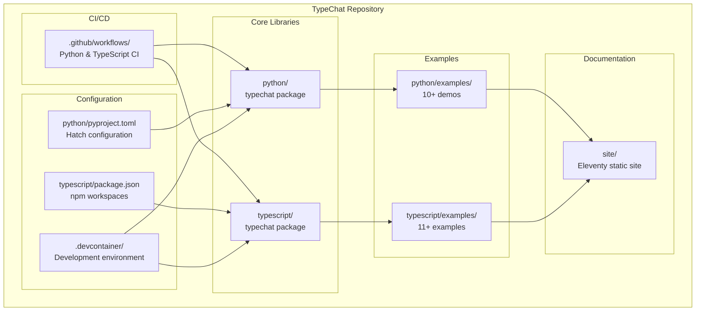
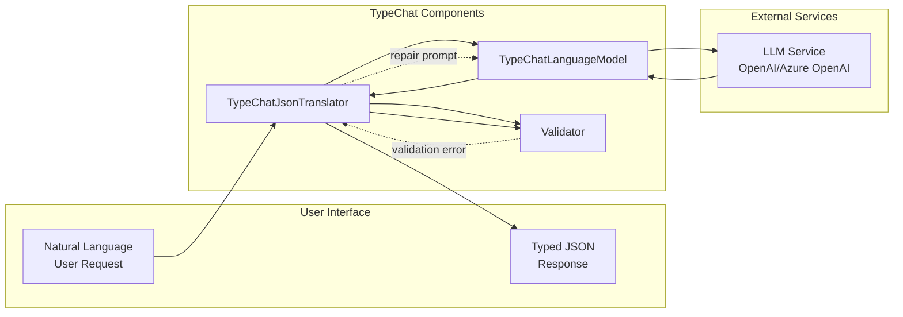
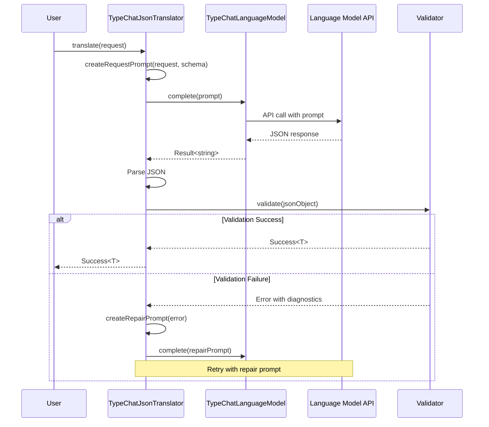
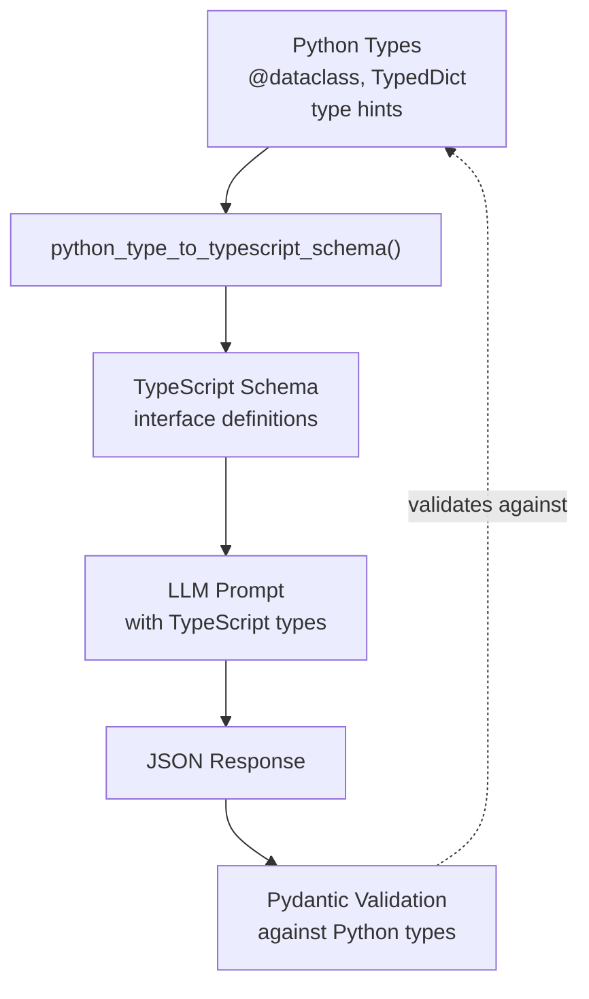
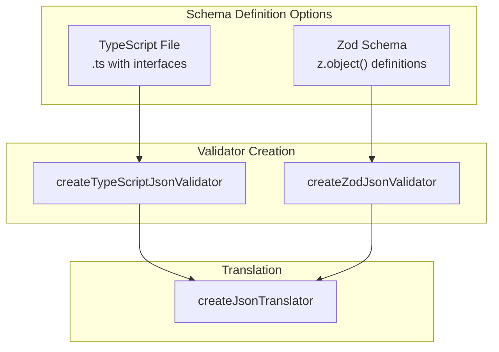
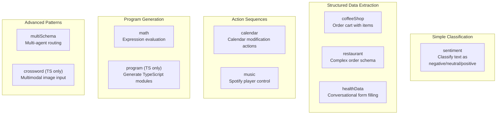

<!-- source: DeepWiki mcp.deepwiki.com · repo microsoft/TypeChat · page 1 Overview · fetched 2026-10-26 -->

# Overview

<details>
<summary>Relevant source files</summary>

The following files were used as context for generating this wiki page:

- [README.md](README.md)
- [python/README.md](python/README.md)
- [python/examples/README.md](python/examples/README.md)
- [site/src/_data/docsTOC.json](site/src/_data/docsTOC.json)
- [site/src/blog/introducing-typechat.md](site/src/blog/introducing-typechat.md)
- [site/src/docs/faq.md](site/src/docs/faq.md)
- [site/src/docs/introduction.md](site/src/docs/introduction.md)
- [site/src/docs/python/basic-usage.md](site/src/docs/python/basic-usage.md)
- [site/src/docs/techniques.md](site/src/docs/techniques.md)
- [site/src/docs/typescript/basic-usage.md](site/src/docs/typescript/basic-usage.md)
- [typescript/README.md](typescript/README.md)
- [typescript/examples/README.md](typescript/examples/README.md)
- [typescript/src/ts/program.ts](typescript/src/ts/program.ts)
- [typescript/src/zod/validate.ts](typescript/src/zod/validate.ts)

</details>


## Purpose and Scope

This document provides a high-level overview of the TypeChat repository, explaining its purpose, architecture, and key components. TypeChat is a polyglot library (available in both Python and TypeScript) that enables developers to build natural language interfaces by using type definitions to constrain and structure responses from large language models (LLMs).

For detailed information about specific aspects:
- Core concepts and techniques: see [Core Concepts](#2)
- Python-specific implementation details: see [Python Implementation](#3)
- TypeScript-specific implementation details: see [TypeScript Implementation](#4)
- Repository organization and package configuration: see [Package Structure and Configuration](#5)
- Development workflows and testing: see [Development and Testing](#6)

## What is TypeChat?

TypeChat is a library that makes it easy to build natural language interfaces using types. It addresses a fundamental challenge in integrating LLMs into applications: converting natural language input into structured, type-safe data that applications can process reliably.

Traditional approaches to building natural language interfaces relied on complex decision trees or prompt engineering. TypeChat replaces **prompt engineering** with **schema engineering**—instead of crafting increasingly complex prompts, developers define types that represent the intents supported in their application.

**Core workflow:**

1. Developer defines types (TypeScript interfaces or Python dataclasses) representing desired response structures
2. TypeChat constructs a prompt to the LLM that includes these type definitions
3. LLM response is validated against the schema
4. If validation fails, TypeChat automatically repairs the response through additional LLM interaction
5. Application receives type-safe, validated data

Sources: [README.md:1-17](), [python/README.md:1-25](), [site/src/docs/introduction.md:118-133]()

## Repository Structure

The TypeChat repository is organized as a **polyglot monorepo** containing parallel implementations in Python and TypeScript that share the same conceptual architecture but are implemented independently in their respective languages.



**Repository Structure Diagram: Main directories and their relationships**

| Directory | Purpose |
|-----------|---------|
| `python/` | Python package implementation, examples, and tests |
| `typescript/` | TypeScript package implementation, examples, and tests |
| `site/` | Documentation website built with Eleventy |
| `.github/workflows/` | CI/CD pipelines for testing and deployment |
| `.devcontainer/` | Development container configuration |

Sources: [README.md:39-47](), [python/README.md:35-51](), [typescript/README.md:19-38]()

## Core Architecture

Both Python and TypeScript implementations follow the same three-component architecture. Each implementation provides equivalent APIs and capabilities, allowing developers to choose their preferred language while maintaining feature parity.



**Core Component Architecture: Flow from natural language input to validated output**

### Three Core Components

| Component | Python Class | TypeScript Interface | Purpose |
|-----------|-------------|---------------------|----------|
| **Translator** | `TypeChatJsonTranslator` | `TypeChatJsonTranslator` | Orchestrates the translation process, manages prompts, and coordinates validation/repair |
| **Model** | `TypeChatLanguageModel` (Protocol) | `TypeChatLanguageModel` | Provides language model completion capability, handles API communication |
| **Validator** | `TypeChatValidator` | `TypeChatJsonValidator` | Validates LLM responses against type schema, provides schema text for prompts |

Sources: [site/src/docs/python/basic-usage.md:19-24](), [site/src/docs/typescript/basic-usage.md:16-24](), [typescript/src/ts/program.ts:1-5]()

## Translation Pipeline

The translation process follows a consistent flow across both implementations:



**Translation Flow: Request to validated response with automatic repair**

The pipeline includes automatic retry logic with configurable maximum attempts. When validation fails, TypeChat constructs a repair prompt that includes diagnostic information from the type checker, giving the LLM specific feedback about what needs to be corrected.

Sources: [site/src/docs/python/basic-usage.md:239-268](), [site/src/docs/typescript/basic-usage.md:300-324](), [README.md:11-17]()

## Python Implementation Details

The Python implementation uses Python's native type system (dataclasses, TypedDict, type hints) but includes a unique feature: **automatic conversion of Python types to TypeScript schemas** for LLM prompts. This is necessary because most LLMs are trained on TypeScript/JavaScript code and better understand TypeScript type syntax.



**Python Type Conversion: Python types to TypeScript for LLM guidance**

**Key Python classes:**
- `TypeChatJsonTranslator` - orchestrates translation [python/src/typechat/_internal/ts_conversion.py]()
- `TypeChatValidator` - validates using Pydantic and generates TypeScript schema
- `create_language_model()` - factory function for OpenAI/Azure models
- `process_requests()` - interactive REPL for testing

Sources: [site/src/docs/python/basic-usage.md:1-268](), [python/README.md:1-74]()

## TypeScript Implementation Details

The TypeScript implementation works directly with TypeScript's type system and provides two validator options:

1. **TypeScriptJsonValidator** - uses the TypeScript compiler API for validation
2. **ZodJsonValidator** - uses Zod schemas for runtime validation



**TypeScript Validator Options: Two approaches for schema validation**

**Key TypeScript functions and types:**
- `createJsonTranslator<T>()` - creates translator with model and validator
- `createTypeScriptJsonValidator<T>()` - TypeScript compiler-based validation [typescript/src/ts/validate.ts]()
- `createZodJsonValidator<T>()` - Zod schema-based validation [typescript/src/zod/validate.ts]()
- `createLanguageModel()` - factory for OpenAI/Azure models
- `processRequests()` - interactive REPL utility

The TypeScript implementation also supports advanced patterns like **program generation**, where natural language requests are translated into TypeScript modules that can be type-checked and executed.

Sources: [site/src/docs/typescript/basic-usage.md:1-325](), [typescript/README.md:1-61](), [typescript/src/ts/program.ts:189-219]()

## Language Model Integration

Both implementations provide convenient factory functions for creating language models that work with OpenAI and Azure OpenAI services:

**Python:**
```python
from typechat import create_language_model

# Automatically detects OpenAI or Azure based on environment variables
model = create_language_model(env_dict)

# Or create directly:
# create_openai_language_model(api_key, model, endpoint, org)
# create_azure_openai_language_model(api_key, endpoint)
```

**TypeScript:**
```typescript
import { createLanguageModel } from "typechat";

// Automatically detects OpenAI or Azure based on environment variables
const model = createLanguageModel(process.env);

// Or create directly:
// createOpenAILanguageModel(apiKey, model, endpoint)
// createAzureOpenAILanguageModel(apiKey, endpoint)
```

The `TypeChatLanguageModel` interface/protocol requires only a `complete()` method, making it straightforward to integrate with other LLM providers.

| Configuration Variable | Purpose |
|----------------------|---------|
| `OPENAI_API_KEY` | OpenAI API authentication key |
| `OPENAI_MODEL` | Model name (e.g., `gpt-3.5-turbo`, `gpt-4`) |
| `OPENAI_ENDPOINT` | Optional custom endpoint URL |
| `AZURE_OPENAI_API_KEY` | Azure OpenAI API authentication key |
| `AZURE_OPENAI_ENDPOINT` | Full Azure OpenAI REST API URL with deployment name |

Sources: [site/src/docs/python/basic-usage.md:42-118](), [site/src/docs/typescript/basic-usage.md:39-98](), [typescript/examples/README.md:63-92](), [python/examples/README.md:76-105]()

## Example Applications

TypeChat includes comprehensive examples demonstrating progressively complex use cases:



**Example Application Complexity Spectrum**

| Example | Python | TypeScript | Description |
|---------|--------|-----------|-------------|
| **sentiment** | ✓ | ✓ | Sentiment classification - TypeChat's "hello world" |
| **coffeeShop** | ✓ | ✓ | Coffee order cart builder |
| **calendar** | ✓ | ✓ | Calendar action sequences |
| **healthData** | ✓ | - | Conversational form filling with history |
| **restaurant** | ✓ | ✓ | Complex order schema with corrections |
| **math** | ✓ | ✓ | Mathematical expression evaluation |
| **music** | ✓ | ✓ | Music player control (Spotify-style) |
| **multiSchema** | ✓ | - | Multi-agent routing and selection |
| **program** | - | ✓ | TypeScript code generation from natural language |
| **crossword** | - | ✓ | Multimodal input with image analysis |

Each example includes sample input files (typically `input.txt`) demonstrating various natural language requests the system can handle.

Sources: [typescript/examples/README.md:8-19](), [python/examples/README.md:8-21](), [site/src/blog/introducing-typechat.md:141-187]()

## Running Examples

Both implementations provide similar workflows for running examples interactively or with input files:

**Python:**
```bash
cd python/examples/sentiment
python demo.py                    # Interactive mode
python demo.py input.txt         # Process file input
```

**TypeScript:**
```bash
cd typescript/examples/sentiment
node ./dist/main.js              # Interactive mode
node ./dist/main.js input.txt   # Process file input
```

Examples use environment variables from a `.env` file for API credentials. The interactive mode provides a prompt (often with an emoji like `😀>`) where users can type natural language requests.

Sources: [python/examples/README.md:107-120](), [typescript/examples/README.md:94-107]()

## Installation and Getting Started

**Python Installation:**
```bash
# From PyPI
pip install typechat

# From source
git clone https://github.com/microsoft/TypeChat
cd TypeChat/python
hatch shell
```

**TypeScript Installation:**
```bash
# From npm
npm install typechat

# From source
git clone https://github.com/microsoft/TypeChat
cd TypeChat/typescript
npm install
npm run build
```

Both implementations require:
- API keys for OpenAI or Azure OpenAI (configured via environment variables)
- Python ≥3.11 (for Python version) or Node.js ≥18 (for TypeScript version)

Sources: [README.md:19-47](), [python/README.md:27-51](), [typescript/README.md:19-38]()

## Development Environment

The repository includes a `.devcontainer` configuration for GitHub Codespaces and local VS Code development, providing a pre-configured environment with all necessary dependencies:
- Python 3.12
- Node.js 20
- Required build tools and extensions

This enables developers to start working with TypeChat examples immediately without manual environment setup.

Sources: [typescript/examples/README.md:34-53](), [python/examples/README.md:55-74]()

## Key Design Principles

TypeChat is built on several core principles:

1. **Types as Interface Specification** - Type definitions serve as the contract between natural language and structured data
2. **Schema Engineering over Prompt Engineering** - Developers focus on defining types rather than crafting prompts
3. **Validation and Repair** - Automatic validation with repair prompts when responses don't conform to schema
4. **Model Neutrality** - Works with any LLM that can complete prompts (though optimized for models trained on both code and natural language)
5. **Safety Through Constraints** - Types constrain model uncertainty and provide an escape hatch for out-of-domain requests
6. **Polyglot Parity** - Parallel implementations maintain API compatibility across languages

Sources: [README.md:1-17](), [site/src/docs/introduction.md:118-133](), [site/src/docs/techniques.md:8-28](), [site/src/docs/faq.md:24-42]()

## Next Steps

To learn more about specific aspects of TypeChat:

- **Understand core concepts:** See [Core Concepts](#2) for detailed explanations of schema engineering, the translation pipeline, and type system bridges
- **Explore Python implementation:** See [Python Implementation](#3) for Python-specific components, schema conversion, and examples
- **Explore TypeScript implementation:** See [TypeScript Implementation](#4) for TypeScript-specific components, validators, and examples
- **Learn about repository structure:** See [Package Structure and Configuration](#5) for monorepo organization and package details
- **Set up development environment:** See [Development and Testing](#6) for CI/CD, testing infrastructure, and development workflows
- **Understand documentation site:** See [Documentation Website](#7) for information about the Eleventy-based documentation site

Sources: [README.md:45-47](), [python/README.md:45-51](), [typescript/README.md:36-38]()

---

