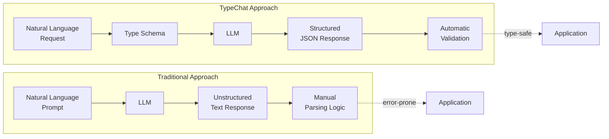
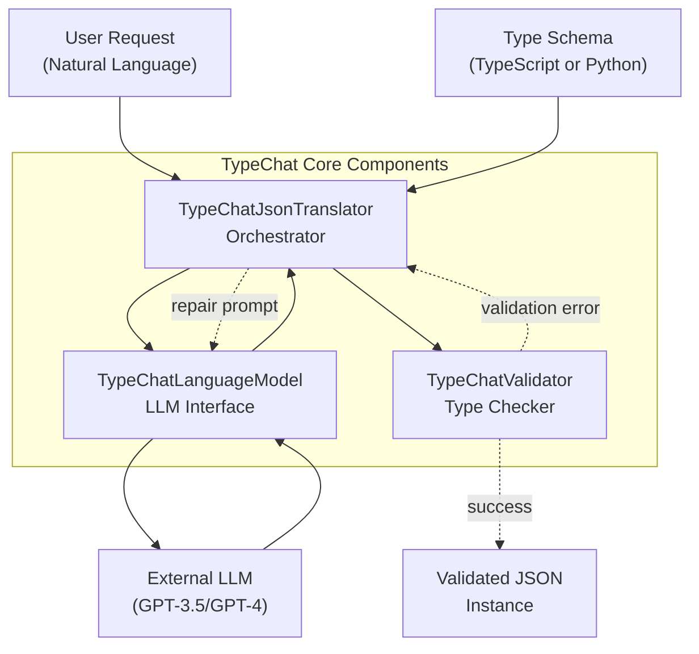
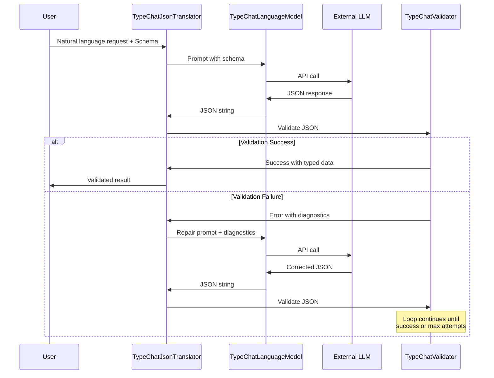
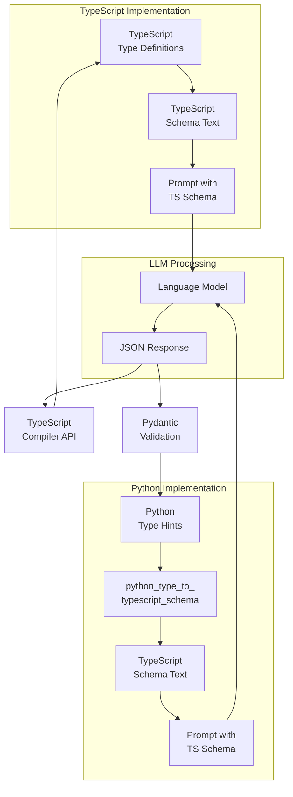
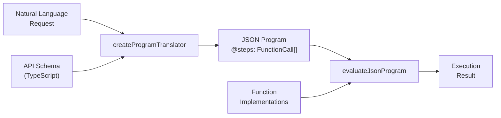

<!-- source: DeepWiki mcp.deepwiki.com · repo microsoft/TypeChat · page 2 Core Concepts · fetched 2026-10-26 -->

# Core Concepts

Relevant source files

The following files were used as context for generating this wiki page:

- [README.md](README.md)
- [site/src/blog/introducing-typechat.md](site/src/blog/introducing-typechat.md)
- [site/src/docs/faq.md](site/src/docs/faq.md)
- [site/src/docs/introduction.md](site/src/docs/introduction.md)
- [site/src/docs/techniques.md](site/src/docs/techniques.md)
- [typescript/src/ts/program.ts](typescript/src/ts/program.ts)
- [typescript/src/zod/validate.ts](typescript/src/zod/validate.ts)

This document explains the fundamental concepts underlying TypeChat's approach to natural language processing. TypeChat uses **type definitions as the interface contract** between natural language input and structured application data, replacing traditional prompt engineering with what the library calls "schema engineering."

For implementation-specific details, see [Python Implementation](#3) and [TypeScript Implementation](#4). For examples of these concepts in practice, see [Python Examples](#3.3) and [TypeScript Examples](#4.2).

## The Schema Engineering Paradigm

TypeChat's core innovation is replacing **prompt engineering** with **schema engineering**. Instead of writing increasingly complex natural language prompts to guide an LLM's response format, developers define type definitions that precisely describe the structure and constraints of acceptable responses.

**Sources:** [README.md:7](), [site/src/blog/introducing-typechat.md:79-132](), [site/src/docs/techniques.md:8-10]()

The rationale for this approach is based on three observations:

| Observation | Implication |
|------------|-------------|
| LLMs are trained extensively on TypeScript/JavaScript code | Types provide familiar, unambiguous specifications for LLMs |
| JSON is the interchange format for the world's most popular language | LLMs excel at generating well-formed JSON |
| Natural language prompts are ambiguous and fragile | Type definitions are precise and maintainable |

TypeScript serves as the "specification language" because LLMs have seen enormous amounts of TypeScript in their training data. The types act as a formal, unambiguous description of possible outputs, which the model has learned to respect through its training on codebases that use TypeScript.

**Sources:** [site/src/docs/introduction.md:79-119](), [site/src/docs/faq.md:34-42]()

## Three-Component Architecture

TypeChat implements a consistent three-component architecture across both Python and TypeScript implementations:

**Sources:** [README.md:11-16](), [site/src/docs/faq.md:10-14]()

### TypeChatJsonTranslator

The `TypeChatJsonTranslator` is the orchestrator that coordinates the translation process. It:

1. Constructs prompts that combine the user's natural language request with type schema definitions
2. Sends requests to the language model via `TypeChatLanguageModel`
3. Validates responses using `TypeChatValidator`
4. Manages repair loops when validation fails

In TypeScript, translators are created using `createJsonTranslator`. In Python, the equivalent is instantiating `TypeChatJsonTranslator` from the `typechat` module.

**Sources:** [typescript/src/typechat.ts]() (inferred from usage patterns)

### TypeChatLanguageModel

The `TypeChatLanguageModel` provides an abstraction over LLM APIs. It handles:

- Communication with external LLM services (OpenAI, Azure OpenAI, etc.)
- Request formatting and response parsing
- Error handling and retries

This abstraction makes TypeChat model-neutral, allowing developers to use any LLM service that provides a chat completion-style API.

**Sources:** [README.md:39-43](), [site/src/blog/introducing-typechat.md:189-196]()

### TypeChatValidator

The `TypeChatValidator` (or `TypeChatJsonValidator`) validates that LLM responses conform to the specified schema. The validation approach differs between implementations:

| Implementation | Validation Method |
|---------------|------------------|
| **TypeScript** | Uses TypeScript compiler API or Zod schemas for runtime validation |
| **Python** | Uses Pydantic models for runtime validation against Python type hints |

When validation fails, the validator returns diagnostic messages that the translator uses to construct repair prompts.

**Sources:** [site/src/docs/faq.md:34-42](), [typescript/src/zod/validate.ts:1-30]()

## Validation and Repair Loop

TypeChat implements an automatic **repair loop** that iteratively improves invalid LLM responses:

**Sources:** [README.md:14](), [site/src/docs/introduction.md:127-131](), [site/src/docs/faq.md:38-42]()

The repair mechanism leverages compiler diagnostics from TypeScript or validation errors from Pydantic. These diagnostics provide precise, actionable feedback to the LLM about what is wrong with its response:

**Example repair prompt structure:**
1. Original prompt with schema
2. LLM's invalid response
3. Specific validation errors (e.g., "Property 'quantity' is missing", "Type 'string' is not assignable to type 'number'")
4. Request for corrected response

This approach is more reliable than hoping the LLM gets it right on the first attempt, and it's more maintainable than complex prompt engineering.

**Sources:** [site/src/docs/faq.md:38-42]()

## Cross-Language Type System Bridge

TypeChat provides parallel implementations in Python and TypeScript, but they handle type schemas differently:

**Sources:** [python/src/typechat/_ts_schema.py]() (inferred from architecture), [site/src/docs/faq.md:44-46]()

### Why TypeScript for LLM Prompts?

Both implementations use **TypeScript schemas in LLM prompts**, even when the application is written in Python. This is because:

1. **Training Data**: LLMs have seen vastly more TypeScript/JavaScript code than Python during training
2. **JSON Affinity**: TypeScript is explicitly designed to describe JSON structures
3. **Compactness**: TypeScript schemas are up to 5x more concise than equivalent JSON Schema definitions

For Python developers, this means:
- Write application types using Python's native type hints (`@dataclass`, `TypedDict`, `Literal`, etc.)
- TypeChat automatically converts these to TypeScript schemas for LLM prompts
- Validation still happens against the original Python types using Pydantic

This architecture allows Python developers to work in their native type system while benefiting from LLMs' familiarity with TypeScript. For details on the conversion mechanism, see [Type System Bridge](#2.3).

**Sources:** [site/src/docs/faq.md:34-42](), [README.md:3-17]()

## Response Model Design Principles

TypeChat schemas are not necessarily the exact types your application uses internally. They are **Response Models** that bridge between natural language and application logic by constraining LLM responses in meaningful ways.

| Principle | Rationale |
|-----------|-----------|
| Keep it simple (primitives, arrays, objects) | LLMs handle simple structures more reliably |
| Only use JSON-representable types | No classes, functions, or non-serializable constructs |
| Make structures flat and regular | Deep nesting increases error rates |
| Include natural language comments on types | Comments guide LLM interpretation |
| Restrict use of generics | Complex type parameters confuse models |
| Avoid deep inheritance hierarchies | Flat discriminated unions work better |
| Use `string` instead of narrow literal types | Allow LLMs some flexibility |
| Include an "unknown" escape hatch | Suppress hallucinations for out-of-domain requests |

**Sources:** [site/src/docs/techniques.md:14-25]()

### The Escape Hatch Pattern

A critical design pattern is including an **"unknown" category** in your schema to handle out-of-domain requests. Without this, LLMs may hallucinate responses by forcing user input into inappropriate categories.

**Example:** A coffee shop schema without an escape hatch might translate "two tall trees" into "two tall lattes". With an escape hatch (`UnknownRequest` type), the LLM will correctly categorize this as an unknown/invalid request.

**Sources:** [site/src/docs/techniques.md:26-28]()

## Advanced Patterns

TypeChat supports several advanced patterns beyond simple data translation:

### Program Generation

The `Program` type and `createProgramTranslator` enable generating executable programs as JSON. The generated programs consist of function call sequences that can be safely evaluated using `evaluateJsonProgram`.

**Sources:** [typescript/src/ts/program.ts:1-219](), [site/src/blog/introducing-typechat.md:184-187]()

The `Program` type defines a sequence of `FunctionCall` objects with `@func` (function name) and `@args` (arguments) properties. The `evaluateJsonProgram` function acts as a safe interpreter that dispatches function calls to application-provided handlers.

**Sources:** [typescript/src/ts/program.ts:6-31](), [typescript/src/ts/program.ts:147-186]()

### Multi-Schema Routing

Applications can use a "meta-schema" to dynamically select specialized sub-schemas based on user input. This enables building systems that route requests to different domain-specific handlers.

**Sources:** [site/src/docs/introduction.md:125](), [README.md:9]()

### Zod Schema Support

In TypeScript, developers can use Zod schemas instead of TypeScript types via `createZodJsonValidator`. This provides runtime validation without requiring the TypeScript compiler API.

**Sources:** [typescript/src/zod/validate.ts:1-30](), [typescript/src/zod/validate.ts:66-249]()

---

The three child pages provide detailed coverage of these core concepts:
- [Schema Engineering](#2.1) - Deep dive into designing effective type schemas
- [Translation Pipeline](#2.2) - Complete flow from request to validated output  
- [Type System Bridge](#2.3) - How Python types convert to TypeScript schemas

---

