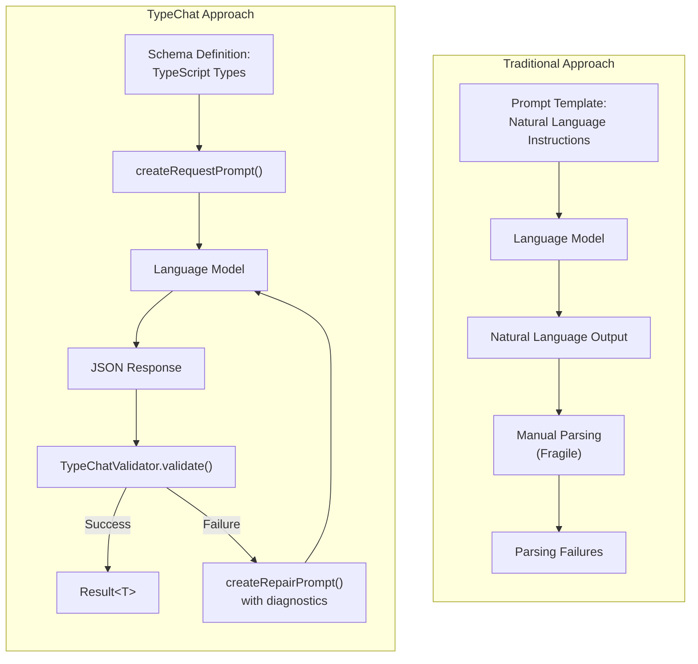
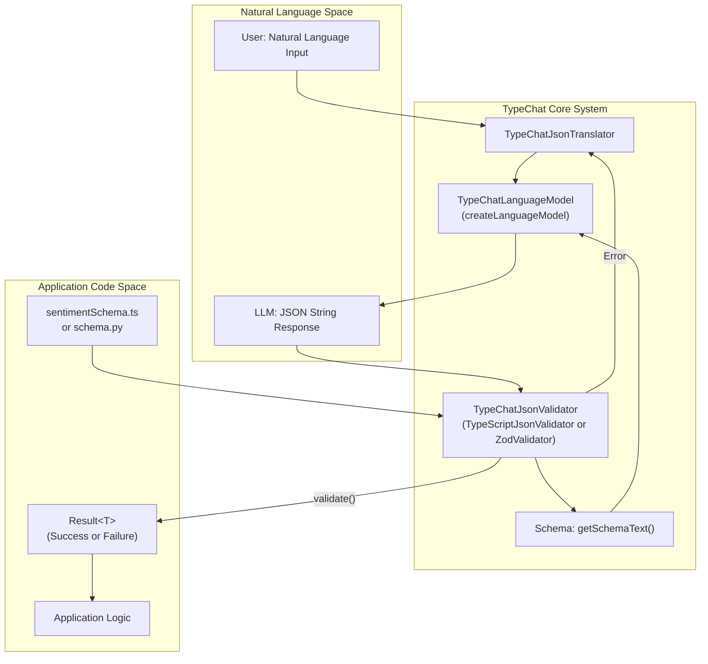
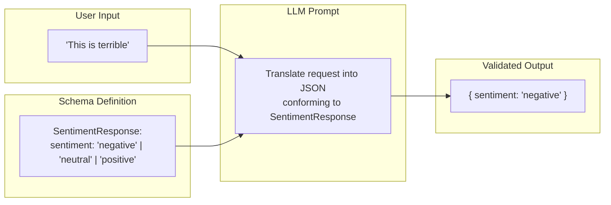
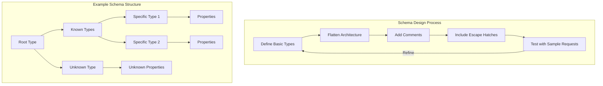
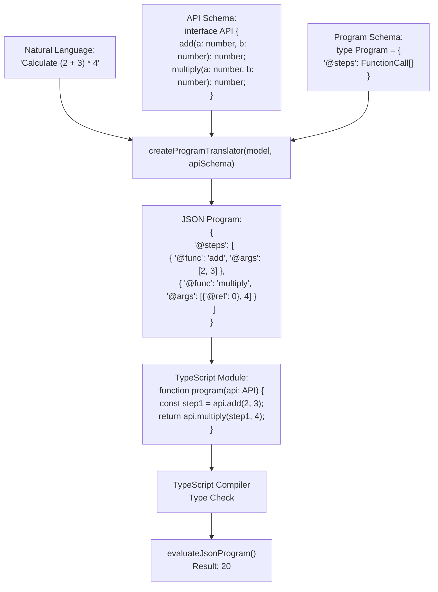
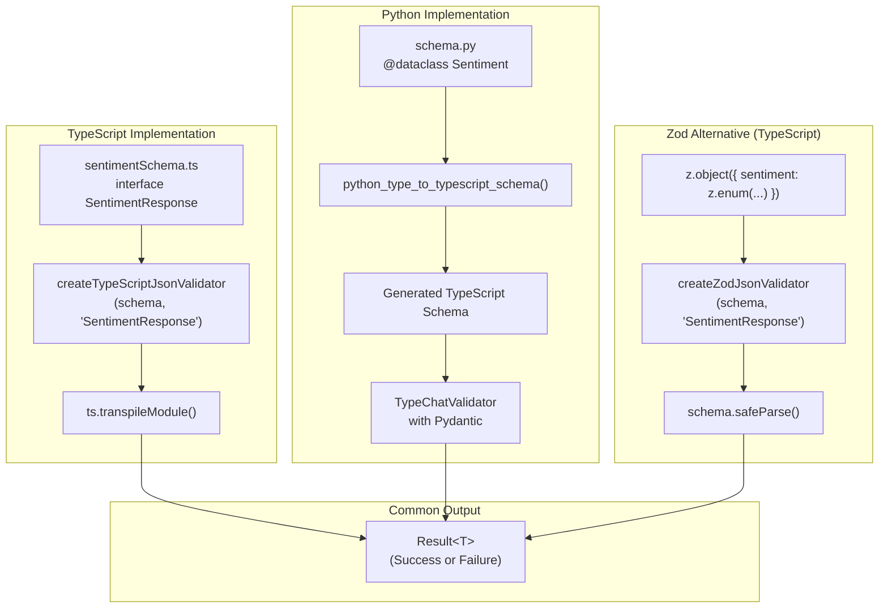

<!-- source: DeepWiki mcp.deepwiki.com · repo microsoft/TypeChat · page 2.1 Schema Engineering · fetched 2026-10-26 -->

# Schema Engineering

<details>
<summary>Relevant source files</summary>

The following files were used as context for generating this wiki page:

- [README.md](README.md)
- [python/README.md](python/README.md)
- [python/examples/README.md](python/examples/README.md)
- [site/src/_data/docsTOC.json](site/src/_data/docsTOC.json)
- [site/src/blog/introducing-typechat.md](site/src/blog/introducing-typechat.md)
- [site/src/docs/faq.md](site/src/docs/faq.md)
- [site/src/docs/introduction.md](site/src/docs/introduction.md)
- [site/src/docs/python/basic-usage.md](site/src/docs/python/basic-usage.md)
- [site/src/docs/techniques.md](site/src/docs/techniques.md)
- [site/src/docs/typescript/basic-usage.md](site/src/docs/typescript/basic-usage.md)
- [typescript/README.md](typescript/README.md)
- [typescript/examples/README.md](typescript/examples/README.md)
- [typescript/src/ts/program.ts](typescript/src/ts/program.ts)
- [typescript/src/zod/validate.ts](typescript/src/zod/validate.ts)

</details>


Schema Engineering is a core architectural component of TypeChat that replaces traditional prompt engineering with a structured, type-based approach. This document explains how TypeChat uses types to guide language model responses, providing more reliable and safer natural language interfaces. For details on the overall request processing flow, see [Request Processing Flow](#2.2).

## What is Schema Engineering?

Schema Engineering is TypeChat's approach to structuring and constraining language model outputs using type definitions. Instead of writing complex decision trees or prompt templates to guide a language model's responses, Schema Engineering uses TypeScript type definitions to define the shape of expected data.

**Diagram: Traditional Prompt Engineering vs Schema Engineering**



Sources: [README.md:5-7](), [site/src/docs/techniques.md:8-10](), [site/src/blog/introducing-typechat.md:15-33](), [typescript/src/typechat.ts]()

## Schema Engineering vs. Prompt Engineering

Schema Engineering fundamentally differs from traditional prompt engineering in several key ways:

| Traditional Prompt Engineering | Schema Engineering |
|--------------------------------|-------------------|
| Relies on natural language instructions | Uses type definitions as instructions |
| Output format guidance through examples | Output format constrained by types |
| Unpredictable structure in responses | Guaranteed structure matching schema |
| Manual validation of responses | Automated validation via TypeScript compiler |
| Trial-and-error prompt refinement | Systematic schema design |

Schema Engineering provides the structure that bridges between natural language input and application logic. The types act as a contract between what the user can express and what the application can process.

**Diagram: TypeChat Component Flow with Code Entities**



Sources: [site/src/docs/techniques.md:8-13](), [site/src/blog/introducing-typechat.md:76-133](), [typescript/src/typechat.ts](), [python/src/typechat/_internal/ts_conversion.py]()

## Response Models

The types you design for TypeChat act as "Response Models" - they bridge between natural language and your application logic by controlling and constraining LLM responses in meaningful ways. These types aren't necessarily the exact types your application uses internally, but rather types specifically designed to capture user intent from natural language.

### Simple Schema Example: Sentiment Analysis

The sentiment example demonstrates the simplest form of schema engineering. The schema defines a single type with a constrained set of values:

**TypeScript Schema** ([typescript/examples/sentiment/src/sentimentSchema.ts]())
```typescript
export interface SentimentResponse {
    sentiment: "negative" | "neutral" | "positive";
}
```

**Python Schema** ([python/examples/sentiment/schema.py]())
```python
@dataclass
class Sentiment:
    sentiment: Literal["negative", "neutral", "positive"]
```

Both schemas are converted into TypeScript for the LLM prompt. The Python implementation uses `python_type_to_typescript_schema()` to convert Python type hints into TypeScript interface definitions.

**Diagram: Schema to JSON Translation Flow**



Sources: [site/src/docs/techniques.md:10-13](), [README.md:9-11](), [site/src/blog/introducing-typechat.md:84-122](), [typescript/examples/sentiment/src/sentimentSchema.ts](), [python/examples/sentiment/schema.py]()

### Complex Schema Example: Coffee Shop Orders

More complex schemas can represent structured data with nested types and optional fields:

**TypeScript Schema** ([typescript/examples/coffeeShop/src/coffeeShopSchema.ts]())
```typescript
export interface Cart {
    items: (LineItem | UnknownText)[];
}

export interface LineItem {
    type: 'lineitem';
    product: Product;
    quantity: number;
}

export interface Product {
    name: string;
    options?: OptionsType[];
}

export type UnknownText = {
    type: 'unknown',
    text: string; // The text that wasn't understood
};
```

The schema includes an escape hatch (`UnknownText`) to handle requests outside the domain, which helps prevent hallucinations.

Sources: [typescript/examples/coffeeShop/src/coffeeShopSchema.ts](), [site/src/docs/techniques.md:24-27]()

## Best Practices for Schema Engineering

When designing schemas for TypeChat, follow these guidelines for optimal results:

1. **Keep it simple**: Use primitives, arrays, and objects
2. **Use JSON-representable types**: No classes, only types representable in JSON
3. **Create flat, regular structures**: Avoid deep nesting
4. **Add natural language comments**: Include JSDoc comments to describe intent
5. **Limit advanced type features**:
   - Avoid deep inheritance hierarchies
   - Restrict use of generics
   - Don't use conditional, mapped, and indexed access types
6. **Allow flexibility**: Use `string` instead of literal types when appropriate
7. **Include escape hatches**: Add an "unknown" type to handle out-of-domain requests

The escape hatch point is particularly important. When Response Models have no option for handling out-of-domain requests, LLMs may hallucinate answers. An "unknown" category allows the model to route non-domain requests appropriately.



Sources: [site/src/docs/techniques.md:14-25](), [README.md:9-11]()

## Schema Validation and Repair

A key strength of TypeChat is its ability to validate and repair language model responses using the TypeScript compiler:

1. The language model attempts to generate JSON conforming to the schema
2. TypeChat validates the JSON against the schema using the TypeScript compiler
3. If validation fails, TypeChat sends error diagnostics back to the model
4. The model repairs its response based on the error feedback
5. This cycle repeats until the response is valid or a maximum retry limit is reached

The validation process differs based on which validator is used:

| Validator Type | Implementation | Validation Method |
|----------------|----------------|-------------------|
| `TypeScriptJsonValidator` | TypeScript Compiler API | `ts.transpileModule()` with type checking |
| `ZodValidator` | Zod runtime validation | `schema.safeParse()` |
| Python `TypeChatValidator` | Pydantic validation | `pydantic.TypeAdapter.validate_python()` |

**Diagram: Validation and Repair Loop with Code Entities**

```mermaid
sequenceDiagram
    participant User
    participant Translator["TypeChatJsonTranslator<br/>translate()"]
    participant Model["TypeChatLanguageModel<br/>complete()"]
    participant Validator["TypeChatValidator<br/>validate()"]
    participant App["Application"]

    User->>Translator: "Natural language request"
    Translator->>Translator: createRequestPrompt(request)
    Translator->>Model: complete(prompt)
    Model-->>Translator: "JSON string"
    Translator->>Validator: validate(jsonObject)
    
    alt Validation Success
        Validator-->>Translator: "Success&lt;T&gt;"
        Translator->>App: "Result&lt;T&gt;"
    else Validation Failure (Attempt < maxAttempts)
        Validator-->>Translator: "Failure with diagnostics"
        Translator->>Translator: createRepairPrompt(error)
        Translator->>Model: complete(repairPrompt)
        Model-->>Translator: "Repaired JSON string"
        Translator->>Validator: validate(jsonObject)
        Validator-->>Translator: "Success&lt;T&gt;"
        Translator->>App: "Result&lt;T&gt;"
    end
```

**TypeScript Validation Implementation:**

The `TypeScriptJsonValidator` ([typescript/src/ts/validate.ts]()) uses the TypeScript compiler API to validate JSON objects:

1. Converts JSON to a TypeScript module string using `createModuleTextFromJson()`
2. Compiles the module with `ts.transpileModule()` to get type errors
3. Returns `Success<T>` if no errors, otherwise `Failure` with diagnostics

**Zod Validation Implementation:**

The `ZodValidator` ([typescript/src/zod/validate.ts]()) uses Zod's runtime validation:

1. Calls `schema.safeParse(jsonObject)` on the Zod schema
2. Returns `Success<T>` if validation passes
3. Returns `Failure` with formatted error messages if validation fails

**Python Validation Implementation:**

The Python `TypeChatValidator` ([python/src/typechat/_validator.py]()) uses Pydantic:

1. Creates a `TypeAdapter` from the Python type
2. Calls `type_adapter.validate_python(obj)` 
3. Returns `Success[T]` or `Failure` based on validation result

Sources: [README.md:13-15](), [site/src/blog/introducing-typechat.md:123-133](), [typescript/src/ts/validate.ts](), [typescript/src/zod/validate.ts](), [python/src/typechat/_validator.py]()

## Advanced Schema Pattern: Program API

TypeChat supports an advanced schema pattern for generating executable programs from natural language. The `Program` type ([typescript/src/ts/program.ts:6-31]()) represents a sequence of function calls that compose an API:

```typescript
export type Program = {
    "@steps": FunctionCall[];
}

export type FunctionCall = {
    "@func": string;
    "@args"?: Expression[];
};
```

**Program Translation Flow:**

1. User provides natural language request
2. `createProgramTranslator()` constructs a translator with both the Program schema and target API schema
3. LLM generates a JSON program with function calls
4. `createModuleTextFromProgram()` converts the JSON to TypeScript code
5. TypeScript compiler validates the generated code against the API schema
6. `evaluateJsonProgram()` executes the validated program

**Diagram: Program API Schema Flow**



The Program API approach is used in the Math example ([typescript/examples/math]()) and demonstrates how TypeChat can generate and validate small programs rather than just data structures.

Sources: [typescript/src/ts/program.ts:6-31](), [typescript/src/ts/program.ts:86-136](), [typescript/src/ts/program.ts:189-219](), [typescript/examples/math]()

## Implementation Languages

Schema Engineering is currently supported in different programming languages, with TypeScript being the primary implementation:

**TypeScript/JavaScript:**
- Native TypeScript types defined in `.ts` files
- Validated using `createTypeScriptJsonValidator()` with TypeScript Compiler API
- Alternative: Zod schemas with `createZodJsonValidator()`

**Python:**
- Python type hints (`@dataclass`, `TypedDict`, `Literal`, etc.)
- Converted to TypeScript schemas using `python_type_to_typescript_schema()`
- Validated using Pydantic runtime validation
- Supports Python 3.11-3.14 with version-specific type features

**C#/.NET:**
- Available as separate implementation at [https://github.com/microsoft/TypeChat.net]()
- .NET types converted to TypeScript schemas

**Diagram: Schema Definition Across Languages**



All implementations follow the same conceptual model: define types in the native language, convert to a schema representation, validate LLM output, and return typed results.

Sources: [python/README.md:7-11](), [typescript/README.md:7-11](), [README.md:39-43](), [typescript/src/ts/validate.ts](), [typescript/src/zod/validate.ts](), [python/src/typechat/_internal/ts_conversion.py]()

## Examples of Schema Engineering

TypeChat provides several examples demonstrating Schema Engineering patterns, progressing from simple to complex:

| Example | Schema Pattern | Key Features |
|---------|---------------|--------------|
| **Sentiment** ([typescript/examples/sentiment](), [python/examples/sentiment]()) | Single type with literal values | `Literal["negative", "neutral", "positive"]` |
| **Coffee Shop** ([typescript/examples/coffeeShop](), [python/examples/coffeeShop]()) | Discriminated union with escape hatch | `LineItem \| UnknownText` types |
| **Calendar** ([typescript/examples/calendar](), [python/examples/calendar]()) | Action sequence pattern | Array of action types: `AddEventAction \| RemoveEventAction` etc. |
| **Restaurant** ([typescript/examples/restaurant](), [python/examples/restaurant]()) | Complex nested structures | Detailed item options and modifiers |
| **Math** ([typescript/examples/math](), [python/examples/math]()) | Program generation | Uses Program API schema pattern |
| **MultiSchema** ([python/examples/multiSchema]()) | Meta-schema routing | Routes to child schemas based on intent |
| **Music** ([typescript/examples/music](), [python/examples/music]()) | Dataflow program | Steps with result references |

### Schema Evolution: From Simple to Complex

**Level 1: Simple Classification**
- Single discriminated type
- Example: `sentiment: "negative" | "neutral" | "positive"`

**Level 2: Structured Data**
- Nested objects and arrays
- Optional fields
- Example: `Cart { items: LineItem[] }`

**Level 3: Action Sequences**
- Discriminated unions of action types
- Example: `AddEventAction | RemoveEventAction | ...`

**Level 4: Program Generation**
- Function calls with arguments
- Result references between steps
- Example: `Program { "@steps": FunctionCall[] }`

Each level builds on the previous, demonstrating how schema engineering can handle increasingly complex use cases.

Sources: [typescript/examples/README.md:9-18](), [python/examples/README.md:9-20](), [typescript/examples/sentiment/src/sentimentSchema.ts](), [typescript/examples/coffeeShop/src/coffeeShopSchema.ts](), [typescript/examples/calendar/src/calendarActionsSchema.ts](), [typescript/examples/math](), [python/examples/multiSchema]()

## Conclusion

Schema Engineering represents a paradigm shift in how we build natural language interfaces. By using types instead of unstructured prompts, TypeChat makes it easier to create reliable, safe, and maintainable natural language interfaces. The approach leverages the TypeScript type system's expressiveness and the compiler's validation capabilities to ensure that language model responses conform to your application's expectations.

This structured approach to natural language understanding reduces the need for prompt engineering expertise and provides stronger guarantees about the structure and validity of language model responses.

Sources: [README.md:3-17](), [site/src/docs/introduction.md:117-133](), [site/src/docs/faq.md:26-33]()

---

