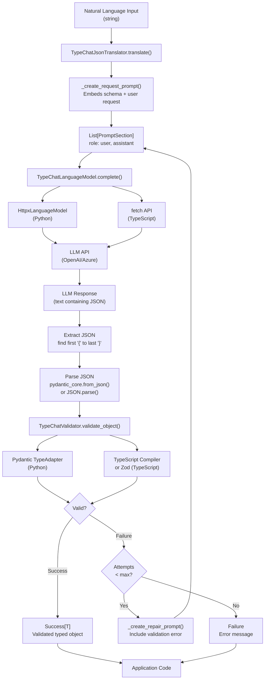
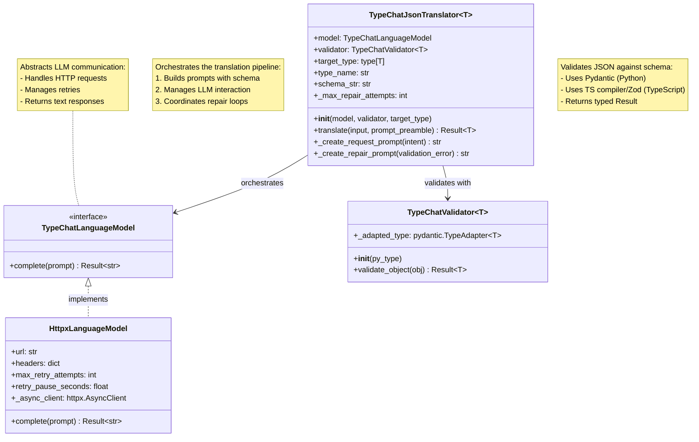
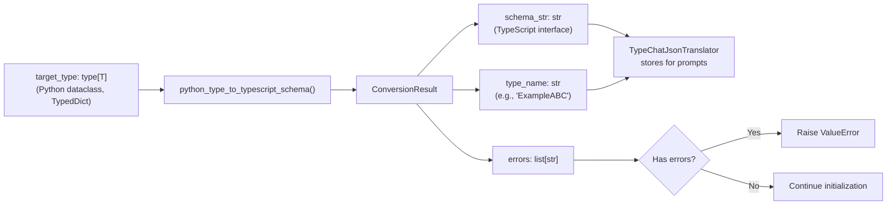
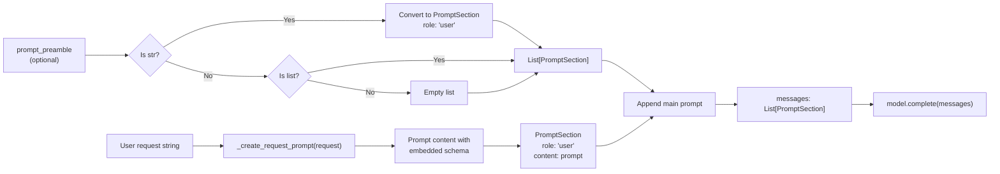
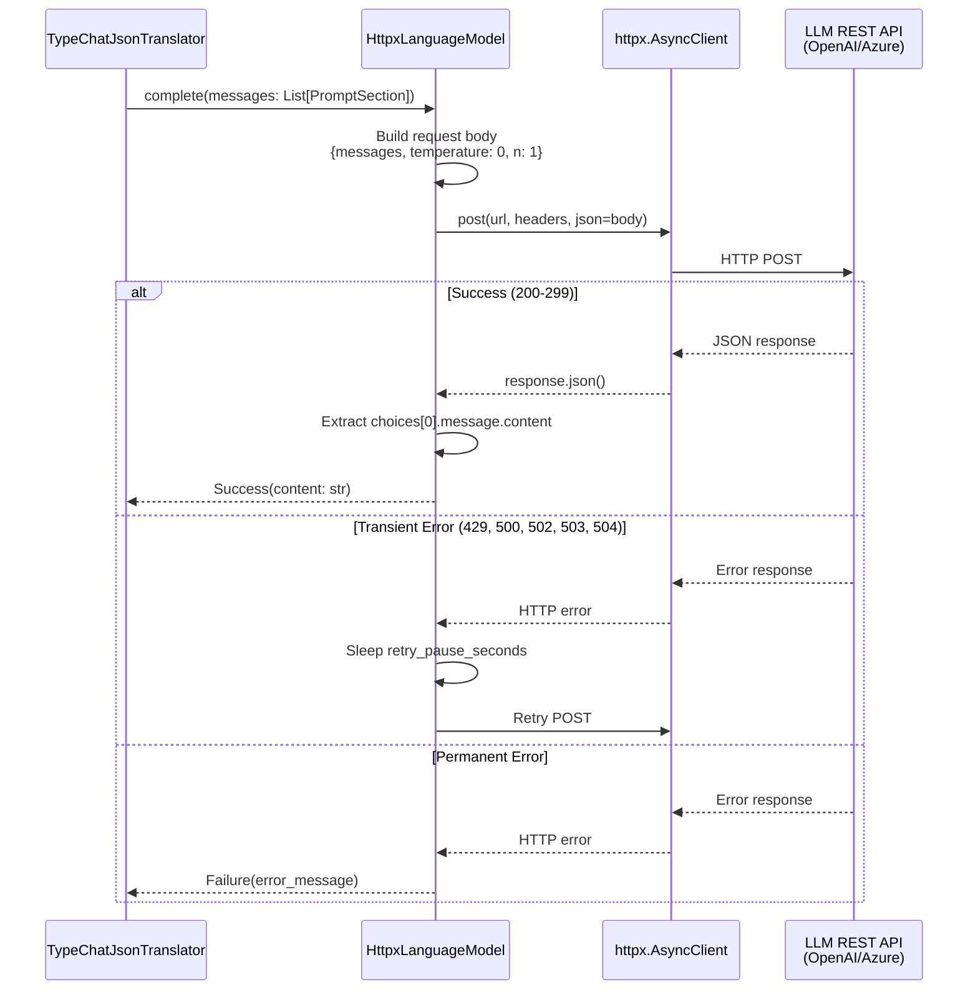
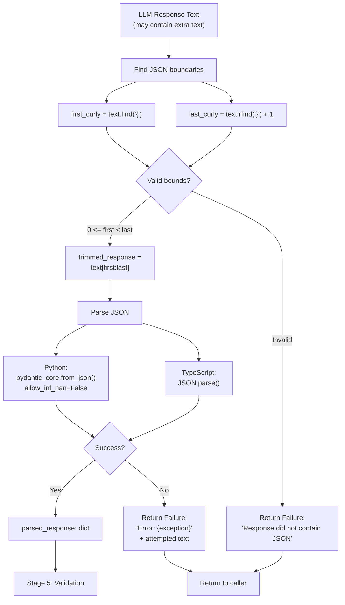
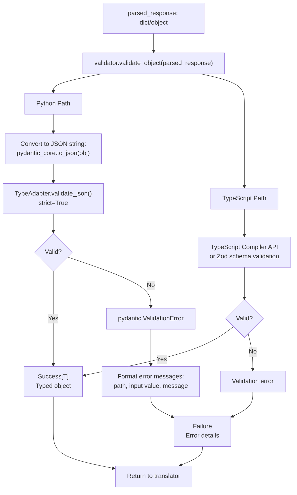
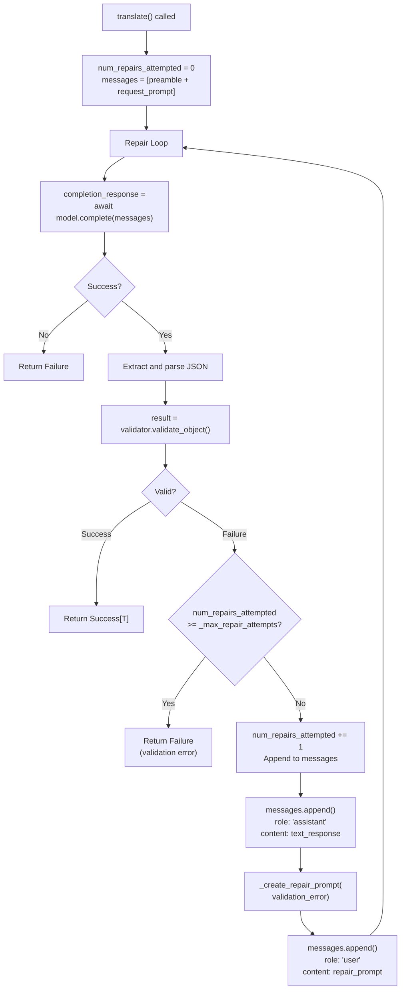
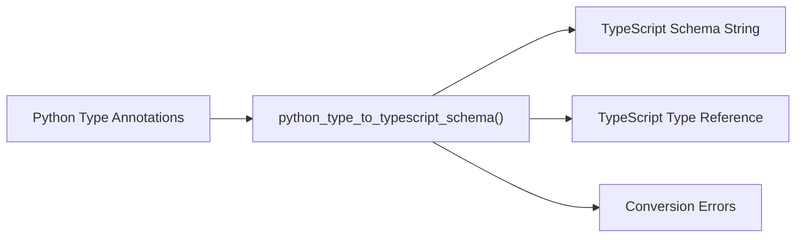
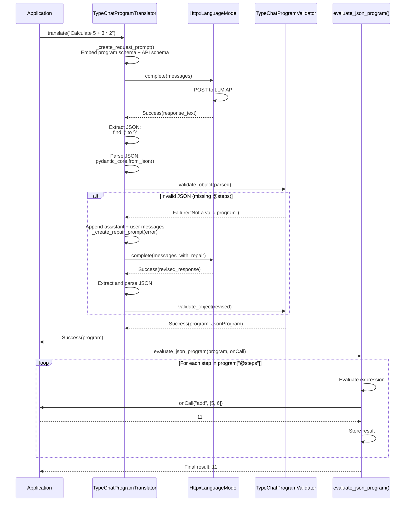

<!-- source: DeepWiki mcp.deepwiki.com · repo microsoft/TypeChat · page 2.2 Translation Pipeline · fetched 2026-10-26 -->

# Translation Pipeline

<details>
<summary>Relevant source files</summary>

The following files were used as context for generating this wiki page:

- [README.md](README.md)
- [python/examples/healthData/translator.py](python/examples/healthData/translator.py)
- [python/examples/math/program.py](python/examples/math/program.py)
- [python/examples/multiSchema/agents.py](python/examples/multiSchema/agents.py)
- [python/examples/multiSchema/router.py](python/examples/multiSchema/router.py)
- [python/src/typechat/__init__.py](python/src/typechat/__init__.py)
- [python/src/typechat/_internal/interactive.py](python/src/typechat/_internal/interactive.py)
- [python/src/typechat/_internal/model.py](python/src/typechat/_internal/model.py)
- [python/src/typechat/_internal/translator.py](python/src/typechat/_internal/translator.py)
- [python/src/typechat/_internal/validator.py](python/src/typechat/_internal/validator.py)
- [python/tests/__snapshots__/test_translator.ambr](python/tests/__snapshots__/test_translator.ambr)
- [python/tests/test_translator.py](python/tests/test_translator.py)
- [python/tests/test_validator.py](python/tests/test_validator.py)
- [typescript/examples/crossword/README.md](typescript/examples/crossword/README.md)
- [typescript/examples/crossword/package.json](typescript/examples/crossword/package.json)
- [typescript/examples/crossword/src/crosswordSchema.ts](typescript/examples/crossword/src/crosswordSchema.ts)
- [typescript/examples/crossword/src/input.txt](typescript/examples/crossword/src/input.txt)
- [typescript/examples/crossword/src/main.ts](typescript/examples/crossword/src/main.ts)
- [typescript/examples/crossword/src/puzzleScreenshot.jpeg](typescript/examples/crossword/src/puzzleScreenshot.jpeg)
- [typescript/examples/crossword/src/translator.ts](typescript/examples/crossword/src/translator.ts)
- [typescript/examples/crossword/src/tsconfig.json](typescript/examples/crossword/src/tsconfig.json)
- [typescript/src/model.ts](typescript/src/model.ts)
- [typescript/src/ts/program.ts](typescript/src/ts/program.ts)
- [typescript/src/typechat.ts](typescript/src/typechat.ts)
- [typescript/src/zod/validate.ts](typescript/src/zod/validate.ts)

</details>


This page documents the complete translation pipeline in TypeChat, from natural language input through LLM interaction, validation, and repair to structured JSON output. The pipeline orchestrates the transformation of unstructured text into type-safe objects through a series of well-defined stages.

For information about how schemas constrain LLM outputs, see [Schema Engineering](#2.1). For details on the Python→TypeScript type conversion, see [Type System Bridge](#2.3).

## Pipeline Overview

The TypeChat translation pipeline transforms natural language requests into validated JSON objects through five core stages: prompt construction, LLM completion, response parsing, schema validation, and optional repair. The pipeline is implemented by `TypeChatJsonTranslator` which coordinates interactions between the language model and validator components.

**Translation Pipeline Architecture**



Sources: [python/src/typechat/_internal/translator.py:52-102](), [typescript/src/typechat.ts:124-162](), [python/src/typechat/_internal/model.py:59-97](), [typescript/src/model.ts:153-187]()

## Core Pipeline Components

The translation pipeline involves three primary components that work together to transform natural language into validated JSON objects:

**Component Architecture and Responsibilities**



| Component | Responsibility | Key Methods |
|-----------|---------------|-------------|
| `TypeChatJsonTranslator` | Orchestrates the entire translation pipeline | `translate()`, `_create_request_prompt()`, `_create_repair_prompt()` |
| `TypeChatLanguageModel` | Abstracts communication with LLM APIs | `complete()` |
| `HttpxLanguageModel` | Implements HTTP-based LLM communication with retries | `complete()`, `__aenter__()`, `__aexit__()` |
| `TypeChatValidator` | Validates JSON objects against Python/TypeScript schemas | `validate_object()` |

Sources: [python/src/typechat/_internal/translator.py:12-50](), [python/src/typechat/_internal/model.py:18-28](), [python/src/typechat/_internal/model.py:38-112](), [python/src/typechat/_internal/validator.py:11-25](), [typescript/src/typechat.ts:7-64](), [typescript/src/model.ts:62-77]()

## Pipeline Stages

### Stage 1: Initialization and Schema Preparation

Before the pipeline can process requests, it must be initialized with three components:

1. **Language Model**: An instance implementing `TypeChatLanguageModel` (e.g., `HttpxLanguageModel`)
2. **Validator**: A `TypeChatValidator` instance for the target type
3. **Target Type**: The Python/TypeScript type definition for the expected JSON structure

During initialization, the Python implementation performs schema conversion:

**Python Schema Conversion Process**



**Initialization Example**

```python
# Python
model = create_language_model(os.environ)
validator = TypeChatValidator(MyDataClass)
translator = TypeChatJsonTranslator(
    model=model,
    validator=validator,
    target_type=MyDataClass
)
# Internally converts Python types → TypeScript schema
```

```typescript
// TypeScript
const model = createLanguageModel(process.env);
const schema = fs.readFileSync("schema.ts", "utf8");
const validator = createTypeScriptJsonValidator<MyType>(schema, "MyType");
const translator = createJsonTranslator(model, validator);
// Uses TypeScript schema directly
```

Sources: [python/src/typechat/_internal/translator.py:24-51](), [python/src/typechat/_internal/ts_conversion.py:7-28](), [typescript/src/typechat.ts:97-108]()

### Stage 2: Prompt Construction

When `translate()` is called, the pipeline begins by constructing a prompt using `_create_request_prompt()`. This prompt embeds the TypeScript schema and user request into a structured instruction for the LLM.

**Prompt Template Structure**

```
You are a service that translates user requests into JSON objects of type "{type_name}" according to the following TypeScript definitions:
```
{schema_str}
```
The following is a user request:
'''
{intent}
'''
The following is the user request translated into a JSON object with 2 spaces of indentation and no properties with the value undefined:
```

The prompt is packaged into a `PromptSection` with role `"user"`. If a `prompt_preamble` is provided, it's prepended to enable conversational context or additional instructions.

**Prompt Section Assembly**



**Example Prompt**

For a dataclass `ExampleABC` with fields `a: str`, `b: bool`, `c: int`:

```
You are a service that translates user requests into JSON objects of type "ExampleABC" according to the following TypeScript definitions:
```
interface ExampleABC {
    a: string;
    b: boolean;
    c: number;
}
```
The following is a user request:
'''
Get me stuff with hello, true, and 42.
'''
The following is the user request translated into a JSON object with 2 spaces of indentation and no properties with the value undefined:
```

Sources: [python/src/typechat/_internal/translator.py:52-72](), [python/src/typechat/_internal/translator.py:103-115](), [typescript/src/typechat.ts:110-116](), [typescript/src/typechat.ts:124-126]()

### Stage 3: Language Model Interaction

The assembled prompt is sent to the LLM through `model.complete()`. The `HttpxLanguageModel` (Python) or fetch-based implementation (TypeScript) handles the HTTP communication, retry logic, and error handling.

**LLM Interaction Sequence**



**Retry Configuration**

| Parameter | Python | TypeScript | Default | Purpose |
|-----------|--------|------------|---------|---------|
| Max Retries | `max_retry_attempts` | `retryMaxAttempts` | 3 | Maximum retry attempts for transient errors |
| Retry Delay | `retry_pause_seconds` | `retryPauseMs` | 1 sec / 1000 ms | Delay between retries |
| Timeout | `timeout_seconds` | N/A | 10 sec | Request timeout before failure |

**Transient Error Codes**: 429 (Rate Limit), 500 (Server Error), 502 (Bad Gateway), 503 (Service Unavailable), 504 (Gateway Timeout)

Sources: [python/src/typechat/_internal/model.py:59-97](), [python/src/typechat/_internal/model.py:30-36](), [typescript/src/model.ts:147-187](), [typescript/src/model.ts:193-203]()

### Stage 4: Response Parsing

The LLM returns a text response that typically contains JSON embedded in explanatory text. The pipeline extracts and parses the JSON object.

**JSON Extraction and Parsing Process**



**Example Extraction**

Input text:
```
Sure, here's the JSON object:
{ "a": "hello", "b": true, "c": 42 }
Hope this helps!
```

Extracted:
```json
{ "a": "hello", "b": true, "c": 42 }
```

Sources: [python/src/typechat/_internal/translator.py:80-96](), [typescript/src/typechat.ts:134-146]()

### Stage 5: Schema Validation

The parsed JSON object is validated against the target schema using `TypeChatValidator.validate_object()`. The validation implementation differs between Python and TypeScript but follows the same conceptual model.

**Validation Process**



**Python Validation with Pydantic**

The Python implementation uses `pydantic.TypeAdapter` to validate JSON strings in strict mode:

```python
# From TypeChatValidator.validate_object()
json_str = pydantic_core.to_json(obj)
typed_dict = self._adapted_type.validate_json(json_str, strict=True)
return Success(typed_dict)
```

**Validation Error Formatting**

Validation errors are formatted to provide clear diagnostics:

```
Validation path `c` failed for value `{"a": "hello", "b": true}` because:
  Field required
```

For multiple errors:
```
Several possible issues may have occurred with the given data.

Validation path `field1` failed for value `...` because:
  Expected type 'string'
Validation path `field2.nested` failed for value `...` because:
  Field required
```

Sources: [python/src/typechat/_internal/validator.py:27-46](), [python/src/typechat/_internal/validator.py:48-67](), [typescript/src/typechat.ts:150-154]()

### Stage 6: Repair Loop (Optional)

If validation fails, the pipeline can attempt to repair the JSON by sending the error back to the LLM with a repair prompt. This process repeats until validation succeeds or the maximum repair attempts are exhausted.

**Repair Loop Logic**



**Repair Prompt Template**

```
The above JSON object is invalid for the following reason:
'''
{validation_error}
'''
The following is a revised JSON object:
```

**Repair Conversation Example**

| Turn | Role | Content |
|------|------|---------|
| 1 | user | Original request prompt with schema |
| 1 | assistant | `{ "a": "hello", "b": true }` (missing field `c`) |
| 2 | user | "The above JSON object is invalid for the following reason: Validation path \`c\` failed... Field required" |
| 2 | assistant | `{ "a": "hello", "b": true, "c": 1234 }` |

**Configuration Differences**

| Implementation | Parameter | Default | Behavior |
|----------------|-----------|---------|----------|
| Python | `_max_repair_attempts` | 1 | Hard limit on repair attempts |
| TypeScript | `attemptRepair` | `true` | Boolean flag: single repair attempt if `true` |

Sources: [python/src/typechat/_internal/translator.py:74-101](), [python/src/typechat/_internal/translator.py:117-125](), [typescript/src/typechat.ts:127-161](), [typescript/src/typechat.ts:118-122](), [python/tests/__snapshots__/test_translator.ambr:120-199]()

### Stage 7: Result Handling

The pipeline returns a `Result<T>` discriminated union that represents either success or failure:

**Result Type Structure**

```python
# Python
class Success[T]:
    value: T  # The validated, typed object

class Failure:
    message: str  # Error description

Result[T] = Success[T] | Failure
```

```typescript
// TypeScript
type Success<T> = {
    success: true;
    data: T;
}

type Error = {
    success: false;
    message: string;
}

type Result<T> = Success<T> | Error;
```

**Usage Pattern**

```python
# Python
result = await translator.translate("Create a coffee order")
if isinstance(result, Success):
    order = result.value  # Type: CoffeeOrder
    print(json.dumps(order, indent=2))
else:
    print(f"Error: {result.message}")
```

```typescript
// TypeScript
const result = await translator.translate("Create a coffee order");
if (result.success) {
    const order = result.data;  // Type: CoffeeOrder
    console.log(JSON.stringify(order, null, 2));
} else {
    console.log(`Error: ${result.message}`);
}
```

Sources: [python/src/typechat/_internal/result.py:1-18](), [typescript/src/result.ts:1-24]()

## Implementation Differences

### Python vs TypeScript

| Feature | Python Implementation | TypeScript Implementation |
|---------|----------------------|---------------------------|
| Schema Conversion | Converts Python types to TypeScript schema | Uses TypeScript directly |
| Repair Attempts | Configurable via `_max_repair_attempts` | Single repair attempt controlled by `attemptRepair` flag |
| Null Handling | None | Optional `stripNulls` to remove null values |
| Extra Validation | None | Optional `validateInstance` hook |

Sources: [python/src/typechat/_internal/translator.py:22](), [typescript/src/typechat.ts:20-27](), [typescript/src/typechat.ts:52-162]()

## Schema Conversion (Python)

In the Python implementation, type annotations are converted to TypeScript schema:



This conversion ensures the language model receives a TypeScript schema regardless of whether you're using Python or TypeScript.

Sources: [python/src/typechat/_internal/ts_conversion/python_type_to_ts_nodes.py:146-438]()

## Complete Pipeline Example

The following sequence diagram illustrates the complete pipeline flow for a math calculation request, including the repair loop.

**Math Translation Pipeline with Repair**



Sources: [python/examples/math/program.py:50-99](), [python/examples/math/program.py:120-158](), [python/examples/multiSchema/agents.py:46-89]()

## Pipeline Customization

The translation pipeline can be customized at multiple points to support specialized use cases:

### Custom Prompts

Override `_create_request_prompt()` and `_create_repair_prompt()` to inject domain-specific instructions or formatting:

**Example: Math Program Translator with API Definitions**

```python
class TypeChatProgramTranslator(TypeChatJsonTranslator[JsonProgram]):
    _api_declaration_str: str
    
    def _create_request_prompt(self, intent: str) -> str:
        prompt = f"""
You are a service that translates user requests into programs represented as JSON using the following TypeScript definitions:
```
{program_schema_text}
```
The programs can call functions from the API defined in the following TypeScript definitions:
```
{self._api_declaration_str}
```
The following is a user request:
'''
{intent}
'''
The following is the user request translated into a JSON program object with 2 spaces of indentation and no properties with the value undefined:
"""
        return prompt
```

Sources: [python/examples/math/program.py:120-147](), [typescript/src/ts/program.ts:196-212]()

### Conversational Context with Prompt Preamble

Use `prompt_preamble` to include conversation history or additional context:

**Example: Health Data Translator with Chat History**

```python
class TranslatorWithHistory(TypeChatJsonTranslator[T]):
    _chat_history: list[ChatMessage]
    
    async def translate(self, input: str, *, prompt_preamble=None) -> Result[T]:
        result = await super().translate(input=input, prompt_preamble=prompt_preamble)
        if not isinstance(result, Failure):
            self._chat_history.append(ChatMessage(source="assistant", body=result.value))
        return result
    
    def _create_request_prompt(self, intent: str) -> str:
        history_str = json.dumps(self._chat_history, indent=2)
        now = datetime.now()
        
        prompt = f"""
user: You are a service that translates user requests into JSON objects...
system:
IMPORTANT CONTEXT for the user request:
{history_str}
user:
Use precise date and times RELATIVE TO CURRENT DATE: {now.strftime('%A, %m %d, %Y')}
...
"""
        return prompt
```

Sources: [python/examples/healthData/translator.py:16-67]()

### Multimodal Input (TypeScript)

TypeScript implementation supports multimodal prompts with images:

**Example: Crossword Translator with Image Input**

```typescript
function createRequestPrompt(request: string): PromptContent {
    const contentSections = [
        { type: "text", text: "You are a virtual assistant..." },
        {
            type: "image_url",
            image_url: {
                url: screenshot,  // Base64 or URL
                detail: "high"
            }
        },
        {
            type: "text",
            text: `Use the top left corner as coordinate 0,0...`
        },
        // ... schema and request sections
    ] as MultimodalPromptContent[];
    
    return contentSections;
}
```

Sources: [typescript/examples/crossword/src/translator.ts:10-82](), [typescript/src/model.ts:19-54]()

### Custom Validation Logic

Implement specialized validators for complex constraints:

**Example: Program Validator with Custom Logic**

```python
class TypeChatProgramValidator(TypeChatValidator[JsonProgram]):
    def validate_object(self, obj: Any) -> Success[JsonProgram] | Failure:
        if "@steps" in obj and isinstance(obj["@steps"], Sequence):
            return Success(obj)
        else:
            return Failure("This is not a valid program. The program must have an array of @steps")
```

Sources: [python/examples/math/program.py:102-116]()

## Conclusion

The TypeChat request processing flow transforms natural language inputs into validated JSON objects through a series of steps including prompt construction, language model interaction, response parsing, validation, and repair. This architecture enables robust natural language interfaces with type safety guarantees, bridging the gap between unstructured natural language and strongly-typed programming interfaces.

---

