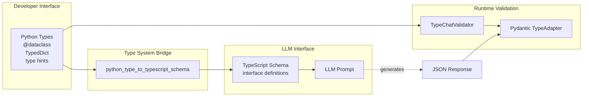
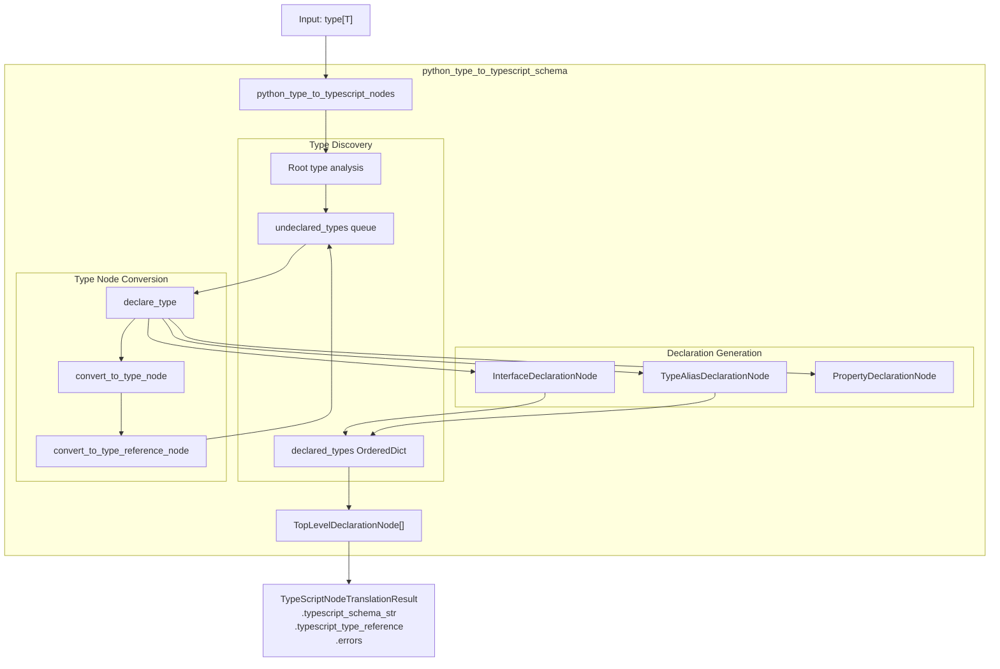
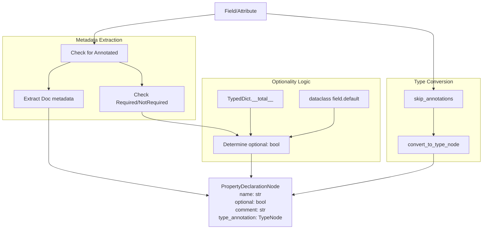
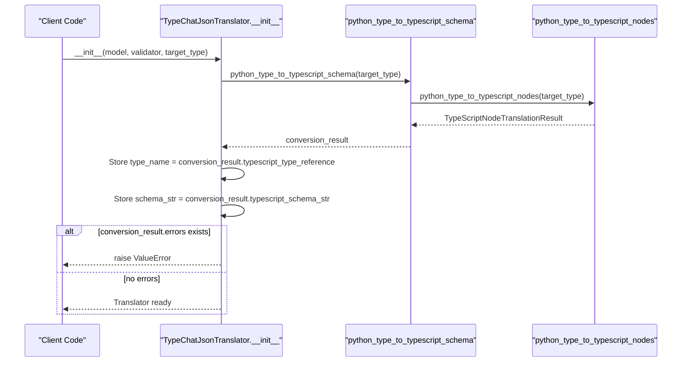
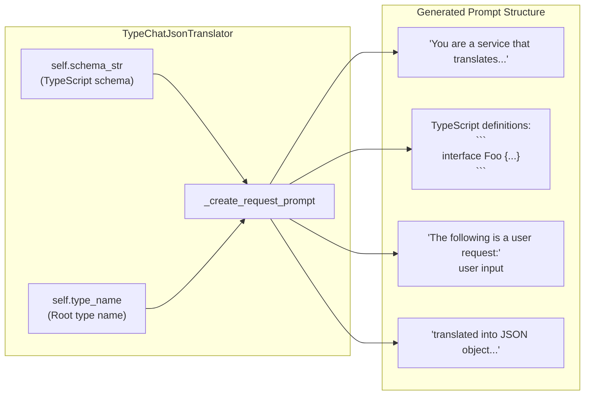
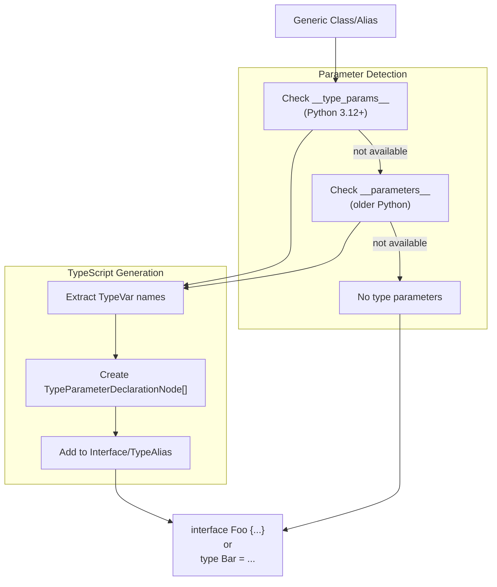
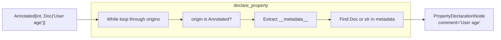
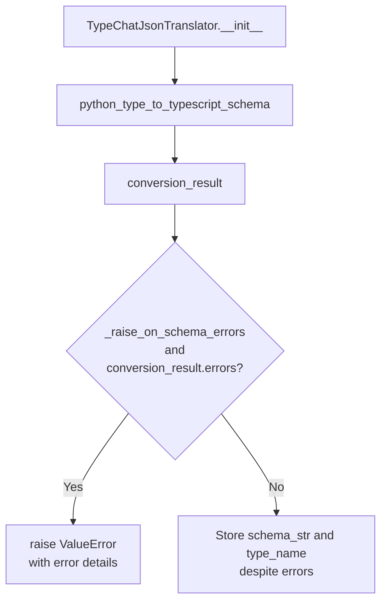
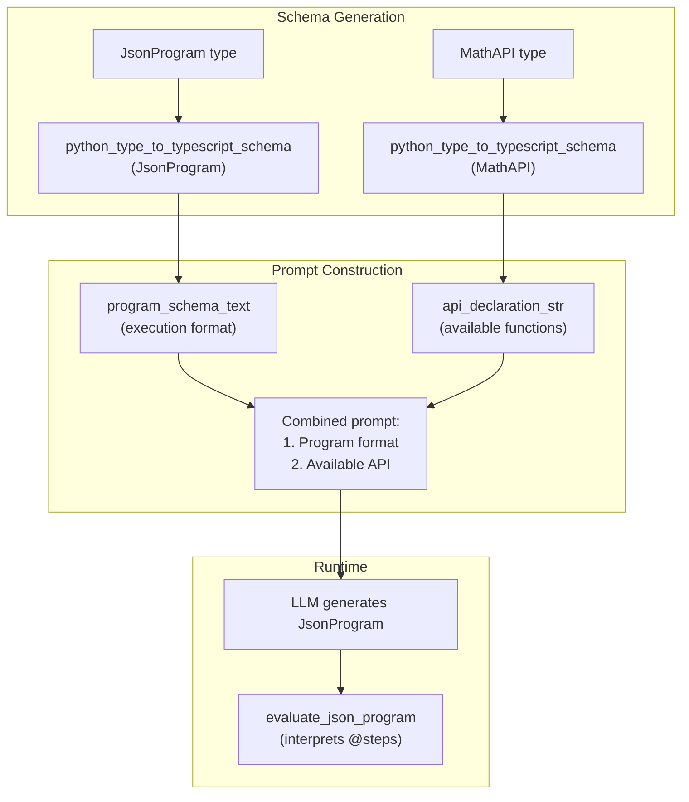

<!-- source: DeepWiki mcp.deepwiki.com · repo microsoft/TypeChat · page 2.3 Type System Bridge · fetched 2026-10-26 -->

# Type System Bridge

<details>
<summary>Relevant source files</summary>

The following files were used as context for generating this wiki page:

- [python/examples/healthData/translator.py](python/examples/healthData/translator.py)
- [python/examples/math/program.py](python/examples/math/program.py)
- [python/examples/multiSchema/agents.py](python/examples/multiSchema/agents.py)
- [python/examples/multiSchema/router.py](python/examples/multiSchema/router.py)
- [python/src/typechat/__init__.py](python/src/typechat/__init__.py)
- [python/src/typechat/_internal/interactive.py](python/src/typechat/_internal/interactive.py)
- [python/src/typechat/_internal/model.py](python/src/typechat/_internal/model.py)
- [python/src/typechat/_internal/translator.py](python/src/typechat/_internal/translator.py)
- [python/src/typechat/_internal/ts_conversion/python_type_to_ts_nodes.py](python/src/typechat/_internal/ts_conversion/python_type_to_ts_nodes.py)
- [python/src/typechat/_internal/validator.py](python/src/typechat/_internal/validator.py)
- [python/tests/__snapshots__/test_coffeeshop/test_coffeeshop_schema.schema.d.ts](python/tests/__snapshots__/test_coffeeshop/test_coffeeshop_schema.schema.d.ts)
- [python/tests/__snapshots__/test_translator.ambr](python/tests/__snapshots__/test_translator.ambr)
- [python/tests/test_conflicting_names_1.py](python/tests/test_conflicting_names_1.py)
- [python/tests/test_translator.py](python/tests/test_translator.py)
- [python/tests/test_validator.py](python/tests/test_validator.py)

</details>


## Purpose and Scope

The Type System Bridge is the component that converts Python type annotations into TypeScript schema definitions for use in LLM prompts. This enables Python developers to define their data structures using native Python types (dataclasses, TypedDict, type hints) while leveraging the fact that large language models are primarily trained on TypeScript and JavaScript codebases.

This page covers the conversion mechanism, supported Python constructs, and how the converted schemas integrate with the translation pipeline. For information about the complete translation flow including validation and repair, see [Translation Pipeline](#2.2). For implementation details of the Python-specific components, see [Schema Conversion System](#3.2).

---

## Motivation: Why Convert to TypeScript?

The Type System Bridge solves a fundamental challenge: most large language models are trained predominantly on TypeScript and JavaScript code, making them more effective at understanding and generating JSON that conforms to TypeScript interface definitions. However, Python developers naturally want to use Python's native type system.

The solution is bidirectional:
1. **For LLM prompts**: Python types are converted to TypeScript schemas that the LLM understands
2. **For validation**: The original Python types are used with Pydantic to validate LLM responses at runtime



**Sources:** [python/src/typechat/_internal/translator.py:43-50](), [python/src/typechat/_internal/validator.py:34-45]()

---

## Conversion Architecture

The conversion process is implemented in `python_type_to_typescript_schema`, which orchestrates the translation from Python type annotations to TypeScript abstract syntax tree (AST) nodes, then to string output.

### Core Conversion Pipeline



**Sources:** [python/src/typechat/_internal/ts_conversion/python_type_to_ts_nodes.py:155-447]()

---

## Type Mapping Table

The Type System Bridge supports comprehensive Python type annotations and maps them to equivalent TypeScript constructs.

### Primitive Types

| Python Type | TypeScript Output | Notes |
|------------|-------------------|-------|
| `str` | `string` | Direct mapping |
| `int` | `number` | Direct mapping |
| `float` | `number` | Direct mapping |
| `bool` | `boolean` | Direct mapping |
| `None`, `NoneType` | `null` | Direct mapping |
| `Any`, `object` | `any` | Direct mapping |
| `Never`, `NoReturn` | `never` | Direct mapping |
| `LiteralString` | `string` | Type-safe string literals |

**Sources:** [python/src/typechat/_internal/ts_conversion/python_type_to_ts_nodes.py:213-224]()

### Collection Types

| Python Type | TypeScript Output | Implementation |
|------------|-------------------|----------------|
| `list[T]` | `T[]` or `Array<T>` | Array syntax unless T is a union |
| `set[T]`, `frozenset[T]` | `T[]` | Converted to arrays |
| `tuple[T, U, V]` | `[T, U, V]` | Fixed-length tuple |
| `tuple[T, ...]` | `T[]` | Variable-length array |
| `dict[K, V]` | `Record<K, V>` | Key type defaults to `string` unless `number` |

**Sources:** [python/src/typechat/_internal/ts_conversion/python_type_to_ts_nodes.py:234-271]()

### Union and Literal Types

| Python Type | TypeScript Output | Example |
|------------|-------------------|---------|
| `T \| U` | `T \| U` | `str \| int` → `string \| number` |
| `Union[T, U]` | `T \| U` | Alternative union syntax |
| `Literal["a", "b"]` | `"a" \| "b"` | String literal union |
| `Literal[1, 2, 3]` | `1 \| 2 \| 3` | Numeric literal union |

**Sources:** [python/src/typechat/_internal/ts_conversion/python_type_to_ts_nodes.py:273-281]()

### Structured Types

| Python Type | TypeScript Output | Requirements |
|------------|-------------------|--------------|
| `@dataclass` | `interface` | Fields converted to properties |
| `TypedDict` | `interface` | Keys converted to properties |
| `type X = ...` (3.12+) | `type X = ...` | Type alias syntax |
| Generic types | Interface with type parameters | `Generic[T]` → `<T>` syntax |

**Sources:** [python/src/typechat/_internal/ts_conversion/python_type_to_ts_nodes.py:344-416]()

---

## Dataclass and TypedDict Conversion

### Property Declaration Process

Both dataclasses and TypedDicts are converted to TypeScript interfaces. The conversion handles property metadata including optionality and documentation.



**Sources:** [python/src/typechat/_internal/ts_conversion/python_type_to_ts_nodes.py:295-335](), [python/src/typechat/_internal/ts_conversion/python_type_to_ts_nodes.py:375-395]()

### Optionality Rules

#### TypedDict
- Default behavior determined by `__total__` flag
- Explicit `Required[T]` and `NotRequired[T]` override the default
- `NotRequired` generates optional properties (`name?: type`)

#### Dataclass
- Properties are optional if `field.default` or `field.default_factory` are set
- Properties are required if both are `MISSING`

**Sources:** [python/src/typechat/_internal/ts_conversion/python_type_to_ts_nodes.py:376-395]()

---

## Integration with TypeChatJsonTranslator

The conversion happens during translator initialization and the results are stored for use in prompt generation.

### Translator Initialization Flow



**Sources:** [python/src/typechat/_internal/translator.py:24-50]()

### Prompt Construction with Schema

The converted TypeScript schema is embedded in the prompt sent to the LLM:



**Sources:** [python/src/typechat/_internal/translator.py:103-115]()

---

## Example: Coffee Shop Order Schema

This example demonstrates a complete conversion from Python dataclasses to TypeScript interfaces, showing how complex nested structures are handled.

### Python Source Types

```python
@dataclass
class Cart:
    type: Literal["Cart"]
    items: list[LineItem | UnknownText]

@dataclass
class LineItem:
    type: Literal["LineItem"]
    product: BakeryProduct | LatteDrink | CoffeeDrink | EspressoDrink | UnknownText
    quantity: int

@dataclass
class LatteDrink:
    type: Literal["LatteDrink"]
    name: Literal["cappuccino", "flat white", "latte", "latte macchiato", "mocha", "chai latte"]
    temperature: Literal["hot", "extra hot", "warm", "iced"] | None = None
    size: Literal["short", "tall", "grande", "venti"] | None = None
    options: list[Creamer | Sweetener | Syrup | Topping | Caffeine | LattePreparation] | None = None
```

### Generated TypeScript Schema

The Type System Bridge generates this TypeScript output (excerpt):

```typescript
interface Cart {
    type: "Cart";
    items: Array<LineItem | UnknownText>;
}

interface LineItem {
    type: "LineItem";
    product: BakeryProduct | LatteDrink | CoffeeDrink | EspressoDrink | UnknownText;
    quantity: number;
}

interface LatteDrink {
    type: "LatteDrink";
    name: "cappuccino" | "flat white" | "latte" | "latte macchiato" | "mocha" | "chai latte";
    temperature?: "hot" | "extra hot" | "warm" | "iced";
    size?: "short" | "tall" | "grande" | "venti";
    options?: Array<Creamer | Sweetener | Syrup | Topping | Caffeine | LattePreparation>;
}
```

**Sources:** [python/tests/__snapshots__/test_coffeeshop/test_coffeeshop_schema.schema.d.ts:1-97]()

### Conversion Details

| Python Feature | TypeScript Output | Line References |
|---------------|-------------------|-----------------|
| `type: Literal["Cart"]` | `type: "Cart"` | Discriminator field |
| `list[LineItem \| UnknownText]` | `Array<LineItem \| UnknownText>` | Union in array uses `Array<>` syntax |
| `temperature: ... \| None = None` | `temperature?: ...` | Optional with default `None` becomes `?:` |
| Dataclass field with default | Optional property (`?:`) | Based on `field.default is not MISSING` |

---

## Generic Types and Type Parameters

The Type System Bridge supports generic types and preserves type parameters in the conversion.

### Type Parameter Extraction



**Sources:** [python/src/typechat/_internal/ts_conversion/python_type_to_ts_nodes.py:348-359](), [python/src/typechat/_internal/ts_conversion/python_type_to_ts_nodes.py:406-407]()

---

## Annotation Metadata and Documentation

The Type System Bridge extracts documentation from Python `Annotated` types to generate TypeScript comments.

### Supported Metadata

| Python Annotation | TypeScript Output | Example |
|-------------------|-------------------|---------|
| `Annotated[T, Doc("text")]` | `// text` | Uses `typing_extensions.Doc` |
| `Annotated[T, "text"]` | `// text` | Plain string as metadata |
| Class docstring | `// docstring` | From `__doc__` attribute |



**Sources:** [python/src/typechat/_internal/ts_conversion/python_type_to_ts_nodes.py:304-316](), [python/examples/math/program.py:33-42]()

---

## Error Handling and Validation

The conversion process tracks errors during translation, allowing the translator to either raise exceptions or continue with partial results.

### Error Categories

| Error Type | Trigger Condition | Example |
|-----------|-------------------|---------|
| Name conflicts | Two types with same `__name__` | Multiple classes named `C` from different modules |
| Invalid type arguments | Missing or wrong number of type args | `dict[str]` (expects 2 args) |
| Unsupported constructs | Type not translatable | Plain class without `@dataclass` |
| Malformed tuples | Invalid `tuple[T, ...]` syntax | `tuple[..., T]` (ellipsis must be second) |

### Error Flow in Translator



**Sources:** [python/src/typechat/_internal/translator.py:45-50](), [python/src/typechat/_internal/ts_conversion/python_type_to_ts_nodes.py:161-185]()

---

## Advanced Pattern: Program API

The `math` example demonstrates using the Type System Bridge for metaprogramming, where the schema itself becomes an executable program format.

### JsonProgram Schema Conversion

The example defines a recursive program structure using TypedDict:

```python
Expression: TypeAlias = "str | int | float | bool | None | dict[str, Expression] | list[Expression] | FunctionCall | ResultReference"

JsonProgram = TypedDict("JsonProgram", {"@steps": list["FunctionCall"]})

FunctionCall = TypedDict(
    "FunctionCall",
    {
        "@func": Annotated[str, Doc("Name of the function")],
        "@args": NotRequired[Annotated[list[Expression], Doc("Arguments for the function, if any")]],
    },
)

ResultReference = TypedDict(
    "ResultReference", 
    {"@ref": Annotated[int, Doc("Index of the previous expression in the 'steps' array")]}
)
```

**Sources:** [python/examples/math/program.py:27-42]()

### Dual Schema Usage



**Sources:** [python/examples/math/program.py:44-147]()

---

## Snapshot Testing

The Type System Bridge includes comprehensive snapshot tests to ensure conversion stability across Python versions.

### Test Infrastructure

| Test Aspect | Implementation | Purpose |
|-------------|----------------|---------|
| Version-specific snapshots | `PyVersionedTypeScriptSchemaSnapshotExtension` | Different output for Python 3.12+ features |
| Schema file format | `.schema.d.ts` files | Readable TypeScript declaration files |
| Name conflict detection | `test_conflicting_names_*.py` | Validate error handling for duplicate names |

**Sources:** [python/tests/test_conflicting_names_1.py:1-26](), [python/tests/__snapshots__/test_translator.ambr:1-387]()

---

