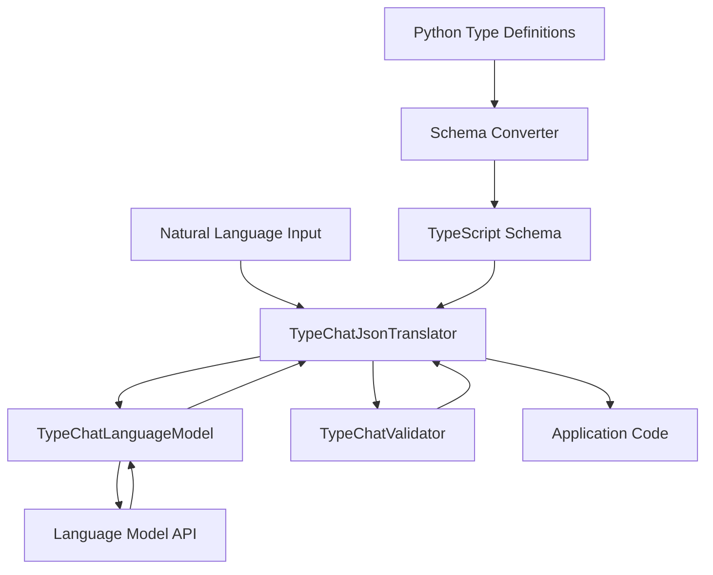
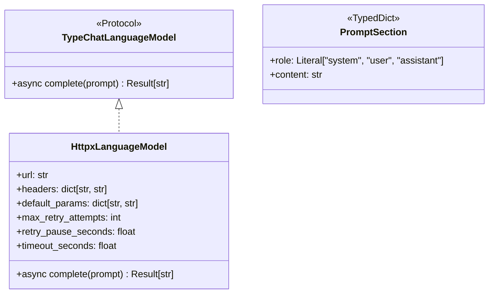
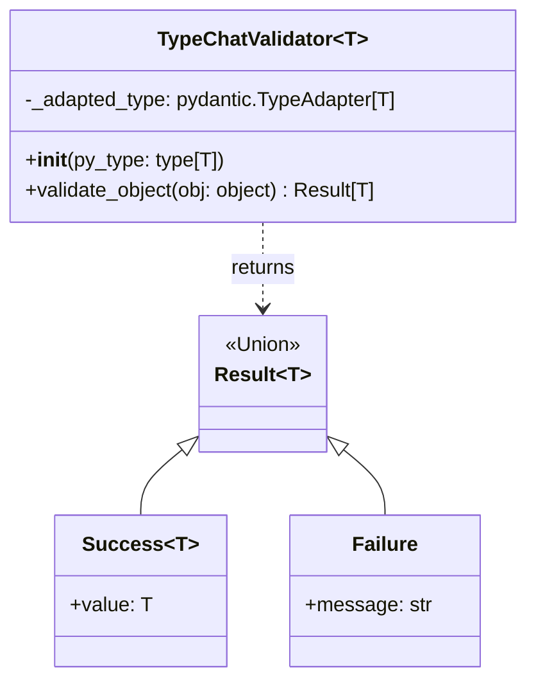
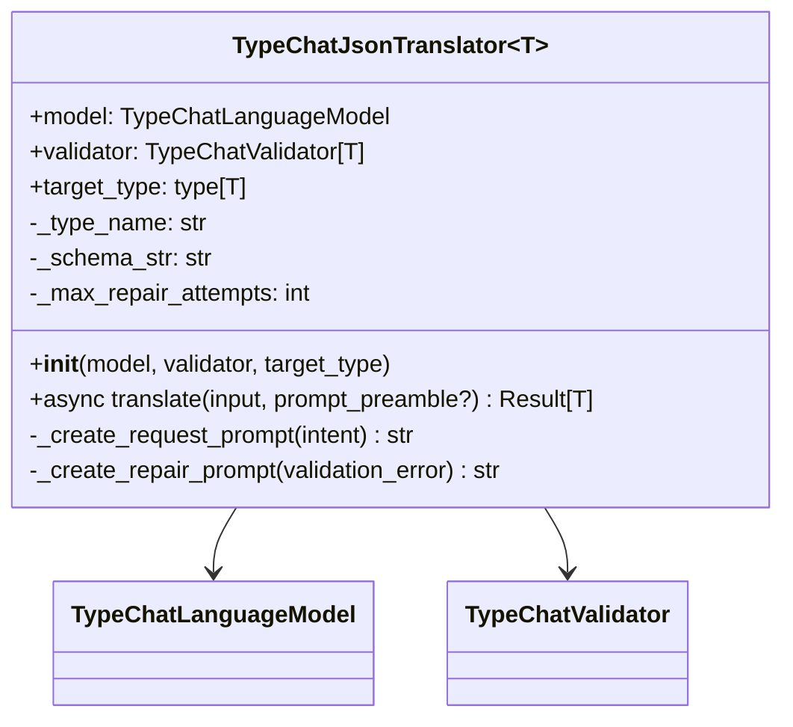
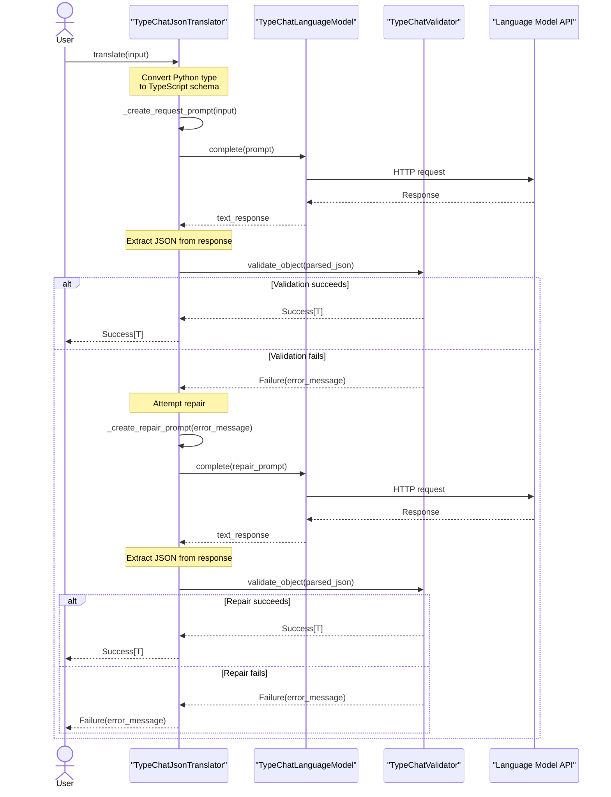
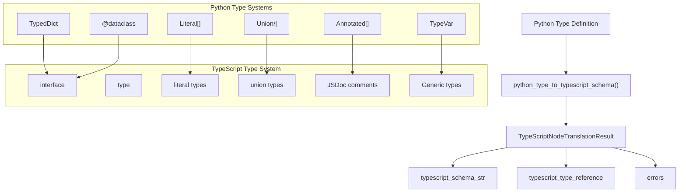
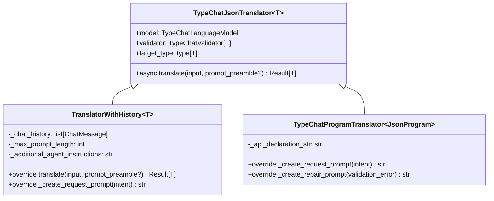

<!-- source: DeepWiki mcp.deepwiki.com · repo microsoft/TypeChat · page 3 Python Implementation · fetched 2026-10-26 -->

# Python Implementation

<details>
<summary>Relevant source files</summary>

The following files were used as context for generating this wiki page:

- [python/README.md](python/README.md)
- [python/examples/README.md](python/examples/README.md)
- [python/examples/healthData/translator.py](python/examples/healthData/translator.py)
- [python/examples/math/program.py](python/examples/math/program.py)
- [python/examples/multiSchema/agents.py](python/examples/multiSchema/agents.py)
- [python/examples/multiSchema/router.py](python/examples/multiSchema/router.py)
- [python/src/typechat/__init__.py](python/src/typechat/__init__.py)
- [python/src/typechat/_internal/interactive.py](python/src/typechat/_internal/interactive.py)
- [python/src/typechat/_internal/model.py](python/src/typechat/_internal/model.py)
- [python/src/typechat/_internal/translator.py](python/src/typechat/_internal/translator.py)
- [python/src/typechat/_internal/validator.py](python/src/typechat/_internal/validator.py)
- [python/tests/__snapshots__/test_translator.ambr](python/tests/__snapshots__/test_translator.ambr)
- [python/tests/test_translator.py](python/tests/test_translator.py)
- [python/tests/test_validator.py](python/tests/test_validator.py)
- [site/src/_data/docsTOC.json](site/src/_data/docsTOC.json)
- [site/src/docs/python/basic-usage.md](site/src/docs/python/basic-usage.md)
- [site/src/docs/typescript/basic-usage.md](site/src/docs/typescript/basic-usage.md)
- [typescript/README.md](typescript/README.md)
- [typescript/examples/README.md](typescript/examples/README.md)

</details>


This page provides documentation for the Python implementation of TypeChat, a library that makes it easy to build natural language interfaces using type definitions. While the TypeChat project also has a [TypeScript Implementation](#4), this document focuses specifically on how TypeChat is implemented and used in Python.

## Overview

The Python implementation of TypeChat provides all the core functionality of the TypeScript version while leveraging Python's type annotation system. It allows developers to define schemas using Python's type hints (including TypedDict, dataclasses, and other typing constructs) and automatically converts these to TypeScript schemas for use in prompts to large language models.



Sources:
- [python/src/typechat/_internal/translator.py:1-126]()
- [python/src/typechat/_internal/model.py:1-185]()
- [python/src/typechat/_internal/validator.py:1-68]()
- [python/src/typechat/__init__.py:1-26]()

## Installation and Requirements

TypeChat for Python requires Python 3.11 or later. It depends on several key packages:

- `pydantic>=2.5.2`: For validating JSON objects against Python type definitions
- `pydantic_core>=2.16.3`: Core validation engine used by Pydantic
- `httpx>=0.27.0`: For making HTTP requests to language model APIs
- `typing_extensions>=4.10.0`: For advanced type annotations

You can install TypeChat using pip:

```bash
pip install "typechat @ git+https://github.com/microsoft/TypeChat#subdirectory=python"
```

Sources:
- [python/pyproject.toml:1-194]()
- [python/README.md:1-64]()

## Core Components

### TypeChatLanguageModel

`TypeChatLanguageModel` is a protocol (interface) that defines how to communicate with language models:



The implementation supports both OpenAI and Azure OpenAI endpoints through factory functions:

- `create_language_model(vals: dict[str, str | None])`: Creates a model from environment variables
- `create_openai_language_model(api_key, model, endpoint, org)`: Creates an OpenAI model
- `create_azure_openai_language_model(api_key, endpoint)`: Creates an Azure OpenAI model

Sources:
- [python/src/typechat/_internal/model.py:1-185]()
- [python/src/typechat/__init__.py:1-26]()

### TypeChatValidator

`TypeChatValidator` validates JSON objects against Python type definitions using Pydantic:



Sources:
- [python/src/typechat/_internal/validator.py:1-68]()

### TypeChatJsonTranslator

`TypeChatJsonTranslator` is the main component that users interact with:



The translator orchestrates the process of:
1. Converting Python types to TypeScript schemas
2. Creating prompts with these schemas
3. Sending prompts to the language model
4. Validating and potentially repairing the response

Sources:
- [python/src/typechat/_internal/translator.py:1-126]()

## Request Processing Flow

The following diagram illustrates how a request is processed through the Python implementation:



Sources:
- [python/src/typechat/_internal/translator.py:52-102]()

## Schema Conversion

A unique aspect of the Python implementation is the conversion of Python type annotations to TypeScript schemas. This is handled by the `python_type_to_typescript_schema` function:



The converter supports a wide range of Python type constructs:
- Primitive types (`str`, `int`, `bool`, etc.)
- Container types (`list`, `dict`, `tuple`)
- Union types (including the new pipe syntax `|`)
- Literal types
- TypedDict (converted to TypeScript interfaces)
- Dataclasses (converted to TypeScript interfaces)
- Generics (with `TypeVar`)
- Special types like `NotRequired` and `Required` (for optional fields)
- Type aliases

Sources:
- [python/src/typechat/_internal/ts_conversion/python_type_to_ts_nodes.py:1-439]()
- [python/src/typechat/_internal/translator.py:43-50]()

## Example Usage

Here's a basic example of how to use TypeChat in Python:

```python
from dataclasses import dataclass
from typing_extensions import Literal, Annotated, Doc
import os
import asyncio
from typechat import TypeChatValidator, TypeChatJsonTranslator, create_language_model

@dataclass
class Sentiment:
    """
    The following is a schema definition for determining the sentiment of some user input.
    """
    sentiment: Annotated[Literal["negative", "neutral", "positive"], 
                         Doc("The sentiment for the text")]

async def main():
    # Create language model from environment variables
    model = create_language_model(os.environ)
    
    # Create validator and translator
    validator = TypeChatValidator(Sentiment)
    translator = TypeChatJsonTranslator(model, validator, Sentiment)
    
    # Translate natural language to JSON
    result = await translator.translate("I'm having a great day!")
    if result.success:
        print(f"Sentiment: {result.value.sentiment}")
    else:
        print(f"Error: {result.message}")

asyncio.run(main())
```

More complex examples are available in the repository, demonstrating how to use TypeChat for various applications such as:
- Sentiment analysis
- Coffee shop ordering
- Calendar scheduling
- Math problem solving
- Music player control
- Multi-schema routing

Sources:
- [python/examples/sentiment/schema.py:1-11]()
- [python/examples/README.md:1-120]()

## Advanced Features

### Interactive Mode

The Python implementation includes a helper function `process_requests` that can be used to process requests interactively or from a file:

```python
from typechat import process_requests

async def main():
    # Setup translator...
    
    await process_requests(
        interactive_prompt="🤖> ",
        input_file_name=None,  # Or specify a file path
        process_request=lambda line: translator.translate(line)
    )
```

Sources:
- [python/src/typechat/_internal/interactive.py:1-38]()

### Custom Translators

You can extend `TypeChatJsonTranslator` to customize the prompts and behavior:



This allows for specialized translators for different use cases, such as:
- Translators that maintain conversation history
- Program translators that generate executable code
- Multi-schema routers that select the appropriate schema based on user input

Sources:
- [python/examples/healthData/translator.py:1-68]()
- [python/examples/math/program.py:1-159]()
- [python/examples/multiSchema/router.py:1-51]()
- [python/examples/multiSchema/agents.py:1-125]()

## Development Environment

The TypeChat development environment is configured to support both Python and TypeScript development. It includes:

- VS Code configuration for both languages
- A dev container for consistent development environments
- Hatch for Python environment and package management
- NPM for TypeScript dependencies

Sources:
- [.devcontainer/devcontainer.json:1-49]()
- [python/pyproject.toml:50-194]()

## Testing and Validation

The Python implementation includes a test suite built with pytest. The tests cover various aspects of the implementation, including:

- Type validation with Pydantic
- Schema conversion from Python to TypeScript
- Integration with language models

Sources:
- [python/tests/test_validator.py:1-16]()
- [python/pyproject.toml:67-70]()

## Conclusion

The Python implementation of TypeChat provides a powerful and flexible way to build natural language interfaces using Python's type annotation system. It maintains feature parity with the TypeScript implementation while taking advantage of Python-specific features and conventions.

By leveraging the schema conversion capabilities, developers can define their schemas once in Python and have them automatically converted to TypeScript for use in prompts to language models. This approach combines the simplicity of Python's type system with the effectiveness of TypeChat's schema-driven approach to natural language understanding.

---

