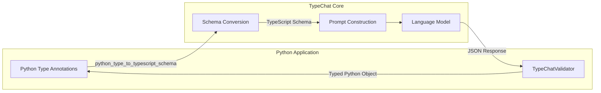
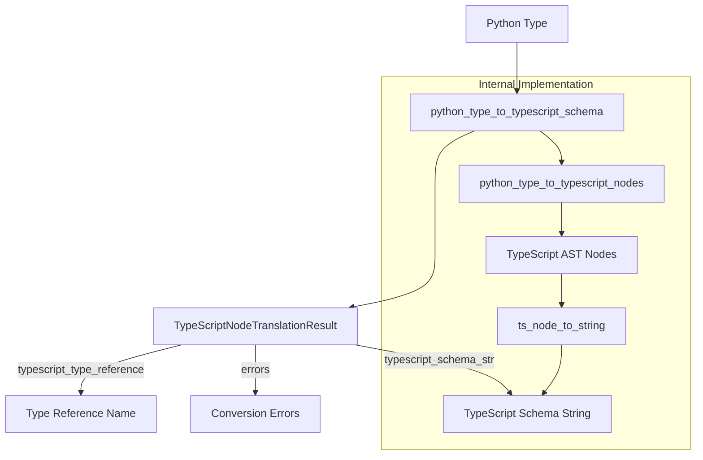
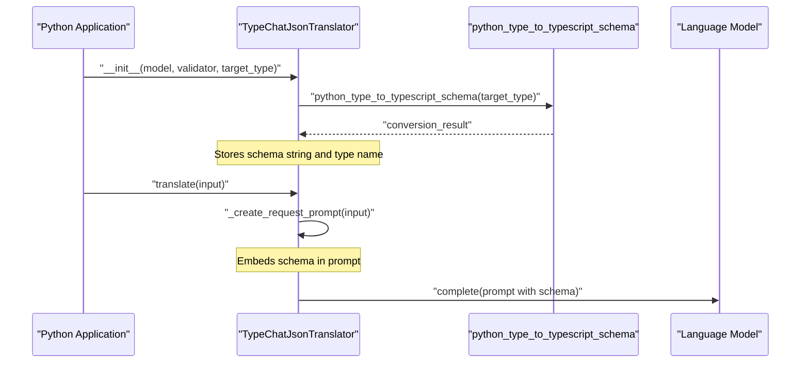

<!-- source: DeepWiki mcp.deepwiki.com · repo microsoft/TypeChat · page 3.2 Schema Conversion System · fetched 2026-10-26 -->

# Schema Conversion

<details>
<summary>Relevant source files</summary>

The following files were used as context for generating this wiki page:

- [.github/workflows/ci.js.yml](.github/workflows/ci.js.yml)
- [.github/workflows/ci.python.yml](.github/workflows/ci.python.yml)
- [python/src/typechat/_internal/ts_conversion/python_type_to_ts_nodes.py](python/src/typechat/_internal/ts_conversion/python_type_to_ts_nodes.py)
- [python/tests/__py3.13_snapshots__/test_conflicting_names_1/test_conflicting_names_1.schema.d.ts](python/tests/__py3.13_snapshots__/test_conflicting_names_1/test_conflicting_names_1.schema.d.ts)
- [python/tests/__py3.13_snapshots__/test_hello_world/test_generic_alias1.schema.d.ts](python/tests/__py3.13_snapshots__/test_hello_world/test_generic_alias1.schema.d.ts)
- [python/tests/__py3.14_snapshots__/test_conflicting_names_1/test_conflicting_names_1.schema.d.ts](python/tests/__py3.14_snapshots__/test_conflicting_names_1/test_conflicting_names_1.schema.d.ts)
- [python/tests/__py3.14_snapshots__/test_hello_world/test_generic_alias1.schema.d.ts](python/tests/__py3.14_snapshots__/test_hello_world/test_generic_alias1.schema.d.ts)
- [python/tests/__snapshots__/test_coffeeshop/test_coffeeshop_schema.schema.d.ts](python/tests/__snapshots__/test_coffeeshop/test_coffeeshop_schema.schema.d.ts)
- [python/tests/test_conflicting_names_1.py](python/tests/test_conflicting_names_1.py)

</details>


This page documents the schema conversion system in TypeChat's Python implementation, which transforms Python type annotations into TypeScript type definitions. This conversion is a critical bridge allowing Python developers to leverage TypeChat's schema-driven approach while maintaining familiar Python typing patterns.

For information about the broader concept of schema engineering, see [Schema Engineering](#2.1).

## Overview

Schema conversion in TypeChat serves as the foundation for translating between Python's type system and TypeScript's type system. This conversion enables Python applications to:

1. Define data schemas using native Python type annotations
2. Automatically convert these types to TypeScript definitions
3. Use the TypeScript definitions in prompts to language models
4. Validate responses against the original Python types



Sources: [python/src/typechat/_internal/translator.py:43-50](), [python/src/typechat/_internal/ts_conversion/python_type_to_ts_nodes.py:146-438]()

## Core Components

The schema conversion system consists of several interconnected components:



Sources: [python/src/typechat/_internal/ts_conversion/python_type_to_ts_nodes.py:119-123](), [python/src/typechat/_internal/ts_conversion/ts_node_to_string.py:20-96]()

## Conversion Process

The conversion from Python types to TypeScript schemas occurs in several stages:

1. **Type Analysis**: Python types are analyzed using reflection APIs like `get_type_hints`, `get_origin`, and `get_args`
2. **Node Creation**: Corresponding TypeScript AST nodes are created for each Python type construct
3. **Dependency Resolution**: Type dependencies are identified and processed recursively
4. **Node Stringification**: The AST nodes are converted to TypeScript code strings
5. **Result Assembly**: The schema string, type reference name, and any errors are packaged in a result object

Sources: [python/src/typechat/_internal/ts_conversion/python_type_to_ts_nodes.py:146-438](), [python/src/typechat/_internal/translator.py:43-50]()

## Type Mapping

The following table shows how Python types are mapped to TypeScript types:

| Python Type                    | TypeScript Equivalent              |
|--------------------------------|------------------------------------|
| `str`, `LiteralString`         | `string`                           |
| `int`, `float`                 | `number`                           |
| `bool`                         | `boolean`                          |
| `None`, `NoneType`             | `null`                             |
| `list[T]`, `set[T]`            | `T[]`                              |
| `dict[K, V]`                   | `Record<K, V>`                     |
| `tuple[T, U]`                  | `[T, U]`                           |
| `tuple[T, ...]`                | `T[]`                              |
| `Literal[x, y]`                | `x \| y`                           |
| `T | U` (Union)                | `T \| U`                           |
| `TypedDict`                    | `interface`                        |
| `dataclass`                    | `interface`                        |
| `TypeAlias`                    | `type`                             |
| `Generic[T]`                   | `Generic<T>`                       |
| `Any`, `object`                | `any`                              |
| `Never`, `NoReturn`            | `never`                            |
| `Self`                         | `this`                             |

Sources: [python/src/typechat/_internal/ts_conversion/python_type_to_ts_nodes.py:201-283]()

## Usage in TypeChatJsonTranslator

The schema conversion is primarily used in the `TypeChatJsonTranslator` initialization:



Sources: [python/src/typechat/_internal/translator.py:42-50](), [python/src/typechat/_internal/translator.py:104-108]()

## Special Type Handling

### Documentation Comments

Comments are extracted from Python's `Annotated` with `Doc` and added to TypeScript interfaces:

```python
class Sample(TypedDict):
    """Class documentation."""
    field: Annotated[str, Doc("Field documentation")]
```

Converts to:

```typescript
// Class documentation.
interface Sample {
    // Field documentation
    field: string;
}
```

Sources: [python/src/typechat/_internal/ts_conversion/python_type_to_ts_nodes.py:286-326]()

### Optional Properties

Optional properties are handled differently for TypedDicts vs. Dataclasses:

- In **TypedDicts**: Properties are optional based on `total=False` or explicit `NotRequired`
- In **Dataclasses**: Properties are optional if they have a default value

Sources: [python/src/typechat/_internal/ts_conversion/python_type_to_ts_nodes.py:366-386]()

## Error Handling

The conversion process collects errors but continues processing when possible:

- Type constructs that can't be translated are logged as errors
- Invalid usage of type annotations is detected and reported
- Conflicting type names are identified
- The result includes an `errors` list containing all issues

When initializing `TypeChatJsonTranslator`, these errors can either:
- Raise an exception (default behavior)
- Be collected but ignored by setting `_raise_on_schema_errors=False`

Sources: [python/src/typechat/_internal/translator.py:43-47](), [python/src/typechat/_internal/ts_conversion/python_type_to_ts_nodes.py:118-123]()

## Examples

### Basic Type Conversion

```python
from typing import TypedDict, List, Optional

class User(TypedDict):
    name: str
    age: int
    email: Optional[str]
    tags: List[str]

# Convert to TypeScript
from typechat import python_type_to_typescript_schema
result = python_type_to_typescript_schema(User)
print(result.typescript_schema_str)
```

Output:
```typescript
interface User {
    name: string;
    age: number;
    email: string | null;
    tags: string[];
}
```

### Complex Example with Generic Types

This example demonstrates conversion of generic types, inheritance, and nested structures:

```python
from typing import TypeVar, Generic, List, Dict, Optional
from typing_extensions import TypedDict

T = TypeVar('T')

class BaseResponse(Generic[T]):
    data: T
    status: str

class UserData(TypedDict):
    id: int
    name: str
    settings: Optional[Dict[str, str]]

# Type to convert
class UserResponse(BaseResponse[UserData]):
    metadata: List[str]
```

Sources: [python/examples/math/program.py:13-33](), [python/examples/healthData/translator.py:10-15]()

## Application in Examples

The schema conversion system is used in several example applications:

1. **Math Example**: Converts a `JsonProgram` type for solving math problems
2. **Music Player**: Converts player action types for controlling music playback
3. **MultiSchema Router**: Converts multiple schema types for request routing
4. **Health Data**: Converts health data types with temporal relationships

Sources: [python/examples/math/program.py:44-46](), [python/examples/multiSchema/agents.py:28-44](), [python/examples/multiSchema/router.py:12-25]()

## Advanced Usage

Some applications handle conversion errors or customize the conversion process:

```python
# Handling conversion errors
result = python_type_to_typescript_schema(complex_type)
if result.errors:
    print("Conversion warnings:", result.errors)
    
# Using the type name reference
type_name = result.typescript_type_reference
print(f"The root type is {type_name}")

# Passing conversion result to translator
translator = TypeChatJsonTranslator(
    model, validator, target_type, 
    _raise_on_schema_errors=False
)
```

Sources: [python/examples/math/program.py:124-127]()

## Limitations and Considerations

- Some Python typing constructs have no direct TypeScript equivalent
- Python 3.12 type features like `TypeAliasType` have special handling
- Complex recursive types may require special handling
- Type name conflicts are detected but not automatically resolved
- Generic protocol classes have limited support

Sources: [python/src/typechat/_internal/ts_conversion/python_type_to_ts_nodes.py:58-116](), [python/tests/__snapshots__/test_conflicting_names_1/test_conflicting_names_1.schema.d.ts:1-7]()

---

