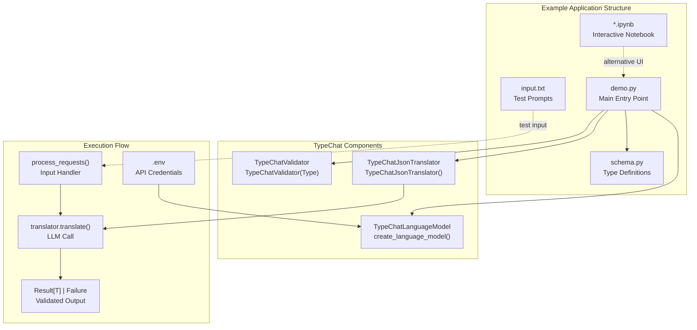
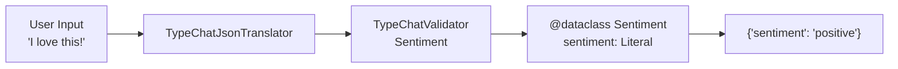
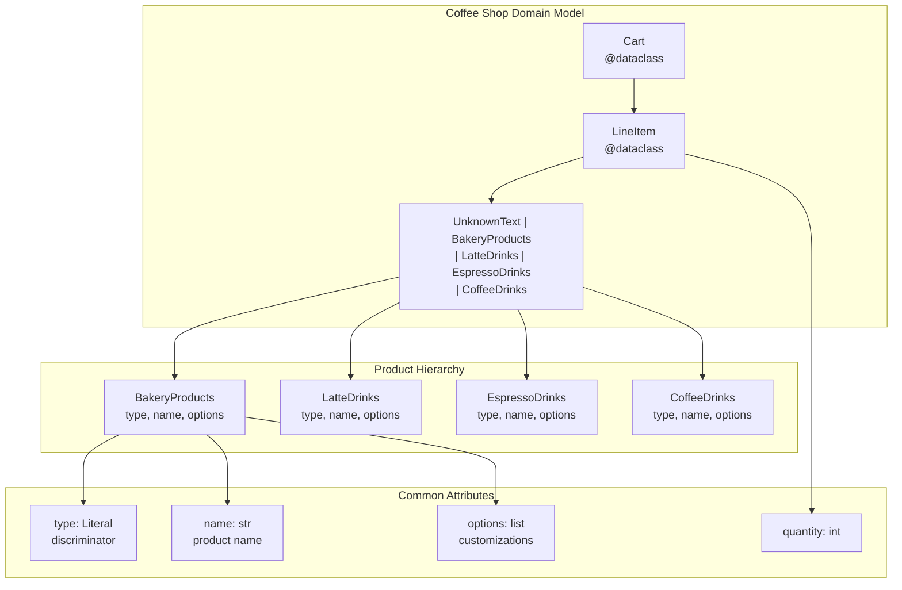
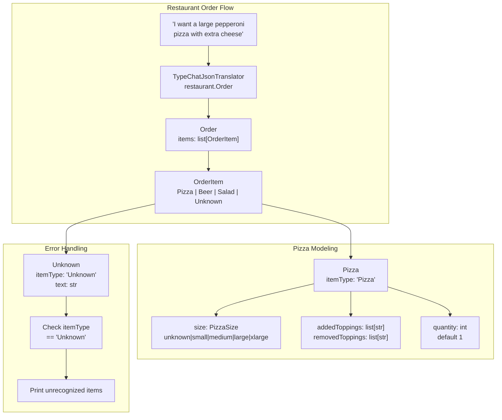
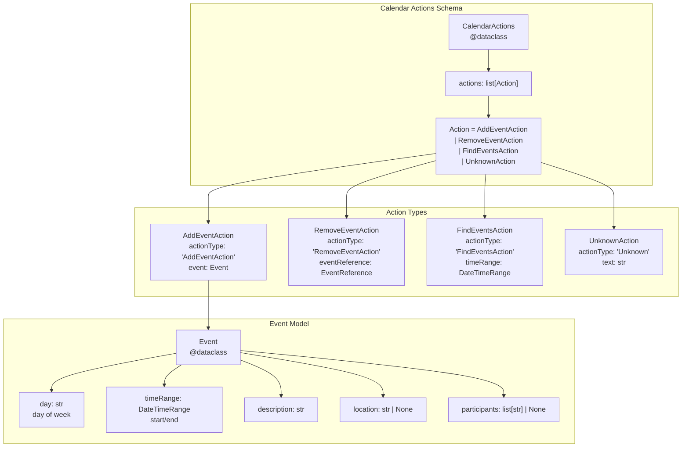
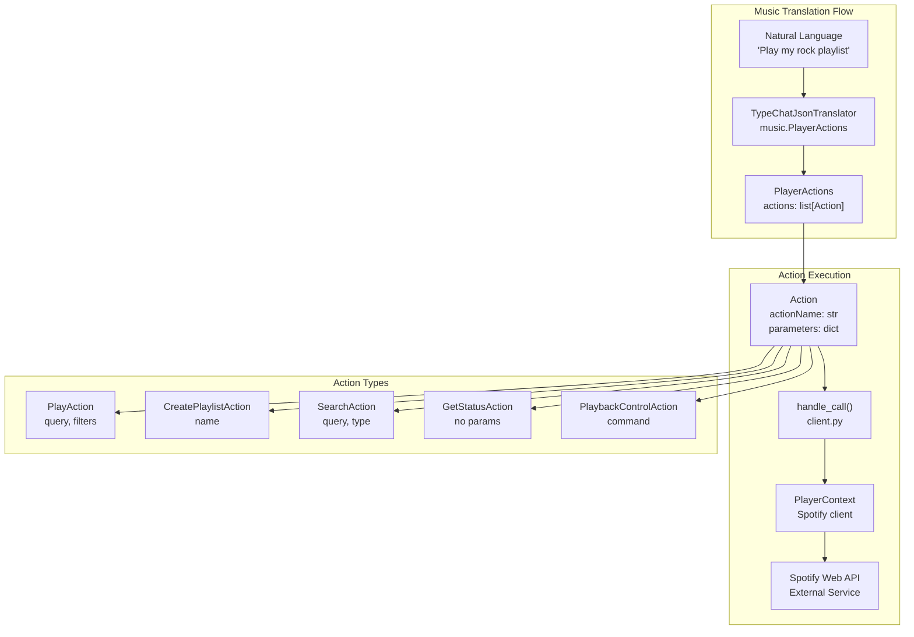
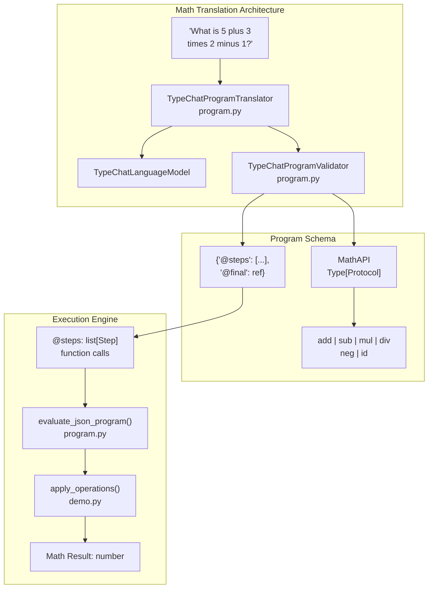
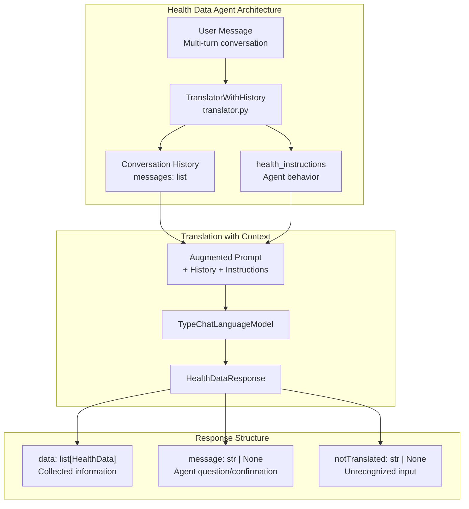
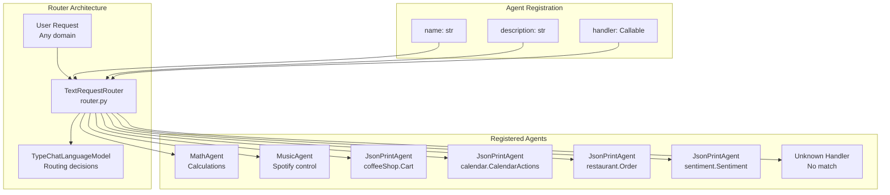
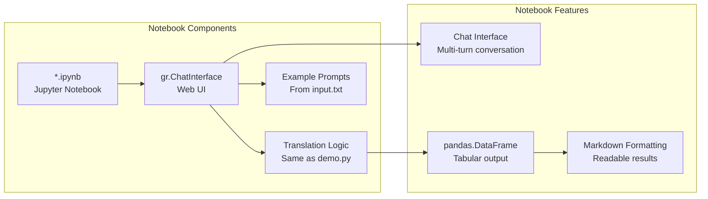

<!-- source: DeepWiki mcp.deepwiki.com · repo microsoft/TypeChat · page 3.3 Python Examples · fetched 2026-10-26 -->

# Python Examples

<details>
<summary>Relevant source files</summary>

The following files were used as context for generating this wiki page:

- [python/README.md](python/README.md)
- [python/examples/README.md](python/examples/README.md)
- [python/examples/calendar/demo.py](python/examples/calendar/demo.py)
- [python/examples/coffeeShop/demo.py](python/examples/coffeeShop/demo.py)
- [python/examples/healthData/demo.py](python/examples/healthData/demo.py)
- [python/examples/math/demo.py](python/examples/math/demo.py)
- [python/examples/multiSchema/demo.py](python/examples/multiSchema/demo.py)
- [python/examples/music/demo.py](python/examples/music/demo.py)
- [python/examples/restaurant/demo.py](python/examples/restaurant/demo.py)
- [python/examples/sentiment/demo.py](python/examples/sentiment/demo.py)
- [python/notebooks/calendar.ipynb](python/notebooks/calendar.ipynb)
- [python/notebooks/coffeeShop.ipynb](python/notebooks/coffeeShop.ipynb)
- [python/notebooks/healthData.ipynb](python/notebooks/healthData.ipynb)
- [python/notebooks/math.ipynb](python/notebooks/math.ipynb)
- [python/notebooks/music.ipynb](python/notebooks/music.ipynb)
- [python/notebooks/restaurant.ipynb](python/notebooks/restaurant.ipynb)
- [python/notebooks/sentiment.ipynb](python/notebooks/sentiment.ipynb)
- [site/src/_data/docsTOC.json](site/src/_data/docsTOC.json)
- [site/src/docs/python/basic-usage.md](site/src/docs/python/basic-usage.md)
- [site/src/docs/typescript/basic-usage.md](site/src/docs/typescript/basic-usage.md)
- [typescript/README.md](typescript/README.md)
- [typescript/examples/README.md](typescript/examples/README.md)

</details>


## Purpose and Scope

This page documents the Python example applications included in the TypeChat repository. These examples demonstrate how to use the TypeChat Python library to build natural language interfaces for various domains, ranging from simple sentiment analysis to complex multi-agent routing systems. Each example illustrates specific TypeChat capabilities and design patterns.

For information about the core TypeChat Python components used by these examples, see [Core Components](#3.1). For details on the schema conversion system that enables these examples to work with LLMs, see [Schema Conversion System](#3.2).

## Example Applications Overview

The Python implementation includes eight example applications organized by complexity:

| Example | Location | Purpose | Complexity |
|---------|----------|---------|------------|
| **Sentiment** | [python/examples/sentiment/]() | Classify text sentiment as negative, neutral, or positive | Simple |
| **Coffee Shop** | [python/examples/coffeeShop/]() | Process coffee and bakery orders with customizations | Moderate |
| **Restaurant** | [python/examples/restaurant/]() | Handle complex restaurant orders with pizza, beer, and salads | Moderate |
| **Calendar** | [python/examples/calendar/]() | Manage calendar events through action sequences | Moderate |
| **Music** | [python/examples/music/]() | Control Spotify playback and manage playlists | Moderate |
| **Math** | [python/examples/math/]() | Generate and evaluate mathematical expressions | Advanced |
| **HealthData** | [python/examples/healthData/]() | Collect health data through conversational history | Advanced |
| **MultiSchema** | [python/examples/multiSchema/]() | Route requests to specialized agents dynamically | Advanced |

**Sources:** [python/examples/README.md:1-21]()

## Common Example Structure

All Python examples follow a consistent architectural pattern that demonstrates TypeChat's standard usage:



### Standard Demo Pattern

Every example implements this core pattern in its `demo.py` file:

1. **Load Configuration**: Read API credentials from environment using `dotenv_values()`
2. **Create Model**: Initialize language model with `create_language_model(env_vals)`
3. **Define Validator**: Create `TypeChatValidator` with target type from `schema.py`
4. **Build Translator**: Construct `TypeChatJsonTranslator` with model, validator, and type
5. **Define Handler**: Implement async `request_handler(message: str)` function
6. **Process Requests**: Call `process_requests()` with prompt prefix, optional input file, and handler

**Sources:** [python/examples/sentiment/demo.py:1-31](), [python/examples/coffeeShop/demo.py:1-35](), [python/examples/restaurant/demo.py:1-33](), [python/examples/calendar/demo.py:1-34]()

## Simple Classification: Sentiment

The sentiment example serves as TypeChat's "Hello World" - it demonstrates the minimal setup required to classify natural language input.

### Sentiment Schema

The schema defines a single type with three possible values:



The schema leverages Python's `Literal` type hint to constrain responses:

- **Type**: `@dataclass` defining `Sentiment` class
- **Field**: `sentiment: Literal["negative", "neutral", "positive"]`
- **Purpose**: Demonstrates basic three-way classification

**Sources:** [python/examples/sentiment/demo.py:8-24]()

### Sentiment Implementation

The sentiment demo implements the minimal TypeChat workflow:

- **Model Creation**: [python/examples/sentiment/demo.py:13]() - `create_language_model(env_vals)`
- **Validator Setup**: [python/examples/sentiment/demo.py:14]() - `TypeChatValidator(sentiment.Sentiment)`
- **Translator Construction**: [python/examples/sentiment/demo.py:15]() - Combines model, validator, and target type
- **Request Handler**: [python/examples/sentiment/demo.py:17-23]() - Processes translation result and extracts sentiment field
- **Interactive Processing**: [python/examples/sentiment/demo.py:26]() - Uses `process_requests()` with "😀> " prompt

**Sources:** [python/examples/sentiment/demo.py:11-31]()

## Structured Data Examples

### Coffee Shop Orders

The coffee shop example demonstrates structured data collection for a product ordering system with customization options.



The schema uses a discriminated union pattern where each product type has a unique `type` field value:

- **Cart Structure**: Contains `items: list[LineItem]`
- **LineItem**: Links `product` to `quantity`
- **Product Types**: Union of `UnknownText`, `BakeryProducts`, `LatteDrinks`, `EspressoDrinks`, `CoffeeDrinks`
- **Unknown Handling**: [python/examples/coffeeShop/demo.py:24-28]() - Detects items where `type == "Unknown"`

The demo's request handler checks for unknown items and reports them back to the user, demonstrating TypeChat's ability to handle ambiguous input gracefully.

**Sources:** [python/examples/coffeeShop/demo.py:1-35](), [python/examples/README.md:14]()

### Restaurant Orders

The restaurant example extends the coffee shop pattern with more complex menu structures and option combinations.



Key differences from coffee shop:

- **More Complex Options**: Pizza allows both `addedToppings` and `removedToppings` lists
- **Size Enumeration**: Uses `PizzaSize` literal type with 5 values including "unknown"
- **Multiple Product Categories**: Pizza, Beer, Salad each with distinct attributes
- **Quantity Defaults**: Demonstrates optional fields with default values

**Sources:** [python/examples/restaurant/demo.py:1-33](), [python/examples/README.md:17]()

## Action Sequence Examples

### Calendar Actions

The calendar example demonstrates generating sequences of operations rather than static data structures.



The calendar example uses discriminated unions where each action has an `actionType` field:

- **Action Pattern**: Each action type contains different payloads appropriate for the operation
- **Unknown Handling**: [python/examples/calendar/demo.py:22-26]() - Reports unrecognized actions
- **Prompt Prefix**: Uses "📅> " to indicate calendar domain

**Sources:** [python/examples/calendar/demo.py:1-34](), [python/examples/README.md:15]()

### Music Player

The music example demonstrates integration with external APIs (Spotify) and complex dataflow programs.



The music example introduces several advanced concepts:

- **External API Integration**: [python/examples/music/demo.py:15]() - Creates `player_context` via `get_client_context()`
- **Action Execution**: [python/examples/music/demo.py:25-26]() - Iterates through actions calling `handle_call()`
- **Exception Handling**: [python/examples/music/demo.py:27-28]() - Catches and reports errors from API calls
- **Unknown Action Detection**: [python/examples/music/demo.py:30-34]() - Identifies and reports unrecognized actions
- **Dataflow Programs**: Actions can reference results from previous steps

**Sources:** [python/examples/music/demo.py:1-42](), [python/examples/README.md:20]()

## Advanced Examples

### Math Program Generation

The math example demonstrates program generation capabilities where TypeChat produces executable code representations.



Key components:

- **Program Validator**: [python/examples/math/demo.py:14]() - Uses custom `TypeChatProgramValidator` instead of standard validator
- **Program Translator**: [python/examples/math/demo.py:15]() - Uses `TypeChatProgramTranslator` that generates executable programs
- **MathAPI Protocol**: Defines available operations (add, sub, mul, div, neg, id)
- **Program Structure**: JSON with `@steps` array and `@final` reference
- **Evaluation**: [python/examples/math/demo.py:24]() - Calls `evaluate_json_program()` with result and operation handler
- **Operation Handler**: [python/examples/math/demo.py:31-54]() - `apply_operations()` function implements math operations

The program translator converts natural language math expressions into a series of function calls that can be evaluated step-by-step.

**Sources:** [python/examples/math/demo.py:1-58](), [python/examples/README.md:18]()

### Health Data with History

The HealthData example demonstrates conversational agents that maintain history across multiple interactions.



Notable features:

- **Custom Translator**: [python/examples/healthData/demo.py:24-26]() - Uses `TranslatorWithHistory` instead of standard `TypeChatJsonTranslator`
- **Agent Instructions**: [python/examples/healthData/demo.py:9-18]() - Multi-line instructions for conversational behavior
- **History Management**: Translator maintains conversation context across turns
- **Response Types**: [python/examples/healthData/demo.py:33-43]() - Handles data, agent messages, and recognition failures
- **Form Filling Pattern**: Agent asks questions to gather required and optional fields
- **Spelling Correction**: Instructions include automatic error correction

This example shows how TypeChat can be extended beyond one-shot translation to support multi-turn conversations.

**Sources:** [python/examples/healthData/demo.py:1-52](), [python/examples/README.md:16]()

### Multi-Schema Router

The MultiSchema example demonstrates building a "super-app" that dynamically routes requests to specialized agents.



Key implementation details:

- **Router Creation**: [python/examples/multiSchema/demo.py:26]() - `TextRequestRouter(model=model)`
- **Agent Registration**: [python/examples/multiSchema/demo.py:29-66]() - Each agent registered with name, description, handler
- **Specialized Agents**:
  - [python/examples/multiSchema/demo.py:29-32]() - `MathAgent` for calculations
  - [python/examples/multiSchema/demo.py:34-40]() - `MusicAgent` with Spotify authentication
  - [python/examples/multiSchema/demo.py:42-66]() - Multiple `JsonPrintAgent` instances for different domains
- **Unknown Handler**: [python/examples/multiSchema/demo.py:20-21]() - Fallback when no agent matches
- **Request Routing**: [python/examples/multiSchema/demo.py:71-72]() - `router.route_request(message)`

The router uses the LLM to analyze user intent and select the appropriate specialist agent based on registered descriptions.

**Sources:** [python/examples/multiSchema/demo.py:1-80](), [python/examples/README.md:19]()

## Running Examples

### Command-Line Execution

All examples support two execution modes:

**Interactive Mode** (no arguments):
```bash
python examples/sentiment/demo.py
```

This launches an interactive prompt where users can enter requests one at a time. The prompt prefix varies by example (e.g., "😀> " for sentiment, "☕> " for coffee shop).

**Batch Mode** (with input file):
```bash
python examples/coffeeShop/demo.py examples/coffeeShop/input.txt
```

This processes all lines from the specified input file sequentially.

**Sources:** [python/examples/README.md:109-120](), [python/examples/sentiment/demo.py:25-26]()

### Environment Configuration

All examples require environment variables for LLM access:

| Variable | Purpose | Required |
|----------|---------|----------|
| `OPENAI_API_KEY` | OpenAI API authentication | For OpenAI |
| `OPENAI_MODEL` | Model name (e.g., "gpt-4") | For OpenAI |
| `AZURE_OPENAI_ENDPOINT` | Full Azure OpenAI URL | For Azure OpenAI |
| `AZURE_OPENAI_API_KEY` | Azure authentication | For Azure OpenAI |

Examples use `dotenv_values()` to load these from a `.env` file in the repository root.

**Sources:** [python/examples/README.md:76-105](), [python/examples/sentiment/demo.py:12]()

### Development Setup

**Option 1 - Using Hatch**:
```bash
cd TypeChat/python
hatch shell
python examples/sentiment/demo.py
```

**Option 2 - Using venv**:
```bash
cd TypeChat/python
python -m venv ../.venv
source ../.venv/bin/activate  # Unix
../.venv/Scripts/Activate.ps1  # Windows
pip install .[examples]
python examples/sentiment/demo.py
```

**Sources:** [python/examples/README.md:22-53]()

## Interactive Jupyter Notebooks

Each example includes an accompanying Jupyter notebook in [python/notebooks/]() that provides an alternative interactive interface using Gradio:



Available notebooks:

- [python/notebooks/sentiment.ipynb]() - Sentiment classification UI
- [python/notebooks/coffeeShop.ipynb]() - Coffee order UI with table view
- [python/notebooks/restaurant.ipynb]() - Restaurant order UI
- [python/notebooks/calendar.ipynb]() - Calendar action UI
- [python/notebooks/music.ipynb]() - Spotify control UI
- [python/notebooks/math.ipynb]() - Math expression UI with step visualization
- [python/notebooks/healthData.ipynb]() - Health data collection conversational UI

Notebooks use:
- **Gradio**: [python/notebooks/sentiment.ipynb:69-71]() - `gr.ChatInterface()` for web UI
- **Pandas**: [python/notebooks/coffeeShop.ipynb:53-62]() - Format results as tables
- **Example Loading**: [python/notebooks/coffeeShop.ipynb:64-69]() - Populate UI with sample prompts from `input.txt`

**Sources:** [python/notebooks/sentiment.ipynb:1-104](), [python/notebooks/coffeeShop.ipynb:1-114](), [python/notebooks/restaurant.ipynb:1-118](), [python/notebooks/calendar.ipynb:1-130](), [python/notebooks/music.ipynb:1-140](), [python/notebooks/math.ipynb:1-138](), [python/notebooks/healthData.ipynb:1-146]()

---

