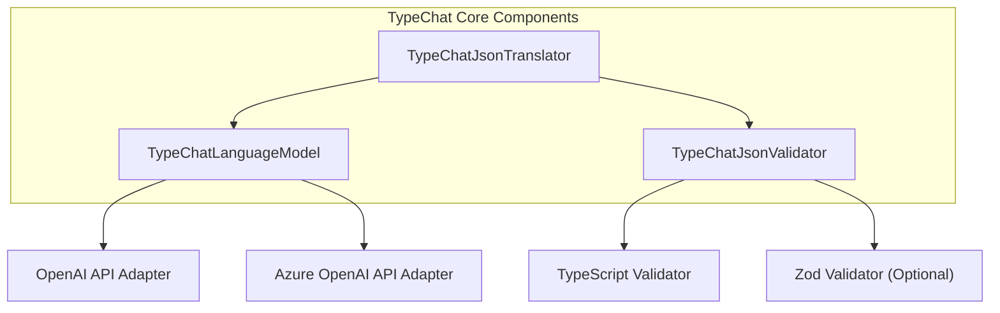
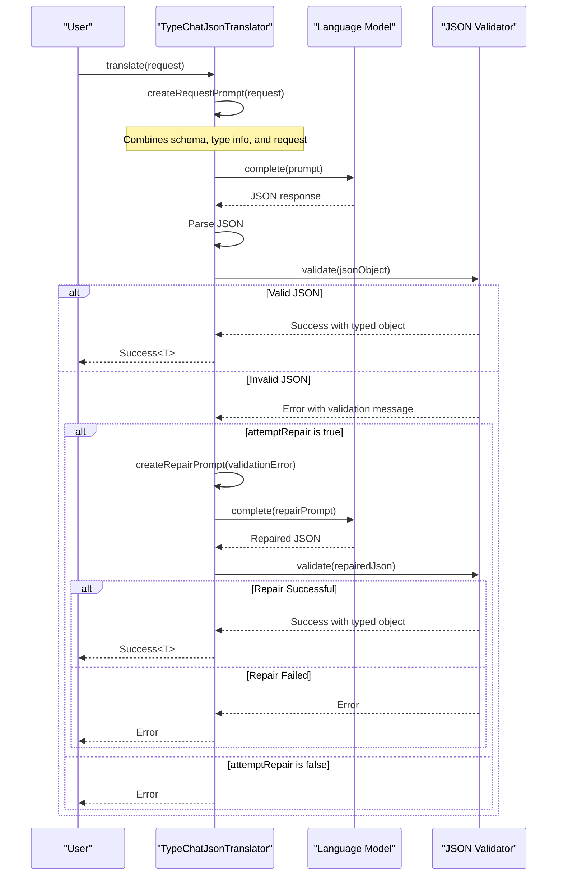
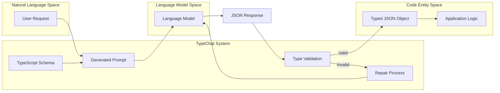
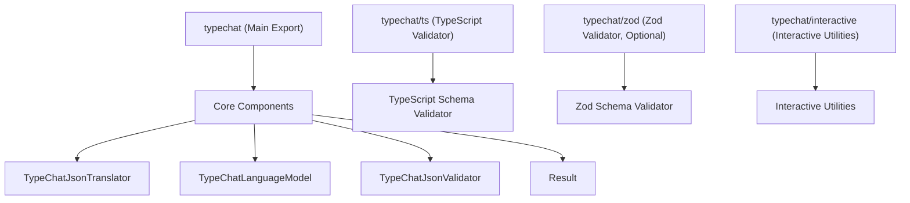

<!-- source: DeepWiki mcp.deepwiki.com · repo microsoft/TypeChat · page 4 TypeScript Implementation · fetched 2026-10-26 -->

# TypeScript Implementation

Relevant source files

The following files were used as context for generating this wiki page:

- [README.md](README.md)
- [typescript/examples/crossword/README.md](typescript/examples/crossword/README.md)
- [typescript/examples/crossword/package.json](typescript/examples/crossword/package.json)
- [typescript/examples/crossword/src/crosswordSchema.ts](typescript/examples/crossword/src/crosswordSchema.ts)
- [typescript/examples/crossword/src/input.txt](typescript/examples/crossword/src/input.txt)
- [typescript/examples/crossword/src/main.ts](typescript/examples/crossword/src/main.ts)
- [typescript/examples/crossword/src/puzzleScreenshot.jpeg](typescript/examples/crossword/src/puzzleScreenshot.jpeg)
- [typescript/examples/crossword/src/translator.ts](typescript/examples/crossword/src/translator.ts)
- [typescript/examples/crossword/src/tsconfig.json](typescript/examples/crossword/src/tsconfig.json)
- [typescript/src/model.ts](typescript/src/model.ts)
- [typescript/src/ts/program.ts](typescript/src/ts/program.ts)
- [typescript/src/typechat.ts](typescript/src/typechat.ts)
- [typescript/src/zod/validate.ts](typescript/src/zod/validate.ts)

This page documents the TypeScript implementation of TypeChat, which serves as the primary and reference implementation of the library. The TypeScript version provides the core functionality for translating natural language requests into type-safe JSON objects using language models. For information about the Python implementation, see [Python Implementation](#3).

## Overview

The TypeScript implementation of TypeChat is designed around the concept of schema engineering - using TypeScript type definitions to guide language models in producing structured, validated responses. The codebase is lightweight, modular, and model-agnostic, providing a flexible foundation for building natural language interfaces.

Sources:
- [typescript/src/typechat.ts:7-86]()
- [typescript/src/model.ts:62-77]()
- [typescript/package.json:1-62]()

## Core Components

The TypeChat TypeScript implementation consists of three primary components:

1. **TypeChatJsonTranslator**: The main interface for translating natural language to JSON objects
2. **TypeChatLanguageModel**: An abstraction for interacting with language models
3. **TypeChatJsonValidator**: An interface for validating JSON objects against a schema

### TypeChatJsonTranslator

The `TypeChatJsonTranslator<T>` interface is the central component responsible for translating natural language requests into JSON objects that conform to the specified type `T`. This interface combines a language model with a validator to process requests, generate responses, and ensure type safety.

Key properties and methods:

- `model`: The associated language model
- `validator`: The associated JSON validator
- `attemptRepair`: Boolean flag indicating whether to attempt repair of invalid JSON
- `stripNulls`: Boolean flag for removing null-valued properties
- `translate()`: The main method for translating natural language to JSON
- `createRequestPrompt()`: Creates a prompt from the request and schema
- `createRepairPrompt()`: Creates a prompt for repairing invalid JSON

Sources:
- [typescript/src/typechat.ts:7-64]()
- [typescript/src/typechat.ts:97-163]()

### TypeChatLanguageModel

The `TypeChatLanguageModel` interface provides an abstraction layer for interacting with AI language models. This design allows TypeChat to work with different model providers without changes to the core logic.

Key properties and methods:

- `complete()`: Sends a prompt to the language model and returns the response
- `retryMaxAttempts`: Maximum number of retry attempts for transient errors
- `retryPauseMs`: Delay before retrying after a transient error

TypeChat provides built-in implementations for:
- OpenAI API via `createOpenAILanguageModel()`
- Azure OpenAI API via `createAzureOpenAILanguageModel()`
- A convenience function `createLanguageModel()` that selects the appropriate implementation based on environment variables

Sources:
- [typescript/src/model.ts:62-77]()
- [typescript/src/model.ts:94-217]()

### TypeChatJsonValidator

The `TypeChatJsonValidator<T>` interface handles the validation of JSON objects against the specified schema. It ensures that responses from the language model conform to the expected type.

Key methods:

- `getSchemaText()`: Returns the TypeScript source code for the schema
- `getTypeName()`: Returns the name of the target type
- `validate()`: Validates a JSON object against the schema

Sources:
- [typescript/src/typechat.ts:69-86]()

## Translation Process

The TypeScript implementation follows a structured process to translate natural language requests into typed JSON objects. The diagram below illustrates this process:

Sources:
- [typescript/src/typechat.ts:124-163]()
- [typescript/src/model.ts:153-187]()

### Creating the Request Prompt

The `createRequestPrompt` method constructs a prompt that includes:
1. Instructions specifying the role of the language model
2. The TypeScript schema defining the expected structure
3. The user's natural language request
4. A request for the response as a valid JSON object

The prompt encourages the model to generate a JSON object that conforms to the defined schema, setting the stage for successful translation.

Sources:
- [typescript/src/typechat.ts:110-116]()

### Validation and Repair

A key feature of TypeChat is its ability to repair invalid JSON responses. When validation fails and `attemptRepair` is true, the translator:

1. Constructs a repair prompt that includes the validation error
2. Sends this prompt to the language model
3. Validates the repaired response

This repair mechanism significantly improves the reliability of language model responses, ensuring they conform to the expected types.

Sources:
- [typescript/src/typechat.ts:118-122]()
- [typescript/src/typechat.ts:147-160]()

## Model Integrations

TypeChat provides built-in support for connecting to different language model APIs, focusing primarily on OpenAI's models:

### OpenAI Integration

The `createOpenAILanguageModel` function creates a model instance that connects to the OpenAI API. It requires:
- API key
- Model name (e.g., "gpt-4")
- Optional endpoint URL (defaults to OpenAI's chat completions endpoint)
- Optional organization ID

Sources:
- [typescript/src/model.ts:118-124]()

### Azure OpenAI Integration

The `createAzureOpenAILanguageModel` function creates a model instance for Azure's OpenAI service. It requires:
- API key
- Endpoint URL that includes deployment details and API version

Sources:
- [typescript/src/model.ts:134-142]()

### Model-Agnostic Design

The architecture allows for easy integration with other language model providers. You simply need to implement the `TypeChatLanguageModel` interface with your preferred model.

Sources:
- [typescript/src/model.ts:62-77]()
- [typescript/src/model.ts:147-187]()

## Schema Engineering with TypeScript

TypeChat leverages TypeScript's type system to define the expected structure of language model responses. This approach, called "schema engineering," replaces traditional prompt engineering with a more structured and reliable method.

The key benefits of schema engineering:

1. **Precision**: TypeScript types precisely define the expected response structure
2. **Validation**: Automatic validation against the schema ensures type safety
3. **Repair**: The system can attempt to fix non-conforming responses
4. **Familiar syntax**: Leverages TypeScript's familiar type system

Sources:
- [README.md:3-17]()
- [site/src/blog/introducing-typechat.md:79-133]()
- [site/src/docs/techniques.md:8-28]()

## Package Structure and Export

The TypeChat TypeScript package is structured to provide a clean and straightforward API:

The package exports:
- The main module with core interfaces and functions
- TypeScript-specific validator under `/ts`
- Zod schema support under `/zod` (optional)
- Interactive utilities under `/interactive`

Sources:
- [typescript/package.json:27-32]()

## Using the TypeScript Implementation

Here's a quick overview of how to use the TypeScript implementation:

1. Install the package: `npm install typechat`
2. Define your TypeScript schema
3. Create a language model instance
4. Create a validator for your schema
5. Create a translator with the model and validator
6. Use the translator to process natural language requests

TypeChat's TypeScript implementation is designed to be lightweight and focused on its core responsibility: translating natural language to typed JSON objects. It integrates with your application's type system, providing a seamless bridge between natural language and your application logic.

Sources:
- [README.md:19-27]()
- [site/src/blog/introducing-typechat.md:143-182]()

## Summary

The TypeScript implementation of TypeChat provides a robust foundation for building natural language interfaces using types. It leverages TypeScript's type system to guide language models in producing structured, validated responses, making it easier to integrate natural language capabilities into applications while maintaining type safety and reliability.

The core components—TypeChatJsonTranslator, TypeChatLanguageModel, and TypeChatJsonValidator—work together to handle the translation of natural language to typed JSON objects, with built-in support for validation and repair. The modular design allows for integration with different language model providers, though it currently focuses on OpenAI and Azure OpenAI.

By replacing prompt engineering with schema engineering, TypeChat offers a more structured and reliable approach to working with language models, ensuring that responses conform to expected types and can be safely integrated into existing applications.

---

