<!-- source: DeepWiki mcp.deepwiki.com · repo microsoft/TypeChat · page 4.1 Core Components · fetched 2026-10-26 -->

# Core Components

<details>
<summary>Relevant source files</summary>

The following files were used as context for generating this wiki page:

- [python/README.md](python/README.md)
- [python/examples/README.md](python/examples/README.md)
- [python/examples/healthData/translator.py](python/examples/healthData/translator.py)
- [python/examples/math/program.py](python/examples/math/program.py)
- [python/examples/multiSchema/agents.py](python/examples/multiSchema/agents.py)
- [python/examples/multiSchema/router.py](python/examples/multiSchema/router.py)
- [python/src/typechat/__init__.py](python/src/typechat/__init__.py)
- [python/src/typechat/_internal/interactive.py](python/src/typechat/_internal/interactive.py)
- [python/src/typechat/_internal/model.py](python/src/typechat/_internal/model.py)
- [python/src/typechat/_internal/translator.py](python/src/typechat/_internal/translator.py)
- [python/src/typechat/_internal/validator.py](python/src/typechat/_internal/validator.py)
- [python/tests/__snapshots__/test_translator.ambr](python/tests/__snapshots__/test_translator.ambr)
- [python/tests/test_translator.py](python/tests/test_translator.py)
- [python/tests/test_validator.py](python/tests/test_validator.py)
- [site/src/_data/docsTOC.json](site/src/_data/docsTOC.json)
- [site/src/docs/python/basic-usage.md](site/src/docs/python/basic-usage.md)
- [site/src/docs/typescript/basic-usage.md](site/src/docs/typescript/basic-usage.md)
- [typescript/README.md](typescript/README.md)
- [typescript/examples/README.md](typescript/examples/README.md)

</details>


## Purpose and Scope

This page documents the three core components of TypeChat's Python implementation and their interactions: `TypeChatLanguageModel`, `TypeChatValidator`, and `TypeChatJsonTranslator`. These components work together to translate natural language requests into validated, strongly-typed Python objects.

For information about the schema conversion system that converts Python types to TypeScript for LLM prompts, see [Schema Conversion System](#3.2). For implementation examples, see [Python Examples](#3.3). For details on the cross-language type system bridge, see [Type System Bridge](#2.3).

## Component Architecture Overview

The Python implementation consists of three primary components that form a translation pipeline:

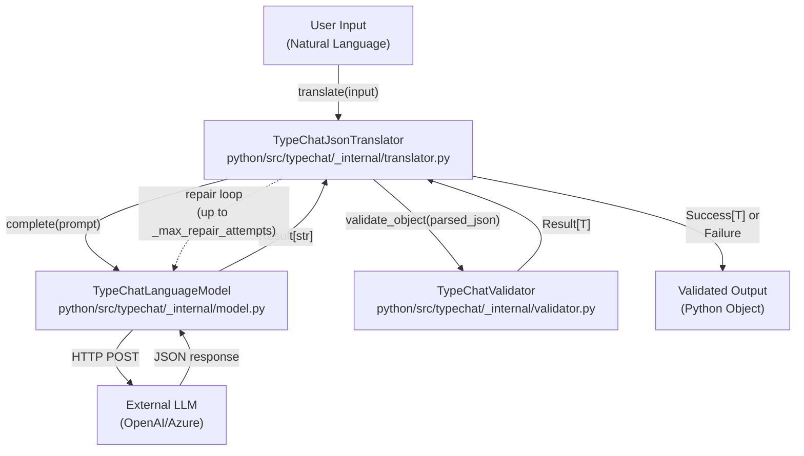

**Component Responsibilities:**

| Component | Primary Responsibility | Key Methods |
|-----------|----------------------|-------------|
| `TypeChatLanguageModel` | Communicates with LLM endpoints (OpenAI/Azure) | `complete(prompt)` |
| `TypeChatValidator` | Validates JSON objects against Python types using Pydantic | `validate_object(obj)` |
| `TypeChatJsonTranslator` | Orchestrates translation pipeline, handles repair loops | `translate(input)` |

Sources: [python/src/typechat/_internal/translator.py:1-126](), [python/src/typechat/_internal/model.py:1-185](), [python/src/typechat/_internal/validator.py:1-68]()

## TypeChatLanguageModel Protocol

### Protocol Definition

`TypeChatLanguageModel` is a protocol (structural interface) that defines the contract for communicating with language model services:

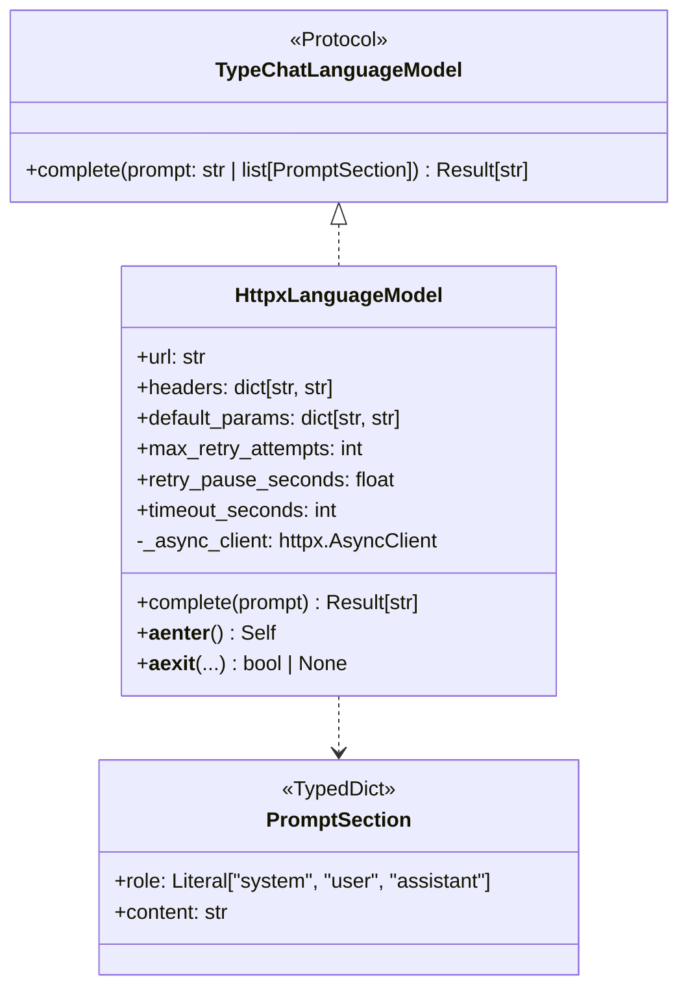

**Protocol Method:**

The `complete` method accepts either a simple string or a list of `PromptSection` objects (for multi-turn conversations):

```python
async def complete(self, prompt: str | list[PromptSection]) -> Result[str]:
```

**PromptSection Structure:**

[python/src/typechat/_internal/model.py:9-16]() defines the prompt section format:

| Field | Type | Description |
|-------|------|-------------|
| `role` | `Literal["system", "user", "assistant"]` | The role associated with the message |
| `content` | `str` | The message content |

Sources: [python/src/typechat/_internal/model.py:18-28]()

### HttpxLanguageModel Implementation

The built-in `HttpxLanguageModel` class implements the protocol using the `httpx` library:

```mermaid
graph LR
    Complete["complete(prompt)"]
    Convert["Convert str to<br/>list[PromptSection]"]
    BuildBody["Build request body<br/>{messages, temperature: 0.0, n: 1}"]
    Post["POST to self.url<br/>with httpx.AsyncClient"]
    Retry["Retry Logic<br/>max_retry_attempts"]
    Parse["Parse JSON response<br/>choices[0].message.content"]
    Result["Return Result[str]"]
    
    Complete --> Convert
    Convert --> BuildBody
    BuildBody --> Post
    Post --> Retry
    Retry --> Parse
    Parse --> Result
    
    Retry -.->|"if transient error<br/>(429, 500, 502, 503, 504)"| Post
```

**Configuration Attributes:**

[python/src/typechat/_internal/model.py:38-49]() defines the following configurable attributes:

| Attribute | Default | Description |
|-----------|---------|-------------|
| `max_retry_attempts` | `3` | Maximum number of retry attempts for transient errors |
| `retry_pause_seconds` | `1.0` | Delay before retrying (seconds) |
| `timeout_seconds` | `10` | Request timeout duration |

**Transient Error Codes:**

[python/src/typechat/_internal/model.py:30-36]() defines error codes that trigger retries: `[429, 500, 502, 503, 504]`

Sources: [python/src/typechat/_internal/model.py:38-112]()

### Factory Functions

TypeChat provides three factory functions for creating language models:

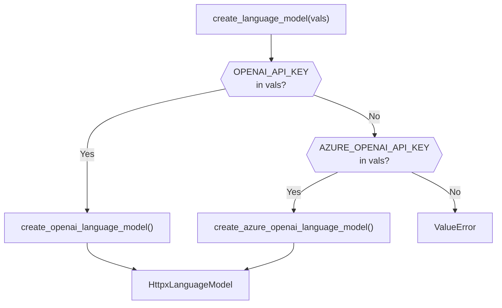

**Function Signatures:**

| Function | Parameters | Environment Variables Required |
|----------|------------|-------------------------------|
| `create_language_model` | `vals: dict[str, str \| None]` | `OPENAI_API_KEY` + `OPENAI_MODEL` OR `AZURE_OPENAI_API_KEY` + `AZURE_OPENAI_ENDPOINT` |
| `create_openai_language_model` | `api_key: str, model: str, endpoint: str, org: str` | None (direct parameters) |
| `create_azure_openai_language_model` | `api_key: str, endpoint: str` | None (direct parameters) |

Sources: [python/src/typechat/_internal/model.py:113-184]()

## TypeChatValidator

### Validation Architecture

`TypeChatValidator` validates JSON objects against Python type definitions using Pydantic's runtime validation:

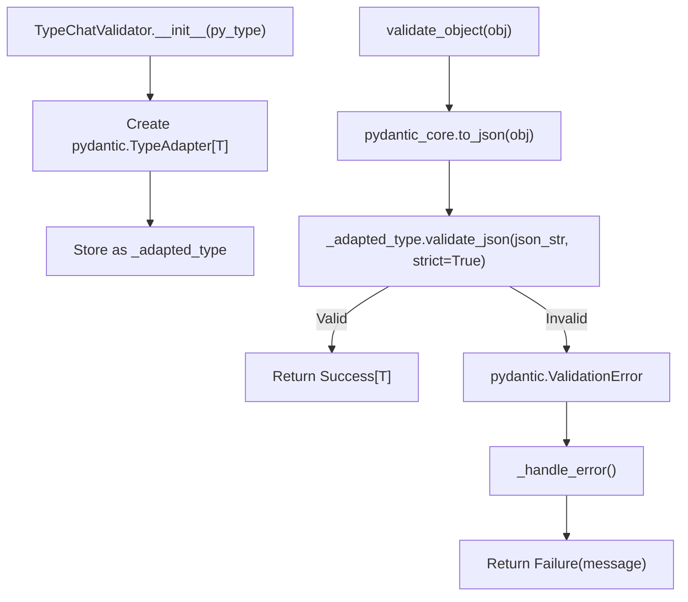

**Class Structure:**

[python/src/typechat/_internal/validator.py:11-46]() defines:

| Member | Type | Description |
|--------|------|-------------|
| `_adapted_type` | `pydantic.TypeAdapter[T]` | Pydantic adapter for the target type |
| `__init__` | Constructor | Takes `py_type: type[T]` parameter |
| `validate_object` | Method | Returns `Result[T]` (Success or Failure) |

Sources: [python/src/typechat/_internal/validator.py:11-46]()

### Validation Process

The validator performs a two-step validation process:

1. **Serialize to JSON**: [python/src/typechat/_internal/validator.py:41]() converts the Python object to JSON using `pydantic_core.to_json(obj)`

2. **Validate from JSON**: [python/src/typechat/_internal/validator.py:42]() validates using `validate_json(json_str, strict=True)`

This approach ensures strict type checking. Under Pydantic's strict mode, a plain `dict` is not automatically coerced to a `dataclass`.

### Error Handling

[python/src/typechat/_internal/validator.py:48-67]() formats validation errors into human-readable messages:

```mermaid
graph LR
    ValidationError["pydantic.ValidationError"]
    Iterate["Iterate error.errors()"]
    FormatPath["Format validation path"]
    FormatInput["Format input value"]
    FormatMsg["Format error message"]
    Combine["Combine into string"]
    Failure["Return Failure(message)"]
    
    ValidationError --> Iterate
    Iterate --> FormatPath
    FormatPath --> FormatInput
    FormatInput --> FormatMsg
    FormatMsg --> Combine
    Combine --> Failure
```

**Error Message Format:**

```
Validation path `field.subfield` failed for value `{"key": "value"}` because:
  Field required
```

Sources: [python/src/typechat/_internal/validator.py:48-67]()

## TypeChatJsonTranslator

### Class Structure and Initialization

`TypeChatJsonTranslator` is the main orchestrator that brings together the model, validator, and schema conversion:

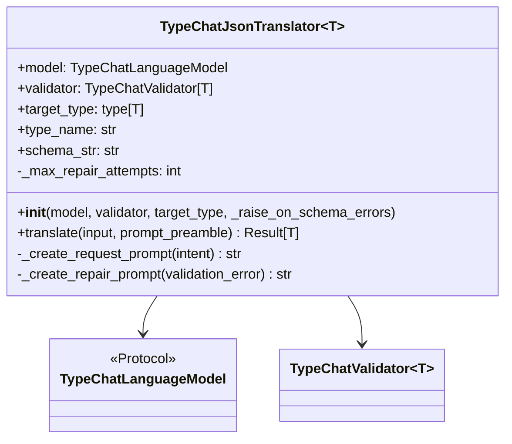

**Initialization Process:**

[python/src/typechat/_internal/translator.py:24-50]() performs the following steps:

1. Store `model`, `validator`, and `target_type` references
2. Convert Python type to TypeScript schema via `python_type_to_typescript_schema(target_type)` ([python/src/typechat/_internal/translator.py:43]())
3. Store `type_name` (TypeScript type reference) and `schema_str` (TypeScript schema text)
4. Optionally raise `ValueError` if schema conversion has errors

| Attribute | Type | Purpose |
|-----------|------|---------|
| `model` | `TypeChatLanguageModel` | LLM communication interface |
| `validator` | `TypeChatValidator[T]` | Type validation engine |
| `target_type` | `type[T]` | Python type for validation |
| `type_name` | `str` | TypeScript type name (e.g., `"SentimentResponse"`) |
| `schema_str` | `str` | Full TypeScript schema definition |
| `_max_repair_attempts` | `int` | Maximum repair iterations (default: `1`) |

Sources: [python/src/typechat/_internal/translator.py:12-50]()

### Translation Pipeline

The `translate` method implements the complete request-to-object pipeline:

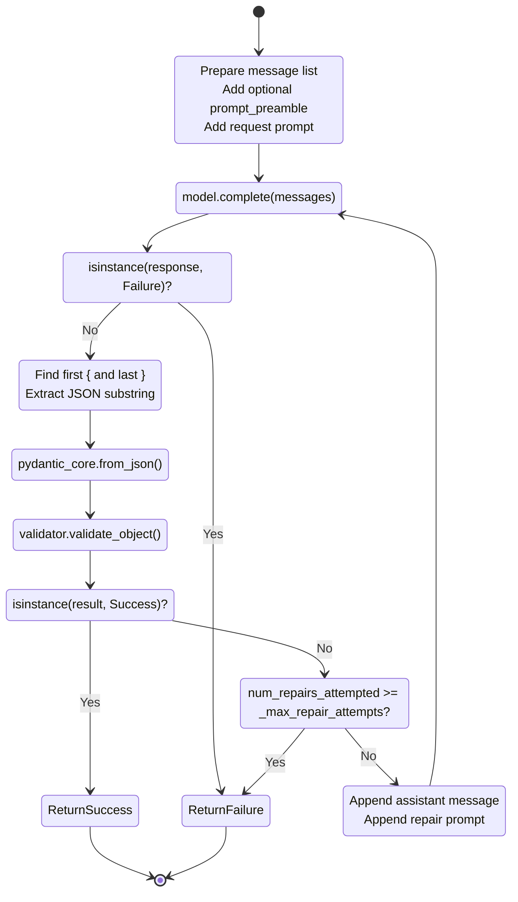

**Translation Steps:**

[python/src/typechat/_internal/translator.py:52-101]() implements the following algorithm:

1. **Message Preparation** ([lines 65-72]()):
   - Convert `prompt_preamble` (if string) to `PromptSection` with "user" role
   - Append request prompt generated by `_create_request_prompt()`

2. **LLM Interaction Loop** ([lines 74-101]()):
   - Call `model.complete(messages)`
   - If model returns `Failure`, return immediately
   - Extract JSON between first `{` and last `}` ([lines 81-82]())
   - Parse JSON with `pydantic_core.from_json()` ([line 87]())
   - Validate with `validator.validate_object()` ([line 91]())
   - If validation succeeds, return `Success[T]`
   - If validation fails and retries remain:
     - Append assistant message with LLM's response
     - Append repair prompt with validation error
     - Continue loop

3. **Repair Loop Termination**:
   - Maximum attempts controlled by `_max_repair_attempts` ([line 97]())
   - Returns `Failure` with final error message if all attempts exhausted

Sources: [python/src/typechat/_internal/translator.py:52-101]()

### Prompt Generation

The translator generates two types of prompts:

#### Request Prompt

[python/src/typechat/_internal/translator.py:103-115]() generates the initial prompt:

```
You are a service that translates user requests into JSON objects of type "{type_name}" according to the following TypeScript definitions:
```
{schema_str}
```
The following is a user request:
'''
{intent}
'''
The following is the user request translated into a JSON object with 2 spaces of indentation and no properties with the value undefined:
```

**Key Components:**
- `type_name`: The TypeScript type name (e.g., `"Sentiment"`)
- `schema_str`: Full TypeScript schema text with interfaces/types
- `intent`: The user's natural language input

#### Repair Prompt

[python/src/typechat/_internal/translator.py:117-125]() generates repair prompts when validation fails:

```
The above JSON object is invalid for the following reason:
'''
{validation_error}
'''
The following is a revised JSON object:
```

This prompt is appended after the LLM's previous (invalid) response, creating a conversation where the model sees its error and can correct it.

Sources: [python/src/typechat/_internal/translator.py:103-125]()

### Prompt Preamble Support

The `translate` method accepts an optional `prompt_preamble` parameter for conversation history:

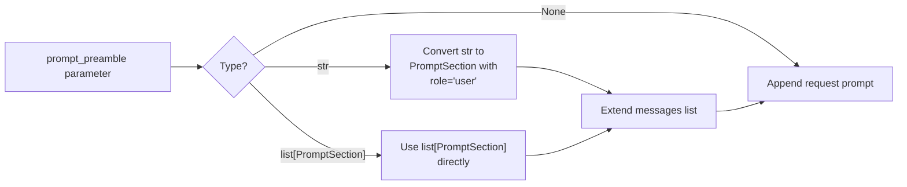

[python/src/typechat/_internal/translator.py:67-70]() handles preamble conversion:

- If `str`: Converted to `[{"role": "user", "content": prompt_preamble}]`
- If `list[PromptSection]`: Used directly
- If `None`: No preamble added

This enables multi-turn conversations, as demonstrated in [python/examples/healthData/translator.py]().

Sources: [python/src/typechat/_internal/translator.py:52-72]()

## Component Interaction Lifecycle

### Complete Translation Flow

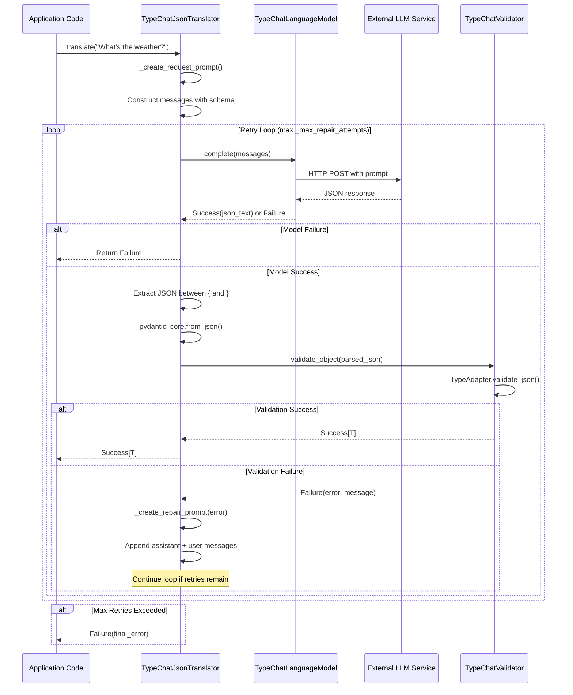

Sources: [python/src/typechat/_internal/translator.py:52-101](), [python/src/typechat/_internal/model.py:59-97](), [python/src/typechat/_internal/validator.py:27-46]()

### Example Usage Pattern

From [python/examples/sentiment/demo.py]() and [site/src/docs/python/basic-usage.md](), typical usage follows this pattern:

1. **Create Model:**
   ```python
   from dotenv import dotenv_values
   from typechat import create_language_model
   
   env_vals = dotenv_values()
   model = create_language_model(env_vals)
   ```

2. **Create Validator:**
   ```python
   from typechat import TypeChatValidator
   import schema as sentiment  # Contains Sentiment type definition
   
   validator = TypeChatValidator(sentiment.Sentiment)
   ```

3. **Create Translator:**
   ```python
   from typechat import TypeChatJsonTranslator
   
   translator = TypeChatJsonTranslator(model, validator, sentiment.Sentiment)
   ```

4. **Translate Requests:**
   ```python
   result = await translator.translate("I'm feeling great today!")
   if isinstance(result, Failure):
       print(result.message)
   else:
       print(f"Sentiment: {result.value.sentiment}")
   ```

Sources: [site/src/docs/python/basic-usage.md:19-36](), [python/src/typechat/__init__.py:5-10]()

### Extensibility: Custom Translators

Applications can extend `TypeChatJsonTranslator` to customize behavior:

**TranslatorWithHistory Example:**

[python/examples/healthData/translator.py:16-67]() demonstrates extending the translator:

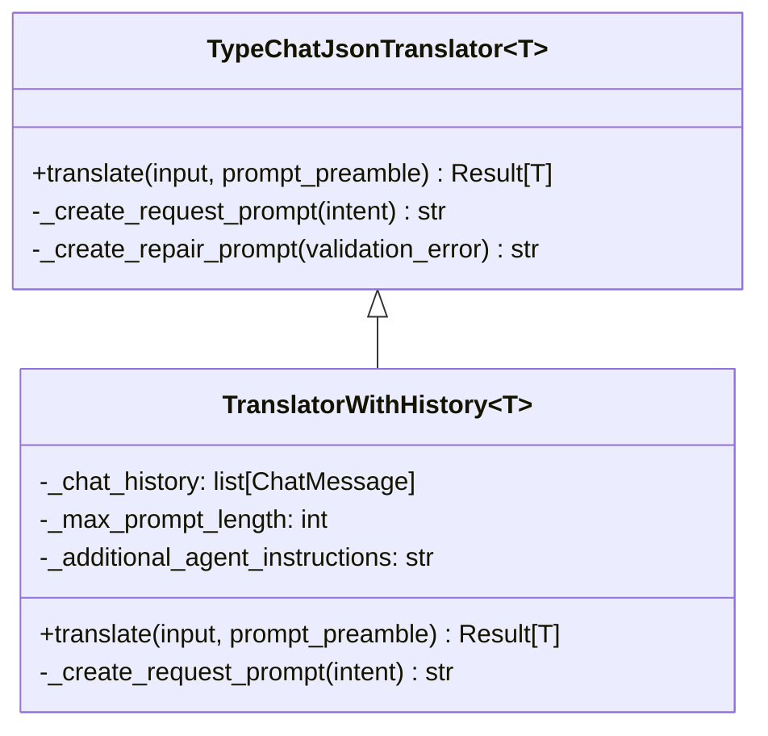

**Customizations:**
- Maintains `_chat_history` to track conversation state
- Overrides `translate()` to append successful results to history
- Overrides `_create_request_prompt()` to inject history and current date/time
- Adds `_additional_agent_instructions` for domain-specific guidance

**TypeChatProgramTranslator Example:**

[python/examples/math/program.py:120-158]() extends the translator for program generation:

- Uses custom `TypeChatProgramValidator` instead of standard validator
- Overrides both `_create_request_prompt()` and `_create_repair_prompt()` to mention "program" instead of "object"
- Stores `_api_declaration_str` with function API definitions
- Constructs prompts that reference both program schema and API schema

Sources: [python/examples/healthData/translator.py:16-67](), [python/examples/math/program.py:120-158]()

## Public API Surface

The core components are exported from the main package:

[python/src/typechat/__init__.py:5-25]() defines the public API:

| Export | Module | Purpose |
|--------|--------|---------|
| `TypeChatLanguageModel` | `_internal.model` | Protocol for LLM communication |
| `create_language_model` | `_internal.model` | Factory for OpenAI/Azure models |
| `create_openai_language_model` | `_internal.model` | Factory for OpenAI |
| `create_azure_openai_language_model` | `_internal.model` | Factory for Azure OpenAI |
| `TypeChatValidator` | `_internal.validator` | Runtime type validator |
| `TypeChatJsonTranslator` | `_internal.translator` | Main translation orchestrator |
| `PromptSection` | `_internal.model` | Type for multi-turn prompts |
| `Result`, `Success`, `Failure` | `_internal.result` | Result type system |
| `python_type_to_typescript_schema` | `_internal.ts_conversion` | Schema conversion (see [Schema Conversion System](#3.2)) |
| `process_requests` | `_internal.interactive` | Interactive/file-based REPL helper |

Sources: [python/src/typechat/__init__.py:1-25]()

---

