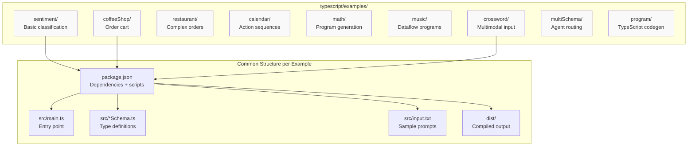
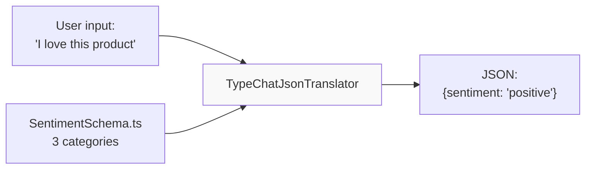
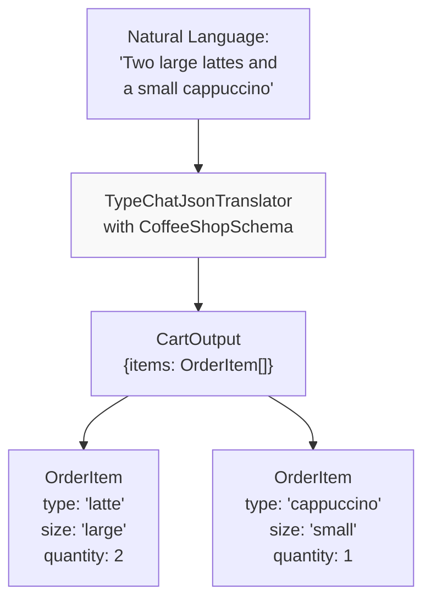
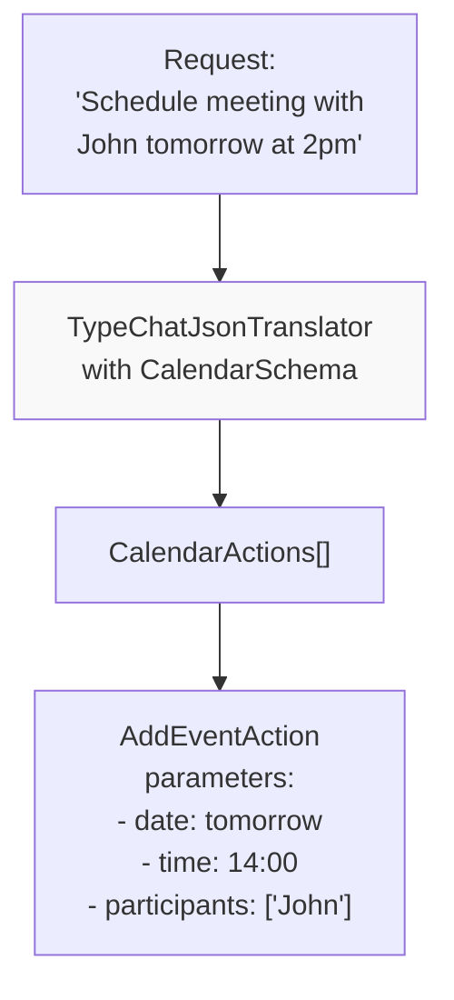
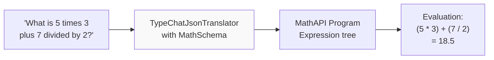
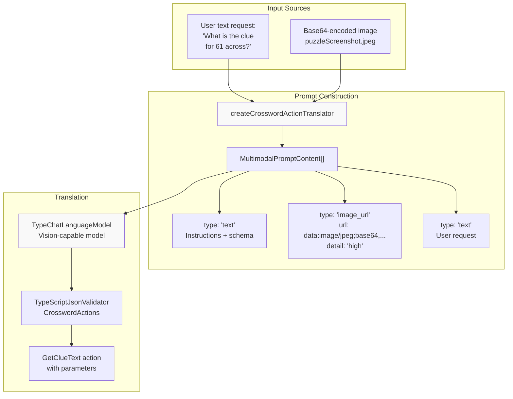
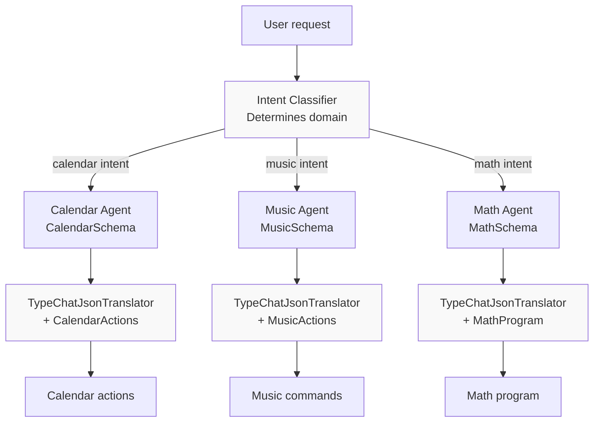
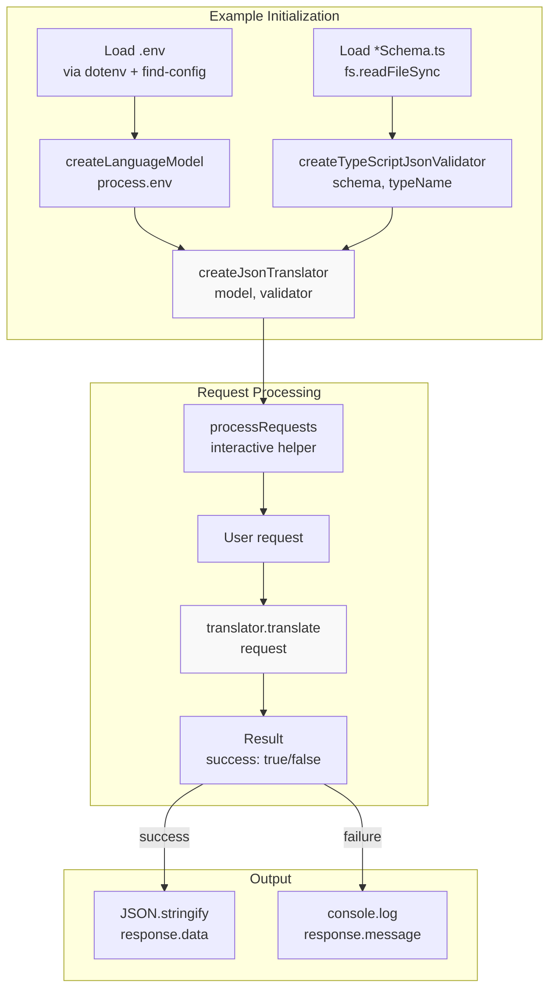
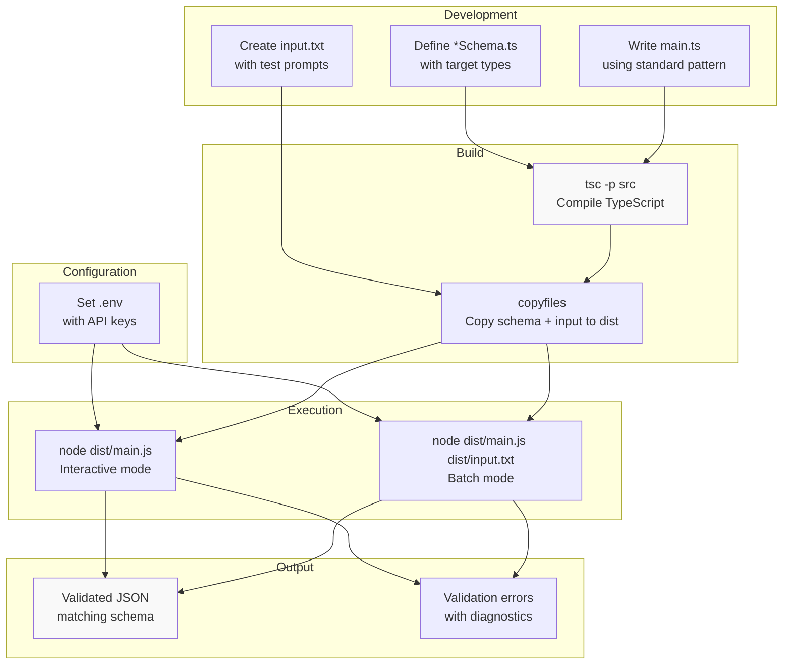

<!-- source: DeepWiki mcp.deepwiki.com · repo microsoft/TypeChat · page 4.2 TypeScript Examples · fetched 2026-10-26 -->

# TypeScript Examples

<details>
<summary>Relevant source files</summary>

The following files were used as context for generating this wiki page:

- [site/src/docs/examples.md](site/src/docs/examples.md)
- [typescript/examples/crossword/README.md](typescript/examples/crossword/README.md)
- [typescript/examples/crossword/package.json](typescript/examples/crossword/package.json)
- [typescript/examples/crossword/src/crosswordSchema.ts](typescript/examples/crossword/src/crosswordSchema.ts)
- [typescript/examples/crossword/src/input.txt](typescript/examples/crossword/src/input.txt)
- [typescript/examples/crossword/src/main.ts](typescript/examples/crossword/src/main.ts)
- [typescript/examples/crossword/src/puzzleScreenshot.jpeg](typescript/examples/crossword/src/puzzleScreenshot.jpeg)
- [typescript/examples/crossword/src/translator.ts](typescript/examples/crossword/src/translator.ts)
- [typescript/examples/crossword/src/tsconfig.json](typescript/examples/crossword/src/tsconfig.json)
- [typescript/src/model.ts](typescript/src/model.ts)
- [typescript/src/typechat.ts](typescript/src/typechat.ts)

</details>


## Purpose and Scope

This page documents the TypeScript example applications in the TypeChat repository. These examples demonstrate TypeChat's capabilities across varying levels of complexity, from simple sentiment classification to multimodal input processing and program generation. Each example shows how natural language input is translated to validated JSON output conforming to TypeScript schemas.

For information about the TypeScript core library components, see [Core Components](#4.1). For Python examples, see [Python Examples](#3.3).

## Example Organization

The TypeScript examples are located in `typescript/examples/` and follow a consistent structure. Each example is a standalone npm package with its own schema definition, input files, and main entry point.



**Sources:** [site/src/docs/examples.md:1-109]()

### Standard Example Structure

Each example follows this file organization:

| File/Directory | Purpose |
|----------------|---------|
| `package.json` | Defines dependencies (`typechat`, `dotenv`, `find-config`) and build script (`tsc -p src`) |
| `src/main.ts` | Entry point that creates `TypeChatLanguageModel`, loads schema, creates translator, and processes requests |
| `src/*Schema.ts` | TypeScript type definitions that define the target JSON structure |
| `src/input.txt` | Sample natural language prompts for testing |
| `src/tsconfig.json` | TypeScript compiler configuration targeting ES2021 with Node.js module resolution |
| `dist/` | Compiled JavaScript output after running `npm run build` |

**Sources:** [typescript/examples/crossword/package.json:1-24](), [typescript/examples/crossword/src/tsconfig.json:1-16]()

## Running Examples

### Prerequisites

Examples require Node.js 18.16.0 or newer and environment variables for OpenAI or Azure OpenAI:

**OpenAI Configuration:**
- `OPENAI_MODEL`: Model name (e.g., `gpt-3.5-turbo` or `gpt-4`)
- `OPENAI_API_KEY`: Your OpenAI API key

**Azure OpenAI Configuration:**
- `AZURE_OPENAI_ENDPOINT`: Full REST API URL
- `AZURE_OPENAI_API_KEY`: Your Azure OpenAI API key

These are typically set in a `.env` file in the repository root.

**Sources:** [site/src/docs/examples.md:66-93]()

### Build and Execution

```bash
# Build all examples from repository root
npm run build-all

# Run example interactively
cd typescript/examples/<example-name>
node ./dist/main.js

# Run with input file
node ./dist/main.js ./dist/input.txt

# Debug in VS Code
# Open example directory and press F5
```

Interactive mode prompts for input and responds until `quit` or `exit` is entered.

**Sources:** [site/src/docs/examples.md:58-108]()

## Example Categories by Complexity

### Simple Classification: Sentiment

The sentiment example is TypeChat's "hello world" - a basic classifier that categorizes user input into three sentiment categories: negative, neutral, or positive.



This example demonstrates the minimal TypeChat setup: a simple schema with a union type, basic validation, and straightforward output.

**Sources:** [site/src/docs/examples.md:16-16]()

### Structured Data: Coffee Shop and Restaurant

These examples translate natural language orders into structured cart data with items, quantities, and options.

**Coffee Shop:** Handles coffee orders with multiple items, sizes, and customizations. The schema defines product types, sizes, and modifiers.

**Restaurant:** Uses a more complex schema to model sophisticated linguistic input including compound sentences, distractions, and corrections. Demonstrates TypeChat's ability to parse complex conversational input and generate user intent summaries.



The restaurant example builds on this foundation with additional complexity for handling corrections, compound requests, and generating summaries of user intent.

**Sources:** [site/src/docs/examples.md:17-19]()

### Action Sequences: Calendar and Music

These examples translate natural language into sequences of actions that modify state or control external systems.

**Calendar:** Translates user intent into a sequence of calendar modification actions (add events, remove events, modify events). Each action has specific parameters for dates, times, participants, and descriptions.

**Music (Spotify):** Generates JSON representing a dataflow program where each action can consume data from previous steps. This enables complex operations like "play the top song by the artist of the currently playing track."



The music example extends this pattern to dataflow-style programs where actions reference outputs from previous steps, enabling complex multi-step operations.

**Sources:** [site/src/docs/examples.md:18-21]()

### Program Generation: Math

The math example demonstrates TypeChat's program generation capabilities by translating natural language calculations into executable programs.



The schema defines an API with four basic operators (add, subtract, multiply, divide) and TypeChat generates expression trees that can be evaluated. This highlights TypeChat's ability to generate structured programs from natural language, not just data.

**Sources:** [site/src/docs/examples.md:20-20]()

## Multimodal Input: Crossword Example

The crossword example demonstrates TypeChat's multimodal capabilities by including images in prompts alongside text. This requires models that support vision input (GPT-4-vision, GPT-4-omni, GPT-4-turbo).

### Multimodal Architecture



**Sources:** [typescript/examples/crossword/src/translator.ts:1-82](), [typescript/examples/crossword/src/main.ts:1-34]()

### Multimodal Prompt Creation

The crossword example uses a custom `createRequestPrompt` function that constructs `MultimodalPromptContent` arrays:

[typescript/examples/crossword/src/translator.ts:22-54]()

Key implementation details:

1. **Image Loading:** The screenshot is loaded as base64-encoded data and prefixed with `data:image/jpeg;base64,` [typescript/examples/crossword/src/main.ts:19-20]()

2. **Content Sections:** The prompt is an array of content objects with `type` field:
   - `text` objects for instructions and schema
   - `image_url` objects with `url` and `detail` fields [typescript/examples/crossword/src/translator.ts:64-69]()

3. **Custom Translator:** Uses `createCrosswordActionTranslator` which extends the base translator to override `createRequestPrompt` [typescript/examples/crossword/src/translator.ts:10-20]()

### Multimodal Type Definitions

The TypeScript type system supports multimodal prompts through the `PromptContent` type hierarchy:

[typescript/src/model.ts:19-54]()

- `PromptContent`: Either a string or `MultimodalPromptContent[]`
- `MultimodalPromptContent`: String, `TextPromptContent`, or `ImagePromptContent`
- `ImagePromptContent`: Has `type: "image_url"` and `image_url` with `url` and optional `detail` level

**Sources:** [typescript/src/model.ts:1-217](), [typescript/examples/crossword/README.md:1-25]()

### Crossword Schema

The schema defines actions for querying crossword clues and answers:

[typescript/examples/crossword/src/crosswordSchema.ts:1-33]()

The discriminated union type enables the translator to generate specific action types based on user intent:
- `GetClueText`: Returns clue text for a given number/direction
- `GetAnswerValue`: Validates a proposed answer
- `UnknownAction`: Fallback for unrecognized requests

**Sources:** [typescript/examples/crossword/src/crosswordSchema.ts:1-33](), [typescript/examples/crossword/src/input.txt:1-2]()

## Advanced Pattern: Multi-Schema Routing

The multi-schema example demonstrates agent routing by selecting specialized schemas based on input classification. This enables building systems with multiple domain-specific agents that handle different request types.



This pattern allows building modular systems where specialized agents handle their domains with optimized schemas, while a routing layer directs requests to the appropriate agent.

**Sources:** [site/src/docs/examples.md:14-22]()

## Schema Design Patterns

### Progressive Complexity

The examples demonstrate increasing schema sophistication:

| Example | Schema Features | Complexity |
|---------|----------------|------------|
| Sentiment | Simple union type with 3 literals | Basic |
| Coffee Shop | Objects with nested properties, arrays | Intermediate |
| Restaurant | Complex objects, optional fields, extensive documentation | Intermediate-Advanced |
| Calendar | Action discriminated unions, date/time handling | Advanced |
| Math | Recursive expression trees, function composition | Advanced |
| Music | Dataflow with step references, multi-action sequences | Advanced |

### Discriminated Unions

Most examples use discriminated union types with a common `actionName` or `type` field:

```typescript
type Action = 
  | { actionName: "add"; parameters: AddParams }
  | { actionName: "remove"; parameters: RemoveParams }
  | { actionName: "unknown"; parameters: { text: string } }
```

This pattern enables:
1. Type-safe action handling in application code
2. Clear LLM guidance on available action types
3. Fallback to "unknown" action for unrecognized intents

**Sources:** [typescript/examples/crossword/src/crosswordSchema.ts:3-33]()

### Schema Documentation

Effective schemas include inline documentation that guides the LLM:

- Type descriptions explaining purpose and constraints
- Field comments clarifying expected formats
- Examples in comments showing valid values
- Unknown/fallback actions for graceful degradation

The restaurant example extensively documents its schema to handle complex linguistic input and corrections.

**Sources:** [site/src/docs/examples.md:19-19]()

## Translation Flow in Examples

All examples follow the same core translation pattern using TypeChat's base components:



**Sources:** [typescript/examples/crossword/src/main.ts:12-34]()

### Standard Main.ts Pattern

Every example's `main.ts` follows this structure:

1. **Environment Setup:** Load `.env` using `find-config` to locate it [typescript/examples/crossword/src/main.ts:12-14]()

2. **Model Creation:** Create language model from environment variables [typescript/examples/crossword/src/main.ts:16-16]()

3. **Schema Loading:** Read schema file from disk [typescript/examples/crossword/src/main.ts:17-17]()

4. **Validator Creation:** Create typed validator with schema and type name [typescript/examples/crossword/src/main.ts:22-22]()

5. **Translator Creation:** Create translator (optionally customized) [typescript/examples/crossword/src/main.ts:23-23]()

6. **Request Processing:** Use `processRequests` helper for interactive or file input [typescript/examples/crossword/src/main.ts:26-34]()

**Sources:** [typescript/examples/crossword/src/main.ts:1-34]()

## Integration with Core TypeChat

Examples leverage the core TypeChat components documented in [Core Components](#4.1):

### TypeChatLanguageModel

Created via `createLanguageModel(process.env)` which auto-selects OpenAI or Azure OpenAI based on available environment variables. Supports:
- Automatic retry with exponential backoff for transient errors
- Multi-modal prompts through `PromptSection[]` with content arrays
- Configurable retry parameters (`retryMaxAttempts`, `retryPauseMs`)

**Sources:** [typescript/src/model.ts:94-108]()

### TypeChatJsonTranslator

Created via `createJsonTranslator(model, validator)` with configuration options:
- `attemptRepair`: Enable automatic repair attempts on validation failure (default: `true`)
- `stripNulls`: Remove null-valued properties for models that over-use null (default: `false`)
- `createRequestPrompt`: Customizable prompt generation function
- `createRepairPrompt`: Customizable repair prompt generation function

**Sources:** [typescript/src/typechat.ts:97-163]()

### TypeScriptJsonValidator

Created via `createTypeScriptJsonValidator<T>(schema, typeName)` which:
- Uses TypeScript compiler API for validation
- Returns `Result<T>` with success/failure indication
- Provides detailed error messages for repair attempts

Examples can also use Zod validators as an alternative validation strategy.

**Sources:** [typescript/src/typechat.ts:69-86]()

## Running Example Workflow

The complete workflow from development to execution:



**Sources:** [site/src/docs/examples.md:58-108](), [typescript/examples/crossword/package.json:8-9]()

---

