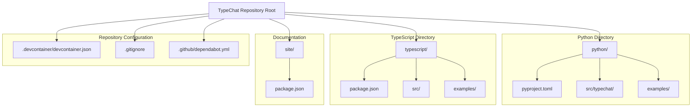
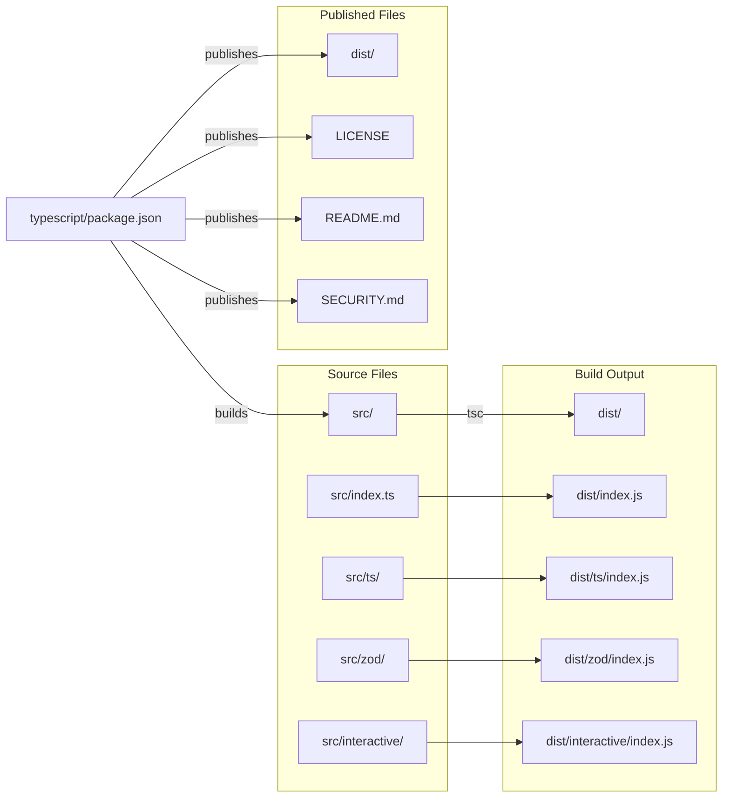
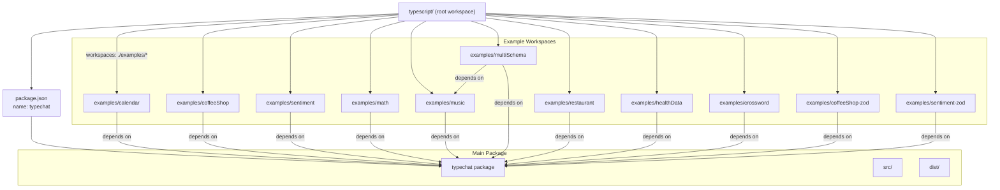
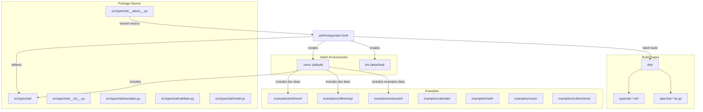
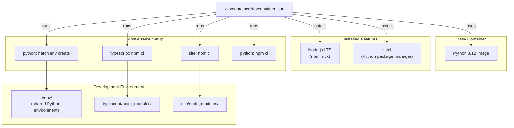
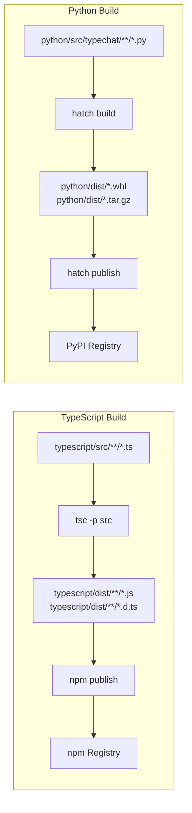
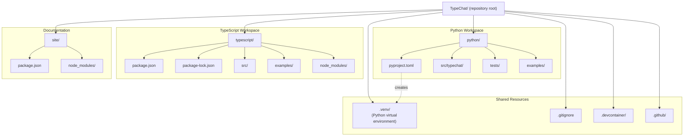

<!-- source: DeepWiki mcp.deepwiki.com · repo microsoft/TypeChat · page 5 Package Structure and Configuration · fetched 2026-10-26 -->

# Package Structure and Configuration

<details>
<summary>Relevant source files</summary>

The following files were used as context for generating this wiki page:

- [.devcontainer/devcontainer.json](.devcontainer/devcontainer.json)
- [.github/dependabot.yml](.github/dependabot.yml)
- [.gitignore](.gitignore)
- [python/examples/calendar/schema.py](python/examples/calendar/schema.py)
- [python/examples/restaurant/schema.py](python/examples/restaurant/schema.py)
- [python/examples/sentiment/schema.py](python/examples/sentiment/schema.py)
- [python/pyproject.toml](python/pyproject.toml)
- [typescript/.gitignore](typescript/.gitignore)
- [typescript/.npmignore](typescript/.npmignore)
- [typescript/package-lock.json](typescript/package-lock.json)
- [typescript/package.json](typescript/package.json)

</details>


## Purpose and Scope

This document describes the TypeChat repository's monorepo structure, package configuration, and workspace organization. It covers:

- How the TypeScript and Python packages are organized within the repository
- Package configuration files and their key settings
- npm workspaces for TypeScript examples
- Hatch environments for Python development
- Repository-level configuration files

For detailed information about individual package contents, see [Python Package](#5.1) and [TypeScript Package](#5.2). For information about the development environment and tooling, see [Development Environment](#6.1).

---

## Monorepo Structure Overview

The TypeChat repository is organized as a polyglot monorepo with three main directories at the root:

| Directory | Purpose | Package Manager |
|-----------|---------|-----------------|
| `python/` | Python implementation and examples | Hatch + pip |
| `typescript/` | TypeScript implementation and examples | npm workspaces |
| `site/` | Documentation website (Eleventy) | npm |

The repository maintains parallel implementations with independent package configurations but shared development infrastructure.

**Monorepo Layout**



**Sources:** [.gitignore:1-18](), [.devcontainer/devcontainer.json:1-50](), [typescript/package.json:1-69](), [python/pyproject.toml:1-195]()

---

## TypeScript Package Configuration

### Main Package Definition

The TypeScript package is defined in [typescript/package.json:1-69]() with the following key configuration:

| Property | Value | Purpose |
|----------|-------|---------|
| `name` | `"typechat"` | Package name on npm registry |
| `version` | `"0.1.2"` | Published package version |
| `main` | `"./dist/index.js"` | CommonJS entry point |
| `types` | `"./dist/index.d.ts"` | TypeScript type definitions |
| `engines.node` | `">=18"` | Minimum Node.js version |

### Package Exports

The package provides multiple entry points via the `exports` field [typescript/package.json:33-38]():

```
.           → ./dist/index.js       (main translator)
./ts        → ./dist/ts/index.js    (TypeScript validator)
./zod       → ./dist/zod/index.js   (Zod validator)
./interactive → ./dist/interactive/index.js (interactive utilities)
```

### Peer Dependencies

The package declares optional peer dependencies [typescript/package.json:49-60]():

- `typescript: ^5.3.3` - Required for TypeScript-based validation
- `zod: ^3.22.4` - Required for Zod-based validation

Both are marked as optional via `peerDependenciesMeta`, allowing users to install only what they need.

**TypeScript Package Structure**



**Sources:** [typescript/package.json:1-69](), [typescript/.npmignore:1-9]()

---

## npm Workspaces for Examples

The TypeScript package uses npm workspaces to manage the main package and all example applications [typescript/package.json:64-67]():

```json
"workspaces": [
  "./",
  "./examples/*"
]
```

### Workspace Structure

Each example is a separate npm package with its own `package.json` in [typescript/package-lock.json:34-211]():

| Example | Package Name | Dependencies |
|---------|--------------|--------------|
| `examples/calendar` | (unnamed) | typechat, typescript, dotenv, find-config |
| `examples/coffeeShop` | `coffeeshop` | typechat, typescript, dotenv, find-config |
| `examples/coffeeShop-zod` | `coffeeshop-zod` | typechat, zod, dotenv, find-config |
| `examples/sentiment` | (unnamed) | typechat, typescript, dotenv, find-config |
| `examples/sentiment-zod` | (unnamed) | typechat, dotenv, find-config |
| `examples/math` | (unnamed) | typechat, typescript, dotenv, find-config |
| `examples/music` | (unnamed) | typechat, typescript, express, sqlite3, axios |
| `examples/restaurant` | (unnamed) | typechat, typescript, dotenv, find-config |
| `examples/healthData` | `health-data` | typechat, typescript, dotenv, find-config |
| `examples/multiSchema` | `multi-schema` | typechat, typescript, music, dotenv, find-config |
| `examples/crossword` | (unnamed) | typechat, typescript, dotenv, find-config |

### Workspace Dependencies

The workspaces configuration enables:

1. **Hoisted dependencies** - Common packages installed once at root `node_modules/`
2. **Local package references** - Examples reference `typechat` workspace via symlinks
3. **Shared build process** - `npm run build-all` builds all workspaces [typescript/package.json:24]()
4. **Cross-workspace dependencies** - `multiSchema` depends on `music` workspace [typescript/package-lock.json:135]()

**npm Workspaces Structure**



**Sources:** [typescript/package.json:64-67](), [typescript/package-lock.json:1-211]()

---

## Python Package Configuration

### pyproject.toml Structure

The Python package uses [pyproject.toml:1-195]() as the single source of configuration, following PEP 518 standards.

**Key Configuration Sections**

| Section | Purpose | Lines |
|---------|---------|-------|
| `[build-system]` | Hatchling build backend | [python/pyproject.toml:1-3]() |
| `[project]` | Package metadata and dependencies | [python/pyproject.toml:5-30]() |
| `[project.optional-dependencies]` | Development and example dependencies | [python/pyproject.toml:32-44]() |
| `[tool.hatch.version]` | Dynamic version from `__about__.py` | [python/pyproject.toml:51-52]() |
| `[tool.hatch.envs.default]` | Default Hatch environment | [python/pyproject.toml:54-79]() |
| `[tool.hatch.envs.lint]` | Linting and type-checking environment | [python/pyproject.toml:84-111]() |

### Package Metadata

From [python/pyproject.toml:5-30]():

```python
name = "typechat"
requires-python = ">=3.11"
dependencies = [
    "pydantic>=2.5.2",
    "pydantic_core>=2.16.3",
    "httpx>=0.27.0",
    "typing_extensions>=4.10.0",
]
```

The package supports Python 3.11, 3.12, and 3.13 [python/pyproject.toml:19-21]().

### Hatch Environments

#### Default Environment

Configured in [python/pyproject.toml:54-79]():

- **Type:** `virtual`
- **Path:** `../.venv` (shared with repository root)
- **Features:** `["dev", "examples"]` (includes all optional dependencies)
- **Scripts:** 
  - `test` - Run pytest
  - `test-cov` - Run tests with coverage
  - `cov-report` - Generate coverage report
  - `cov` - Combined test and report

#### Lint Environment

Configured in [python/pyproject.toml:84-111]():

- **Type:** `detached` (isolated from main dependencies)
- **Tools:** black, mypy, ruff, pyright
- **Scripts:**
  - `typing` - Run pyright and mypy
  - `style` - Check code style
  - `fmt` - Format code
  - `all` - Run all checks

**Python Package Structure with Hatch**



**Sources:** [python/pyproject.toml:1-195]()

---

## Python Examples Structure

Unlike TypeScript which uses npm workspaces, Python examples are organized as subdirectories without separate package configurations:

```
python/examples/
├── sentiment/
│   ├── main.py
│   └── schema.py
├── coffeeshop/
│   ├── main.py
│   └── schema.py
├── restaurant/
│   ├── main.py
│   └── schema.py
├── calendar/
│   ├── main.py
│   └── schema.py
├── math/
│   ├── main.py
│   └── schema.py
├── music/
│   ├── main.py
│   └── schema.py
└── multischema/
    ├── main.py
    └── schema.py
```

Each example:
1. Imports the `typechat` package from the parent directory
2. Defines its schema in `schema.py` using Python dataclasses or TypedDict
3. Implements the example logic in `main.py`

Examples of schema definitions:

- **Sentiment:** [python/examples/sentiment/schema.py:1-11]() - Simple `@dataclass` with `Literal` type
- **Restaurant:** [python/examples/restaurant/schema.py:1-50]() - Complex `TypedDict` with unions and nested types
- **Calendar:** [python/examples/calendar/schema.py:1-88]() - Action-based schema with multiple action types

**Sources:** [python/examples/sentiment/schema.py:1-11](), [python/examples/restaurant/schema.py:1-50](), [python/examples/calendar/schema.py:1-88]()

---

## Repository-Level Configuration

### Version Control Ignore Patterns

The repository uses two levels of `.gitignore` configuration:

**Root `.gitignore`** [.gitignore:1-18]():

```
build/
dist/
out/
node_modules/
.venv/
.env*
*.map
*.out.txt
*.bat
.scratch/
**/.vscode/*
**/tsconfig.debug.json
!**/.vscode/launch.json
**/build.bat
```

Key patterns:
- `node_modules/` - TypeScript dependencies
- `.venv/` - Python virtual environment (shared)
- `.env*` - Environment files with API keys
- `build/`, `dist/`, `out/` - Build artifacts

**TypeScript-specific** [typescript/.gitignore:1-20]():

```
build/
dist/
out/
node_modules/
.env
*.map
*.out.txt
*.bat
SECURITY.md      # Copied at publish time
```

### npm Publish Configuration

The TypeScript package uses `.npmignore` [typescript/.npmignore:1-9]() to exclude source files from published package:

```
src/              # Exclude TypeScript source
examples/         # Exclude examples
node_modules/
*.map
*.ts
!*.d.ts          # Include .d.ts files
tsconfig.json
.gitignore
```

The `files` field in [typescript/package.json:42-47]() explicitly includes:

```json
"files": [
  "dist",
  "LICENSE",
  "README.md",
  "SECURITY.md"
]
```

**Sources:** [.gitignore:1-18](), [typescript/.gitignore:1-20](), [typescript/.npmignore:1-9](), [typescript/package.json:42-47]()

---

## Development Container Configuration

The repository provides a complete development environment via [.devcontainer/devcontainer.json:1-50]().

### Base Image and Features

```json
{
  "name": "TypeChat Development (Python and TypeScript)",
  "image": "mcr.microsoft.com/devcontainers/python:1-3.12",
  "features": {
    "ghcr.io/devcontainers/features/node:1": {
      "nodeGypDependencies": true,
      "version": "lts",
      "nvmVersion": "latest"
    },
    "ghcr.io/devcontainers-contrib/features/hatch:2": {
      "version": "latest"
    }
  }
}
```

**Components:**

| Component | Purpose |
|-----------|---------|
| Base: Python 3.12 | Python runtime |
| Node.js LTS | TypeScript runtime and build tools |
| Hatch | Python package and environment manager |

### Post-Create Commands

The container runs these commands after creation [.devcontainer/devcontainer.json:40-45]():

```json
"postCreateCommand": {
  "site - npm": "cd site; npm ci",
  "typescript - npm": "cd typescript; npm ci",
  "python - hatch": "cd python; hatch env create",
  "python - npm": "cd python; npm ci"
}
```

This installs:
1. Documentation site dependencies
2. TypeScript package and workspace dependencies
3. Python Hatch environment with all dependencies
4. Python example dependencies (npm is used for some Python tooling)

### VS Code Integration

[.devcontainer/devcontainer.json:24-36]() configures VS Code:

```json
"customizations": {
  "vscode": {
    "extensions": [
      "ms-python.black-formatter"
    ],
    "settings": {
      "python.defaultInterpreterPath": "/workspaces/TypeChat/.venv",
      "python.analysis.autoSearchPaths": false
    }
  }
}
```

**Port Forwarding:** [.devcontainer/devcontainer.json:21]() forwards ports 7860-7870 for development servers.

**Development Container Architecture**



**Sources:** [.devcontainer/devcontainer.json:1-50]()

---

## Dependency Management

### Dependabot Configuration

The repository uses Dependabot [.github/dependabot.yml:1-17]() to keep dependencies current:

```yaml
version: 2
updates:
  - package-ecosystem: "devcontainers"
    directory: "/"
    schedule:
      interval: weekly
  - package-ecosystem: "github-actions"
    directory: "/"
    schedule:
      interval: weekly
```

**Monitored Ecosystems:**

| Ecosystem | Directory | Update Frequency |
|-----------|-----------|------------------|
| `devcontainers` | `/` | Weekly |
| `github-actions` | `/` | Weekly |

Note: Python (pip) and JavaScript (npm) dependencies are managed manually through their respective lock files.

**Sources:** [.github/dependabot.yml:1-17]()

---

## Build and Publish Scripts

### TypeScript Build Scripts

From [typescript/package.json:22-29]():

| Script | Command | Purpose |
|--------|---------|---------|
| `build` | `tsc -p src` | Compile TypeScript to JavaScript |
| `build-all` | `npm run build --workspaces` | Build all workspace packages |
| `prepare` | `npm run build-all` | Pre-installation hook |
| `prepublishOnly` | Copy `SECURITY.md` from root | Prepare for publishing |
| `postpublish` | Delete `SECURITY.md` | Clean up after publishing |
| `publish-package` | `npm publish` | Publish to npm registry |
| `publish-package:dry-run` | `npm publish --dry-run` | Test publish process |

### Python Build Process

Python uses Hatch for building [python/pyproject.toml:1-3]():

```bash
# Build wheel and source distribution
hatch build

# Publish to PyPI
hatch publish
```

The build backend is `hatchling` which reads configuration from `pyproject.toml`.

**Package Build Pipeline**



**Sources:** [typescript/package.json:22-29](), [python/pyproject.toml:1-3]()

---

## Shared Virtual Environment

The Python package is configured to use a shared virtual environment at the repository root [python/pyproject.toml:54-60]():

```toml
[tool.hatch.envs.default]
type = "virtual"
path = "../.venv"
```

This design:

1. **Simplifies IDE configuration** - Single interpreter path for all Python code
2. **Reduces disk usage** - One set of dependencies instead of multiple
3. **Enables workspace-level tooling** - Tools like Pyright can analyze entire Python codebase
4. **Matches VS Code settings** - [.devcontainer/devcontainer.json:31]() points to `/workspaces/TypeChat/.venv`

The `.venv/` directory is excluded from version control by [.gitignore:5]().

**Cross-Language File Structure**



**Sources:** [python/pyproject.toml:54-60](), [.devcontainer/devcontainer.json:31](), [.gitignore:5]()

---

## Tool Configuration

### Python Tool Configuration

All Python tool configuration is centralized in `pyproject.toml`:

**Black Formatter** [python/pyproject.toml:117-120]():
```toml
[tool.black]
target-version = ["py311"]
line-length = 120
skip-string-normalization = true
```

**Ruff Linter** [python/pyproject.toml:122-176]():
```toml
[tool.ruff]
target-version = "py311"
line-length = 120
select = ["A", "ARG", "B", "C", "DTZ", "E", "EM", "F", "FBT", ...]
```

**Mypy Type Checker** [python/pyproject.toml:113-115]():
```toml
[tool.mypy]
python_version = "3.11"
untyped_calls_exclude = ["spotipy"]
```

**Coverage** [python/pyproject.toml:177-194]():
```toml
[tool.coverage.run]
source_pkgs = ["typechat", "tests"]
branch = true
parallel = true
```

### TypeScript Tool Configuration

TypeScript uses separate configuration files:

- `tsconfig.json` - TypeScript compiler options
- `.eslintrc.js` - ESLint configuration (if present)
- `.prettierrc` - Prettier formatting (if present)

These files are not included in the provided file list but are typically present in TypeScript projects.

**Sources:** [python/pyproject.toml:113-194]()

---

