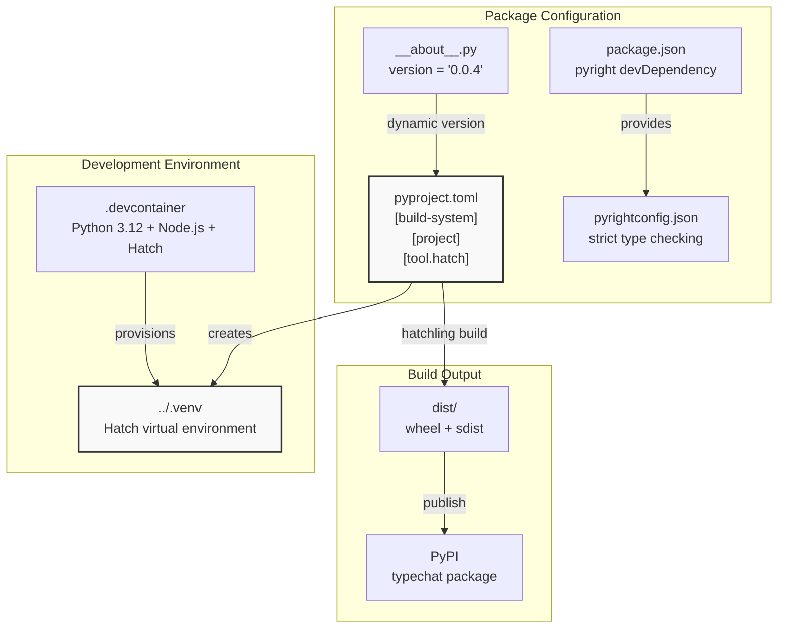
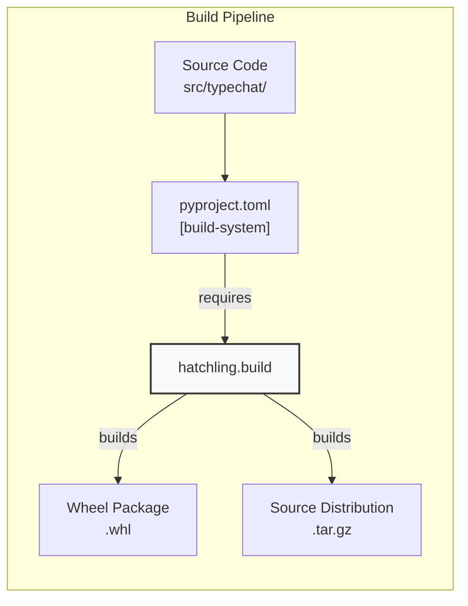
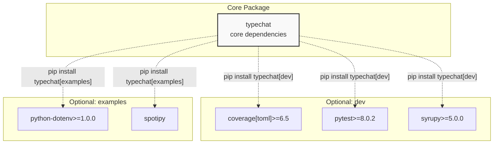
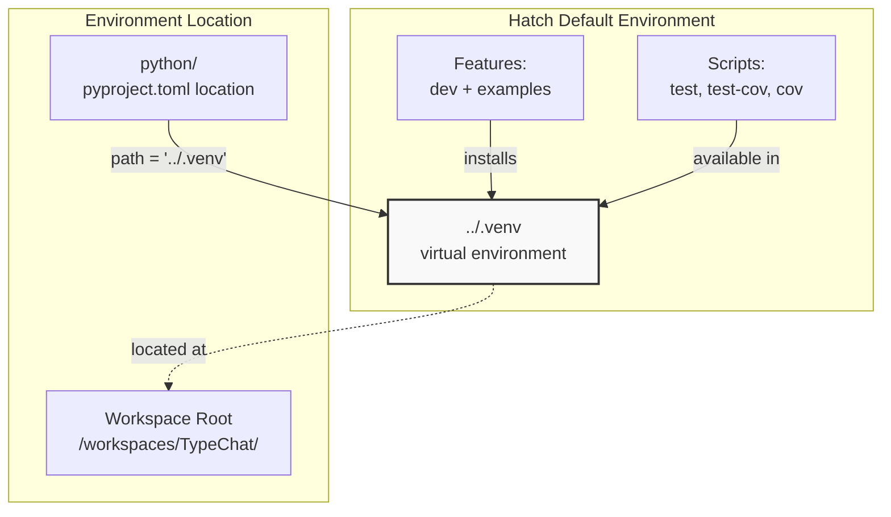
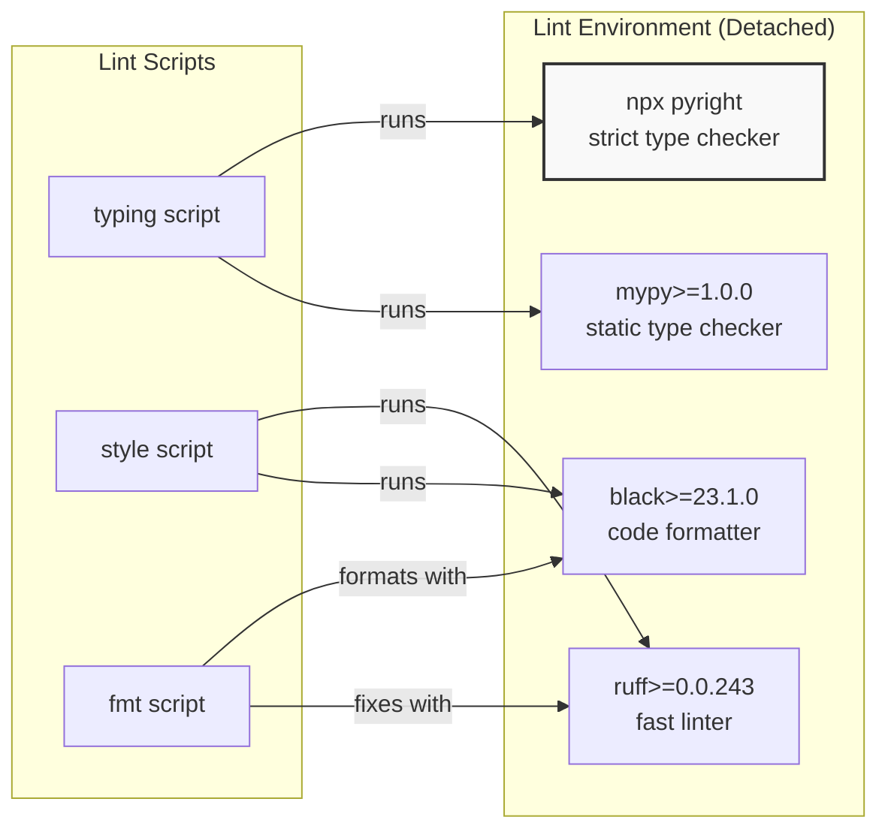
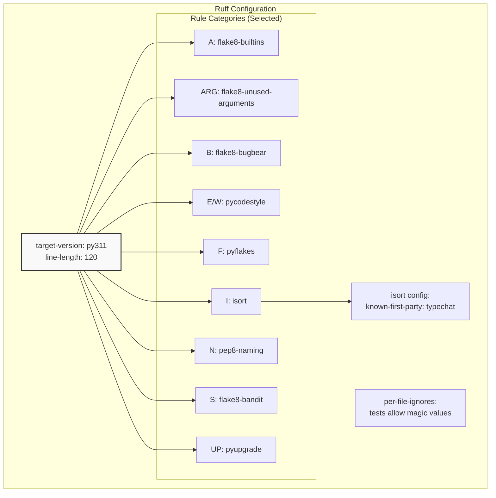
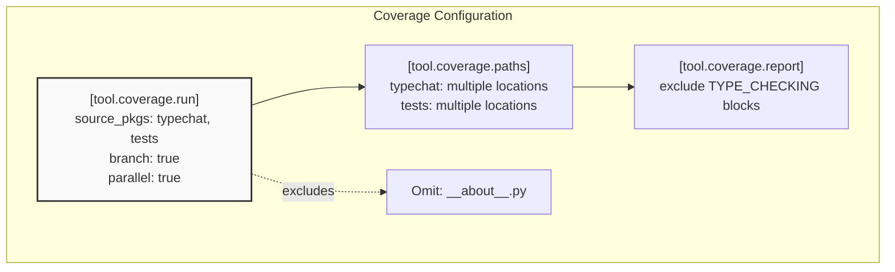
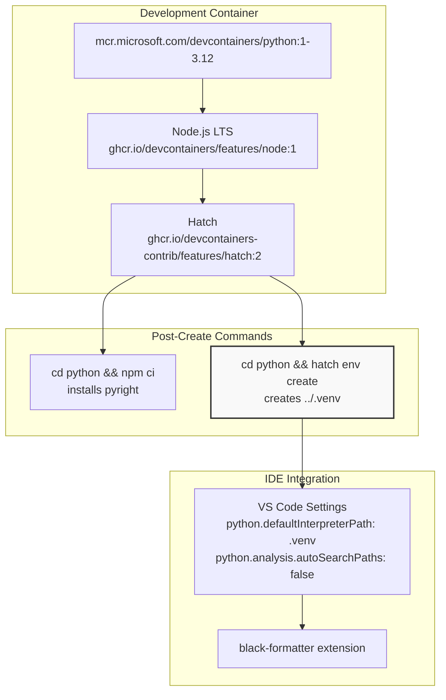

<!-- source: DeepWiki mcp.deepwiki.com · repo microsoft/TypeChat · page 5.1 Python Package · fetched 2026-10-26 -->

# Python Package

<details>
<summary>Relevant source files</summary>

The following files were used as context for generating this wiki page:

- [.devcontainer/devcontainer.json](.devcontainer/devcontainer.json)
- [.github/dependabot.yml](.github/dependabot.yml)
- [python/.gitignore](python/.gitignore)
- [python/examples/calendar/schema.py](python/examples/calendar/schema.py)
- [python/examples/restaurant/schema.py](python/examples/restaurant/schema.py)
- [python/examples/sentiment/schema.py](python/examples/sentiment/schema.py)
- [python/package-lock.json](python/package-lock.json)
- [python/package.json](python/package.json)
- [python/pyproject.toml](python/pyproject.toml)
- [python/pyrightconfig.json](python/pyrightconfig.json)
- [python/src/typechat/__about__.py](python/src/typechat/__about__.py)
- [python/src/typechat/_internal/__init__.py](python/src/typechat/_internal/__init__.py)

</details>


## Purpose and Scope

This document describes the Python package configuration, build system, and development tooling for the TypeChat Python implementation. It covers the `pyproject.toml` configuration, dependency management, Hatch build system setup, type checking configuration, and development environment tooling. For information about the actual Python implementation of TypeChat's core components, see [Core Components](#3.1). For Python-specific examples, see [Python Examples](#3.3).

## Package Structure Overview

The Python package is configured as a modern Python package using PEP 621 metadata standards and the Hatchling build backend. The package is published to PyPI as `typechat` and internally uses Hatch for environment management and development workflows.



**Sources:** [python/pyproject.toml:1-195](), [python/src/typechat/__about__.py:1-5](), [python/package.json:1-14](), [python/pyrightconfig.json:1-17](), [.devcontainer/devcontainer.json:1-50]()

## Package Metadata

The package is identified as `typechat` on PyPI with the following key metadata:

| Property | Value |
|----------|-------|
| **Package Name** | `typechat` |
| **Version** | `0.0.4` (dynamic from `__about__.py`) |
| **Python Requirement** | `>=3.11` |
| **Status** | `Beta` (Development Status 4) |
| **License** | `MIT` |
| **Build Backend** | `hatchling.build` |

The package supports Python 3.11, 3.12, and 3.13 across CPython and PyPy implementations. Version information is stored separately in [python/src/typechat/__about__.py:4]() and dynamically imported during build via the `[tool.hatch.version]` configuration.

**Sources:** [python/pyproject.toml:5-30](), [python/src/typechat/__about__.py:4](), [python/pyproject.toml:51-52]()

## Build System Configuration

The package uses Hatchling as its build backend, configured through the `[build-system]` table:



The `[build-system]` table specifies:
- `requires = ["hatchling"]` - Uses Hatchling as the build backend
- `build-backend = "hatchling.build"` - PEP 517 build backend specification

**Sources:** [python/pyproject.toml:1-3]()

## Dependencies

### Runtime Dependencies

The package declares four core runtime dependencies:

| Dependency | Version Constraint | Purpose |
|------------|-------------------|---------|
| `pydantic` | `>=2.5.2` | Runtime validation and schema definition |
| `pydantic_core` | `>=2.16.3` | Pydantic's Rust-based core validation engine |
| `httpx` | `>=0.27.0` | Async HTTP client for LLM API calls |
| `typing_extensions` | `>=4.10.0` | Backported typing features (e.g., `TypedDict`, `Literal`) |

These dependencies enable the core TypeChat functionality: type-based schema definition (Pydantic), HTTP communication with language models (httpx), and cross-version type hint compatibility (typing_extensions).

**Sources:** [python/pyproject.toml:25-30]()

### Optional Dependencies

The package provides two optional dependency groups:



**dev** group includes testing and coverage tools:
- `coverage[toml]>=6.5` - Code coverage measurement with TOML configuration support
- `pytest>=8.0.2` - Test framework
- `syrupy>=5.0.0` - Snapshot testing library for schema validation tests

**examples** group includes dependencies for example applications:
- `python-dotenv>=1.0.0` - Environment variable management for API keys
- `spotipy` - Spotify API client for the music example

**Sources:** [python/pyproject.toml:32-44]()

## Hatch Environment Configuration

Hatch manages virtual environments through the `[tool.hatch.envs]` tables. The primary environment is configured to support both library development and example execution.

### Default Environment

The default environment is configured with the following characteristics:



Key configuration in `[tool.hatch.envs.default]`:
- **type**: `"virtual"` - Standard virtual environment
- **path**: `"../.venv"` - Located at workspace root for editor integration
- **features**: `["dev", "examples"]` - Includes both optional dependency groups

The workspace root location (`../.venv`) ensures IDEs can automatically detect the virtual environment, as noted in the configuration comments.

### Environment Scripts

The default environment provides several predefined scripts:

| Script | Command | Purpose |
|--------|---------|---------|
| `test` | `pytest {args:tests}` | Run tests with optional arguments |
| `test-cov` | `coverage run -m pytest {args:tests}` | Run tests with coverage measurement |
| `cov-report` | `coverage combine && coverage report` | Generate coverage report |
| `cov` | `test-cov && cov-report` | Run tests with coverage and report |

**Sources:** [python/pyproject.toml:54-79]()

### Matrix Testing Environment

The `all` environment is configured for matrix testing across Python versions:

```toml
[[tool.hatch.envs.all.matrix]]
python = ["3.11", "3.12"]
```

This creates separate environments for Python 3.11 and 3.12, enabling multi-version compatibility testing. Note that Python 3.13 is supported as indicated in classifiers but not included in the matrix due to test infrastructure limitations.

**Sources:** [python/pyproject.toml:81-82]()

### Lint Environment

The lint environment is **detached** (does not inherit from default) and provides type checking and code quality tools:



The lint environment provides three script groups:

1. **typing**: Type checking with both Pyright and mypy
   - `npx pyright` - Strict TypeScript-style type checking
   - `mypy --install-types --non-interactive {args:src/typechat}` - Excludes tests (PEP 695 limitations)

2. **style**: Code quality checks
   - `ruff {args:.}` - Fast Python linter
   - `black --check --diff {args:.}` - Code formatting verification

3. **fmt**: Auto-formatting
   - `black {args:.}` - Apply code formatting
   - `ruff --fix {args:.}` - Apply auto-fixes
   - Runs `style` to verify

**Sources:** [python/pyproject.toml:84-111]()

## Type Checking Configuration

TypeChat uses dual type checking with Pyright (primary) and mypy (secondary) to ensure strict type safety.

### Pyright Configuration

Pyright is configured through [python/pyrightconfig.json:1-17]() with the strictest settings:

| Setting | Value | Effect |
|---------|-------|--------|
| `typeCheckingMode` | `"strict"` | Maximum type safety enforcement |
| `pythonVersion` | `"3.11"` | Target Python 3.11 compatibility |
| `reportCallInDefaultInitializer` | `"error"` | Prevent mutable default arguments |
| `reportImplicitOverride` | `"error"` | Require explicit `@override` decorator |
| `reportImportCycles` | `"error"` | Detect circular imports |
| `reportPropertyTypeMismatch` | `"error"` | Enforce property type consistency |
| `reportUninitializedInstanceVariable` | `"error"` | Require initialization of all instance variables |

Pyright is invoked via `npx pyright` using the Node.js package defined in [python/package.json:1-14](), which pins Pyright version `1.1.358`.

**Sources:** [python/pyrightconfig.json:1-17](), [python/package.json:1-14]()

### mypy Configuration

mypy is configured through `[tool.mypy]` with more lenient settings due to PEP 695 limitations:

```toml
[tool.mypy]
python_version = "3.11"
untyped_calls_exclude = ["spotipy"]
```

mypy only checks `src/typechat` (not tests) because it does not fully support PEP 695 type parameters, as noted in [python/pyproject.toml:94-96]().

**Sources:** [python/pyproject.toml:113-115]()

## Code Quality Tools Configuration

### Black Formatter

Black is configured for consistent Python code formatting:

| Setting | Value |
|---------|-------|
| `target-version` | `["py311"]` | Optimize for Python 3.11 syntax |
| `line-length` | `120` | Maximum line length |
| `skip-string-normalization` | `true` | Preserve single/double quote choice |

**Sources:** [python/pyproject.toml:117-120]()

### Ruff Linter

Ruff is configured with extensive rule selection for comprehensive linting:



The configuration enables 14 rule categories (A, ARG, B, C, DTZ, E, EM, F, FBT, I, ICN, ISC, N, PLC, PLE, PLR, PLW, Q, RUF, S, T, TID, UP, W, YTT) covering builtins, unused arguments, bugbear, complexity, error messages, imports, naming, security, and upgrade suggestions.

Special configurations:
- **isort integration**: Sets `typechat` as first-party for import sorting
- **import bans**: `ban-relative-imports = "all"` - Requires absolute imports
- **test exceptions**: Tests can use magic values (`PLR2004`), assertions (`S101`), and relative imports (`TID252`)

**Sources:** [python/pyproject.toml:122-175]()

## Testing and Coverage Configuration

### Coverage Settings

Coverage measurement is configured through `[tool.coverage]` tables:



Key settings:
- **source_pkgs**: `["typechat", "tests"]` - Measure coverage for both packages
- **branch**: `true` - Track branch coverage in addition to line coverage
- **parallel**: `true` - Support parallel test execution
- **omit**: Excludes `src/typechat/__about__.py` (version metadata only)

The `[tool.coverage.paths]` section maps multiple installation locations to canonical paths, supporting different test environments and Hatch workspaces.

The `[tool.coverage.report]` section excludes common patterns:
- `no cov` comment markers
- `if __name__ == .__main__.:` blocks
- `if TYPE_CHECKING:` blocks (import-only code)

**Sources:** [python/pyproject.toml:177-194]()

## Development Environment Setup

The development environment is provisioned through the devcontainer configuration and Hatch:



The devcontainer configuration includes:
- **Base image**: Python 3.12 from Microsoft's devcontainer images
- **Node.js**: LTS version with node-gyp dependencies for native modules
- **Hatch**: Latest version for Python environment management
- **Port forwarding**: Ports 7860-7870 for example application servers

Post-creation commands:
1. `cd python; npm ci` - Installs Node.js dependencies (Pyright)
2. `cd python; hatch env create` - Creates the default virtual environment

VS Code integration:
- Forces interpreter path to `/workspaces/TypeChat/.venv`
- Disables auto-search paths to respect the configured environment
- Includes `ms-python.black-formatter` extension

**Sources:** [.devcontainer/devcontainer.json:1-50]()

## Dependency Management

The repository uses Dependabot for automated dependency updates:

| Ecosystem | Directory | Schedule |
|-----------|-----------|----------|
| `devcontainers` | `/` | Weekly |
| `github-actions` | `/` | Weekly |

Notably, Python package dependencies are **not** managed by Dependabot, requiring manual updates to [python/pyproject.toml:25-44]() when dependency updates are needed.

**Sources:** [.github/dependabot.yml:1-17]()

## Package URLs and Links

The package metadata includes three primary URLs:

| Link Type | URL |
|-----------|-----|
| **Documentation** | `https://github.com/microsoft/TypeChat#readme` |
| **Issues** | `https://github.com/microsoft/TypeChat/issues` |
| **Source** | `https://github.com/microsoft/TypeChat` |

These URLs are included in PyPI metadata and accessible via `pip show typechat`.

**Sources:** [python/pyproject.toml:46-49]()

---

