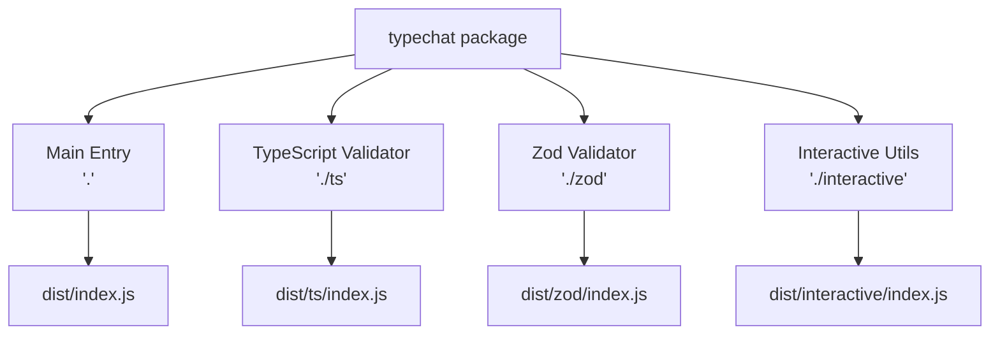
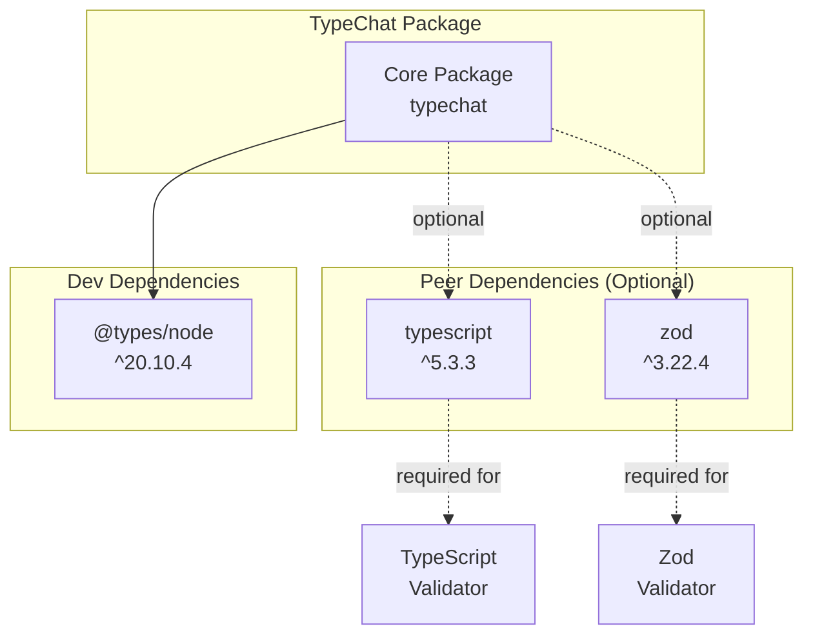
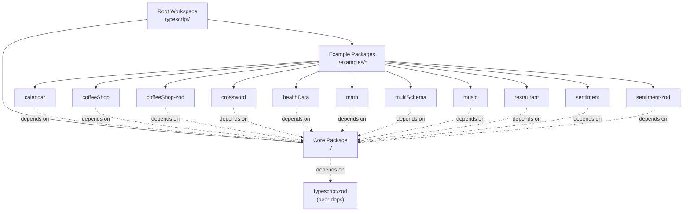
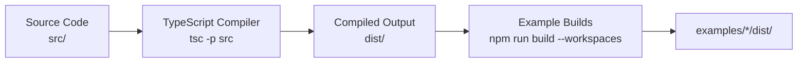
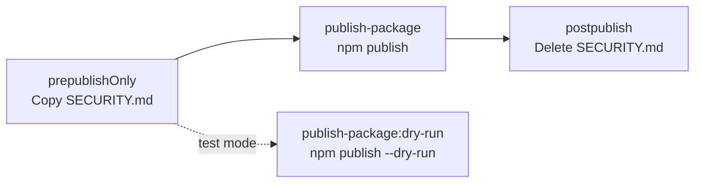
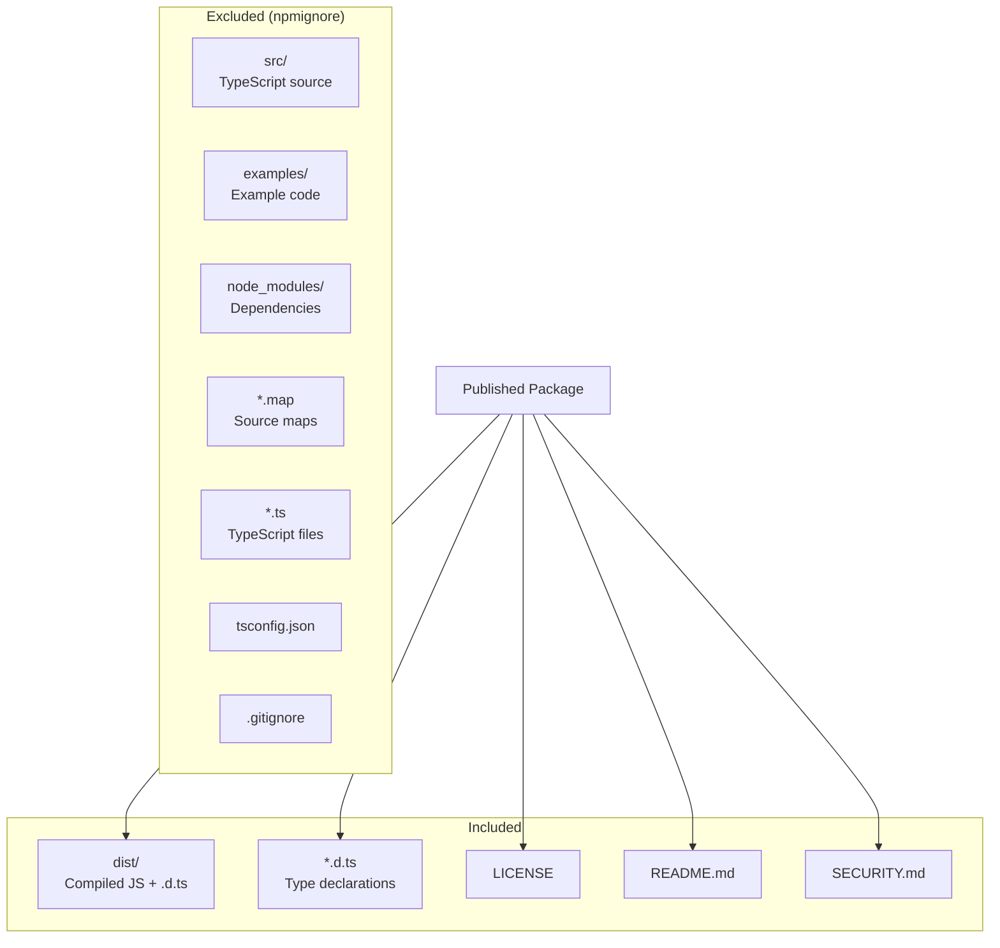

<!-- source: DeepWiki mcp.deepwiki.com · repo microsoft/TypeChat · page 5.2 TypeScript Package · fetched 2026-10-26 -->

# TypeScript Package

<details>
<summary>Relevant source files</summary>

The following files were used as context for generating this wiki page:

- [typescript/.gitignore](typescript/.gitignore)
- [typescript/.npmignore](typescript/.npmignore)
- [typescript/package-lock.json](typescript/package-lock.json)
- [typescript/package.json](typescript/package.json)

</details>


## Purpose and Scope

This document covers the TypeScript package configuration, structure, and build system for the core `typechat` npm package. It details the package metadata, exports structure, workspace setup for examples, dependency management, and publishing process. For the Python package configuration, see [Python Package](#5.1). For the overall repository organization, see [Repository Organization](#5.3). For the core TypeScript implementation components, see [Core Components](#4.1).

---

## Package Metadata

The TypeScript package is published to npm as `typechat` at version 0.1.2. The package is licensed under MIT and maintained by Microsoft.

**Package Identification:**

| Property | Value |
|----------|-------|
| Name | `typechat` |
| Version | `0.1.2` |
| License | MIT |
| Author | Microsoft |
| Node Engine | >=18 |

The package description emphasizes its experimental nature and type-based approach to natural language interfaces: "TypeChat is an experimental library that makes it easy to build natural language interfaces using types."

**Keywords:** The package is indexed under `schema`, `LLM`, `prompt`, `TypeScript`, and `validation` keywords for discoverability.

**Sources:** [typescript/package.json:2-13]()

---

## Exports and Entry Points

The TypeScript package uses the modern `exports` field to provide multiple entry points, allowing consumers to import specific functionality without bundling unused code.

### Export Structure



**Export Mapping:**

| Import Path | Compiled Output | Purpose |
|-------------|----------------|---------|
| `typechat` | `./dist/index.js` | Core translator and model interfaces |
| `typechat/ts` | `./dist/ts/index.js` | TypeScript compiler-based validator |
| `typechat/zod` | `./dist/zod/index.js` | Zod schema-based validator |
| `typechat/interactive` | `./dist/interactive/index.js` | Interactive CLI utilities |

The main entry point (`./dist/index.js`) is also exposed through the legacy `main` field for compatibility with older tooling. Type declarations are provided via `./dist/index.d.ts`.

**Sources:** [typescript/package.json:31-38]()

---

## Dependency Management

The TypeScript package uses a unique dependency structure that makes TypeScript and Zod optional peer dependencies, allowing users to choose their validation strategy.

### Dependency Architecture



**Dependency Table:**

| Category | Package | Version | Optional | Purpose |
|----------|---------|---------|----------|---------|
| Runtime | None | - | - | Zero runtime dependencies |
| Peer | `typescript` | ^5.3.3 | Yes | Required for TypeScript compiler validator |
| Peer | `zod` | ^3.22.4 | Yes | Required for Zod schema validator |
| Dev | `@types/node` | ^20.10.4 | No | Node.js type definitions for development |

### Optional Peer Dependencies

The package declares both TypeScript and Zod as optional peer dependencies through `peerDependenciesMeta`, allowing applications to install only the validator they intend to use:

- Applications using TypeScript compiler validation must install `typescript@^5.3.3`
- Applications using Zod validation must install `zod@^3.22.4`
- Applications can install both if they need to support multiple validation strategies

This design keeps the core package lightweight while maintaining flexibility.

**Sources:** [typescript/package.json:48-60]()

---

## Workspace Configuration

The TypeScript package uses npm workspaces to manage the core library and all example applications as a monorepo, enabling shared dependency management and coordinated builds.

### Workspace Structure



The workspace configuration is defined in [typescript/package.json:64-67]():

```
"workspaces": [
  "./",
  "./examples/*"
]
```

This includes:
1. **Root workspace (`./`):** The core `typechat` package itself
2. **Example workspaces (`./examples/*`):** All subdirectories under `examples/`

### Example Package Dependencies

Each example package declares `typechat@^0.1.0` as a dependency, which npm workspaces resolve to the local package. Example packages also include common dependencies:

| Dependency | Purpose | Used By |
|------------|---------|---------|
| `dotenv` | Environment variable loading | All examples |
| `find-config` | Config file discovery | All examples |
| `typescript` | TypeScript compiler validator | Most examples |
| `zod` | Zod schema validator | Zod-specific examples |
| `copyfiles` | Build-time file copying | All examples (dev) |

**TypeScript Examples:**
- `calendar`, `coffeeShop`, `crossword`, `healthData`, `math`, `restaurant`, `sentiment` - Use TypeScript compiler validation
- `music` - Complex example with Spotify integration, uses TypeScript validation

**Zod Examples:**
- `coffeeShop-zod`, `sentiment-zod` - Demonstrate Zod schema validation

**Multi-Schema:**
- `multiSchema` - Demonstrates agent routing, depends on the `music` example package

**Sources:** [typescript/package-lock.json:11-14](), [typescript/package-lock.json:34-196]()

---

## Build System

The TypeScript package uses a multi-stage build system that compiles TypeScript source to JavaScript and coordinates builds across all workspace packages.

### Build Pipeline



### Build Scripts

| Script | Command | Trigger | Purpose |
|--------|---------|---------|---------|
| `build` | `tsc -p src` | Manual | Compile core package TypeScript to JavaScript |
| `build-all` | `npm run build --workspaces` | Manual | Build core and all example packages |
| `prepare` | `npm run build-all` | Pre-install | Lifecycle hook that builds before install |

The `prepare` script ensures the package is always built before installation, either as a git dependency or during local development. The TypeScript compiler reads configuration from a `tsconfig.json` in the `src/` directory and outputs compiled JavaScript and declaration files to `dist/`.

**Sources:** [typescript/package.json:22-25]()

---

## Publishing Workflow

The package uses npm scripts to manage the publishing process, including security file handling and dry-run testing.

### Publishing Scripts



| Script | Command | Timing | Purpose |
|--------|---------|--------|---------|
| `prepublishOnly` | `node -e "require('fs').copyFileSync('../SECURITY.md','SECURITY.md')"` | Before publish | Copy security policy from repository root |
| `publish-package` | `npm publish` | Manual | Publish package to npm registry |
| `postpublish` | `node -e "require('fs').unlinkSync('SECURITY.md')"` | After publish | Remove temporary security file |
| `publish-package:dry-run` | `npm publish --dry-run` | Manual | Test publish without uploading |

The publishing workflow ensures that the `SECURITY.md` file from the repository root is included in the published package, but not checked into the TypeScript package directory. The file is copied before publishing and cleaned up afterward.

**Sources:** [typescript/package.json:26-29]()

---

## Package Contents

The published npm package includes only the necessary files for runtime use, excluding source code and development artifacts.

### Included Files

The `files` field specifies which directories and files are included in the published package:

| Path | Type | Contents |
|------|------|----------|
| `dist/` | Directory | Compiled JavaScript and TypeScript declarations |
| `LICENSE` | File | MIT license text |
| `README.md` | File | Package documentation |
| `SECURITY.md` | File | Security policy (copied at publish time) |

### Excluded Files

The `.npmignore` file explicitly excludes development files from the published package:



The `.npmignore` rules ensure:
- Source TypeScript files (`*.ts`) are excluded, except type declarations (`*.d.ts`)
- Example code remains in the repository only
- Source maps and development configuration are excluded
- Only the compiled `dist/` directory is published

**Sources:** [typescript/package.json:42-47](), [typescript/.npmignore:1-9]()

---

## Development Exclusions

The `.gitignore` file manages which files are excluded from version control during development.

### Git Ignore Patterns

| Pattern | Purpose |
|---------|---------|
| `build/`, `dist/`, `out/` | Build output directories |
| `node_modules/` | Installed dependencies |
| `.env` | Environment variables (secrets) |
| `*.map` | Source map files |
| `*.out.txt` | Test output files |
| `*.bat` | Windows batch scripts |
| `SECURITY.md` | Copied file (lives in repo root) |
| `.scratch/` | Local development workspace |
| `**/.vscode/*` (except `launch.json`) | Editor configuration |
| `**/tsconfig.debug.json` | Debug-specific TypeScript config |
| `**/build.bat` | Build scripts |

The `.gitignore` ensures that generated files, local configuration, and sensitive data are not committed to the repository while allowing some debugging configuration (`launch.json`) to be shared across the team.

**Sources:** [typescript/.gitignore:1-20]()

---

## Engine Requirements

The package requires Node.js version 18 or higher, specified in the `engines` field:

```json
"engines": {
  "node": ">=18"
}
```

This requirement aligns with Node.js LTS support and ensures access to modern JavaScript features and APIs. The CI pipeline tests across multiple Node.js versions (18, 20, 22) to verify compatibility.

**Sources:** [typescript/package.json:39-41](), [typescript/package-lock.json:18-20]()

---

## Summary

The TypeScript package is designed as a lightweight, modular library with:

- **Zero runtime dependencies** for minimal bundle size
- **Optional peer dependencies** (TypeScript and Zod) allowing users to choose their validation strategy
- **Multiple entry points** via the `exports` field for tree-shaking and selective imports
- **Workspace-based monorepo** managing 11+ example packages
- **Automated build pipeline** ensuring all packages are compiled before use
- **Careful publishing workflow** including security documentation and file exclusions

This architecture enables developers to use TypeChat with minimal overhead while maintaining flexibility in validation approaches and clear separation between core library and example code.

---

