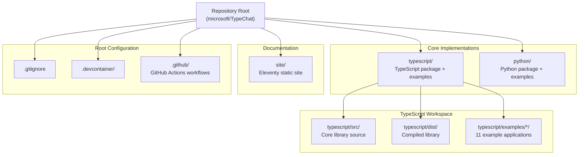
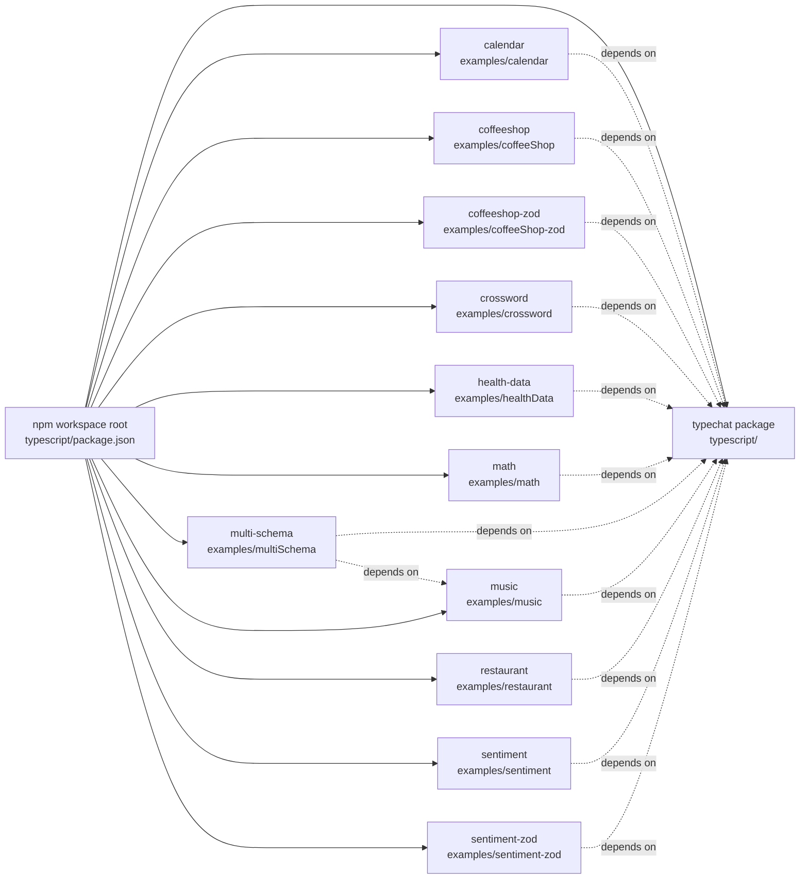
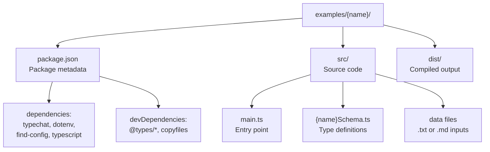
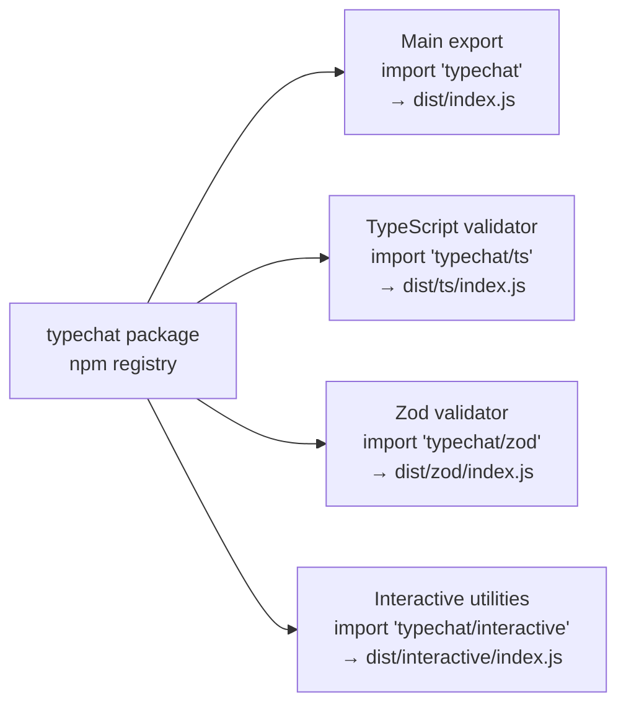
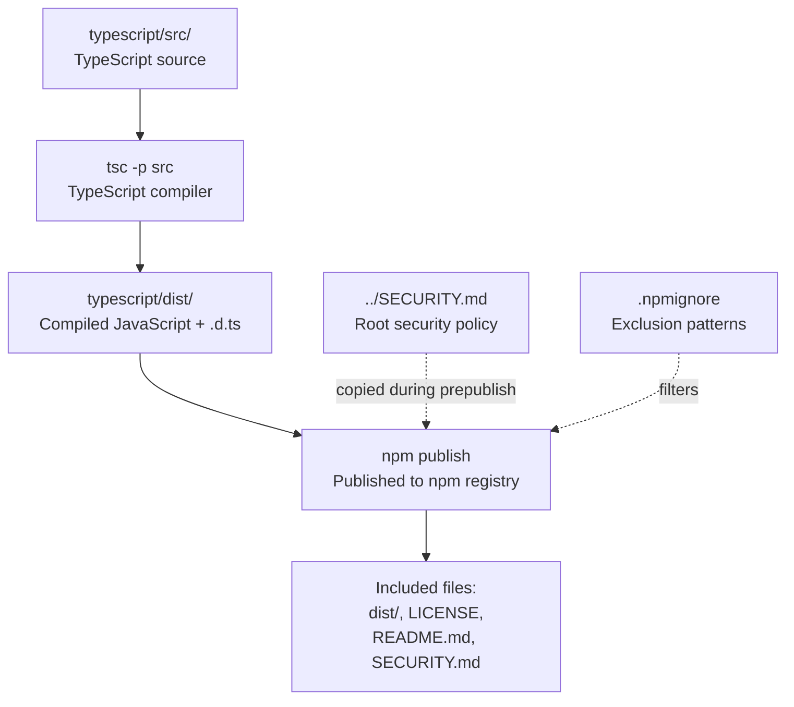

<!-- source: DeepWiki mcp.deepwiki.com · repo microsoft/TypeChat · page 5.3 Repository Organization · fetched 2026-10-26 -->

# Repository Organization

Relevant source files

The following files were used as context for generating this wiki page:

- [.gitignore](.gitignore)
- [typescript/.gitignore](typescript/.gitignore)
- [typescript/.npmignore](typescript/.npmignore)
- [typescript/package-lock.json](typescript/package-lock.json)
- [typescript/package.json](typescript/package.json)

This page documents the physical directory structure of the TypeChat monorepo, including the organization of Python and TypeScript implementations, example applications, documentation site, and configuration files. For language-specific package configuration details, see [Python Package](#5.1) and [TypeScript Package](#5.2). For development environment and CI/CD details, see [Development Environment](#6.1) and [CI/CD Pipeline](#6.2).

## Repository Structure Overview

The TypeChat repository is organized as a **polyglot monorepo** containing parallel Python and TypeScript implementations, comprehensive examples in both languages, a static documentation site, and shared configuration files at the root.

**Sources:** [.gitignore:1-18](), [typescript/package.json:64-67](), [typescript/package-lock.json:11-14]()

## Directory Layout

### TypeScript Directory Structure

The `typescript/` directory contains the TypeScript implementation organized as an npm workspace with the core library at the root and examples as separate packages.

```mermaid
graph TD
    TS["typescript/"]
    
    TS --> SRC["src/<br/>TypeScript source code"]
    TS --> DIST["dist/<br/>Compiled JavaScript output"]
    TS --> EXAMPLES["examples/<br/>Example applications"]
    TS --> PKG["package.json<br/>Workspace root config"]
    TS --> LOCK["package-lock.json<br/>Dependency lockfile"]
    TS --> GITIGNORE[".gitignore<br/>TS-specific patterns"]
    TS --> NPMIGNORE[".npmignore<br/>Publish exclusions"]
    
    SRC --> SRC_INDEX["index.ts"]
    SRC --> SRC_TS["ts/<br/>TypeScript compiler validator"]
    SRC --> SRC_ZOD["zod/<br/>Zod validator"]
    SRC --> SRC_INTER["interactive/<br/>Interactive utilities"]
    
    EXAMPLES --> EX_CAL["calendar/<br/>Calendar actions"]
    EXAMPLES --> EX_COFFEE["coffeeShop/<br/>Coffee orders"]
    EXAMPLES --> EX_COFFEE_ZOD["coffeeShop-zod/<br/>Coffee with Zod"]
    EXAMPLES --> EX_CROSS["crossword/<br/>Multimodal crossword"]
    EXAMPLES --> EX_HEALTH["healthData/<br/>Health data entry"]
    EXAMPLES --> EX_MATH["math/<br/>Math expressions"]
    EXAMPLES --> EX_MULTI["multiSchema/<br/>Multi-schema routing"]
    EXAMPLES --> EX_MUSIC["music/<br/>Spotify control"]
    EXAMPLES --> EX_REST["restaurant/<br/>Restaurant orders"]
    EXAMPLES --> EX_SENT["sentiment/<br/>Sentiment analysis"]
    EXAMPLES --> EX_SENT_ZOD["sentiment-zod/<br/>Sentiment with Zod"]
```

**Sources:** [typescript/package.json:31-38](), [typescript/.gitignore:1-20](), [typescript/.npmignore:1-9]()

### Workspace Package Relationships

The TypeScript workspace uses npm workspaces to manage dependencies between the core library and examples. Each example is a separate package that depends on the `typechat` core package.

**Sources:** [typescript/package.json:64-67](), [typescript/package-lock.json:34-196]()

## Workspace Configuration

### TypeScript Workspace Definition

The TypeScript workspace is configured in the root `package.json` with a workspaces array that includes the current directory and all example subdirectories.

| Configuration | Value | Location |
|--------------|-------|----------|
| Workspace root | `typescript/` | [typescript/package.json:2]() |
| Workspace pattern | `"./"` and `"./examples/*"` | [typescript/package.json:64-67]() |
| Core package name | `typechat` | [typescript/package.json:2]() |
| Example count | 11 packages | [typescript/package-lock.json:34-196]() |

Each example package has its own `package.json` with:
- A unique package name (e.g., `coffeeshop`, `calendar`, `music`)
- Dependency on `"typechat": "^0.1.0"`
- Common dev dependencies: `@types/node`, `@types/find-config`, `copyfiles`
- Runtime dependency on `typescript` (except Zod-only examples)

**Sources:** [typescript/package.json:64-67](), [typescript/package-lock.json:34-48](), [typescript/package-lock.json:49-64]()

### Example Package Structure

All TypeScript examples follow a consistent structure:

**Sources:** [typescript/package-lock.json:34-196]()

## Ignored Files and Patterns

### Root-Level Gitignore

The repository root [.gitignore:1-18]() defines patterns that apply to the entire repository:

| Pattern | Purpose | Applies To |
|---------|---------|------------|
| `build/`, `dist/`, `out/` | Compiled output directories | All packages |
| `node_modules/` | Node.js dependencies | TypeScript workspace |
| `.venv/` | Python virtual environments | Python implementation |
| `.env*` | Environment variable files | All packages |
| `*.map`, `*.out.txt`, `*.bat` | Build artifacts and scripts | All packages |
| `.scratch/` | Local development scratch space | All developers |
| `**/.vscode/*` (except `launch.json`) | VS Code settings | All directories |
| `**/tsconfig.debug.json`, `**/build.bat` | Debug configurations | TypeScript packages |

**Sources:** [.gitignore:1-18]()

### TypeScript-Specific Gitignore

The `typescript/` directory has additional ignore patterns in [typescript/.gitignore:1-20]():

| Additional Pattern | Purpose |
|-------------------|---------|
| `SECURITY.md` | Copied at publish time from repo root |

All other patterns in `typescript/.gitignore` duplicate the root patterns for consistency when the TypeScript directory is viewed in isolation.

**Sources:** [typescript/.gitignore:1-20]()

### NPM Publish Exclusions

The [typescript/.npmignore:1-9]() defines what is excluded when publishing to npm:

| Pattern | Reason for Exclusion |
|---------|---------------------|
| `src/` | Source code not needed in published package |
| `examples/` | Examples published separately |
| `node_modules/` | Dependencies installed by consumers |
| `*.ts` (except `*.d.ts`) | Source TypeScript files (keep type definitions) |
| `tsconfig.json` | Build configuration |
| `.gitignore` | Version control metadata |

The published package includes only: `dist/`, `LICENSE`, `README.md`, and `SECURITY.md` (as specified in [typescript/package.json:42-47]()).

**Sources:** [typescript/.npmignore:1-9](), [typescript/package.json:42-47]()

## Package Export Structure

### TypeScript Package Exports

The TypeScript package defines multiple entry points for different use cases:

These exports correspond to the compiled output from [typescript/src/]() and are configured in [typescript/package.json:33-38]().

**Sources:** [typescript/package.json:31-38]()

### Build and Distribution Workflow

The build process is orchestrated by npm scripts in [typescript/package.json:22-29]():
- `build`: Compiles the core library (`tsc -p src`)
- `build-all`: Compiles all workspace packages (`npm run build --workspaces`)
- `prepare`: Runs `build-all` before install/publish
- `prepublishOnly`: Copies `SECURITY.md` from repository root
- `postpublish`: Removes the copied `SECURITY.md`

**Sources:** [typescript/package.json:22-29](), [typescript/package.json:42-47](), [typescript/.npmignore:1-9]()

## Cross-Language Repository Structure

While this page focuses on the TypeScript directory structure, the repository also contains:

- **Python Implementation**: Located in `python/` directory with similar structure (package source, examples, tests)
- **Documentation Site**: Located in `site/` directory, built with Eleventy and deployed to GitHub Pages
- **Shared CI/CD**: GitHub Actions workflows in `.github/workflows/` that test both implementations
- **Development Container**: Configuration in `.devcontainer/` supporting both Python and TypeScript development

For details on the Python package structure, see [Python Package](#5.1). For documentation site architecture, see [Site Architecture](#7.1).

**Sources:** High-level architecture diagrams (provided context)

---

