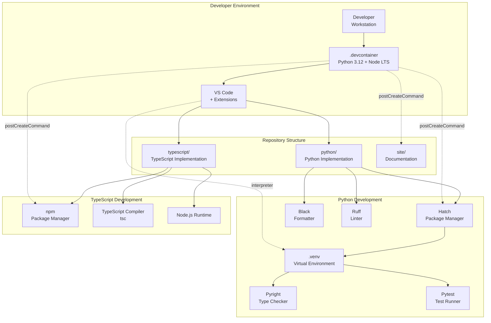
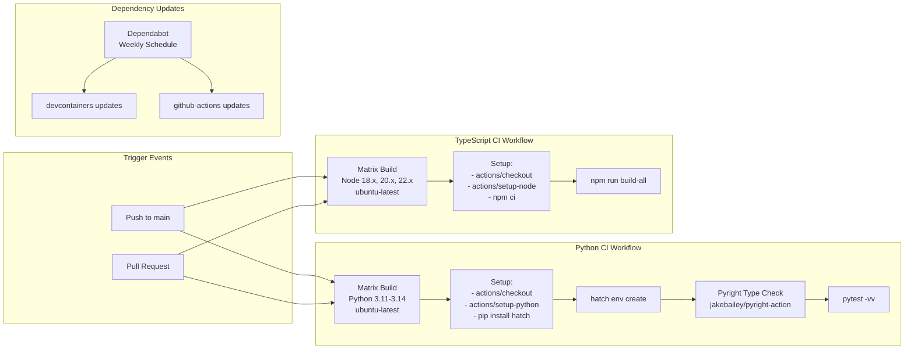
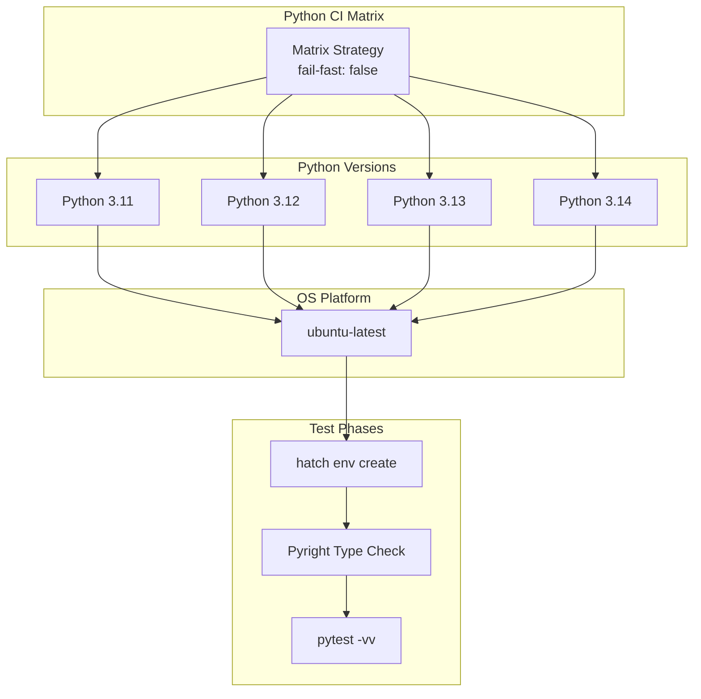

<!-- source: DeepWiki mcp.deepwiki.com · repo microsoft/TypeChat · page 6 Development and Testing · fetched 2026-10-26 -->

# Development and Testing

<details>
<summary>Relevant source files</summary>

The following files were used as context for generating this wiki page:

- [.devcontainer/devcontainer.json](.devcontainer/devcontainer.json)
- [.github/dependabot.yml](.github/dependabot.yml)
- [.github/workflows/ci.js.yml](.github/workflows/ci.js.yml)
- [.github/workflows/ci.python.yml](.github/workflows/ci.python.yml)
- [python/examples/calendar/schema.py](python/examples/calendar/schema.py)
- [python/examples/restaurant/schema.py](python/examples/restaurant/schema.py)
- [python/examples/sentiment/schema.py](python/examples/sentiment/schema.py)
- [python/pyproject.toml](python/pyproject.toml)
- [python/tests/__py3.13_snapshots__/test_conflicting_names_1/test_conflicting_names_1.schema.d.ts](python/tests/__py3.13_snapshots__/test_conflicting_names_1/test_conflicting_names_1.schema.d.ts)
- [python/tests/__py3.13_snapshots__/test_hello_world/test_generic_alias1.schema.d.ts](python/tests/__py3.13_snapshots__/test_hello_world/test_generic_alias1.schema.d.ts)
- [python/tests/__py3.14_snapshots__/test_conflicting_names_1/test_conflicting_names_1.schema.d.ts](python/tests/__py3.14_snapshots__/test_conflicting_names_1/test_conflicting_names_1.schema.d.ts)
- [python/tests/__py3.14_snapshots__/test_hello_world/test_generic_alias1.schema.d.ts](python/tests/__py3.14_snapshots__/test_hello_world/test_generic_alias1.schema.d.ts)

</details>


This document provides an overview of the development workflows, testing strategies, and CI/CD infrastructure for the TypeChat repository. It covers the development environment setup, continuous integration pipelines for both Python and TypeScript implementations, and the testing approaches used to ensure code quality and cross-version compatibility.

For specific implementation details, see:
- **Development Environment Setup**: [6.1](#6.1) documents devcontainer configuration and local tooling
- **CI/CD Pipeline Details**: [6.2](#6.2) covers GitHub Actions workflows and deployment processes
- **Testing Infrastructure Details**: [6.3](#6.3) explains snapshot testing and type conversion validation

## Overview

The TypeChat repository implements a **polyglot development workflow** that maintains parallel Python and TypeScript implementations with independent but aligned testing and build processes. Both implementations share the same conceptual architecture but use language-specific tooling, testing frameworks, and package management systems.

The development infrastructure is designed to support:
- **Multi-version testing**: Python 3.11-3.14 and Node.js 18.x-22.x
- **Type safety enforcement**: Pyright for Python, TypeScript compiler for TypeScript
- **Automated dependency management**: Dependabot for container and GitHub Actions updates
- **Snapshot-based validation**: Testing Python→TypeScript schema conversion correctness
- **Containerized development**: Consistent development environment via devcontainers

Sources: [.github/workflows/ci.python.yml:1-72](), [.github/workflows/ci.js.yml:1-42](), [.devcontainer/devcontainer.json:1-50]()

## Development Workflow Architecture



**Development Workflow Architecture**

This diagram shows the development environment structure. The devcontainer provides a consistent base environment with Python 3.12 and Node.js LTS. Python development uses Hatch to manage a shared `.venv` virtual environment at the repository root, while TypeScript uses npm workspaces. Post-creation commands automatically install dependencies for all three workspace areas.

Sources: [.devcontainer/devcontainer.json:1-50](), [python/pyproject.toml:54-67]()

## CI/CD Pipeline Overview



**CI/CD Pipeline Overview**

The repository runs two independent CI workflows. The Python workflow ([.github/workflows/ci.python.yml]()) tests across four Python versions, running Pyright for static type checking and Pytest for runtime tests. The TypeScript workflow ([.github/workflows/ci.js.yml]()) tests across three Node.js versions, building all packages in the workspace. Both workflows use matrix strategies for parallel testing.

Sources: [.github/workflows/ci.python.yml:1-72](), [.github/workflows/ci.js.yml:1-42](), [.github/dependabot.yml:1-17]()

## Python Testing Infrastructure

The Python testing infrastructure uses several specialized approaches:

| Testing Component | Tool/Framework | Purpose |
|------------------|----------------|---------|
| Type Checking | Pyright (via GitHub Action) | Static type validation across Python versions |
| Runtime Testing | Pytest | Unit and integration tests |
| Snapshot Testing | Syrupy | Validating TypeScript schema generation |
| Coverage | Coverage.py | Code coverage measurement |
| Linting | Ruff + Black | Code style enforcement |

The Python test suite includes **version-specific snapshot directories** to handle differences in Python's type system across versions:

```mermaid
graph TD
    subgraph "Test Execution"
        PYTEST["pytest"]
        TEST_FILE["test_hello_world.py<br/>test_conflicting_names.py"]
    end
    
    subgraph "Snapshot Validation"
        SYRUPY["Syrupy<br/>Snapshot Testing"]
        PY311["__py3.11_snapshots__/"]
        PY312["__py3.12_snapshots__/"]
        PY313["__py3.13_snapshots__/"]
        PY314["__py3.14_snapshots__/"]
    end
    
    subgraph "Generated Artifacts"
        TS_SCHEMA["*.schema.d.ts<br/>TypeScript Definitions"]
        ERROR_MSG["// ERRORS:<br/>// !!! ..."]
    end
    
    PYTEST --> TEST_FILE
    TEST_FILE --> SYRUPY
    
    SYRUPY -.Python 3.11.-> PY311
    SYRUPY -.Python 3.12.-> PY312
    SYRUPY -.Python 3.13.-> PY313
    SYRUPY -.Python 3.14.-> PY314
    
    PY311 --> TS_SCHEMA
    PY312 --> TS_SCHEMA
    PY313 --> TS_SCHEMA
    PY314 --> TS_SCHEMA
    
    TS_SCHEMA -.may contain.-> ERROR_MSG
```

**Python Snapshot Testing Architecture**

The snapshot testing system validates that `python_type_to_typescript_schema()` produces consistent TypeScript schemas across Python versions. Each Python version (3.11-3.14) has its own snapshot directory because type system features differ between versions. Tests like `test_hello_world` and `test_conflicting_names_1` generate TypeScript `.schema.d.ts` files that are compared against stored snapshots.

Sources: [python/tests/__py3.13_snapshots__/test_hello_world/test_generic_alias1.schema.d.ts:1-36](), [python/tests/__py3.14_snapshots__/test_hello_world/test_generic_alias1.schema.d.ts:1-36](), [python/tests/__py3.13_snapshots__/test_conflicting_names_1/test_conflicting_names_1.schema.d.ts:1-16](), [python/pyproject.toml:34-38]()

## Package Configuration and Build Tools

### Python Configuration

The Python implementation uses **Hatch** as its build system and package manager. Key configuration elements in `pyproject.toml`:

| Configuration | Value | Purpose |
|--------------|-------|---------|
| Build System | `hatchling` | PEP 517 compliant build backend |
| Python Version | `>=3.11` | Minimum supported version |
| Virtual Environment | `../venv` | Shared workspace-level environment |
| Test Framework | `pytest>=8.0.2` | Runtime testing |
| Snapshot Testing | `syrupy>=5.0.0` | Schema generation validation |
| Type Checking | Pyright (via npm) | Static analysis |

The Hatch environment configuration includes development and example dependencies:

```
[tool.hatch.envs.default]
type = "virtual"
path = "../.venv"  # Shared across workspace
features = ["dev", "examples"]
```

Sources: [python/pyproject.toml:1-195]()

### TypeScript Configuration

The TypeScript implementation uses **npm workspaces** to manage multiple packages. The CI workflow:

```yaml
defaults:
  run:
    shell: bash
    working-directory: typescript

jobs:
  build:
    strategy:
      matrix:
        node-version: [18.x, 20.x, 22.x]
    steps:
    - run: npm ci
    - run: npm run build-all
```

Sources: [.github/workflows/ci.js.yml:11-42]()

## Type Checking Configuration

### Python: Pyright

The Python CI workflow uses the `jakebailey/pyright-action` to run Pyright with version consistency:

```yaml
- name: Get Pyright Version
  id: pyright-version
  run: |
    PYRIGHT_VERSION=$(jq -r '.devDependencies.pyright' < package.json)
    echo "version=$PYRIGHT_VERSION" >> $GITHUB_OUTPUT

- name: Run pyright
  uses: jakebailey/pyright-action@v3
  with:
    version: ${{ steps.pyright-version.outputs.version }}
    python-version: ${{ matrix.python-version}}
    working-directory: ./python
```

The Pyright version is read from `python/package.json` to ensure consistency between local development and CI. Only the Python 3.11 build on ubuntu-latest posts annotations to avoid duplicate comments.

Sources: [.github/workflows/ci.python.yml:53-66]()

### Python: Additional Type Checking

The `pyproject.toml` also configures mypy as a secondary type checker, though it's excluded from CI for tests because mypy doesn't fully support PEP 695 (type parameters):

```toml
[tool.hatch.envs.lint.scripts]
typing = [
  "npx pyright",
  # mypy should not include tests, as it does not fully support
  # PEP 695 (type aliases, type parameters, etc.)
  "mypy --install-types --non-interactive {args:src/typechat}"
]
```

Sources: [python/pyproject.toml:91-98]()

## Testing Matrix Strategy

### Python Multi-Version Testing



**Python Testing Matrix**

The Python CI workflow tests all combinations of Python versions 3.11-3.14 on ubuntu-latest. The `fail-fast: false` setting ensures all matrix combinations complete even if one fails, providing comprehensive test results across all supported Python versions.

Sources: [.github/workflows/ci.python.yml:17-31]()

### TypeScript Multi-Version Testing

The TypeScript CI similarly tests across Node.js versions:

```yaml
strategy:
  matrix:
    node-version: [18.x, 20.x, 22.x]
```

Sources: [.github/workflows/ci.js.yml:23-30]()

## Code Quality Tools

### Python Linting and Formatting

The Python implementation uses a comprehensive set of code quality tools configured in `pyproject.toml`:

| Tool | Configuration | Purpose |
|------|--------------|---------|
| **Black** | `target-version = ["py311"]`<br/>`line-length = 120` | Code formatting |
| **Ruff** | `target-version = "py311"`<br/>`line-length = 120` | Fast Python linter |
| **Pyright** | Via npm, version-pinned | Type checking |
| **Mypy** | `python_version = "3.11"` | Secondary type checking |

Ruff is configured with extensive rule selections covering:
- `A`: Shadowing builtins
- `B`: Bugbear (likely bugs)
- `E`, `W`: pycodestyle errors and warnings
- `F`: Pyflakes
- `I`: Import sorting
- `PLC`, `PLE`, `PLR`, `PLW`: Pylint checks
- `RUF`: Ruff-specific rules
- `S`: Security (bandit)
- And many more

Sources: [python/pyproject.toml:84-176]()

## Test Organization

### Python Test Structure

The Python tests are organized with special handling for snapshot validation:

```
python/tests/
├── __py3.11_snapshots__/    # Python 3.11 specific snapshots
├── __py3.12_snapshots__/    # Python 3.12 specific snapshots
├── __py3.13_snapshots__/    # Python 3.13 specific snapshots
├── __py3.14_snapshots__/    # Python 3.14 specific snapshots
├── test_hello_world.py      # Core type conversion tests
├── test_conflicting_names_1.py  # Edge case tests
└── ...
```

Each snapshot directory contains `.schema.d.ts` files that represent the expected TypeScript schema output for specific test cases. For example, `test_generic_alias1.schema.d.ts` validates the conversion of Python generic classes, type aliases, and complex type hierarchies.

Sources: [python/tests/__py3.13_snapshots__/test_hello_world/test_generic_alias1.schema.d.ts:1-36](), [python/tests/__py3.14_snapshots__/test_hello_world/test_generic_alias1.schema.d.ts:1-36]()

### Error Detection in Snapshots

Snapshot files can contain error markers to validate that the conversion system correctly detects invalid schema constructs:

```typescript
// Entry point is: 'Derived'

// ERRORS:
// !!! Cannot create a schema using two types with the same name. 
//     C conflicts between <class 'tests.test_conflicting_names_1.a.<locals>.C'> 
//     and <class 'tests.test_conflicting_names_1.b.<locals>.C'>
```

This demonstrates that the test infrastructure validates not just successful conversions, but also error handling and reporting.

Sources: [python/tests/__py3.13_snapshots__/test_conflicting_names_1/test_conflicting_names_1.schema.d.ts:1-16]()

## Example Application Testing

While the core library has its own test suite, the example applications serve as integration tests demonstrating real-world usage patterns. Example schemas like `Sentiment`, `Order`, and `CalendarActions` validate that the library correctly handles various TypedDict and dataclass patterns.

Example schemas test:
- **Simple schemas**: `Sentiment` with literal types and annotations
- **Complex nested structures**: `Order` with union types and lists
- **Action sequences**: `CalendarActions` with multiple action types
- **Optional fields**: `NotRequired` and `total=False` patterns

Sources: [python/examples/sentiment/schema.py:1-11](), [python/examples/restaurant/schema.py:1-50](), [python/examples/calendar/schema.py:1-88]()

## Dependency Management

The repository uses **Dependabot** to automatically monitor and update dependencies weekly:

```yaml
version: 2
updates:
  - package-ecosystem: "devcontainers"
    directory: "/"
    schedule:
      interval: weekly
  - package-ecosystem: "github-actions"
    directory: "/"
    schedule:
      interval: weekly
```

This ensures:
- **Devcontainer base images** stay current with security updates
- **GitHub Actions** use the latest stable versions
- **Security vulnerabilities** are promptly addressed

Notably, Dependabot only monitors the devcontainer and GitHub Actions dependencies, not the npm or pip packages. This suggests a deliberate choice to manage language-specific dependencies manually through version pinning in `pyproject.toml` and `package.json`.

Sources: [.github/dependabot.yml:1-17]()

## Development Container Configuration

The devcontainer provides a consistent development environment across all contributors:

```json
{
  "name": "TypeChat Development (Python and TypeScript)",
  "image": "mcr.microsoft.com/devcontainers/python:1-3.12",
  "features": {
    "ghcr.io/devcontainers/features/node:1": {
      "nodeGypDependencies": true,
      "version": "lts",
      "nvmVersion": "latest"
    },
    "ghcr.io/devcontainers-contrib/features/hatch:2": {
      "version": "latest"
    }
  }
}
```

The container includes:
- **Base**: Python 3.12 devcontainer image
- **Node.js**: LTS version with nvm for version management
- **Hatch**: Latest version for Python package management
- **Port forwarding**: 7860-7870 for example applications
- **VS Code extensions**: Black formatter pre-installed

The `postCreateCommand` automatically initializes all workspaces:
- `site`: `npm ci` for documentation site
- `typescript`: `npm ci` for TypeScript packages
- `python`: `hatch env create` and `npm ci` for Python tooling

Sources: [.devcontainer/devcontainer.json:1-50]()

## Coverage Configuration

The Python package includes coverage configuration for code coverage measurement:

```toml
[tool.coverage.run]
source_pkgs = ["typechat", "tests"]
branch = true
parallel = true
omit = ["src/typechat/__about__.py"]

[tool.coverage.report]
exclude_lines = [
  "no cov",
  "if __name__ == .__main__.:",
  "if TYPE_CHECKING:",
]
```

Hatch provides scripts for running coverage:
- `hatch run test-cov`: Run tests with coverage
- `hatch run cov-report`: Generate coverage report
- `hatch run cov`: Run both in sequence

Sources: [python/pyproject.toml:177-194](), [python/pyproject.toml:69-79]()

---

