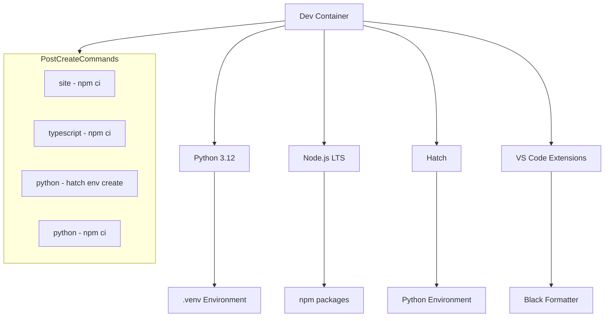
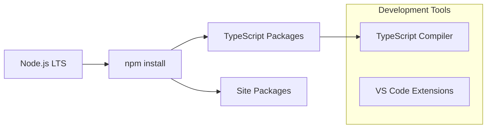
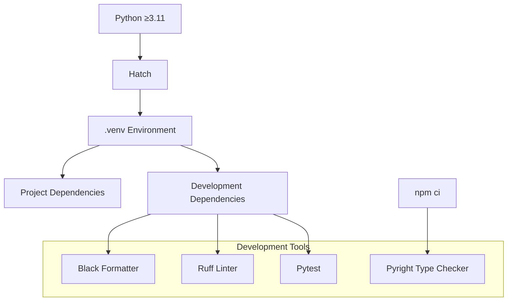
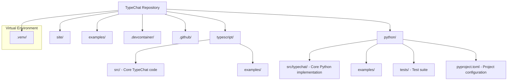
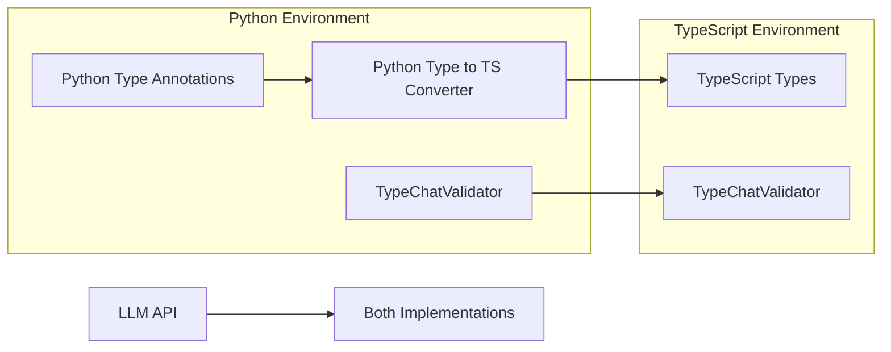
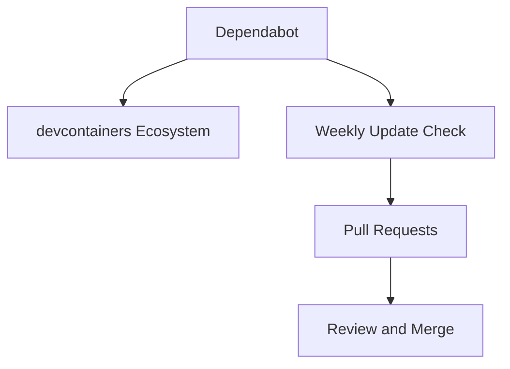

<!-- source: DeepWiki mcp.deepwiki.com · repo microsoft/TypeChat · page 6.1 Development Environment · fetched 2026-10-26 -->

# Development Environment

<details>
<summary>Relevant source files</summary>

The following files were used as context for generating this wiki page:

- [.devcontainer/devcontainer.json](.devcontainer/devcontainer.json)
- [.github/dependabot.yml](.github/dependabot.yml)
- [.gitignore](.gitignore)
- [python/examples/calendar/schema.py](python/examples/calendar/schema.py)
- [python/examples/restaurant/schema.py](python/examples/restaurant/schema.py)
- [python/examples/sentiment/schema.py](python/examples/sentiment/schema.py)
- [python/pyproject.toml](python/pyproject.toml)
- [site/src/docs/examples.md](site/src/docs/examples.md)

</details>


This document provides detailed instructions for setting up a development environment for contributing to the TypeChat project. It covers both TypeScript and Python implementations, dev container configuration, and manual setup options. For information on building and testing TypeChat after your environment is set up, please see [Building and Testing](#6.2).

## Development Container Setup

TypeChat provides a development container configuration for a consistent and pre-configured development environment, supporting both TypeScript and Python development workflows.



Sources: [.devcontainer/devcontainer.json:1-49]()

### Prerequisites for Dev Container

1. Docker Desktop or compatible container runtime
2. Visual Studio Code with Remote - Containers extension

### Using the Dev Container

1. Clone the TypeChat repository
2. Open the repository in VS Code
3. When prompted, select "Reopen in Container" or use the command palette to select "Remote-Containers: Reopen in Container"
4. The container will automatically:
   - Set up Python 3.12 environment
   - Install Node.js LTS
   - Configure Hatch for Python package management
   - Run post-creation commands to install dependencies

## Manual Setup

If you prefer not to use the dev container, you can set up your development environment manually.

### TypeScript Development Setup



Sources: [.devcontainer/devcontainer.json:9-14]()

1. Install Node.js LTS
2. Navigate to the `typescript` directory and run `npm ci`
3. For the site development, navigate to the `site` directory and run `npm ci`

### Python Development Setup



Sources: [python/pyproject.toml:1-194]()

1. Install Python 3.11 or newer
2. Install Hatch: `pip install hatch`
3. Navigate to the `python` directory
4. Create virtual environment: `hatch env create`
5. Install npm dependencies for Pyright: `npm ci`

## Project Structure



Sources: [.gitignore:1-18]()

The `.venv` directory is created at the repository root to provide a shared virtual environment for all Python components.

## Python Development Configuration

Python development uses Hatch for environment management and includes several development tools:

| Tool | Purpose | Configuration |
|------|---------|--------------|
| Hatch | Environment and package management | `[tool.hatch.*]` sections in pyproject.toml |
| Pytest | Testing framework | `[tool.hatch.envs.default.scripts]` for test commands |
| Black | Code formatting | `[tool.black]` section |
| Ruff | Linting | `[tool.ruff]` section |
| Pyright | Type checking | Invoked via npm |
| MyPy | Type checking | `[tool.mypy]` section |

Sources: [python/pyproject.toml:50-193]()

### Python Dependencies

The core Python package requires:

- Python ≥3.11
- pydantic ≥2.5.2
- pydantic_core ≥2.16.3
- httpx ≥0.27.0
- typing_extensions ≥4.10.0

Development dependencies are specified in the `dev` optional dependency group:

```
dev = [
  "coverage[toml]>=6.5",
  "pytest>=8.0.2",
  "syrupy>=4.6.1",
]
```

Sources: [python/pyproject.toml:10-37]()

### Running Python Development Tasks

Hatch provides scripts for common development tasks:

```
# Run tests
hatch run test

# Run tests with coverage
hatch run cov

# Run linting and type checking
hatch run lint:all

# Format code
hatch run lint:fmt
```

Sources: [python/pyproject.toml:68-110]()

## TypeScript and Python Integration

TypeChat's development environment bridges TypeScript and Python implementations through schema engineering and type validation.



Sources: [python/tests/test_validator.py:1-16](), [python/examples/sentiment/schema.py:1-11](), [python/examples/restaurant/schema.py:1-50](), [python/examples/calendar/schema.py:1-88]()

Both TypeScript and Python implementations use type/schema definitions to guide language models, but the Python implementation includes a converter to transform Python type annotations to TypeScript schemas for validation.

## Environment Variables

For examples and testing with language models, you'll need to set up environment variables:

1. Create a `.env` file at the root of the repository (it's gitignored)
2. Add your API keys and configurations:
   ```
   OPENAI_API_KEY=your_api_key
   AZURE_OPENAI_API_KEY=your_azure_key
   AZURE_OPENAI_ENDPOINT=your_azure_endpoint
   ```

Sources: [.gitignore:6]()

## Development Container Maintenance

The development container is maintained using GitHub's Dependabot, which automatically checks for updates to the container configuration:



Sources: [.github/dependabot.yml:1-13]()

---

