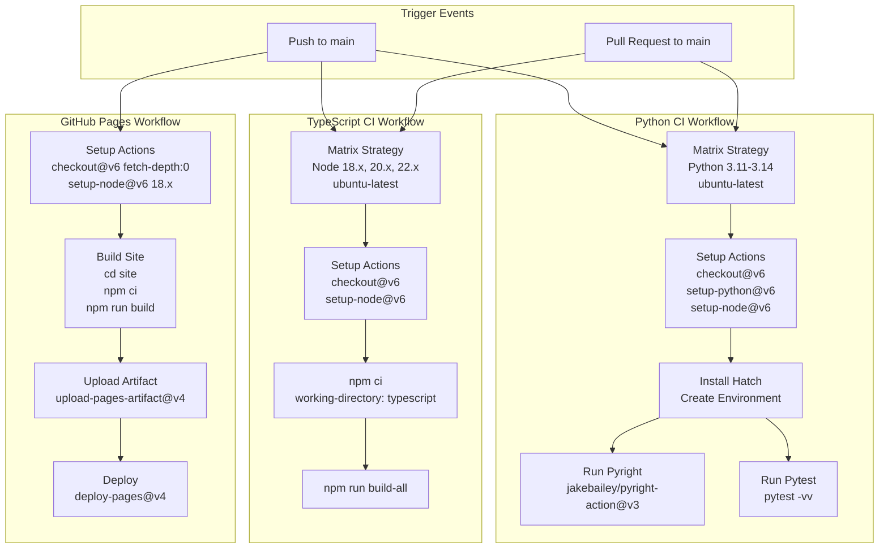
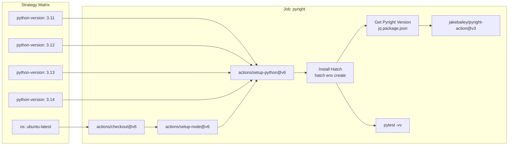
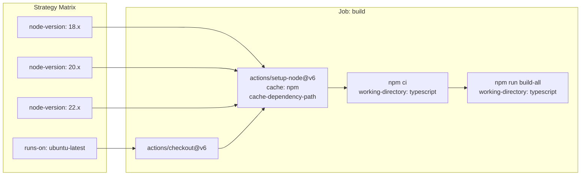
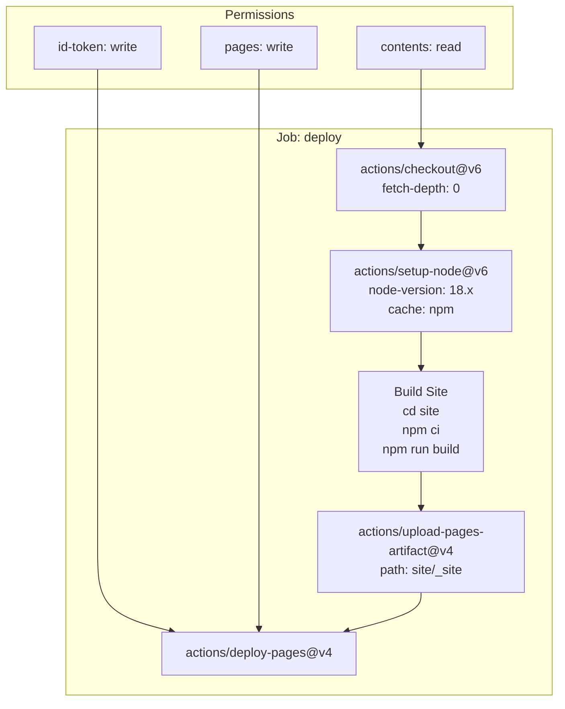

<!-- source: DeepWiki mcp.deepwiki.com · repo microsoft/TypeChat · page 6.2 CI/CD Pipeline · fetched 2026-10-26 -->

# CI/CD Pipeline

<details>
<summary>Relevant source files</summary>

The following files were used as context for generating this wiki page:

- [.github/workflows/ci.js.yml](.github/workflows/ci.js.yml)
- [.github/workflows/ci.python.yml](.github/workflows/ci.python.yml)
- [.github/workflows/github-pages.yml](.github/workflows/github-pages.yml)
- [python/tests/__py3.13_snapshots__/test_conflicting_names_1/test_conflicting_names_1.schema.d.ts](python/tests/__py3.13_snapshots__/test_conflicting_names_1/test_conflicting_names_1.schema.d.ts)
- [python/tests/__py3.13_snapshots__/test_hello_world/test_generic_alias1.schema.d.ts](python/tests/__py3.13_snapshots__/test_hello_world/test_generic_alias1.schema.d.ts)
- [python/tests/__py3.14_snapshots__/test_conflicting_names_1/test_conflicting_names_1.schema.d.ts](python/tests/__py3.14_snapshots__/test_conflicting_names_1/test_conflicting_names_1.schema.d.ts)
- [python/tests/__py3.14_snapshots__/test_hello_world/test_generic_alias1.schema.d.ts](python/tests/__py3.14_snapshots__/test_hello_world/test_generic_alias1.schema.d.ts)
- [site/.gitignore](site/.gitignore)
- [site/package-lock.json](site/package-lock.json)
- [site/package.json](site/package.json)

</details>


## Purpose and Scope

This document describes the GitHub Actions-based CI/CD infrastructure that tests, builds, and deploys the TypeChat repository. It covers the three primary workflows that validate code quality across multiple Python and Node.js versions, and automatically deploy documentation to GitHub Pages.

For information about the development environment setup used locally before code reaches CI, see [Development Environment](#6.1). For details on testing methodologies including snapshot testing, see [Testing Infrastructure](#6.3).

## Overview

The TypeChat repository implements three distinct GitHub Actions workflows that execute on pushes and pull requests to the `main` branch:

| Workflow | File | Purpose | Trigger |
|----------|------|---------|---------|
| Python CI | `.github/workflows/ci.python.yml` | Type checking and testing across Python 3.11-3.14 | Push/PR to main |
| Node.js CI | `.github/workflows/ci.js.yml` | Build and test TypeScript implementation | Push/PR to main |
| GitHub Pages | `.github/workflows/github-pages.yml` | Build and deploy documentation site | Push to main |

All workflows run on `ubuntu-latest` runners and use specific working directories to isolate Python (`./python`) and TypeScript (`typescript`) codebases.

**Sources:** [.github/workflows/ci.python.yml:1-72](), [.github/workflows/ci.js.yml:1-42](), [.github/workflows/github-pages.yml:1-38]()

## CI/CD Workflow Architecture



**Sources:** [.github/workflows/ci.python.yml:3-10](), [.github/workflows/ci.js.yml:6-10](), [.github/workflows/github-pages.yml:2-5]()

## Python CI Pipeline

### Workflow Configuration

The Python CI workflow (`ci.python.yml`) executes type checking and testing across a matrix of Python versions with read-only content permissions.



### Step Sequence

1. **Environment Setup** ([.github/workflows/ci.python.yml:34-39]()): Uses `actions/setup-python@v6` with matrix Python version
2. **Hatch Installation** ([.github/workflows/ci.python.yml:41-44]()): Installs Hatch package manager and pins `virtualenv<20.29`
3. **Environment Creation** ([.github/workflows/ci.python.yml:46-51]()): Creates Hatch environment and adds to `GITHUB_PATH`
4. **Pyright Version Extraction** ([.github/workflows/ci.python.yml:53-58]()): Uses `jq` to parse `package.json` and extract Pyright version
5. **Type Checking** ([.github/workflows/ci.python.yml:60-66]()): Runs `jakebailey/pyright-action@v3` with version-specific configuration
6. **Testing** ([.github/workflows/ci.python.yml:68-70]()): Executes `pytest -vv` in verbose mode

### Pyright Configuration

The workflow extracts the Pyright version dynamically from `package.json`:

```bash
PYRIGHT_VERSION=$(jq -r '.devDependencies.pyright' < package.json)
```

The `pyright-action` is configured with:
- `version`: Extracted from `package.json`
- `python-version`: Matrix variable `${{ matrix.python-version }}`
- `annotate`: Only enabled for Python 3.11 on ubuntu-latest to prevent duplicate PR comments
- `working-directory`: `./python`

**Sources:** [.github/workflows/ci.python.yml:17-71]()

## TypeScript CI Pipeline

### Workflow Configuration

The Node.js CI workflow (`ci.js.yml`) builds and tests the TypeScript implementation across Node.js LTS versions with read-only content permissions.



### Step Sequence

1. **Checkout** ([.github/workflows/ci.js.yml:33]()): Uses `actions/checkout@v6`
2. **Node.js Setup** ([.github/workflows/ci.js.yml:34-39]()): Configures Node.js with npm cache using `typescript/package-lock.json`
3. **Dependency Installation** ([.github/workflows/ci.js.yml:40]()): Runs `npm ci` for clean install
4. **Build** ([.github/workflows/ci.js.yml:41]()): Executes `npm run build-all` to compile all TypeScript packages

### Shell Configuration

The workflow enforces `bash` with `pipefail` to ensure proper error propagation:

```yaml
defaults:
  run:
    shell: bash
    working-directory: typescript
```

**Sources:** [.github/workflows/ci.js.yml:1-42]()

## Documentation Deployment Pipeline

### Workflow Configuration

The GitHub Pages workflow (`github-pages.yml`) builds the Eleventy static site and deploys it to GitHub Pages with elevated permissions for deployment.



### Step Sequence

1. **Full History Checkout** ([.github/workflows/github-pages.yml:16-18]()): Uses `fetch-depth: 0` to retrieve complete Git history for site generation
2. **Node.js Setup** ([.github/workflows/github-pages.yml:19-24]()): Configures Node.js 18.x with npm cache pointing to `site/package-lock.json`
3. **Site Build** ([.github/workflows/github-pages.yml:25-30]()): 
   - Changes to `site` directory
   - Runs `npm ci` for clean dependency install
   - Executes `npm run build` which invokes Eleventy
4. **Artifact Upload** ([.github/workflows/github-pages.yml:31-35]()): Uploads `site/_site` directory as `github-pages` artifact
5. **Deployment** ([.github/workflows/github-pages.yml:36-37]()): Deploys artifact to GitHub Pages using `actions/deploy-pages@v4`

### Site Build Configuration

The site's `package.json` defines the build command:

| Script | Command |
|--------|---------|
| `build` | `eleventy` |
| `serve` | `eleventy --serve` |

The build uses Eleventy 3.1.2 and Shiki 0.14.3 for static site generation and code highlighting.

**Sources:** [.github/workflows/github-pages.yml:1-38](), [site/package.json:1-25]()

## Multi-Version Testing Strategy

### Python Version Matrix

The Python CI tests against four Python versions to ensure compatibility across the supported range:

| Python Version | Testing Focus |
|----------------|---------------|
| 3.11 | Minimum supported version, PR annotation enabled |
| 3.12 | Primary development version |
| 3.13 | Current stable release |
| 3.14 | Future compatibility testing |

The snapshot tests maintain version-specific directories (`__py3.13_snapshots__`, `__py3.14_snapshots__`) to handle Python version differences in type conversion output.

### Node.js Version Matrix

The TypeScript CI tests against three Node.js LTS versions:

| Node.js Version | LTS Status |
|-----------------|------------|
| 18.x | Active LTS (maintenance) |
| 20.x | Active LTS |
| 22.x | Current release |

### Fail-Fast Configuration

The Python CI uses `fail-fast: false` in the strategy matrix ([.github/workflows/ci.python.yml:21]()), allowing all version combinations to complete even if one fails. This provides comprehensive compatibility reporting.

**Sources:** [.github/workflows/ci.python.yml:20-29](), [.github/workflows/ci.js.yml:27-30](), [python/tests/__py3.13_snapshots__/test_hello_world/test_generic_alias1.schema.d.ts:1-36](), [python/tests/__py3.14_snapshots__/test_hello_world/test_generic_alias1.schema.d.ts:1-36]()

## Dependency Management and Caching

### NPM Cache Strategy

Both TypeScript and documentation workflows use `actions/setup-node@v6` with npm caching:

```yaml
cache: "npm"
cache-dependency-path: "typescript/package-lock.json"  # or site/package-lock.json
```

This caches `node_modules` based on the lock file hash, speeding up subsequent runs.

### Python Dependency Pinning

The Python workflow pins specific package versions to ensure reproducibility:

```bash
pip install hatch "virtualenv<20.29"
```

The `virtualenv<20.29` pin prevents breaking changes from newer virtualenv releases.

### Hatch Environment Management

The workflow creates a Hatch environment and dynamically adds it to `GITHUB_PATH`:

```bash
hatch env create
HATCH_ENV=$(hatch env find)
echo "$HATCH_ENV/bin" >> $GITHUB_PATH
```

This makes the Hatch-managed Python environment available to subsequent steps, including Pyright and pytest.

**Sources:** [.github/workflows/ci.python.yml:41-51](), [.github/workflows/ci.js.yml:38-39](), [.github/workflows/github-pages.yml:22-24]()

## Permissions Model

### Repository-Level Permissions

Each workflow declares minimal required permissions following the principle of least privilege:

| Workflow | Permissions | Purpose |
|----------|-------------|---------|
| Python CI | `contents: read` | Read source code only |
| Node.js CI | `contents: read` | Read source code only |
| GitHub Pages | `contents: read`, `id-token: write`, `pages: write` | Read code, authenticate, deploy pages |

### Annotation Control

The Python CI conditionally enables PR annotations:

```yaml
annotate: ${{ matrix.python-version == '3.11' && matrix.os == 'ubuntu-latest' }}
```

This ensures only one job posts Pyright diagnostic comments to PRs, preventing duplicate annotations.

**Sources:** [.github/workflows/ci.python.yml:18-19](), [.github/workflows/ci.js.yml:12-13](), [.github/workflows/github-pages.yml:7-10](), [.github/workflows/ci.python.yml:65]()

## Working Directory Configuration

### Monorepo Isolation

Each workflow uses `defaults.run.working-directory` to isolate execution contexts:

```yaml
# Python CI
defaults:
  run:
    shell: bash
    working-directory: ./python

# TypeScript CI
defaults:
  run:
    shell: bash
    working-directory: typescript
```

This allows workflows to use relative paths (`npm ci`, `pytest -vv`) while operating on the correct subdirectory of the monorepo.

### GitHub Actions Overrides

Individual steps can override the default working directory when needed:

```yaml
- name: Run pyright
  uses: jakebailey/pyright-action@v3
  with:
    working-directory: ./python  # Explicit override for action
```

**Sources:** [.github/workflows/ci.python.yml:11-14](), [.github/workflows/ci.js.yml:17-20](), [.github/workflows/ci.python.yml:66]()

---

