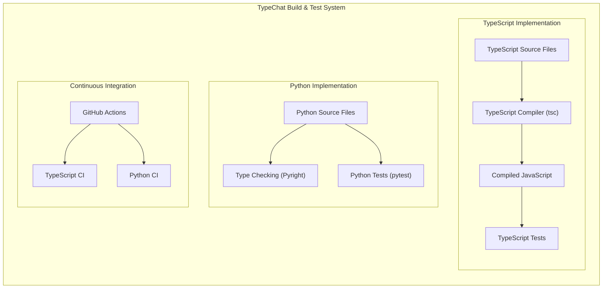
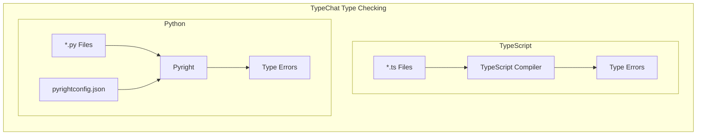
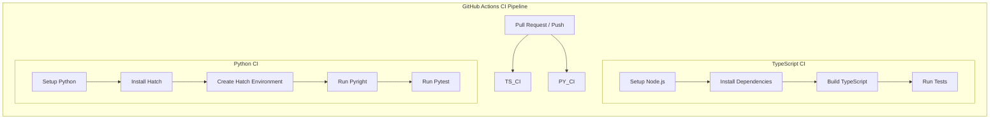

<!-- source: DeepWiki mcp.deepwiki.com · repo microsoft/TypeChat · page 6.3 Testing Infrastructure · fetched 2026-10-26 -->

# Building and Testing

<details>
<summary>Relevant source files</summary>

The following files were used as context for generating this wiki page:

- [.github/workflows/ci.js.yml](.github/workflows/ci.js.yml)
- [.github/workflows/ci.python.yml](.github/workflows/ci.python.yml)
- [python/examples/healthData/translator.py](python/examples/healthData/translator.py)
- [python/examples/math/program.py](python/examples/math/program.py)
- [python/examples/multiSchema/agents.py](python/examples/multiSchema/agents.py)
- [python/examples/multiSchema/router.py](python/examples/multiSchema/router.py)
- [python/src/typechat/__init__.py](python/src/typechat/__init__.py)
- [python/src/typechat/_internal/interactive.py](python/src/typechat/_internal/interactive.py)
- [python/src/typechat/_internal/model.py](python/src/typechat/_internal/model.py)
- [python/src/typechat/_internal/translator.py](python/src/typechat/_internal/translator.py)
- [python/src/typechat/_internal/validator.py](python/src/typechat/_internal/validator.py)
- [python/tests/__py3.12+_snapshots__/test_generic_alias_3/test_generic_alias3.schema.d.ts](python/tests/__py3.12+_snapshots__/test_generic_alias_3/test_generic_alias3.schema.d.ts)
- [python/tests/__py3.12+_snapshots__/test_generic_alias_4/test_generic_alias4.schema.d.ts](python/tests/__py3.12+_snapshots__/test_generic_alias_4/test_generic_alias4.schema.d.ts)
- [python/tests/__py3.12+_snapshots__/test_type_alias_syntax/test_type_alias_union1.schema.d.ts](python/tests/__py3.12+_snapshots__/test_type_alias_syntax/test_type_alias_union1.schema.d.ts)
- [python/tests/__py3.13_snapshots__/test_conflicting_names_1/test_conflicting_names_1.schema.d.ts](python/tests/__py3.13_snapshots__/test_conflicting_names_1/test_conflicting_names_1.schema.d.ts)
- [python/tests/__py3.13_snapshots__/test_hello_world/test_generic_alias1.schema.d.ts](python/tests/__py3.13_snapshots__/test_hello_world/test_generic_alias1.schema.d.ts)
- [python/tests/__py3.14_snapshots__/test_conflicting_names_1/test_conflicting_names_1.schema.d.ts](python/tests/__py3.14_snapshots__/test_conflicting_names_1/test_conflicting_names_1.schema.d.ts)
- [python/tests/__py3.14_snapshots__/test_hello_world/test_generic_alias1.schema.d.ts](python/tests/__py3.14_snapshots__/test_hello_world/test_generic_alias1.schema.d.ts)
- [python/tests/__snapshots__/test_generic_alias_2/test_generic_alias2.schema.d.ts](python/tests/__snapshots__/test_generic_alias_2/test_generic_alias2.schema.d.ts)
- [python/tests/__snapshots__/test_translator.ambr](python/tests/__snapshots__/test_translator.ambr)
- [python/tests/test_generic_alias_1.py](python/tests/test_generic_alias_1.py)
- [python/tests/test_generic_alias_2.py](python/tests/test_generic_alias_2.py)
- [python/tests/test_generic_alias_3.py](python/tests/test_generic_alias_3.py)
- [python/tests/test_generic_alias_4.py](python/tests/test_generic_alias_4.py)
- [python/tests/test_translator.py](python/tests/test_translator.py)
- [python/tests/test_type_alias_syntax.py](python/tests/test_type_alias_syntax.py)
- [python/tests/test_validator.py](python/tests/test_validator.py)
- [python/tests/utilities.py](python/tests/utilities.py)

</details>


This document provides detailed instructions on building and testing TypeChat from source code. It covers both TypeScript and Python implementations and includes information about the project's continuous integration setup. For information about setting up your development environment, see [Development Environment](#6.1).

## Build and Test Overview

TypeChat supports two language implementations (TypeScript and Python), each with its own build and test processes. Both implementations use type checking tools to ensure code quality, with TypeScript using the TypeScript compiler (`tsc`) and Python using Pyright.



Sources: [.github/workflows/ci.python.yml](), [python/package.json]()

## Building TypeChat

### TypeScript Implementation

The TypeScript implementation uses npm for package management and the TypeScript compiler for building.

#### Prerequisites
- Node.js (v14 or later)
- npm (comes with Node.js)

#### Build Steps

1. Clone the repository:
   ```bash
   git clone https://github.com/microsoft/TypeChat.git
   cd TypeChat
   ```

2. Install dependencies:
   ```bash
   npm install
   ```

3. Build the project:
   ```bash
   npm run build
   ```

The build process compiles TypeScript files into JavaScript, which are output to the `dist/` directory.

### Python Implementation

The Python implementation uses Hatch for environment and build management.

#### Prerequisites
- Python 3.11 or 3.12
- pip (for installing Hatch)

#### Build Steps

1. Navigate to the Python directory:
   ```bash
   cd python
   ```

2. Install Hatch (if not already installed):
   ```bash
   pip install hatch
   ```

3. Create the development environment:
   ```bash
   hatch env create
   ```

4. Activate the environment:
   ```bash
   hatch shell
   ```

The Python implementation doesn't require a build step like TypeScript, but type-checking is an essential part of the development process.

Sources: [python/package.json](), [.github/workflows/ci.python.yml:37-47]()

## Testing TypeChat

### TypeScript Testing

The TypeScript implementation includes a test suite that validates both the core functionality and example applications.

#### Running Tests

```bash
npm test
```

This command runs the test suite, which includes:
- Unit tests for core components
- Integration tests for the JSON translator
- Validation tests for the type system

### Python Testing

The Python implementation uses pytest for testing.

#### Running Tests

```bash
cd python
pytest -vv
```

If you're using Hatch, you can run tests within the Hatch environment:

```bash
hatch run test
```

The test suite validates:
- Core functionality of the TypeChatJsonTranslator
- Language model interfaces
- Type validation
- Schema conversion from Python to TypeScript

Sources: [.github/workflows/ci.python.yml:64-66]()

## Type Checking

Type checking is a critical part of the TypeChat development process and is enforced in both implementations.

### TypeScript Type Checking

Type checking in TypeScript is performed by the TypeScript compiler:

```bash
npm run typecheck
```

### Python Type Checking

Python type checking is performed using Pyright:

```bash
cd python
npm run check
```

Or with Hatch:

```bash
hatch run typecheck
```

Pyright is configured to use strict type checking mode to ensure high code quality.



Sources: [python/pyrightconfig.json](), [python/package.json:6-8]()

## Continuous Integration

TypeChat uses GitHub Actions for continuous integration to ensure code quality across both implementations.

### CI Workflow

When a pull request is created or code is pushed to the main branch, GitHub Actions automatically runs the build and test processes for both TypeScript and Python implementations.

#### Python CI Workflow

The Python CI workflow:

1. Sets up the environment with Python 3.11 and 3.12
2. Installs Hatch for environment management
3. Runs Pyright for type checking
4. Executes the pytest test suite



Sources: [.github/workflows/ci.python.yml]()

### CI Status

The CI status for each pull request is displayed on the GitHub pull request page. All tests must pass before a pull request can be merged.

## Common Build and Test Issues

### TypeScript Issues

- Missing dependencies: Ensure all dependencies are installed with `npm install`
- TypeScript errors: Address all type errors reported by the TypeScript compiler

### Python Issues

- Environment issues: Use Hatch to create a clean environment with `hatch env create`
- Import errors: Ensure the package is installed in development mode
- Type check failures: Pyright is configured in strict mode; all typing annotations must be correct

Sources: [python/pyrightconfig.json:1-5](), [.gitignore:1-17]()

## Development Artifacts

During development, both implementations generate artifacts that are excluded from version control:

- TypeScript: `build/`, `dist/`, `node_modules/`
- Python: `__pycache__/`, `.venv/`, `*.egg-info/`, `dist/`

These directories are listed in the respective `.gitignore` files to keep the repository clean.

Sources: [.gitignore](), [python/.gitignore]()

---

