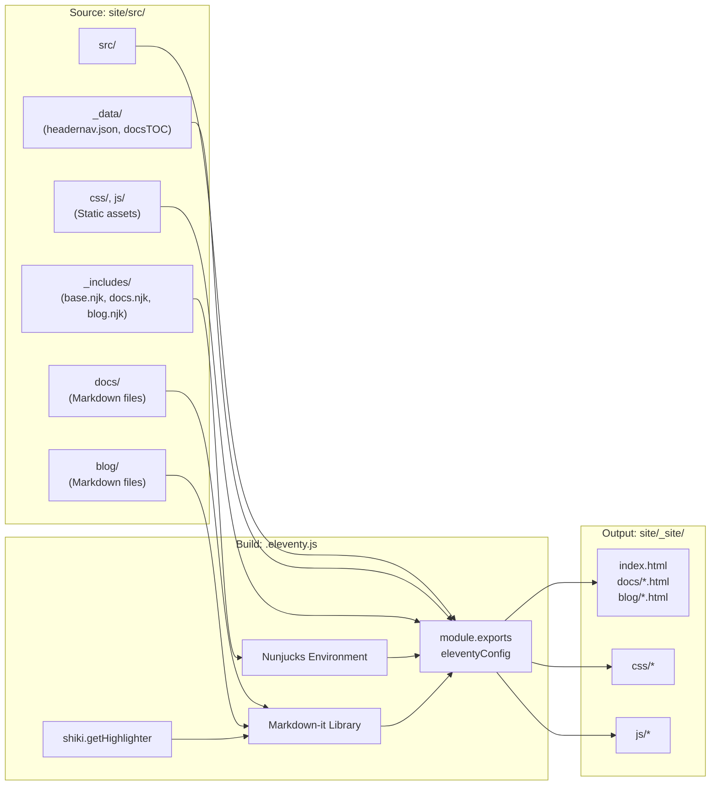
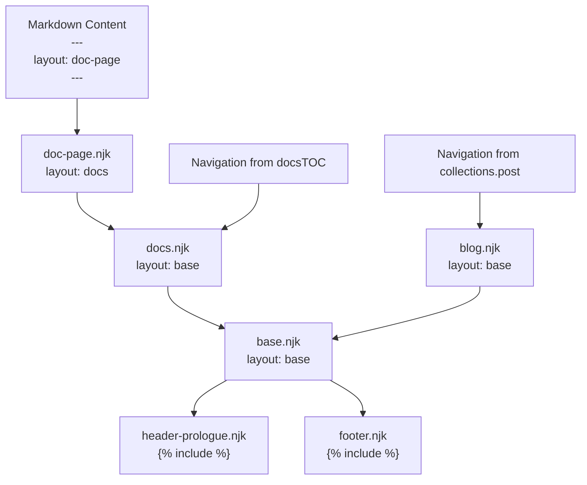
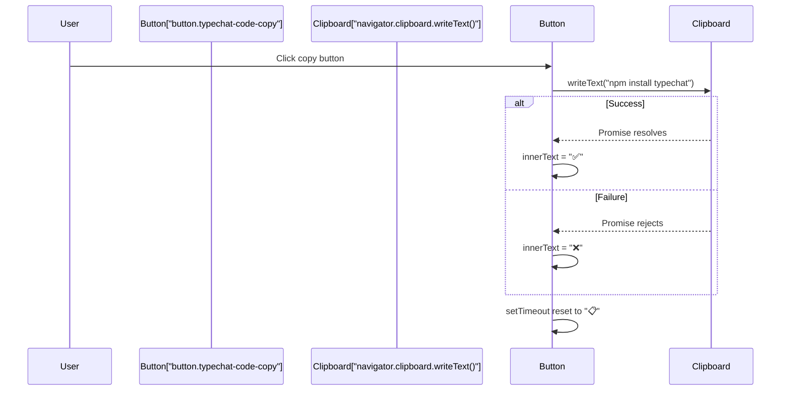
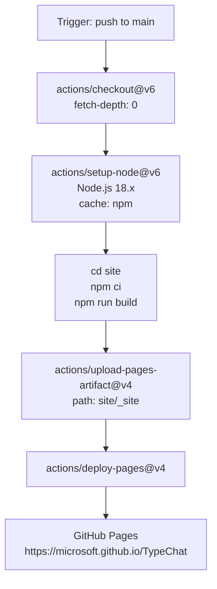

<!-- source: DeepWiki mcp.deepwiki.com · repo microsoft/TypeChat · page 7 Documentation Website · fetched 2026-10-26 -->

# Documentation Website

<details>
<summary>Relevant source files</summary>

The following files were used as context for generating this wiki page:

- [.github/workflows/github-pages.yml](.github/workflows/github-pages.yml)
- [site/.eleventy.js](site/.eleventy.js)
- [site/.gitignore](site/.gitignore)
- [site/package-lock.json](site/package-lock.json)
- [site/package.json](site/package.json)
- [site/src/_data/headernav.json](site/src/_data/headernav.json)
- [site/src/_includes/blog.njk](site/src/_includes/blog.njk)
- [site/src/_includes/doc-page.njk](site/src/_includes/doc-page.njk)
- [site/src/_includes/docs.njk](site/src/_includes/docs.njk)
- [site/src/blog/index.njk](site/src/blog/index.njk)
- [site/src/docs/index.njk](site/src/docs/index.njk)
- [site/src/index.njk](site/src/index.njk)

</details>


This document provides comprehensive documentation for the TypeChat documentation website - a static site that serves as the primary interface for TypeChat documentation, examples, and project information. The site is built with Eleventy and deployed to GitHub Pages.

## Overview

The TypeChat documentation website is built using Eleventy (11ty) v3.1.2 as the static site generator. The site provides documentation, blog posts, and project information through a template-based architecture. It is automatically built and deployed to GitHub Pages via GitHub Actions on every push to the `main` branch.

| Component | Technology | Version |
|-----------|-----------|---------|
| Static Site Generator | @11ty/eleventy | ^3.1.2 |
| Syntax Highlighter | shiki | ^0.14.3 |
| Template Engine | Nunjucks | (via Eleventy) |
| CSS Framework | Bootstrap | 5.3.0 |
| Deployment Target | GitHub Pages | - |

Sources:
- [site/package.json:1-25]()
- [site/package-lock.json:1-100]()
- [.github/workflows/github-pages.yml:1-38]()

## Site Architecture

### Build Pipeline



The build process transforms Nunjucks templates and Markdown content into static HTML using Eleventy's configuration defined in `.eleventy.js`. Shiki provides syntax highlighting for code blocks, and assets are copied through to the output directory.

Sources:
- [site/.eleventy.js:9-51]()
- [site/package.json:8]()
- [.github/workflows/github-pages.yml:25-30]()

## Template Hierarchy

### Template Inheritance Structure



The site uses Nunjucks template inheritance where `base.njk` provides the HTML structure, and specialized layouts (`docs.njk`, `blog.njk`) extend it. The `doc-page.njk` template wraps Markdown content with a title and passes it to the docs layout.

### Key Template Files

| Template | Purpose | Key Variables |
|----------|---------|--------------|
| base.njk | Root HTML structure | `title`, `content` |
| docs.njk | Documentation page wrapper | `docsTOC`, `page.url` |
| blog.njk | Blog post wrapper | `collections.post`, `page.url` |
| doc-page.njk | Individual doc page | `title`, `content` |
| header-prologue.njk | Site header and navigation | `headernav` |
| footer.njk | Site footer | - |

Sources:
- [site/src/_includes/docs.njk:1-55]()
- [site/src/_includes/blog.njk:1-47]()
- [site/src/_includes/doc-page.njk:1-5]()

## Content Organization

### Site Sections

The documentation site is organized into three primary sections defined in `headernav.json`:

| Section | URL | Template | Purpose |
|---------|-----|----------|---------|
| Home | `/` | `src/index.njk` | Project introduction and quick start |
| Docs | `/docs/` | `src/docs/*.md` → `docs.njk` | Technical documentation |
| Blog | `/blog/` | `src/blog/*.md` → `blog.njk` | Articles and updates |
| GitHub | (external) | - | Link to repository |

### Navigation Data Structure

The `headernav.json` file defines the main navigation:

```json
[
    { "title": "Home", "dest": "/" },
    { "title": "Docs", "dest": "/docs/" },
    { "title": "Blog", "dest": "/blog/" },
    { "title": "GitHub", "dest": "https://github.com/microsoft/TypeChat", "isExternal": true }
]
```

### Documentation Structure

Documentation pages are organized via the `docsTOC` data structure, which groups related documentation pages. Each documentation index page (`/docs/` and `/blog/`) redirects to the first available page in its respective section:

```nunjucks

<meta http-equiv="refresh" content="0; URL={{firstDoc.url}}">
```

Sources:
- [site/src/_data/headernav.json:1-19]()
- [site/src/index.njk:1-26]()
- [site/src/docs/index.njk:10-16]()
- [site/src/blog/index.njk:11-17]()
- [site/src/_includes/docs.njk:10-22]()

## Eleventy Configuration

The `.eleventy.js` configuration file defines the build behavior for the documentation site.

### Configuration Exports

```javascript
module.exports = async function (eleventyConfig) {
    // Plugin registration, filters, and configuration
}
```

### Key Configuration Components

| Component | Implementation | Line Reference |
|-----------|----------------|----------------|
| Base HTML Plugin | `EleventyHtmlBasePlugin` | [site/.eleventy.js:11-13]() |
| Passthrough Copy | CSS and JS directories | [site/.eleventy.js:15-16]() |
| Date Filter | `Intl.DateTimeFormat` | [site/.eleventy.js:2,18]() |
| List Filter | `Intl.ListFormat` | [site/.eleventy.js:3,19]() |
| Nunjucks Options | `throwOnUndefined: true` | [site/.eleventy.js:21-23]() |
| Syntax Highlighting | Shiki highlighter | [site/.eleventy.js:26-42]() |
| Input Directory | `src` | [site/.eleventy.js:46]() |
| Output Directory | `_site` | [site/.eleventy.js:47]() |
| Path Prefix | `TypeChat` | [site/.eleventy.js:49]() |

### Shiki Syntax Highlighting Configuration

The site configures Shiki to highlight multiple languages with the `dark-plus` theme:

```javascript
const highlighter = await shiki.getHighlighter({
    langs: [
        "typescript", "javascript", "tsx", "jsx",
        "jsonc", "json",
        "html", "diff",
        "bat", "sh",
        "python", "py",
    ],
    theme: "dark-plus"
});
```

The Markdown library is amended to use Shiki for code block rendering during the `eleventy.before` event.

Sources:
- [site/.eleventy.js:1-51]()
- [site/package.json:7-9]()

## Styling System

### CSS Architecture

The site combines Bootstrap 5.3.0 with custom CSS defined in `site/src/css/styles.css`.

| CSS File | Purpose | Key Classes |
|----------|---------|-------------|
| 5.3.0_dist_css_bootstrap.min.css | Bootstrap framework | Grid, utilities, components |
| styles.css | Custom styling | `.typechat-*`, `.with-sidebar`, `.nav-on-change` |
| noscript-styles.css | No-JavaScript fallback | `.nav-on-change { display: none !important; }` |

### Custom CSS Classes

The custom CSS defines TypeChat-specific styles:

- `.typechat-hero`: Hero section styling for the home page
- `.typechat-prose-content`: Content area with max-width and typography
- `.typechat-code-copy`: Code block copy button container
- `.typechat-docs-smol-nav`: Mobile navigation for documentation
- `.typechat-cap-content-width`: Content width constraint
- `.with-sidebar`: Two-column layout with navigation sidebar

### Typography and Code Blocks

Code blocks use a monospace font stack and custom styling:

```css
code, pre {
    font-family: Consolas, "Courier New", monospace;
}
```

The prose content area includes specific styles for headings, paragraphs, lists, and code blocks to ensure readability.

Sources:
- [site/src/css/styles.css:1-115]()
- [site/src/css/noscript-styles.css:1-8]()

## JavaScript Functionality

The site includes minimal JavaScript in `site/src/js/interactivity.js` for two features:

### Copy Button Functionality



The copy button uses the Clipboard API to copy the npm install command and provides visual feedback.

### Navigation Dropdown Handler

For mobile views, the site includes a navigation dropdown that redirects on selection:

```javascript
document.querySelectorAll(".nav-on-change").forEach((select) => {
    select.addEventListener("change", (event) => {
        const selectedValue = event.target.value;
        if (selectedValue) {
            window.location.href = selectedValue;
        }
    });
});
```

This JavaScript handles the mobile navigation dropdowns in both documentation and blog sections.

Sources:
- [site/src/js/interactivity.js:1-39]()
- [site/src/index.njk:18-21]()
- [site/src/_includes/docs.njk:6-26]()
- [site/src/_includes/blog.njk:6-21]()

## GitHub Pages Deployment

### Deployment Workflow

The documentation site is automatically deployed via the `github-pages.yml` GitHub Actions workflow.



### Workflow Configuration

| Step | Action | Configuration |
|------|--------|---------------|
| Checkout | `actions/checkout@v6` | `fetch-depth: 0` for full history |
| Setup Node | `actions/setup-node@v6` | Node.js 18.x with npm cache |
| Build | Shell commands | `npm ci && npm run build` in `site/` |
| Upload | `actions/upload-pages-artifact@v4` | Artifact name: `github-pages`, path: `site/_site` |
| Deploy | `actions/deploy-pages@v4` | Deploys artifact to GitHub Pages |

### Permissions

The workflow requires specific GitHub permissions:

```yaml
permissions:
  contents: read
  id-token: write
  pages: write
```

These permissions allow the workflow to read repository contents, write to GitHub Pages, and generate deployment tokens.

Sources:
- [.github/workflows/github-pages.yml:1-38]()
- [site/package.json:8]()

## Directory Structure

### Source Organization

```
site/
├── .eleventy.js              # Eleventy config (module.exports)
├── package.json              # npm scripts: build, serve
├── package-lock.json         # Dependency lock file
├── .gitignore               # Ignores: _site
└── src/                     # Source directory (input)
    ├── _data/               # Data files
    │   ├── headernav.json   # Main navigation structure
    │   └── docsTOC.js       # Documentation table of contents
    ├── _includes/           # Nunjucks templates
    │   ├── base.njk         # Root HTML template
    │   ├── docs.njk         # Documentation layout
    │   ├── blog.njk         # Blog layout
    │   ├── doc-page.njk     # Individual doc wrapper
    │   ├── header-prologue.njk  # Site header
    │   └── footer.njk       # Site footer
    ├── css/                 # CSS files (passthrough)
    │   ├── 5.3.0_dist_css_bootstrap.min.css
    │   ├── styles.css       # Custom TypeChat styles
    │   └── noscript-styles.css
    ├── js/                  # JavaScript (passthrough)
    │   └── interactivity.js # Copy button, nav handler
    ├── docs/                # Documentation content (Markdown)
    │   └── index.njk        # Redirects to first doc
    ├── blog/                # Blog posts (Markdown)
    │   └── index.njk        # Redirects to latest post
    └── index.njk            # Home page template
```

### Output Directory

The `_site/` directory contains the generated static site and is excluded from version control via `.gitignore`. This directory is created by running `npm run build` (which executes `eleventy`).

Sources:
- [site/.eleventy.js:44-50]()
- [site/.gitignore:1]()
- [site/package.json:1-25]()

## Local Development

For local development of the TypeChat website, the following steps are available:

1. Navigate to the `site/` directory
2. Run `npm install` to install dependencies
3. Use `npm run serve` to start a local development server
4. Make changes to files in the `src/` directory
5. The server will automatically rebuild and refresh the browser

This development workflow enables rapid iteration on the website content and design.

Sources:
- [site/package.json:7-10]()
- [site/.eleventy.js:1-54]()

---

