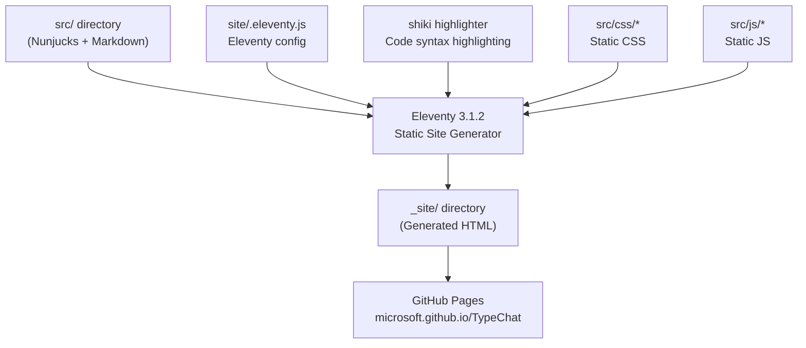
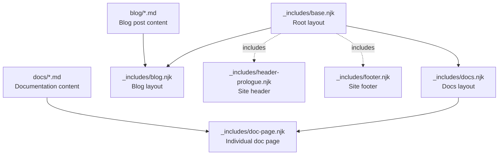
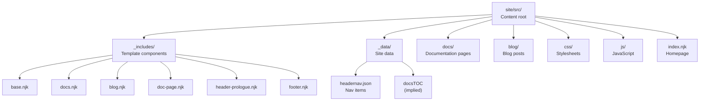

<!-- source: DeepWiki mcp.deepwiki.com · repo microsoft/TypeChat · page 7.1 Site Architecture · fetched 2026-10-26 -->

# Site Architecture

<details>
<summary>Relevant source files</summary>

The following files were used as context for generating this wiki page:

- [.github/workflows/github-pages.yml](.github/workflows/github-pages.yml)
- [site/.eleventy.js](site/.eleventy.js)
- [site/.gitignore](site/.gitignore)
- [site/package-lock.json](site/package-lock.json)
- [site/package.json](site/package.json)
- [site/src/_data/headernav.json](site/src/_data/headernav.json)
- [site/src/_includes/blog.njk](site/src/_includes/blog.njk)
- [site/src/_includes/doc-page.njk](site/src/_includes/doc-page.njk)
- [site/src/_includes/docs.njk](site/src/_includes/docs.njk)
- [site/src/blog/index.njk](site/src/blog/index.njk)
- [site/src/docs/index.njk](site/src/docs/index.njk)
- [site/src/index.njk](site/src/index.njk)

</details>


## Purpose and Scope

This document describes the TypeChat documentation website's static site generation architecture, including the Eleventy build system, template organization, content structure, and GitHub Pages deployment. For information about the site's CSS architecture and styling, see [Content and Styling](#7.2). For CI/CD workflows including documentation deployment, see [CI/CD Pipeline](#6.2).

## Build System Overview

The documentation site uses Eleventy (11ty) version 3.1.2 as its static site generator. Eleventy transforms Nunjucks templates and Markdown content into static HTML pages that are deployed to GitHub Pages.

### Core Dependencies

The site has two primary dependencies defined in [site/package.json:21-24]():

| Package | Version | Purpose |
|---------|---------|---------|
| `@11ty/eleventy` | ^3.1.2 | Static site generator engine |
| `shiki` | ^0.14.3 | Syntax highlighting for code blocks |

### Eleventy Configuration

The site configuration is defined in [site/.eleventy.js:1-52](). Key configuration aspects:

**Input/Output Directories** [site/.eleventy.js:44-48]():
- Input: `src` directory
- Output: `_site` directory
- Path prefix: `/TypeChat` (for GitHub Pages subdirectory deployment)

**Template Engine Settings** [site/.eleventy.js:21-23]():
- Nunjucks configured with `throwOnUndefined: true` to catch template errors

**Pass-through Copy** [site/.eleventy.js:15-16]():
- CSS files from `./src/css`
- JavaScript files from `./src/js`



**Diagram: Site Build Process**

Sources: [site/.eleventy.js:1-52](), [site/package.json:1-26]()

## Code Highlighting Integration

The site integrates Shiki for syntax highlighting of code blocks in Markdown content. This integration occurs during the Eleventy build lifecycle.

**Initialization** [site/.eleventy.js:26-42]():

The `eleventy.before` hook initializes the Shiki highlighter with support for multiple languages including TypeScript, Python, JavaScript, JSON, HTML, and shell scripts. The theme is set to `dark-plus`.

**Markdown Integration** [site/.eleventy.js:37-41]():

The highlighter is registered with the Markdown library to automatically highlight code blocks using `highlighter.codeToHtml(code, { lang })`.

**Supported Languages** [site/.eleventy.js:28-34]():
- `typescript`, `javascript`, `tsx`, `jsx`
- `jsonc`, `json`
- `html`, `diff`
- `bat`, `sh`
- `python`, `py`

Sources: [site/.eleventy.js:10-42]()

## Template Architecture

The site uses a hierarchical template system with Nunjucks, consisting of layouts and includes that compose to generate different page types.

### Template Hierarchy



**Diagram: Template Inheritance Hierarchy**

Sources: [site/src/_includes/docs.njk:1-55](), [site/src/_includes/blog.njk:1-47](), [site/src/_includes/doc-page.njk:1-5]()

### Layout Templates

**Base Layout**: [site/src/_includes/base.njk]() - Not shown in files but referenced in [site/src/_includes/docs.njk:2]() and [site/src/_includes/blog.njk:2]()

**Documentation Layout**: [site/src/_includes/docs.njk:1-55]()
- Displays sidebar navigation from `docsTOC` data
- Includes mobile-friendly dropdown navigation [site/src/_includes/docs.njk:6-26]()
- Two-column layout with sidebar and content area [site/src/_includes/docs.njk:27-54]()

**Blog Layout**: [site/src/_includes/blog.njk:1-47]()
- Lists all blog posts in sidebar from `collections.post`
- Similar responsive navigation pattern to docs
- Content area for individual blog post

**Doc Page Layout**: [site/src/_includes/doc-page.njk:1-5]()
- Minimal wrapper that adds page title as `<h1>`
- Inherits from `docs` layout

### Navigation System

The site implements a responsive navigation system with different rendering strategies for desktop and mobile viewports.

**Desktop Navigation** [site/src/_includes/docs.njk:28-50]():
- Sidebar with grouped navigation items
- Rendered from `docsTOC` data structure
- Active page highlighted with `.active` class

**Mobile Navigation** [site/src/_includes/docs.njk:6-26]():
- Dropdown `<select>` element
- JavaScript-enabled navigation via `.nav-on-change` class
- Hidden on desktop with `.d-md-none` class

**Header Navigation**: Referenced in [site/src/_data/headernav.json:1-19]()

| Title | Destination | Type |
|-------|-------------|------|
| Home | `/` | Internal |
| Docs | `/docs/` | Internal |
| Blog | `/blog/` | Internal |
| GitHub | `https://github.com/microsoft/TypeChat` | External |

Sources: [site/src/_includes/docs.njk:1-55](), [site/src/_includes/blog.njk:1-47](), [site/src/_data/headernav.json:1-19]()

## Content Organization

The site content is organized in the `src` directory with specific subdirectories for different content types.



**Diagram: Source Directory Structure**

Sources: [site/.eleventy.js:45-47](), [site/src/_data/headernav.json:1-19]()

### Index Redirect Pages

Both the documentation and blog sections implement index pages that redirect to their first content item.

**Documentation Index** [site/src/docs/index.njk:1-30]():
- Reads first doc page from `docsTOC[0].pages[0]`
- Uses HTML meta refresh to redirect: `<meta http-equiv="refresh" content="0; URL={{firstDoc.url}}">`
- Sets canonical link for SEO

**Blog Index** [site/src/blog/index.njk:1-50]():
- Reads latest blog post from `collections.post[0]`
- Same meta refresh pattern
- Redirects to most recent post

Sources: [site/src/docs/index.njk:10-15](), [site/src/blog/index.njk:11-16]()

### Homepage

The site homepage is defined in [site/src/index.njk:1-26](). It features:
- Hero section with TypeChat branding
- Call-to-action buttons for documentation and GitHub
- NPM install command with copy functionality [site/src/index.njk:18-21]()

Sources: [site/src/index.njk:1-26]()

## Build and Deployment Pipeline

The site is built and deployed to GitHub Pages through GitHub Actions automation.

### Build Commands

Defined in [site/package.json:7-10]():

| Command | Action |
|---------|--------|
| `npm run build` | Runs `eleventy` to generate static site |
| `npm run serve` | Runs `eleventy --serve` for local development with live reload |

### GitHub Actions Workflow

```mermaid
graph LR
    PUSH["Push to main branch"]
    CHECKOUT["Checkout repository<br/>actions/checkout@v6"]
    SETUP["Setup Node.js 18.x<br/>actions/setup-node@v6"]
    INSTALL["npm ci<br/>Install dependencies"]
    BUILD["npm run build<br/>Generate _site/"]
    UPLOAD["Upload artifact<br/>actions/upload-pages-artifact@v4"]
    DEPLOY["Deploy to GitHub Pages<br/>actions/deploy-pages@v4"]
    PAGES["GitHub Pages<br/>microsoft.github.io/TypeChat"]
    
    PUSH --> CHECKOUT
    CHECKOUT --> SETUP
    SETUP --> INSTALL
    INSTALL --> BUILD
    BUILD --> UPLOAD
    UPLOAD --> DEPLOY
    DEPLOY --> PAGES
```



**Diagram: GitHub Pages Deployment Workflow**

Sources: [.github/workflows/github-pages.yml:1-38]()

**Workflow Configuration** [.github/workflows/github-pages.yml:1-38]():

**Trigger**: Pushes to `main` branch [.github/workflows/github-pages.yml:2-5]()

**Permissions** [.github/workflows/github-pages.yml:7-10]():
- `contents: read` - Read repository contents
- `id-token: write` - Write ID tokens for GitHub Pages
- `pages: write` - Write to GitHub Pages

**Build Steps**:
1. Checkout with full history (`fetch-depth: 0`) [.github/workflows/github-pages.yml:16-18]()
2. Setup Node.js 18.x with npm cache [.github/workflows/github-pages.yml:19-24]()
3. Build site in `site` directory [.github/workflows/github-pages.yml:25-30]()
4. Upload `site/_site` as artifact [.github/workflows/github-pages.yml:31-35]()
5. Deploy artifact to GitHub Pages [.github/workflows/github-pages.yml:36-37]()

Sources: [.github/workflows/github-pages.yml:1-38]()

## Site URL Configuration

The site is configured to be deployed in a subdirectory of GitHub Pages, specified by the `pathPrefix` setting in [site/.eleventy.js:49]():

```javascript
pathPrefix: "TypeChat"
```

This configures Eleventy to prepend `/TypeChat` to all URLs, making the site accessible at `https://microsoft.github.io/TypeChat/` rather than at the root domain.

### EleventyHtmlBasePlugin

The configuration uses `EleventyHtmlBasePlugin` [site/.eleventy.js:11-13]() to automatically transform relative URLs in HTML to account for the path prefix. This ensures that links, images, and other assets work correctly when deployed to the subdirectory.

Sources: [site/.eleventy.js:11-13](), [site/.eleventy.js:49]()

## Custom Filters

The Eleventy configuration defines custom Nunjucks filters for formatting content [site/.eleventy.js:2-19]():

**Date Formatter** [site/.eleventy.js:2](), [site/.eleventy.js:18]():
- Filter name: `formatDate`
- Uses `Intl.DateTimeFormat` with locale `en-US`
- Format: "Month Day, Year" (e.g., "January 15, 2024")

**List Formatter** [site/.eleventy.js:3](), [site/.eleventy.js:19]():
- Filter name: `formatList`
- Uses `Intl.ListFormat` with conjunction style
- Formats arrays into natural language lists (e.g., "Alice, Bob, and Charlie")

Sources: [site/.eleventy.js:2-3](), [site/.eleventy.js:18-19]()

## Generated Output

The build process outputs all generated files to the `_site` directory [site/.eleventy.js:47](), which is excluded from version control via [site/.gitignore:1]().

**Output Structure**:
- HTML files generated from Nunjucks templates and Markdown content
- Static CSS files copied from `src/css`
- Static JavaScript files copied from `src/js`
- All paths prefixed with `/TypeChat/` for GitHub Pages deployment

The `_site` directory is ephemeral and recreated on each build, with the GitHub Actions workflow uploading it as an artifact for deployment.

Sources: [site/.eleventy.js:47](), [site/.gitignore:1](), [.github/workflows/github-pages.yml:31-35]()

---

