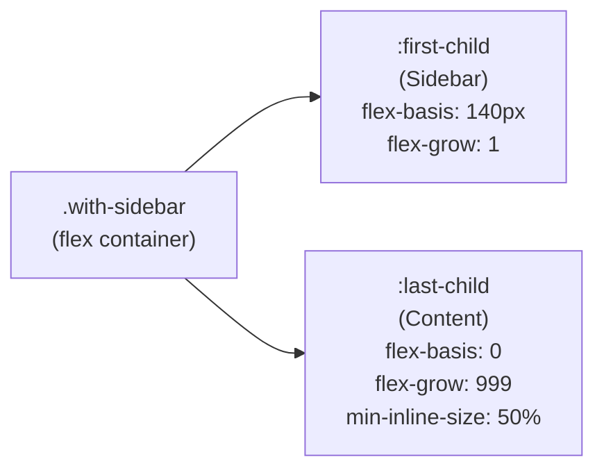
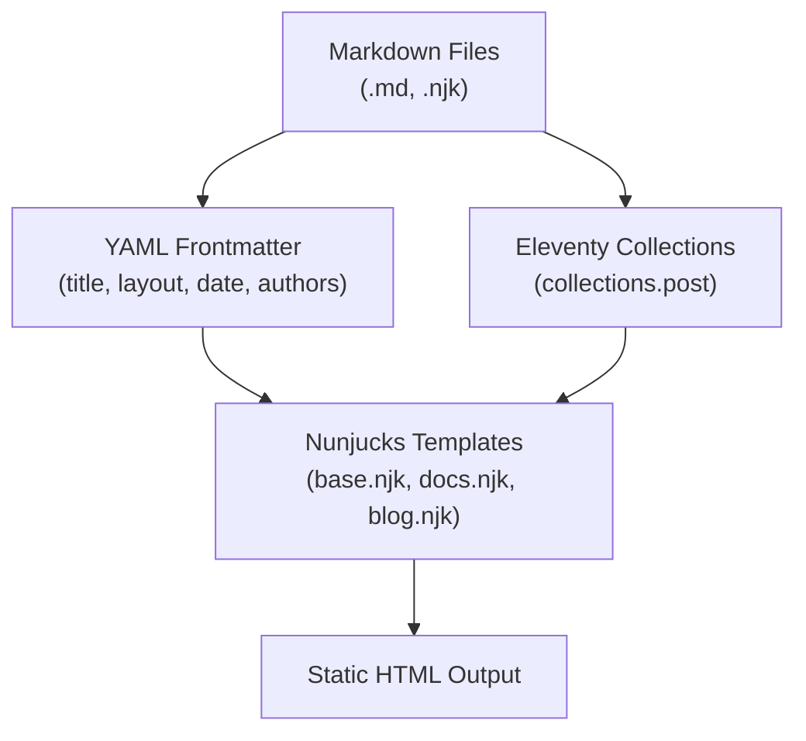
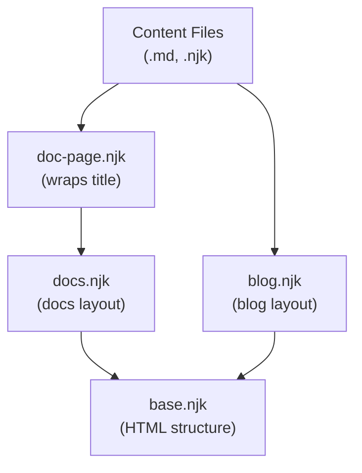
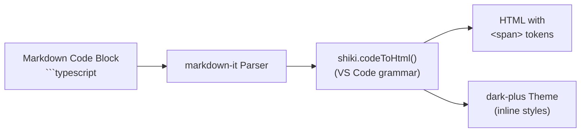
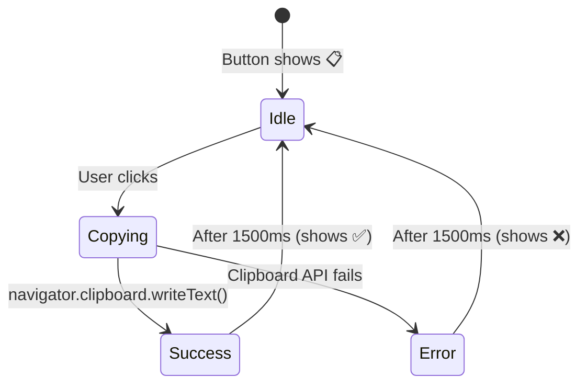

<!-- source: DeepWiki mcp.deepwiki.com · repo microsoft/TypeChat · page 7.2 Content and Styling · fetched 2026-10-26 -->

# Content and Styling

<details>
<summary>Relevant source files</summary>

The following files were used as context for generating this wiki page:

- [site/.eleventy.js](site/.eleventy.js)
- [site/jsconfig.json](site/jsconfig.json)
- [site/src/_data/headernav.json](site/src/_data/headernav.json)
- [site/src/_includes/base.njk](site/src/_includes/base.njk)
- [site/src/_includes/blog.njk](site/src/_includes/blog.njk)
- [site/src/_includes/doc-page.njk](site/src/_includes/doc-page.njk)
- [site/src/_includes/docs.njk](site/src/_includes/docs.njk)
- [site/src/_includes/footer.njk](site/src/_includes/footer.njk)
- [site/src/_includes/header-prologue.njk](site/src/_includes/header-prologue.njk)
- [site/src/blog/announcing-typechat-0-1-0.md](site/src/blog/announcing-typechat-0-1-0.md)
- [site/src/blog/index.njk](site/src/blog/index.njk)
- [site/src/css/noscript-styles.css](site/src/css/noscript-styles.css)
- [site/src/css/styles.css](site/src/css/styles.css)
- [site/src/docs/index.njk](site/src/docs/index.njk)
- [site/src/index.njk](site/src/index.njk)
- [site/src/js/interactivity.js](site/src/js/interactivity.js)

</details>


This document covers the visual presentation layer and content organization of the TypeChat documentation website. It details the CSS architecture, markdown-based content infrastructure for documentation and blog posts, syntax highlighting system, and client-side JavaScript interactivity. For information about the static site generation process and template rendering, see [Site Architecture](#7.1).

## CSS Architecture

The website's styling is organized into three CSS files with distinct responsibilities:

| CSS File | Purpose | Lines |
|----------|---------|-------|
| `site/src/css/styles.css` | Main styles for components and layouts | 120 |
| `site/src/css/noscript-styles.css` | Fallback styles when JavaScript is disabled | 8 |
| `site/src/css/5.3.0_dist_css_bootstrap.min.css` | Bootstrap 5.3.0 framework (passthrough) | N/A |

### CSS Custom Properties

The site defines three CSS custom properties in `:root` [site/src/css/styles.css:38-42]():

- `--typechat-monospace`: Font stack for code elements (`Consolas, Menlo, Monaco, Roboto, monospace`)
- `--typechat-inline-code-color`: Color for inline code (`#a10615`)
- `--typechat-rounding-radius`: Border radius for rounded elements (`0.5rem`)

### Layout Patterns

#### Sidebar Layout

The `.with-sidebar` class implements a flexible sidebar layout using CSS flexbox [site/src/css/styles.css:21-36]():



This pattern is used in both `blog.njk` [site/src/_includes/blog.njk:22]() and `docs.njk` [site/src/_includes/docs.njk:27]() layouts to create a navigation sidebar with main content.

#### Content Width Constraint

The `.typechat-cap-content-width` class limits content width to 1000px for improved readability [site/src/css/styles.css:44-46]().

### Component Styles

#### Skip to Main Link

The `.skip-to-main` class provides an accessibility feature for keyboard navigation [site/src/css/styles.css:1-19]():

- Hidden by default (`opacity: 0`, `z-index: -999999999`)
- Revealed on keyboard focus with high contrast styling
- Used in [site/src/_includes/header-prologue.njk:1]()

#### Code Copy Button

The `.typechat-hero .typechat-code-copy` selector styles the NPM install command display on the homepage [site/src/css/styles.css:48-70]():

- Dark background (`#212529`) with white text
- Rounded corners using `--typechat-rounding-radius`
- Copy button positioned absolutely at the right edge

#### Prose Content

The `.typechat-prose-content` class provides styles for markdown-rendered content [site/src/css/styles.css:72-119]():

| Element | Styling |
|---------|---------|
| `pre`, `blockquote` | 1rem padding, 0.5rem border radius, box shadow |
| `code` | Monospace font, custom color for inline code |
| `table` | Border collapse, borders on cells (not left/right) |

**Sources:** [site/src/css/styles.css:1-120]()

## Content Infrastructure

The site supports two content types: documentation pages and blog posts, both written in Markdown with frontmatter metadata.



### Blog Infrastructure

Blog posts are Markdown files with the `post` tag in frontmatter [site/src/blog/announcing-typechat-0-1-0.md:1-7]():

```
---
title: Announcing TypeChat 0.1.0
layout: blog
tags: post
date: 2024-03-25
authors: ["Daniel Rosenwasser"]
---
```

The `blog.njk` layout template [site/src/_includes/blog.njk:1-47]() provides:

1. **Sidebar Navigation**: Lists all posts from `collections.post` [site/src/_includes/blog.njk:28-40]()
2. **Mobile Navigation**: Dropdown select menu for small screens [site/src/_includes/blog.njk:6-21]()
3. **Formatted Metadata**: Date formatting using `formatDate` filter and author list using `formatList` filter [site/src/blog/announcing-typechat-0-1-0.md:11]()

The blog index page [site/src/blog/index.njk:1-50]() implements an automatic redirect to the latest blog post [site/src/blog/index.njk:11-16]().

### Documentation Infrastructure

Documentation pages use the `docs` layout [site/src/_includes/doc-page.njk:1-5](), which wraps content in the `docs.njk` template [site/src/_includes/docs.njk:1-55](). The documentation navigation is driven by the `docsTOC` data structure, which organizes pages into groups [site/src/_includes/docs.njk:33-48]().

Similar to the blog, the docs provide both sidebar navigation for desktop and a select dropdown for mobile devices [site/src/_includes/docs.njk:6-26]().

### Template Hierarchy



**Sources:** [site/src/_includes/blog.njk:1-47](), [site/src/_includes/docs.njk:1-55](), [site/src/_includes/doc-page.njk:1-5](), [site/src/_includes/base.njk:1-25](), [site/src/blog/announcing-typechat-0-1-0.md:1-213]()

## Code Highlighting System

Code syntax highlighting is implemented using Shiki, a syntax highlighter powered by VS Code's grammar engine.

### Shiki Configuration

The Eleventy configuration [site/.eleventy.js:10-42]() sets up Shiki during the `eleventy.before` event:

1. **Highlighter Initialization** [site/.eleventy.js:27-36]():
   - Creates highlighter with `dark-plus` theme
   - Loads language support for TypeScript, JavaScript, Python, JSON, HTML, shell scripts, and diffs

2. **Markdown Library Amendment** [site/.eleventy.js:37-41]():
   - Configures the markdown-it library's `highlight` function
   - Converts code blocks to HTML using `highlighter.codeToHtml()`

### Supported Languages

| Language Category | Languages |
|-------------------|-----------|
| JavaScript/TypeScript | `typescript`, `javascript`, `tsx`, `jsx` |
| Data Formats | `jsonc`, `json` |
| Markup | `html`, `diff` |
| Shell | `bat`, `sh` |
| Python | `python`, `py` |

### Integration Flow



The highlighted code is then styled within `.typechat-prose-content pre` elements [site/src/css/styles.css:72-85](), which include:
- Focus outline for accessibility (`3px solid #0078d4`)
- Shadow and rounded corners
- Padding for readability

**Sources:** [site/.eleventy.js:10-51](), [site/src/css/styles.css:72-91]()

## Interactive Components

Client-side interactivity is provided by [site/src/js/interactivity.js:1-39](), which implements two features without requiring a framework.

### Copy to Clipboard

The copy button functionality [site/src/js/interactivity.js:3-25]() targets the `.typechat-code-copy button` element on the homepage:



The button updates its `textContent`, `title`, and `ariaLabel` properties to provide visual and accessibility feedback. The hardcoded copy text is `"npm install typechat"` [site/src/js/interactivity.js:12]().

### Navigation Select Dropdowns

The `.nav-on-change` select elements [site/src/js/interactivity.js:27-38]() enable mobile navigation:

1. **Element Selection**: Finds all elements with class `nav-on-change`
2. **Event Handler**: Attaches `onchange` handler that navigates to `select.value`
3. **URL Update**: Uses `window.location.pathname = select.value`

This functionality is used in both blog and docs mobile navigation dropdowns [site/src/_includes/blog.njk:9]() and [site/src/_includes/docs.njk:9]().

### No-JavaScript Fallback

When JavaScript is disabled, [site/src/css/noscript-styles.css:1-8]() hides elements that require JavaScript:

- `.typechat-hero button`: Copy button
- `.typechat-docs-smol-nav`: Mobile navigation dropdowns

The site remains functional without JavaScript as all navigation links work without client-side code.

**Sources:** [site/src/js/interactivity.js:1-39](), [site/src/css/noscript-styles.css:1-8]()

## Content Formatting Filters

Eleventy custom filters [site/.eleventy.js:18-19]() enable content formatting in templates:

| Filter | Implementation | Usage |
|--------|----------------|-------|
| `formatDate` | `Intl.DateTimeFormat("en-US")` | Formats blog post dates [site/src/blog/announcing-typechat-0-1-0.md:11]() |
| `formatList` | `Intl.ListFormat("en-US")` | Formats author arrays with commas and "and" |

These filters use native JavaScript Internationalization APIs [site/.eleventy.js:2-3]() for locale-aware formatting.

**Sources:** [site/.eleventy.js:2-19]()

## Navigation Configuration

The header navigation is defined in JSON [site/src/_data/headernav.json:1-19]():

```json
[
    {"title": "Home", "dest": "/"},
    {"title": "Docs", "dest": "/docs/"},
    {"title": "Blog", "dest": "/blog/"},
    {"title": "GitHub", "dest": "...", "isExternal": true}
]
```

The `header-prologue.njk` template [site/src/_includes/header-prologue.njk:11-21]() consumes this data and applies:
- `.active` class for current page
- `target="_blank" rel="noopener"` for external links
- Active state detection based on URL matching

**Sources:** [site/src/_data/headernav.json:1-19](), [site/src/_includes/header-prologue.njk:1-24]()