# Page: Overview

# Overview

<details>
<summary>Relevant source files</summary>

The following files were used as context for generating this wiki page:

- [README.md](README.md)
- [python/README.md](python/README.md)
- [python/examples/README.md](python/examples/README.md)
- [site/src/_data/docsTOC.json](site/src/_data/docsTOC.json)
- [site/src/blog/introducing-typechat.md](site/src/blog/introducing-typechat.md)
- [site/src/docs/faq.md](site/src/docs/faq.md)
- [site/src/docs/introduction.md](site/src/docs/introduction.md)
- [site/src/docs/python/basic-usage.md](site/src/docs/python/basic-usage.md)
- [site/src/docs/techniques.md](site/src/docs/techniques.md)
- [site/src/docs/typescript/basic-usage.md](site/src/docs/typescript/basic-usage.md)
- [typescript/README.md](typescript/README.md)
- [typescript/examples/README.md](typescript/examples/README.md)
- [typescript/src/ts/program.ts](typescript/src/ts/program.ts)
- [typescript/src/zod/validate.ts](typescript/src/zod/validate.ts)

</details>


## Purpose and Scope

This document provides a high-level overview of the TypeChat repository, explaining its purpose, architecture, and key components. TypeChat is a polyglot library (available in both Python and TypeScript) that enables developers to build natural language interfaces by using type definitions to constrain and structure responses from large language models (LLMs).

For detailed information about specific aspects:
- Core concepts and techniques: see [Core Concepts](#2)
- Python-specific implementation details: see [Python Implementation](#3)
- TypeScript-specific implementation details: see [TypeScript Implementation](#4)
- Repository organization and package configuration: see [Package Structure and Configuration](#5)
- Development workflows and testing: see [Development and Testing](#6)

## What is TypeChat?

TypeChat is a library that makes it easy to build natural language interfaces using types. It addresses a fundamental challenge in integrating LLMs into applications: converting natural language input into structured, type-safe data that applications can process reliably.

Traditional approaches to building natural language interfaces relied on complex decision trees or prompt engineering. TypeChat replaces **prompt engineering** with **schema engineering**—instead of crafting increasingly complex prompts, developers define types that represent the intents supported in their application.

**Core workflow:**

1. Developer defines types (TypeScript interfaces or Python dataclasses) representing desired response structures
2. TypeChat constructs a prompt to the LLM that includes these type definitions
3. LLM response is validated against the schema
4. If validation fails, TypeChat automatically repairs the response through additional LLM interaction
5. Application receives type-safe, validated data

Sources: [README.md:1-17](), [python/README.md:1-25](), [site/src/docs/introduction.md:118-133]()

## Repository Structure

The TypeChat repository is organized as a **polyglot monorepo** containing parallel implementations in Python and TypeScript that share the same conceptual architecture but are implemented independently in their respective languages.

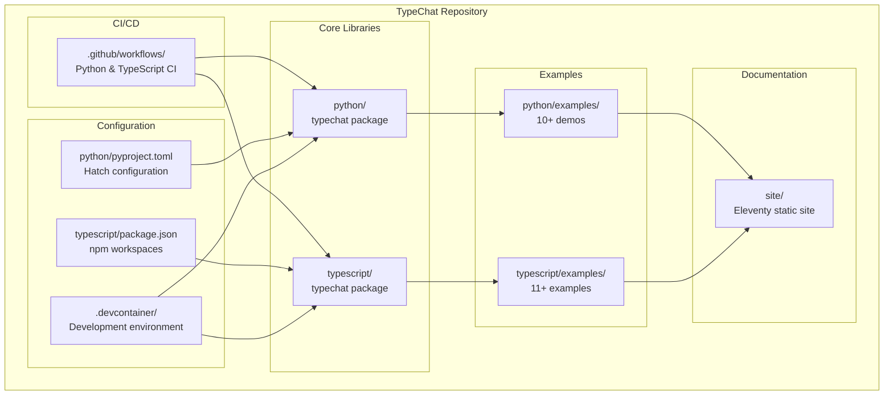

**Repository Structure Diagram: Main directories and their relationships**

| Directory | Purpose |
|-----------|---------|
| `python/` | Python package implementation, examples, and tests |
| `typescript/` | TypeScript package implementation, examples, and tests |
| `site/` | Documentation website built with Eleventy |
| `.github/workflows/` | CI/CD pipelines for testing and deployment |
| `.devcontainer/` | Development container configuration |

Sources: [README.md:39-47](), [python/README.md:35-51](), [typescript/README.md:19-38]()

## Core Architecture

Both Python and TypeScript implementations follow the same three-component architecture. Each implementation provides equivalent APIs and capabilities, allowing developers to choose their preferred language while maintaining feature parity.

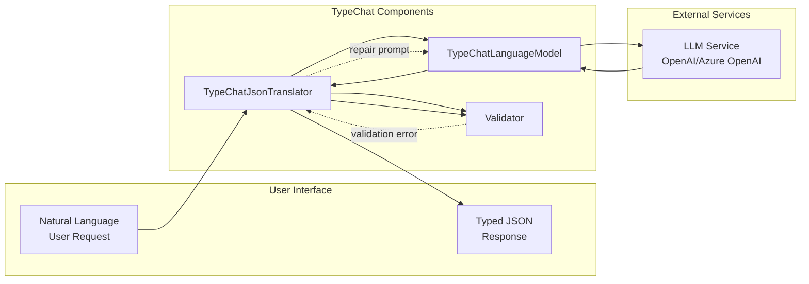

**Core Component Architecture: Flow from natural language input to validated output**

### Three Core Components

| Component | Python Class | TypeScript Interface | Purpose |
|-----------|-------------|---------------------|----------|
| **Translator** | `TypeChatJsonTranslator` | `TypeChatJsonTranslator` | Orchestrates the translation process, manages prompts, and coordinates validation/repair |
| **Model** | `TypeChatLanguageModel` (Protocol) | `TypeChatLanguageModel` | Provides language model completion capability, handles API communication |
| **Validator** | `TypeChatValidator` | `TypeChatJsonValidator` | Validates LLM responses against type schema, provides schema text for prompts |

Sources: [site/src/docs/python/basic-usage.md:19-24](), [site/src/docs/typescript/basic-usage.md:16-24](), [typescript/src/ts/program.ts:1-5]()

## Translation Pipeline

The translation process follows a consistent flow across both implementations:

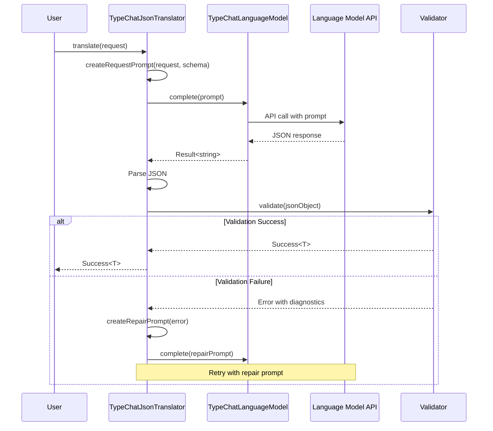

**Translation Flow: Request to validated response with automatic repair**

The pipeline includes automatic retry logic with configurable maximum attempts. When validation fails, TypeChat constructs a repair prompt that includes diagnostic information from the type checker, giving the LLM specific feedback about what needs to be corrected.

Sources: [site/src/docs/python/basic-usage.md:239-268](), [site/src/docs/typescript/basic-usage.md:300-324](), [README.md:11-17]()

## Python Implementation Details

The Python implementation uses Python's native type system (dataclasses, TypedDict, type hints) but includes a unique feature: **automatic conversion of Python types to TypeScript schemas** for LLM prompts. This is necessary because most LLMs are trained on TypeScript/JavaScript code and better understand TypeScript type syntax.

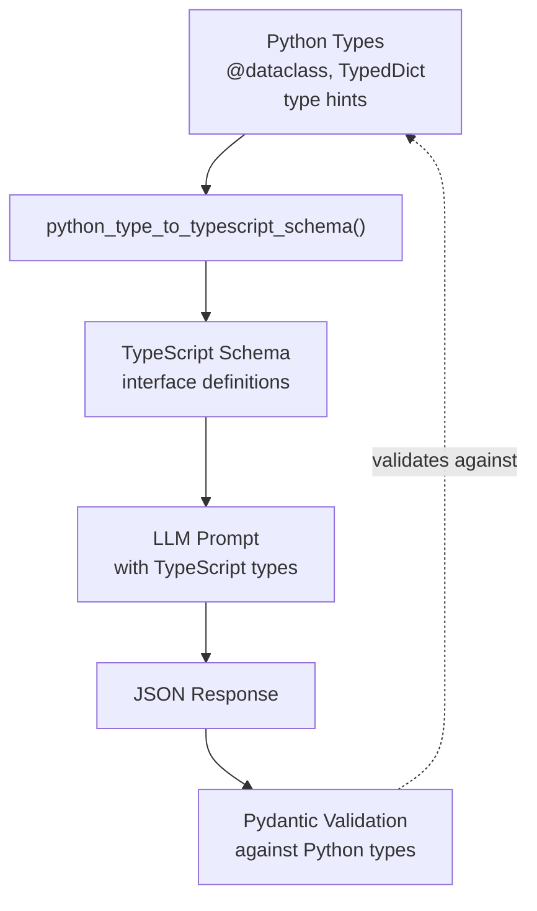

**Python Type Conversion: Python types to TypeScript for LLM guidance**

**Key Python classes:**
- `TypeChatJsonTranslator` - orchestrates translation [python/src/typechat/_internal/ts_conversion.py]()
- `TypeChatValidator` - validates using Pydantic and generates TypeScript schema
- `create_language_model()` - factory function for OpenAI/Azure models
- `process_requests()` - interactive REPL for testing

Sources: [site/src/docs/python/basic-usage.md:1-268](), [python/README.md:1-74]()

## TypeScript Implementation Details

The TypeScript implementation works directly with TypeScript's type system and provides two validator options:

1. **TypeScriptJsonValidator** - uses the TypeScript compiler API for validation
2. **ZodJsonValidator** - uses Zod schemas for runtime validation

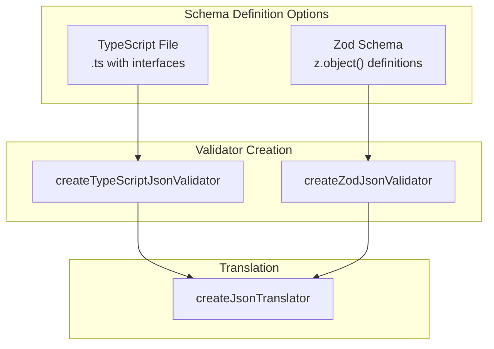

**TypeScript Validator Options: Two approaches for schema validation**

**Key TypeScript functions and types:**
- `createJsonTranslator<T>()` - creates translator with model and validator
- `createTypeScriptJsonValidator<T>()` - TypeScript compiler-based validation [typescript/src/ts/validate.ts]()
- `createZodJsonValidator<T>()` - Zod schema-based validation [typescript/src/zod/validate.ts]()
- `createLanguageModel()` - factory for OpenAI/Azure models
- `processRequests()` - interactive REPL utility

The TypeScript implementation also supports advanced patterns like **program generation**, where natural language requests are translated into TypeScript modules that can be type-checked and executed.

Sources: [site/src/docs/typescript/basic-usage.md:1-325](), [typescript/README.md:1-61](), [typescript/src/ts/program.ts:189-219]()

## Language Model Integration

Both implementations provide convenient factory functions for creating language models that work with OpenAI and Azure OpenAI services:

**Python:**
```python
from typechat import create_language_model

# Automatically detects OpenAI or Azure based on environment variables
model = create_language_model(env_dict)

# Or create directly:
# create_openai_language_model(api_key, model, endpoint, org)
# create_azure_openai_language_model(api_key, endpoint)
```

**TypeScript:**
```typescript
import { createLanguageModel } from "typechat";

// Automatically detects OpenAI or Azure based on environment variables
const model = createLanguageModel(process.env);

// Or create directly:
// createOpenAILanguageModel(apiKey, model, endpoint)
// createAzureOpenAILanguageModel(apiKey, endpoint)
```

The `TypeChatLanguageModel` interface/protocol requires only a `complete()` method, making it straightforward to integrate with other LLM providers.

| Configuration Variable | Purpose |
|----------------------|---------|
| `OPENAI_API_KEY` | OpenAI API authentication key |
| `OPENAI_MODEL` | Model name (e.g., `gpt-3.5-turbo`, `gpt-4`) |
| `OPENAI_ENDPOINT` | Optional custom endpoint URL |
| `AZURE_OPENAI_API_KEY` | Azure OpenAI API authentication key |
| `AZURE_OPENAI_ENDPOINT` | Full Azure OpenAI REST API URL with deployment name |

Sources: [site/src/docs/python/basic-usage.md:42-118](), [site/src/docs/typescript/basic-usage.md:39-98](), [typescript/examples/README.md:63-92](), [python/examples/README.md:76-105]()

## Example Applications

TypeChat includes comprehensive examples demonstrating progressively complex use cases:

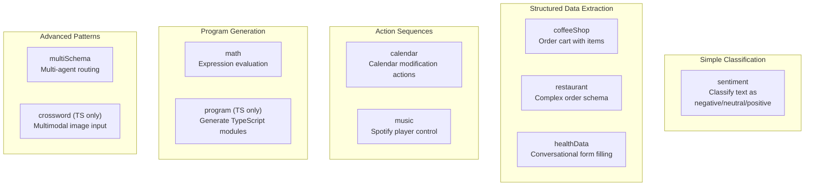

**Example Application Complexity Spectrum**

| Example | Python | TypeScript | Description |
|---------|--------|-----------|-------------|
| **sentiment** | ✓ | ✓ | Sentiment classification - TypeChat's "hello world" |
| **coffeeShop** | ✓ | ✓ | Coffee order cart builder |
| **calendar** | ✓ | ✓ | Calendar action sequences |
| **healthData** | ✓ | - | Conversational form filling with history |
| **restaurant** | ✓ | ✓ | Complex order schema with corrections |
| **math** | ✓ | ✓ | Mathematical expression evaluation |
| **music** | ✓ | ✓ | Music player control (Spotify-style) |
| **multiSchema** | ✓ | - | Multi-agent routing and selection |
| **program** | - | ✓ | TypeScript code generation from natural language |
| **crossword** | - | ✓ | Multimodal input with image analysis |

Each example includes sample input files (typically `input.txt`) demonstrating various natural language requests the system can handle.

Sources: [typescript/examples/README.md:8-19](), [python/examples/README.md:8-21](), [site/src/blog/introducing-typechat.md:141-187]()

## Running Examples

Both implementations provide similar workflows for running examples interactively or with input files:

**Python:**
```bash
cd python/examples/sentiment
python demo.py                    # Interactive mode
python demo.py input.txt         # Process file input
```

**TypeScript:**
```bash
cd typescript/examples/sentiment
node ./dist/main.js              # Interactive mode
node ./dist/main.js input.txt   # Process file input
```

Examples use environment variables from a `.env` file for API credentials. The interactive mode provides a prompt (often with an emoji like `😀>`) where users can type natural language requests.

Sources: [python/examples/README.md:107-120](), [typescript/examples/README.md:94-107]()

## Installation and Getting Started

**Python Installation:**
```bash
# From PyPI
pip install typechat

# From source
git clone https://github.com/microsoft/TypeChat
cd TypeChat/python
hatch shell
```

**TypeScript Installation:**
```bash
# From npm
npm install typechat

# From source
git clone https://github.com/microsoft/TypeChat
cd TypeChat/typescript
npm install
npm run build
```

Both implementations require:
- API keys for OpenAI or Azure OpenAI (configured via environment variables)
- Python ≥3.11 (for Python version) or Node.js ≥18 (for TypeScript version)

Sources: [README.md:19-47](), [python/README.md:27-51](), [typescript/README.md:19-38]()

## Development Environment

The repository includes a `.devcontainer` configuration for GitHub Codespaces and local VS Code development, providing a pre-configured environment with all necessary dependencies:
- Python 3.12
- Node.js 20
- Required build tools and extensions

This enables developers to start working with TypeChat examples immediately without manual environment setup.

Sources: [typescript/examples/README.md:34-53](), [python/examples/README.md:55-74]()

## Key Design Principles

TypeChat is built on several core principles:

1. **Types as Interface Specification** - Type definitions serve as the contract between natural language and structured data
2. **Schema Engineering over Prompt Engineering** - Developers focus on defining types rather than crafting prompts
3. **Validation and Repair** - Automatic validation with repair prompts when responses don't conform to schema
4. **Model Neutrality** - Works with any LLM that can complete prompts (though optimized for models trained on both code and natural language)
5. **Safety Through Constraints** - Types constrain model uncertainty and provide an escape hatch for out-of-domain requests
6. **Polyglot Parity** - Parallel implementations maintain API compatibility across languages

Sources: [README.md:1-17](), [site/src/docs/introduction.md:118-133](), [site/src/docs/techniques.md:8-28](), [site/src/docs/faq.md:24-42]()

## Next Steps

To learn more about specific aspects of TypeChat:

- **Understand core concepts:** See [Core Concepts](#2) for detailed explanations of schema engineering, the translation pipeline, and type system bridges
- **Explore Python implementation:** See [Python Implementation](#3) for Python-specific components, schema conversion, and examples
- **Explore TypeScript implementation:** See [TypeScript Implementation](#4) for TypeScript-specific components, validators, and examples
- **Learn about repository structure:** See [Package Structure and Configuration](#5) for monorepo organization and package details
- **Set up development environment:** See [Development and Testing](#6) for CI/CD, testing infrastructure, and development workflows
- **Understand documentation site:** See [Documentation Website](#7) for information about the Eleventy-based documentation site

Sources: [README.md:45-47](), [python/README.md:45-51](), [typescript/README.md:36-38]()

---

# Page: Core Concepts

# Core Concepts

<details>
<summary>Relevant source files</summary>

The following files were used as context for generating this wiki page:

- [README.md](README.md)
- [site/src/blog/introducing-typechat.md](site/src/blog/introducing-typechat.md)
- [site/src/docs/faq.md](site/src/docs/faq.md)
- [site/src/docs/introduction.md](site/src/docs/introduction.md)
- [site/src/docs/techniques.md](site/src/docs/techniques.md)
- [typescript/src/ts/program.ts](typescript/src/ts/program.ts)
- [typescript/src/zod/validate.ts](typescript/src/zod/validate.ts)

</details>


This document explains the fundamental concepts underlying TypeChat's approach to natural language processing. TypeChat uses **type definitions as the interface contract** between natural language input and structured application data, replacing traditional prompt engineering with what the library calls "schema engineering."

For implementation-specific details, see [Python Implementation](#3) and [TypeScript Implementation](#4). For examples of these concepts in practice, see [Python Examples](#3.3) and [TypeScript Examples](#4.2).

## The Schema Engineering Paradigm

TypeChat's core innovation is replacing **prompt engineering** with **schema engineering**. Instead of writing increasingly complex natural language prompts to guide an LLM's response format, developers define type definitions that precisely describe the structure and constraints of acceptable responses.

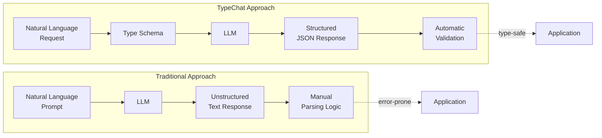

**Sources:** [README.md:7](), [site/src/blog/introducing-typechat.md:79-132](), [site/src/docs/techniques.md:8-10]()

The rationale for this approach is based on three observations:

| Observation | Implication |
|------------|-------------|
| LLMs are trained extensively on TypeScript/JavaScript code | Types provide familiar, unambiguous specifications for LLMs |
| JSON is the interchange format for the world's most popular language | LLMs excel at generating well-formed JSON |
| Natural language prompts are ambiguous and fragile | Type definitions are precise and maintainable |

TypeScript serves as the "specification language" because LLMs have seen enormous amounts of TypeScript in their training data. The types act as a formal, unambiguous description of possible outputs, which the model has learned to respect through its training on codebases that use TypeScript.

**Sources:** [site/src/docs/introduction.md:79-119](), [site/src/docs/faq.md:34-42]()

## Three-Component Architecture

TypeChat implements a consistent three-component architecture across both Python and TypeScript implementations:

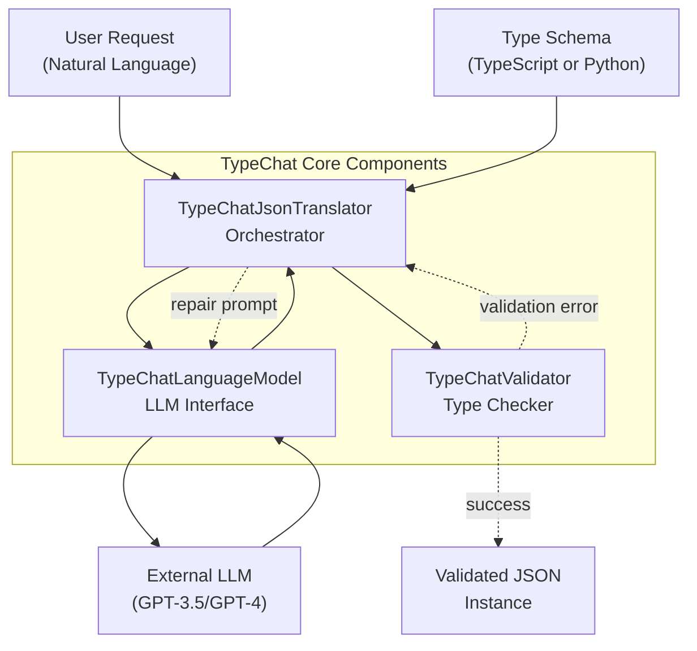

**Sources:** [README.md:11-16](), [site/src/docs/faq.md:10-14]()

### TypeChatJsonTranslator

The `TypeChatJsonTranslator` is the orchestrator that coordinates the translation process. It:

1. Constructs prompts that combine the user's natural language request with type schema definitions
2. Sends requests to the language model via `TypeChatLanguageModel`
3. Validates responses using `TypeChatValidator`
4. Manages repair loops when validation fails

In TypeScript, translators are created using `createJsonTranslator`. In Python, the equivalent is instantiating `TypeChatJsonTranslator` from the `typechat` module.

**Sources:** [typescript/src/typechat.ts]() (inferred from usage patterns)

### TypeChatLanguageModel

The `TypeChatLanguageModel` provides an abstraction over LLM APIs. It handles:

- Communication with external LLM services (OpenAI, Azure OpenAI, etc.)
- Request formatting and response parsing
- Error handling and retries

This abstraction makes TypeChat model-neutral, allowing developers to use any LLM service that provides a chat completion-style API.

**Sources:** [README.md:39-43](), [site/src/blog/introducing-typechat.md:189-196]()

### TypeChatValidator

The `TypeChatValidator` (or `TypeChatJsonValidator`) validates that LLM responses conform to the specified schema. The validation approach differs between implementations:

| Implementation | Validation Method |
|---------------|------------------|
| **TypeScript** | Uses TypeScript compiler API or Zod schemas for runtime validation |
| **Python** | Uses Pydantic models for runtime validation against Python type hints |

When validation fails, the validator returns diagnostic messages that the translator uses to construct repair prompts.

**Sources:** [site/src/docs/faq.md:34-42](), [typescript/src/zod/validate.ts:1-30]()

## Validation and Repair Loop

TypeChat implements an automatic **repair loop** that iteratively improves invalid LLM responses:

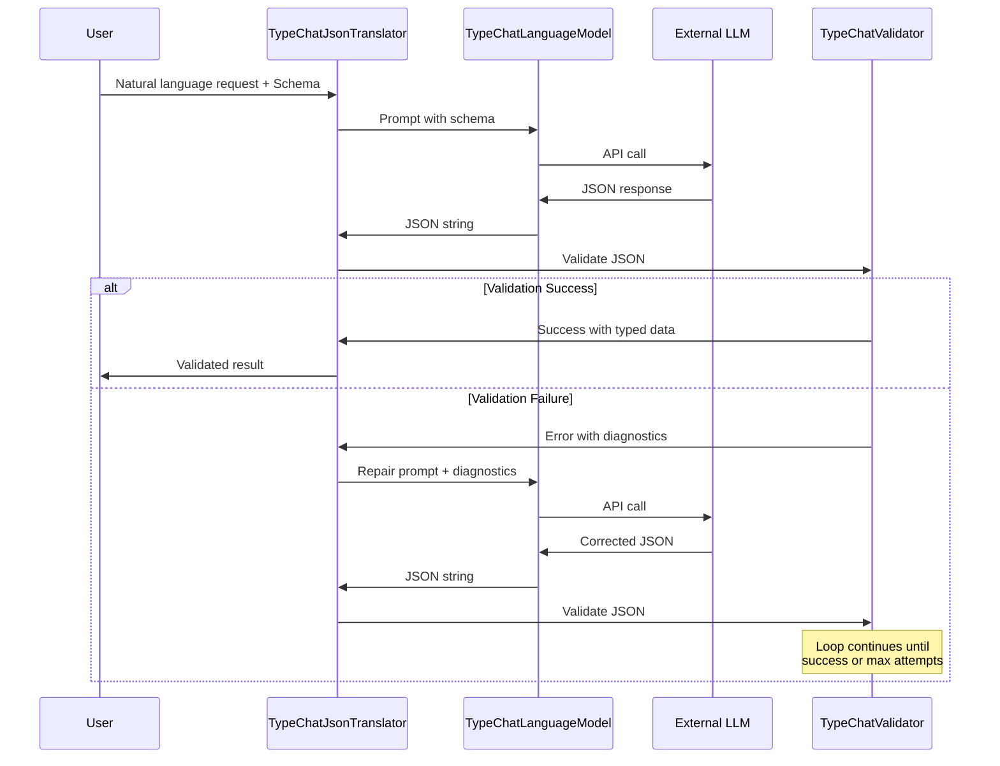

**Sources:** [README.md:14](), [site/src/docs/introduction.md:127-131](), [site/src/docs/faq.md:38-42]()

The repair mechanism leverages compiler diagnostics from TypeScript or validation errors from Pydantic. These diagnostics provide precise, actionable feedback to the LLM about what is wrong with its response:

**Example repair prompt structure:**
1. Original prompt with schema
2. LLM's invalid response
3. Specific validation errors (e.g., "Property 'quantity' is missing", "Type 'string' is not assignable to type 'number'")
4. Request for corrected response

This approach is more reliable than hoping the LLM gets it right on the first attempt, and it's more maintainable than complex prompt engineering.

**Sources:** [site/src/docs/faq.md:38-42]()

## Cross-Language Type System Bridge

TypeChat provides parallel implementations in Python and TypeScript, but they handle type schemas differently:

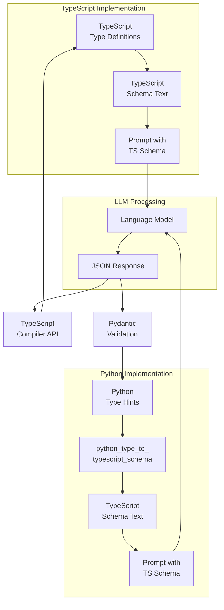

**Sources:** [python/src/typechat/_ts_schema.py]() (inferred from architecture), [site/src/docs/faq.md:44-46]()

### Why TypeScript for LLM Prompts?

Both implementations use **TypeScript schemas in LLM prompts**, even when the application is written in Python. This is because:

1. **Training Data**: LLMs have seen vastly more TypeScript/JavaScript code than Python during training
2. **JSON Affinity**: TypeScript is explicitly designed to describe JSON structures
3. **Compactness**: TypeScript schemas are up to 5x more concise than equivalent JSON Schema definitions

For Python developers, this means:
- Write application types using Python's native type hints (`@dataclass`, `TypedDict`, `Literal`, etc.)
- TypeChat automatically converts these to TypeScript schemas for LLM prompts
- Validation still happens against the original Python types using Pydantic

This architecture allows Python developers to work in their native type system while benefiting from LLMs' familiarity with TypeScript. For details on the conversion mechanism, see [Type System Bridge](#2.3).

**Sources:** [site/src/docs/faq.md:34-42](), [README.md:3-17]()

## Response Model Design Principles

TypeChat schemas are not necessarily the exact types your application uses internally. They are **Response Models** that bridge between natural language and application logic by constraining LLM responses in meaningful ways.

| Principle | Rationale |
|-----------|-----------|
| Keep it simple (primitives, arrays, objects) | LLMs handle simple structures more reliably |
| Only use JSON-representable types | No classes, functions, or non-serializable constructs |
| Make structures flat and regular | Deep nesting increases error rates |
| Include natural language comments on types | Comments guide LLM interpretation |
| Restrict use of generics | Complex type parameters confuse models |
| Avoid deep inheritance hierarchies | Flat discriminated unions work better |
| Use `string` instead of narrow literal types | Allow LLMs some flexibility |
| Include an "unknown" escape hatch | Suppress hallucinations for out-of-domain requests |

**Sources:** [site/src/docs/techniques.md:14-25]()

### The Escape Hatch Pattern

A critical design pattern is including an **"unknown" category** in your schema to handle out-of-domain requests. Without this, LLMs may hallucinate responses by forcing user input into inappropriate categories.

**Example:** A coffee shop schema without an escape hatch might translate "two tall trees" into "two tall lattes". With an escape hatch (`UnknownRequest` type), the LLM will correctly categorize this as an unknown/invalid request.

**Sources:** [site/src/docs/techniques.md:26-28]()

## Advanced Patterns

TypeChat supports several advanced patterns beyond simple data translation:

### Program Generation

The `Program` type and `createProgramTranslator` enable generating executable programs as JSON. The generated programs consist of function call sequences that can be safely evaluated using `evaluateJsonProgram`.

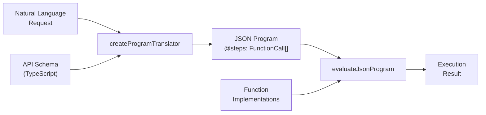

**Sources:** [typescript/src/ts/program.ts:1-219](), [site/src/blog/introducing-typechat.md:184-187]()

The `Program` type defines a sequence of `FunctionCall` objects with `@func` (function name) and `@args` (arguments) properties. The `evaluateJsonProgram` function acts as a safe interpreter that dispatches function calls to application-provided handlers.

**Sources:** [typescript/src/ts/program.ts:6-31](), [typescript/src/ts/program.ts:147-186]()

### Multi-Schema Routing

Applications can use a "meta-schema" to dynamically select specialized sub-schemas based on user input. This enables building systems that route requests to different domain-specific handlers.

**Sources:** [site/src/docs/introduction.md:125](), [README.md:9]()

### Zod Schema Support

In TypeScript, developers can use Zod schemas instead of TypeScript types via `createZodJsonValidator`. This provides runtime validation without requiring the TypeScript compiler API.

**Sources:** [typescript/src/zod/validate.ts:1-30](), [typescript/src/zod/validate.ts:66-249]()

---

The three child pages provide detailed coverage of these core concepts:
- [Schema Engineering](#2.1) - Deep dive into designing effective type schemas
- [Translation Pipeline](#2.2) - Complete flow from request to validated output  
- [Type System Bridge](#2.3) - How Python types convert to TypeScript schemas

---

# Page: Schema Engineering

# Schema Engineering

<details>
<summary>Relevant source files</summary>

The following files were used as context for generating this wiki page:

- [README.md](README.md)
- [python/README.md](python/README.md)
- [python/examples/README.md](python/examples/README.md)
- [site/src/_data/docsTOC.json](site/src/_data/docsTOC.json)
- [site/src/blog/introducing-typechat.md](site/src/blog/introducing-typechat.md)
- [site/src/docs/faq.md](site/src/docs/faq.md)
- [site/src/docs/introduction.md](site/src/docs/introduction.md)
- [site/src/docs/python/basic-usage.md](site/src/docs/python/basic-usage.md)
- [site/src/docs/techniques.md](site/src/docs/techniques.md)
- [site/src/docs/typescript/basic-usage.md](site/src/docs/typescript/basic-usage.md)
- [typescript/README.md](typescript/README.md)
- [typescript/examples/README.md](typescript/examples/README.md)
- [typescript/src/ts/program.ts](typescript/src/ts/program.ts)
- [typescript/src/zod/validate.ts](typescript/src/zod/validate.ts)

</details>


Schema Engineering is a core architectural component of TypeChat that replaces traditional prompt engineering with a structured, type-based approach. This document explains how TypeChat uses types to guide language model responses, providing more reliable and safer natural language interfaces. For details on the overall request processing flow, see [Request Processing Flow](#2.2).

## What is Schema Engineering?

Schema Engineering is TypeChat's approach to structuring and constraining language model outputs using type definitions. Instead of writing complex decision trees or prompt templates to guide a language model's responses, Schema Engineering uses TypeScript type definitions to define the shape of expected data.

**Diagram: Traditional Prompt Engineering vs Schema Engineering**

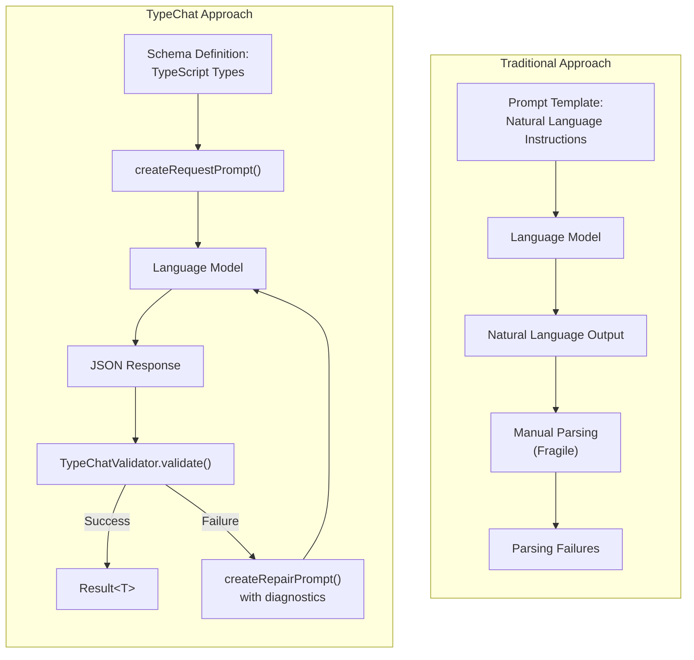

Sources: [README.md:5-7](), [site/src/docs/techniques.md:8-10](), [site/src/blog/introducing-typechat.md:15-33](), [typescript/src/typechat.ts]()

## Schema Engineering vs. Prompt Engineering

Schema Engineering fundamentally differs from traditional prompt engineering in several key ways:

| Traditional Prompt Engineering | Schema Engineering |
|--------------------------------|-------------------|
| Relies on natural language instructions | Uses type definitions as instructions |
| Output format guidance through examples | Output format constrained by types |
| Unpredictable structure in responses | Guaranteed structure matching schema |
| Manual validation of responses | Automated validation via TypeScript compiler |
| Trial-and-error prompt refinement | Systematic schema design |

Schema Engineering provides the structure that bridges between natural language input and application logic. The types act as a contract between what the user can express and what the application can process.

**Diagram: TypeChat Component Flow with Code Entities**

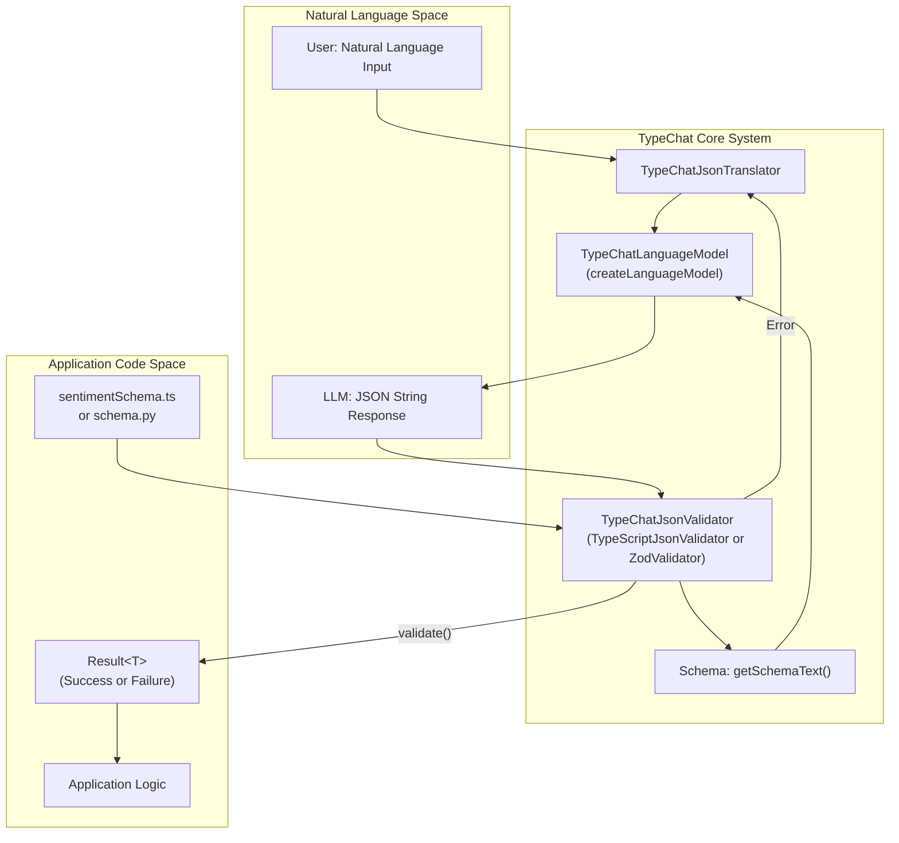

Sources: [site/src/docs/techniques.md:8-13](), [site/src/blog/introducing-typechat.md:76-133](), [typescript/src/typechat.ts](), [python/src/typechat/_internal/ts_conversion.py]()

## Response Models

The types you design for TypeChat act as "Response Models" - they bridge between natural language and your application logic by controlling and constraining LLM responses in meaningful ways. These types aren't necessarily the exact types your application uses internally, but rather types specifically designed to capture user intent from natural language.

### Simple Schema Example: Sentiment Analysis

The sentiment example demonstrates the simplest form of schema engineering. The schema defines a single type with a constrained set of values:

**TypeScript Schema** ([typescript/examples/sentiment/src/sentimentSchema.ts]())
```typescript
export interface SentimentResponse {
    sentiment: "negative" | "neutral" | "positive";
}
```

**Python Schema** ([python/examples/sentiment/schema.py]())
```python
@dataclass
class Sentiment:
    sentiment: Literal["negative", "neutral", "positive"]
```

Both schemas are converted into TypeScript for the LLM prompt. The Python implementation uses `python_type_to_typescript_schema()` to convert Python type hints into TypeScript interface definitions.

**Diagram: Schema to JSON Translation Flow**

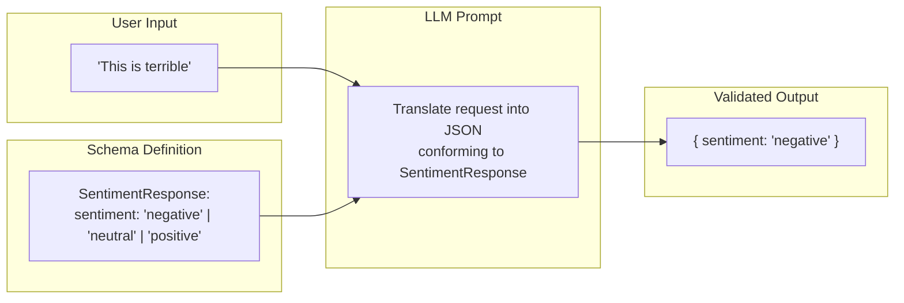

Sources: [site/src/docs/techniques.md:10-13](), [README.md:9-11](), [site/src/blog/introducing-typechat.md:84-122](), [typescript/examples/sentiment/src/sentimentSchema.ts](), [python/examples/sentiment/schema.py]()

### Complex Schema Example: Coffee Shop Orders

More complex schemas can represent structured data with nested types and optional fields:

**TypeScript Schema** ([typescript/examples/coffeeShop/src/coffeeShopSchema.ts]())
```typescript
export interface Cart {
    items: (LineItem | UnknownText)[];
}

export interface LineItem {
    type: 'lineitem';
    product: Product;
    quantity: number;
}

export interface Product {
    name: string;
    options?: OptionsType[];
}

export type UnknownText = {
    type: 'unknown',
    text: string; // The text that wasn't understood
};
```

The schema includes an escape hatch (`UnknownText`) to handle requests outside the domain, which helps prevent hallucinations.

Sources: [typescript/examples/coffeeShop/src/coffeeShopSchema.ts](), [site/src/docs/techniques.md:24-27]()

## Best Practices for Schema Engineering

When designing schemas for TypeChat, follow these guidelines for optimal results:

1. **Keep it simple**: Use primitives, arrays, and objects
2. **Use JSON-representable types**: No classes, only types representable in JSON
3. **Create flat, regular structures**: Avoid deep nesting
4. **Add natural language comments**: Include JSDoc comments to describe intent
5. **Limit advanced type features**:
   - Avoid deep inheritance hierarchies
   - Restrict use of generics
   - Don't use conditional, mapped, and indexed access types
6. **Allow flexibility**: Use `string` instead of literal types when appropriate
7. **Include escape hatches**: Add an "unknown" type to handle out-of-domain requests

The escape hatch point is particularly important. When Response Models have no option for handling out-of-domain requests, LLMs may hallucinate answers. An "unknown" category allows the model to route non-domain requests appropriately.

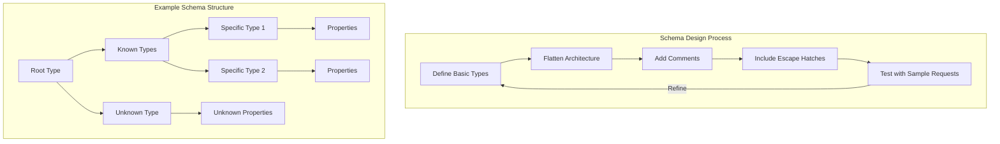

Sources: [site/src/docs/techniques.md:14-25](), [README.md:9-11]()

## Schema Validation and Repair

A key strength of TypeChat is its ability to validate and repair language model responses using the TypeScript compiler:

1. The language model attempts to generate JSON conforming to the schema
2. TypeChat validates the JSON against the schema using the TypeScript compiler
3. If validation fails, TypeChat sends error diagnostics back to the model
4. The model repairs its response based on the error feedback
5. This cycle repeats until the response is valid or a maximum retry limit is reached

The validation process differs based on which validator is used:

| Validator Type | Implementation | Validation Method |
|----------------|----------------|-------------------|
| `TypeScriptJsonValidator` | TypeScript Compiler API | `ts.transpileModule()` with type checking |
| `ZodValidator` | Zod runtime validation | `schema.safeParse()` |
| Python `TypeChatValidator` | Pydantic validation | `pydantic.TypeAdapter.validate_python()` |

**Diagram: Validation and Repair Loop with Code Entities**

```mermaid
sequenceDiagram
    participant User
    participant Translator["TypeChatJsonTranslator<br/>translate()"]
    participant Model["TypeChatLanguageModel<br/>complete()"]
    participant Validator["TypeChatValidator<br/>validate()"]
    participant App["Application"]

    User->>Translator: "Natural language request"
    Translator->>Translator: createRequestPrompt(request)
    Translator->>Model: complete(prompt)
    Model-->>Translator: "JSON string"
    Translator->>Validator: validate(jsonObject)
    
    alt Validation Success
        Validator-->>Translator: "Success&lt;T&gt;"
        Translator->>App: "Result&lt;T&gt;"
    else Validation Failure (Attempt < maxAttempts)
        Validator-->>Translator: "Failure with diagnostics"
        Translator->>Translator: createRepairPrompt(error)
        Translator->>Model: complete(repairPrompt)
        Model-->>Translator: "Repaired JSON string"
        Translator->>Validator: validate(jsonObject)
        Validator-->>Translator: "Success&lt;T&gt;"
        Translator->>App: "Result&lt;T&gt;"
    end
```

**TypeScript Validation Implementation:**

The `TypeScriptJsonValidator` ([typescript/src/ts/validate.ts]()) uses the TypeScript compiler API to validate JSON objects:

1. Converts JSON to a TypeScript module string using `createModuleTextFromJson()`
2. Compiles the module with `ts.transpileModule()` to get type errors
3. Returns `Success<T>` if no errors, otherwise `Failure` with diagnostics

**Zod Validation Implementation:**

The `ZodValidator` ([typescript/src/zod/validate.ts]()) uses Zod's runtime validation:

1. Calls `schema.safeParse(jsonObject)` on the Zod schema
2. Returns `Success<T>` if validation passes
3. Returns `Failure` with formatted error messages if validation fails

**Python Validation Implementation:**

The Python `TypeChatValidator` ([python/src/typechat/_validator.py]()) uses Pydantic:

1. Creates a `TypeAdapter` from the Python type
2. Calls `type_adapter.validate_python(obj)` 
3. Returns `Success[T]` or `Failure` based on validation result

Sources: [README.md:13-15](), [site/src/blog/introducing-typechat.md:123-133](), [typescript/src/ts/validate.ts](), [typescript/src/zod/validate.ts](), [python/src/typechat/_validator.py]()

## Advanced Schema Pattern: Program API

TypeChat supports an advanced schema pattern for generating executable programs from natural language. The `Program` type ([typescript/src/ts/program.ts:6-31]()) represents a sequence of function calls that compose an API:

```typescript
export type Program = {
    "@steps": FunctionCall[];
}

export type FunctionCall = {
    "@func": string;
    "@args"?: Expression[];
};
```

**Program Translation Flow:**

1. User provides natural language request
2. `createProgramTranslator()` constructs a translator with both the Program schema and target API schema
3. LLM generates a JSON program with function calls
4. `createModuleTextFromProgram()` converts the JSON to TypeScript code
5. TypeScript compiler validates the generated code against the API schema
6. `evaluateJsonProgram()` executes the validated program

**Diagram: Program API Schema Flow**

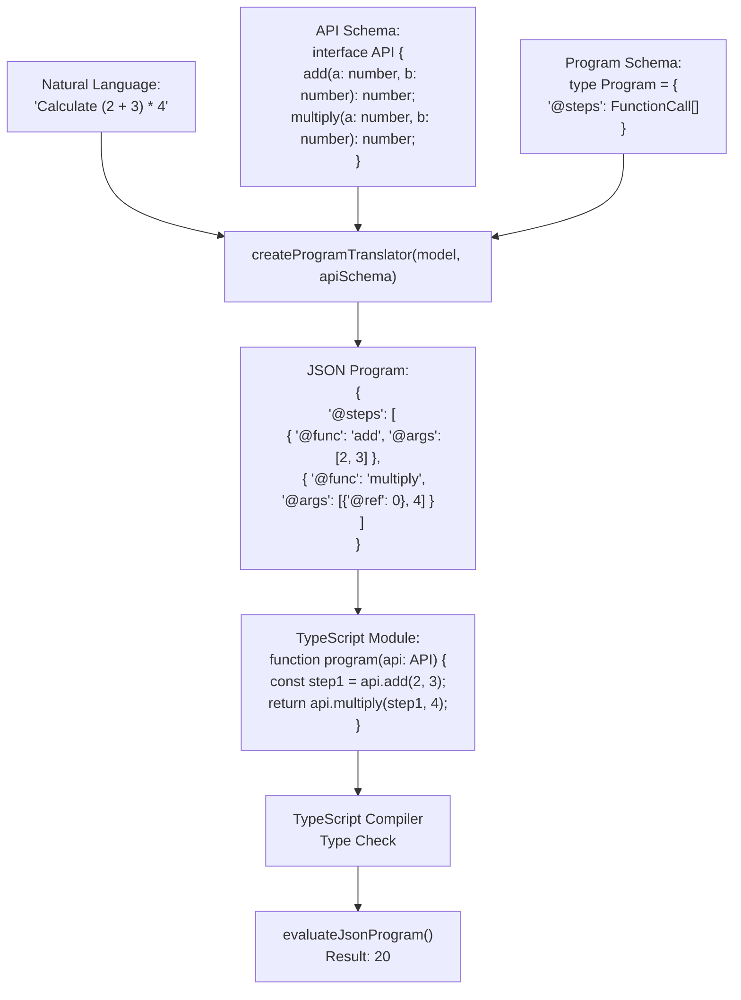

The Program API approach is used in the Math example ([typescript/examples/math]()) and demonstrates how TypeChat can generate and validate small programs rather than just data structures.

Sources: [typescript/src/ts/program.ts:6-31](), [typescript/src/ts/program.ts:86-136](), [typescript/src/ts/program.ts:189-219](), [typescript/examples/math]()

## Implementation Languages

Schema Engineering is currently supported in different programming languages, with TypeScript being the primary implementation:

**TypeScript/JavaScript:**
- Native TypeScript types defined in `.ts` files
- Validated using `createTypeScriptJsonValidator()` with TypeScript Compiler API
- Alternative: Zod schemas with `createZodJsonValidator()`

**Python:**
- Python type hints (`@dataclass`, `TypedDict`, `Literal`, etc.)
- Converted to TypeScript schemas using `python_type_to_typescript_schema()`
- Validated using Pydantic runtime validation
- Supports Python 3.11-3.14 with version-specific type features

**C#/.NET:**
- Available as separate implementation at [https://github.com/microsoft/TypeChat.net]()
- .NET types converted to TypeScript schemas

**Diagram: Schema Definition Across Languages**

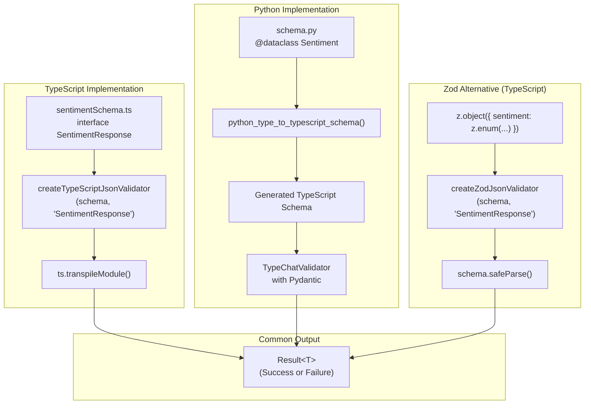

All implementations follow the same conceptual model: define types in the native language, convert to a schema representation, validate LLM output, and return typed results.

Sources: [python/README.md:7-11](), [typescript/README.md:7-11](), [README.md:39-43](), [typescript/src/ts/validate.ts](), [typescript/src/zod/validate.ts](), [python/src/typechat/_internal/ts_conversion.py]()

## Examples of Schema Engineering

TypeChat provides several examples demonstrating Schema Engineering patterns, progressing from simple to complex:

| Example | Schema Pattern | Key Features |
|---------|---------------|--------------|
| **Sentiment** ([typescript/examples/sentiment](), [python/examples/sentiment]()) | Single type with literal values | `Literal["negative", "neutral", "positive"]` |
| **Coffee Shop** ([typescript/examples/coffeeShop](), [python/examples/coffeeShop]()) | Discriminated union with escape hatch | `LineItem \| UnknownText` types |
| **Calendar** ([typescript/examples/calendar](), [python/examples/calendar]()) | Action sequence pattern | Array of action types: `AddEventAction \| RemoveEventAction` etc. |
| **Restaurant** ([typescript/examples/restaurant](), [python/examples/restaurant]()) | Complex nested structures | Detailed item options and modifiers |
| **Math** ([typescript/examples/math](), [python/examples/math]()) | Program generation | Uses Program API schema pattern |
| **MultiSchema** ([python/examples/multiSchema]()) | Meta-schema routing | Routes to child schemas based on intent |
| **Music** ([typescript/examples/music](), [python/examples/music]()) | Dataflow program | Steps with result references |

### Schema Evolution: From Simple to Complex

**Level 1: Simple Classification**
- Single discriminated type
- Example: `sentiment: "negative" | "neutral" | "positive"`

**Level 2: Structured Data**
- Nested objects and arrays
- Optional fields
- Example: `Cart { items: LineItem[] }`

**Level 3: Action Sequences**
- Discriminated unions of action types
- Example: `AddEventAction | RemoveEventAction | ...`

**Level 4: Program Generation**
- Function calls with arguments
- Result references between steps
- Example: `Program { "@steps": FunctionCall[] }`

Each level builds on the previous, demonstrating how schema engineering can handle increasingly complex use cases.

Sources: [typescript/examples/README.md:9-18](), [python/examples/README.md:9-20](), [typescript/examples/sentiment/src/sentimentSchema.ts](), [typescript/examples/coffeeShop/src/coffeeShopSchema.ts](), [typescript/examples/calendar/src/calendarActionsSchema.ts](), [typescript/examples/math](), [python/examples/multiSchema]()

## Conclusion

Schema Engineering represents a paradigm shift in how we build natural language interfaces. By using types instead of unstructured prompts, TypeChat makes it easier to create reliable, safe, and maintainable natural language interfaces. The approach leverages the TypeScript type system's expressiveness and the compiler's validation capabilities to ensure that language model responses conform to your application's expectations.

This structured approach to natural language understanding reduces the need for prompt engineering expertise and provides stronger guarantees about the structure and validity of language model responses.

Sources: [README.md:3-17](), [site/src/docs/introduction.md:117-133](), [site/src/docs/faq.md:26-33]()

---

# Page: Translation Pipeline

# Translation Pipeline

<details>
<summary>Relevant source files</summary>

The following files were used as context for generating this wiki page:

- [README.md](README.md)
- [python/examples/healthData/translator.py](python/examples/healthData/translator.py)
- [python/examples/math/program.py](python/examples/math/program.py)
- [python/examples/multiSchema/agents.py](python/examples/multiSchema/agents.py)
- [python/examples/multiSchema/router.py](python/examples/multiSchema/router.py)
- [python/src/typechat/__init__.py](python/src/typechat/__init__.py)
- [python/src/typechat/_internal/interactive.py](python/src/typechat/_internal/interactive.py)
- [python/src/typechat/_internal/model.py](python/src/typechat/_internal/model.py)
- [python/src/typechat/_internal/translator.py](python/src/typechat/_internal/translator.py)
- [python/src/typechat/_internal/validator.py](python/src/typechat/_internal/validator.py)
- [python/tests/__snapshots__/test_translator.ambr](python/tests/__snapshots__/test_translator.ambr)
- [python/tests/test_translator.py](python/tests/test_translator.py)
- [python/tests/test_validator.py](python/tests/test_validator.py)
- [typescript/examples/crossword/README.md](typescript/examples/crossword/README.md)
- [typescript/examples/crossword/package.json](typescript/examples/crossword/package.json)
- [typescript/examples/crossword/src/crosswordSchema.ts](typescript/examples/crossword/src/crosswordSchema.ts)
- [typescript/examples/crossword/src/input.txt](typescript/examples/crossword/src/input.txt)
- [typescript/examples/crossword/src/main.ts](typescript/examples/crossword/src/main.ts)
- [typescript/examples/crossword/src/puzzleScreenshot.jpeg](typescript/examples/crossword/src/puzzleScreenshot.jpeg)
- [typescript/examples/crossword/src/translator.ts](typescript/examples/crossword/src/translator.ts)
- [typescript/examples/crossword/src/tsconfig.json](typescript/examples/crossword/src/tsconfig.json)
- [typescript/src/model.ts](typescript/src/model.ts)
- [typescript/src/ts/program.ts](typescript/src/ts/program.ts)
- [typescript/src/typechat.ts](typescript/src/typechat.ts)
- [typescript/src/zod/validate.ts](typescript/src/zod/validate.ts)

</details>


This page documents the complete translation pipeline in TypeChat, from natural language input through LLM interaction, validation, and repair to structured JSON output. The pipeline orchestrates the transformation of unstructured text into type-safe objects through a series of well-defined stages.

For information about how schemas constrain LLM outputs, see [Schema Engineering](#2.1). For details on the Python→TypeScript type conversion, see [Type System Bridge](#2.3).

## Pipeline Overview

The TypeChat translation pipeline transforms natural language requests into validated JSON objects through five core stages: prompt construction, LLM completion, response parsing, schema validation, and optional repair. The pipeline is implemented by `TypeChatJsonTranslator` which coordinates interactions between the language model and validator components.

**Translation Pipeline Architecture**

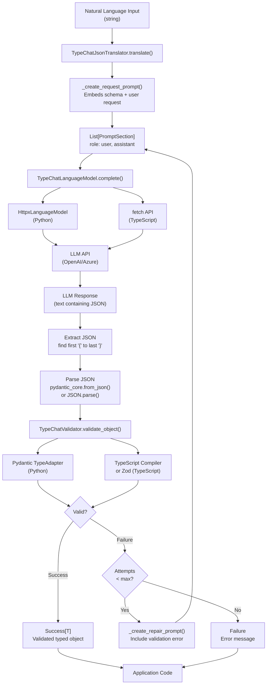

Sources: [python/src/typechat/_internal/translator.py:52-102](), [typescript/src/typechat.ts:124-162](), [python/src/typechat/_internal/model.py:59-97](), [typescript/src/model.ts:153-187]()

## Core Pipeline Components

The translation pipeline involves three primary components that work together to transform natural language into validated JSON objects:

**Component Architecture and Responsibilities**

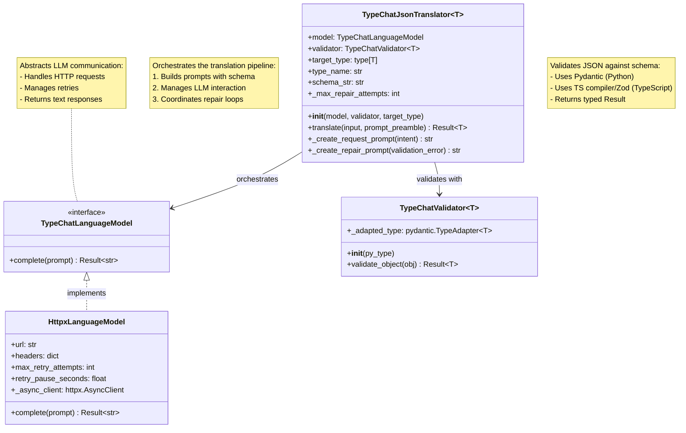

| Component | Responsibility | Key Methods |
|-----------|---------------|-------------|
| `TypeChatJsonTranslator` | Orchestrates the entire translation pipeline | `translate()`, `_create_request_prompt()`, `_create_repair_prompt()` |
| `TypeChatLanguageModel` | Abstracts communication with LLM APIs | `complete()` |
| `HttpxLanguageModel` | Implements HTTP-based LLM communication with retries | `complete()`, `__aenter__()`, `__aexit__()` |
| `TypeChatValidator` | Validates JSON objects against Python/TypeScript schemas | `validate_object()` |

Sources: [python/src/typechat/_internal/translator.py:12-50](), [python/src/typechat/_internal/model.py:18-28](), [python/src/typechat/_internal/model.py:38-112](), [python/src/typechat/_internal/validator.py:11-25](), [typescript/src/typechat.ts:7-64](), [typescript/src/model.ts:62-77]()

## Pipeline Stages

### Stage 1: Initialization and Schema Preparation

Before the pipeline can process requests, it must be initialized with three components:

1. **Language Model**: An instance implementing `TypeChatLanguageModel` (e.g., `HttpxLanguageModel`)
2. **Validator**: A `TypeChatValidator` instance for the target type
3. **Target Type**: The Python/TypeScript type definition for the expected JSON structure

During initialization, the Python implementation performs schema conversion:

**Python Schema Conversion Process**

```mermaid
flowchart LR
    TargetType["target_type: type[T]<br/>(Python dataclass, TypedDict)"]
    
    TargetType --> convert["python_type_to_typescript_schema()"]
    
    convert --> result["ConversionResult"]
    result --> schema["schema_str: str<br/>(TypeScript interface)"]
    result --> typename["type_name: str<br/>(e.g., 'ExampleABC')"]
    result --> errors["errors: list[str]"]
    
    schema --> translator["TypeChatJsonTranslator<br/>stores for prompts"]
    typename --> translator
    
    errors --> check{Has errors?}
    check -->|Yes| raise["Raise ValueError"]
    check -->|No| continue["Continue initialization"]
```

**Initialization Example**

```python
# Python
model = create_language_model(os.environ)
validator = TypeChatValidator(MyDataClass)
translator = TypeChatJsonTranslator(
    model=model,
    validator=validator,
    target_type=MyDataClass
)
# Internally converts Python types → TypeScript schema
```

```typescript
// TypeScript
const model = createLanguageModel(process.env);
const schema = fs.readFileSync("schema.ts", "utf8");
const validator = createTypeScriptJsonValidator<MyType>(schema, "MyType");
const translator = createJsonTranslator(model, validator);
// Uses TypeScript schema directly
```

Sources: [python/src/typechat/_internal/translator.py:24-51](), [python/src/typechat/_internal/ts_conversion.py:7-28](), [typescript/src/typechat.ts:97-108]()

### Stage 2: Prompt Construction

When `translate()` is called, the pipeline begins by constructing a prompt using `_create_request_prompt()`. This prompt embeds the TypeScript schema and user request into a structured instruction for the LLM.

**Prompt Template Structure**

```
You are a service that translates user requests into JSON objects of type "{type_name}" according to the following TypeScript definitions:
```
{schema_str}
```
The following is a user request:
'''
{intent}
'''
The following is the user request translated into a JSON object with 2 spaces of indentation and no properties with the value undefined:
```

The prompt is packaged into a `PromptSection` with role `"user"`. If a `prompt_preamble` is provided, it's prepended to enable conversational context or additional instructions.

**Prompt Section Assembly**

```mermaid
flowchart LR
    preamble["prompt_preamble<br/>(optional)"]
    
    preamble --> check{Is str?}
    check -->|Yes| convert["Convert to PromptSection<br/>role: 'user'"]
    check -->|No| isList{Is list?}
    isList -->|Yes| sections["List[PromptSection]"]
    isList -->|No| empty["Empty list"]
    
    convert --> sections
    empty --> sections
    
    sections --> append["Append main prompt"]
    
    request["User request string"] --> createPrompt["_create_request_prompt(request)"]
    createPrompt --> promptContent["Prompt content with<br/>embedded schema"]
    
    promptContent --> section["PromptSection<br/>role: 'user'<br/>content: prompt"]
    
    section --> append
    append --> messages["messages: List[PromptSection]"]
    
    messages --> complete["model.complete(messages)"]
```

**Example Prompt**

For a dataclass `ExampleABC` with fields `a: str`, `b: bool`, `c: int`:

```
You are a service that translates user requests into JSON objects of type "ExampleABC" according to the following TypeScript definitions:
```
interface ExampleABC {
    a: string;
    b: boolean;
    c: number;
}
```
The following is a user request:
'''
Get me stuff with hello, true, and 42.
'''
The following is the user request translated into a JSON object with 2 spaces of indentation and no properties with the value undefined:
```

Sources: [python/src/typechat/_internal/translator.py:52-72](), [python/src/typechat/_internal/translator.py:103-115](), [typescript/src/typechat.ts:110-116](), [typescript/src/typechat.ts:124-126]()

### Stage 3: Language Model Interaction

The assembled prompt is sent to the LLM through `model.complete()`. The `HttpxLanguageModel` (Python) or fetch-based implementation (TypeScript) handles the HTTP communication, retry logic, and error handling.

**LLM Interaction Sequence**

```mermaid
sequenceDiagram
    participant translator as TypeChatJsonTranslator
    participant model as HttpxLanguageModel
    participant client as httpx.AsyncClient
    participant api as LLM REST API<br/>(OpenAI/Azure)

    translator->>model: complete(messages: List[PromptSection])
    
    model->>model: Build request body<br/>{messages, temperature: 0, n: 1}
    
    model->>client: post(url, headers, json=body)
    
    client->>api: HTTP POST
    
    alt Success (200-299)
        api-->>client: JSON response
        client-->>model: response.json()
        model->>model: Extract choices[0].message.content
        model-->>translator: Success(content: str)
    else Transient Error (429, 500, 502, 503, 504)
        api-->>client: Error response
        client-->>model: HTTP error
        model->>model: Sleep retry_pause_seconds
        model->>client: Retry POST
    else Permanent Error
        api-->>client: Error response
        client-->>model: HTTP error
        model-->>translator: Failure(error_message)
    end
```

**Retry Configuration**

| Parameter | Python | TypeScript | Default | Purpose |
|-----------|--------|------------|---------|---------|
| Max Retries | `max_retry_attempts` | `retryMaxAttempts` | 3 | Maximum retry attempts for transient errors |
| Retry Delay | `retry_pause_seconds` | `retryPauseMs` | 1 sec / 1000 ms | Delay between retries |
| Timeout | `timeout_seconds` | N/A | 10 sec | Request timeout before failure |

**Transient Error Codes**: 429 (Rate Limit), 500 (Server Error), 502 (Bad Gateway), 503 (Service Unavailable), 504 (Gateway Timeout)

Sources: [python/src/typechat/_internal/model.py:59-97](), [python/src/typechat/_internal/model.py:30-36](), [typescript/src/model.ts:147-187](), [typescript/src/model.ts:193-203]()

### Stage 4: Response Parsing

The LLM returns a text response that typically contains JSON embedded in explanatory text. The pipeline extracts and parses the JSON object.

**JSON Extraction and Parsing Process**

```mermaid
flowchart TB
    response["LLM Response Text<br/>(may contain extra text)"]
    
    response --> find["Find JSON boundaries"]
    find --> first["first_curly = text.find('{')"]
    find --> last["last_curly = text.rfind('}') + 1"]
    
    first --> check{Valid bounds?}
    last --> check
    
    check -->|"0 <= first < last"| extract["trimmed_response =<br/>text[first:last]"]
    check -->|Invalid| error1["Return Failure:<br/>'Response did not contain JSON'"]
    
    extract --> parse["Parse JSON"]
    
    parse --> pyParse["Python:<br/>pydantic_core.from_json()<br/>allow_inf_nan=False"]
    parse --> tsParse["TypeScript:<br/>JSON.parse()"]
    
    pyParse --> parseResult{Success?}
    tsParse --> parseResult
    
    parseResult -->|Yes| parsed["parsed_response: dict"]
    parseResult -->|No| error2["Return Failure:<br/>'Error: {exception}'<br/>+ attempted text"]
    
    parsed --> validate["Stage 5: Validation"]
    error1 --> failReturn["Return to caller"]
    error2 --> failReturn
```

**Example Extraction**

Input text:
```
Sure, here's the JSON object:
{ "a": "hello", "b": true, "c": 42 }
Hope this helps!
```

Extracted:
```json
{ "a": "hello", "b": true, "c": 42 }
```

Sources: [python/src/typechat/_internal/translator.py:80-96](), [typescript/src/typechat.ts:134-146]()

### Stage 5: Schema Validation

The parsed JSON object is validated against the target schema using `TypeChatValidator.validate_object()`. The validation implementation differs between Python and TypeScript but follows the same conceptual model.

**Validation Process**

```mermaid
flowchart TB
    parsed["parsed_response: dict/object"]
    
    parsed --> validateCall["validator.validate_object(parsed_response)"]
    
    validateCall --> pyValidate["Python Path"]
    validateCall --> tsValidate["TypeScript Path"]
    
    pyValidate --> pyJSON["Convert to JSON string:<br/>pydantic_core.to_json(obj)"]
    pyJSON --> pyAdapter["TypeAdapter.validate_json()<br/>strict=True"]
    pyAdapter --> pyCheck{Valid?}
    
    tsValidate --> tsCheck["TypeScript Compiler API<br/>or Zod schema validation"]
    tsCheck --> tsResult{Valid?}
    
    pyCheck -->|Yes| success["Success[T]<br/>Typed object"]
    pyCheck -->|No| pyError["pydantic.ValidationError"]
    pyError --> format["Format error messages:<br/>path, input value, message"]
    format --> fail["Failure<br/>Error details"]
    
    tsResult -->|Yes| success
    tsResult -->|No| tsError["Validation error"]
    tsError --> fail
    
    success --> return["Return to translator"]
    fail --> return
```

**Python Validation with Pydantic**

The Python implementation uses `pydantic.TypeAdapter` to validate JSON strings in strict mode:

```python
# From TypeChatValidator.validate_object()
json_str = pydantic_core.to_json(obj)
typed_dict = self._adapted_type.validate_json(json_str, strict=True)
return Success(typed_dict)
```

**Validation Error Formatting**

Validation errors are formatted to provide clear diagnostics:

```
Validation path `c` failed for value `{"a": "hello", "b": true}` because:
  Field required
```

For multiple errors:
```
Several possible issues may have occurred with the given data.

Validation path `field1` failed for value `...` because:
  Expected type 'string'
Validation path `field2.nested` failed for value `...` because:
  Field required
```

Sources: [python/src/typechat/_internal/validator.py:27-46](), [python/src/typechat/_internal/validator.py:48-67](), [typescript/src/typechat.ts:150-154]()

### Stage 6: Repair Loop (Optional)

If validation fails, the pipeline can attempt to repair the JSON by sending the error back to the LLM with a repair prompt. This process repeats until validation succeeds or the maximum repair attempts are exhausted.

**Repair Loop Logic**

```mermaid
flowchart TB
    start["translate() called"]
    
    start --> init["num_repairs_attempted = 0<br/>messages = [preamble + request_prompt]"]
    
    init --> loop["Repair Loop"]
    
    loop --> complete["completion_response =<br/>await model.complete(messages)"]
    
    complete --> checkComplete{Success?}
    checkComplete -->|No| returnFail["Return Failure"]
    
    checkComplete -->|Yes| extract["Extract and parse JSON"]
    extract --> validate["result = validator.validate_object()"]
    
    validate --> checkValid{Valid?}
    
    checkValid -->|Success| returnSuccess["Return Success[T]"]
    
    checkValid -->|Failure| checkAttempts{"num_repairs_attempted<br/>>= _max_repair_attempts?"}
    
    checkAttempts -->|Yes| returnValidationFail["Return Failure<br/>(validation error)"]
    
    checkAttempts -->|No| repair["num_repairs_attempted += 1<br/>Append to messages"]
    
    repair --> appendAssistant["messages.append()<br/>role: 'assistant'<br/>content: text_response"]
    
    appendAssistant --> createRepair["_create_repair_prompt(<br/>validation_error)"]
    
    createRepair --> appendUser["messages.append()<br/>role: 'user'<br/>content: repair_prompt"]
    
    appendUser --> loop
```

**Repair Prompt Template**

```
The above JSON object is invalid for the following reason:
'''
{validation_error}
'''
The following is a revised JSON object:
```

**Repair Conversation Example**

| Turn | Role | Content |
|------|------|---------|
| 1 | user | Original request prompt with schema |
| 1 | assistant | `{ "a": "hello", "b": true }` (missing field `c`) |
| 2 | user | "The above JSON object is invalid for the following reason: Validation path \`c\` failed... Field required" |
| 2 | assistant | `{ "a": "hello", "b": true, "c": 1234 }` |

**Configuration Differences**

| Implementation | Parameter | Default | Behavior |
|----------------|-----------|---------|----------|
| Python | `_max_repair_attempts` | 1 | Hard limit on repair attempts |
| TypeScript | `attemptRepair` | `true` | Boolean flag: single repair attempt if `true` |

Sources: [python/src/typechat/_internal/translator.py:74-101](), [python/src/typechat/_internal/translator.py:117-125](), [typescript/src/typechat.ts:127-161](), [typescript/src/typechat.ts:118-122](), [python/tests/__snapshots__/test_translator.ambr:120-199]()

### Stage 7: Result Handling

The pipeline returns a `Result<T>` discriminated union that represents either success or failure:

**Result Type Structure**

```python
# Python
class Success[T]:
    value: T  # The validated, typed object

class Failure:
    message: str  # Error description

Result[T] = Success[T] | Failure
```

```typescript
// TypeScript
type Success<T> = {
    success: true;
    data: T;
}

type Error = {
    success: false;
    message: string;
}

type Result<T> = Success<T> | Error;
```

**Usage Pattern**

```python
# Python
result = await translator.translate("Create a coffee order")
if isinstance(result, Success):
    order = result.value  # Type: CoffeeOrder
    print(json.dumps(order, indent=2))
else:
    print(f"Error: {result.message}")
```

```typescript
// TypeScript
const result = await translator.translate("Create a coffee order");
if (result.success) {
    const order = result.data;  // Type: CoffeeOrder
    console.log(JSON.stringify(order, null, 2));
} else {
    console.log(`Error: ${result.message}`);
}
```

Sources: [python/src/typechat/_internal/result.py:1-18](), [typescript/src/result.ts:1-24]()

## Implementation Differences

### Python vs TypeScript

| Feature | Python Implementation | TypeScript Implementation |
|---------|----------------------|---------------------------|
| Schema Conversion | Converts Python types to TypeScript schema | Uses TypeScript directly |
| Repair Attempts | Configurable via `_max_repair_attempts` | Single repair attempt controlled by `attemptRepair` flag |
| Null Handling | None | Optional `stripNulls` to remove null values |
| Extra Validation | None | Optional `validateInstance` hook |

Sources: [python/src/typechat/_internal/translator.py:22](), [typescript/src/typechat.ts:20-27](), [typescript/src/typechat.ts:52-162]()

## Schema Conversion (Python)

In the Python implementation, type annotations are converted to TypeScript schema:

```mermaid
flowchart LR
    PyType["Python Type Annotations"] --> Converter["python_type_to_typescript_schema()"]
    Converter --> TSSchema["TypeScript Schema String"]
    Converter --> TSReference["TypeScript Type Reference"]
    Converter --> Errors["Conversion Errors"]
```

This conversion ensures the language model receives a TypeScript schema regardless of whether you're using Python or TypeScript.

Sources: [python/src/typechat/_internal/ts_conversion/python_type_to_ts_nodes.py:146-438]()

## Complete Pipeline Example

The following sequence diagram illustrates the complete pipeline flow for a math calculation request, including the repair loop.

**Math Translation Pipeline with Repair**

```mermaid
sequenceDiagram
    participant app as Application
    participant translator as TypeChatProgramTranslator
    participant model as HttpxLanguageModel
    participant validator as TypeChatProgramValidator
    participant executor as evaluate_json_program()

    app->>translator: translate("Calculate 5 + 3 * 2")
    
    translator->>translator: _create_request_prompt()<br/>Embed program schema + API schema
    
    translator->>model: complete(messages)
    model->>model: POST to LLM API
    model-->>translator: Success(response_text)
    
    translator->>translator: Extract JSON:<br/>find '{' to '}'
    translator->>translator: Parse JSON:<br/>pydantic_core.from_json()
    
    translator->>validator: validate_object(parsed)
    
    alt Invalid JSON (missing @steps)
        validator-->>translator: Failure("Not a valid program")
        translator->>translator: Append assistant + user messages<br/>_create_repair_prompt(error)
        translator->>model: complete(messages_with_repair)
        model-->>translator: Success(revised_response)
        translator->>translator: Extract and parse JSON
        translator->>validator: validate_object(revised)
    end
    
    validator-->>translator: Success(program: JsonProgram)
    translator-->>app: Success(program)
    
    app->>executor: evaluate_json_program(program, onCall)
    
    loop For each step in program["@steps"]
        executor->>executor: Evaluate expression
        executor->>app: onCall("add", [5, 6])
        app-->>executor: 11
        executor->>executor: Store result
    end
    
    executor-->>app: Final result: 11
```

Sources: [python/examples/math/program.py:50-99](), [python/examples/math/program.py:120-158](), [python/examples/multiSchema/agents.py:46-89]()

## Pipeline Customization

The translation pipeline can be customized at multiple points to support specialized use cases:

### Custom Prompts

Override `_create_request_prompt()` and `_create_repair_prompt()` to inject domain-specific instructions or formatting:

**Example: Math Program Translator with API Definitions**

```python
class TypeChatProgramTranslator(TypeChatJsonTranslator[JsonProgram]):
    _api_declaration_str: str
    
    def _create_request_prompt(self, intent: str) -> str:
        prompt = f"""
You are a service that translates user requests into programs represented as JSON using the following TypeScript definitions:
```
{program_schema_text}
```
The programs can call functions from the API defined in the following TypeScript definitions:
```
{self._api_declaration_str}
```
The following is a user request:
'''
{intent}
'''
The following is the user request translated into a JSON program object with 2 spaces of indentation and no properties with the value undefined:
"""
        return prompt
```

Sources: [python/examples/math/program.py:120-147](), [typescript/src/ts/program.ts:196-212]()

### Conversational Context with Prompt Preamble

Use `prompt_preamble` to include conversation history or additional context:

**Example: Health Data Translator with Chat History**

```python
class TranslatorWithHistory(TypeChatJsonTranslator[T]):
    _chat_history: list[ChatMessage]
    
    async def translate(self, input: str, *, prompt_preamble=None) -> Result[T]:
        result = await super().translate(input=input, prompt_preamble=prompt_preamble)
        if not isinstance(result, Failure):
            self._chat_history.append(ChatMessage(source="assistant", body=result.value))
        return result
    
    def _create_request_prompt(self, intent: str) -> str:
        history_str = json.dumps(self._chat_history, indent=2)
        now = datetime.now()
        
        prompt = f"""
user: You are a service that translates user requests into JSON objects...
system:
IMPORTANT CONTEXT for the user request:
{history_str}
user:
Use precise date and times RELATIVE TO CURRENT DATE: {now.strftime('%A, %m %d, %Y')}
...
"""
        return prompt
```

Sources: [python/examples/healthData/translator.py:16-67]()

### Multimodal Input (TypeScript)

TypeScript implementation supports multimodal prompts with images:

**Example: Crossword Translator with Image Input**

```typescript
function createRequestPrompt(request: string): PromptContent {
    const contentSections = [
        { type: "text", text: "You are a virtual assistant..." },
        {
            type: "image_url",
            image_url: {
                url: screenshot,  // Base64 or URL
                detail: "high"
            }
        },
        {
            type: "text",
            text: `Use the top left corner as coordinate 0,0...`
        },
        // ... schema and request sections
    ] as MultimodalPromptContent[];
    
    return contentSections;
}
```

Sources: [typescript/examples/crossword/src/translator.ts:10-82](), [typescript/src/model.ts:19-54]()

### Custom Validation Logic

Implement specialized validators for complex constraints:

**Example: Program Validator with Custom Logic**

```python
class TypeChatProgramValidator(TypeChatValidator[JsonProgram]):
    def validate_object(self, obj: Any) -> Success[JsonProgram] | Failure:
        if "@steps" in obj and isinstance(obj["@steps"], Sequence):
            return Success(obj)
        else:
            return Failure("This is not a valid program. The program must have an array of @steps")
```

Sources: [python/examples/math/program.py:102-116]()

## Conclusion

The TypeChat request processing flow transforms natural language inputs into validated JSON objects through a series of steps including prompt construction, language model interaction, response parsing, validation, and repair. This architecture enables robust natural language interfaces with type safety guarantees, bridging the gap between unstructured natural language and strongly-typed programming interfaces.

---

# Page: Type System Bridge

# Type System Bridge

<details>
<summary>Relevant source files</summary>

The following files were used as context for generating this wiki page:

- [python/examples/healthData/translator.py](python/examples/healthData/translator.py)
- [python/examples/math/program.py](python/examples/math/program.py)
- [python/examples/multiSchema/agents.py](python/examples/multiSchema/agents.py)
- [python/examples/multiSchema/router.py](python/examples/multiSchema/router.py)
- [python/src/typechat/__init__.py](python/src/typechat/__init__.py)
- [python/src/typechat/_internal/interactive.py](python/src/typechat/_internal/interactive.py)
- [python/src/typechat/_internal/model.py](python/src/typechat/_internal/model.py)
- [python/src/typechat/_internal/translator.py](python/src/typechat/_internal/translator.py)
- [python/src/typechat/_internal/ts_conversion/python_type_to_ts_nodes.py](python/src/typechat/_internal/ts_conversion/python_type_to_ts_nodes.py)
- [python/src/typechat/_internal/validator.py](python/src/typechat/_internal/validator.py)
- [python/tests/__snapshots__/test_coffeeshop/test_coffeeshop_schema.schema.d.ts](python/tests/__snapshots__/test_coffeeshop/test_coffeeshop_schema.schema.d.ts)
- [python/tests/__snapshots__/test_translator.ambr](python/tests/__snapshots__/test_translator.ambr)
- [python/tests/test_conflicting_names_1.py](python/tests/test_conflicting_names_1.py)
- [python/tests/test_translator.py](python/tests/test_translator.py)
- [python/tests/test_validator.py](python/tests/test_validator.py)

</details>


## Purpose and Scope

The Type System Bridge is the component that converts Python type annotations into TypeScript schema definitions for use in LLM prompts. This enables Python developers to define their data structures using native Python types (dataclasses, TypedDict, type hints) while leveraging the fact that large language models are primarily trained on TypeScript and JavaScript codebases.

This page covers the conversion mechanism, supported Python constructs, and how the converted schemas integrate with the translation pipeline. For information about the complete translation flow including validation and repair, see [Translation Pipeline](#2.2). For implementation details of the Python-specific components, see [Schema Conversion System](#3.2).

---

## Motivation: Why Convert to TypeScript?

The Type System Bridge solves a fundamental challenge: most large language models are trained predominantly on TypeScript and JavaScript code, making them more effective at understanding and generating JSON that conforms to TypeScript interface definitions. However, Python developers naturally want to use Python's native type system.

The solution is bidirectional:
1. **For LLM prompts**: Python types are converted to TypeScript schemas that the LLM understands
2. **For validation**: The original Python types are used with Pydantic to validate LLM responses at runtime

```mermaid
graph LR
    subgraph "Developer Interface"
        PY_TYPES["Python Types<br/>@dataclass<br/>TypedDict<br/>type hints"]
    end
    
    subgraph "Type System Bridge"
        CONVERTER["python_type_to_typescript_schema"]
    end
    
    subgraph "LLM Interface"
        TS_SCHEMA["TypeScript Schema<br/>interface definitions"]
        PROMPT["LLM Prompt"]
    end
    
    subgraph "Runtime Validation"
        PYDANTIC["Pydantic TypeAdapter"]
        PY_VALIDATOR["TypeChatValidator"]
    end
    
    PY_TYPES --> CONVERTER
    CONVERTER --> TS_SCHEMA
    TS_SCHEMA --> PROMPT
    
    PY_TYPES --> PY_VALIDATOR
    PY_VALIDATOR --> PYDANTIC
    
    PROMPT -.generates.-> JSON_RESP["JSON Response"]
    JSON_RESP --> PYDANTIC
```

**Sources:** [python/src/typechat/_internal/translator.py:43-50](), [python/src/typechat/_internal/validator.py:34-45]()

---

## Conversion Architecture

The conversion process is implemented in `python_type_to_typescript_schema`, which orchestrates the translation from Python type annotations to TypeScript abstract syntax tree (AST) nodes, then to string output.

### Core Conversion Pipeline

```mermaid
graph TD
    INPUT["Input: type[T]"]
    
    subgraph "python_type_to_typescript_schema"
        ENTRY["python_type_to_typescript_nodes"]
        
        subgraph "Type Discovery"
            ROOT["Root type analysis"]
            UNDECLARED["undeclared_types queue"]
            DECLARED["declared_types OrderedDict"]
        end
        
        subgraph "Type Node Conversion"
            CONVERT_NODE["convert_to_type_node"]
            CONVERT_REF["convert_to_type_reference_node"]
            DECLARE["declare_type"]
        end
        
        subgraph "Declaration Generation"
            INTERFACE["InterfaceDeclarationNode"]
            ALIAS["TypeAliasDeclarationNode"]
            PROPERTY["PropertyDeclarationNode"]
        end
        
        OUTPUT_NODES["TopLevelDeclarationNode[]"]
    end
    
    OUTPUT_RESULT["TypeScriptNodeTranslationResult<br/>.typescript_schema_str<br/>.typescript_type_reference<br/>.errors"]
    
    INPUT --> ENTRY
    ENTRY --> ROOT
    ROOT --> UNDECLARED
    
    UNDECLARED --> DECLARE
    DECLARE --> CONVERT_NODE
    CONVERT_NODE --> CONVERT_REF
    CONVERT_REF --> UNDECLARED
    
    DECLARE --> INTERFACE
    DECLARE --> ALIAS
    DECLARE --> PROPERTY
    
    INTERFACE --> DECLARED
    ALIAS --> DECLARED
    
    DECLARED --> OUTPUT_NODES
    OUTPUT_NODES --> OUTPUT_RESULT
```

**Sources:** [python/src/typechat/_internal/ts_conversion/python_type_to_ts_nodes.py:155-447]()

---

## Type Mapping Table

The Type System Bridge supports comprehensive Python type annotations and maps them to equivalent TypeScript constructs.

### Primitive Types

| Python Type | TypeScript Output | Notes |
|------------|-------------------|-------|
| `str` | `string` | Direct mapping |
| `int` | `number` | Direct mapping |
| `float` | `number` | Direct mapping |
| `bool` | `boolean` | Direct mapping |
| `None`, `NoneType` | `null` | Direct mapping |
| `Any`, `object` | `any` | Direct mapping |
| `Never`, `NoReturn` | `never` | Direct mapping |
| `LiteralString` | `string` | Type-safe string literals |

**Sources:** [python/src/typechat/_internal/ts_conversion/python_type_to_ts_nodes.py:213-224]()

### Collection Types

| Python Type | TypeScript Output | Implementation |
|------------|-------------------|----------------|
| `list[T]` | `T[]` or `Array<T>` | Array syntax unless T is a union |
| `set[T]`, `frozenset[T]` | `T[]` | Converted to arrays |
| `tuple[T, U, V]` | `[T, U, V]` | Fixed-length tuple |
| `tuple[T, ...]` | `T[]` | Variable-length array |
| `dict[K, V]` | `Record<K, V>` | Key type defaults to `string` unless `number` |

**Sources:** [python/src/typechat/_internal/ts_conversion/python_type_to_ts_nodes.py:234-271]()

### Union and Literal Types

| Python Type | TypeScript Output | Example |
|------------|-------------------|---------|
| `T \| U` | `T \| U` | `str \| int` → `string \| number` |
| `Union[T, U]` | `T \| U` | Alternative union syntax |
| `Literal["a", "b"]` | `"a" \| "b"` | String literal union |
| `Literal[1, 2, 3]` | `1 \| 2 \| 3` | Numeric literal union |

**Sources:** [python/src/typechat/_internal/ts_conversion/python_type_to_ts_nodes.py:273-281]()

### Structured Types

| Python Type | TypeScript Output | Requirements |
|------------|-------------------|--------------|
| `@dataclass` | `interface` | Fields converted to properties |
| `TypedDict` | `interface` | Keys converted to properties |
| `type X = ...` (3.12+) | `type X = ...` | Type alias syntax |
| Generic types | Interface with type parameters | `Generic[T]` → `<T>` syntax |

**Sources:** [python/src/typechat/_internal/ts_conversion/python_type_to_ts_nodes.py:344-416]()

---

## Dataclass and TypedDict Conversion

### Property Declaration Process

Both dataclasses and TypedDicts are converted to TypeScript interfaces. The conversion handles property metadata including optionality and documentation.

```mermaid
graph TD
    FIELD["Field/Attribute"]
    
    subgraph "Metadata Extraction"
        CHECK_ANNOTATED["Check for Annotated"]
        EXTRACT_DOC["Extract Doc metadata"]
        CHECK_OPT["Check Required/NotRequired"]
    end
    
    subgraph "Optionality Logic"
        TD_TOTAL["TypedDict.__total__"]
        DC_DEFAULT["dataclass field.default"]
        FINAL_OPT["Determine optional: bool"]
    end
    
    subgraph "Type Conversion"
        SKIP_ANN["skip_annotations"]
        CONVERT_TYPE["convert_to_type_node"]
    end
    
    OUTPUT["PropertyDeclarationNode<br/>name: str<br/>optional: bool<br/>comment: str<br/>type_annotation: TypeNode"]
    
    FIELD --> CHECK_ANNOTATED
    CHECK_ANNOTATED --> EXTRACT_DOC
    CHECK_ANNOTATED --> CHECK_OPT
    
    CHECK_OPT --> FINAL_OPT
    TD_TOTAL --> FINAL_OPT
    DC_DEFAULT --> FINAL_OPT
    
    EXTRACT_DOC --> OUTPUT
    FINAL_OPT --> OUTPUT
    
    FIELD --> SKIP_ANN
    SKIP_ANN --> CONVERT_TYPE
    CONVERT_TYPE --> OUTPUT
```

**Sources:** [python/src/typechat/_internal/ts_conversion/python_type_to_ts_nodes.py:295-335](), [python/src/typechat/_internal/ts_conversion/python_type_to_ts_nodes.py:375-395]()

### Optionality Rules

#### TypedDict
- Default behavior determined by `__total__` flag
- Explicit `Required[T]` and `NotRequired[T]` override the default
- `NotRequired` generates optional properties (`name?: type`)

#### Dataclass
- Properties are optional if `field.default` or `field.default_factory` are set
- Properties are required if both are `MISSING`

**Sources:** [python/src/typechat/_internal/ts_conversion/python_type_to_ts_nodes.py:376-395]()

---

## Integration with TypeChatJsonTranslator

The conversion happens during translator initialization and the results are stored for use in prompt generation.

### Translator Initialization Flow

```mermaid
sequenceDiagram
    participant CLIENT as "Client Code"
    participant TRANS as "TypeChatJsonTranslator.__init__"
    participant CONV as "python_type_to_typescript_schema"
    participant NODES as "python_type_to_typescript_nodes"
    
    CLIENT->>TRANS: __init__(model, validator, target_type)
    TRANS->>CONV: python_type_to_typescript_schema(target_type)
    CONV->>NODES: python_type_to_typescript_nodes(target_type)
    
    NODES-->>CONV: TypeScriptNodeTranslationResult
    CONV-->>TRANS: conversion_result
    
    TRANS->>TRANS: Store type_name = conversion_result.typescript_type_reference
    TRANS->>TRANS: Store schema_str = conversion_result.typescript_schema_str
    
    alt conversion_result.errors exists
        TRANS-->>CLIENT: raise ValueError
    else no errors
        TRANS-->>CLIENT: Translator ready
    end
```

**Sources:** [python/src/typechat/_internal/translator.py:24-50]()

### Prompt Construction with Schema

The converted TypeScript schema is embedded in the prompt sent to the LLM:

```mermaid
graph LR
    subgraph "TypeChatJsonTranslator"
        SCHEMA_STR["self.schema_str<br/>(TypeScript schema)"]
        TYPE_NAME["self.type_name<br/>(Root type name)"]
        CREATE_PROMPT["_create_request_prompt"]
    end
    
    subgraph "Generated Prompt Structure"
        PREAMBLE["'You are a service that translates...'"]
        SCHEMA_BLOCK["TypeScript definitions:<br/>```<br/>interface Foo {...}<br/>```"]
        USER_REQUEST["'The following is a user request:'<br/>user input"]
        INSTRUCTION["'translated into JSON object...'"]
    end
    
    SCHEMA_STR --> CREATE_PROMPT
    TYPE_NAME --> CREATE_PROMPT
    
    CREATE_PROMPT --> PREAMBLE
    CREATE_PROMPT --> SCHEMA_BLOCK
    CREATE_PROMPT --> USER_REQUEST
    CREATE_PROMPT --> INSTRUCTION
```

**Sources:** [python/src/typechat/_internal/translator.py:103-115]()

---

## Example: Coffee Shop Order Schema

This example demonstrates a complete conversion from Python dataclasses to TypeScript interfaces, showing how complex nested structures are handled.

### Python Source Types

```python
@dataclass
class Cart:
    type: Literal["Cart"]
    items: list[LineItem | UnknownText]

@dataclass
class LineItem:
    type: Literal["LineItem"]
    product: BakeryProduct | LatteDrink | CoffeeDrink | EspressoDrink | UnknownText
    quantity: int

@dataclass
class LatteDrink:
    type: Literal["LatteDrink"]
    name: Literal["cappuccino", "flat white", "latte", "latte macchiato", "mocha", "chai latte"]
    temperature: Literal["hot", "extra hot", "warm", "iced"] | None = None
    size: Literal["short", "tall", "grande", "venti"] | None = None
    options: list[Creamer | Sweetener | Syrup | Topping | Caffeine | LattePreparation] | None = None
```

### Generated TypeScript Schema

The Type System Bridge generates this TypeScript output (excerpt):

```typescript
interface Cart {
    type: "Cart";
    items: Array<LineItem | UnknownText>;
}

interface LineItem {
    type: "LineItem";
    product: BakeryProduct | LatteDrink | CoffeeDrink | EspressoDrink | UnknownText;
    quantity: number;
}

interface LatteDrink {
    type: "LatteDrink";
    name: "cappuccino" | "flat white" | "latte" | "latte macchiato" | "mocha" | "chai latte";
    temperature?: "hot" | "extra hot" | "warm" | "iced";
    size?: "short" | "tall" | "grande" | "venti";
    options?: Array<Creamer | Sweetener | Syrup | Topping | Caffeine | LattePreparation>;
}
```

**Sources:** [python/tests/__snapshots__/test_coffeeshop/test_coffeeshop_schema.schema.d.ts:1-97]()

### Conversion Details

| Python Feature | TypeScript Output | Line References |
|---------------|-------------------|-----------------|
| `type: Literal["Cart"]` | `type: "Cart"` | Discriminator field |
| `list[LineItem \| UnknownText]` | `Array<LineItem \| UnknownText>` | Union in array uses `Array<>` syntax |
| `temperature: ... \| None = None` | `temperature?: ...` | Optional with default `None` becomes `?:` |
| Dataclass field with default | Optional property (`?:`) | Based on `field.default is not MISSING` |

---

## Generic Types and Type Parameters

The Type System Bridge supports generic types and preserves type parameters in the conversion.

### Type Parameter Extraction

```mermaid
graph TD
    CLASS["Generic Class/Alias"]
    
    subgraph "Parameter Detection"
        CHECK_312["Check __type_params__<br/>(Python 3.12+)"]
        CHECK_PARAM["Check __parameters__<br/>(older Python)"]
        FALLBACK["No type parameters"]
    end
    
    subgraph "TypeScript Generation"
        EXTRACT_NAMES["Extract TypeVar names"]
        CREATE_PARAMS["Create TypeParameterDeclarationNode[]"]
        ADD_TO_DECL["Add to Interface/TypeAlias"]
    end
    
    OUTPUT["interface Foo<T, U> {...}<br/>or<br/>type Bar<T> = ..."]
    
    CLASS --> CHECK_312
    CHECK_312 --> EXTRACT_NAMES
    CHECK_312 -->|not available| CHECK_PARAM
    CHECK_PARAM --> EXTRACT_NAMES
    CHECK_PARAM -->|not available| FALLBACK
    
    EXTRACT_NAMES --> CREATE_PARAMS
    CREATE_PARAMS --> ADD_TO_DECL
    ADD_TO_DECL --> OUTPUT
    
    FALLBACK --> OUTPUT
```

**Sources:** [python/src/typechat/_internal/ts_conversion/python_type_to_ts_nodes.py:348-359](), [python/src/typechat/_internal/ts_conversion/python_type_to_ts_nodes.py:406-407]()

---

## Annotation Metadata and Documentation

The Type System Bridge extracts documentation from Python `Annotated` types to generate TypeScript comments.

### Supported Metadata

| Python Annotation | TypeScript Output | Example |
|-------------------|-------------------|---------|
| `Annotated[T, Doc("text")]` | `// text` | Uses `typing_extensions.Doc` |
| `Annotated[T, "text"]` | `// text` | Plain string as metadata |
| Class docstring | `// docstring` | From `__doc__` attribute |

```mermaid
graph LR
    ANNOTATED["Annotated[int, Doc('User age')]"]
    
    subgraph "declare_property"
        LOOP["While loop through origins"]
        CHECK_ORIGIN["origin is Annotated?"]
        EXTRACT["Extract __metadata__"]
        FIND_DOC["Find Doc or str in metadata"]
    end
    
    PROPERTY["PropertyDeclarationNode<br/>comment='User age'"]
    
    ANNOTATED --> LOOP
    LOOP --> CHECK_ORIGIN
    CHECK_ORIGIN --> EXTRACT
    EXTRACT --> FIND_DOC
    FIND_DOC --> PROPERTY
```

**Sources:** [python/src/typechat/_internal/ts_conversion/python_type_to_ts_nodes.py:304-316](), [python/examples/math/program.py:33-42]()

---

## Error Handling and Validation

The conversion process tracks errors during translation, allowing the translator to either raise exceptions or continue with partial results.

### Error Categories

| Error Type | Trigger Condition | Example |
|-----------|-------------------|---------|
| Name conflicts | Two types with same `__name__` | Multiple classes named `C` from different modules |
| Invalid type arguments | Missing or wrong number of type args | `dict[str]` (expects 2 args) |
| Unsupported constructs | Type not translatable | Plain class without `@dataclass` |
| Malformed tuples | Invalid `tuple[T, ...]` syntax | `tuple[..., T]` (ellipsis must be second) |

### Error Flow in Translator

```mermaid
graph TD
    INIT["TypeChatJsonTranslator.__init__"]
    CONVERT["python_type_to_typescript_schema"]
    RESULT["conversion_result"]
    
    CHECK{"_raise_on_schema_errors<br/>and<br/>conversion_result.errors?"}
    
    RAISE["raise ValueError<br/>with error details"]
    STORE["Store schema_str and type_name<br/>despite errors"]
    
    INIT --> CONVERT
    CONVERT --> RESULT
    RESULT --> CHECK
    
    CHECK -->|Yes| RAISE
    CHECK -->|No| STORE
```

**Sources:** [python/src/typechat/_internal/translator.py:45-50](), [python/src/typechat/_internal/ts_conversion/python_type_to_ts_nodes.py:161-185]()

---

## Advanced Pattern: Program API

The `math` example demonstrates using the Type System Bridge for metaprogramming, where the schema itself becomes an executable program format.

### JsonProgram Schema Conversion

The example defines a recursive program structure using TypedDict:

```python
Expression: TypeAlias = "str | int | float | bool | None | dict[str, Expression] | list[Expression] | FunctionCall | ResultReference"

JsonProgram = TypedDict("JsonProgram", {"@steps": list["FunctionCall"]})

FunctionCall = TypedDict(
    "FunctionCall",
    {
        "@func": Annotated[str, Doc("Name of the function")],
        "@args": NotRequired[Annotated[list[Expression], Doc("Arguments for the function, if any")]],
    },
)

ResultReference = TypedDict(
    "ResultReference", 
    {"@ref": Annotated[int, Doc("Index of the previous expression in the 'steps' array")]}
)
```

**Sources:** [python/examples/math/program.py:27-42]()

### Dual Schema Usage

```mermaid
graph TD
    subgraph "Schema Generation"
        PROGRAM_TYPE["JsonProgram type"]
        API_TYPE["MathAPI type"]
        CONV1["python_type_to_typescript_schema<br/>(JsonProgram)"]
        CONV2["python_type_to_typescript_schema<br/>(MathAPI)"]
    end
    
    subgraph "Prompt Construction"
        PROGRAM_SCHEMA["program_schema_text<br/>(execution format)"]
        API_SCHEMA["api_declaration_str<br/>(available functions)"]
        COMBINED_PROMPT["Combined prompt:<br/>1. Program format<br/>2. Available API"]
    end
    
    subgraph "Runtime"
        LLM_RESPONSE["LLM generates JsonProgram"]
        EVALUATE["evaluate_json_program<br/>(interprets @steps)"]
    end
    
    PROGRAM_TYPE --> CONV1
    API_TYPE --> CONV2
    
    CONV1 --> PROGRAM_SCHEMA
    CONV2 --> API_SCHEMA
    
    PROGRAM_SCHEMA --> COMBINED_PROMPT
    API_SCHEMA --> COMBINED_PROMPT
    
    COMBINED_PROMPT --> LLM_RESPONSE
    LLM_RESPONSE --> EVALUATE
```

**Sources:** [python/examples/math/program.py:44-147]()

---

## Snapshot Testing

The Type System Bridge includes comprehensive snapshot tests to ensure conversion stability across Python versions.

### Test Infrastructure

| Test Aspect | Implementation | Purpose |
|-------------|----------------|---------|
| Version-specific snapshots | `PyVersionedTypeScriptSchemaSnapshotExtension` | Different output for Python 3.12+ features |
| Schema file format | `.schema.d.ts` files | Readable TypeScript declaration files |
| Name conflict detection | `test_conflicting_names_*.py` | Validate error handling for duplicate names |

**Sources:** [python/tests/test_conflicting_names_1.py:1-26](), [python/tests/__snapshots__/test_translator.ambr:1-387]()

---

# Page: Python Implementation

# Python Implementation

<details>
<summary>Relevant source files</summary>

The following files were used as context for generating this wiki page:

- [python/README.md](python/README.md)
- [python/examples/README.md](python/examples/README.md)
- [python/examples/healthData/translator.py](python/examples/healthData/translator.py)
- [python/examples/math/program.py](python/examples/math/program.py)
- [python/examples/multiSchema/agents.py](python/examples/multiSchema/agents.py)
- [python/examples/multiSchema/router.py](python/examples/multiSchema/router.py)
- [python/src/typechat/__init__.py](python/src/typechat/__init__.py)
- [python/src/typechat/_internal/interactive.py](python/src/typechat/_internal/interactive.py)
- [python/src/typechat/_internal/model.py](python/src/typechat/_internal/model.py)
- [python/src/typechat/_internal/translator.py](python/src/typechat/_internal/translator.py)
- [python/src/typechat/_internal/validator.py](python/src/typechat/_internal/validator.py)
- [python/tests/__snapshots__/test_translator.ambr](python/tests/__snapshots__/test_translator.ambr)
- [python/tests/test_translator.py](python/tests/test_translator.py)
- [python/tests/test_validator.py](python/tests/test_validator.py)
- [site/src/_data/docsTOC.json](site/src/_data/docsTOC.json)
- [site/src/docs/python/basic-usage.md](site/src/docs/python/basic-usage.md)
- [site/src/docs/typescript/basic-usage.md](site/src/docs/typescript/basic-usage.md)
- [typescript/README.md](typescript/README.md)
- [typescript/examples/README.md](typescript/examples/README.md)

</details>


This page provides documentation for the Python implementation of TypeChat, a library that makes it easy to build natural language interfaces using type definitions. While the TypeChat project also has a [TypeScript Implementation](#4), this document focuses specifically on how TypeChat is implemented and used in Python.

## Overview

The Python implementation of TypeChat provides all the core functionality of the TypeScript version while leveraging Python's type annotation system. It allows developers to define schemas using Python's type hints (including TypedDict, dataclasses, and other typing constructs) and automatically converts these to TypeScript schemas for use in prompts to large language models.

```mermaid
graph TD
    User["Natural Language Input"] --> Translator["TypeChatJsonTranslator"]
    Translator --> Model["TypeChatLanguageModel"]
    Model --> LLM["Language Model API"]
    LLM --> Model
    Model --> Translator
    Translator --> Validator["TypeChatValidator"]
    Validator --> Translator
    Translator --> Application["Application Code"]
    
    PythonType["Python Type Definitions"] --> SchemaConverter["Schema Converter"]
    SchemaConverter --> TypeScriptSchema["TypeScript Schema"]
    TypeScriptSchema --> Translator
```

Sources:
- [python/src/typechat/_internal/translator.py:1-126]()
- [python/src/typechat/_internal/model.py:1-185]()
- [python/src/typechat/_internal/validator.py:1-68]()
- [python/src/typechat/__init__.py:1-26]()

## Installation and Requirements

TypeChat for Python requires Python 3.11 or later. It depends on several key packages:

- `pydantic>=2.5.2`: For validating JSON objects against Python type definitions
- `pydantic_core>=2.16.3`: Core validation engine used by Pydantic
- `httpx>=0.27.0`: For making HTTP requests to language model APIs
- `typing_extensions>=4.10.0`: For advanced type annotations

You can install TypeChat using pip:

```bash
pip install "typechat @ git+https://github.com/microsoft/TypeChat#subdirectory=python"
```

Sources:
- [python/pyproject.toml:1-194]()
- [python/README.md:1-64]()

## Core Components

### TypeChatLanguageModel

`TypeChatLanguageModel` is a protocol (interface) that defines how to communicate with language models:

```mermaid
classDiagram
    class TypeChatLanguageModel {
        <<Protocol>>
        +async complete(prompt) Result[str]
    }
    
    class HttpxLanguageModel {
        +url: str
        +headers: dict[str, str]
        +default_params: dict[str, str]
        +max_retry_attempts: int
        +retry_pause_seconds: float
        +timeout_seconds: float
        +async complete(prompt) Result[str]
    }
    
    TypeChatLanguageModel <|.. HttpxLanguageModel
    
    class PromptSection {
        <<TypedDict>>
        +role: Literal["system", "user", "assistant"]
        +content: str
    }
```

The implementation supports both OpenAI and Azure OpenAI endpoints through factory functions:

- `create_language_model(vals: dict[str, str | None])`: Creates a model from environment variables
- `create_openai_language_model(api_key, model, endpoint, org)`: Creates an OpenAI model
- `create_azure_openai_language_model(api_key, endpoint)`: Creates an Azure OpenAI model

Sources:
- [python/src/typechat/_internal/model.py:1-185]()
- [python/src/typechat/__init__.py:1-26]()

### TypeChatValidator

`TypeChatValidator` validates JSON objects against Python type definitions using Pydantic:

```mermaid
classDiagram
    class TypeChatValidator~T~ {
        -_adapted_type: pydantic.TypeAdapter[T]
        +__init__(py_type: type[T])
        +validate_object(obj: object) Result[T]
    }
    
    class Result~T~ {
        <<Union>>
    }
    
    class Success~T~ {
        +value: T
    }
    
    class Failure {
        +message: str
    }
    
    Result <|-- Success
    Result <|-- Failure
    TypeChatValidator ..> Result : returns
```

Sources:
- [python/src/typechat/_internal/validator.py:1-68]()

### TypeChatJsonTranslator

`TypeChatJsonTranslator` is the main component that users interact with:

```mermaid
classDiagram
    class TypeChatJsonTranslator~T~ {
        +model: TypeChatLanguageModel
        +validator: TypeChatValidator[T]
        +target_type: type[T]
        -_type_name: str
        -_schema_str: str
        -_max_repair_attempts: int
        +__init__(model, validator, target_type)
        +async translate(input, prompt_preamble?) Result[T]
        -_create_request_prompt(intent) str
        -_create_repair_prompt(validation_error) str
    }
    
    TypeChatJsonTranslator --> TypeChatLanguageModel
    TypeChatJsonTranslator --> TypeChatValidator
```

The translator orchestrates the process of:
1. Converting Python types to TypeScript schemas
2. Creating prompts with these schemas
3. Sending prompts to the language model
4. Validating and potentially repairing the response

Sources:
- [python/src/typechat/_internal/translator.py:1-126]()

## Request Processing Flow

The following diagram illustrates how a request is processed through the Python implementation:

```mermaid
sequenceDiagram
    actor User
    participant Translator as "TypeChatJsonTranslator"
    participant Model as "TypeChatLanguageModel"
    participant Validator as "TypeChatValidator"
    participant LLM as "Language Model API"
    
    User->>Translator: translate(input)
    
    Note over Translator: Convert Python type<br>to TypeScript schema
    
    Translator->>Translator: _create_request_prompt(input)
    Translator->>Model: complete(prompt)
    Model->>LLM: HTTP request
    LLM-->>Model: Response
    Model-->>Translator: text_response
    
    Note over Translator: Extract JSON from response
    
    Translator->>Validator: validate_object(parsed_json)
    
    alt Validation succeeds
        Validator-->>Translator: Success[T]
        Translator-->>User: Success[T]
    else Validation fails
        Validator-->>Translator: Failure(error_message)
        
        Note over Translator: Attempt repair
        
        Translator->>Translator: _create_repair_prompt(error_message)
        Translator->>Model: complete(repair_prompt)
        Model->>LLM: HTTP request
        LLM-->>Model: Response
        Model-->>Translator: text_response
        
        Note over Translator: Extract JSON from response
        
        Translator->>Validator: validate_object(parsed_json)
        alt Repair succeeds
            Validator-->>Translator: Success[T]
            Translator-->>User: Success[T]
        else Repair fails
            Validator-->>Translator: Failure(error_message)
            Translator-->>User: Failure(error_message)
        end
    end
```

Sources:
- [python/src/typechat/_internal/translator.py:52-102]()

## Schema Conversion

A unique aspect of the Python implementation is the conversion of Python type annotations to TypeScript schemas. This is handled by the `python_type_to_typescript_schema` function:

```mermaid
graph TD
    PythonType["Python Type Definition"] --> Converter["python_type_to_typescript_schema()"]
    Converter --> Result["TypeScriptNodeTranslationResult"]
    Result --> TypeScriptSchema["typescript_schema_str"]
    Result --> TypeReference["typescript_type_reference"]
    Result --> Errors["errors"]
    
    subgraph "Python Type Systems"
        TypedDict["TypedDict"]
        Dataclass["@dataclass"]
        Literal["Literal[]"]
        Union["Union/|"]
        Annotated["Annotated[]"]
        TypeVar["TypeVar"]
    end
    
    subgraph "TypeScript Type System"
        Interface["interface"]
        Type["type"]
        LiteralType["literal types"]
        UnionType["union types"]
        Comments["JSDoc comments"]
        GenericType["Generic types"]
    end
    
    TypedDict --> Interface
    Dataclass --> Interface
    Literal --> LiteralType
    Union --> UnionType
    Annotated --> Comments
    TypeVar --> GenericType
```

The converter supports a wide range of Python type constructs:
- Primitive types (`str`, `int`, `bool`, etc.)
- Container types (`list`, `dict`, `tuple`)
- Union types (including the new pipe syntax `|`)
- Literal types
- TypedDict (converted to TypeScript interfaces)
- Dataclasses (converted to TypeScript interfaces)
- Generics (with `TypeVar`)
- Special types like `NotRequired` and `Required` (for optional fields)
- Type aliases

Sources:
- [python/src/typechat/_internal/ts_conversion/python_type_to_ts_nodes.py:1-439]()
- [python/src/typechat/_internal/translator.py:43-50]()

## Example Usage

Here's a basic example of how to use TypeChat in Python:

```python
from dataclasses import dataclass
from typing_extensions import Literal, Annotated, Doc
import os
import asyncio
from typechat import TypeChatValidator, TypeChatJsonTranslator, create_language_model

@dataclass
class Sentiment:
    """
    The following is a schema definition for determining the sentiment of some user input.
    """
    sentiment: Annotated[Literal["negative", "neutral", "positive"], 
                         Doc("The sentiment for the text")]

async def main():
    # Create language model from environment variables
    model = create_language_model(os.environ)
    
    # Create validator and translator
    validator = TypeChatValidator(Sentiment)
    translator = TypeChatJsonTranslator(model, validator, Sentiment)
    
    # Translate natural language to JSON
    result = await translator.translate("I'm having a great day!")
    if result.success:
        print(f"Sentiment: {result.value.sentiment}")
    else:
        print(f"Error: {result.message}")

asyncio.run(main())
```

More complex examples are available in the repository, demonstrating how to use TypeChat for various applications such as:
- Sentiment analysis
- Coffee shop ordering
- Calendar scheduling
- Math problem solving
- Music player control
- Multi-schema routing

Sources:
- [python/examples/sentiment/schema.py:1-11]()
- [python/examples/README.md:1-120]()

## Advanced Features

### Interactive Mode

The Python implementation includes a helper function `process_requests` that can be used to process requests interactively or from a file:

```python
from typechat import process_requests

async def main():
    # Setup translator...
    
    await process_requests(
        interactive_prompt="🤖> ",
        input_file_name=None,  # Or specify a file path
        process_request=lambda line: translator.translate(line)
    )
```

Sources:
- [python/src/typechat/_internal/interactive.py:1-38]()

### Custom Translators

You can extend `TypeChatJsonTranslator` to customize the prompts and behavior:

```mermaid
classDiagram
    class TypeChatJsonTranslator~T~ {
        +model: TypeChatLanguageModel
        +validator: TypeChatValidator[T]
        +target_type: type[T]
        +async translate(input, prompt_preamble?) Result[T]
    }
    
    class TranslatorWithHistory~T~ {
        -_chat_history: list[ChatMessage]
        -_max_prompt_length: int
        -_additional_agent_instructions: str
        +override translate(input, prompt_preamble?) Result[T]
        +override _create_request_prompt(intent) str
    }
    
    class TypeChatProgramTranslator~JsonProgram~ {
        -_api_declaration_str: str
        +override _create_request_prompt(intent) str
        +override _create_repair_prompt(validation_error) str
    }
    
    TypeChatJsonTranslator <|-- TranslatorWithHistory
    TypeChatJsonTranslator <|-- TypeChatProgramTranslator
```

This allows for specialized translators for different use cases, such as:
- Translators that maintain conversation history
- Program translators that generate executable code
- Multi-schema routers that select the appropriate schema based on user input

Sources:
- [python/examples/healthData/translator.py:1-68]()
- [python/examples/math/program.py:1-159]()
- [python/examples/multiSchema/router.py:1-51]()
- [python/examples/multiSchema/agents.py:1-125]()

## Development Environment

The TypeChat development environment is configured to support both Python and TypeScript development. It includes:

- VS Code configuration for both languages
- A dev container for consistent development environments
- Hatch for Python environment and package management
- NPM for TypeScript dependencies

Sources:
- [.devcontainer/devcontainer.json:1-49]()
- [python/pyproject.toml:50-194]()

## Testing and Validation

The Python implementation includes a test suite built with pytest. The tests cover various aspects of the implementation, including:

- Type validation with Pydantic
- Schema conversion from Python to TypeScript
- Integration with language models

Sources:
- [python/tests/test_validator.py:1-16]()
- [python/pyproject.toml:67-70]()

## Conclusion

The Python implementation of TypeChat provides a powerful and flexible way to build natural language interfaces using Python's type annotation system. It maintains feature parity with the TypeScript implementation while taking advantage of Python-specific features and conventions.

By leveraging the schema conversion capabilities, developers can define their schemas once in Python and have them automatically converted to TypeScript for use in prompts to language models. This approach combines the simplicity of Python's type system with the effectiveness of TypeChat's schema-driven approach to natural language understanding.

---

# Page: Core Components

# Core Components

<details>
<summary>Relevant source files</summary>

The following files were used as context for generating this wiki page:

- [python/README.md](python/README.md)
- [python/examples/README.md](python/examples/README.md)
- [python/examples/healthData/translator.py](python/examples/healthData/translator.py)
- [python/examples/math/program.py](python/examples/math/program.py)
- [python/examples/multiSchema/agents.py](python/examples/multiSchema/agents.py)
- [python/examples/multiSchema/router.py](python/examples/multiSchema/router.py)
- [python/src/typechat/__init__.py](python/src/typechat/__init__.py)
- [python/src/typechat/_internal/interactive.py](python/src/typechat/_internal/interactive.py)
- [python/src/typechat/_internal/model.py](python/src/typechat/_internal/model.py)
- [python/src/typechat/_internal/translator.py](python/src/typechat/_internal/translator.py)
- [python/src/typechat/_internal/validator.py](python/src/typechat/_internal/validator.py)
- [python/tests/__snapshots__/test_translator.ambr](python/tests/__snapshots__/test_translator.ambr)
- [python/tests/test_translator.py](python/tests/test_translator.py)
- [python/tests/test_validator.py](python/tests/test_validator.py)
- [site/src/_data/docsTOC.json](site/src/_data/docsTOC.json)
- [site/src/docs/python/basic-usage.md](site/src/docs/python/basic-usage.md)
- [site/src/docs/typescript/basic-usage.md](site/src/docs/typescript/basic-usage.md)
- [typescript/README.md](typescript/README.md)
- [typescript/examples/README.md](typescript/examples/README.md)

</details>


## Purpose and Scope

This page documents the three core components of TypeChat's Python implementation and their interactions: `TypeChatLanguageModel`, `TypeChatValidator`, and `TypeChatJsonTranslator`. These components work together to translate natural language requests into validated, strongly-typed Python objects.

For information about the schema conversion system that converts Python types to TypeScript for LLM prompts, see [Schema Conversion System](#3.2). For implementation examples, see [Python Examples](#3.3). For details on the cross-language type system bridge, see [Type System Bridge](#2.3).

## Component Architecture Overview

The Python implementation consists of three primary components that form a translation pipeline:

```mermaid
graph TD
    User["User Input<br/>(Natural Language)"]
    Translator["TypeChatJsonTranslator<br/>python/src/typechat/_internal/translator.py"]
    Model["TypeChatLanguageModel<br/>python/src/typechat/_internal/model.py"]
    Validator["TypeChatValidator<br/>python/src/typechat/_internal/validator.py"]
    LLM["External LLM<br/>(OpenAI/Azure)"]
    Output["Validated Output<br/>(Python Object)"]
    
    User -->|"translate(input)"| Translator
    Translator -->|"complete(prompt)"| Model
    Model -->|"HTTP POST"| LLM
    LLM -->|"JSON response"| Model
    Model -->|"Result[str]"| Translator
    Translator -->|"validate_object(parsed_json)"| Validator
    Validator -->|"Result[T]"| Translator
    Translator -->|"Success[T] or<br/>Failure"| Output
    
    Translator -.->|"repair loop<br/>(up to _max_repair_attempts)"| Model
```

**Component Responsibilities:**

| Component | Primary Responsibility | Key Methods |
|-----------|----------------------|-------------|
| `TypeChatLanguageModel` | Communicates with LLM endpoints (OpenAI/Azure) | `complete(prompt)` |
| `TypeChatValidator` | Validates JSON objects against Python types using Pydantic | `validate_object(obj)` |
| `TypeChatJsonTranslator` | Orchestrates translation pipeline, handles repair loops | `translate(input)` |

Sources: [python/src/typechat/_internal/translator.py:1-126](), [python/src/typechat/_internal/model.py:1-185](), [python/src/typechat/_internal/validator.py:1-68]()

## TypeChatLanguageModel Protocol

### Protocol Definition

`TypeChatLanguageModel` is a protocol (structural interface) that defines the contract for communicating with language model services:

```mermaid
classDiagram
    class TypeChatLanguageModel {
        <<Protocol>>
        +complete(prompt: str | list[PromptSection]) Result[str]
    }
    
    class HttpxLanguageModel {
        +url: str
        +headers: dict[str, str]
        +default_params: dict[str, str]
        +max_retry_attempts: int
        +retry_pause_seconds: float
        +timeout_seconds: int
        -_async_client: httpx.AsyncClient
        +complete(prompt) Result[str]
        +__aenter__() Self
        +__aexit__(...) bool | None
    }
    
    class PromptSection {
        <<TypedDict>>
        +role: Literal["system", "user", "assistant"]
        +content: str
    }
    
    TypeChatLanguageModel <|.. HttpxLanguageModel
    HttpxLanguageModel ..> PromptSection
```

**Protocol Method:**

The `complete` method accepts either a simple string or a list of `PromptSection` objects (for multi-turn conversations):

```python
async def complete(self, prompt: str | list[PromptSection]) -> Result[str]:
```

**PromptSection Structure:**

[python/src/typechat/_internal/model.py:9-16]() defines the prompt section format:

| Field | Type | Description |
|-------|------|-------------|
| `role` | `Literal["system", "user", "assistant"]` | The role associated with the message |
| `content` | `str` | The message content |

Sources: [python/src/typechat/_internal/model.py:18-28]()

### HttpxLanguageModel Implementation

The built-in `HttpxLanguageModel` class implements the protocol using the `httpx` library:

```mermaid
graph LR
    Complete["complete(prompt)"]
    Convert["Convert str to<br/>list[PromptSection]"]
    BuildBody["Build request body<br/>{messages, temperature: 0.0, n: 1}"]
    Post["POST to self.url<br/>with httpx.AsyncClient"]
    Retry["Retry Logic<br/>max_retry_attempts"]
    Parse["Parse JSON response<br/>choices[0].message.content"]
    Result["Return Result[str]"]
    
    Complete --> Convert
    Convert --> BuildBody
    BuildBody --> Post
    Post --> Retry
    Retry --> Parse
    Parse --> Result
    
    Retry -.->|"if transient error<br/>(429, 500, 502, 503, 504)"| Post
```

**Configuration Attributes:**

[python/src/typechat/_internal/model.py:38-49]() defines the following configurable attributes:

| Attribute | Default | Description |
|-----------|---------|-------------|
| `max_retry_attempts` | `3` | Maximum number of retry attempts for transient errors |
| `retry_pause_seconds` | `1.0` | Delay before retrying (seconds) |
| `timeout_seconds` | `10` | Request timeout duration |

**Transient Error Codes:**

[python/src/typechat/_internal/model.py:30-36]() defines error codes that trigger retries: `[429, 500, 502, 503, 504]`

Sources: [python/src/typechat/_internal/model.py:38-112]()

### Factory Functions

TypeChat provides three factory functions for creating language models:

```mermaid
graph TD
    create_language_model["create_language_model(vals)"]
    check_openai{{"OPENAI_API_KEY<br/>in vals?"}}
    check_azure{{"AZURE_OPENAI_API_KEY<br/>in vals?"}}
    create_openai["create_openai_language_model()"]
    create_azure["create_azure_openai_language_model()"]
    error["ValueError"]
    model["HttpxLanguageModel"]
    
    create_language_model --> check_openai
    check_openai -->|"Yes"| create_openai
    check_openai -->|"No"| check_azure
    check_azure -->|"Yes"| create_azure
    check_azure -->|"No"| error
    create_openai --> model
    create_azure --> model
```

**Function Signatures:**

| Function | Parameters | Environment Variables Required |
|----------|------------|-------------------------------|
| `create_language_model` | `vals: dict[str, str \| None]` | `OPENAI_API_KEY` + `OPENAI_MODEL` OR `AZURE_OPENAI_API_KEY` + `AZURE_OPENAI_ENDPOINT` |
| `create_openai_language_model` | `api_key: str, model: str, endpoint: str, org: str` | None (direct parameters) |
| `create_azure_openai_language_model` | `api_key: str, endpoint: str` | None (direct parameters) |

Sources: [python/src/typechat/_internal/model.py:113-184]()

## TypeChatValidator

### Validation Architecture

`TypeChatValidator` validates JSON objects against Python type definitions using Pydantic's runtime validation:

```mermaid
graph TD
    Init["TypeChatValidator.__init__(py_type)"]
    Adapt["Create pydantic.TypeAdapter[T]"]
    Store["Store as _adapted_type"]
    
    ValidateCall["validate_object(obj)"]
    ToJSON["pydantic_core.to_json(obj)"]
    ValidateJSON["_adapted_type.validate_json(json_str, strict=True)"]
    Success["Return Success[T]"]
    Error["pydantic.ValidationError"]
    Handle["_handle_error()"]
    Failure["Return Failure(message)"]
    
    Init --> Adapt
    Adapt --> Store
    
    ValidateCall --> ToJSON
    ToJSON --> ValidateJSON
    ValidateJSON -->|"Valid"| Success
    ValidateJSON -->|"Invalid"| Error
    Error --> Handle
    Handle --> Failure
```

**Class Structure:**

[python/src/typechat/_internal/validator.py:11-46]() defines:

| Member | Type | Description |
|--------|------|-------------|
| `_adapted_type` | `pydantic.TypeAdapter[T]` | Pydantic adapter for the target type |
| `__init__` | Constructor | Takes `py_type: type[T]` parameter |
| `validate_object` | Method | Returns `Result[T]` (Success or Failure) |

Sources: [python/src/typechat/_internal/validator.py:11-46]()

### Validation Process

The validator performs a two-step validation process:

1. **Serialize to JSON**: [python/src/typechat/_internal/validator.py:41]() converts the Python object to JSON using `pydantic_core.to_json(obj)`

2. **Validate from JSON**: [python/src/typechat/_internal/validator.py:42]() validates using `validate_json(json_str, strict=True)`

This approach ensures strict type checking. Under Pydantic's strict mode, a plain `dict` is not automatically coerced to a `dataclass`.

### Error Handling

[python/src/typechat/_internal/validator.py:48-67]() formats validation errors into human-readable messages:

```mermaid
graph LR
    ValidationError["pydantic.ValidationError"]
    Iterate["Iterate error.errors()"]
    FormatPath["Format validation path"]
    FormatInput["Format input value"]
    FormatMsg["Format error message"]
    Combine["Combine into string"]
    Failure["Return Failure(message)"]
    
    ValidationError --> Iterate
    Iterate --> FormatPath
    FormatPath --> FormatInput
    FormatInput --> FormatMsg
    FormatMsg --> Combine
    Combine --> Failure
```

**Error Message Format:**

```
Validation path `field.subfield` failed for value `{"key": "value"}` because:
  Field required
```

Sources: [python/src/typechat/_internal/validator.py:48-67]()

## TypeChatJsonTranslator

### Class Structure and Initialization

`TypeChatJsonTranslator` is the main orchestrator that brings together the model, validator, and schema conversion:

```mermaid
classDiagram
    class TypeChatJsonTranslator~T~ {
        +model: TypeChatLanguageModel
        +validator: TypeChatValidator[T]
        +target_type: type[T]
        +type_name: str
        +schema_str: str
        -_max_repair_attempts: int
        +__init__(model, validator, target_type, _raise_on_schema_errors)
        +translate(input, prompt_preamble) Result[T]
        -_create_request_prompt(intent) str
        -_create_repair_prompt(validation_error) str
    }
    
    class TypeChatLanguageModel {
        <<Protocol>>
    }
    
    class TypeChatValidator~T~ {
    }
    
    TypeChatJsonTranslator --> TypeChatLanguageModel
    TypeChatJsonTranslator --> TypeChatValidator
```

**Initialization Process:**

[python/src/typechat/_internal/translator.py:24-50]() performs the following steps:

1. Store `model`, `validator`, and `target_type` references
2. Convert Python type to TypeScript schema via `python_type_to_typescript_schema(target_type)` ([python/src/typechat/_internal/translator.py:43]())
3. Store `type_name` (TypeScript type reference) and `schema_str` (TypeScript schema text)
4. Optionally raise `ValueError` if schema conversion has errors

| Attribute | Type | Purpose |
|-----------|------|---------|
| `model` | `TypeChatLanguageModel` | LLM communication interface |
| `validator` | `TypeChatValidator[T]` | Type validation engine |
| `target_type` | `type[T]` | Python type for validation |
| `type_name` | `str` | TypeScript type name (e.g., `"SentimentResponse"`) |
| `schema_str` | `str` | Full TypeScript schema definition |
| `_max_repair_attempts` | `int` | Maximum repair iterations (default: `1`) |

Sources: [python/src/typechat/_internal/translator.py:12-50]()

### Translation Pipeline

The `translate` method implements the complete request-to-object pipeline:

```mermaid
stateDiagram-v2
    [*] --> PrepareMessages
    PrepareMessages: Prepare message list<br/>Add optional prompt_preamble<br/>Add request prompt
    
    PrepareMessages --> CallModel
    CallModel: model.complete(messages)
    
    CallModel --> CheckModelFailure
    CheckModelFailure: isinstance(response, Failure)?
    
    CheckModelFailure --> ReturnFailure: Yes
    CheckModelFailure --> ExtractJSON: No
    
    ExtractJSON: Find first { and last }<br/>Extract JSON substring
    
    ExtractJSON --> ParseJSON
    ParseJSON: pydantic_core.from_json()
    
    ParseJSON --> ValidateObject
    ValidateObject: validator.validate_object()
    
    ValidateObject --> CheckValidation
    CheckValidation: isinstance(result, Success)?
    
    CheckValidation --> ReturnSuccess: Yes
    CheckValidation --> CheckRepairs: No
    
    CheckRepairs: num_repairs_attempted >= _max_repair_attempts?
    
    CheckRepairs --> ReturnFailure: Yes
    CheckRepairs --> AddRepairPrompt: No
    
    AddRepairPrompt: Append assistant message<br/>Append repair prompt
    
    AddRepairPrompt --> CallModel
    
    ReturnSuccess --> [*]
    ReturnFailure --> [*]
```

**Translation Steps:**

[python/src/typechat/_internal/translator.py:52-101]() implements the following algorithm:

1. **Message Preparation** ([lines 65-72]()):
   - Convert `prompt_preamble` (if string) to `PromptSection` with "user" role
   - Append request prompt generated by `_create_request_prompt()`

2. **LLM Interaction Loop** ([lines 74-101]()):
   - Call `model.complete(messages)`
   - If model returns `Failure`, return immediately
   - Extract JSON between first `{` and last `}` ([lines 81-82]())
   - Parse JSON with `pydantic_core.from_json()` ([line 87]())
   - Validate with `validator.validate_object()` ([line 91]())
   - If validation succeeds, return `Success[T]`
   - If validation fails and retries remain:
     - Append assistant message with LLM's response
     - Append repair prompt with validation error
     - Continue loop

3. **Repair Loop Termination**:
   - Maximum attempts controlled by `_max_repair_attempts` ([line 97]())
   - Returns `Failure` with final error message if all attempts exhausted

Sources: [python/src/typechat/_internal/translator.py:52-101]()

### Prompt Generation

The translator generates two types of prompts:

#### Request Prompt

[python/src/typechat/_internal/translator.py:103-115]() generates the initial prompt:

```
You are a service that translates user requests into JSON objects of type "{type_name}" according to the following TypeScript definitions:
```
{schema_str}
```
The following is a user request:
'''
{intent}
'''
The following is the user request translated into a JSON object with 2 spaces of indentation and no properties with the value undefined:
```

**Key Components:**
- `type_name`: The TypeScript type name (e.g., `"Sentiment"`)
- `schema_str`: Full TypeScript schema text with interfaces/types
- `intent`: The user's natural language input

#### Repair Prompt

[python/src/typechat/_internal/translator.py:117-125]() generates repair prompts when validation fails:

```
The above JSON object is invalid for the following reason:
'''
{validation_error}
'''
The following is a revised JSON object:
```

This prompt is appended after the LLM's previous (invalid) response, creating a conversation where the model sees its error and can correct it.

Sources: [python/src/typechat/_internal/translator.py:103-125]()

### Prompt Preamble Support

The `translate` method accepts an optional `prompt_preamble` parameter for conversation history:

```mermaid
graph LR
    Preamble["prompt_preamble parameter"]
    CheckType{"Type?"}
    ConvertStr["Convert str to<br/>PromptSection with<br/>role='user'"]
    UseList["Use list[PromptSection]<br/>directly"]
    Extend["Extend messages list"]
    AppendRequest["Append request prompt"]
    
    Preamble --> CheckType
    CheckType -->|"str"| ConvertStr
    CheckType -->|"list[PromptSection]"| UseList
    CheckType -->|"None"| AppendRequest
    ConvertStr --> Extend
    UseList --> Extend
    Extend --> AppendRequest
```

[python/src/typechat/_internal/translator.py:67-70]() handles preamble conversion:

- If `str`: Converted to `[{"role": "user", "content": prompt_preamble}]`
- If `list[PromptSection]`: Used directly
- If `None`: No preamble added

This enables multi-turn conversations, as demonstrated in [python/examples/healthData/translator.py]().

Sources: [python/src/typechat/_internal/translator.py:52-72]()

## Component Interaction Lifecycle

### Complete Translation Flow

```mermaid
sequenceDiagram
    participant App as Application Code
    participant Trans as TypeChatJsonTranslator
    participant Model as TypeChatLanguageModel
    participant LLM as External LLM Service
    participant Val as TypeChatValidator
    
    App->>Trans: translate("What's the weather?")
    Trans->>Trans: _create_request_prompt()
    Trans->>Trans: Construct messages with schema
    
    loop Retry Loop (max _max_repair_attempts)
        Trans->>Model: complete(messages)
        Model->>LLM: HTTP POST with prompt
        LLM-->>Model: JSON response
        Model-->>Trans: Success(json_text) or Failure
        
        alt Model Failure
            Trans-->>App: Return Failure
        else Model Success
            Trans->>Trans: Extract JSON between { and }
            Trans->>Trans: pydantic_core.from_json()
            Trans->>Val: validate_object(parsed_json)
            Val->>Val: TypeAdapter.validate_json()
            
            alt Validation Success
                Val-->>Trans: Success[T]
                Trans-->>App: Success[T]
            else Validation Failure
                Val-->>Trans: Failure(error_message)
                Trans->>Trans: _create_repair_prompt(error)
                Trans->>Trans: Append assistant + user messages
                Note over Trans: Continue loop if retries remain
            end
        end
    end
    
    alt Max Retries Exceeded
        Trans-->>App: Failure(final_error)
    end
```

Sources: [python/src/typechat/_internal/translator.py:52-101](), [python/src/typechat/_internal/model.py:59-97](), [python/src/typechat/_internal/validator.py:27-46]()

### Example Usage Pattern

From [python/examples/sentiment/demo.py]() and [site/src/docs/python/basic-usage.md](), typical usage follows this pattern:

1. **Create Model:**
   ```python
   from dotenv import dotenv_values
   from typechat import create_language_model
   
   env_vals = dotenv_values()
   model = create_language_model(env_vals)
   ```

2. **Create Validator:**
   ```python
   from typechat import TypeChatValidator
   import schema as sentiment  # Contains Sentiment type definition
   
   validator = TypeChatValidator(sentiment.Sentiment)
   ```

3. **Create Translator:**
   ```python
   from typechat import TypeChatJsonTranslator
   
   translator = TypeChatJsonTranslator(model, validator, sentiment.Sentiment)
   ```

4. **Translate Requests:**
   ```python
   result = await translator.translate("I'm feeling great today!")
   if isinstance(result, Failure):
       print(result.message)
   else:
       print(f"Sentiment: {result.value.sentiment}")
   ```

Sources: [site/src/docs/python/basic-usage.md:19-36](), [python/src/typechat/__init__.py:5-10]()

### Extensibility: Custom Translators

Applications can extend `TypeChatJsonTranslator` to customize behavior:

**TranslatorWithHistory Example:**

[python/examples/healthData/translator.py:16-67]() demonstrates extending the translator:

```mermaid
classDiagram
    class TypeChatJsonTranslator~T~ {
        +translate(input, prompt_preamble) Result[T]
        -_create_request_prompt(intent) str
        -_create_repair_prompt(validation_error) str
    }
    
    class TranslatorWithHistory~T~ {
        -_chat_history: list[ChatMessage]
        -_max_prompt_length: int
        -_additional_agent_instructions: str
        +translate(input, prompt_preamble) Result[T]
        -_create_request_prompt(intent) str
    }
    
    TypeChatJsonTranslator <|-- TranslatorWithHistory
```

**Customizations:**
- Maintains `_chat_history` to track conversation state
- Overrides `translate()` to append successful results to history
- Overrides `_create_request_prompt()` to inject history and current date/time
- Adds `_additional_agent_instructions` for domain-specific guidance

**TypeChatProgramTranslator Example:**

[python/examples/math/program.py:120-158]() extends the translator for program generation:

- Uses custom `TypeChatProgramValidator` instead of standard validator
- Overrides both `_create_request_prompt()` and `_create_repair_prompt()` to mention "program" instead of "object"
- Stores `_api_declaration_str` with function API definitions
- Constructs prompts that reference both program schema and API schema

Sources: [python/examples/healthData/translator.py:16-67](), [python/examples/math/program.py:120-158]()

## Public API Surface

The core components are exported from the main package:

[python/src/typechat/__init__.py:5-25]() defines the public API:

| Export | Module | Purpose |
|--------|--------|---------|
| `TypeChatLanguageModel` | `_internal.model` | Protocol for LLM communication |
| `create_language_model` | `_internal.model` | Factory for OpenAI/Azure models |
| `create_openai_language_model` | `_internal.model` | Factory for OpenAI |
| `create_azure_openai_language_model` | `_internal.model` | Factory for Azure OpenAI |
| `TypeChatValidator` | `_internal.validator` | Runtime type validator |
| `TypeChatJsonTranslator` | `_internal.translator` | Main translation orchestrator |
| `PromptSection` | `_internal.model` | Type for multi-turn prompts |
| `Result`, `Success`, `Failure` | `_internal.result` | Result type system |
| `python_type_to_typescript_schema` | `_internal.ts_conversion` | Schema conversion (see [Schema Conversion System](#3.2)) |
| `process_requests` | `_internal.interactive` | Interactive/file-based REPL helper |

Sources: [python/src/typechat/__init__.py:1-25]()

---

# Page: Schema Conversion System

# Schema Conversion

<details>
<summary>Relevant source files</summary>

The following files were used as context for generating this wiki page:

- [.github/workflows/ci.js.yml](.github/workflows/ci.js.yml)
- [.github/workflows/ci.python.yml](.github/workflows/ci.python.yml)
- [python/src/typechat/_internal/ts_conversion/python_type_to_ts_nodes.py](python/src/typechat/_internal/ts_conversion/python_type_to_ts_nodes.py)
- [python/tests/__py3.13_snapshots__/test_conflicting_names_1/test_conflicting_names_1.schema.d.ts](python/tests/__py3.13_snapshots__/test_conflicting_names_1/test_conflicting_names_1.schema.d.ts)
- [python/tests/__py3.13_snapshots__/test_hello_world/test_generic_alias1.schema.d.ts](python/tests/__py3.13_snapshots__/test_hello_world/test_generic_alias1.schema.d.ts)
- [python/tests/__py3.14_snapshots__/test_conflicting_names_1/test_conflicting_names_1.schema.d.ts](python/tests/__py3.14_snapshots__/test_conflicting_names_1/test_conflicting_names_1.schema.d.ts)
- [python/tests/__py3.14_snapshots__/test_hello_world/test_generic_alias1.schema.d.ts](python/tests/__py3.14_snapshots__/test_hello_world/test_generic_alias1.schema.d.ts)
- [python/tests/__snapshots__/test_coffeeshop/test_coffeeshop_schema.schema.d.ts](python/tests/__snapshots__/test_coffeeshop/test_coffeeshop_schema.schema.d.ts)
- [python/tests/test_conflicting_names_1.py](python/tests/test_conflicting_names_1.py)

</details>


This page documents the schema conversion system in TypeChat's Python implementation, which transforms Python type annotations into TypeScript type definitions. This conversion is a critical bridge allowing Python developers to leverage TypeChat's schema-driven approach while maintaining familiar Python typing patterns.

For information about the broader concept of schema engineering, see [Schema Engineering](#2.1).

## Overview

Schema conversion in TypeChat serves as the foundation for translating between Python's type system and TypeScript's type system. This conversion enables Python applications to:

1. Define data schemas using native Python type annotations
2. Automatically convert these types to TypeScript definitions
3. Use the TypeScript definitions in prompts to language models
4. Validate responses against the original Python types

```mermaid
flowchart LR
    subgraph "Python Application"
        PyTypes["Python Type Annotations"]
        Validator["TypeChatValidator"]
    end
    
    subgraph "TypeChat Core"
        SchemaConv["Schema Conversion"]
        Prompt["Prompt Construction"]
        LLM["Language Model"]
    end
    
    PyTypes -->|"python_type_to_typescript_schema"| SchemaConv
    SchemaConv -->|"TypeScript Schema"| Prompt
    Prompt --> LLM
    LLM -->|"JSON Response"| Validator
    Validator -->|"Typed Python Object"| PyTypes
```

Sources: [python/src/typechat/_internal/translator.py:43-50](), [python/src/typechat/_internal/ts_conversion/python_type_to_ts_nodes.py:146-438]()

## Core Components

The schema conversion system consists of several interconnected components:

```mermaid
flowchart TD
    PyType["Python Type"] --> Converter["python_type_to_typescript_schema"]
    Converter --> Result["TypeScriptNodeTranslationResult"]
    Result --> |"typescript_schema_str"| SchemaStr["TypeScript Schema String"]
    Result --> |"typescript_type_reference"| TypeRef["Type Reference Name"]
    Result --> |"errors"| Errors["Conversion Errors"]
    
    subgraph "Internal Implementation"
        Converter --> PyToNodes["python_type_to_typescript_nodes"]
        PyToNodes --> TSNodes["TypeScript AST Nodes"]
        TSNodes --> NodeToString["ts_node_to_string"]
        NodeToString --> SchemaStr
    end
```

Sources: [python/src/typechat/_internal/ts_conversion/python_type_to_ts_nodes.py:119-123](), [python/src/typechat/_internal/ts_conversion/ts_node_to_string.py:20-96]()

## Conversion Process

The conversion from Python types to TypeScript schemas occurs in several stages:

1. **Type Analysis**: Python types are analyzed using reflection APIs like `get_type_hints`, `get_origin`, and `get_args`
2. **Node Creation**: Corresponding TypeScript AST nodes are created for each Python type construct
3. **Dependency Resolution**: Type dependencies are identified and processed recursively
4. **Node Stringification**: The AST nodes are converted to TypeScript code strings
5. **Result Assembly**: The schema string, type reference name, and any errors are packaged in a result object

Sources: [python/src/typechat/_internal/ts_conversion/python_type_to_ts_nodes.py:146-438](), [python/src/typechat/_internal/translator.py:43-50]()

## Type Mapping

The following table shows how Python types are mapped to TypeScript types:

| Python Type                    | TypeScript Equivalent              |
|--------------------------------|------------------------------------|
| `str`, `LiteralString`         | `string`                           |
| `int`, `float`                 | `number`                           |
| `bool`                         | `boolean`                          |
| `None`, `NoneType`             | `null`                             |
| `list[T]`, `set[T]`            | `T[]`                              |
| `dict[K, V]`                   | `Record<K, V>`                     |
| `tuple[T, U]`                  | `[T, U]`                           |
| `tuple[T, ...]`                | `T[]`                              |
| `Literal[x, y]`                | `x \| y`                           |
| `T | U` (Union)                | `T \| U`                           |
| `TypedDict`                    | `interface`                        |
| `dataclass`                    | `interface`                        |
| `TypeAlias`                    | `type`                             |
| `Generic[T]`                   | `Generic<T>`                       |
| `Any`, `object`                | `any`                              |
| `Never`, `NoReturn`            | `never`                            |
| `Self`                         | `this`                             |

Sources: [python/src/typechat/_internal/ts_conversion/python_type_to_ts_nodes.py:201-283]()

## Usage in TypeChatJsonTranslator

The schema conversion is primarily used in the `TypeChatJsonTranslator` initialization:

```mermaid
sequenceDiagram
    participant App as "Python Application"
    participant Translator as "TypeChatJsonTranslator"
    participant Converter as "python_type_to_typescript_schema"
    participant LLM as "Language Model"
    
    App->>Translator: "__init__(model, validator, target_type)"
    Translator->>Converter: "python_type_to_typescript_schema(target_type)"
    Converter-->>Translator: "conversion_result"
    
    Note over Translator: Stores schema string and type name
    
    App->>Translator: "translate(input)"
    Translator->>Translator: "_create_request_prompt(input)"
    Note over Translator: Embeds schema in prompt
    Translator->>LLM: "complete(prompt with schema)"
```

Sources: [python/src/typechat/_internal/translator.py:42-50](), [python/src/typechat/_internal/translator.py:104-108]()

## Special Type Handling

### Documentation Comments

Comments are extracted from Python's `Annotated` with `Doc` and added to TypeScript interfaces:

```python
class Sample(TypedDict):
    """Class documentation."""
    field: Annotated[str, Doc("Field documentation")]
```

Converts to:

```typescript
// Class documentation.
interface Sample {
    // Field documentation
    field: string;
}
```

Sources: [python/src/typechat/_internal/ts_conversion/python_type_to_ts_nodes.py:286-326]()

### Optional Properties

Optional properties are handled differently for TypedDicts vs. Dataclasses:

- In **TypedDicts**: Properties are optional based on `total=False` or explicit `NotRequired`
- In **Dataclasses**: Properties are optional if they have a default value

Sources: [python/src/typechat/_internal/ts_conversion/python_type_to_ts_nodes.py:366-386]()

## Error Handling

The conversion process collects errors but continues processing when possible:

- Type constructs that can't be translated are logged as errors
- Invalid usage of type annotations is detected and reported
- Conflicting type names are identified
- The result includes an `errors` list containing all issues

When initializing `TypeChatJsonTranslator`, these errors can either:
- Raise an exception (default behavior)
- Be collected but ignored by setting `_raise_on_schema_errors=False`

Sources: [python/src/typechat/_internal/translator.py:43-47](), [python/src/typechat/_internal/ts_conversion/python_type_to_ts_nodes.py:118-123]()

## Examples

### Basic Type Conversion

```python
from typing import TypedDict, List, Optional

class User(TypedDict):
    name: str
    age: int
    email: Optional[str]
    tags: List[str]

# Convert to TypeScript
from typechat import python_type_to_typescript_schema
result = python_type_to_typescript_schema(User)
print(result.typescript_schema_str)
```

Output:
```typescript
interface User {
    name: string;
    age: number;
    email: string | null;
    tags: string[];
}
```

### Complex Example with Generic Types

This example demonstrates conversion of generic types, inheritance, and nested structures:

```python
from typing import TypeVar, Generic, List, Dict, Optional
from typing_extensions import TypedDict

T = TypeVar('T')

class BaseResponse(Generic[T]):
    data: T
    status: str

class UserData(TypedDict):
    id: int
    name: str
    settings: Optional[Dict[str, str]]

# Type to convert
class UserResponse(BaseResponse[UserData]):
    metadata: List[str]
```

Sources: [python/examples/math/program.py:13-33](), [python/examples/healthData/translator.py:10-15]()

## Application in Examples

The schema conversion system is used in several example applications:

1. **Math Example**: Converts a `JsonProgram` type for solving math problems
2. **Music Player**: Converts player action types for controlling music playback
3. **MultiSchema Router**: Converts multiple schema types for request routing
4. **Health Data**: Converts health data types with temporal relationships

Sources: [python/examples/math/program.py:44-46](), [python/examples/multiSchema/agents.py:28-44](), [python/examples/multiSchema/router.py:12-25]()

## Advanced Usage

Some applications handle conversion errors or customize the conversion process:

```python
# Handling conversion errors
result = python_type_to_typescript_schema(complex_type)
if result.errors:
    print("Conversion warnings:", result.errors)
    
# Using the type name reference
type_name = result.typescript_type_reference
print(f"The root type is {type_name}")

# Passing conversion result to translator
translator = TypeChatJsonTranslator(
    model, validator, target_type, 
    _raise_on_schema_errors=False
)
```

Sources: [python/examples/math/program.py:124-127]()

## Limitations and Considerations

- Some Python typing constructs have no direct TypeScript equivalent
- Python 3.12 type features like `TypeAliasType` have special handling
- Complex recursive types may require special handling
- Type name conflicts are detected but not automatically resolved
- Generic protocol classes have limited support

Sources: [python/src/typechat/_internal/ts_conversion/python_type_to_ts_nodes.py:58-116](), [python/tests/__snapshots__/test_conflicting_names_1/test_conflicting_names_1.schema.d.ts:1-7]()

---

# Page: Python Examples

# Python Examples

<details>
<summary>Relevant source files</summary>

The following files were used as context for generating this wiki page:

- [python/README.md](python/README.md)
- [python/examples/README.md](python/examples/README.md)
- [python/examples/calendar/demo.py](python/examples/calendar/demo.py)
- [python/examples/coffeeShop/demo.py](python/examples/coffeeShop/demo.py)
- [python/examples/healthData/demo.py](python/examples/healthData/demo.py)
- [python/examples/math/demo.py](python/examples/math/demo.py)
- [python/examples/multiSchema/demo.py](python/examples/multiSchema/demo.py)
- [python/examples/music/demo.py](python/examples/music/demo.py)
- [python/examples/restaurant/demo.py](python/examples/restaurant/demo.py)
- [python/examples/sentiment/demo.py](python/examples/sentiment/demo.py)
- [python/notebooks/calendar.ipynb](python/notebooks/calendar.ipynb)
- [python/notebooks/coffeeShop.ipynb](python/notebooks/coffeeShop.ipynb)
- [python/notebooks/healthData.ipynb](python/notebooks/healthData.ipynb)
- [python/notebooks/math.ipynb](python/notebooks/math.ipynb)
- [python/notebooks/music.ipynb](python/notebooks/music.ipynb)
- [python/notebooks/restaurant.ipynb](python/notebooks/restaurant.ipynb)
- [python/notebooks/sentiment.ipynb](python/notebooks/sentiment.ipynb)
- [site/src/_data/docsTOC.json](site/src/_data/docsTOC.json)
- [site/src/docs/python/basic-usage.md](site/src/docs/python/basic-usage.md)
- [site/src/docs/typescript/basic-usage.md](site/src/docs/typescript/basic-usage.md)
- [typescript/README.md](typescript/README.md)
- [typescript/examples/README.md](typescript/examples/README.md)

</details>


## Purpose and Scope

This page documents the Python example applications included in the TypeChat repository. These examples demonstrate how to use the TypeChat Python library to build natural language interfaces for various domains, ranging from simple sentiment analysis to complex multi-agent routing systems. Each example illustrates specific TypeChat capabilities and design patterns.

For information about the core TypeChat Python components used by these examples, see [Core Components](#3.1). For details on the schema conversion system that enables these examples to work with LLMs, see [Schema Conversion System](#3.2).

## Example Applications Overview

The Python implementation includes eight example applications organized by complexity:

| Example | Location | Purpose | Complexity |
|---------|----------|---------|------------|
| **Sentiment** | [python/examples/sentiment/]() | Classify text sentiment as negative, neutral, or positive | Simple |
| **Coffee Shop** | [python/examples/coffeeShop/]() | Process coffee and bakery orders with customizations | Moderate |
| **Restaurant** | [python/examples/restaurant/]() | Handle complex restaurant orders with pizza, beer, and salads | Moderate |
| **Calendar** | [python/examples/calendar/]() | Manage calendar events through action sequences | Moderate |
| **Music** | [python/examples/music/]() | Control Spotify playback and manage playlists | Moderate |
| **Math** | [python/examples/math/]() | Generate and evaluate mathematical expressions | Advanced |
| **HealthData** | [python/examples/healthData/]() | Collect health data through conversational history | Advanced |
| **MultiSchema** | [python/examples/multiSchema/]() | Route requests to specialized agents dynamically | Advanced |

**Sources:** [python/examples/README.md:1-21]()

## Common Example Structure

All Python examples follow a consistent architectural pattern that demonstrates TypeChat's standard usage:

```mermaid
graph TD
    subgraph "Example Application Structure"
        DEMO["demo.py<br/>Main Entry Point"]
        SCHEMA["schema.py<br/>Type Definitions"]
        INPUT["input.txt<br/>Test Prompts"]
        NOTEBOOK["*.ipynb<br/>Interactive Notebook"]
    end
    
    subgraph "TypeChat Components"
        MODEL["TypeChatLanguageModel<br/>create_language_model()"]
        VALIDATOR["TypeChatValidator<br/>TypeChatValidator(Type)"]
        TRANSLATOR["TypeChatJsonTranslator<br/>TypeChatJsonTranslator()"]
    end
    
    subgraph "Execution Flow"
        ENV[".env<br/>API Credentials"]
        PROCESS["process_requests()<br/>Input Handler"]
        TRANSLATE["translator.translate()<br/>LLM Call"]
        RESULT["Result[T] | Failure<br/>Validated Output"]
    end
    
    DEMO --> SCHEMA
    DEMO --> MODEL
    DEMO --> VALIDATOR
    DEMO --> TRANSLATOR
    
    ENV --> MODEL
    PROCESS --> TRANSLATE
    TRANSLATOR --> TRANSLATE
    TRANSLATE --> RESULT
    
    INPUT -.test input.-> PROCESS
    NOTEBOOK -.alternative UI.-> DEMO
```

### Standard Demo Pattern

Every example implements this core pattern in its `demo.py` file:

1. **Load Configuration**: Read API credentials from environment using `dotenv_values()`
2. **Create Model**: Initialize language model with `create_language_model(env_vals)`
3. **Define Validator**: Create `TypeChatValidator` with target type from `schema.py`
4. **Build Translator**: Construct `TypeChatJsonTranslator` with model, validator, and type
5. **Define Handler**: Implement async `request_handler(message: str)` function
6. **Process Requests**: Call `process_requests()` with prompt prefix, optional input file, and handler

**Sources:** [python/examples/sentiment/demo.py:1-31](), [python/examples/coffeeShop/demo.py:1-35](), [python/examples/restaurant/demo.py:1-33](), [python/examples/calendar/demo.py:1-34]()

## Simple Classification: Sentiment

The sentiment example serves as TypeChat's "Hello World" - it demonstrates the minimal setup required to classify natural language input.

### Sentiment Schema

The schema defines a single type with three possible values:

```mermaid
graph LR
    INPUT["User Input<br/>'I love this!'"]
    TRANSLATOR["TypeChatJsonTranslator"]
    VALIDATOR["TypeChatValidator<br/>Sentiment"]
    SCHEMA["@dataclass Sentiment<br/>sentiment: Literal"]
    OUTPUT["{'sentiment': 'positive'}"]
    
    INPUT --> TRANSLATOR
    TRANSLATOR --> VALIDATOR
    VALIDATOR --> SCHEMA
    SCHEMA --> OUTPUT
```

The schema leverages Python's `Literal` type hint to constrain responses:

- **Type**: `@dataclass` defining `Sentiment` class
- **Field**: `sentiment: Literal["negative", "neutral", "positive"]`
- **Purpose**: Demonstrates basic three-way classification

**Sources:** [python/examples/sentiment/demo.py:8-24]()

### Sentiment Implementation

The sentiment demo implements the minimal TypeChat workflow:

- **Model Creation**: [python/examples/sentiment/demo.py:13]() - `create_language_model(env_vals)`
- **Validator Setup**: [python/examples/sentiment/demo.py:14]() - `TypeChatValidator(sentiment.Sentiment)`
- **Translator Construction**: [python/examples/sentiment/demo.py:15]() - Combines model, validator, and target type
- **Request Handler**: [python/examples/sentiment/demo.py:17-23]() - Processes translation result and extracts sentiment field
- **Interactive Processing**: [python/examples/sentiment/demo.py:26]() - Uses `process_requests()` with "😀> " prompt

**Sources:** [python/examples/sentiment/demo.py:11-31]()

## Structured Data Examples

### Coffee Shop Orders

The coffee shop example demonstrates structured data collection for a product ordering system with customization options.

```mermaid
graph TD
    subgraph "Coffee Shop Domain Model"
        CART["Cart<br/>@dataclass"]
        ITEM["LineItem<br/>@dataclass"]
        PRODUCT["UnknownText | BakeryProducts<br/>| LatteDrinks | EspressoDrinks<br/>| CoffeeDrinks"]
    end
    
    subgraph "Product Hierarchy"
        BAKERY["BakeryProducts<br/>type, name, options"]
        LATTE["LatteDrinks<br/>type, name, options"]
        ESPRESSO["EspressoDrinks<br/>type, name, options"]
        COFFEE["CoffeeDrinks<br/>type, name, options"]
    end
    
    subgraph "Common Attributes"
        TYPE["type: Literal<br/>discriminator"]
        NAME["name: str<br/>product name"]
        OPTIONS["options: list<br/>customizations"]
        QUANTITY["quantity: int"]
    end
    
    CART --> ITEM
    ITEM --> PRODUCT
    PRODUCT --> BAKERY
    PRODUCT --> LATTE
    PRODUCT --> ESPRESSO
    PRODUCT --> COFFEE
    
    BAKERY --> TYPE
    BAKERY --> NAME
    BAKERY --> OPTIONS
    ITEM --> QUANTITY
```

The schema uses a discriminated union pattern where each product type has a unique `type` field value:

- **Cart Structure**: Contains `items: list[LineItem]`
- **LineItem**: Links `product` to `quantity`
- **Product Types**: Union of `UnknownText`, `BakeryProducts`, `LatteDrinks`, `EspressoDrinks`, `CoffeeDrinks`
- **Unknown Handling**: [python/examples/coffeeShop/demo.py:24-28]() - Detects items where `type == "Unknown"`

The demo's request handler checks for unknown items and reports them back to the user, demonstrating TypeChat's ability to handle ambiguous input gracefully.

**Sources:** [python/examples/coffeeShop/demo.py:1-35](), [python/examples/README.md:14]()

### Restaurant Orders

The restaurant example extends the coffee shop pattern with more complex menu structures and option combinations.

```mermaid
graph TD
    subgraph "Restaurant Order Flow"
        INPUT["'I want a large pepperoni<br/>pizza with extra cheese'"]
        TRANSLATOR["TypeChatJsonTranslator<br/>restaurant.Order"]
        ORDER["Order<br/>items: list[OrderItem]"]
        ORDERITEM["OrderItem<br/>Pizza | Beer | Salad | Unknown"]
    end
    
    subgraph "Pizza Modeling"
        PIZZA["Pizza<br/>itemType: 'Pizza'"]
        SIZE["size: PizzaSize<br/>unknown|small|medium|large|xlarge"]
        TOPPINGS["addedToppings: list[str]<br/>removedToppings: list[str]"]
        QUANTITY["quantity: int<br/>default 1"]
    end
    
    subgraph "Error Handling"
        UNKNOWN["Unknown<br/>itemType: 'Unknown'<br/>text: str"]
        CHECKER["Check itemType<br/>== 'Unknown'"]
        REPORT["Print unrecognized items"]
    end
    
    INPUT --> TRANSLATOR
    TRANSLATOR --> ORDER
    ORDER --> ORDERITEM
    ORDERITEM --> PIZZA
    ORDERITEM --> UNKNOWN
    
    PIZZA --> SIZE
    PIZZA --> TOPPINGS
    PIZZA --> QUANTITY
    
    UNKNOWN --> CHECKER
    CHECKER --> REPORT
```

Key differences from coffee shop:

- **More Complex Options**: Pizza allows both `addedToppings` and `removedToppings` lists
- **Size Enumeration**: Uses `PizzaSize` literal type with 5 values including "unknown"
- **Multiple Product Categories**: Pizza, Beer, Salad each with distinct attributes
- **Quantity Defaults**: Demonstrates optional fields with default values

**Sources:** [python/examples/restaurant/demo.py:1-33](), [python/examples/README.md:17]()

## Action Sequence Examples

### Calendar Actions

The calendar example demonstrates generating sequences of operations rather than static data structures.

```mermaid
graph TD
    subgraph "Calendar Actions Schema"
        ACTIONS["CalendarActions<br/>@dataclass"]
        ACTIONLIST["actions: list[Action]"]
        ACTION["Action = AddEventAction<br/>| RemoveEventAction<br/>| FindEventsAction<br/>| UnknownAction"]
    end
    
    subgraph "Action Types"
        ADD["AddEventAction<br/>actionType: 'AddEventAction'<br/>event: Event"]
        REMOVE["RemoveEventAction<br/>actionType: 'RemoveEventAction'<br/>eventReference: EventReference"]
        FIND["FindEventsAction<br/>actionType: 'FindEventsAction'<br/>timeRange: DateTimeRange"]
        UNK["UnknownAction<br/>actionType: 'Unknown'<br/>text: str"]
    end
    
    subgraph "Event Model"
        EVENT["Event<br/>@dataclass"]
        DAY["day: str<br/>day of week"]
        TIME["timeRange: DateTimeRange<br/>start/end"]
        DESC["description: str"]
        LOCATION["location: str | None"]
        PARTICIPANTS["participants: list[str] | None"]
    end
    
    ACTIONS --> ACTIONLIST
    ACTIONLIST --> ACTION
    ACTION --> ADD
    ACTION --> REMOVE
    ACTION --> FIND
    ACTION --> UNK
    
    ADD --> EVENT
    EVENT --> DAY
    EVENT --> TIME
    EVENT --> DESC
    EVENT --> LOCATION
    EVENT --> PARTICIPANTS
```

The calendar example uses discriminated unions where each action has an `actionType` field:

- **Action Pattern**: Each action type contains different payloads appropriate for the operation
- **Unknown Handling**: [python/examples/calendar/demo.py:22-26]() - Reports unrecognized actions
- **Prompt Prefix**: Uses "📅> " to indicate calendar domain

**Sources:** [python/examples/calendar/demo.py:1-34](), [python/examples/README.md:15]()

### Music Player

The music example demonstrates integration with external APIs (Spotify) and complex dataflow programs.

```mermaid
graph TD
    subgraph "Music Translation Flow"
        INPUT["Natural Language<br/>'Play my rock playlist'"]
        TRANSLATOR["TypeChatJsonTranslator<br/>music.PlayerActions"]
        ACTIONS["PlayerActions<br/>actions: list[Action]"]
    end
    
    subgraph "Action Execution"
        ACTION["Action<br/>actionName: str<br/>parameters: dict"]
        HANDLER["handle_call()<br/>client.py"]
        CONTEXT["PlayerContext<br/>Spotify client"]
        SPOTIFY["Spotify Web API<br/>External Service"]
    end
    
    subgraph "Action Types"
        PLAY["PlayAction<br/>query, filters"]
        CREATE["CreatePlaylistAction<br/>name"]
        SEARCH["SearchAction<br/>query, type"]
        STATUS["GetStatusAction<br/>no params"]
        CONTROL["PlaybackControlAction<br/>command"]
    end
    
    INPUT --> TRANSLATOR
    TRANSLATOR --> ACTIONS
    ACTIONS --> ACTION
    ACTION --> HANDLER
    HANDLER --> CONTEXT
    CONTEXT --> SPOTIFY
    
    ACTION --> PLAY
    ACTION --> CREATE
    ACTION --> SEARCH
    ACTION --> STATUS
    ACTION --> CONTROL
```

The music example introduces several advanced concepts:

- **External API Integration**: [python/examples/music/demo.py:15]() - Creates `player_context` via `get_client_context()`
- **Action Execution**: [python/examples/music/demo.py:25-26]() - Iterates through actions calling `handle_call()`
- **Exception Handling**: [python/examples/music/demo.py:27-28]() - Catches and reports errors from API calls
- **Unknown Action Detection**: [python/examples/music/demo.py:30-34]() - Identifies and reports unrecognized actions
- **Dataflow Programs**: Actions can reference results from previous steps

**Sources:** [python/examples/music/demo.py:1-42](), [python/examples/README.md:20]()

## Advanced Examples

### Math Program Generation

The math example demonstrates program generation capabilities where TypeChat produces executable code representations.

```mermaid
graph TD
    subgraph "Math Translation Architecture"
        INPUT["'What is 5 plus 3<br/>times 2 minus 1?'"]
        MODEL["TypeChatLanguageModel"]
        VALIDATOR["TypeChatProgramValidator<br/>program.py"]
        TRANSLATOR["TypeChatProgramTranslator<br/>program.py"]
    end
    
    subgraph "Program Schema"
        MATHAPI["MathAPI<br/>Type[Protocol]"]
        OPS["add | sub | mul | div<br/>neg | id"]
        PROGRAM["{'@steps': [...],<br/>'@final': ref}"]
    end
    
    subgraph "Execution Engine"
        STEPS["@steps: list[Step]<br/>function calls"]
        EVALUATE["evaluate_json_program()<br/>program.py"]
        APPLY["apply_operations()<br/>demo.py"]
        RESULT["Math Result: number"]
    end
    
    INPUT --> TRANSLATOR
    TRANSLATOR --> MODEL
    TRANSLATOR --> VALIDATOR
    
    VALIDATOR --> MATHAPI
    MATHAPI --> OPS
    VALIDATOR --> PROGRAM
    
    PROGRAM --> STEPS
    STEPS --> EVALUATE
    EVALUATE --> APPLY
    APPLY --> RESULT
```

Key components:

- **Program Validator**: [python/examples/math/demo.py:14]() - Uses custom `TypeChatProgramValidator` instead of standard validator
- **Program Translator**: [python/examples/math/demo.py:15]() - Uses `TypeChatProgramTranslator` that generates executable programs
- **MathAPI Protocol**: Defines available operations (add, sub, mul, div, neg, id)
- **Program Structure**: JSON with `@steps` array and `@final` reference
- **Evaluation**: [python/examples/math/demo.py:24]() - Calls `evaluate_json_program()` with result and operation handler
- **Operation Handler**: [python/examples/math/demo.py:31-54]() - `apply_operations()` function implements math operations

The program translator converts natural language math expressions into a series of function calls that can be evaluated step-by-step.

**Sources:** [python/examples/math/demo.py:1-58](), [python/examples/README.md:18]()

### Health Data with History

The HealthData example demonstrates conversational agents that maintain history across multiple interactions.

```mermaid
graph TD
    subgraph "Health Data Agent Architecture"
        INPUT["User Message<br/>Multi-turn conversation"]
        TRANSLATOR["TranslatorWithHistory<br/>translator.py"]
        HISTORY["Conversation History<br/>messages: list"]
        INSTRUCTIONS["health_instructions<br/>Agent behavior"]
    end
    
    subgraph "Translation with Context"
        AUGMENTED["Augmented Prompt<br/>+ History + Instructions"]
        MODEL["TypeChatLanguageModel"]
        RESPONSE["HealthDataResponse"]
    end
    
    subgraph "Response Structure"
        DATA["data: list[HealthData]<br/>Collected information"]
        MESSAGE["message: str | None<br/>Agent question/confirmation"]
        NOTTRANSLATED["notTranslated: str | None<br/>Unrecognized input"]
    end
    
    INPUT --> TRANSLATOR
    TRANSLATOR --> HISTORY
    TRANSLATOR --> INSTRUCTIONS
    HISTORY --> AUGMENTED
    INSTRUCTIONS --> AUGMENTED
    AUGMENTED --> MODEL
    MODEL --> RESPONSE
    
    RESPONSE --> DATA
    RESPONSE --> MESSAGE
    RESPONSE --> NOTTRANSLATED
```

Notable features:

- **Custom Translator**: [python/examples/healthData/demo.py:24-26]() - Uses `TranslatorWithHistory` instead of standard `TypeChatJsonTranslator`
- **Agent Instructions**: [python/examples/healthData/demo.py:9-18]() - Multi-line instructions for conversational behavior
- **History Management**: Translator maintains conversation context across turns
- **Response Types**: [python/examples/healthData/demo.py:33-43]() - Handles data, agent messages, and recognition failures
- **Form Filling Pattern**: Agent asks questions to gather required and optional fields
- **Spelling Correction**: Instructions include automatic error correction

This example shows how TypeChat can be extended beyond one-shot translation to support multi-turn conversations.

**Sources:** [python/examples/healthData/demo.py:1-52](), [python/examples/README.md:16]()

### Multi-Schema Router

The MultiSchema example demonstrates building a "super-app" that dynamically routes requests to specialized agents.

```mermaid
graph TD
    subgraph "Router Architecture"
        INPUT["User Request<br/>Any domain"]
        ROUTER["TextRequestRouter<br/>router.py"]
        MODEL["TypeChatLanguageModel<br/>Routing decisions"]
    end
    
    subgraph "Registered Agents"
        MATH["MathAgent<br/>Calculations"]
        MUSIC["MusicAgent<br/>Spotify control"]
        COFFEE["JsonPrintAgent<br/>coffeeShop.Cart"]
        CALENDAR["JsonPrintAgent<br/>calendar.CalendarActions"]
        RESTAURANT["JsonPrintAgent<br/>restaurant.Order"]
        SENTIMENT["JsonPrintAgent<br/>sentiment.Sentiment"]
        UNKNOWN["Unknown Handler<br/>No match"]
    end
    
    subgraph "Agent Registration"
        NAME["name: str"]
        DESCRIPTION["description: str"]
        HANDLER["handler: Callable"]
    end
    
    INPUT --> ROUTER
    ROUTER --> MODEL
    
    ROUTER --> MATH
    ROUTER --> MUSIC
    ROUTER --> COFFEE
    ROUTER --> CALENDAR
    ROUTER --> RESTAURANT
    ROUTER --> SENTIMENT
    ROUTER --> UNKNOWN
    
    NAME --> ROUTER
    DESCRIPTION --> ROUTER
    HANDLER --> ROUTER
```

Key implementation details:

- **Router Creation**: [python/examples/multiSchema/demo.py:26]() - `TextRequestRouter(model=model)`
- **Agent Registration**: [python/examples/multiSchema/demo.py:29-66]() - Each agent registered with name, description, handler
- **Specialized Agents**:
  - [python/examples/multiSchema/demo.py:29-32]() - `MathAgent` for calculations
  - [python/examples/multiSchema/demo.py:34-40]() - `MusicAgent` with Spotify authentication
  - [python/examples/multiSchema/demo.py:42-66]() - Multiple `JsonPrintAgent` instances for different domains
- **Unknown Handler**: [python/examples/multiSchema/demo.py:20-21]() - Fallback when no agent matches
- **Request Routing**: [python/examples/multiSchema/demo.py:71-72]() - `router.route_request(message)`

The router uses the LLM to analyze user intent and select the appropriate specialist agent based on registered descriptions.

**Sources:** [python/examples/multiSchema/demo.py:1-80](), [python/examples/README.md:19]()

## Running Examples

### Command-Line Execution

All examples support two execution modes:

**Interactive Mode** (no arguments):
```bash
python examples/sentiment/demo.py
```

This launches an interactive prompt where users can enter requests one at a time. The prompt prefix varies by example (e.g., "😀> " for sentiment, "☕> " for coffee shop).

**Batch Mode** (with input file):
```bash
python examples/coffeeShop/demo.py examples/coffeeShop/input.txt
```

This processes all lines from the specified input file sequentially.

**Sources:** [python/examples/README.md:109-120](), [python/examples/sentiment/demo.py:25-26]()

### Environment Configuration

All examples require environment variables for LLM access:

| Variable | Purpose | Required |
|----------|---------|----------|
| `OPENAI_API_KEY` | OpenAI API authentication | For OpenAI |
| `OPENAI_MODEL` | Model name (e.g., "gpt-4") | For OpenAI |
| `AZURE_OPENAI_ENDPOINT` | Full Azure OpenAI URL | For Azure OpenAI |
| `AZURE_OPENAI_API_KEY` | Azure authentication | For Azure OpenAI |

Examples use `dotenv_values()` to load these from a `.env` file in the repository root.

**Sources:** [python/examples/README.md:76-105](), [python/examples/sentiment/demo.py:12]()

### Development Setup

**Option 1 - Using Hatch**:
```bash
cd TypeChat/python
hatch shell
python examples/sentiment/demo.py
```

**Option 2 - Using venv**:
```bash
cd TypeChat/python
python -m venv ../.venv
source ../.venv/bin/activate  # Unix
../.venv/Scripts/Activate.ps1  # Windows
pip install .[examples]
python examples/sentiment/demo.py
```

**Sources:** [python/examples/README.md:22-53]()

## Interactive Jupyter Notebooks

Each example includes an accompanying Jupyter notebook in [python/notebooks/]() that provides an alternative interactive interface using Gradio:

```mermaid
graph LR
    subgraph "Notebook Components"
        NOTEBOOK["*.ipynb<br/>Jupyter Notebook"]
        GRADIO["gr.ChatInterface<br/>Web UI"]
        TRANSLATOR["Translation Logic<br/>Same as demo.py"]
        EXAMPLES["Example Prompts<br/>From input.txt"]
    end
    
    subgraph "Notebook Features"
        CHAT["Chat Interface<br/>Multi-turn conversation"]
        TABLE["pandas.DataFrame<br/>Tabular output"]
        MARKDOWN["Markdown Formatting<br/>Readable results"]
    end
    
    NOTEBOOK --> GRADIO
    GRADIO --> TRANSLATOR
    GRADIO --> EXAMPLES
    
    GRADIO --> CHAT
    TRANSLATOR --> TABLE
    TABLE --> MARKDOWN
```

Available notebooks:

- [python/notebooks/sentiment.ipynb]() - Sentiment classification UI
- [python/notebooks/coffeeShop.ipynb]() - Coffee order UI with table view
- [python/notebooks/restaurant.ipynb]() - Restaurant order UI
- [python/notebooks/calendar.ipynb]() - Calendar action UI
- [python/notebooks/music.ipynb]() - Spotify control UI
- [python/notebooks/math.ipynb]() - Math expression UI with step visualization
- [python/notebooks/healthData.ipynb]() - Health data collection conversational UI

Notebooks use:
- **Gradio**: [python/notebooks/sentiment.ipynb:69-71]() - `gr.ChatInterface()` for web UI
- **Pandas**: [python/notebooks/coffeeShop.ipynb:53-62]() - Format results as tables
- **Example Loading**: [python/notebooks/coffeeShop.ipynb:64-69]() - Populate UI with sample prompts from `input.txt`

**Sources:** [python/notebooks/sentiment.ipynb:1-104](), [python/notebooks/coffeeShop.ipynb:1-114](), [python/notebooks/restaurant.ipynb:1-118](), [python/notebooks/calendar.ipynb:1-130](), [python/notebooks/music.ipynb:1-140](), [python/notebooks/math.ipynb:1-138](), [python/notebooks/healthData.ipynb:1-146]()

---

# Page: TypeScript Implementation

# TypeScript Implementation

<details>
<summary>Relevant source files</summary>

The following files were used as context for generating this wiki page:

- [README.md](README.md)
- [typescript/examples/crossword/README.md](typescript/examples/crossword/README.md)
- [typescript/examples/crossword/package.json](typescript/examples/crossword/package.json)
- [typescript/examples/crossword/src/crosswordSchema.ts](typescript/examples/crossword/src/crosswordSchema.ts)
- [typescript/examples/crossword/src/input.txt](typescript/examples/crossword/src/input.txt)
- [typescript/examples/crossword/src/main.ts](typescript/examples/crossword/src/main.ts)
- [typescript/examples/crossword/src/puzzleScreenshot.jpeg](typescript/examples/crossword/src/puzzleScreenshot.jpeg)
- [typescript/examples/crossword/src/translator.ts](typescript/examples/crossword/src/translator.ts)
- [typescript/examples/crossword/src/tsconfig.json](typescript/examples/crossword/src/tsconfig.json)
- [typescript/src/model.ts](typescript/src/model.ts)
- [typescript/src/ts/program.ts](typescript/src/ts/program.ts)
- [typescript/src/typechat.ts](typescript/src/typechat.ts)
- [typescript/src/zod/validate.ts](typescript/src/zod/validate.ts)

</details>


This page documents the TypeScript implementation of TypeChat, which serves as the primary and reference implementation of the library. The TypeScript version provides the core functionality for translating natural language requests into type-safe JSON objects using language models. For information about the Python implementation, see [Python Implementation](#3).

## Overview

The TypeScript implementation of TypeChat is designed around the concept of schema engineering - using TypeScript type definitions to guide language models in producing structured, validated responses. The codebase is lightweight, modular, and model-agnostic, providing a flexible foundation for building natural language interfaces.

```mermaid
flowchart TD
    subgraph "TypeChat Core Components"
        TypeChatJsonTranslator["TypeChatJsonTranslator"]
        TypeChatLanguageModel["TypeChatLanguageModel"]
        TypeChatJsonValidator["TypeChatJsonValidator"]
    end
    
    TypeChatJsonTranslator --> TypeChatLanguageModel
    TypeChatJsonTranslator --> TypeChatJsonValidator
    
    TypeChatLanguageModel --> OpenAIModel["OpenAI API Adapter"]
    TypeChatLanguageModel --> AzureOpenAIModel["Azure OpenAI API Adapter"]
    
    TypeChatJsonValidator --> TypeScriptValidator["TypeScript Validator"]
    TypeChatJsonValidator --> ZodValidator["Zod Validator (Optional)"]
```

Sources:
- [typescript/src/typechat.ts:7-86]()
- [typescript/src/model.ts:62-77]()
- [typescript/package.json:1-62]()

## Core Components

The TypeChat TypeScript implementation consists of three primary components:

1. **TypeChatJsonTranslator**: The main interface for translating natural language to JSON objects
2. **TypeChatLanguageModel**: An abstraction for interacting with language models
3. **TypeChatJsonValidator**: An interface for validating JSON objects against a schema

### TypeChatJsonTranslator

The `TypeChatJsonTranslator<T>` interface is the central component responsible for translating natural language requests into JSON objects that conform to the specified type `T`. This interface combines a language model with a validator to process requests, generate responses, and ensure type safety.

Key properties and methods:

- `model`: The associated language model
- `validator`: The associated JSON validator
- `attemptRepair`: Boolean flag indicating whether to attempt repair of invalid JSON
- `stripNulls`: Boolean flag for removing null-valued properties
- `translate()`: The main method for translating natural language to JSON
- `createRequestPrompt()`: Creates a prompt from the request and schema
- `createRepairPrompt()`: Creates a prompt for repairing invalid JSON

Sources:
- [typescript/src/typechat.ts:7-64]()
- [typescript/src/typechat.ts:97-163]()

### TypeChatLanguageModel

The `TypeChatLanguageModel` interface provides an abstraction layer for interacting with AI language models. This design allows TypeChat to work with different model providers without changes to the core logic.

Key properties and methods:

- `complete()`: Sends a prompt to the language model and returns the response
- `retryMaxAttempts`: Maximum number of retry attempts for transient errors
- `retryPauseMs`: Delay before retrying after a transient error

TypeChat provides built-in implementations for:
- OpenAI API via `createOpenAILanguageModel()`
- Azure OpenAI API via `createAzureOpenAILanguageModel()`
- A convenience function `createLanguageModel()` that selects the appropriate implementation based on environment variables

Sources:
- [typescript/src/model.ts:62-77]()
- [typescript/src/model.ts:94-217]()

### TypeChatJsonValidator

The `TypeChatJsonValidator<T>` interface handles the validation of JSON objects against the specified schema. It ensures that responses from the language model conform to the expected type.

Key methods:

- `getSchemaText()`: Returns the TypeScript source code for the schema
- `getTypeName()`: Returns the name of the target type
- `validate()`: Validates a JSON object against the schema

Sources:
- [typescript/src/typechat.ts:69-86]()

## Translation Process

The TypeScript implementation follows a structured process to translate natural language requests into typed JSON objects. The diagram below illustrates this process:

```mermaid
sequenceDiagram
    participant User as "User"
    participant Translator as "TypeChatJsonTranslator"
    participant LLM as "Language Model"
    participant Validator as "JSON Validator"
    
    User->>Translator: translate(request)
    Translator->>Translator: createRequestPrompt(request)
    Note over Translator: Combines schema, type info, and request
    Translator->>LLM: complete(prompt)
    LLM-->>Translator: JSON response
    Translator->>Translator: Parse JSON
    Translator->>Validator: validate(jsonObject)
    
    alt Valid JSON
        Validator-->>Translator: Success with typed object
        Translator-->>User: Success<T>
    else Invalid JSON
        Validator-->>Translator: Error with validation message
        
        alt attemptRepair is true
            Translator->>Translator: createRepairPrompt(validationError)
            Translator->>LLM: complete(repairPrompt)
            LLM-->>Translator: Repaired JSON
            Translator->>Validator: validate(repairedJson)
            
            alt Repair Successful
                Validator-->>Translator: Success with typed object
                Translator-->>User: Success<T>
            else Repair Failed
                Validator-->>Translator: Error
                Translator-->>User: Error
            end
        else attemptRepair is false
            Translator-->>User: Error
        end
    end
```

Sources:
- [typescript/src/typechat.ts:124-163]()
- [typescript/src/model.ts:153-187]()

### Creating the Request Prompt

The `createRequestPrompt` method constructs a prompt that includes:
1. Instructions specifying the role of the language model
2. The TypeScript schema defining the expected structure
3. The user's natural language request
4. A request for the response as a valid JSON object

The prompt encourages the model to generate a JSON object that conforms to the defined schema, setting the stage for successful translation.

Sources:
- [typescript/src/typechat.ts:110-116]()

### Validation and Repair

A key feature of TypeChat is its ability to repair invalid JSON responses. When validation fails and `attemptRepair` is true, the translator:

1. Constructs a repair prompt that includes the validation error
2. Sends this prompt to the language model
3. Validates the repaired response

This repair mechanism significantly improves the reliability of language model responses, ensuring they conform to the expected types.

Sources:
- [typescript/src/typechat.ts:118-122]()
- [typescript/src/typechat.ts:147-160]()

## Model Integrations

TypeChat provides built-in support for connecting to different language model APIs, focusing primarily on OpenAI's models:

### OpenAI Integration

The `createOpenAILanguageModel` function creates a model instance that connects to the OpenAI API. It requires:
- API key
- Model name (e.g., "gpt-4")
- Optional endpoint URL (defaults to OpenAI's chat completions endpoint)
- Optional organization ID

Sources:
- [typescript/src/model.ts:118-124]()

### Azure OpenAI Integration

The `createAzureOpenAILanguageModel` function creates a model instance for Azure's OpenAI service. It requires:
- API key
- Endpoint URL that includes deployment details and API version

Sources:
- [typescript/src/model.ts:134-142]()

### Model-Agnostic Design

The architecture allows for easy integration with other language model providers. You simply need to implement the `TypeChatLanguageModel` interface with your preferred model.

Sources:
- [typescript/src/model.ts:62-77]()
- [typescript/src/model.ts:147-187]()

## Schema Engineering with TypeScript

TypeChat leverages TypeScript's type system to define the expected structure of language model responses. This approach, called "schema engineering," replaces traditional prompt engineering with a more structured and reliable method.

```mermaid
flowchart LR
    subgraph "Natural Language Space"
        UserRequest["User Request"]
    end
    
    subgraph "TypeChat System"
        TypeSchema["TypeScript Schema"]
        Prompt["Generated Prompt"]
        Validation["Type Validation"]
        Repair["Repair Process"]
    end
    
    subgraph "Language Model Space"
        LLM["Language Model"]
    end
    
    subgraph "Code Entity Space"
        TypedObject["Typed JSON Object"]
        AppLogic["Application Logic"]
    end
    
    UserRequest --> Prompt
    TypeSchema --> Prompt
    Prompt --> LLM
    LLM --> JSON["JSON Response"]
    JSON --> Validation
    Validation -->|Valid| TypedObject
    Validation -->|Invalid| Repair
    Repair --> LLM
    TypedObject --> AppLogic
```

The key benefits of schema engineering:

1. **Precision**: TypeScript types precisely define the expected response structure
2. **Validation**: Automatic validation against the schema ensures type safety
3. **Repair**: The system can attempt to fix non-conforming responses
4. **Familiar syntax**: Leverages TypeScript's familiar type system

Sources:
- [README.md:3-17]()
- [site/src/blog/introducing-typechat.md:79-133]()
- [site/src/docs/techniques.md:8-28]()

## Package Structure and Export

The TypeChat TypeScript package is structured to provide a clean and straightforward API:

```mermaid
graph TD
    Main["typechat (Main Export)"]
    TS["typechat/ts (TypeScript Validator)"]
    Zod["typechat/zod (Zod Validator, Optional)"]
    Interactive["typechat/interactive (Interactive Utilities)"]
    
    Main --> Core["Core Components"]
    Core --> Translator["TypeChatJsonTranslator"]
    Core --> ModelInterface["TypeChatLanguageModel"]
    Core --> ValidatorInterface["TypeChatJsonValidator"]
    Core --> Result["Result<T>"]
    
    TS --> TSValidator["TypeScript Schema Validator"]
    Zod --> ZodValidator["Zod Schema Validator"]
    Interactive --> InteractiveUtils["Interactive Utilities"]
```

The package exports:
- The main module with core interfaces and functions
- TypeScript-specific validator under `/ts`
- Zod schema support under `/zod` (optional)
- Interactive utilities under `/interactive`

Sources:
- [typescript/package.json:27-32]()

## Using the TypeScript Implementation

Here's a quick overview of how to use the TypeScript implementation:

1. Install the package: `npm install typechat`
2. Define your TypeScript schema
3. Create a language model instance
4. Create a validator for your schema
5. Create a translator with the model and validator
6. Use the translator to process natural language requests

TypeChat's TypeScript implementation is designed to be lightweight and focused on its core responsibility: translating natural language to typed JSON objects. It integrates with your application's type system, providing a seamless bridge between natural language and your application logic.

Sources:
- [README.md:19-27]()
- [site/src/blog/introducing-typechat.md:143-182]()

## Summary

The TypeScript implementation of TypeChat provides a robust foundation for building natural language interfaces using types. It leverages TypeScript's type system to guide language models in producing structured, validated responses, making it easier to integrate natural language capabilities into applications while maintaining type safety and reliability.

The core components—TypeChatJsonTranslator, TypeChatLanguageModel, and TypeChatJsonValidator—work together to handle the translation of natural language to typed JSON objects, with built-in support for validation and repair. The modular design allows for integration with different language model providers, though it currently focuses on OpenAI and Azure OpenAI.

By replacing prompt engineering with schema engineering, TypeChat offers a more structured and reliable approach to working with language models, ensuring that responses conform to expected types and can be safely integrated into existing applications.

---

# Page: Core Components

# Core Components

<details>
<summary>Relevant source files</summary>

The following files were used as context for generating this wiki page:

- [README.md](README.md)
- [typescript/examples/crossword/README.md](typescript/examples/crossword/README.md)
- [typescript/examples/crossword/package.json](typescript/examples/crossword/package.json)
- [typescript/examples/crossword/src/crosswordSchema.ts](typescript/examples/crossword/src/crosswordSchema.ts)
- [typescript/examples/crossword/src/input.txt](typescript/examples/crossword/src/input.txt)
- [typescript/examples/crossword/src/main.ts](typescript/examples/crossword/src/main.ts)
- [typescript/examples/crossword/src/puzzleScreenshot.jpeg](typescript/examples/crossword/src/puzzleScreenshot.jpeg)
- [typescript/examples/crossword/src/translator.ts](typescript/examples/crossword/src/translator.ts)
- [typescript/examples/crossword/src/tsconfig.json](typescript/examples/crossword/src/tsconfig.json)
- [typescript/src/model.ts](typescript/src/model.ts)
- [typescript/src/ts/program.ts](typescript/src/ts/program.ts)
- [typescript/src/typechat.ts](typescript/src/typechat.ts)
- [typescript/src/zod/validate.ts](typescript/src/zod/validate.ts)

</details>


This page documents the core components of the TypeScript implementation of TypeChat. These components work together to translate natural language requests into validated JSON objects conforming to TypeScript schemas. For information about the Python implementation's core components, see [Core Components](#3.1). For details on TypeScript examples, see [TypeScript Examples](#4.2).

## Overview

The TypeScript implementation consists of three primary interfaces that work together in a translation pipeline:

```mermaid
graph TB
    Input["Natural Language Input"]
    
    subgraph "Core Components"
        Translator["TypeChatJsonTranslator&lt;T&gt;<br/>(typechat.ts)"]
        Model["TypeChatLanguageModel<br/>(model.ts)"]
        Validator["TypeChatJsonValidator&lt;T&gt;<br/>(typechat.ts)"]
    end
    
    subgraph "Validator Implementations"
        TSValidator["TypeScriptJsonValidator<br/>(ts/validate.ts)"]
        ZodValidator["ZodJsonValidator<br/>(zod/validate.ts)"]
    end
    
    subgraph "LLM Service"
        LLM["OpenAI / Azure OpenAI<br/>REST API"]
    end
    
    Output["Validated JSON&lt;T&gt;"]
    
    Input --> Translator
    Translator --> Model
    Translator --> Validator
    
    Model --> LLM
    LLM --> Model
    
    Validator -.implemented by.-> TSValidator
    Validator -.implemented by.-> ZodValidator
    
    Translator --> Output
    
    Validator -.repair loop.-> Model
```

**Sources:** [typescript/src/typechat.ts:1-194](), [typescript/src/model.ts:1-218]()

## TypeChatLanguageModel

The `TypeChatLanguageModel` interface provides an abstraction for communicating with large language models. It handles prompt completion, automatic retries on transient errors, and supports both text and multimodal prompts.

### Interface Definition

| Property | Type | Description |
|----------|------|-------------|
| `retryMaxAttempts` | `number` (optional) | Maximum number of retry attempts (default: 3) |
| `retryPauseMs` | `number` (optional) | Delay before retrying in milliseconds (default: 1000ms) |
| `complete()` | `(prompt: string \| PromptSection[]) => Promise<Result<string>>` | Obtains completion from the LLM |

**Sources:** [typescript/src/model.ts:62-77]()

### Prompt Structure

Prompts can be provided as either a simple string or an array of `PromptSection` objects:

```mermaid
graph LR
    PromptSection["PromptSection"]
    
    Role["role:<br/>system | user | assistant"]
    Content["content:<br/>PromptContent"]
    
    TextContent["string"]
    MultimodalContent["MultimodalPromptContent[]"]
    
    TextPart["TextPromptContent<br/>{type: 'text', text: string}"]
    ImagePart["ImagePromptContent<br/>{type: 'image_url', image_url: ImageUrl}"]
    
    PromptSection --> Role
    PromptSection --> Content
    
    Content --> TextContent
    Content --> MultimodalContent
    
    MultimodalContent --> TextPart
    MultimodalContent --> ImagePart
```

**Sources:** [typescript/src/model.ts:8-54]()

### Factory Functions

The TypeScript implementation provides three factory functions for creating `TypeChatLanguageModel` instances:

| Function | Parameters | Description |
|----------|-----------|-------------|
| `createLanguageModel()` | `env: Record<string, string>` | Auto-detects OpenAI or Azure OpenAI from environment variables |
| `createOpenAILanguageModel()` | `apiKey, model, endpoint, org` | Creates OpenAI language model with explicit configuration |
| `createAzureOpenAILanguageModel()` | `apiKey, endpoint` | Creates Azure OpenAI language model |

**Sources:** [typescript/src/model.ts:94-142]()

### Retry Logic

The implementation includes automatic retry handling for transient HTTP errors:

```mermaid
graph TD
    Start["complete() called"]
    SendRequest["Send POST request to LLM endpoint"]
    CheckResponse{"Response OK?"}
    
    Success["Return success(response)"]
    CheckTransient{"Transient error?<br/>(429, 500, 502, 503, 504)"}
    CheckRetries{"retryCount < retryMaxAttempts?"}
    
    Wait["Sleep for retryPauseMs"]
    IncrementRetry["retryCount++"]
    
    Error["Return error(status, statusText)"]
    
    Start --> SendRequest
    SendRequest --> CheckResponse
    
    CheckResponse -->|Yes| Success
    CheckResponse -->|No| CheckTransient
    
    CheckTransient -->|Yes| CheckRetries
    CheckTransient -->|No| Error
    
    CheckRetries -->|Yes| Wait
    CheckRetries -->|No| Error
    
    Wait --> IncrementRetry
    IncrementRetry --> SendRequest
```

**Sources:** [typescript/src/model.ts:153-187](), [typescript/src/model.ts:193-203]()

## TypeChatJsonValidator

The `TypeChatJsonValidator<T>` interface defines the contract for validating JSON objects against a schema. Implementations convert validation errors into diagnostic messages that can be used for LLM repair attempts.

### Interface Definition

| Method | Return Type | Description |
|--------|-------------|-------------|
| `getSchemaText()` | `string` | Returns TypeScript source code for the validation schema |
| `getTypeName()` | `string` | Returns the name of the JSON target type in the schema |
| `validate()` | `Result<T>` | Validates a JSON object and returns typed result or error |

**Sources:** [typescript/src/typechat.ts:69-86]()

### Validation Implementations

TypeChat provides two validator implementations:

```mermaid
graph TB
    Interface["TypeChatJsonValidator&lt;T&gt;<br/>Interface"]
    
    subgraph "TypeScript Compiler Validation"
        TSValidator["TypeScriptJsonValidator&lt;T&gt;<br/>(ts/validate.ts)"]
        TSCompiler["TypeScript Compiler API<br/>ts.createProgram()"]
        TSCheck["Type checking via<br/>getPreEmitDiagnostics()"]
    end
    
    subgraph "Runtime Validation"
        ZodValidator["ZodJsonValidator&lt;T&gt;<br/>(zod/validate.ts)"]
        ZodSchema["Zod Schema<br/>z.ZodType"]
        ZodParse["Runtime validation via<br/>schema.safeParse()"]
    end
    
    Interface -.implemented by.-> TSValidator
    Interface -.implemented by.-> ZodValidator
    
    TSValidator --> TSCompiler
    TSCompiler --> TSCheck
    
    ZodValidator --> ZodSchema
    ZodSchema --> ZodParse
```

**Sources:** [typescript/src/zod/validate.ts:1-249]()

#### TypeScript Compiler-Based Validation

The TypeScript compiler-based validator uses the TypeScript compiler API to perform static type checking. It generates a TypeScript module from the JSON object and validates it against the schema.

**Key characteristics:**
- Uses the TypeScript compiler for validation
- Provides precise error messages with property paths
- Supports complex TypeScript type features (unions, generics, mapped types)
- Defined in `typescript/src/ts/validate.ts`

#### Zod-Based Validation

The Zod validator uses the Zod library for runtime schema validation and can convert Zod schemas to TypeScript source code for LLM prompts.

**Key characteristics:**
- Runtime validation using Zod
- Schema-to-TypeScript conversion via `getZodSchemaAsTypeScript()`
- Supports Zod's runtime validation features
- Created with `createZodJsonValidator<T, K>(schema, typeName)`

**Sources:** [typescript/src/zod/validate.ts:14-30](), [typescript/src/zod/validate.ts:75-103]()

## TypeChatJsonTranslator

The `TypeChatJsonTranslator<T>` interface orchestrates the translation process from natural language to validated JSON objects. It combines a language model and validator, manages the repair loop, and provides customization points for prompt engineering.

### Interface Definition

| Property/Method | Type | Description |
|-----------------|------|-------------|
| `model` | `TypeChatLanguageModel` | The associated language model |
| `validator` | `TypeChatJsonValidator<T>` | The associated validator |
| `attemptRepair` | `boolean` | Whether to attempt repairing invalid JSON (default: true) |
| `stripNulls` | `boolean` | Whether to strip null-valued properties (default: false) |
| `createRequestPrompt()` | `(request: string) => PromptContent` | Creates the initial prompt from user request |
| `createRepairPrompt()` | `(validationError: string) => string` | Creates a repair prompt from validation error |
| `validateInstance()` | `(instance: T) => Result<T>` | Additional validation beyond schema checking |
| `translate()` | `(request: string, promptPreamble?) => Promise<Result<T>>` | Main translation method |

**Sources:** [typescript/src/typechat.ts:7-64]()

### Translation Flow

```mermaid
graph TD
    Start["translate(request, promptPreamble?)"]
    
    CreatePrompt["Create prompt via<br/>createRequestPrompt(request)"]
    AddPreamble["Prepend promptPreamble<br/>if provided"]
    
    CallLLM["model.complete(prompt)"]
    CheckLLMSuccess{"LLM Success?"}
    
    ExtractJSON["Extract JSON from response<br/>(find '{' to '}')"]
    CheckJSONFound{"JSON found?"}
    
    ParseJSON["JSON.parse(jsonText)"]
    CheckParsed{"Parse success?"}
    
    StripNulls{"stripNulls?"}
    RemoveNulls["Remove null-valued properties<br/>recursively"]
    
    ValidateSchema["validator.validate(jsonObject)"]
    CheckSchemaValid{"Schema valid?"}
    
    ValidateInstance["validateInstance(data)"]
    CheckInstanceValid{"Instance valid?"}
    
    CheckRepair{"attemptRepair &&<br/>first attempt?"}
    
    CreateRepairPrompt["Create repair prompt via<br/>createRepairPrompt(error)"]
    AppendRepair["Append assistant response<br/>and repair prompt"]
    
    ReturnSuccess["Return success(data)"]
    ReturnError["Return error(message)"]
    
    Start --> CreatePrompt
    CreatePrompt --> AddPreamble
    AddPreamble --> CallLLM
    
    CallLLM --> CheckLLMSuccess
    CheckLLMSuccess -->|No| ReturnError
    CheckLLMSuccess -->|Yes| ExtractJSON
    
    ExtractJSON --> CheckJSONFound
    CheckJSONFound -->|No| ReturnError
    CheckJSONFound -->|Yes| ParseJSON
    
    ParseJSON --> CheckParsed
    CheckParsed -->|No| ReturnError
    CheckParsed -->|Yes| StripNulls
    
    StripNulls -->|Yes| RemoveNulls
    StripNulls -->|No| ValidateSchema
    RemoveNulls --> ValidateSchema
    
    ValidateSchema --> CheckSchemaValid
    CheckSchemaValid -->|No| CheckRepair
    CheckSchemaValid -->|Yes| ValidateInstance
    
    ValidateInstance --> CheckInstanceValid
    CheckInstanceValid -->|No| CheckRepair
    CheckInstanceValid -->|Yes| ReturnSuccess
    
    CheckRepair -->|Yes| CreateRepairPrompt
    CheckRepair -->|No| ReturnError
    
    CreateRepairPrompt --> AppendRepair
    AppendRepair --> CallLLM
```

**Sources:** [typescript/src/typechat.ts:124-162]()

### Factory Function

The `createJsonTranslator<T>()` factory function creates a translator instance with default implementations:

```typescript
// Default request prompt template (lines 110-115)
function createRequestPrompt(request: string) {
    return `You are a service that translates user requests into JSON objects of type "${validator.getTypeName()}" according to the following TypeScript definitions:\n` +
        `\`\`\`\n${validator.getSchemaText()}\`\`\`\n` +
        `The following is a user request:\n` +
        `"""\n${request}\n"""\n` +
        `The following is the user request translated into a JSON object with 2 spaces of indentation and no properties with the value undefined:\n`;
}

// Default repair prompt template (lines 118-121)
function createRepairPrompt(validationError: string) {
    return `The JSON object is invalid for the following reason:\n` +
        `"""\n${validationError}\n"""\n` +
        `The following is a revised JSON object:\n`;
}
```

**Sources:** [typescript/src/typechat.ts:97-122]()

### Customization Example: Multimodal Prompts

The crossword example demonstrates how to customize `createRequestPrompt()` to support multimodal input:

```mermaid
graph LR
    CustomTranslator["createCrosswordActionTranslator()"]
    BaseTranslator["createJsonTranslator()"]
    
    CustomPrompt["Custom createRequestPrompt()<br/>Returns MultimodalPromptContent[]"]
    
    TextSection1["System instructions<br/>{type: 'text'}"]
    ImageSection["Crossword screenshot<br/>{type: 'image_url'}"]
    TextSection2["Schema definition<br/>{type: 'text'}"]
    TextSection3["User request<br/>{type: 'text'}"]
    
    CustomTranslator --> BaseTranslator
    CustomTranslator -.overrides.-> CustomPrompt
    
    CustomPrompt --> TextSection1
    CustomPrompt --> ImageSection
    CustomPrompt --> TextSection2
    CustomPrompt --> TextSection3
```

**Sources:** [typescript/examples/crossword/src/translator.ts:10-82]()

## Program API

The Program API extends TypeChat to support generating and executing sequences of function calls. This enables building systems that translate natural language into executable programs.

### Program Schema

The Program API uses a specialized schema that represents programs as JSON:

```mermaid
graph TB
    Program["Program<br/>{@steps: FunctionCall[]}"]
    
    FunctionCall["FunctionCall<br/>{@func: string, @args?: Expression[]}"]
    
    Expression["Expression"]
    
    JsonValue["JsonValue<br/>string | number | boolean | null | object | array"]
    ResultReference["ResultReference<br/>{@ref: number}"]
    
    Program --> FunctionCall
    FunctionCall --> Expression
    
    Expression --> JsonValue
    Expression --> FunctionCall
    Expression --> ResultReference
```

**Sources:** [typescript/src/ts/program.ts:6-69]()

### Program Translation

| Function | Purpose |
|----------|---------|
| `createProgramTranslator()` | Creates a translator that converts natural language to JSON programs |
| `createModuleTextFromProgram()` | Transforms JSON program into TypeScript module for type checking |
| `evaluateJsonProgram()` | Safely executes JSON program via callback function |

**Example transformation:**

```javascript
// JSON Program
{
  "@steps": [
    { "@func": "add", "@args": [2, 3] },
    { "@func": "multiply", "@args": [{ "@ref": 0 }, 4] }
  ]
}

// Generated TypeScript Module
import { API } from "./schema";
function program(api: API) {
  const step1 = api.add(2, 3);
  return api.multiply(step1, 4);
}
```

**Sources:** [typescript/src/ts/program.ts:86-136](), [typescript/src/ts/program.ts:196-219]()

### Program Execution

The `evaluateJsonProgram()` function provides safe execution by:
- Delegating all function calls to an `onCall` callback
- Resolving result references from previous steps
- Returning the result of the final expression

**Sources:** [typescript/src/ts/program.ts:147-186]()

## Multimodal Support

TypeChat supports multimodal prompts for models like GPT-4 Vision, GPT-4 Omni, and GPT-4 Turbo. Multimodal content allows combining text and images in prompts.

### Multimodal Content Types

```mermaid
graph TB
    PromptContent["PromptContent"]
    
    StringContent["string<br/>(simple text)"]
    MultimodalArray["MultimodalPromptContent[]<br/>(array of content parts)"]
    
    TextPart["TextPromptContent<br/>{type: 'text', text: string}"]
    ImagePart["ImagePromptContent<br/>{type: 'image_url', image_url: {...}}"]
    
    ImageUrl["ImageUrl"]
    UrlProp["url: string<br/>(URL or base64)"]
    DetailProp["detail?: 'auto' | 'low' | 'high'<br/>(processing mode)"]
    
    PromptContent --> StringContent
    PromptContent --> MultimodalArray
    
    MultimodalArray --> TextPart
    MultimodalArray --> ImagePart
    
    ImagePart --> ImageUrl
    ImageUrl --> UrlProp
    ImageUrl --> DetailProp
```

**Sources:** [typescript/src/model.ts:19-54]()

### Multimodal Usage Example

The crossword example demonstrates multimodal prompt construction:

```typescript
// Custom prompt builder that includes an image
function createRequestPrompt(request: string): PromptContent {
    const contentSections = [
        {
            type: "text",
            text: "You are a virtual assistant..."
        },
        {
            type: "image_url",
            image_url: {
                url: screenshot,  // base64-encoded image
                detail: "high"
            }
        },
        {
            type: "text",
            text: `Use the layout information provided...`
        }
    ] as MultimodalPromptContent[];
    
    return contentSections;
}
```

**Sources:** [typescript/examples/crossword/src/translator.ts:22-54]()

## Component Interactions Summary

The following diagram shows how all core components interact during a complete translation:

```mermaid
sequenceDiagram
    participant User
    participant Translator as TypeChatJsonTranslator
    participant Model as TypeChatLanguageModel
    participant Validator as TypeChatJsonValidator
    participant LLM as LLM Service
    
    User->>Translator: translate(request)
    Translator->>Translator: createRequestPrompt(request)
    Translator->>Model: complete(prompt)
    Model->>LLM: POST /chat/completions
    LLM-->>Model: response text
    Model-->>Translator: success(responseText)
    Translator->>Translator: Extract & parse JSON
    
    alt stripNulls enabled
        Translator->>Translator: stripNulls(jsonObject)
    end
    
    Translator->>Validator: validate(jsonObject)
    
    alt Validation fails & attemptRepair
        Validator-->>Translator: error(validationMessage)
        Translator->>Translator: createRepairPrompt(error)
        Translator->>Model: complete([...prompt, assistant, repair])
        Model->>LLM: POST /chat/completions
        LLM-->>Model: revised response
        Model-->>Translator: success(responseText)
        Translator->>Translator: Extract & parse JSON
        Translator->>Validator: validate(jsonObject)
    end
    
    Validator-->>Translator: success(typedData)
    Translator->>Translator: validateInstance(typedData)
    Translator-->>User: success(typedData)
```

**Sources:** [typescript/src/typechat.ts:124-162](), [typescript/src/model.ts:153-187]()

---

# Page: TypeScript Examples

# TypeScript Examples

<details>
<summary>Relevant source files</summary>

The following files were used as context for generating this wiki page:

- [site/src/docs/examples.md](site/src/docs/examples.md)
- [typescript/examples/crossword/README.md](typescript/examples/crossword/README.md)
- [typescript/examples/crossword/package.json](typescript/examples/crossword/package.json)
- [typescript/examples/crossword/src/crosswordSchema.ts](typescript/examples/crossword/src/crosswordSchema.ts)
- [typescript/examples/crossword/src/input.txt](typescript/examples/crossword/src/input.txt)
- [typescript/examples/crossword/src/main.ts](typescript/examples/crossword/src/main.ts)
- [typescript/examples/crossword/src/puzzleScreenshot.jpeg](typescript/examples/crossword/src/puzzleScreenshot.jpeg)
- [typescript/examples/crossword/src/translator.ts](typescript/examples/crossword/src/translator.ts)
- [typescript/examples/crossword/src/tsconfig.json](typescript/examples/crossword/src/tsconfig.json)
- [typescript/src/model.ts](typescript/src/model.ts)
- [typescript/src/typechat.ts](typescript/src/typechat.ts)

</details>


## Purpose and Scope

This page documents the TypeScript example applications in the TypeChat repository. These examples demonstrate TypeChat's capabilities across varying levels of complexity, from simple sentiment classification to multimodal input processing and program generation. Each example shows how natural language input is translated to validated JSON output conforming to TypeScript schemas.

For information about the TypeScript core library components, see [Core Components](#4.1). For Python examples, see [Python Examples](#3.3).

## Example Organization

The TypeScript examples are located in `typescript/examples/` and follow a consistent structure. Each example is a standalone npm package with its own schema definition, input files, and main entry point.

```mermaid
graph TB
    subgraph "typescript/examples/"
        SENT["sentiment/<br/>Basic classification"]
        COFFEE["coffeeShop/<br/>Order cart"]
        REST["restaurant/<br/>Complex orders"]
        CAL["calendar/<br/>Action sequences"]
        MATH["math/<br/>Program generation"]
        MUSIC["music/<br/>Dataflow programs"]
        CROSS["crossword/<br/>Multimodal input"]
        MULTI["multiSchema/<br/>Agent routing"]
        PROG["program/<br/>TypeScript codegen"]
    end
    
    subgraph "Common Structure per Example"
        PKG["package.json<br/>Dependencies + scripts"]
        MAIN["src/main.ts<br/>Entry point"]
        SCHEMA["src/*Schema.ts<br/>Type definitions"]
        INPUT["src/input.txt<br/>Sample prompts"]
        DIST["dist/<br/>Compiled output"]
    end
    
    SENT --> PKG
    COFFEE --> PKG
    CROSS --> PKG
    
    PKG --> MAIN
    PKG --> SCHEMA
    PKG --> INPUT
    PKG --> DIST
    
    style SENT fill:#f9f9f9
    style COFFEE fill:#f9f9f9
    style REST fill:#f9f9f9
    style CAL fill:#f9f9f9
    style MATH fill:#f9f9f9
    style MUSIC fill:#f9f9f9
    style CROSS fill:#f9f9f9
    style MULTI fill:#f9f9f9
    style PROG fill:#f9f9f9
```

**Sources:** [site/src/docs/examples.md:1-109]()

### Standard Example Structure

Each example follows this file organization:

| File/Directory | Purpose |
|----------------|---------|
| `package.json` | Defines dependencies (`typechat`, `dotenv`, `find-config`) and build script (`tsc -p src`) |
| `src/main.ts` | Entry point that creates `TypeChatLanguageModel`, loads schema, creates translator, and processes requests |
| `src/*Schema.ts` | TypeScript type definitions that define the target JSON structure |
| `src/input.txt` | Sample natural language prompts for testing |
| `src/tsconfig.json` | TypeScript compiler configuration targeting ES2021 with Node.js module resolution |
| `dist/` | Compiled JavaScript output after running `npm run build` |

**Sources:** [typescript/examples/crossword/package.json:1-24](), [typescript/examples/crossword/src/tsconfig.json:1-16]()

## Running Examples

### Prerequisites

Examples require Node.js 18.16.0 or newer and environment variables for OpenAI or Azure OpenAI:

**OpenAI Configuration:**
- `OPENAI_MODEL`: Model name (e.g., `gpt-3.5-turbo` or `gpt-4`)
- `OPENAI_API_KEY`: Your OpenAI API key

**Azure OpenAI Configuration:**
- `AZURE_OPENAI_ENDPOINT`: Full REST API URL
- `AZURE_OPENAI_API_KEY`: Your Azure OpenAI API key

These are typically set in a `.env` file in the repository root.

**Sources:** [site/src/docs/examples.md:66-93]()

### Build and Execution

```bash
# Build all examples from repository root
npm run build-all

# Run example interactively
cd typescript/examples/<example-name>
node ./dist/main.js

# Run with input file
node ./dist/main.js ./dist/input.txt

# Debug in VS Code
# Open example directory and press F5
```

Interactive mode prompts for input and responds until `quit` or `exit` is entered.

**Sources:** [site/src/docs/examples.md:58-108]()

## Example Categories by Complexity

### Simple Classification: Sentiment

The sentiment example is TypeChat's "hello world" - a basic classifier that categorizes user input into three sentiment categories: negative, neutral, or positive.

```mermaid
graph LR
    INPUT["User input:<br/>'I love this product'"]
    SCHEMA["SentimentSchema.ts<br/>3 categories"]
    TRANS["TypeChatJsonTranslator"]
    OUTPUT["JSON:<br/>{sentiment: 'positive'}"]
    
    INPUT --> TRANS
    SCHEMA --> TRANS
    TRANS --> OUTPUT
    
    style TRANS fill:#f9f9f9
```

This example demonstrates the minimal TypeChat setup: a simple schema with a union type, basic validation, and straightforward output.

**Sources:** [site/src/docs/examples.md:16-16]()

### Structured Data: Coffee Shop and Restaurant

These examples translate natural language orders into structured cart data with items, quantities, and options.

**Coffee Shop:** Handles coffee orders with multiple items, sizes, and customizations. The schema defines product types, sizes, and modifiers.

**Restaurant:** Uses a more complex schema to model sophisticated linguistic input including compound sentences, distractions, and corrections. Demonstrates TypeChat's ability to parse complex conversational input and generate user intent summaries.

```mermaid
graph TB
    NL["Natural Language:<br/>'Two large lattes and<br/>a small cappuccino'"]
    
    PARSE["TypeChatJsonTranslator<br/>with CoffeeShopSchema"]
    
    CART["CartOutput<br/>{items: OrderItem[]}"]
    
    ITEM1["OrderItem<br/>type: 'latte'<br/>size: 'large'<br/>quantity: 2"]
    
    ITEM2["OrderItem<br/>type: 'cappuccino'<br/>size: 'small'<br/>quantity: 1"]
    
    NL --> PARSE
    PARSE --> CART
    CART --> ITEM1
    CART --> ITEM2
    
    style PARSE fill:#f9f9f9
```

The restaurant example builds on this foundation with additional complexity for handling corrections, compound requests, and generating summaries of user intent.

**Sources:** [site/src/docs/examples.md:17-19]()

### Action Sequences: Calendar and Music

These examples translate natural language into sequences of actions that modify state or control external systems.

**Calendar:** Translates user intent into a sequence of calendar modification actions (add events, remove events, modify events). Each action has specific parameters for dates, times, participants, and descriptions.

**Music (Spotify):** Generates JSON representing a dataflow program where each action can consume data from previous steps. This enables complex operations like "play the top song by the artist of the currently playing track."

```mermaid
graph TB
    REQ["Request:<br/>'Schedule meeting with<br/>John tomorrow at 2pm'"]
    
    TRANS["TypeChatJsonTranslator<br/>with CalendarSchema"]
    
    ACTIONS["CalendarActions[]"]
    
    ACT1["AddEventAction<br/>parameters:<br/>- date: tomorrow<br/>- time: 14:00<br/>- participants: ['John']"]
    
    REQ --> TRANS
    TRANS --> ACTIONS
    ACTIONS --> ACT1
    
    style TRANS fill:#f9f9f9
```

The music example extends this pattern to dataflow-style programs where actions reference outputs from previous steps, enabling complex multi-step operations.

**Sources:** [site/src/docs/examples.md:18-21]()

### Program Generation: Math

The math example demonstrates TypeChat's program generation capabilities by translating natural language calculations into executable programs.

```mermaid
graph LR
    INPUT["'What is 5 times 3<br/>plus 7 divided by 2?'"]
    
    TRANS["TypeChatJsonTranslator<br/>with MathSchema"]
    
    PROGRAM["MathAPI Program<br/>Expression tree"]
    
    EVAL["Evaluation:<br/>(5 * 3) + (7 / 2)<br/>= 18.5"]
    
    INPUT --> TRANS
    TRANS --> PROGRAM
    PROGRAM --> EVAL
    
    style TRANS fill:#f9f9f9
```

The schema defines an API with four basic operators (add, subtract, multiply, divide) and TypeChat generates expression trees that can be evaluated. This highlights TypeChat's ability to generate structured programs from natural language, not just data.

**Sources:** [site/src/docs/examples.md:20-20]()

## Multimodal Input: Crossword Example

The crossword example demonstrates TypeChat's multimodal capabilities by including images in prompts alongside text. This requires models that support vision input (GPT-4-vision, GPT-4-omni, GPT-4-turbo).

### Multimodal Architecture

```mermaid
graph TB
    subgraph "Input Sources"
        TEXT["User text request:<br/>'What is the clue<br/>for 61 across?'"]
        IMG["Base64-encoded image<br/>puzzleScreenshot.jpeg"]
    end
    
    subgraph "Prompt Construction"
        CUSTOM["createCrosswordActionTranslator"]
        PROMPT["MultimodalPromptContent[]"]
        
        TXTCONT["type: 'text'<br/>Instructions + schema"]
        IMGCONT["type: 'image_url'<br/>url: data:image/jpeg;base64,...<br/>detail: 'high'"]
        REQCONT["type: 'text'<br/>User request"]
    end
    
    subgraph "Translation"
        MODEL["TypeChatLanguageModel<br/>Vision-capable model"]
        VALID["TypeScriptJsonValidator<br/>CrosswordActions"]
        OUTPUT["GetClueText action<br/>with parameters"]
    end
    
    TEXT --> CUSTOM
    IMG --> CUSTOM
    
    CUSTOM --> PROMPT
    PROMPT --> TXTCONT
    PROMPT --> IMGCONT
    PROMPT --> REQCONT
    
    PROMPT --> MODEL
    MODEL --> VALID
    VALID --> OUTPUT
    
    style CUSTOM fill:#f9f9f9
    style MODEL fill:#f9f9f9
```

**Sources:** [typescript/examples/crossword/src/translator.ts:1-82](), [typescript/examples/crossword/src/main.ts:1-34]()

### Multimodal Prompt Creation

The crossword example uses a custom `createRequestPrompt` function that constructs `MultimodalPromptContent` arrays:

[typescript/examples/crossword/src/translator.ts:22-54]()

Key implementation details:

1. **Image Loading:** The screenshot is loaded as base64-encoded data and prefixed with `data:image/jpeg;base64,` [typescript/examples/crossword/src/main.ts:19-20]()

2. **Content Sections:** The prompt is an array of content objects with `type` field:
   - `text` objects for instructions and schema
   - `image_url` objects with `url` and `detail` fields [typescript/examples/crossword/src/translator.ts:64-69]()

3. **Custom Translator:** Uses `createCrosswordActionTranslator` which extends the base translator to override `createRequestPrompt` [typescript/examples/crossword/src/translator.ts:10-20]()

### Multimodal Type Definitions

The TypeScript type system supports multimodal prompts through the `PromptContent` type hierarchy:

[typescript/src/model.ts:19-54]()

- `PromptContent`: Either a string or `MultimodalPromptContent[]`
- `MultimodalPromptContent`: String, `TextPromptContent`, or `ImagePromptContent`
- `ImagePromptContent`: Has `type: "image_url"` and `image_url` with `url` and optional `detail` level

**Sources:** [typescript/src/model.ts:1-217](), [typescript/examples/crossword/README.md:1-25]()

### Crossword Schema

The schema defines actions for querying crossword clues and answers:

[typescript/examples/crossword/src/crosswordSchema.ts:1-33]()

The discriminated union type enables the translator to generate specific action types based on user intent:
- `GetClueText`: Returns clue text for a given number/direction
- `GetAnswerValue`: Validates a proposed answer
- `UnknownAction`: Fallback for unrecognized requests

**Sources:** [typescript/examples/crossword/src/crosswordSchema.ts:1-33](), [typescript/examples/crossword/src/input.txt:1-2]()

## Advanced Pattern: Multi-Schema Routing

The multi-schema example demonstrates agent routing by selecting specialized schemas based on input classification. This enables building systems with multiple domain-specific agents that handle different request types.

```mermaid
graph TB
    INPUT["User request"]
    
    ROUTER["Intent Classifier<br/>Determines domain"]
    
    AGENT1["Calendar Agent<br/>CalendarSchema"]
    AGENT2["Music Agent<br/>MusicSchema"]
    AGENT3["Math Agent<br/>MathSchema"]
    
    TRANS1["TypeChatJsonTranslator<br/>+ CalendarActions"]
    TRANS2["TypeChatJsonTranslator<br/>+ MusicActions"]
    TRANS3["TypeChatJsonTranslator<br/>+ MathProgram"]
    
    OUTPUT1["Calendar actions"]
    OUTPUT2["Music commands"]
    OUTPUT3["Math program"]
    
    INPUT --> ROUTER
    ROUTER -->|"calendar intent"| AGENT1
    ROUTER -->|"music intent"| AGENT2
    ROUTER -->|"math intent"| AGENT3
    
    AGENT1 --> TRANS1
    AGENT2 --> TRANS2
    AGENT3 --> TRANS3
    
    TRANS1 --> OUTPUT1
    TRANS2 --> OUTPUT2
    TRANS3 --> OUTPUT3
    
    style ROUTER fill:#f9f9f9
    style TRANS1 fill:#f9f9f9
    style TRANS2 fill:#f9f9f9
    style TRANS3 fill:#f9f9f9
```

This pattern allows building modular systems where specialized agents handle their domains with optimized schemas, while a routing layer directs requests to the appropriate agent.

**Sources:** [site/src/docs/examples.md:14-22]()

## Schema Design Patterns

### Progressive Complexity

The examples demonstrate increasing schema sophistication:

| Example | Schema Features | Complexity |
|---------|----------------|------------|
| Sentiment | Simple union type with 3 literals | Basic |
| Coffee Shop | Objects with nested properties, arrays | Intermediate |
| Restaurant | Complex objects, optional fields, extensive documentation | Intermediate-Advanced |
| Calendar | Action discriminated unions, date/time handling | Advanced |
| Math | Recursive expression trees, function composition | Advanced |
| Music | Dataflow with step references, multi-action sequences | Advanced |

### Discriminated Unions

Most examples use discriminated union types with a common `actionName` or `type` field:

```typescript
type Action = 
  | { actionName: "add"; parameters: AddParams }
  | { actionName: "remove"; parameters: RemoveParams }
  | { actionName: "unknown"; parameters: { text: string } }
```

This pattern enables:
1. Type-safe action handling in application code
2. Clear LLM guidance on available action types
3. Fallback to "unknown" action for unrecognized intents

**Sources:** [typescript/examples/crossword/src/crosswordSchema.ts:3-33]()

### Schema Documentation

Effective schemas include inline documentation that guides the LLM:

- Type descriptions explaining purpose and constraints
- Field comments clarifying expected formats
- Examples in comments showing valid values
- Unknown/fallback actions for graceful degradation

The restaurant example extensively documents its schema to handle complex linguistic input and corrections.

**Sources:** [site/src/docs/examples.md:19-19]()

## Translation Flow in Examples

All examples follow the same core translation pattern using TypeChat's base components:

```mermaid
graph TB
    subgraph "Example Initialization"
        ENV["Load .env<br/>via dotenv + find-config"]
        MODEL["createLanguageModel<br/>process.env"]
        SCHEMA["Load *Schema.ts<br/>fs.readFileSync"]
        VALID["createTypeScriptJsonValidator<br/>schema, typeName"]
        TRANS["createJsonTranslator<br/>model, validator"]
    end
    
    subgraph "Request Processing"
        INTER["processRequests<br/>interactive helper"]
        REQ["User request"]
        TRANSLATE["translator.translate<br/>request"]
        RESULT["Result<T><br/>success: true/false"]
    end
    
    subgraph "Output"
        SUCCESS["JSON.stringify<br/>response.data"]
        ERROR["console.log<br/>response.message"]
    end
    
    ENV --> MODEL
    SCHEMA --> VALID
    MODEL --> TRANS
    VALID --> TRANS
    
    TRANS --> INTER
    INTER --> REQ
    REQ --> TRANSLATE
    TRANSLATE --> RESULT
    
    RESULT -->|"success"| SUCCESS
    RESULT -->|"failure"| ERROR
    
    style TRANS fill:#f9f9f9
    style TRANSLATE fill:#f9f9f9
```

**Sources:** [typescript/examples/crossword/src/main.ts:12-34]()

### Standard Main.ts Pattern

Every example's `main.ts` follows this structure:

1. **Environment Setup:** Load `.env` using `find-config` to locate it [typescript/examples/crossword/src/main.ts:12-14]()

2. **Model Creation:** Create language model from environment variables [typescript/examples/crossword/src/main.ts:16-16]()

3. **Schema Loading:** Read schema file from disk [typescript/examples/crossword/src/main.ts:17-17]()

4. **Validator Creation:** Create typed validator with schema and type name [typescript/examples/crossword/src/main.ts:22-22]()

5. **Translator Creation:** Create translator (optionally customized) [typescript/examples/crossword/src/main.ts:23-23]()

6. **Request Processing:** Use `processRequests` helper for interactive or file input [typescript/examples/crossword/src/main.ts:26-34]()

**Sources:** [typescript/examples/crossword/src/main.ts:1-34]()

## Integration with Core TypeChat

Examples leverage the core TypeChat components documented in [Core Components](#4.1):

### TypeChatLanguageModel

Created via `createLanguageModel(process.env)` which auto-selects OpenAI or Azure OpenAI based on available environment variables. Supports:
- Automatic retry with exponential backoff for transient errors
- Multi-modal prompts through `PromptSection[]` with content arrays
- Configurable retry parameters (`retryMaxAttempts`, `retryPauseMs`)

**Sources:** [typescript/src/model.ts:94-108]()

### TypeChatJsonTranslator

Created via `createJsonTranslator(model, validator)` with configuration options:
- `attemptRepair`: Enable automatic repair attempts on validation failure (default: `true`)
- `stripNulls`: Remove null-valued properties for models that over-use null (default: `false`)
- `createRequestPrompt`: Customizable prompt generation function
- `createRepairPrompt`: Customizable repair prompt generation function

**Sources:** [typescript/src/typechat.ts:97-163]()

### TypeScriptJsonValidator

Created via `createTypeScriptJsonValidator<T>(schema, typeName)` which:
- Uses TypeScript compiler API for validation
- Returns `Result<T>` with success/failure indication
- Provides detailed error messages for repair attempts

Examples can also use Zod validators as an alternative validation strategy.

**Sources:** [typescript/src/typechat.ts:69-86]()

## Running Example Workflow

The complete workflow from development to execution:

```mermaid
graph TB
    subgraph "Development"
        SCHEMA["Define *Schema.ts<br/>with target types"]
        MAIN["Write main.ts<br/>using standard pattern"]
        INPUT["Create input.txt<br/>with test prompts"]
    end
    
    subgraph "Build"
        TSC["tsc -p src<br/>Compile TypeScript"]
        COPY["copyfiles<br/>Copy schema + input to dist"]
    end
    
    subgraph "Configuration"
        ENV["Set .env<br/>with API keys"]
    end
    
    subgraph "Execution"
        INTER["node dist/main.js<br/>Interactive mode"]
        FILE["node dist/main.js dist/input.txt<br/>Batch mode"]
    end
    
    subgraph "Output"
        JSON["Validated JSON<br/>matching schema"]
        ERR["Validation errors<br/>with diagnostics"]
    end
    
    SCHEMA --> TSC
    MAIN --> TSC
    INPUT --> COPY
    
    TSC --> COPY
    ENV --> INTER
    ENV --> FILE
    COPY --> INTER
    COPY --> FILE
    
    INTER --> JSON
    INTER --> ERR
    FILE --> JSON
    FILE --> ERR
    
    style TSC fill:#f9f9f9
    style JSON fill:#f9f9f9
```

**Sources:** [site/src/docs/examples.md:58-108](), [typescript/examples/crossword/package.json:8-9]()

---

# Page: Package Structure and Configuration

# Package Structure and Configuration

<details>
<summary>Relevant source files</summary>

The following files were used as context for generating this wiki page:

- [.devcontainer/devcontainer.json](.devcontainer/devcontainer.json)
- [.github/dependabot.yml](.github/dependabot.yml)
- [.gitignore](.gitignore)
- [python/examples/calendar/schema.py](python/examples/calendar/schema.py)
- [python/examples/restaurant/schema.py](python/examples/restaurant/schema.py)
- [python/examples/sentiment/schema.py](python/examples/sentiment/schema.py)
- [python/pyproject.toml](python/pyproject.toml)
- [typescript/.gitignore](typescript/.gitignore)
- [typescript/.npmignore](typescript/.npmignore)
- [typescript/package-lock.json](typescript/package-lock.json)
- [typescript/package.json](typescript/package.json)

</details>


## Purpose and Scope

This document describes the TypeChat repository's monorepo structure, package configuration, and workspace organization. It covers:

- How the TypeScript and Python packages are organized within the repository
- Package configuration files and their key settings
- npm workspaces for TypeScript examples
- Hatch environments for Python development
- Repository-level configuration files

For detailed information about individual package contents, see [Python Package](#5.1) and [TypeScript Package](#5.2). For information about the development environment and tooling, see [Development Environment](#6.1).

---

## Monorepo Structure Overview

The TypeChat repository is organized as a polyglot monorepo with three main directories at the root:

| Directory | Purpose | Package Manager |
|-----------|---------|-----------------|
| `python/` | Python implementation and examples | Hatch + pip |
| `typescript/` | TypeScript implementation and examples | npm workspaces |
| `site/` | Documentation website (Eleventy) | npm |

The repository maintains parallel implementations with independent package configurations but shared development infrastructure.

**Monorepo Layout**

```mermaid
graph TD
    ROOT["TypeChat Repository Root"]
    
    subgraph "Python Directory"
        PYDIR["python/"]
        PYPROJ["pyproject.toml"]
        PYSRC["src/typechat/"]
        PYEX["examples/"]
    end
    
    subgraph "TypeScript Directory"
        TSDIR["typescript/"]
        TSPKG["package.json"]
        TSSRC["src/"]
        TSEX["examples/"]
    end
    
    subgraph "Documentation"
        SITEDIR["site/"]
        SITEPKG["package.json"]
    end
    
    subgraph "Repository Configuration"
        DEVCON[".devcontainer/devcontainer.json"]
        GITIGN[".gitignore"]
        DEPBOT[".github/dependabot.yml"]
    end
    
    ROOT --> PYDIR
    ROOT --> TSDIR
    ROOT --> SITEDIR
    ROOT --> DEVCON
    ROOT --> GITIGN
    ROOT --> DEPBOT
    
    PYDIR --> PYPROJ
    PYDIR --> PYSRC
    PYDIR --> PYEX
    
    TSDIR --> TSPKG
    TSDIR --> TSSRC
    TSDIR --> TSEX
    
    SITEDIR --> SITEPKG
```

**Sources:** [.gitignore:1-18](), [.devcontainer/devcontainer.json:1-50](), [typescript/package.json:1-69](), [python/pyproject.toml:1-195]()

---

## TypeScript Package Configuration

### Main Package Definition

The TypeScript package is defined in [typescript/package.json:1-69]() with the following key configuration:

| Property | Value | Purpose |
|----------|-------|---------|
| `name` | `"typechat"` | Package name on npm registry |
| `version` | `"0.1.2"` | Published package version |
| `main` | `"./dist/index.js"` | CommonJS entry point |
| `types` | `"./dist/index.d.ts"` | TypeScript type definitions |
| `engines.node` | `">=18"` | Minimum Node.js version |

### Package Exports

The package provides multiple entry points via the `exports` field [typescript/package.json:33-38]():

```
.           → ./dist/index.js       (main translator)
./ts        → ./dist/ts/index.js    (TypeScript validator)
./zod       → ./dist/zod/index.js   (Zod validator)
./interactive → ./dist/interactive/index.js (interactive utilities)
```

### Peer Dependencies

The package declares optional peer dependencies [typescript/package.json:49-60]():

- `typescript: ^5.3.3` - Required for TypeScript-based validation
- `zod: ^3.22.4` - Required for Zod-based validation

Both are marked as optional via `peerDependenciesMeta`, allowing users to install only what they need.

**TypeScript Package Structure**

```mermaid
graph LR
    PKG["typescript/package.json"]
    
    subgraph "Source Files"
        SRC["src/"]
        INDEX["src/index.ts"]
        TS["src/ts/"]
        ZOD["src/zod/"]
        INT["src/interactive/"]
    end
    
    subgraph "Build Output"
        DIST["dist/"]
        DISTINDEX["dist/index.js"]
        DISTTS["dist/ts/index.js"]
        DISTZOD["dist/zod/index.js"]
        DISTINT["dist/interactive/index.js"]
    end
    
    subgraph "Published Files"
        DISTPUB["dist/"]
        LICENSE["LICENSE"]
        README["README.md"]
        SECURITY["SECURITY.md"]
    end
    
    PKG -->|"builds"| SRC
    SRC -->|"tsc"| DIST
    PKG -->|"publishes"| DISTPUB
    PKG -->|"publishes"| LICENSE
    PKG -->|"publishes"| README
    PKG -->|"publishes"| SECURITY
    
    INDEX --> DISTINDEX
    TS --> DISTTS
    ZOD --> DISTZOD
    INT --> DISTINT
```

**Sources:** [typescript/package.json:1-69](), [typescript/.npmignore:1-9]()

---

## npm Workspaces for Examples

The TypeScript package uses npm workspaces to manage the main package and all example applications [typescript/package.json:64-67]():

```json
"workspaces": [
  "./",
  "./examples/*"
]
```

### Workspace Structure

Each example is a separate npm package with its own `package.json` in [typescript/package-lock.json:34-211]():

| Example | Package Name | Dependencies |
|---------|--------------|--------------|
| `examples/calendar` | (unnamed) | typechat, typescript, dotenv, find-config |
| `examples/coffeeShop` | `coffeeshop` | typechat, typescript, dotenv, find-config |
| `examples/coffeeShop-zod` | `coffeeshop-zod` | typechat, zod, dotenv, find-config |
| `examples/sentiment` | (unnamed) | typechat, typescript, dotenv, find-config |
| `examples/sentiment-zod` | (unnamed) | typechat, dotenv, find-config |
| `examples/math` | (unnamed) | typechat, typescript, dotenv, find-config |
| `examples/music` | (unnamed) | typechat, typescript, express, sqlite3, axios |
| `examples/restaurant` | (unnamed) | typechat, typescript, dotenv, find-config |
| `examples/healthData` | `health-data` | typechat, typescript, dotenv, find-config |
| `examples/multiSchema` | `multi-schema` | typechat, typescript, music, dotenv, find-config |
| `examples/crossword` | (unnamed) | typechat, typescript, dotenv, find-config |

### Workspace Dependencies

The workspaces configuration enables:

1. **Hoisted dependencies** - Common packages installed once at root `node_modules/`
2. **Local package references** - Examples reference `typechat` workspace via symlinks
3. **Shared build process** - `npm run build-all` builds all workspaces [typescript/package.json:24]()
4. **Cross-workspace dependencies** - `multiSchema` depends on `music` workspace [typescript/package-lock.json:135]()

**npm Workspaces Structure**

```mermaid
graph TB
    ROOT["typescript/ (root workspace)"]
    ROOTPKG["package.json<br/>name: typechat"]
    
    subgraph "Main Package"
        MAIN["typechat package"]
        MAINSRC["src/"]
        MAINDIST["dist/"]
    end
    
    subgraph "Example Workspaces"
        CAL["examples/calendar"]
        COFFEE["examples/coffeeShop"]
        SENT["examples/sentiment"]
        MATH["examples/math"]
        MUSIC["examples/music"]
        MULTI["examples/multiSchema"]
        REST["examples/restaurant"]
        HEALTH["examples/healthData"]
        CROSS["examples/crossword"]
        COFFEEZOD["examples/coffeeShop-zod"]
        SENTZOD["examples/sentiment-zod"]
    end
    
    ROOT --> ROOTPKG
    ROOTPKG --> MAIN
    
    ROOT -->|"workspaces: ./examples/*"| CAL
    ROOT --> COFFEE
    ROOT --> SENT
    ROOT --> MATH
    ROOT --> MUSIC
    ROOT --> MULTI
    ROOT --> REST
    ROOT --> HEALTH
    ROOT --> CROSS
    ROOT --> COFFEEZOD
    ROOT --> SENTZOD
    
    CAL -->|"depends on"| MAIN
    COFFEE -->|"depends on"| MAIN
    SENT -->|"depends on"| MAIN
    MATH -->|"depends on"| MAIN
    MUSIC -->|"depends on"| MAIN
    MULTI -->|"depends on"| MAIN
    MULTI -->|"depends on"| MUSIC
    REST -->|"depends on"| MAIN
    HEALTH -->|"depends on"| MAIN
    CROSS -->|"depends on"| MAIN
    COFFEEZOD -->|"depends on"| MAIN
    SENTZOD -->|"depends on"| MAIN
```

**Sources:** [typescript/package.json:64-67](), [typescript/package-lock.json:1-211]()

---

## Python Package Configuration

### pyproject.toml Structure

The Python package uses [pyproject.toml:1-195]() as the single source of configuration, following PEP 518 standards.

**Key Configuration Sections**

| Section | Purpose | Lines |
|---------|---------|-------|
| `[build-system]` | Hatchling build backend | [python/pyproject.toml:1-3]() |
| `[project]` | Package metadata and dependencies | [python/pyproject.toml:5-30]() |
| `[project.optional-dependencies]` | Development and example dependencies | [python/pyproject.toml:32-44]() |
| `[tool.hatch.version]` | Dynamic version from `__about__.py` | [python/pyproject.toml:51-52]() |
| `[tool.hatch.envs.default]` | Default Hatch environment | [python/pyproject.toml:54-79]() |
| `[tool.hatch.envs.lint]` | Linting and type-checking environment | [python/pyproject.toml:84-111]() |

### Package Metadata

From [python/pyproject.toml:5-30]():

```python
name = "typechat"
requires-python = ">=3.11"
dependencies = [
    "pydantic>=2.5.2",
    "pydantic_core>=2.16.3",
    "httpx>=0.27.0",
    "typing_extensions>=4.10.0",
]
```

The package supports Python 3.11, 3.12, and 3.13 [python/pyproject.toml:19-21]().

### Hatch Environments

#### Default Environment

Configured in [python/pyproject.toml:54-79]():

- **Type:** `virtual`
- **Path:** `../.venv` (shared with repository root)
- **Features:** `["dev", "examples"]` (includes all optional dependencies)
- **Scripts:** 
  - `test` - Run pytest
  - `test-cov` - Run tests with coverage
  - `cov-report` - Generate coverage report
  - `cov` - Combined test and report

#### Lint Environment

Configured in [python/pyproject.toml:84-111]():

- **Type:** `detached` (isolated from main dependencies)
- **Tools:** black, mypy, ruff, pyright
- **Scripts:**
  - `typing` - Run pyright and mypy
  - `style` - Check code style
  - `fmt` - Format code
  - `all` - Run all checks

**Python Package Structure with Hatch**

```mermaid
graph TB
    PYPROJ["python/pyproject.toml"]
    
    subgraph "Package Source"
        SRC["src/typechat/"]
        ABOUT["src/typechat/__about__.py"]
        INIT["src/typechat/__init__.py"]
        TRANS["src/typechat/translator.py"]
        VALID["src/typechat/validator.py"]
        MODEL["src/typechat/model.py"]
    end
    
    subgraph "Hatch Environments"
        DEFAULT[".venv/ (default)"]
        LINT["lint (detached)"]
    end
    
    subgraph "Examples"
        SENT["examples/sentiment/"]
        COFFEE["examples/coffeeshop/"]
        REST["examples/restaurant/"]
        CAL["examples/calendar/"]
        MATH["examples/math/"]
        MUSIC["examples/music/"]
        MULTI["examples/multischema/"]
    end
    
    subgraph "Build Output"
        DIST["dist/"]
        WHEEL["typechat-*.whl"]
        TARBALL["typechat-*.tar.gz"]
    end
    
    PYPROJ -->|"defines"| SRC
    PYPROJ -->|"creates"| DEFAULT
    PYPROJ -->|"creates"| LINT
    
    ABOUT -->|"version source"| PYPROJ
    
    DEFAULT -->|"includes"| SRC
    DEFAULT -->|"includes dev deps"| SENT
    DEFAULT -->|"includes dev deps"| COFFEE
    DEFAULT -->|"includes examples deps"| REST
    
    PYPROJ -->|"hatch build"| DIST
    DIST --> WHEEL
    DIST --> TARBALL
```

**Sources:** [python/pyproject.toml:1-195]()

---

## Python Examples Structure

Unlike TypeScript which uses npm workspaces, Python examples are organized as subdirectories without separate package configurations:

```
python/examples/
├── sentiment/
│   ├── main.py
│   └── schema.py
├── coffeeshop/
│   ├── main.py
│   └── schema.py
├── restaurant/
│   ├── main.py
│   └── schema.py
├── calendar/
│   ├── main.py
│   └── schema.py
├── math/
│   ├── main.py
│   └── schema.py
├── music/
│   ├── main.py
│   └── schema.py
└── multischema/
    ├── main.py
    └── schema.py
```

Each example:
1. Imports the `typechat` package from the parent directory
2. Defines its schema in `schema.py` using Python dataclasses or TypedDict
3. Implements the example logic in `main.py`

Examples of schema definitions:

- **Sentiment:** [python/examples/sentiment/schema.py:1-11]() - Simple `@dataclass` with `Literal` type
- **Restaurant:** [python/examples/restaurant/schema.py:1-50]() - Complex `TypedDict` with unions and nested types
- **Calendar:** [python/examples/calendar/schema.py:1-88]() - Action-based schema with multiple action types

**Sources:** [python/examples/sentiment/schema.py:1-11](), [python/examples/restaurant/schema.py:1-50](), [python/examples/calendar/schema.py:1-88]()

---

## Repository-Level Configuration

### Version Control Ignore Patterns

The repository uses two levels of `.gitignore` configuration:

**Root `.gitignore`** [.gitignore:1-18]():

```
build/
dist/
out/
node_modules/
.venv/
.env*
*.map
*.out.txt
*.bat
.scratch/
**/.vscode/*
**/tsconfig.debug.json
!**/.vscode/launch.json
**/build.bat
```

Key patterns:
- `node_modules/` - TypeScript dependencies
- `.venv/` - Python virtual environment (shared)
- `.env*` - Environment files with API keys
- `build/`, `dist/`, `out/` - Build artifacts

**TypeScript-specific** [typescript/.gitignore:1-20]():

```
build/
dist/
out/
node_modules/
.env
*.map
*.out.txt
*.bat
SECURITY.md      # Copied at publish time
```

### npm Publish Configuration

The TypeScript package uses `.npmignore` [typescript/.npmignore:1-9]() to exclude source files from published package:

```
src/              # Exclude TypeScript source
examples/         # Exclude examples
node_modules/
*.map
*.ts
!*.d.ts          # Include .d.ts files
tsconfig.json
.gitignore
```

The `files` field in [typescript/package.json:42-47]() explicitly includes:

```json
"files": [
  "dist",
  "LICENSE",
  "README.md",
  "SECURITY.md"
]
```

**Sources:** [.gitignore:1-18](), [typescript/.gitignore:1-20](), [typescript/.npmignore:1-9](), [typescript/package.json:42-47]()

---

## Development Container Configuration

The repository provides a complete development environment via [.devcontainer/devcontainer.json:1-50]().

### Base Image and Features

```json
{
  "name": "TypeChat Development (Python and TypeScript)",
  "image": "mcr.microsoft.com/devcontainers/python:1-3.12",
  "features": {
    "ghcr.io/devcontainers/features/node:1": {
      "nodeGypDependencies": true,
      "version": "lts",
      "nvmVersion": "latest"
    },
    "ghcr.io/devcontainers-contrib/features/hatch:2": {
      "version": "latest"
    }
  }
}
```

**Components:**

| Component | Purpose |
|-----------|---------|
| Base: Python 3.12 | Python runtime |
| Node.js LTS | TypeScript runtime and build tools |
| Hatch | Python package and environment manager |

### Post-Create Commands

The container runs these commands after creation [.devcontainer/devcontainer.json:40-45]():

```json
"postCreateCommand": {
  "site - npm": "cd site; npm ci",
  "typescript - npm": "cd typescript; npm ci",
  "python - hatch": "cd python; hatch env create",
  "python - npm": "cd python; npm ci"
}
```

This installs:
1. Documentation site dependencies
2. TypeScript package and workspace dependencies
3. Python Hatch environment with all dependencies
4. Python example dependencies (npm is used for some Python tooling)

### VS Code Integration

[.devcontainer/devcontainer.json:24-36]() configures VS Code:

```json
"customizations": {
  "vscode": {
    "extensions": [
      "ms-python.black-formatter"
    ],
    "settings": {
      "python.defaultInterpreterPath": "/workspaces/TypeChat/.venv",
      "python.analysis.autoSearchPaths": false
    }
  }
}
```

**Port Forwarding:** [.devcontainer/devcontainer.json:21]() forwards ports 7860-7870 for development servers.

**Development Container Architecture**

```mermaid
graph TD
    DEVCON[".devcontainer/devcontainer.json"]
    
    subgraph "Base Container"
        BASE["Python 3.12 Image"]
    end
    
    subgraph "Installed Features"
        NODE["Node.js LTS<br/>(npm, npx)"]
        HATCH["Hatch<br/>(Python package manager)"]
    end
    
    subgraph "Post-Create Setup"
        SITENPM["site: npm ci"]
        TSNPM["typescript: npm ci"]
        PYHATCH["python: hatch env create"]
        PYNPM["python: npm ci"]
    end
    
    subgraph "Development Environment"
        VENV[".venv/<br/>(shared Python environment)"]
        NODEMOD["typescript/node_modules/"]
        SITEMOD["site/node_modules/"]
    end
    
    DEVCON -->|"uses"| BASE
    DEVCON -->|"installs"| NODE
    DEVCON -->|"installs"| HATCH
    
    DEVCON -->|"runs"| SITENPM
    DEVCON -->|"runs"| TSNPM
    DEVCON -->|"runs"| PYHATCH
    DEVCON -->|"runs"| PYNPM
    
    SITENPM --> SITEMOD
    TSNPM --> NODEMOD
    PYHATCH --> VENV
```

**Sources:** [.devcontainer/devcontainer.json:1-50]()

---

## Dependency Management

### Dependabot Configuration

The repository uses Dependabot [.github/dependabot.yml:1-17]() to keep dependencies current:

```yaml
version: 2
updates:
  - package-ecosystem: "devcontainers"
    directory: "/"
    schedule:
      interval: weekly
  - package-ecosystem: "github-actions"
    directory: "/"
    schedule:
      interval: weekly
```

**Monitored Ecosystems:**

| Ecosystem | Directory | Update Frequency |
|-----------|-----------|------------------|
| `devcontainers` | `/` | Weekly |
| `github-actions` | `/` | Weekly |

Note: Python (pip) and JavaScript (npm) dependencies are managed manually through their respective lock files.

**Sources:** [.github/dependabot.yml:1-17]()

---

## Build and Publish Scripts

### TypeScript Build Scripts

From [typescript/package.json:22-29]():

| Script | Command | Purpose |
|--------|---------|---------|
| `build` | `tsc -p src` | Compile TypeScript to JavaScript |
| `build-all` | `npm run build --workspaces` | Build all workspace packages |
| `prepare` | `npm run build-all` | Pre-installation hook |
| `prepublishOnly` | Copy `SECURITY.md` from root | Prepare for publishing |
| `postpublish` | Delete `SECURITY.md` | Clean up after publishing |
| `publish-package` | `npm publish` | Publish to npm registry |
| `publish-package:dry-run` | `npm publish --dry-run` | Test publish process |

### Python Build Process

Python uses Hatch for building [python/pyproject.toml:1-3]():

```bash
# Build wheel and source distribution
hatch build

# Publish to PyPI
hatch publish
```

The build backend is `hatchling` which reads configuration from `pyproject.toml`.

**Package Build Pipeline**

```mermaid
graph LR
    subgraph "TypeScript Build"
        TSSRC["typescript/src/**/*.ts"]
        TSC["tsc -p src"]
        TSDIST["typescript/dist/**/*.js<br/>typescript/dist/**/*.d.ts"]
        TSPUB["npm publish"]
        NPMREG["npm Registry"]
    end
    
    subgraph "Python Build"
        PYSRC["python/src/typechat/**/*.py"]
        HATCHBUILD["hatch build"]
        PYDIST["python/dist/*.whl<br/>python/dist/*.tar.gz"]
        HATCHPUB["hatch publish"]
        PYPIREG["PyPI Registry"]
    end
    
    TSSRC --> TSC
    TSC --> TSDIST
    TSDIST --> TSPUB
    TSPUB --> NPMREG
    
    PYSRC --> HATCHBUILD
    HATCHBUILD --> PYDIST
    PYDIST --> HATCHPUB
    HATCHPUB --> PYPIREG
```

**Sources:** [typescript/package.json:22-29](), [python/pyproject.toml:1-3]()

---

## Shared Virtual Environment

The Python package is configured to use a shared virtual environment at the repository root [python/pyproject.toml:54-60]():

```toml
[tool.hatch.envs.default]
type = "virtual"
path = "../.venv"
```

This design:

1. **Simplifies IDE configuration** - Single interpreter path for all Python code
2. **Reduces disk usage** - One set of dependencies instead of multiple
3. **Enables workspace-level tooling** - Tools like Pyright can analyze entire Python codebase
4. **Matches VS Code settings** - [.devcontainer/devcontainer.json:31]() points to `/workspaces/TypeChat/.venv`

The `.venv/` directory is excluded from version control by [.gitignore:5]().

**Cross-Language File Structure**

```mermaid
graph TB
    ROOT["TypeChat/ (repository root)"]
    
    subgraph "Shared Resources"
        VENV[".venv/<br/>(Python virtual environment)"]
        GITIGNORE[".gitignore"]
        DEVCONTAINER[".devcontainer/"]
        GITHUB[".github/"]
    end
    
    subgraph "Python Workspace"
        PYDIR["python/"]
        PYPKG["pyproject.toml"]
        PYSRC["src/typechat/"]
        PYTEST["tests/"]
        PYEX["examples/"]
    end
    
    subgraph "TypeScript Workspace"
        TSDIR["typescript/"]
        TSPKG["package.json"]
        TSLOCK["package-lock.json"]
        TSSRC["src/"]
        TSEX["examples/"]
        NODEMOD["node_modules/"]
    end
    
    subgraph "Documentation"
        SITE["site/"]
        SITEPKG["package.json"]
        SITEMOD["node_modules/"]
    end
    
    ROOT --> VENV
    ROOT --> GITIGNORE
    ROOT --> DEVCONTAINER
    ROOT --> GITHUB
    ROOT --> PYDIR
    ROOT --> TSDIR
    ROOT --> SITE
    
    PYDIR --> PYPKG
    PYDIR --> PYSRC
    PYDIR --> PYTEST
    PYDIR --> PYEX
    
    PYPKG -.creates.-> VENV
    
    TSDIR --> TSPKG
    TSDIR --> TSLOCK
    TSDIR --> TSSRC
    TSDIR --> TSEX
    TSDIR --> NODEMOD
    
    SITE --> SITEPKG
    SITE --> SITEMOD
```

**Sources:** [python/pyproject.toml:54-60](), [.devcontainer/devcontainer.json:31](), [.gitignore:5]()

---

## Tool Configuration

### Python Tool Configuration

All Python tool configuration is centralized in `pyproject.toml`:

**Black Formatter** [python/pyproject.toml:117-120]():
```toml
[tool.black]
target-version = ["py311"]
line-length = 120
skip-string-normalization = true
```

**Ruff Linter** [python/pyproject.toml:122-176]():
```toml
[tool.ruff]
target-version = "py311"
line-length = 120
select = ["A", "ARG", "B", "C", "DTZ", "E", "EM", "F", "FBT", ...]
```

**Mypy Type Checker** [python/pyproject.toml:113-115]():
```toml
[tool.mypy]
python_version = "3.11"
untyped_calls_exclude = ["spotipy"]
```

**Coverage** [python/pyproject.toml:177-194]():
```toml
[tool.coverage.run]
source_pkgs = ["typechat", "tests"]
branch = true
parallel = true
```

### TypeScript Tool Configuration

TypeScript uses separate configuration files:

- `tsconfig.json` - TypeScript compiler options
- `.eslintrc.js` - ESLint configuration (if present)
- `.prettierrc` - Prettier formatting (if present)

These files are not included in the provided file list but are typically present in TypeScript projects.

**Sources:** [python/pyproject.toml:113-194]()

---

# Page: Python Package

# Python Package

<details>
<summary>Relevant source files</summary>

The following files were used as context for generating this wiki page:

- [.devcontainer/devcontainer.json](.devcontainer/devcontainer.json)
- [.github/dependabot.yml](.github/dependabot.yml)
- [python/.gitignore](python/.gitignore)
- [python/examples/calendar/schema.py](python/examples/calendar/schema.py)
- [python/examples/restaurant/schema.py](python/examples/restaurant/schema.py)
- [python/examples/sentiment/schema.py](python/examples/sentiment/schema.py)
- [python/package-lock.json](python/package-lock.json)
- [python/package.json](python/package.json)
- [python/pyproject.toml](python/pyproject.toml)
- [python/pyrightconfig.json](python/pyrightconfig.json)
- [python/src/typechat/__about__.py](python/src/typechat/__about__.py)
- [python/src/typechat/_internal/__init__.py](python/src/typechat/_internal/__init__.py)

</details>


## Purpose and Scope

This document describes the Python package configuration, build system, and development tooling for the TypeChat Python implementation. It covers the `pyproject.toml` configuration, dependency management, Hatch build system setup, type checking configuration, and development environment tooling. For information about the actual Python implementation of TypeChat's core components, see [Core Components](#3.1). For Python-specific examples, see [Python Examples](#3.3).

## Package Structure Overview

The Python package is configured as a modern Python package using PEP 621 metadata standards and the Hatchling build backend. The package is published to PyPI as `typechat` and internally uses Hatch for environment management and development workflows.

```mermaid
graph TB
    subgraph "Package Configuration"
        PYPROJECT["pyproject.toml<br/>[build-system]<br/>[project]<br/>[tool.hatch]"]
        ABOUT["__about__.py<br/>version = '0.0.4'"]
        PACKAGE_JSON["package.json<br/>pyright devDependency"]
        PYRIGHTCONFIG["pyrightconfig.json<br/>strict type checking"]
    end
    
    subgraph "Build Output"
        DIST["dist/<br/>wheel + sdist"]
        PYPI["PyPI<br/>typechat package"]
    end
    
    subgraph "Development Environment"
        VENV["../.venv<br/>Hatch virtual environment"]
        DEVCONTAINER[".devcontainer<br/>Python 3.12 + Node.js + Hatch"]
    end
    
    PYPROJECT -->|"hatchling build"| DIST
    ABOUT -->|"dynamic version"| PYPROJECT
    DIST -->|"publish"| PYPI
    PYPROJECT -->|"creates"| VENV
    DEVCONTAINER -->|"provisions"| VENV
    PACKAGE_JSON -->|"provides"| PYRIGHTCONFIG
    
    style PYPROJECT fill:#f9f9f9,stroke:#333,stroke-width:2px
    style VENV fill:#f9f9f9,stroke:#333,stroke-width:2px
```

**Sources:** [python/pyproject.toml:1-195](), [python/src/typechat/__about__.py:1-5](), [python/package.json:1-14](), [python/pyrightconfig.json:1-17](), [.devcontainer/devcontainer.json:1-50]()

## Package Metadata

The package is identified as `typechat` on PyPI with the following key metadata:

| Property | Value |
|----------|-------|
| **Package Name** | `typechat` |
| **Version** | `0.0.4` (dynamic from `__about__.py`) |
| **Python Requirement** | `>=3.11` |
| **Status** | `Beta` (Development Status 4) |
| **License** | `MIT` |
| **Build Backend** | `hatchling.build` |

The package supports Python 3.11, 3.12, and 3.13 across CPython and PyPy implementations. Version information is stored separately in [python/src/typechat/__about__.py:4]() and dynamically imported during build via the `[tool.hatch.version]` configuration.

**Sources:** [python/pyproject.toml:5-30](), [python/src/typechat/__about__.py:4](), [python/pyproject.toml:51-52]()

## Build System Configuration

The package uses Hatchling as its build backend, configured through the `[build-system]` table:

```mermaid
graph LR
    subgraph "Build Pipeline"
        SOURCE["Source Code<br/>src/typechat/"]
        PYPROJECT["pyproject.toml<br/>[build-system]"]
        HATCHLING["hatchling.build"]
        WHEEL["Wheel Package<br/>.whl"]
        SDIST["Source Distribution<br/>.tar.gz"]
    end
    
    SOURCE --> PYPROJECT
    PYPROJECT -->|"requires"| HATCHLING
    HATCHLING -->|"builds"| WHEEL
    HATCHLING -->|"builds"| SDIST
    
    style HATCHLING fill:#f9f9f9,stroke:#333,stroke-width:2px
```

The `[build-system]` table specifies:
- `requires = ["hatchling"]` - Uses Hatchling as the build backend
- `build-backend = "hatchling.build"` - PEP 517 build backend specification

**Sources:** [python/pyproject.toml:1-3]()

## Dependencies

### Runtime Dependencies

The package declares four core runtime dependencies:

| Dependency | Version Constraint | Purpose |
|------------|-------------------|---------|
| `pydantic` | `>=2.5.2` | Runtime validation and schema definition |
| `pydantic_core` | `>=2.16.3` | Pydantic's Rust-based core validation engine |
| `httpx` | `>=0.27.0` | Async HTTP client for LLM API calls |
| `typing_extensions` | `>=4.10.0` | Backported typing features (e.g., `TypedDict`, `Literal`) |

These dependencies enable the core TypeChat functionality: type-based schema definition (Pydantic), HTTP communication with language models (httpx), and cross-version type hint compatibility (typing_extensions).

**Sources:** [python/pyproject.toml:25-30]()

### Optional Dependencies

The package provides two optional dependency groups:

```mermaid
graph TB
    subgraph "Core Package"
        CORE["typechat<br/>core dependencies"]
    end
    
    subgraph "Optional: dev"
        COV["coverage[toml]>=6.5"]
        PYTEST["pytest>=8.0.2"]
        SYRUPY["syrupy>=5.0.0"]
    end
    
    subgraph "Optional: examples"
        DOTENV["python-dotenv>=1.0.0"]
        SPOTIPY["spotipy"]
    end
    
    CORE -.->|"pip install typechat[dev]"| COV
    CORE -.->|"pip install typechat[dev]"| PYTEST
    CORE -.->|"pip install typechat[dev]"| SYRUPY
    CORE -.->|"pip install typechat[examples]"| DOTENV
    CORE -.->|"pip install typechat[examples]"| SPOTIPY
    
    style CORE fill:#f9f9f9,stroke:#333,stroke-width:2px
```

**dev** group includes testing and coverage tools:
- `coverage[toml]>=6.5` - Code coverage measurement with TOML configuration support
- `pytest>=8.0.2` - Test framework
- `syrupy>=5.0.0` - Snapshot testing library for schema validation tests

**examples** group includes dependencies for example applications:
- `python-dotenv>=1.0.0` - Environment variable management for API keys
- `spotipy` - Spotify API client for the music example

**Sources:** [python/pyproject.toml:32-44]()

## Hatch Environment Configuration

Hatch manages virtual environments through the `[tool.hatch.envs]` tables. The primary environment is configured to support both library development and example execution.

### Default Environment

The default environment is configured with the following characteristics:

```mermaid
graph TB
    subgraph "Hatch Default Environment"
        VENV["../.venv<br/>virtual environment"]
        FEATURES["Features:<br/>dev + examples"]
        SCRIPTS["Scripts:<br/>test, test-cov, cov"]
    end
    
    subgraph "Environment Location"
        WORKSPACE["Workspace Root<br/>/workspaces/TypeChat/"]
        PYTHON_DIR["python/<br/>pyproject.toml location"]
    end
    
    PYTHON_DIR -->|"path = '../.venv'"| VENV
    VENV -.->|"located at"| WORKSPACE
    FEATURES -->|"installs"| VENV
    SCRIPTS -->|"available in"| VENV
    
    style VENV fill:#f9f9f9,stroke:#333,stroke-width:2px
```

Key configuration in `[tool.hatch.envs.default]`:
- **type**: `"virtual"` - Standard virtual environment
- **path**: `"../.venv"` - Located at workspace root for editor integration
- **features**: `["dev", "examples"]` - Includes both optional dependency groups

The workspace root location (`../.venv`) ensures IDEs can automatically detect the virtual environment, as noted in the configuration comments.

### Environment Scripts

The default environment provides several predefined scripts:

| Script | Command | Purpose |
|--------|---------|---------|
| `test` | `pytest {args:tests}` | Run tests with optional arguments |
| `test-cov` | `coverage run -m pytest {args:tests}` | Run tests with coverage measurement |
| `cov-report` | `coverage combine && coverage report` | Generate coverage report |
| `cov` | `test-cov && cov-report` | Run tests with coverage and report |

**Sources:** [python/pyproject.toml:54-79]()

### Matrix Testing Environment

The `all` environment is configured for matrix testing across Python versions:

```toml
[[tool.hatch.envs.all.matrix]]
python = ["3.11", "3.12"]
```

This creates separate environments for Python 3.11 and 3.12, enabling multi-version compatibility testing. Note that Python 3.13 is supported as indicated in classifiers but not included in the matrix due to test infrastructure limitations.

**Sources:** [python/pyproject.toml:81-82]()

### Lint Environment

The lint environment is **detached** (does not inherit from default) and provides type checking and code quality tools:

```mermaid
graph LR
    subgraph "Lint Environment (Detached)"
        BLACK["black>=23.1.0<br/>code formatter"]
        MYPY["mypy>=1.0.0<br/>static type checker"]
        RUFF["ruff>=0.0.243<br/>fast linter"]
        PYRIGHT["npx pyright<br/>strict type checker"]
    end
    
    subgraph "Lint Scripts"
        TYPING["typing script"]
        STYLE["style script"]
        FMT["fmt script"]
    end
    
    TYPING -->|"runs"| PYRIGHT
    TYPING -->|"runs"| MYPY
    STYLE -->|"runs"| RUFF
    STYLE -->|"runs"| BLACK
    FMT -->|"formats with"| BLACK
    FMT -->|"fixes with"| RUFF
    
    style PYRIGHT fill:#f9f9f9,stroke:#333,stroke-width:2px
```

The lint environment provides three script groups:

1. **typing**: Type checking with both Pyright and mypy
   - `npx pyright` - Strict TypeScript-style type checking
   - `mypy --install-types --non-interactive {args:src/typechat}` - Excludes tests (PEP 695 limitations)

2. **style**: Code quality checks
   - `ruff {args:.}` - Fast Python linter
   - `black --check --diff {args:.}` - Code formatting verification

3. **fmt**: Auto-formatting
   - `black {args:.}` - Apply code formatting
   - `ruff --fix {args:.}` - Apply auto-fixes
   - Runs `style` to verify

**Sources:** [python/pyproject.toml:84-111]()

## Type Checking Configuration

TypeChat uses dual type checking with Pyright (primary) and mypy (secondary) to ensure strict type safety.

### Pyright Configuration

Pyright is configured through [python/pyrightconfig.json:1-17]() with the strictest settings:

| Setting | Value | Effect |
|---------|-------|--------|
| `typeCheckingMode` | `"strict"` | Maximum type safety enforcement |
| `pythonVersion` | `"3.11"` | Target Python 3.11 compatibility |
| `reportCallInDefaultInitializer` | `"error"` | Prevent mutable default arguments |
| `reportImplicitOverride` | `"error"` | Require explicit `@override` decorator |
| `reportImportCycles` | `"error"` | Detect circular imports |
| `reportPropertyTypeMismatch` | `"error"` | Enforce property type consistency |
| `reportUninitializedInstanceVariable` | `"error"` | Require initialization of all instance variables |

Pyright is invoked via `npx pyright` using the Node.js package defined in [python/package.json:1-14](), which pins Pyright version `1.1.358`.

**Sources:** [python/pyrightconfig.json:1-17](), [python/package.json:1-14]()

### mypy Configuration

mypy is configured through `[tool.mypy]` with more lenient settings due to PEP 695 limitations:

```toml
[tool.mypy]
python_version = "3.11"
untyped_calls_exclude = ["spotipy"]
```

mypy only checks `src/typechat` (not tests) because it does not fully support PEP 695 type parameters, as noted in [python/pyproject.toml:94-96]().

**Sources:** [python/pyproject.toml:113-115]()

## Code Quality Tools Configuration

### Black Formatter

Black is configured for consistent Python code formatting:

| Setting | Value |
|---------|-------|
| `target-version` | `["py311"]` | Optimize for Python 3.11 syntax |
| `line-length` | `120` | Maximum line length |
| `skip-string-normalization` | `true` | Preserve single/double quote choice |

**Sources:** [python/pyproject.toml:117-120]()

### Ruff Linter

Ruff is configured with extensive rule selection for comprehensive linting:

```mermaid
graph TB
    subgraph "Ruff Configuration"
        TARGET["target-version: py311<br/>line-length: 120"]
        
        subgraph "Rule Categories (Selected)"
            A["A: flake8-builtins"]
            ARG["ARG: flake8-unused-arguments"]
            B["B: flake8-bugbear"]
            E["E/W: pycodestyle"]
            F["F: pyflakes"]
            I["I: isort"]
            N["N: pep8-naming"]
            S["S: flake8-bandit"]
            UP["UP: pyupgrade"]
        end
        
        ISORT["isort config:<br/>known-first-party: typechat"]
        IGNORE_TESTS["per-file-ignores:<br/>tests allow magic values"]
    end
    
    TARGET --> A
    TARGET --> ARG
    TARGET --> B
    TARGET --> E
    TARGET --> F
    TARGET --> I
    TARGET --> N
    TARGET --> S
    TARGET --> UP
    
    I --> ISORT
    
    style TARGET fill:#f9f9f9,stroke:#333,stroke-width:2px
```

The configuration enables 14 rule categories (A, ARG, B, C, DTZ, E, EM, F, FBT, I, ICN, ISC, N, PLC, PLE, PLR, PLW, Q, RUF, S, T, TID, UP, W, YTT) covering builtins, unused arguments, bugbear, complexity, error messages, imports, naming, security, and upgrade suggestions.

Special configurations:
- **isort integration**: Sets `typechat` as first-party for import sorting
- **import bans**: `ban-relative-imports = "all"` - Requires absolute imports
- **test exceptions**: Tests can use magic values (`PLR2004`), assertions (`S101`), and relative imports (`TID252`)

**Sources:** [python/pyproject.toml:122-175]()

## Testing and Coverage Configuration

### Coverage Settings

Coverage measurement is configured through `[tool.coverage]` tables:

```mermaid
graph TB
    subgraph "Coverage Configuration"
        RUN["[tool.coverage.run]<br/>source_pkgs: typechat, tests<br/>branch: true<br/>parallel: true"]
        PATHS["[tool.coverage.paths]<br/>typechat: multiple locations<br/>tests: multiple locations"]
        REPORT["[tool.coverage.report]<br/>exclude TYPE_CHECKING blocks"]
        OMIT["Omit: __about__.py"]
    end
    
    RUN --> PATHS
    PATHS --> REPORT
    RUN -.->|"excludes"| OMIT
    
    style RUN fill:#f9f9f9,stroke:#333,stroke-width:2px
```

Key settings:
- **source_pkgs**: `["typechat", "tests"]` - Measure coverage for both packages
- **branch**: `true` - Track branch coverage in addition to line coverage
- **parallel**: `true` - Support parallel test execution
- **omit**: Excludes `src/typechat/__about__.py` (version metadata only)

The `[tool.coverage.paths]` section maps multiple installation locations to canonical paths, supporting different test environments and Hatch workspaces.

The `[tool.coverage.report]` section excludes common patterns:
- `no cov` comment markers
- `if __name__ == .__main__.:` blocks
- `if TYPE_CHECKING:` blocks (import-only code)

**Sources:** [python/pyproject.toml:177-194]()

## Development Environment Setup

The development environment is provisioned through the devcontainer configuration and Hatch:

```mermaid
graph TB
    subgraph "Development Container"
        BASE["mcr.microsoft.com/devcontainers/python:1-3.12"]
        NODE["Node.js LTS<br/>ghcr.io/devcontainers/features/node:1"]
        HATCH_FEATURE["Hatch<br/>ghcr.io/devcontainers-contrib/features/hatch:2"]
    end
    
    subgraph "Post-Create Commands"
        NPM_PYTHON["cd python && npm ci<br/>installs pyright"]
        HATCH_CREATE["cd python && hatch env create<br/>creates ../.venv"]
    end
    
    subgraph "IDE Integration"
        VSCODE["VS Code Settings<br/>python.defaultInterpreterPath: .venv<br/>python.analysis.autoSearchPaths: false"]
        BLACK_EXT["black-formatter extension"]
    end
    
    BASE --> NODE
    NODE --> HATCH_FEATURE
    HATCH_FEATURE --> NPM_PYTHON
    HATCH_FEATURE --> HATCH_CREATE
    HATCH_CREATE --> VSCODE
    VSCODE --> BLACK_EXT
    
    style HATCH_CREATE fill:#f9f9f9,stroke:#333,stroke-width:2px
```

The devcontainer configuration includes:
- **Base image**: Python 3.12 from Microsoft's devcontainer images
- **Node.js**: LTS version with node-gyp dependencies for native modules
- **Hatch**: Latest version for Python environment management
- **Port forwarding**: Ports 7860-7870 for example application servers

Post-creation commands:
1. `cd python; npm ci` - Installs Node.js dependencies (Pyright)
2. `cd python; hatch env create` - Creates the default virtual environment

VS Code integration:
- Forces interpreter path to `/workspaces/TypeChat/.venv`
- Disables auto-search paths to respect the configured environment
- Includes `ms-python.black-formatter` extension

**Sources:** [.devcontainer/devcontainer.json:1-50]()

## Dependency Management

The repository uses Dependabot for automated dependency updates:

| Ecosystem | Directory | Schedule |
|-----------|-----------|----------|
| `devcontainers` | `/` | Weekly |
| `github-actions` | `/` | Weekly |

Notably, Python package dependencies are **not** managed by Dependabot, requiring manual updates to [python/pyproject.toml:25-44]() when dependency updates are needed.

**Sources:** [.github/dependabot.yml:1-17]()

## Package URLs and Links

The package metadata includes three primary URLs:

| Link Type | URL |
|-----------|-----|
| **Documentation** | `https://github.com/microsoft/TypeChat#readme` |
| **Issues** | `https://github.com/microsoft/TypeChat/issues` |
| **Source** | `https://github.com/microsoft/TypeChat` |

These URLs are included in PyPI metadata and accessible via `pip show typechat`.

**Sources:** [python/pyproject.toml:46-49]()

---

# Page: TypeScript Package

# TypeScript Package

<details>
<summary>Relevant source files</summary>

The following files were used as context for generating this wiki page:

- [typescript/.gitignore](typescript/.gitignore)
- [typescript/.npmignore](typescript/.npmignore)
- [typescript/package-lock.json](typescript/package-lock.json)
- [typescript/package.json](typescript/package.json)

</details>


## Purpose and Scope

This document covers the TypeScript package configuration, structure, and build system for the core `typechat` npm package. It details the package metadata, exports structure, workspace setup for examples, dependency management, and publishing process. For the Python package configuration, see [Python Package](#5.1). For the overall repository organization, see [Repository Organization](#5.3). For the core TypeScript implementation components, see [Core Components](#4.1).

---

## Package Metadata

The TypeScript package is published to npm as `typechat` at version 0.1.2. The package is licensed under MIT and maintained by Microsoft.

**Package Identification:**

| Property | Value |
|----------|-------|
| Name | `typechat` |
| Version | `0.1.2` |
| License | MIT |
| Author | Microsoft |
| Node Engine | >=18 |

The package description emphasizes its experimental nature and type-based approach to natural language interfaces: "TypeChat is an experimental library that makes it easy to build natural language interfaces using types."

**Keywords:** The package is indexed under `schema`, `LLM`, `prompt`, `TypeScript`, and `validation` keywords for discoverability.

**Sources:** [typescript/package.json:2-13]()

---

## Exports and Entry Points

The TypeScript package uses the modern `exports` field to provide multiple entry points, allowing consumers to import specific functionality without bundling unused code.

### Export Structure

```mermaid
graph TD
    PKG["typechat package"]
    MAIN["Main Entry<br/>'.'"]
    TS["TypeScript Validator<br/>'./ts'"]
    ZOD["Zod Validator<br/>'./zod'"]
    INTERACTIVE["Interactive Utils<br/>'./interactive'"]
    
    PKG --> MAIN
    PKG --> TS
    PKG --> ZOD
    PKG --> INTERACTIVE
    
    MAIN --> MAIN_FILE["dist/index.js"]
    TS --> TS_FILE["dist/ts/index.js"]
    ZOD --> ZOD_FILE["dist/zod/index.js"]
    INTERACTIVE --> INT_FILE["dist/interactive/index.js"]
```

**Export Mapping:**

| Import Path | Compiled Output | Purpose |
|-------------|----------------|---------|
| `typechat` | `./dist/index.js` | Core translator and model interfaces |
| `typechat/ts` | `./dist/ts/index.js` | TypeScript compiler-based validator |
| `typechat/zod` | `./dist/zod/index.js` | Zod schema-based validator |
| `typechat/interactive` | `./dist/interactive/index.js` | Interactive CLI utilities |

The main entry point (`./dist/index.js`) is also exposed through the legacy `main` field for compatibility with older tooling. Type declarations are provided via `./dist/index.d.ts`.

**Sources:** [typescript/package.json:31-38]()

---

## Dependency Management

The TypeScript package uses a unique dependency structure that makes TypeScript and Zod optional peer dependencies, allowing users to choose their validation strategy.

### Dependency Architecture

```mermaid
graph TB
    subgraph "TypeChat Package"
        CORE["Core Package<br/>typechat"]
    end
    
    subgraph "Peer Dependencies (Optional)"
        TS_PEER["typescript<br/>^5.3.3"]
        ZOD_PEER["zod<br/>^3.22.4"]
    end
    
    subgraph "Dev Dependencies"
        TYPES_NODE["@types/node<br/>^20.10.4"]
    end
    
    CORE -.optional.-> TS_PEER
    CORE -.optional.-> ZOD_PEER
    CORE --> TYPES_NODE
    
    TS_PEER -.required for.-> TS_VAL["TypeScript<br/>Validator"]
    ZOD_PEER -.required for.-> ZOD_VAL["Zod<br/>Validator"]
```

**Dependency Table:**

| Category | Package | Version | Optional | Purpose |
|----------|---------|---------|----------|---------|
| Runtime | None | - | - | Zero runtime dependencies |
| Peer | `typescript` | ^5.3.3 | Yes | Required for TypeScript compiler validator |
| Peer | `zod` | ^3.22.4 | Yes | Required for Zod schema validator |
| Dev | `@types/node` | ^20.10.4 | No | Node.js type definitions for development |

### Optional Peer Dependencies

The package declares both TypeScript and Zod as optional peer dependencies through `peerDependenciesMeta`, allowing applications to install only the validator they intend to use:

- Applications using TypeScript compiler validation must install `typescript@^5.3.3`
- Applications using Zod validation must install `zod@^3.22.4`
- Applications can install both if they need to support multiple validation strategies

This design keeps the core package lightweight while maintaining flexibility.

**Sources:** [typescript/package.json:48-60]()

---

## Workspace Configuration

The TypeScript package uses npm workspaces to manage the core library and all example applications as a monorepo, enabling shared dependency management and coordinated builds.

### Workspace Structure

```mermaid
graph TB
    ROOT["Root Workspace<br/>typescript/"]
    CORE["Core Package<br/>./"]
    EXAMPLES["Example Packages<br/>./examples/*"]
    
    ROOT --> CORE
    ROOT --> EXAMPLES
    
    EXAMPLES --> CAL["calendar"]
    EXAMPLES --> COFFEE["coffeeShop"]
    EXAMPLES --> COFFEE_ZOD["coffeeShop-zod"]
    EXAMPLES --> CROSS["crossword"]
    EXAMPLES --> HEALTH["healthData"]
    EXAMPLES --> MATH["math"]
    EXAMPLES --> MULTI["multiSchema"]
    EXAMPLES --> MUSIC["music"]
    EXAMPLES --> REST["restaurant"]
    EXAMPLES --> SENT["sentiment"]
    EXAMPLES --> SENT_ZOD["sentiment-zod"]
    
    CORE -.depends on.-> PEER["typescript/zod<br/>(peer deps)"]
    CAL -.depends on.-> CORE
    COFFEE -.depends on.-> CORE
    COFFEE_ZOD -.depends on.-> CORE
    CROSS -.depends on.-> CORE
    HEALTH -.depends on.-> CORE
    MATH -.depends on.-> CORE
    MULTI -.depends on.-> CORE
    MUSIC -.depends on.-> CORE
    REST -.depends on.-> CORE
    SENT -.depends on.-> CORE
    SENT_ZOD -.depends on.-> CORE
```

The workspace configuration is defined in [typescript/package.json:64-67]():

```
"workspaces": [
  "./",
  "./examples/*"
]
```

This includes:
1. **Root workspace (`./`):** The core `typechat` package itself
2. **Example workspaces (`./examples/*`):** All subdirectories under `examples/`

### Example Package Dependencies

Each example package declares `typechat@^0.1.0` as a dependency, which npm workspaces resolve to the local package. Example packages also include common dependencies:

| Dependency | Purpose | Used By |
|------------|---------|---------|
| `dotenv` | Environment variable loading | All examples |
| `find-config` | Config file discovery | All examples |
| `typescript` | TypeScript compiler validator | Most examples |
| `zod` | Zod schema validator | Zod-specific examples |
| `copyfiles` | Build-time file copying | All examples (dev) |

**TypeScript Examples:**
- `calendar`, `coffeeShop`, `crossword`, `healthData`, `math`, `restaurant`, `sentiment` - Use TypeScript compiler validation
- `music` - Complex example with Spotify integration, uses TypeScript validation

**Zod Examples:**
- `coffeeShop-zod`, `sentiment-zod` - Demonstrate Zod schema validation

**Multi-Schema:**
- `multiSchema` - Demonstrates agent routing, depends on the `music` example package

**Sources:** [typescript/package-lock.json:11-14](), [typescript/package-lock.json:34-196]()

---

## Build System

The TypeScript package uses a multi-stage build system that compiles TypeScript source to JavaScript and coordinates builds across all workspace packages.

### Build Pipeline

```mermaid
graph LR
    SRC["Source Code<br/>src/"]
    TSC["TypeScript Compiler<br/>tsc -p src"]
    DIST["Compiled Output<br/>dist/"]
    WORKSPACES["Example Builds<br/>npm run build --workspaces"]
    
    SRC --> TSC
    TSC --> DIST
    DIST --> WORKSPACES
    
    WORKSPACES --> EX_DIST["examples/*/dist/"]
```

### Build Scripts

| Script | Command | Trigger | Purpose |
|--------|---------|---------|---------|
| `build` | `tsc -p src` | Manual | Compile core package TypeScript to JavaScript |
| `build-all` | `npm run build --workspaces` | Manual | Build core and all example packages |
| `prepare` | `npm run build-all` | Pre-install | Lifecycle hook that builds before install |

The `prepare` script ensures the package is always built before installation, either as a git dependency or during local development. The TypeScript compiler reads configuration from a `tsconfig.json` in the `src/` directory and outputs compiled JavaScript and declaration files to `dist/`.

**Sources:** [typescript/package.json:22-25]()

---

## Publishing Workflow

The package uses npm scripts to manage the publishing process, including security file handling and dry-run testing.

### Publishing Scripts

```mermaid
graph LR
    PREP["prepublishOnly<br/>Copy SECURITY.md"]
    PUB["publish-package<br/>npm publish"]
    POST["postpublish<br/>Delete SECURITY.md"]
    DRY["publish-package:dry-run<br/>npm publish --dry-run"]
    
    PREP --> PUB
    PUB --> POST
    
    PREP -.test mode.-> DRY
```

| Script | Command | Timing | Purpose |
|--------|---------|--------|---------|
| `prepublishOnly` | `node -e "require('fs').copyFileSync('../SECURITY.md','SECURITY.md')"` | Before publish | Copy security policy from repository root |
| `publish-package` | `npm publish` | Manual | Publish package to npm registry |
| `postpublish` | `node -e "require('fs').unlinkSync('SECURITY.md')"` | After publish | Remove temporary security file |
| `publish-package:dry-run` | `npm publish --dry-run` | Manual | Test publish without uploading |

The publishing workflow ensures that the `SECURITY.md` file from the repository root is included in the published package, but not checked into the TypeScript package directory. The file is copied before publishing and cleaned up afterward.

**Sources:** [typescript/package.json:26-29]()

---

## Package Contents

The published npm package includes only the necessary files for runtime use, excluding source code and development artifacts.

### Included Files

The `files` field specifies which directories and files are included in the published package:

| Path | Type | Contents |
|------|------|----------|
| `dist/` | Directory | Compiled JavaScript and TypeScript declarations |
| `LICENSE` | File | MIT license text |
| `README.md` | File | Package documentation |
| `SECURITY.md` | File | Security policy (copied at publish time) |

### Excluded Files

The `.npmignore` file explicitly excludes development files from the published package:

```mermaid
graph TB
    PKG["Published Package"]
    
    subgraph "Excluded (npmignore)"
        SRC["src/<br/>TypeScript source"]
        EXAMPLES["examples/<br/>Example code"]
        MODULES["node_modules/<br/>Dependencies"]
        MAPS["*.map<br/>Source maps"]
        TS_FILES["*.ts<br/>TypeScript files"]
        TSCONFIG["tsconfig.json"]
        GIT[".gitignore"]
    end
    
    subgraph "Included"
        DIST["dist/<br/>Compiled JS + .d.ts"]
        DTS["*.d.ts<br/>Type declarations"]
        LICENSE["LICENSE"]
        README["README.md"]
        SECURITY["SECURITY.md"]
    end
    
    PKG --> DIST
    PKG --> DTS
    PKG --> LICENSE
    PKG --> README
    PKG --> SECURITY
```

The `.npmignore` rules ensure:
- Source TypeScript files (`*.ts`) are excluded, except type declarations (`*.d.ts`)
- Example code remains in the repository only
- Source maps and development configuration are excluded
- Only the compiled `dist/` directory is published

**Sources:** [typescript/package.json:42-47](), [typescript/.npmignore:1-9]()

---

## Development Exclusions

The `.gitignore` file manages which files are excluded from version control during development.

### Git Ignore Patterns

| Pattern | Purpose |
|---------|---------|
| `build/`, `dist/`, `out/` | Build output directories |
| `node_modules/` | Installed dependencies |
| `.env` | Environment variables (secrets) |
| `*.map` | Source map files |
| `*.out.txt` | Test output files |
| `*.bat` | Windows batch scripts |
| `SECURITY.md` | Copied file (lives in repo root) |
| `.scratch/` | Local development workspace |
| `**/.vscode/*` (except `launch.json`) | Editor configuration |
| `**/tsconfig.debug.json` | Debug-specific TypeScript config |
| `**/build.bat` | Build scripts |

The `.gitignore` ensures that generated files, local configuration, and sensitive data are not committed to the repository while allowing some debugging configuration (`launch.json`) to be shared across the team.

**Sources:** [typescript/.gitignore:1-20]()

---

## Engine Requirements

The package requires Node.js version 18 or higher, specified in the `engines` field:

```json
"engines": {
  "node": ">=18"
}
```

This requirement aligns with Node.js LTS support and ensures access to modern JavaScript features and APIs. The CI pipeline tests across multiple Node.js versions (18, 20, 22) to verify compatibility.

**Sources:** [typescript/package.json:39-41](), [typescript/package-lock.json:18-20]()

---

## Summary

The TypeScript package is designed as a lightweight, modular library with:

- **Zero runtime dependencies** for minimal bundle size
- **Optional peer dependencies** (TypeScript and Zod) allowing users to choose their validation strategy
- **Multiple entry points** via the `exports` field for tree-shaking and selective imports
- **Workspace-based monorepo** managing 11+ example packages
- **Automated build pipeline** ensuring all packages are compiled before use
- **Careful publishing workflow** including security documentation and file exclusions

This architecture enables developers to use TypeChat with minimal overhead while maintaining flexibility in validation approaches and clear separation between core library and example code.

---

# Page: Repository Organization

# Repository Organization

<details>
<summary>Relevant source files</summary>

The following files were used as context for generating this wiki page:

- [.gitignore](.gitignore)
- [typescript/.gitignore](typescript/.gitignore)
- [typescript/.npmignore](typescript/.npmignore)
- [typescript/package-lock.json](typescript/package-lock.json)
- [typescript/package.json](typescript/package.json)

</details>


This page documents the physical directory structure of the TypeChat monorepo, including the organization of Python and TypeScript implementations, example applications, documentation site, and configuration files. For language-specific package configuration details, see [Python Package](#5.1) and [TypeScript Package](#5.2). For development environment and CI/CD details, see [Development Environment](#6.1) and [CI/CD Pipeline](#6.2).

## Repository Structure Overview

The TypeChat repository is organized as a **polyglot monorepo** containing parallel Python and TypeScript implementations, comprehensive examples in both languages, a static documentation site, and shared configuration files at the root.

```mermaid
graph TB
    ROOT["Repository Root<br/>(microsoft/TypeChat)"]
    
    subgraph "Core Implementations"
        TS_DIR["typescript/<br/>TypeScript package + examples"]
        PY_DIR["python/<br/>Python package + examples"]
    end
    
    subgraph "Documentation"
        SITE_DIR["site/<br/>Eleventy static site"]
    end
    
    subgraph "Root Configuration"
        ROOT_GIT[".gitignore"]
        ROOT_DEV[".devcontainer/"]
        ROOT_GH[".github/<br/>GitHub Actions workflows"]
    end
    
    subgraph "TypeScript Workspace"
        TS_PKG["typescript/src/<br/>Core library source"]
        TS_DIST["typescript/dist/<br/>Compiled library"]
        TS_EX["typescript/examples/*/<br/>11 example applications"]
    end
    
    ROOT --> TS_DIR
    ROOT --> PY_DIR
    ROOT --> SITE_DIR
    ROOT --> ROOT_GIT
    ROOT --> ROOT_DEV
    ROOT --> ROOT_GH
    
    TS_DIR --> TS_PKG
    TS_DIR --> TS_DIST
    TS_DIR --> TS_EX
```

**Sources:** [.gitignore:1-18](), [typescript/package.json:64-67](), [typescript/package-lock.json:11-14]()

## Directory Layout

### TypeScript Directory Structure

The `typescript/` directory contains the TypeScript implementation organized as an npm workspace with the core library at the root and examples as separate packages.

```mermaid
graph TD
    TS["typescript/"]
    
    TS --> SRC["src/<br/>TypeScript source code"]
    TS --> DIST["dist/<br/>Compiled JavaScript output"]
    TS --> EXAMPLES["examples/<br/>Example applications"]
    TS --> PKG["package.json<br/>Workspace root config"]
    TS --> LOCK["package-lock.json<br/>Dependency lockfile"]
    TS --> GITIGNORE[".gitignore<br/>TS-specific patterns"]
    TS --> NPMIGNORE[".npmignore<br/>Publish exclusions"]
    
    SRC --> SRC_INDEX["index.ts"]
    SRC --> SRC_TS["ts/<br/>TypeScript compiler validator"]
    SRC --> SRC_ZOD["zod/<br/>Zod validator"]
    SRC --> SRC_INTER["interactive/<br/>Interactive utilities"]
    
    EXAMPLES --> EX_CAL["calendar/<br/>Calendar actions"]
    EXAMPLES --> EX_COFFEE["coffeeShop/<br/>Coffee orders"]
    EXAMPLES --> EX_COFFEE_ZOD["coffeeShop-zod/<br/>Coffee with Zod"]
    EXAMPLES --> EX_CROSS["crossword/<br/>Multimodal crossword"]
    EXAMPLES --> EX_HEALTH["healthData/<br/>Health data entry"]
    EXAMPLES --> EX_MATH["math/<br/>Math expressions"]
    EXAMPLES --> EX_MULTI["multiSchema/<br/>Multi-schema routing"]
    EXAMPLES --> EX_MUSIC["music/<br/>Spotify control"]
    EXAMPLES --> EX_REST["restaurant/<br/>Restaurant orders"]
    EXAMPLES --> EX_SENT["sentiment/<br/>Sentiment analysis"]
    EXAMPLES --> EX_SENT_ZOD["sentiment-zod/<br/>Sentiment with Zod"]
```

**Sources:** [typescript/package.json:31-38](), [typescript/.gitignore:1-20](), [typescript/.npmignore:1-9]()

### Workspace Package Relationships

The TypeScript workspace uses npm workspaces to manage dependencies between the core library and examples. Each example is a separate package that depends on the `typechat` core package.

```mermaid
graph LR
    WORKSPACE["npm workspace root<br/>typescript/package.json"]
    
    CORE["typechat package<br/>typescript/"]
    
    CAL["calendar<br/>examples/calendar"]
    COFFEE["coffeeshop<br/>examples/coffeeShop"]
    COFFEE_ZOD["coffeeshop-zod<br/>examples/coffeeShop-zod"]
    CROSS["crossword<br/>examples/crossword"]
    HEALTH["health-data<br/>examples/healthData"]
    MATH["math<br/>examples/math"]
    MULTI["multi-schema<br/>examples/multiSchema"]
    MUSIC["music<br/>examples/music"]
    REST["restaurant<br/>examples/restaurant"]
    SENT["sentiment<br/>examples/sentiment"]
    SENT_ZOD["sentiment-zod<br/>examples/sentiment-zod"]
    
    WORKSPACE --> CORE
    WORKSPACE --> CAL
    WORKSPACE --> COFFEE
    WORKSPACE --> COFFEE_ZOD
    WORKSPACE --> CROSS
    WORKSPACE --> HEALTH
    WORKSPACE --> MATH
    WORKSPACE --> MULTI
    WORKSPACE --> MUSIC
    WORKSPACE --> REST
    WORKSPACE --> SENT
    WORKSPACE --> SENT_ZOD
    
    CAL -.depends on.-> CORE
    COFFEE -.depends on.-> CORE
    COFFEE_ZOD -.depends on.-> CORE
    CROSS -.depends on.-> CORE
    HEALTH -.depends on.-> CORE
    MATH -.depends on.-> CORE
    MULTI -.depends on.-> CORE
    MULTI -.depends on.-> MUSIC
    MUSIC -.depends on.-> CORE
    REST -.depends on.-> CORE
    SENT -.depends on.-> CORE
    SENT_ZOD -.depends on.-> CORE
```

**Sources:** [typescript/package.json:64-67](), [typescript/package-lock.json:34-196]()

## Workspace Configuration

### TypeScript Workspace Definition

The TypeScript workspace is configured in the root `package.json` with a workspaces array that includes the current directory and all example subdirectories.

| Configuration | Value | Location |
|--------------|-------|----------|
| Workspace root | `typescript/` | [typescript/package.json:2]() |
| Workspace pattern | `"./"` and `"./examples/*"` | [typescript/package.json:64-67]() |
| Core package name | `typechat` | [typescript/package.json:2]() |
| Example count | 11 packages | [typescript/package-lock.json:34-196]() |

Each example package has its own `package.json` with:
- A unique package name (e.g., `coffeeshop`, `calendar`, `music`)
- Dependency on `"typechat": "^0.1.0"`
- Common dev dependencies: `@types/node`, `@types/find-config`, `copyfiles`
- Runtime dependency on `typescript` (except Zod-only examples)

**Sources:** [typescript/package.json:64-67](), [typescript/package-lock.json:34-48](), [typescript/package-lock.json:49-64]()

### Example Package Structure

All TypeScript examples follow a consistent structure:

```mermaid
graph TD
    EXAMPLE["examples/{name}/"]
    
    EXAMPLE --> PKG["package.json<br/>Package metadata"]
    EXAMPLE --> SRC_DIR["src/<br/>Source code"]
    EXAMPLE --> DIST["dist/<br/>Compiled output"]
    
    SRC_DIR --> MAIN["main.ts<br/>Entry point"]
    SRC_DIR --> SCHEMA["{name}Schema.ts<br/>Type definitions"]
    SRC_DIR --> DATA["data files<br/>.txt or .md inputs"]
    
    PKG --> DEPS["dependencies:<br/>typechat, dotenv,<br/>find-config, typescript"]
    PKG --> DEV["devDependencies:<br/>@types/*, copyfiles"]
```

**Sources:** [typescript/package-lock.json:34-196]()

## Ignored Files and Patterns

### Root-Level Gitignore

The repository root [.gitignore:1-18]() defines patterns that apply to the entire repository:

| Pattern | Purpose | Applies To |
|---------|---------|------------|
| `build/`, `dist/`, `out/` | Compiled output directories | All packages |
| `node_modules/` | Node.js dependencies | TypeScript workspace |
| `.venv/` | Python virtual environments | Python implementation |
| `.env*` | Environment variable files | All packages |
| `*.map`, `*.out.txt`, `*.bat` | Build artifacts and scripts | All packages |
| `.scratch/` | Local development scratch space | All developers |
| `**/.vscode/*` (except `launch.json`) | VS Code settings | All directories |
| `**/tsconfig.debug.json`, `**/build.bat` | Debug configurations | TypeScript packages |

**Sources:** [.gitignore:1-18]()

### TypeScript-Specific Gitignore

The `typescript/` directory has additional ignore patterns in [typescript/.gitignore:1-20]():

| Additional Pattern | Purpose |
|-------------------|---------|
| `SECURITY.md` | Copied at publish time from repo root |

All other patterns in `typescript/.gitignore` duplicate the root patterns for consistency when the TypeScript directory is viewed in isolation.

**Sources:** [typescript/.gitignore:1-20]()

### NPM Publish Exclusions

The [typescript/.npmignore:1-9]() defines what is excluded when publishing to npm:

| Pattern | Reason for Exclusion |
|---------|---------------------|
| `src/` | Source code not needed in published package |
| `examples/` | Examples published separately |
| `node_modules/` | Dependencies installed by consumers |
| `*.ts` (except `*.d.ts`) | Source TypeScript files (keep type definitions) |
| `tsconfig.json` | Build configuration |
| `.gitignore` | Version control metadata |

The published package includes only: `dist/`, `LICENSE`, `README.md`, and `SECURITY.md` (as specified in [typescript/package.json:42-47]()).

**Sources:** [typescript/.npmignore:1-9](), [typescript/package.json:42-47]()

## Package Export Structure

### TypeScript Package Exports

The TypeScript package defines multiple entry points for different use cases:

```mermaid
graph LR
    PKG["typechat package<br/>npm registry"]
    
    PKG --> MAIN["Main export<br/>import 'typechat'<br/>→ dist/index.js"]
    PKG --> TS["TypeScript validator<br/>import 'typechat/ts'<br/>→ dist/ts/index.js"]
    PKG --> ZOD["Zod validator<br/>import 'typechat/zod'<br/>→ dist/zod/index.js"]
    PKG --> INTER["Interactive utilities<br/>import 'typechat/interactive'<br/>→ dist/interactive/index.js"]
```

These exports correspond to the compiled output from [typescript/src/]() and are configured in [typescript/package.json:33-38]().

**Sources:** [typescript/package.json:31-38]()

### Build and Distribution Workflow

```mermaid
graph TD
    SRC["typescript/src/<br/>TypeScript source"]
    
    SRC --> TSC["tsc -p src<br/>TypeScript compiler"]
    
    TSC --> DIST["typescript/dist/<br/>Compiled JavaScript + .d.ts"]
    
    DIST --> NPM["npm publish<br/>Published to npm registry"]
    
    NPM --> FILES["Included files:<br/>dist/, LICENSE,<br/>README.md, SECURITY.md"]
    
    ROOT_SEC["../SECURITY.md<br/>Root security policy"]
    ROOT_SEC -.copied during prepublish.-> NPM
    
    NPMIGNORE[".npmignore<br/>Exclusion patterns"]
    NPMIGNORE -.filters.-> NPM
```

The build process is orchestrated by npm scripts in [typescript/package.json:22-29]():
- `build`: Compiles the core library (`tsc -p src`)
- `build-all`: Compiles all workspace packages (`npm run build --workspaces`)
- `prepare`: Runs `build-all` before install/publish
- `prepublishOnly`: Copies `SECURITY.md` from repository root
- `postpublish`: Removes the copied `SECURITY.md`

**Sources:** [typescript/package.json:22-29](), [typescript/package.json:42-47](), [typescript/.npmignore:1-9]()

## Cross-Language Repository Structure

While this page focuses on the TypeScript directory structure, the repository also contains:

- **Python Implementation**: Located in `python/` directory with similar structure (package source, examples, tests)
- **Documentation Site**: Located in `site/` directory, built with Eleventy and deployed to GitHub Pages
- **Shared CI/CD**: GitHub Actions workflows in `.github/workflows/` that test both implementations
- **Development Container**: Configuration in `.devcontainer/` supporting both Python and TypeScript development

For details on the Python package structure, see [Python Package](#5.1). For documentation site architecture, see [Site Architecture](#7.1).

**Sources:** High-level architecture diagrams (provided context)

---

# Page: Development and Testing

# Development and Testing

<details>
<summary>Relevant source files</summary>

The following files were used as context for generating this wiki page:

- [.devcontainer/devcontainer.json](.devcontainer/devcontainer.json)
- [.github/dependabot.yml](.github/dependabot.yml)
- [.github/workflows/ci.js.yml](.github/workflows/ci.js.yml)
- [.github/workflows/ci.python.yml](.github/workflows/ci.python.yml)
- [python/examples/calendar/schema.py](python/examples/calendar/schema.py)
- [python/examples/restaurant/schema.py](python/examples/restaurant/schema.py)
- [python/examples/sentiment/schema.py](python/examples/sentiment/schema.py)
- [python/pyproject.toml](python/pyproject.toml)
- [python/tests/__py3.13_snapshots__/test_conflicting_names_1/test_conflicting_names_1.schema.d.ts](python/tests/__py3.13_snapshots__/test_conflicting_names_1/test_conflicting_names_1.schema.d.ts)
- [python/tests/__py3.13_snapshots__/test_hello_world/test_generic_alias1.schema.d.ts](python/tests/__py3.13_snapshots__/test_hello_world/test_generic_alias1.schema.d.ts)
- [python/tests/__py3.14_snapshots__/test_conflicting_names_1/test_conflicting_names_1.schema.d.ts](python/tests/__py3.14_snapshots__/test_conflicting_names_1/test_conflicting_names_1.schema.d.ts)
- [python/tests/__py3.14_snapshots__/test_hello_world/test_generic_alias1.schema.d.ts](python/tests/__py3.14_snapshots__/test_hello_world/test_generic_alias1.schema.d.ts)

</details>


This document provides an overview of the development workflows, testing strategies, and CI/CD infrastructure for the TypeChat repository. It covers the development environment setup, continuous integration pipelines for both Python and TypeScript implementations, and the testing approaches used to ensure code quality and cross-version compatibility.

For specific implementation details, see:
- **Development Environment Setup**: [6.1](#6.1) documents devcontainer configuration and local tooling
- **CI/CD Pipeline Details**: [6.2](#6.2) covers GitHub Actions workflows and deployment processes
- **Testing Infrastructure Details**: [6.3](#6.3) explains snapshot testing and type conversion validation

## Overview

The TypeChat repository implements a **polyglot development workflow** that maintains parallel Python and TypeScript implementations with independent but aligned testing and build processes. Both implementations share the same conceptual architecture but use language-specific tooling, testing frameworks, and package management systems.

The development infrastructure is designed to support:
- **Multi-version testing**: Python 3.11-3.14 and Node.js 18.x-22.x
- **Type safety enforcement**: Pyright for Python, TypeScript compiler for TypeScript
- **Automated dependency management**: Dependabot for container and GitHub Actions updates
- **Snapshot-based validation**: Testing Python→TypeScript schema conversion correctness
- **Containerized development**: Consistent development environment via devcontainers

Sources: [.github/workflows/ci.python.yml:1-72](), [.github/workflows/ci.js.yml:1-42](), [.devcontainer/devcontainer.json:1-50]()

## Development Workflow Architecture

```mermaid
graph TB
    subgraph "Developer Environment"
        DEV["Developer<br/>Workstation"]
        DEVCON[".devcontainer<br/>Python 3.12 + Node LTS"]
        VSCODE["VS Code<br/>+ Extensions"]
    end
    
    subgraph "Python Development"
        HATCH["Hatch<br/>Package Manager"]
        VENV[".venv<br/>Virtual Environment"]
        PYRIGHT["Pyright<br/>Type Checker"]
        PYTEST["Pytest<br/>Test Runner"]
        BLACK["Black<br/>Formatter"]
        RUFF["Ruff<br/>Linter"]
    end
    
    subgraph "TypeScript Development"
        NPM["npm<br/>Package Manager"]
        TSC["TypeScript Compiler<br/>tsc"]
        NODE["Node.js Runtime"]
    end
    
    subgraph "Repository Structure"
        PYTHON["python/<br/>Python Implementation"]
        TS["typescript/<br/>TypeScript Implementation"]
        SITE["site/<br/>Documentation"]
    end
    
    DEV --> DEVCON
    DEVCON --> VSCODE
    VSCODE --> PYTHON
    VSCODE --> TS
    
    PYTHON --> HATCH
    HATCH --> VENV
    VENV --> PYRIGHT
    VENV --> PYTEST
    PYTHON --> BLACK
    PYTHON --> RUFF
    
    TS --> NPM
    TS --> TSC
    TS --> NODE
    
    DEVCON -.postCreateCommand.-> HATCH
    DEVCON -.postCreateCommand.-> NPM
    DEVCON -.postCreateCommand.-> SITE
    
    VSCODE -.interpreter.-> VENV
```

**Development Workflow Architecture**

This diagram shows the development environment structure. The devcontainer provides a consistent base environment with Python 3.12 and Node.js LTS. Python development uses Hatch to manage a shared `.venv` virtual environment at the repository root, while TypeScript uses npm workspaces. Post-creation commands automatically install dependencies for all three workspace areas.

Sources: [.devcontainer/devcontainer.json:1-50](), [python/pyproject.toml:54-67]()

## CI/CD Pipeline Overview

```mermaid
graph LR
    subgraph "Trigger Events"
        PUSH["Push to main"]
        PR["Pull Request"]
    end
    
    subgraph "Python CI Workflow"
        PY_MATRIX["Matrix Build<br/>Python 3.11-3.14<br/>ubuntu-latest"]
        PY_SETUP["Setup:<br/>- actions/checkout<br/>- actions/setup-python<br/>- pip install hatch"]
        PY_HATCH["hatch env create"]
        PY_CHECK["Pyright Type Check<br/>jakebailey/pyright-action"]
        PY_TEST["pytest -vv"]
    end
    
    subgraph "TypeScript CI Workflow"
        TS_MATRIX["Matrix Build<br/>Node 18.x, 20.x, 22.x<br/>ubuntu-latest"]
        TS_SETUP["Setup:<br/>- actions/checkout<br/>- actions/setup-node<br/>- npm ci"]
        TS_BUILD["npm run build-all"]
    end
    
    subgraph "Dependency Updates"
        DEPENDABOT["Dependabot<br/>Weekly Schedule"]
        DEV_CHECK["devcontainers updates"]
        GHA_CHECK["github-actions updates"]
    end
    
    PUSH --> PY_MATRIX
    PR --> PY_MATRIX
    PUSH --> TS_MATRIX
    PR --> TS_MATRIX
    
    PY_MATRIX --> PY_SETUP
    PY_SETUP --> PY_HATCH
    PY_HATCH --> PY_CHECK
    PY_CHECK --> PY_TEST
    
    TS_MATRIX --> TS_SETUP
    TS_SETUP --> TS_BUILD
    
    DEPENDABOT --> DEV_CHECK
    DEPENDABOT --> GHA_CHECK
```

**CI/CD Pipeline Overview**

The repository runs two independent CI workflows. The Python workflow ([.github/workflows/ci.python.yml]()) tests across four Python versions, running Pyright for static type checking and Pytest for runtime tests. The TypeScript workflow ([.github/workflows/ci.js.yml]()) tests across three Node.js versions, building all packages in the workspace. Both workflows use matrix strategies for parallel testing.

Sources: [.github/workflows/ci.python.yml:1-72](), [.github/workflows/ci.js.yml:1-42](), [.github/dependabot.yml:1-17]()

## Python Testing Infrastructure

The Python testing infrastructure uses several specialized approaches:

| Testing Component | Tool/Framework | Purpose |
|------------------|----------------|---------|
| Type Checking | Pyright (via GitHub Action) | Static type validation across Python versions |
| Runtime Testing | Pytest | Unit and integration tests |
| Snapshot Testing | Syrupy | Validating TypeScript schema generation |
| Coverage | Coverage.py | Code coverage measurement |
| Linting | Ruff + Black | Code style enforcement |

The Python test suite includes **version-specific snapshot directories** to handle differences in Python's type system across versions:

```mermaid
graph TD
    subgraph "Test Execution"
        PYTEST["pytest"]
        TEST_FILE["test_hello_world.py<br/>test_conflicting_names.py"]
    end
    
    subgraph "Snapshot Validation"
        SYRUPY["Syrupy<br/>Snapshot Testing"]
        PY311["__py3.11_snapshots__/"]
        PY312["__py3.12_snapshots__/"]
        PY313["__py3.13_snapshots__/"]
        PY314["__py3.14_snapshots__/"]
    end
    
    subgraph "Generated Artifacts"
        TS_SCHEMA["*.schema.d.ts<br/>TypeScript Definitions"]
        ERROR_MSG["// ERRORS:<br/>// !!! ..."]
    end
    
    PYTEST --> TEST_FILE
    TEST_FILE --> SYRUPY
    
    SYRUPY -.Python 3.11.-> PY311
    SYRUPY -.Python 3.12.-> PY312
    SYRUPY -.Python 3.13.-> PY313
    SYRUPY -.Python 3.14.-> PY314
    
    PY311 --> TS_SCHEMA
    PY312 --> TS_SCHEMA
    PY313 --> TS_SCHEMA
    PY314 --> TS_SCHEMA
    
    TS_SCHEMA -.may contain.-> ERROR_MSG
```

**Python Snapshot Testing Architecture**

The snapshot testing system validates that `python_type_to_typescript_schema()` produces consistent TypeScript schemas across Python versions. Each Python version (3.11-3.14) has its own snapshot directory because type system features differ between versions. Tests like `test_hello_world` and `test_conflicting_names_1` generate TypeScript `.schema.d.ts` files that are compared against stored snapshots.

Sources: [python/tests/__py3.13_snapshots__/test_hello_world/test_generic_alias1.schema.d.ts:1-36](), [python/tests/__py3.14_snapshots__/test_hello_world/test_generic_alias1.schema.d.ts:1-36](), [python/tests/__py3.13_snapshots__/test_conflicting_names_1/test_conflicting_names_1.schema.d.ts:1-16](), [python/pyproject.toml:34-38]()

## Package Configuration and Build Tools

### Python Configuration

The Python implementation uses **Hatch** as its build system and package manager. Key configuration elements in `pyproject.toml`:

| Configuration | Value | Purpose |
|--------------|-------|---------|
| Build System | `hatchling` | PEP 517 compliant build backend |
| Python Version | `>=3.11` | Minimum supported version |
| Virtual Environment | `../venv` | Shared workspace-level environment |
| Test Framework | `pytest>=8.0.2` | Runtime testing |
| Snapshot Testing | `syrupy>=5.0.0` | Schema generation validation |
| Type Checking | Pyright (via npm) | Static analysis |

The Hatch environment configuration includes development and example dependencies:

```
[tool.hatch.envs.default]
type = "virtual"
path = "../.venv"  # Shared across workspace
features = ["dev", "examples"]
```

Sources: [python/pyproject.toml:1-195]()

### TypeScript Configuration

The TypeScript implementation uses **npm workspaces** to manage multiple packages. The CI workflow:

```yaml
defaults:
  run:
    shell: bash
    working-directory: typescript

jobs:
  build:
    strategy:
      matrix:
        node-version: [18.x, 20.x, 22.x]
    steps:
    - run: npm ci
    - run: npm run build-all
```

Sources: [.github/workflows/ci.js.yml:11-42]()

## Type Checking Configuration

### Python: Pyright

The Python CI workflow uses the `jakebailey/pyright-action` to run Pyright with version consistency:

```yaml
- name: Get Pyright Version
  id: pyright-version
  run: |
    PYRIGHT_VERSION=$(jq -r '.devDependencies.pyright' < package.json)
    echo "version=$PYRIGHT_VERSION" >> $GITHUB_OUTPUT

- name: Run pyright
  uses: jakebailey/pyright-action@v3
  with:
    version: ${{ steps.pyright-version.outputs.version }}
    python-version: ${{ matrix.python-version}}
    working-directory: ./python
```

The Pyright version is read from `python/package.json` to ensure consistency between local development and CI. Only the Python 3.11 build on ubuntu-latest posts annotations to avoid duplicate comments.

Sources: [.github/workflows/ci.python.yml:53-66]()

### Python: Additional Type Checking

The `pyproject.toml` also configures mypy as a secondary type checker, though it's excluded from CI for tests because mypy doesn't fully support PEP 695 (type parameters):

```toml
[tool.hatch.envs.lint.scripts]
typing = [
  "npx pyright",
  # mypy should not include tests, as it does not fully support
  # PEP 695 (type aliases, type parameters, etc.)
  "mypy --install-types --non-interactive {args:src/typechat}"
]
```

Sources: [python/pyproject.toml:91-98]()

## Testing Matrix Strategy

### Python Multi-Version Testing

```mermaid
graph TD
    subgraph "Python CI Matrix"
        M["Matrix Strategy<br/>fail-fast: false"]
    end
    
    subgraph "Python Versions"
        P311["Python 3.11"]
        P312["Python 3.12"]
        P313["Python 3.13"]
        P314["Python 3.14"]
    end
    
    subgraph "OS Platform"
        UBUNTU["ubuntu-latest"]
    end
    
    subgraph "Test Phases"
        HATCH_ENV["hatch env create"]
        PYRIGHT_RUN["Pyright Type Check"]
        PYTEST_RUN["pytest -vv"]
    end
    
    M --> P311
    M --> P312
    M --> P313
    M --> P314
    
    P311 --> UBUNTU
    P312 --> UBUNTU
    P313 --> UBUNTU
    P314 --> UBUNTU
    
    UBUNTU --> HATCH_ENV
    HATCH_ENV --> PYRIGHT_RUN
    PYRIGHT_RUN --> PYTEST_RUN
```

**Python Testing Matrix**

The Python CI workflow tests all combinations of Python versions 3.11-3.14 on ubuntu-latest. The `fail-fast: false` setting ensures all matrix combinations complete even if one fails, providing comprehensive test results across all supported Python versions.

Sources: [.github/workflows/ci.python.yml:17-31]()

### TypeScript Multi-Version Testing

The TypeScript CI similarly tests across Node.js versions:

```yaml
strategy:
  matrix:
    node-version: [18.x, 20.x, 22.x]
```

Sources: [.github/workflows/ci.js.yml:23-30]()

## Code Quality Tools

### Python Linting and Formatting

The Python implementation uses a comprehensive set of code quality tools configured in `pyproject.toml`:

| Tool | Configuration | Purpose |
|------|--------------|---------|
| **Black** | `target-version = ["py311"]`<br/>`line-length = 120` | Code formatting |
| **Ruff** | `target-version = "py311"`<br/>`line-length = 120` | Fast Python linter |
| **Pyright** | Via npm, version-pinned | Type checking |
| **Mypy** | `python_version = "3.11"` | Secondary type checking |

Ruff is configured with extensive rule selections covering:
- `A`: Shadowing builtins
- `B`: Bugbear (likely bugs)
- `E`, `W`: pycodestyle errors and warnings
- `F`: Pyflakes
- `I`: Import sorting
- `PLC`, `PLE`, `PLR`, `PLW`: Pylint checks
- `RUF`: Ruff-specific rules
- `S`: Security (bandit)
- And many more

Sources: [python/pyproject.toml:84-176]()

## Test Organization

### Python Test Structure

The Python tests are organized with special handling for snapshot validation:

```
python/tests/
├── __py3.11_snapshots__/    # Python 3.11 specific snapshots
├── __py3.12_snapshots__/    # Python 3.12 specific snapshots
├── __py3.13_snapshots__/    # Python 3.13 specific snapshots
├── __py3.14_snapshots__/    # Python 3.14 specific snapshots
├── test_hello_world.py      # Core type conversion tests
├── test_conflicting_names_1.py  # Edge case tests
└── ...
```

Each snapshot directory contains `.schema.d.ts` files that represent the expected TypeScript schema output for specific test cases. For example, `test_generic_alias1.schema.d.ts` validates the conversion of Python generic classes, type aliases, and complex type hierarchies.

Sources: [python/tests/__py3.13_snapshots__/test_hello_world/test_generic_alias1.schema.d.ts:1-36](), [python/tests/__py3.14_snapshots__/test_hello_world/test_generic_alias1.schema.d.ts:1-36]()

### Error Detection in Snapshots

Snapshot files can contain error markers to validate that the conversion system correctly detects invalid schema constructs:

```typescript
// Entry point is: 'Derived'

// ERRORS:
// !!! Cannot create a schema using two types with the same name. 
//     C conflicts between <class 'tests.test_conflicting_names_1.a.<locals>.C'> 
//     and <class 'tests.test_conflicting_names_1.b.<locals>.C'>
```

This demonstrates that the test infrastructure validates not just successful conversions, but also error handling and reporting.

Sources: [python/tests/__py3.13_snapshots__/test_conflicting_names_1/test_conflicting_names_1.schema.d.ts:1-16]()

## Example Application Testing

While the core library has its own test suite, the example applications serve as integration tests demonstrating real-world usage patterns. Example schemas like `Sentiment`, `Order`, and `CalendarActions` validate that the library correctly handles various TypedDict and dataclass patterns.

Example schemas test:
- **Simple schemas**: `Sentiment` with literal types and annotations
- **Complex nested structures**: `Order` with union types and lists
- **Action sequences**: `CalendarActions` with multiple action types
- **Optional fields**: `NotRequired` and `total=False` patterns

Sources: [python/examples/sentiment/schema.py:1-11](), [python/examples/restaurant/schema.py:1-50](), [python/examples/calendar/schema.py:1-88]()

## Dependency Management

The repository uses **Dependabot** to automatically monitor and update dependencies weekly:

```yaml
version: 2
updates:
  - package-ecosystem: "devcontainers"
    directory: "/"
    schedule:
      interval: weekly
  - package-ecosystem: "github-actions"
    directory: "/"
    schedule:
      interval: weekly
```

This ensures:
- **Devcontainer base images** stay current with security updates
- **GitHub Actions** use the latest stable versions
- **Security vulnerabilities** are promptly addressed

Notably, Dependabot only monitors the devcontainer and GitHub Actions dependencies, not the npm or pip packages. This suggests a deliberate choice to manage language-specific dependencies manually through version pinning in `pyproject.toml` and `package.json`.

Sources: [.github/dependabot.yml:1-17]()

## Development Container Configuration

The devcontainer provides a consistent development environment across all contributors:

```json
{
  "name": "TypeChat Development (Python and TypeScript)",
  "image": "mcr.microsoft.com/devcontainers/python:1-3.12",
  "features": {
    "ghcr.io/devcontainers/features/node:1": {
      "nodeGypDependencies": true,
      "version": "lts",
      "nvmVersion": "latest"
    },
    "ghcr.io/devcontainers-contrib/features/hatch:2": {
      "version": "latest"
    }
  }
}
```

The container includes:
- **Base**: Python 3.12 devcontainer image
- **Node.js**: LTS version with nvm for version management
- **Hatch**: Latest version for Python package management
- **Port forwarding**: 7860-7870 for example applications
- **VS Code extensions**: Black formatter pre-installed

The `postCreateCommand` automatically initializes all workspaces:
- `site`: `npm ci` for documentation site
- `typescript`: `npm ci` for TypeScript packages
- `python`: `hatch env create` and `npm ci` for Python tooling

Sources: [.devcontainer/devcontainer.json:1-50]()

## Coverage Configuration

The Python package includes coverage configuration for code coverage measurement:

```toml
[tool.coverage.run]
source_pkgs = ["typechat", "tests"]
branch = true
parallel = true
omit = ["src/typechat/__about__.py"]

[tool.coverage.report]
exclude_lines = [
  "no cov",
  "if __name__ == .__main__.:",
  "if TYPE_CHECKING:",
]
```

Hatch provides scripts for running coverage:
- `hatch run test-cov`: Run tests with coverage
- `hatch run cov-report`: Generate coverage report
- `hatch run cov`: Run both in sequence

Sources: [python/pyproject.toml:177-194](), [python/pyproject.toml:69-79]()

---

# Page: Development Environment

# Development Environment

<details>
<summary>Relevant source files</summary>

The following files were used as context for generating this wiki page:

- [.devcontainer/devcontainer.json](.devcontainer/devcontainer.json)
- [.github/dependabot.yml](.github/dependabot.yml)
- [.gitignore](.gitignore)
- [python/examples/calendar/schema.py](python/examples/calendar/schema.py)
- [python/examples/restaurant/schema.py](python/examples/restaurant/schema.py)
- [python/examples/sentiment/schema.py](python/examples/sentiment/schema.py)
- [python/pyproject.toml](python/pyproject.toml)
- [site/src/docs/examples.md](site/src/docs/examples.md)

</details>


This document provides detailed instructions for setting up a development environment for contributing to the TypeChat project. It covers both TypeScript and Python implementations, dev container configuration, and manual setup options. For information on building and testing TypeChat after your environment is set up, please see [Building and Testing](#6.2).

## Development Container Setup

TypeChat provides a development container configuration for a consistent and pre-configured development environment, supporting both TypeScript and Python development workflows.

```mermaid
flowchart TD
    DevContainer["Dev Container"] --> Python["Python 3.12"]
    DevContainer --> Node["Node.js LTS"]
    DevContainer --> Hatch["Hatch"]
    DevContainer --> VSCode["VS Code Extensions"]
    Python --> PythonVenv[".venv Environment"]
    Node --> NPMPkgs["npm packages"]
    Hatch --> PythonEnv["Python Environment"]
    VSCode --> Formatter["Black Formatter"]

    subgraph "PostCreateCommands"
        SiteSetup["site - npm ci"]
        TSSetup["typescript - npm ci"]
        PySetup["python - hatch env create"]
        PyNPMSetup["python - npm ci"]
    end

    DevContainer --> PostCreateCommands
```

Sources: [.devcontainer/devcontainer.json:1-49]()

### Prerequisites for Dev Container

1. Docker Desktop or compatible container runtime
2. Visual Studio Code with Remote - Containers extension

### Using the Dev Container

1. Clone the TypeChat repository
2. Open the repository in VS Code
3. When prompted, select "Reopen in Container" or use the command palette to select "Remote-Containers: Reopen in Container"
4. The container will automatically:
   - Set up Python 3.12 environment
   - Install Node.js LTS
   - Configure Hatch for Python package management
   - Run post-creation commands to install dependencies

## Manual Setup

If you prefer not to use the dev container, you can set up your development environment manually.

### TypeScript Development Setup

```mermaid
flowchart LR
    Node["Node.js LTS"] --> NPM["npm install"]
    NPM --> TSPackages["TypeScript Packages"]
    NPM --> SitePackages["Site Packages"]
    
    subgraph "Development Tools"
        TypeScriptCompiler["TypeScript Compiler"]
        VSCodeExtensions["VS Code Extensions"]
    end
    
    TSPackages --> TypeScriptCompiler
```

Sources: [.devcontainer/devcontainer.json:9-14]()

1. Install Node.js LTS
2. Navigate to the `typescript` directory and run `npm ci`
3. For the site development, navigate to the `site` directory and run `npm ci`

### Python Development Setup

```mermaid
flowchart TD
    Python["Python ≥3.11"] --> Hatch["Hatch"]
    Hatch --> VirtualEnv[".venv Environment"]
    VirtualEnv --> Dependencies["Project Dependencies"]
    VirtualEnv --> DevDependencies["Development Dependencies"]
    
    subgraph "Development Tools"
        Black["Black Formatter"]
        Pyright["Pyright Type Checker"]
        Ruff["Ruff Linter"]
        Pytest["Pytest"]
    end
    
    DevDependencies --> Black
    DevDependencies --> Ruff
    DevDependencies --> Pytest
    NPM["npm ci"] --> Pyright
```

Sources: [python/pyproject.toml:1-194]()

1. Install Python 3.11 or newer
2. Install Hatch: `pip install hatch`
3. Navigate to the `python` directory
4. Create virtual environment: `hatch env create`
5. Install npm dependencies for Pyright: `npm ci`

## Project Structure

```mermaid
graph TD
    Root["TypeChat Repository"] --> TypeScript["typescript/"]
    Root --> Python["python/"]
    Root --> Site["site/"]
    Root --> Examples["examples/"]
    Root --> DevContainer[".devcontainer/"]
    Root --> GitHubWorkflows[".github/"]

    TypeScript --> TSSrc["src/ - Core TypeChat code"]
    TypeScript --> TSExamples["examples/"]
    
    Python --> PySrc["src/typechat/ - Core Python implementation"]
    Python --> PyExamples["examples/"]
    Python --> PyTests["tests/ - Test suite"]
    Python --> PyProject["pyproject.toml - Project configuration"]
    
    subgraph "Virtual Environment"
        VEnv[".venv/"]
    end
    
    Root --> VEnv
```

Sources: [.gitignore:1-18]()

The `.venv` directory is created at the repository root to provide a shared virtual environment for all Python components.

## Python Development Configuration

Python development uses Hatch for environment management and includes several development tools:

| Tool | Purpose | Configuration |
|------|---------|--------------|
| Hatch | Environment and package management | `[tool.hatch.*]` sections in pyproject.toml |
| Pytest | Testing framework | `[tool.hatch.envs.default.scripts]` for test commands |
| Black | Code formatting | `[tool.black]` section |
| Ruff | Linting | `[tool.ruff]` section |
| Pyright | Type checking | Invoked via npm |
| MyPy | Type checking | `[tool.mypy]` section |

Sources: [python/pyproject.toml:50-193]()

### Python Dependencies

The core Python package requires:

- Python ≥3.11
- pydantic ≥2.5.2
- pydantic_core ≥2.16.3
- httpx ≥0.27.0
- typing_extensions ≥4.10.0

Development dependencies are specified in the `dev` optional dependency group:

```
dev = [
  "coverage[toml]>=6.5",
  "pytest>=8.0.2",
  "syrupy>=4.6.1",
]
```

Sources: [python/pyproject.toml:10-37]()

### Running Python Development Tasks

Hatch provides scripts for common development tasks:

```
# Run tests
hatch run test

# Run tests with coverage
hatch run cov

# Run linting and type checking
hatch run lint:all

# Format code
hatch run lint:fmt
```

Sources: [python/pyproject.toml:68-110]()

## TypeScript and Python Integration

TypeChat's development environment bridges TypeScript and Python implementations through schema engineering and type validation.

```mermaid
graph LR
    subgraph "TypeScript Environment"
        TSTypes["TypeScript Types"]
        TSValidator["TypeChatValidator"]
    end
    
    subgraph "Python Environment"
        PyTypes["Python Type Annotations"]
        PyValidator["TypeChatValidator"]
        TSConverter["Python Type to TS Converter"]
    end
    
    PyTypes --> TSConverter
    TSConverter --> TSTypes
    PyValidator --> TSValidator
    
    LLM["LLM API"] --> Both["Both Implementations"]
```

Sources: [python/tests/test_validator.py:1-16](), [python/examples/sentiment/schema.py:1-11](), [python/examples/restaurant/schema.py:1-50](), [python/examples/calendar/schema.py:1-88]()

Both TypeScript and Python implementations use type/schema definitions to guide language models, but the Python implementation includes a converter to transform Python type annotations to TypeScript schemas for validation.

## Environment Variables

For examples and testing with language models, you'll need to set up environment variables:

1. Create a `.env` file at the root of the repository (it's gitignored)
2. Add your API keys and configurations:
   ```
   OPENAI_API_KEY=your_api_key
   AZURE_OPENAI_API_KEY=your_azure_key
   AZURE_OPENAI_ENDPOINT=your_azure_endpoint
   ```

Sources: [.gitignore:6]()

## Development Container Maintenance

The development container is maintained using GitHub's Dependabot, which automatically checks for updates to the container configuration:

```mermaid
flowchart TD
    Dependabot["Dependabot"] --> DevContainers["devcontainers Ecosystem"]
    Dependabot --> WeeklyCheck["Weekly Update Check"]
    WeeklyCheck --> PRs["Pull Requests"]
    PRs --> ReviewProcess["Review and Merge"]
```

Sources: [.github/dependabot.yml:1-13]()

---

# Page: CI/CD Pipeline

# CI/CD Pipeline

<details>
<summary>Relevant source files</summary>

The following files were used as context for generating this wiki page:

- [.github/workflows/ci.js.yml](.github/workflows/ci.js.yml)
- [.github/workflows/ci.python.yml](.github/workflows/ci.python.yml)
- [.github/workflows/github-pages.yml](.github/workflows/github-pages.yml)
- [python/tests/__py3.13_snapshots__/test_conflicting_names_1/test_conflicting_names_1.schema.d.ts](python/tests/__py3.13_snapshots__/test_conflicting_names_1/test_conflicting_names_1.schema.d.ts)
- [python/tests/__py3.13_snapshots__/test_hello_world/test_generic_alias1.schema.d.ts](python/tests/__py3.13_snapshots__/test_hello_world/test_generic_alias1.schema.d.ts)
- [python/tests/__py3.14_snapshots__/test_conflicting_names_1/test_conflicting_names_1.schema.d.ts](python/tests/__py3.14_snapshots__/test_conflicting_names_1/test_conflicting_names_1.schema.d.ts)
- [python/tests/__py3.14_snapshots__/test_hello_world/test_generic_alias1.schema.d.ts](python/tests/__py3.14_snapshots__/test_hello_world/test_generic_alias1.schema.d.ts)
- [site/.gitignore](site/.gitignore)
- [site/package-lock.json](site/package-lock.json)
- [site/package.json](site/package.json)

</details>


## Purpose and Scope

This document describes the GitHub Actions-based CI/CD infrastructure that tests, builds, and deploys the TypeChat repository. It covers the three primary workflows that validate code quality across multiple Python and Node.js versions, and automatically deploy documentation to GitHub Pages.

For information about the development environment setup used locally before code reaches CI, see [Development Environment](#6.1). For details on testing methodologies including snapshot testing, see [Testing Infrastructure](#6.3).

## Overview

The TypeChat repository implements three distinct GitHub Actions workflows that execute on pushes and pull requests to the `main` branch:

| Workflow | File | Purpose | Trigger |
|----------|------|---------|---------|
| Python CI | `.github/workflows/ci.python.yml` | Type checking and testing across Python 3.11-3.14 | Push/PR to main |
| Node.js CI | `.github/workflows/ci.js.yml` | Build and test TypeScript implementation | Push/PR to main |
| GitHub Pages | `.github/workflows/github-pages.yml` | Build and deploy documentation site | Push to main |

All workflows run on `ubuntu-latest` runners and use specific working directories to isolate Python (`./python`) and TypeScript (`typescript`) codebases.

**Sources:** [.github/workflows/ci.python.yml:1-72](), [.github/workflows/ci.js.yml:1-42](), [.github/workflows/github-pages.yml:1-38]()

## CI/CD Workflow Architecture

```mermaid
graph TB
    subgraph "Trigger Events"
        PUSH["Push to main"]
        PR["Pull Request to main"]
    end
    
    subgraph "Python CI Workflow"
        PY_MATRIX["Matrix Strategy<br/>Python 3.11-3.14<br/>ubuntu-latest"]
        PY_SETUP["Setup Actions<br/>checkout@v6<br/>setup-python@v6<br/>setup-node@v6"]
        PY_HATCH["Install Hatch<br/>Create Environment"]
        PY_PYRIGHT["Run Pyright<br/>jakebailey/pyright-action@v3"]
        PY_PYTEST["Run Pytest<br/>pytest -vv"]
    end
    
    subgraph "TypeScript CI Workflow"
        TS_MATRIX["Matrix Strategy<br/>Node 18.x, 20.x, 22.x<br/>ubuntu-latest"]
        TS_SETUP["Setup Actions<br/>checkout@v6<br/>setup-node@v6"]
        TS_NPM["npm ci<br/>working-directory: typescript"]
        TS_BUILD["npm run build-all"]
    end
    
    subgraph "GitHub Pages Workflow"
        GP_SETUP["Setup Actions<br/>checkout@v6 fetch-depth:0<br/>setup-node@v6 18.x"]
        GP_BUILD["Build Site<br/>cd site<br/>npm ci<br/>npm run build"]
        GP_UPLOAD["Upload Artifact<br/>upload-pages-artifact@v4"]
        GP_DEPLOY["Deploy<br/>deploy-pages@v4"]
    end
    
    PUSH --> PY_MATRIX
    PR --> PY_MATRIX
    PUSH --> TS_MATRIX
    PR --> TS_MATRIX
    PUSH --> GP_SETUP
    
    PY_MATRIX --> PY_SETUP
    PY_SETUP --> PY_HATCH
    PY_HATCH --> PY_PYRIGHT
    PY_HATCH --> PY_PYTEST
    
    TS_MATRIX --> TS_SETUP
    TS_SETUP --> TS_NPM
    TS_NPM --> TS_BUILD
    
    GP_SETUP --> GP_BUILD
    GP_BUILD --> GP_UPLOAD
    GP_UPLOAD --> GP_DEPLOY
```

**Sources:** [.github/workflows/ci.python.yml:3-10](), [.github/workflows/ci.js.yml:6-10](), [.github/workflows/github-pages.yml:2-5]()

## Python CI Pipeline

### Workflow Configuration

The Python CI workflow (`ci.python.yml`) executes type checking and testing across a matrix of Python versions with read-only content permissions.

```mermaid
graph LR
    subgraph "Strategy Matrix"
        OS["os: ubuntu-latest"]
        PY311["python-version: 3.11"]
        PY312["python-version: 3.12"]
        PY313["python-version: 3.13"]
        PY314["python-version: 3.14"]
    end
    
    subgraph "Job: pyright"
        CHECKOUT["actions/checkout@v6"]
        SETUP_NODE["actions/setup-node@v6"]
        SETUP_PY["actions/setup-python@v6"]
        HATCH["Install Hatch<br/>hatch env create"]
        PYRIGHT_VER["Get Pyright Version<br/>jq package.json"]
        RUN_PYRIGHT["jakebailey/pyright-action@v3"]
        RUN_PYTEST["pytest -vv"]
    end
    
    OS --> CHECKOUT
    PY311 --> SETUP_PY
    PY312 --> SETUP_PY
    PY313 --> SETUP_PY
    PY314 --> SETUP_PY
    
    CHECKOUT --> SETUP_NODE
    SETUP_NODE --> SETUP_PY
    SETUP_PY --> HATCH
    HATCH --> PYRIGHT_VER
    PYRIGHT_VER --> RUN_PYRIGHT
    HATCH --> RUN_PYTEST
```

### Step Sequence

1. **Environment Setup** ([.github/workflows/ci.python.yml:34-39]()): Uses `actions/setup-python@v6` with matrix Python version
2. **Hatch Installation** ([.github/workflows/ci.python.yml:41-44]()): Installs Hatch package manager and pins `virtualenv<20.29`
3. **Environment Creation** ([.github/workflows/ci.python.yml:46-51]()): Creates Hatch environment and adds to `GITHUB_PATH`
4. **Pyright Version Extraction** ([.github/workflows/ci.python.yml:53-58]()): Uses `jq` to parse `package.json` and extract Pyright version
5. **Type Checking** ([.github/workflows/ci.python.yml:60-66]()): Runs `jakebailey/pyright-action@v3` with version-specific configuration
6. **Testing** ([.github/workflows/ci.python.yml:68-70]()): Executes `pytest -vv` in verbose mode

### Pyright Configuration

The workflow extracts the Pyright version dynamically from `package.json`:

```bash
PYRIGHT_VERSION=$(jq -r '.devDependencies.pyright' < package.json)
```

The `pyright-action` is configured with:
- `version`: Extracted from `package.json`
- `python-version`: Matrix variable `${{ matrix.python-version }}`
- `annotate`: Only enabled for Python 3.11 on ubuntu-latest to prevent duplicate PR comments
- `working-directory`: `./python`

**Sources:** [.github/workflows/ci.python.yml:17-71]()

## TypeScript CI Pipeline

### Workflow Configuration

The Node.js CI workflow (`ci.js.yml`) builds and tests the TypeScript implementation across Node.js LTS versions with read-only content permissions.

```mermaid
graph LR
    subgraph "Strategy Matrix"
        OS["runs-on: ubuntu-latest"]
        NODE18["node-version: 18.x"]
        NODE20["node-version: 20.x"]
        NODE22["node-version: 22.x"]
    end
    
    subgraph "Job: build"
        CHECKOUT["actions/checkout@v6"]
        SETUP_NODE["actions/setup-node@v6<br/>cache: npm<br/>cache-dependency-path"]
        NPM_CI["npm ci<br/>working-directory: typescript"]
        NPM_BUILD["npm run build-all<br/>working-directory: typescript"]
    end
    
    OS --> CHECKOUT
    NODE18 --> SETUP_NODE
    NODE20 --> SETUP_NODE
    NODE22 --> SETUP_NODE
    
    CHECKOUT --> SETUP_NODE
    SETUP_NODE --> NPM_CI
    NPM_CI --> NPM_BUILD
```

### Step Sequence

1. **Checkout** ([.github/workflows/ci.js.yml:33]()): Uses `actions/checkout@v6`
2. **Node.js Setup** ([.github/workflows/ci.js.yml:34-39]()): Configures Node.js with npm cache using `typescript/package-lock.json`
3. **Dependency Installation** ([.github/workflows/ci.js.yml:40]()): Runs `npm ci` for clean install
4. **Build** ([.github/workflows/ci.js.yml:41]()): Executes `npm run build-all` to compile all TypeScript packages

### Shell Configuration

The workflow enforces `bash` with `pipefail` to ensure proper error propagation:

```yaml
defaults:
  run:
    shell: bash
    working-directory: typescript
```

**Sources:** [.github/workflows/ci.js.yml:1-42]()

## Documentation Deployment Pipeline

### Workflow Configuration

The GitHub Pages workflow (`github-pages.yml`) builds the Eleventy static site and deploys it to GitHub Pages with elevated permissions for deployment.

```mermaid
graph TB
    subgraph "Permissions"
        CONTENTS["contents: read"]
        IDTOKEN["id-token: write"]
        PAGES["pages: write"]
    end
    
    subgraph "Job: deploy"
        CHECKOUT["actions/checkout@v6<br/>fetch-depth: 0"]
        SETUP["actions/setup-node@v6<br/>node-version: 18.x<br/>cache: npm"]
        BUILD["Build Site<br/>cd site<br/>npm ci<br/>npm run build"]
        UPLOAD["actions/upload-pages-artifact@v4<br/>path: site/_site"]
        DEPLOY["actions/deploy-pages@v4"]
    end
    
    CONTENTS --> CHECKOUT
    IDTOKEN --> DEPLOY
    PAGES --> DEPLOY
    
    CHECKOUT --> SETUP
    SETUP --> BUILD
    BUILD --> UPLOAD
    UPLOAD --> DEPLOY
```

### Step Sequence

1. **Full History Checkout** ([.github/workflows/github-pages.yml:16-18]()): Uses `fetch-depth: 0` to retrieve complete Git history for site generation
2. **Node.js Setup** ([.github/workflows/github-pages.yml:19-24]()): Configures Node.js 18.x with npm cache pointing to `site/package-lock.json`
3. **Site Build** ([.github/workflows/github-pages.yml:25-30]()): 
   - Changes to `site` directory
   - Runs `npm ci` for clean dependency install
   - Executes `npm run build` which invokes Eleventy
4. **Artifact Upload** ([.github/workflows/github-pages.yml:31-35]()): Uploads `site/_site` directory as `github-pages` artifact
5. **Deployment** ([.github/workflows/github-pages.yml:36-37]()): Deploys artifact to GitHub Pages using `actions/deploy-pages@v4`

### Site Build Configuration

The site's `package.json` defines the build command:

| Script | Command |
|--------|---------|
| `build` | `eleventy` |
| `serve` | `eleventy --serve` |

The build uses Eleventy 3.1.2 and Shiki 0.14.3 for static site generation and code highlighting.

**Sources:** [.github/workflows/github-pages.yml:1-38](), [site/package.json:1-25]()

## Multi-Version Testing Strategy

### Python Version Matrix

The Python CI tests against four Python versions to ensure compatibility across the supported range:

| Python Version | Testing Focus |
|----------------|---------------|
| 3.11 | Minimum supported version, PR annotation enabled |
| 3.12 | Primary development version |
| 3.13 | Current stable release |
| 3.14 | Future compatibility testing |

The snapshot tests maintain version-specific directories (`__py3.13_snapshots__`, `__py3.14_snapshots__`) to handle Python version differences in type conversion output.

### Node.js Version Matrix

The TypeScript CI tests against three Node.js LTS versions:

| Node.js Version | LTS Status |
|-----------------|------------|
| 18.x | Active LTS (maintenance) |
| 20.x | Active LTS |
| 22.x | Current release |

### Fail-Fast Configuration

The Python CI uses `fail-fast: false` in the strategy matrix ([.github/workflows/ci.python.yml:21]()), allowing all version combinations to complete even if one fails. This provides comprehensive compatibility reporting.

**Sources:** [.github/workflows/ci.python.yml:20-29](), [.github/workflows/ci.js.yml:27-30](), [python/tests/__py3.13_snapshots__/test_hello_world/test_generic_alias1.schema.d.ts:1-36](), [python/tests/__py3.14_snapshots__/test_hello_world/test_generic_alias1.schema.d.ts:1-36]()

## Dependency Management and Caching

### NPM Cache Strategy

Both TypeScript and documentation workflows use `actions/setup-node@v6` with npm caching:

```yaml
cache: "npm"
cache-dependency-path: "typescript/package-lock.json"  # or site/package-lock.json
```

This caches `node_modules` based on the lock file hash, speeding up subsequent runs.

### Python Dependency Pinning

The Python workflow pins specific package versions to ensure reproducibility:

```bash
pip install hatch "virtualenv<20.29"
```

The `virtualenv<20.29` pin prevents breaking changes from newer virtualenv releases.

### Hatch Environment Management

The workflow creates a Hatch environment and dynamically adds it to `GITHUB_PATH`:

```bash
hatch env create
HATCH_ENV=$(hatch env find)
echo "$HATCH_ENV/bin" >> $GITHUB_PATH
```

This makes the Hatch-managed Python environment available to subsequent steps, including Pyright and pytest.

**Sources:** [.github/workflows/ci.python.yml:41-51](), [.github/workflows/ci.js.yml:38-39](), [.github/workflows/github-pages.yml:22-24]()

## Permissions Model

### Repository-Level Permissions

Each workflow declares minimal required permissions following the principle of least privilege:

| Workflow | Permissions | Purpose |
|----------|-------------|---------|
| Python CI | `contents: read` | Read source code only |
| Node.js CI | `contents: read` | Read source code only |
| GitHub Pages | `contents: read`, `id-token: write`, `pages: write` | Read code, authenticate, deploy pages |

### Annotation Control

The Python CI conditionally enables PR annotations:

```yaml
annotate: ${{ matrix.python-version == '3.11' && matrix.os == 'ubuntu-latest' }}
```

This ensures only one job posts Pyright diagnostic comments to PRs, preventing duplicate annotations.

**Sources:** [.github/workflows/ci.python.yml:18-19](), [.github/workflows/ci.js.yml:12-13](), [.github/workflows/github-pages.yml:7-10](), [.github/workflows/ci.python.yml:65]()

## Working Directory Configuration

### Monorepo Isolation

Each workflow uses `defaults.run.working-directory` to isolate execution contexts:

```yaml
# Python CI
defaults:
  run:
    shell: bash
    working-directory: ./python

# TypeScript CI
defaults:
  run:
    shell: bash
    working-directory: typescript
```

This allows workflows to use relative paths (`npm ci`, `pytest -vv`) while operating on the correct subdirectory of the monorepo.

### GitHub Actions Overrides

Individual steps can override the default working directory when needed:

```yaml
- name: Run pyright
  uses: jakebailey/pyright-action@v3
  with:
    working-directory: ./python  # Explicit override for action
```

**Sources:** [.github/workflows/ci.python.yml:11-14](), [.github/workflows/ci.js.yml:17-20](), [.github/workflows/ci.python.yml:66]()

---

# Page: Testing Infrastructure

# Building and Testing

<details>
<summary>Relevant source files</summary>

The following files were used as context for generating this wiki page:

- [.github/workflows/ci.js.yml](.github/workflows/ci.js.yml)
- [.github/workflows/ci.python.yml](.github/workflows/ci.python.yml)
- [python/examples/healthData/translator.py](python/examples/healthData/translator.py)
- [python/examples/math/program.py](python/examples/math/program.py)
- [python/examples/multiSchema/agents.py](python/examples/multiSchema/agents.py)
- [python/examples/multiSchema/router.py](python/examples/multiSchema/router.py)
- [python/src/typechat/__init__.py](python/src/typechat/__init__.py)
- [python/src/typechat/_internal/interactive.py](python/src/typechat/_internal/interactive.py)
- [python/src/typechat/_internal/model.py](python/src/typechat/_internal/model.py)
- [python/src/typechat/_internal/translator.py](python/src/typechat/_internal/translator.py)
- [python/src/typechat/_internal/validator.py](python/src/typechat/_internal/validator.py)
- [python/tests/__py3.12+_snapshots__/test_generic_alias_3/test_generic_alias3.schema.d.ts](python/tests/__py3.12+_snapshots__/test_generic_alias_3/test_generic_alias3.schema.d.ts)
- [python/tests/__py3.12+_snapshots__/test_generic_alias_4/test_generic_alias4.schema.d.ts](python/tests/__py3.12+_snapshots__/test_generic_alias_4/test_generic_alias4.schema.d.ts)
- [python/tests/__py3.12+_snapshots__/test_type_alias_syntax/test_type_alias_union1.schema.d.ts](python/tests/__py3.12+_snapshots__/test_type_alias_syntax/test_type_alias_union1.schema.d.ts)
- [python/tests/__py3.13_snapshots__/test_conflicting_names_1/test_conflicting_names_1.schema.d.ts](python/tests/__py3.13_snapshots__/test_conflicting_names_1/test_conflicting_names_1.schema.d.ts)
- [python/tests/__py3.13_snapshots__/test_hello_world/test_generic_alias1.schema.d.ts](python/tests/__py3.13_snapshots__/test_hello_world/test_generic_alias1.schema.d.ts)
- [python/tests/__py3.14_snapshots__/test_conflicting_names_1/test_conflicting_names_1.schema.d.ts](python/tests/__py3.14_snapshots__/test_conflicting_names_1/test_conflicting_names_1.schema.d.ts)
- [python/tests/__py3.14_snapshots__/test_hello_world/test_generic_alias1.schema.d.ts](python/tests/__py3.14_snapshots__/test_hello_world/test_generic_alias1.schema.d.ts)
- [python/tests/__snapshots__/test_generic_alias_2/test_generic_alias2.schema.d.ts](python/tests/__snapshots__/test_generic_alias_2/test_generic_alias2.schema.d.ts)
- [python/tests/__snapshots__/test_translator.ambr](python/tests/__snapshots__/test_translator.ambr)
- [python/tests/test_generic_alias_1.py](python/tests/test_generic_alias_1.py)
- [python/tests/test_generic_alias_2.py](python/tests/test_generic_alias_2.py)
- [python/tests/test_generic_alias_3.py](python/tests/test_generic_alias_3.py)
- [python/tests/test_generic_alias_4.py](python/tests/test_generic_alias_4.py)
- [python/tests/test_translator.py](python/tests/test_translator.py)
- [python/tests/test_type_alias_syntax.py](python/tests/test_type_alias_syntax.py)
- [python/tests/test_validator.py](python/tests/test_validator.py)
- [python/tests/utilities.py](python/tests/utilities.py)

</details>


This document provides detailed instructions on building and testing TypeChat from source code. It covers both TypeScript and Python implementations and includes information about the project's continuous integration setup. For information about setting up your development environment, see [Development Environment](#6.1).

## Build and Test Overview

TypeChat supports two language implementations (TypeScript and Python), each with its own build and test processes. Both implementations use type checking tools to ensure code quality, with TypeScript using the TypeScript compiler (`tsc`) and Python using Pyright.

```mermaid
flowchart TB
    subgraph "TypeChat Build & Test System"
        direction TB
        
        subgraph "TypeScript Implementation"
            direction TB
            TS_Source["TypeScript Source Files"]
            TSC["TypeScript Compiler (tsc)"]
            TS_Build["Compiled JavaScript"]
            TS_Tests["TypeScript Tests"]
            
            TS_Source --> TSC
            TSC --> TS_Build
            TS_Build --> TS_Tests
        end
        
        subgraph "Python Implementation"
            direction TB
            PY_Source["Python Source Files"]
            Pyright["Type Checking (Pyright)"]
            PY_Tests["Python Tests (pytest)"]
            
            PY_Source --> Pyright
            PY_Source --> PY_Tests
        end
        
        subgraph "Continuous Integration"
            direction TB
            GH_Actions["GitHub Actions"]
            TS_CI["TypeScript CI"]
            PY_CI["Python CI"]
            
            GH_Actions --> TS_CI
            GH_Actions --> PY_CI
        end
    end
```

Sources: [.github/workflows/ci.python.yml](), [python/package.json]()

## Building TypeChat

### TypeScript Implementation

The TypeScript implementation uses npm for package management and the TypeScript compiler for building.

#### Prerequisites
- Node.js (v14 or later)
- npm (comes with Node.js)

#### Build Steps

1. Clone the repository:
   ```bash
   git clone https://github.com/microsoft/TypeChat.git
   cd TypeChat
   ```

2. Install dependencies:
   ```bash
   npm install
   ```

3. Build the project:
   ```bash
   npm run build
   ```

The build process compiles TypeScript files into JavaScript, which are output to the `dist/` directory.

### Python Implementation

The Python implementation uses Hatch for environment and build management.

#### Prerequisites
- Python 3.11 or 3.12
- pip (for installing Hatch)

#### Build Steps

1. Navigate to the Python directory:
   ```bash
   cd python
   ```

2. Install Hatch (if not already installed):
   ```bash
   pip install hatch
   ```

3. Create the development environment:
   ```bash
   hatch env create
   ```

4. Activate the environment:
   ```bash
   hatch shell
   ```

The Python implementation doesn't require a build step like TypeScript, but type-checking is an essential part of the development process.

Sources: [python/package.json](), [.github/workflows/ci.python.yml:37-47]()

## Testing TypeChat

### TypeScript Testing

The TypeScript implementation includes a test suite that validates both the core functionality and example applications.

#### Running Tests

```bash
npm test
```

This command runs the test suite, which includes:
- Unit tests for core components
- Integration tests for the JSON translator
- Validation tests for the type system

### Python Testing

The Python implementation uses pytest for testing.

#### Running Tests

```bash
cd python
pytest -vv
```

If you're using Hatch, you can run tests within the Hatch environment:

```bash
hatch run test
```

The test suite validates:
- Core functionality of the TypeChatJsonTranslator
- Language model interfaces
- Type validation
- Schema conversion from Python to TypeScript

Sources: [.github/workflows/ci.python.yml:64-66]()

## Type Checking

Type checking is a critical part of the TypeChat development process and is enforced in both implementations.

### TypeScript Type Checking

Type checking in TypeScript is performed by the TypeScript compiler:

```bash
npm run typecheck
```

### Python Type Checking

Python type checking is performed using Pyright:

```bash
cd python
npm run check
```

Or with Hatch:

```bash
hatch run typecheck
```

Pyright is configured to use strict type checking mode to ensure high code quality.

```mermaid
flowchart LR
    subgraph "TypeChat Type Checking"
        direction TB
        
        subgraph "TypeScript"
            TSFiles["*.ts Files"]
            TSC["TypeScript Compiler"]
            TSErrors["Type Errors"]
            
            TSFiles --> TSC
            TSC --> TSErrors
        end
        
        subgraph "Python"
            PYFiles["*.py Files"]
            Pyright["Pyright"]
            PyrightConfig["pyrightconfig.json"]
            PYErrors["Type Errors"]
            
            PYFiles --> Pyright
            PyrightConfig --> Pyright
            Pyright --> PYErrors
        end
    end
```

Sources: [python/pyrightconfig.json](), [python/package.json:6-8]()

## Continuous Integration

TypeChat uses GitHub Actions for continuous integration to ensure code quality across both implementations.

### CI Workflow

When a pull request is created or code is pushed to the main branch, GitHub Actions automatically runs the build and test processes for both TypeScript and Python implementations.

#### Python CI Workflow

The Python CI workflow:

1. Sets up the environment with Python 3.11 and 3.12
2. Installs Hatch for environment management
3. Runs Pyright for type checking
4. Executes the pytest test suite

```mermaid
flowchart TB
    subgraph "GitHub Actions CI Pipeline"
        direction TB
        
        PR["Pull Request / Push"]
        
        subgraph "TypeScript CI"
            TS_Setup["Setup Node.js"]
            TS_Install["Install Dependencies"]
            TS_Build["Build TypeScript"]
            TS_Test["Run Tests"]
            
            TS_Setup --> TS_Install
            TS_Install --> TS_Build
            TS_Build --> TS_Test
        end
        
        subgraph "Python CI"
            PY_Setup["Setup Python"]
            PY_Install["Install Hatch"]
            PY_Env["Create Hatch Environment"]
            PY_TypeCheck["Run Pyright"]
            PY_Test["Run Pytest"]
            
            PY_Setup --> PY_Install
            PY_Install --> PY_Env
            PY_Env --> PY_TypeCheck
            PY_TypeCheck --> PY_Test
        end
        
        PR --> TS_CI
        PR --> PY_CI
    end
```

Sources: [.github/workflows/ci.python.yml]()

### CI Status

The CI status for each pull request is displayed on the GitHub pull request page. All tests must pass before a pull request can be merged.

## Common Build and Test Issues

### TypeScript Issues

- Missing dependencies: Ensure all dependencies are installed with `npm install`
- TypeScript errors: Address all type errors reported by the TypeScript compiler

### Python Issues

- Environment issues: Use Hatch to create a clean environment with `hatch env create`
- Import errors: Ensure the package is installed in development mode
- Type check failures: Pyright is configured in strict mode; all typing annotations must be correct

Sources: [python/pyrightconfig.json:1-5](), [.gitignore:1-17]()

## Development Artifacts

During development, both implementations generate artifacts that are excluded from version control:

- TypeScript: `build/`, `dist/`, `node_modules/`
- Python: `__pycache__/`, `.venv/`, `*.egg-info/`, `dist/`

These directories are listed in the respective `.gitignore` files to keep the repository clean.

Sources: [.gitignore](), [python/.gitignore]()

---

# Page: Documentation Website

# Documentation Website

<details>
<summary>Relevant source files</summary>

The following files were used as context for generating this wiki page:

- [.github/workflows/github-pages.yml](.github/workflows/github-pages.yml)
- [site/.eleventy.js](site/.eleventy.js)
- [site/.gitignore](site/.gitignore)
- [site/package-lock.json](site/package-lock.json)
- [site/package.json](site/package.json)
- [site/src/_data/headernav.json](site/src/_data/headernav.json)
- [site/src/_includes/blog.njk](site/src/_includes/blog.njk)
- [site/src/_includes/doc-page.njk](site/src/_includes/doc-page.njk)
- [site/src/_includes/docs.njk](site/src/_includes/docs.njk)
- [site/src/blog/index.njk](site/src/blog/index.njk)
- [site/src/docs/index.njk](site/src/docs/index.njk)
- [site/src/index.njk](site/src/index.njk)

</details>


This document provides comprehensive documentation for the TypeChat documentation website - a static site that serves as the primary interface for TypeChat documentation, examples, and project information. The site is built with Eleventy and deployed to GitHub Pages.

## Overview

The TypeChat documentation website is built using Eleventy (11ty) v3.1.2 as the static site generator. The site provides documentation, blog posts, and project information through a template-based architecture. It is automatically built and deployed to GitHub Pages via GitHub Actions on every push to the `main` branch.

| Component | Technology | Version |
|-----------|-----------|---------|
| Static Site Generator | @11ty/eleventy | ^3.1.2 |
| Syntax Highlighter | shiki | ^0.14.3 |
| Template Engine | Nunjucks | (via Eleventy) |
| CSS Framework | Bootstrap | 5.3.0 |
| Deployment Target | GitHub Pages | - |

Sources:
- [site/package.json:1-25]()
- [site/package-lock.json:1-100]()
- [.github/workflows/github-pages.yml:1-38]()

## Site Architecture

### Build Pipeline

```mermaid
flowchart LR
    subgraph "Source: site/src/"
        srcDir["src/"]
        includes["_includes/\n(base.njk, docs.njk, blog.njk)"]
        docs["docs/\n(Markdown files)"]
        blog["blog/\n(Markdown files)"]
        data["_data/\n(headernav.json, docsTOC)"]
        assets["css/, js/\n(Static assets)"]
    end

    subgraph "Build: .eleventy.js"
        eleventyConfig["module.exports\neleventyConfig"]
        shikiHighlighter["shiki.getHighlighter"]
        nunjucksEnv["Nunjucks Environment"]
        mdLib["Markdown-it Library"]
    end

    subgraph "Output: site/_site/"
        htmlFiles["index.html\ndocs/*.html\nblog/*.html"]
        cssFiles["css/*"]
        jsFiles["js/*"]
    end

    srcDir --> eleventyConfig
    includes --> nunjucksEnv
    docs --> mdLib
    blog --> mdLib
    data --> eleventyConfig
    assets --> eleventyConfig
    
    shikiHighlighter --> mdLib
    nunjucksEnv --> eleventyConfig
    mdLib --> eleventyConfig
    
    eleventyConfig --> htmlFiles
    eleventyConfig --> cssFiles
    eleventyConfig --> jsFiles
```

The build process transforms Nunjucks templates and Markdown content into static HTML using Eleventy's configuration defined in `.eleventy.js`. Shiki provides syntax highlighting for code blocks, and assets are copied through to the output directory.

Sources:
- [site/.eleventy.js:9-51]()
- [site/package.json:8]()
- [.github/workflows/github-pages.yml:25-30]()

## Template Hierarchy

### Template Inheritance Structure

```mermaid
flowchart TD
    base["base.njk\nlayout: base"]
    docs["docs.njk\nlayout: base"]
    blog["blog.njk\nlayout: base"]
    docPage["doc-page.njk\nlayout: docs"]
    
    header["header-prologue.njk\n"]
    footer["footer.njk\n"]
    
    docsNav["Navigation from docsTOC"]
    blogNav["Navigation from collections.post"]
    
    mdContent["Markdown Content\n---\nlayout: doc-page\n---"]
    
    base --> header
    base --> footer
    
    docs --> base
    blog --> base
    docPage --> docs
    
    docsNav --> docs
    blogNav --> blog
    
    mdContent --> docPage
```

The site uses Nunjucks template inheritance where `base.njk` provides the HTML structure, and specialized layouts (`docs.njk`, `blog.njk`) extend it. The `doc-page.njk` template wraps Markdown content with a title and passes it to the docs layout.

### Key Template Files

| Template | Purpose | Key Variables |
|----------|---------|--------------|
| base.njk | Root HTML structure | `title`, `content` |
| docs.njk | Documentation page wrapper | `docsTOC`, `page.url` |
| blog.njk | Blog post wrapper | `collections.post`, `page.url` |
| doc-page.njk | Individual doc page | `title`, `content` |
| header-prologue.njk | Site header and navigation | `headernav` |
| footer.njk | Site footer | - |

Sources:
- [site/src/_includes/docs.njk:1-55]()
- [site/src/_includes/blog.njk:1-47]()
- [site/src/_includes/doc-page.njk:1-5]()

## Content Organization

### Site Sections

The documentation site is organized into three primary sections defined in `headernav.json`:

| Section | URL | Template | Purpose |
|---------|-----|----------|---------|
| Home | `/` | `src/index.njk` | Project introduction and quick start |
| Docs | `/docs/` | `src/docs/*.md` → `docs.njk` | Technical documentation |
| Blog | `/blog/` | `src/blog/*.md` → `blog.njk` | Articles and updates |
| GitHub | (external) | - | Link to repository |

### Navigation Data Structure

The `headernav.json` file defines the main navigation:

```json
[
    { "title": "Home", "dest": "/" },
    { "title": "Docs", "dest": "/docs/" },
    { "title": "Blog", "dest": "/blog/" },
    { "title": "GitHub", "dest": "https://github.com/microsoft/TypeChat", "isExternal": true }
]
```

### Documentation Structure

Documentation pages are organized via the `docsTOC` data structure, which groups related documentation pages. Each documentation index page (`/docs/` and `/blog/`) redirects to the first available page in its respective section:

```nunjucks

<meta http-equiv="refresh" content="0; URL={{firstDoc.url}}">
```

Sources:
- [site/src/_data/headernav.json:1-19]()
- [site/src/index.njk:1-26]()
- [site/src/docs/index.njk:10-16]()
- [site/src/blog/index.njk:11-17]()
- [site/src/_includes/docs.njk:10-22]()

## Eleventy Configuration

The `.eleventy.js` configuration file defines the build behavior for the documentation site.

### Configuration Exports

```javascript
module.exports = async function (eleventyConfig) {
    // Plugin registration, filters, and configuration
}
```

### Key Configuration Components

| Component | Implementation | Line Reference |
|-----------|----------------|----------------|
| Base HTML Plugin | `EleventyHtmlBasePlugin` | [site/.eleventy.js:11-13]() |
| Passthrough Copy | CSS and JS directories | [site/.eleventy.js:15-16]() |
| Date Filter | `Intl.DateTimeFormat` | [site/.eleventy.js:2,18]() |
| List Filter | `Intl.ListFormat` | [site/.eleventy.js:3,19]() |
| Nunjucks Options | `throwOnUndefined: true` | [site/.eleventy.js:21-23]() |
| Syntax Highlighting | Shiki highlighter | [site/.eleventy.js:26-42]() |
| Input Directory | `src` | [site/.eleventy.js:46]() |
| Output Directory | `_site` | [site/.eleventy.js:47]() |
| Path Prefix | `TypeChat` | [site/.eleventy.js:49]() |

### Shiki Syntax Highlighting Configuration

The site configures Shiki to highlight multiple languages with the `dark-plus` theme:

```javascript
const highlighter = await shiki.getHighlighter({
    langs: [
        "typescript", "javascript", "tsx", "jsx",
        "jsonc", "json",
        "html", "diff",
        "bat", "sh",
        "python", "py",
    ],
    theme: "dark-plus"
});
```

The Markdown library is amended to use Shiki for code block rendering during the `eleventy.before` event.

Sources:
- [site/.eleventy.js:1-51]()
- [site/package.json:7-9]()

## Styling System

### CSS Architecture

The site combines Bootstrap 5.3.0 with custom CSS defined in `site/src/css/styles.css`.

| CSS File | Purpose | Key Classes |
|----------|---------|-------------|
| 5.3.0_dist_css_bootstrap.min.css | Bootstrap framework | Grid, utilities, components |
| styles.css | Custom styling | `.typechat-*`, `.with-sidebar`, `.nav-on-change` |
| noscript-styles.css | No-JavaScript fallback | `.nav-on-change { display: none !important; }` |

### Custom CSS Classes

The custom CSS defines TypeChat-specific styles:

- `.typechat-hero`: Hero section styling for the home page
- `.typechat-prose-content`: Content area with max-width and typography
- `.typechat-code-copy`: Code block copy button container
- `.typechat-docs-smol-nav`: Mobile navigation for documentation
- `.typechat-cap-content-width`: Content width constraint
- `.with-sidebar`: Two-column layout with navigation sidebar

### Typography and Code Blocks

Code blocks use a monospace font stack and custom styling:

```css
code, pre {
    font-family: Consolas, "Courier New", monospace;
}
```

The prose content area includes specific styles for headings, paragraphs, lists, and code blocks to ensure readability.

Sources:
- [site/src/css/styles.css:1-115]()
- [site/src/css/noscript-styles.css:1-8]()

## JavaScript Functionality

The site includes minimal JavaScript in `site/src/js/interactivity.js` for two features:

### Copy Button Functionality

```mermaid
sequenceDiagram
    participant User
    participant Button["button.typechat-code-copy"]
    participant Clipboard["navigator.clipboard.writeText()"]
    
    User->>Button: Click copy button
    Button->>Clipboard: writeText("npm install typechat")
    alt Success
        Clipboard-->>Button: Promise resolves
        Button->>Button: innerText = "✅"
    else Failure
        Clipboard-->>Button: Promise rejects
        Button->>Button: innerText = "❌"
    end
    Button->>Button: setTimeout reset to "📋"
```

The copy button uses the Clipboard API to copy the npm install command and provides visual feedback.

### Navigation Dropdown Handler

For mobile views, the site includes a navigation dropdown that redirects on selection:

```javascript
document.querySelectorAll(".nav-on-change").forEach((select) => {
    select.addEventListener("change", (event) => {
        const selectedValue = event.target.value;
        if (selectedValue) {
            window.location.href = selectedValue;
        }
    });
});
```

This JavaScript handles the mobile navigation dropdowns in both documentation and blog sections.

Sources:
- [site/src/js/interactivity.js:1-39]()
- [site/src/index.njk:18-21]()
- [site/src/_includes/docs.njk:6-26]()
- [site/src/_includes/blog.njk:6-21]()

## GitHub Pages Deployment

### Deployment Workflow

The documentation site is automatically deployed via the `github-pages.yml` GitHub Actions workflow.

```mermaid
flowchart TD
    trigger["Trigger: push to main"]
    checkout["actions/checkout@v6\nfetch-depth: 0"]
    setupNode["actions/setup-node@v6\nNode.js 18.x\ncache: npm"]
    build["cd site\nnpm ci\nnpm run build"]
    upload["actions/upload-pages-artifact@v4\npath: site/_site"]
    deploy["actions/deploy-pages@v4"]
    pages["GitHub Pages\nhttps://microsoft.github.io/TypeChat"]
    
    trigger --> checkout
    checkout --> setupNode
    setupNode --> build
    build --> upload
    upload --> deploy
    deploy --> pages
```

### Workflow Configuration

| Step | Action | Configuration |
|------|--------|---------------|
| Checkout | `actions/checkout@v6` | `fetch-depth: 0` for full history |
| Setup Node | `actions/setup-node@v6` | Node.js 18.x with npm cache |
| Build | Shell commands | `npm ci && npm run build` in `site/` |
| Upload | `actions/upload-pages-artifact@v4` | Artifact name: `github-pages`, path: `site/_site` |
| Deploy | `actions/deploy-pages@v4` | Deploys artifact to GitHub Pages |

### Permissions

The workflow requires specific GitHub permissions:

```yaml
permissions:
  contents: read
  id-token: write
  pages: write
```

These permissions allow the workflow to read repository contents, write to GitHub Pages, and generate deployment tokens.

Sources:
- [.github/workflows/github-pages.yml:1-38]()
- [site/package.json:8]()

## Directory Structure

### Source Organization

```
site/
├── .eleventy.js              # Eleventy config (module.exports)
├── package.json              # npm scripts: build, serve
├── package-lock.json         # Dependency lock file
├── .gitignore               # Ignores: _site
└── src/                     # Source directory (input)
    ├── _data/               # Data files
    │   ├── headernav.json   # Main navigation structure
    │   └── docsTOC.js       # Documentation table of contents
    ├── _includes/           # Nunjucks templates
    │   ├── base.njk         # Root HTML template
    │   ├── docs.njk         # Documentation layout
    │   ├── blog.njk         # Blog layout
    │   ├── doc-page.njk     # Individual doc wrapper
    │   ├── header-prologue.njk  # Site header
    │   └── footer.njk       # Site footer
    ├── css/                 # CSS files (passthrough)
    │   ├── 5.3.0_dist_css_bootstrap.min.css
    │   ├── styles.css       # Custom TypeChat styles
    │   └── noscript-styles.css
    ├── js/                  # JavaScript (passthrough)
    │   └── interactivity.js # Copy button, nav handler
    ├── docs/                # Documentation content (Markdown)
    │   └── index.njk        # Redirects to first doc
    ├── blog/                # Blog posts (Markdown)
    │   └── index.njk        # Redirects to latest post
    └── index.njk            # Home page template
```

### Output Directory

The `_site/` directory contains the generated static site and is excluded from version control via `.gitignore`. This directory is created by running `npm run build` (which executes `eleventy`).

Sources:
- [site/.eleventy.js:44-50]()
- [site/.gitignore:1]()
- [site/package.json:1-25]()

## Local Development

For local development of the TypeChat website, the following steps are available:

1. Navigate to the `site/` directory
2. Run `npm install` to install dependencies
3. Use `npm run serve` to start a local development server
4. Make changes to files in the `src/` directory
5. The server will automatically rebuild and refresh the browser

This development workflow enables rapid iteration on the website content and design.

Sources:
- [site/package.json:7-10]()
- [site/.eleventy.js:1-54]()

---

# Page: Site Architecture

# Site Architecture

<details>
<summary>Relevant source files</summary>

The following files were used as context for generating this wiki page:

- [.github/workflows/github-pages.yml](.github/workflows/github-pages.yml)
- [site/.eleventy.js](site/.eleventy.js)
- [site/.gitignore](site/.gitignore)
- [site/package-lock.json](site/package-lock.json)
- [site/package.json](site/package.json)
- [site/src/_data/headernav.json](site/src/_data/headernav.json)
- [site/src/_includes/blog.njk](site/src/_includes/blog.njk)
- [site/src/_includes/doc-page.njk](site/src/_includes/doc-page.njk)
- [site/src/_includes/docs.njk](site/src/_includes/docs.njk)
- [site/src/blog/index.njk](site/src/blog/index.njk)
- [site/src/docs/index.njk](site/src/docs/index.njk)
- [site/src/index.njk](site/src/index.njk)

</details>


## Purpose and Scope

This document describes the TypeChat documentation website's static site generation architecture, including the Eleventy build system, template organization, content structure, and GitHub Pages deployment. For information about the site's CSS architecture and styling, see [Content and Styling](#7.2). For CI/CD workflows including documentation deployment, see [CI/CD Pipeline](#6.2).

## Build System Overview

The documentation site uses Eleventy (11ty) version 3.1.2 as its static site generator. Eleventy transforms Nunjucks templates and Markdown content into static HTML pages that are deployed to GitHub Pages.

### Core Dependencies

The site has two primary dependencies defined in [site/package.json:21-24]():

| Package | Version | Purpose |
|---------|---------|---------|
| `@11ty/eleventy` | ^3.1.2 | Static site generator engine |
| `shiki` | ^0.14.3 | Syntax highlighting for code blocks |

### Eleventy Configuration

The site configuration is defined in [site/.eleventy.js:1-52](). Key configuration aspects:

**Input/Output Directories** [site/.eleventy.js:44-48]():
- Input: `src` directory
- Output: `_site` directory
- Path prefix: `/TypeChat` (for GitHub Pages subdirectory deployment)

**Template Engine Settings** [site/.eleventy.js:21-23]():
- Nunjucks configured with `throwOnUndefined: true` to catch template errors

**Pass-through Copy** [site/.eleventy.js:15-16]():
- CSS files from `./src/css`
- JavaScript files from `./src/js`

```mermaid
graph TD
    SRC["src/ directory<br/>(Nunjucks + Markdown)"]
    CONFIG["site/.eleventy.js<br/>Eleventy config"]
    SHIKI["shiki highlighter<br/>Code syntax highlighting"]
    ELEVENTY["Eleventy 3.1.2<br/>Static Site Generator"]
    SITE["_site/ directory<br/>(Generated HTML)"]
    CSS["src/css/*<br/>Static CSS"]
    JS["src/js/*<br/>Static JS"]
    
    SRC --> ELEVENTY
    CONFIG --> ELEVENTY
    SHIKI --> ELEVENTY
    CSS --> ELEVENTY
    JS --> ELEVENTY
    ELEVENTY --> SITE
    
    SITE --> GITHUB["GitHub Pages<br/>microsoft.github.io/TypeChat"]
```

**Diagram: Site Build Process**

Sources: [site/.eleventy.js:1-52](), [site/package.json:1-26]()

## Code Highlighting Integration

The site integrates Shiki for syntax highlighting of code blocks in Markdown content. This integration occurs during the Eleventy build lifecycle.

**Initialization** [site/.eleventy.js:26-42]():

The `eleventy.before` hook initializes the Shiki highlighter with support for multiple languages including TypeScript, Python, JavaScript, JSON, HTML, and shell scripts. The theme is set to `dark-plus`.

**Markdown Integration** [site/.eleventy.js:37-41]():

The highlighter is registered with the Markdown library to automatically highlight code blocks using `highlighter.codeToHtml(code, { lang })`.

**Supported Languages** [site/.eleventy.js:28-34]():
- `typescript`, `javascript`, `tsx`, `jsx`
- `jsonc`, `json`
- `html`, `diff`
- `bat`, `sh`
- `python`, `py`

Sources: [site/.eleventy.js:10-42]()

## Template Architecture

The site uses a hierarchical template system with Nunjucks, consisting of layouts and includes that compose to generate different page types.

### Template Hierarchy

```mermaid
graph TD
    BASE["_includes/base.njk<br/>Root layout"]
    DOCS["_includes/docs.njk<br/>Docs layout"]
    BLOG["_includes/blog.njk<br/>Blog layout"]
    DOCPAGE["_includes/doc-page.njk<br/>Individual doc page"]
    
    HEADER["_includes/header-prologue.njk<br/>Site header"]
    FOOTER["_includes/footer.njk<br/>Site footer"]
    
    CONTENT_DOC["docs/*.md<br/>Documentation content"]
    CONTENT_BLOG["blog/*.md<br/>Blog post content"]
    
    BASE --> DOCS
    BASE --> BLOG
    DOCS --> DOCPAGE
    
    BASE -.includes.-> HEADER
    BASE -.includes.-> FOOTER
    
    CONTENT_DOC --> DOCPAGE
    CONTENT_BLOG --> BLOG
```

**Diagram: Template Inheritance Hierarchy**

Sources: [site/src/_includes/docs.njk:1-55](), [site/src/_includes/blog.njk:1-47](), [site/src/_includes/doc-page.njk:1-5]()

### Layout Templates

**Base Layout**: [site/src/_includes/base.njk]() - Not shown in files but referenced in [site/src/_includes/docs.njk:2]() and [site/src/_includes/blog.njk:2]()

**Documentation Layout**: [site/src/_includes/docs.njk:1-55]()
- Displays sidebar navigation from `docsTOC` data
- Includes mobile-friendly dropdown navigation [site/src/_includes/docs.njk:6-26]()
- Two-column layout with sidebar and content area [site/src/_includes/docs.njk:27-54]()

**Blog Layout**: [site/src/_includes/blog.njk:1-47]()
- Lists all blog posts in sidebar from `collections.post`
- Similar responsive navigation pattern to docs
- Content area for individual blog post

**Doc Page Layout**: [site/src/_includes/doc-page.njk:1-5]()
- Minimal wrapper that adds page title as `<h1>`
- Inherits from `docs` layout

### Navigation System

The site implements a responsive navigation system with different rendering strategies for desktop and mobile viewports.

**Desktop Navigation** [site/src/_includes/docs.njk:28-50]():
- Sidebar with grouped navigation items
- Rendered from `docsTOC` data structure
- Active page highlighted with `.active` class

**Mobile Navigation** [site/src/_includes/docs.njk:6-26]():
- Dropdown `<select>` element
- JavaScript-enabled navigation via `.nav-on-change` class
- Hidden on desktop with `.d-md-none` class

**Header Navigation**: Referenced in [site/src/_data/headernav.json:1-19]()

| Title | Destination | Type |
|-------|-------------|------|
| Home | `/` | Internal |
| Docs | `/docs/` | Internal |
| Blog | `/blog/` | Internal |
| GitHub | `https://github.com/microsoft/TypeChat` | External |

Sources: [site/src/_includes/docs.njk:1-55](), [site/src/_includes/blog.njk:1-47](), [site/src/_data/headernav.json:1-19]()

## Content Organization

The site content is organized in the `src` directory with specific subdirectories for different content types.

```mermaid
graph TD
    SRC["site/src/<br/>Content root"]
    
    INCLUDES["_includes/<br/>Template components"]
    DATA["_data/<br/>Site data"]
    DOCS["docs/<br/>Documentation pages"]
    BLOG["blog/<br/>Blog posts"]
    CSS["css/<br/>Stylesheets"]
    JS["js/<br/>JavaScript"]
    INDEX["index.njk<br/>Homepage"]
    
    SRC --> INCLUDES
    SRC --> DATA
    SRC --> DOCS
    SRC --> BLOG
    SRC --> CSS
    SRC --> JS
    SRC --> INDEX
    
    DATA --> HEADERNAV["headernav.json<br/>Nav items"]
    DATA --> DOCSTOC["docsTOC<br/>(implied)"]
    
    INCLUDES --> BASE["base.njk"]
    INCLUDES --> DOCS_LAYOUT["docs.njk"]
    INCLUDES --> BLOG_LAYOUT["blog.njk"]
    INCLUDES --> DOCPAGE["doc-page.njk"]
    INCLUDES --> HEADER["header-prologue.njk"]
    INCLUDES --> FOOTER["footer.njk"]
```

**Diagram: Source Directory Structure**

Sources: [site/.eleventy.js:45-47](), [site/src/_data/headernav.json:1-19]()

### Index Redirect Pages

Both the documentation and blog sections implement index pages that redirect to their first content item.

**Documentation Index** [site/src/docs/index.njk:1-30]():
- Reads first doc page from `docsTOC[0].pages[0]`
- Uses HTML meta refresh to redirect: `<meta http-equiv="refresh" content="0; URL={{firstDoc.url}}">`
- Sets canonical link for SEO

**Blog Index** [site/src/blog/index.njk:1-50]():
- Reads latest blog post from `collections.post[0]`
- Same meta refresh pattern
- Redirects to most recent post

Sources: [site/src/docs/index.njk:10-15](), [site/src/blog/index.njk:11-16]()

### Homepage

The site homepage is defined in [site/src/index.njk:1-26](). It features:
- Hero section with TypeChat branding
- Call-to-action buttons for documentation and GitHub
- NPM install command with copy functionality [site/src/index.njk:18-21]()

Sources: [site/src/index.njk:1-26]()

## Build and Deployment Pipeline

The site is built and deployed to GitHub Pages through GitHub Actions automation.

### Build Commands

Defined in [site/package.json:7-10]():

| Command | Action |
|---------|--------|
| `npm run build` | Runs `eleventy` to generate static site |
| `npm run serve` | Runs `eleventy --serve` for local development with live reload |

### GitHub Actions Workflow

```mermaid
graph LR
    PUSH["Push to main branch"]
    CHECKOUT["Checkout repository<br/>actions/checkout@v6"]
    SETUP["Setup Node.js 18.x<br/>actions/setup-node@v6"]
    INSTALL["npm ci<br/>Install dependencies"]
    BUILD["npm run build<br/>Generate _site/"]
    UPLOAD["Upload artifact<br/>actions/upload-pages-artifact@v4"]
    DEPLOY["Deploy to GitHub Pages<br/>actions/deploy-pages@v4"]
    PAGES["GitHub Pages<br/>microsoft.github.io/TypeChat"]
    
    PUSH --> CHECKOUT
    CHECKOUT --> SETUP
    SETUP --> INSTALL
    INSTALL --> BUILD
    BUILD --> UPLOAD
    UPLOAD --> DEPLOY
    DEPLOY --> PAGES
```

**Diagram: GitHub Pages Deployment Workflow**

Sources: [.github/workflows/github-pages.yml:1-38]()

**Workflow Configuration** [.github/workflows/github-pages.yml:1-38]():

**Trigger**: Pushes to `main` branch [.github/workflows/github-pages.yml:2-5]()

**Permissions** [.github/workflows/github-pages.yml:7-10]():
- `contents: read` - Read repository contents
- `id-token: write` - Write ID tokens for GitHub Pages
- `pages: write` - Write to GitHub Pages

**Build Steps**:
1. Checkout with full history (`fetch-depth: 0`) [.github/workflows/github-pages.yml:16-18]()
2. Setup Node.js 18.x with npm cache [.github/workflows/github-pages.yml:19-24]()
3. Build site in `site` directory [.github/workflows/github-pages.yml:25-30]()
4. Upload `site/_site` as artifact [.github/workflows/github-pages.yml:31-35]()
5. Deploy artifact to GitHub Pages [.github/workflows/github-pages.yml:36-37]()

Sources: [.github/workflows/github-pages.yml:1-38]()

## Site URL Configuration

The site is configured to be deployed in a subdirectory of GitHub Pages, specified by the `pathPrefix` setting in [site/.eleventy.js:49]():

```javascript
pathPrefix: "TypeChat"
```

This configures Eleventy to prepend `/TypeChat` to all URLs, making the site accessible at `https://microsoft.github.io/TypeChat/` rather than at the root domain.

### EleventyHtmlBasePlugin

The configuration uses `EleventyHtmlBasePlugin` [site/.eleventy.js:11-13]() to automatically transform relative URLs in HTML to account for the path prefix. This ensures that links, images, and other assets work correctly when deployed to the subdirectory.

Sources: [site/.eleventy.js:11-13](), [site/.eleventy.js:49]()

## Custom Filters

The Eleventy configuration defines custom Nunjucks filters for formatting content [site/.eleventy.js:2-19]():

**Date Formatter** [site/.eleventy.js:2](), [site/.eleventy.js:18]():
- Filter name: `formatDate`
- Uses `Intl.DateTimeFormat` with locale `en-US`
- Format: "Month Day, Year" (e.g., "January 15, 2024")

**List Formatter** [site/.eleventy.js:3](), [site/.eleventy.js:19]():
- Filter name: `formatList`
- Uses `Intl.ListFormat` with conjunction style
- Formats arrays into natural language lists (e.g., "Alice, Bob, and Charlie")

Sources: [site/.eleventy.js:2-3](), [site/.eleventy.js:18-19]()

## Generated Output

The build process outputs all generated files to the `_site` directory [site/.eleventy.js:47](), which is excluded from version control via [site/.gitignore:1]().

**Output Structure**:
- HTML files generated from Nunjucks templates and Markdown content
- Static CSS files copied from `src/css`
- Static JavaScript files copied from `src/js`
- All paths prefixed with `/TypeChat/` for GitHub Pages deployment

The `_site` directory is ephemeral and recreated on each build, with the GitHub Actions workflow uploading it as an artifact for deployment.

Sources: [site/.eleventy.js:47](), [site/.gitignore:1](), [.github/workflows/github-pages.yml:31-35]()

---

# Page: Content and Styling

# Content and Styling

<details>
<summary>Relevant source files</summary>

The following files were used as context for generating this wiki page:

- [site/.eleventy.js](site/.eleventy.js)
- [site/jsconfig.json](site/jsconfig.json)
- [site/src/_data/headernav.json](site/src/_data/headernav.json)
- [site/src/_includes/base.njk](site/src/_includes/base.njk)
- [site/src/_includes/blog.njk](site/src/_includes/blog.njk)
- [site/src/_includes/doc-page.njk](site/src/_includes/doc-page.njk)
- [site/src/_includes/docs.njk](site/src/_includes/docs.njk)
- [site/src/_includes/footer.njk](site/src/_includes/footer.njk)
- [site/src/_includes/header-prologue.njk](site/src/_includes/header-prologue.njk)
- [site/src/blog/announcing-typechat-0-1-0.md](site/src/blog/announcing-typechat-0-1-0.md)
- [site/src/blog/index.njk](site/src/blog/index.njk)
- [site/src/css/noscript-styles.css](site/src/css/noscript-styles.css)
- [site/src/css/styles.css](site/src/css/styles.css)
- [site/src/docs/index.njk](site/src/docs/index.njk)
- [site/src/index.njk](site/src/index.njk)
- [site/src/js/interactivity.js](site/src/js/interactivity.js)

</details>


This document covers the visual presentation layer and content organization of the TypeChat documentation website. It details the CSS architecture, markdown-based content infrastructure for documentation and blog posts, syntax highlighting system, and client-side JavaScript interactivity. For information about the static site generation process and template rendering, see [Site Architecture](#7.1).

## CSS Architecture

The website's styling is organized into three CSS files with distinct responsibilities:

| CSS File | Purpose | Lines |
|----------|---------|-------|
| `site/src/css/styles.css` | Main styles for components and layouts | 120 |
| `site/src/css/noscript-styles.css` | Fallback styles when JavaScript is disabled | 8 |
| `site/src/css/5.3.0_dist_css_bootstrap.min.css` | Bootstrap 5.3.0 framework (passthrough) | N/A |

### CSS Custom Properties

The site defines three CSS custom properties in `:root` [site/src/css/styles.css:38-42]():

- `--typechat-monospace`: Font stack for code elements (`Consolas, Menlo, Monaco, Roboto, monospace`)
- `--typechat-inline-code-color`: Color for inline code (`#a10615`)
- `--typechat-rounding-radius`: Border radius for rounded elements (`0.5rem`)

### Layout Patterns

#### Sidebar Layout

The `.with-sidebar` class implements a flexible sidebar layout using CSS flexbox [site/src/css/styles.css:21-36]():

```mermaid
graph LR
    Container[".with-sidebar<br/>(flex container)"]
    Sidebar[":first-child<br/>(Sidebar)<br/>flex-basis: 140px<br/>flex-grow: 1"]
    Content[":last-child<br/>(Content)<br/>flex-basis: 0<br/>flex-grow: 999<br/>min-inline-size: 50%"]
    
    Container --> Sidebar
    Container --> Content
```

This pattern is used in both `blog.njk` [site/src/_includes/blog.njk:22]() and `docs.njk` [site/src/_includes/docs.njk:27]() layouts to create a navigation sidebar with main content.

#### Content Width Constraint

The `.typechat-cap-content-width` class limits content width to 1000px for improved readability [site/src/css/styles.css:44-46]().

### Component Styles

#### Skip to Main Link

The `.skip-to-main` class provides an accessibility feature for keyboard navigation [site/src/css/styles.css:1-19]():

- Hidden by default (`opacity: 0`, `z-index: -999999999`)
- Revealed on keyboard focus with high contrast styling
- Used in [site/src/_includes/header-prologue.njk:1]()

#### Code Copy Button

The `.typechat-hero .typechat-code-copy` selector styles the NPM install command display on the homepage [site/src/css/styles.css:48-70]():

- Dark background (`#212529`) with white text
- Rounded corners using `--typechat-rounding-radius`
- Copy button positioned absolutely at the right edge

#### Prose Content

The `.typechat-prose-content` class provides styles for markdown-rendered content [site/src/css/styles.css:72-119]():

| Element | Styling |
|---------|---------|
| `pre`, `blockquote` | 1rem padding, 0.5rem border radius, box shadow |
| `code` | Monospace font, custom color for inline code |
| `table` | Border collapse, borders on cells (not left/right) |

**Sources:** [site/src/css/styles.css:1-120]()

## Content Infrastructure

The site supports two content types: documentation pages and blog posts, both written in Markdown with frontmatter metadata.

```mermaid
graph TD
    Markdown["Markdown Files<br/>(.md, .njk)"]
    Frontmatter["YAML Frontmatter<br/>(title, layout, date, authors)"]
    Nunjucks["Nunjucks Templates<br/>(base.njk, docs.njk, blog.njk)"]
    Collections["Eleventy Collections<br/>(collections.post)"]
    HTML["Static HTML Output"]
    
    Markdown --> Frontmatter
    Markdown --> Collections
    Frontmatter --> Nunjucks
    Collections --> Nunjucks
    Nunjucks --> HTML
```

### Blog Infrastructure

Blog posts are Markdown files with the `post` tag in frontmatter [site/src/blog/announcing-typechat-0-1-0.md:1-7]():

```
---
title: Announcing TypeChat 0.1.0
layout: blog
tags: post
date: 2024-03-25
authors: ["Daniel Rosenwasser"]
---
```

The `blog.njk` layout template [site/src/_includes/blog.njk:1-47]() provides:

1. **Sidebar Navigation**: Lists all posts from `collections.post` [site/src/_includes/blog.njk:28-40]()
2. **Mobile Navigation**: Dropdown select menu for small screens [site/src/_includes/blog.njk:6-21]()
3. **Formatted Metadata**: Date formatting using `formatDate` filter and author list using `formatList` filter [site/src/blog/announcing-typechat-0-1-0.md:11]()

The blog index page [site/src/blog/index.njk:1-50]() implements an automatic redirect to the latest blog post [site/src/blog/index.njk:11-16]().

### Documentation Infrastructure

Documentation pages use the `docs` layout [site/src/_includes/doc-page.njk:1-5](), which wraps content in the `docs.njk` template [site/src/_includes/docs.njk:1-55](). The documentation navigation is driven by the `docsTOC` data structure, which organizes pages into groups [site/src/_includes/docs.njk:33-48]().

Similar to the blog, the docs provide both sidebar navigation for desktop and a select dropdown for mobile devices [site/src/_includes/docs.njk:6-26]().

### Template Hierarchy

```mermaid
graph TD
    base["base.njk<br/>(HTML structure)"]
    docs["docs.njk<br/>(docs layout)"]
    blog["blog.njk<br/>(blog layout)"]
    docpage["doc-page.njk<br/>(wraps title)"]
    content["Content Files<br/>(.md, .njk)"]
    
    content --> docpage
    content --> blog
    docpage --> docs
    docs --> base
    blog --> base
```

**Sources:** [site/src/_includes/blog.njk:1-47](), [site/src/_includes/docs.njk:1-55](), [site/src/_includes/doc-page.njk:1-5](), [site/src/_includes/base.njk:1-25](), [site/src/blog/announcing-typechat-0-1-0.md:1-213]()

## Code Highlighting System

Code syntax highlighting is implemented using Shiki, a syntax highlighter powered by VS Code's grammar engine.

### Shiki Configuration

The Eleventy configuration [site/.eleventy.js:10-42]() sets up Shiki during the `eleventy.before` event:

1. **Highlighter Initialization** [site/.eleventy.js:27-36]():
   - Creates highlighter with `dark-plus` theme
   - Loads language support for TypeScript, JavaScript, Python, JSON, HTML, shell scripts, and diffs

2. **Markdown Library Amendment** [site/.eleventy.js:37-41]():
   - Configures the markdown-it library's `highlight` function
   - Converts code blocks to HTML using `highlighter.codeToHtml()`

### Supported Languages

| Language Category | Languages |
|-------------------|-----------|
| JavaScript/TypeScript | `typescript`, `javascript`, `tsx`, `jsx` |
| Data Formats | `jsonc`, `json` |
| Markup | `html`, `diff` |
| Shell | `bat`, `sh` |
| Python | `python`, `py` |

### Integration Flow

```mermaid
graph LR
    MD["Markdown Code Block<br/>```typescript"]
    Parser["markdown-it Parser"]
    Shiki["shiki.codeToHtml()<br/>(VS Code grammar)"]
    HTML["HTML with<br/>&lt;span&gt; tokens"]
    CSS["dark-plus Theme<br/>(inline styles)"]
    
    MD --> Parser
    Parser --> Shiki
    Shiki --> HTML
    Shiki --> CSS
```

The highlighted code is then styled within `.typechat-prose-content pre` elements [site/src/css/styles.css:72-85](), which include:
- Focus outline for accessibility (`3px solid #0078d4`)
- Shadow and rounded corners
- Padding for readability

**Sources:** [site/.eleventy.js:10-51](), [site/src/css/styles.css:72-91]()

## Interactive Components

Client-side interactivity is provided by [site/src/js/interactivity.js:1-39](), which implements two features without requiring a framework.

### Copy to Clipboard

The copy button functionality [site/src/js/interactivity.js:3-25]() targets the `.typechat-code-copy button` element on the homepage:

```mermaid
stateDiagram-v2
    [*] --> Idle: Button shows 📋
    Idle --> Copying: User clicks
    Copying --> Success: navigator.clipboard.writeText()
    Copying --> Error: Clipboard API fails
    Success --> Idle: After 1500ms (shows ✅)
    Error --> Idle: After 1500ms (shows ❌)
```

The button updates its `textContent`, `title`, and `ariaLabel` properties to provide visual and accessibility feedback. The hardcoded copy text is `"npm install typechat"` [site/src/js/interactivity.js:12]().

### Navigation Select Dropdowns

The `.nav-on-change` select elements [site/src/js/interactivity.js:27-38]() enable mobile navigation:

1. **Element Selection**: Finds all elements with class `nav-on-change`
2. **Event Handler**: Attaches `onchange` handler that navigates to `select.value`
3. **URL Update**: Uses `window.location.pathname = select.value`

This functionality is used in both blog and docs mobile navigation dropdowns [site/src/_includes/blog.njk:9]() and [site/src/_includes/docs.njk:9]().

### No-JavaScript Fallback

When JavaScript is disabled, [site/src/css/noscript-styles.css:1-8]() hides elements that require JavaScript:

- `.typechat-hero button`: Copy button
- `.typechat-docs-smol-nav`: Mobile navigation dropdowns

The site remains functional without JavaScript as all navigation links work without client-side code.

**Sources:** [site/src/js/interactivity.js:1-39](), [site/src/css/noscript-styles.css:1-8]()

## Content Formatting Filters

Eleventy custom filters [site/.eleventy.js:18-19]() enable content formatting in templates:

| Filter | Implementation | Usage |
|--------|----------------|-------|
| `formatDate` | `Intl.DateTimeFormat("en-US")` | Formats blog post dates [site/src/blog/announcing-typechat-0-1-0.md:11]() |
| `formatList` | `Intl.ListFormat("en-US")` | Formats author arrays with commas and "and" |

These filters use native JavaScript Internationalization APIs [site/.eleventy.js:2-3]() for locale-aware formatting.

**Sources:** [site/.eleventy.js:2-19]()

## Navigation Configuration

The header navigation is defined in JSON [site/src/_data/headernav.json:1-19]():

```json
[
    {"title": "Home", "dest": "/"},
    {"title": "Docs", "dest": "/docs/"},
    {"title": "Blog", "dest": "/blog/"},
    {"title": "GitHub", "dest": "...", "isExternal": true}
]
```

The `header-prologue.njk` template [site/src/_includes/header-prologue.njk:11-21]() consumes this data and applies:
- `.active` class for current page
- `target="_blank" rel="noopener"` for external links
- Active state detection based on URL matching

**Sources:** [site/src/_data/headernav.json:1-19](), [site/src/_includes/header-prologue.njk:1-24]()