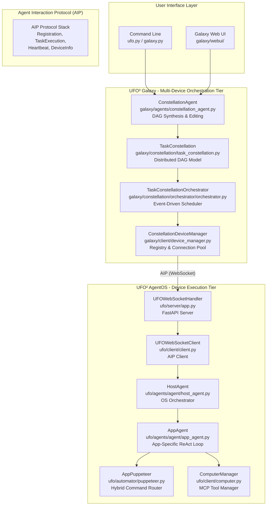
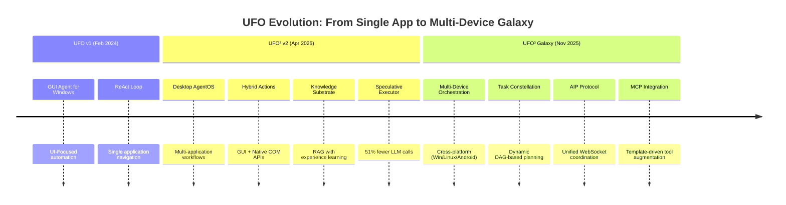
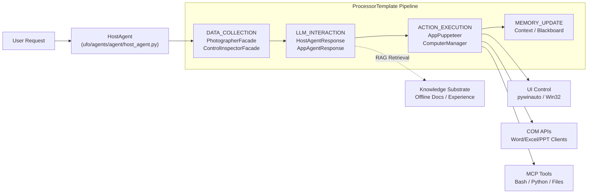

<!-- source: DeepWiki mcp.deepwiki.com · repo microsoft/UFO · page 1 Introduction to UFO · fetched 2026-10-26 -->

# Introduction to UFO

Relevant source files

The following files were used as context for generating this wiki page:

- [CONTRIBUTING.md](CONTRIBUTING.md)
- [DISCLAIMER.md](DISCLAIMER.md)
- [LICENSE](LICENSE)
- [README.md](README.md)
- [README_ZH.md](README_ZH.md)
- [assets/orchestrator.png](assets/orchestrator.png)
- [assets/overview_n.png](assets/overview_n.png)
- [assets/task_constellation.png](assets/task_constellation.png)
- [assets/ufo_blue.png](assets/ufo_blue.png)
- [documents/docs/choose_path.md](documents/docs/choose_path.md)
- [documents/docs/faq.md](documents/docs/faq.md)
- [documents/docs/galaxy/overview.md](documents/docs/galaxy/overview.md)
- [documents/docs/getting_started/more_guidance.md](documents/docs/getting_started/more_guidance.md)
- [documents/docs/getting_started/quick_start_galaxy.md](documents/docs/getting_started/quick_start_galaxy.md)
- [documents/docs/getting_started/quick_start_linux.md](documents/docs/getting_started/quick_start_linux.md)
- [documents/docs/getting_started/quick_start_ufo2.md](documents/docs/getting_started/quick_start_ufo2.md)
- [documents/docs/index.md](documents/docs/index.md)
- [documents/docs/project_directory_structure.md](documents/docs/project_directory_structure.md)
- [documents/mkdocs.yml](documents/mkdocs.yml)
- [galaxy/README.md](galaxy/README.md)
- [galaxy/README_ZH.md](galaxy/README_ZH.md)
- [ufo/README.md](ufo/README.md)
- [ufo/README_ZH.md](ufo/README_ZH.md)

## Purpose and Scope

This document provides a high-level introduction to the UFO³ ecosystem, a comprehensive framework for intelligent automation across devices and platforms. UFO³ consists of two complementary tiers: **UFO² Desktop AgentOS** for single-device Windows automation and **UFO³ Galaxy Framework** for multi-device orchestration. This introduction explains what UFO is, how its components relate, and when to use each tier.

For detailed information on specific components:
- **UFO² Desktop AgentOS architecture**: See [UFO² Desktop AgentOS](#3)
- **Galaxy multi-device orchestration**: See [UFO³ Galaxy Framework](#4)
- **Communication protocol between tiers**: See [Agent Interaction Protocol](#5)
- **Configuration and setup**: See [Configuration System](#6)

**Sources:** [README.md:1-154](), [documents/docs/index.md:1-120](), [galaxy/README.md:1-174]()

---

## What is UFO³?

**UFO³** is an open-source intelligent automation framework that enables natural language-driven task execution across heterogeneous devices and platforms. The framework implements a **two-tier architecture** separating orchestration (Galaxy) from execution (AgentOS).

### Two-Tier Architecture

The framework consists of two complementary tiers:

1. **UFO² Desktop AgentOS** - Single-device Windows automation with hybrid GUI+API execution. It acts as a standalone automation tool or a specialized Windows execution node. [ufo/README.md:74-82]()
2. **UFO³ Galaxy Framework** - A multi-device orchestration layer that transforms isolated agents into a unified digital ecosystem using Task Constellations. [galaxy/README.md:29-30]()

UFO² can operate standalone for Windows tasks or serve as a device agent within Galaxy for cross-platform workflows via the Agent Interaction Protocol (AIP). [README.md:148-148]()

### Key Technical Capabilities

| Capability | Implementation | Description |
|------------|----------------|-------------|
| **Declarative DAG Decomposition** | `ConstellationAgent` | Requests are decomposed into structured `TaskStar` nodes and `TaskStarLine` dependencies. [galaxy/README.md:68-69]() |
| **Hybrid Execution** | `Puppeteer` | Combines Windows UIA, Win32, and WinCOM for native command execution and GUI fallback. [ufo/README.md:46-48]() |
| **Speculative Multi-Action** | `Speculative Executor` | Bundles predicted steps into one LLM call, reducing queries by up to 51%. [ufo/README.md:50-52]() |
| **Knowledge Substrate** | `RAG System` | Integrates offline docs, Bing search, and user demos into a vector store for on-the-fly retrieval. [ufo/README.md:78-78]() |
| **Unified AIP Protocol** | `WebSocket-based` | Secure, fault-tolerant communication layer with heartbeats and auto-reconnection. [galaxy/README.md:115-124]() |

**Sources:** [README.md:125-138](), [ufo/README.md:43-82](), [galaxy/README.md:61-143]()

---

## The Two-Tier Architecture

### UFO³ Ecosystem Architecture: Galaxy (Orchestration) + AgentOS (Execution)

The following diagram bridges the Natural Language Space (User Intent) to the Code Entity Space (specific classes and files).

### Architectural Layers

| Layer | Responsibility | Key Code Entities |
|-------|----------------|-------------------|
| **Control Plane** | Global device registry and capability matching. | `ConstellationClient`, `AgentProfile`. [galaxy/README.md:186-187]() |
| **Planning Layer** | Decomposing intent into TaskStars and TaskStarLines. | `ConstellationAgent`, `TaskConstellation`. [galaxy/README.md:68-69]() |
| **Orchestration Layer** | Event-driven scheduling and safe concurrency control. | `TaskConstellationOrchestrator`, `ConstellationModificationSynchronizer`. [galaxy/README.md:101-106]() |
| **Communication Layer** | Unified WebSocket-based protocol (AIP). | `UFOWebSocketHandler`, `UFOWebSocketClient`. [README.md:135-135]() |
| **Execution Layer** | Platform-specific automation (GUI + API). | `HostAgent`, `AppAgent`, `AppPuppeteer`, `Computer`. [ufo/README.md:74-80]() |

**Sources:** [galaxy/README.md:169-201](), [ufo/README.md:68-82](), [documents/docs/galaxy/overview.md:32-85]()

---

## Evolution Timeline

UFO has evolved from a simple UI-focused agent to a comprehensive multi-device "Agent Galaxy".

**Sources:** [README.md:110-123](), [ufo/README.md:60-64](), [documents/docs/index.md:65-79]()

---

## UFO² Desktop AgentOS Overview

**UFO² Desktop AgentOS** is the stable execution tier for Windows. It operates using a hierarchical agent structure where a **HostAgent** manages the desktop environment and delegates specific application tasks to **AppAgents**.

### UFO² Internal Data Flow

This diagram shows how a natural language request is transformed into a sequence of code-driven actions within a single device.

**Key Features of UFO²:**
- **Hybrid Perception**: Uses `PhotographerFacade` for visual screenshots and `ControlInspectorFacade` for structural UI tree metadata. [ufo/README.md:52-52]()
- **Agent FSM**: Agents transition through states like `CONTINUE`, `CONFIRM`, and `FINISH` via the `AgentStateManager`. [ufo/README.md:76-76]()
- **Knowledge Substrate**: Implements RAG using `ExperienceSummarizer` and `RetrieverFactory` to learn from past trajectories. [ufo/README.md:78-78]()

**Sources:** [ufo/README.md:43-54](), [ufo/README.md:68-82](), [documents/docs/index.md:234-256]()

---

## UFO³ Galaxy Framework Overview

**UFO³ Galaxy** is the orchestration tier. It treats devices as "stars" in a "constellation". It is designed for cross-platform workflows (e.g., "Get logs from Linux, analyze in Excel on Windows").

### Galaxy Orchestration Principles

1. **Declarative Decomposition**: The `ConstellationAgent` decomposes requests into a `TaskConstellation` DAG. [galaxy/README.md:68-69]()
2. **Dynamic Adaptation**: The DAG is not static; it evolves in `Editing Mode` based on runtime feedback and intermediate results. [galaxy/README.md:82-93]()
3. **Asynchronous Parallelism**: The `TaskConstellationOrchestrator` uses event-driven scheduling to run independent `TaskStars` concurrently across multiple devices. [galaxy/README.md:97-108]()
4. **Safety & Consistency**: Uses `ConstellationModificationSynchronizer` to ensure atomic updates to the DAG during parallel execution. [galaxy/README.md:105-105]()

**Key Galaxy Components:**
- **TaskStar**: A node in the DAG representing a unit of work assigned to a specific `device_id`. [galaxy/README.md:68-69]()
- **Agent Interaction Protocol (AIP)**: A WebSocket-based protocol stack (`Registration`, `TaskExecution`, `Heartbeat`) for low-latency coordination. [galaxy/README.md:115-126]()
- **MCP-Empowered Agents**: Lightweight agents that use the Model Context Protocol to expose local tools (Bash, Filesystem) to the LLM. [galaxy/README.md:131-143]()

**Sources:** [galaxy/README.md:27-152](), [documents/docs/galaxy/overview.md:10-85](), [documents/docs/getting_started/quick_start_galaxy.md:5-8]()

---

## Comparison Matrix: UFO² vs. UFO³ Galaxy

| Aspect | UFO² Desktop AgentOS | UFO³ Galaxy |
|--------|----------------------|-------------|
| **Primary Scope** | Single Windows Device | Multi-Device / Cross-Platform |
| **Task Model** | Sequential ReAct Loop | DAG-based Constellation |
| **Coordination** | HostAgent + AppAgents | ConstellationAgent + TaskOrchestrator |
| **Parallelism** | Sequential | Parallel DAG Execution |
| **Device Support** | Windows 10/11 | Windows, Linux, Android, Web |
| **Communication** | Local Function Calls | AIP (WebSocket Protocol) |
| **Learning Curve** | Low | Moderate |
| **Status** | LTS (Stable) | Active Development |

**Sources:** [README.md:139-154](), [documents/docs/index.md:95-110](), [documents/docs/choose_path.md:49-61]()

---

