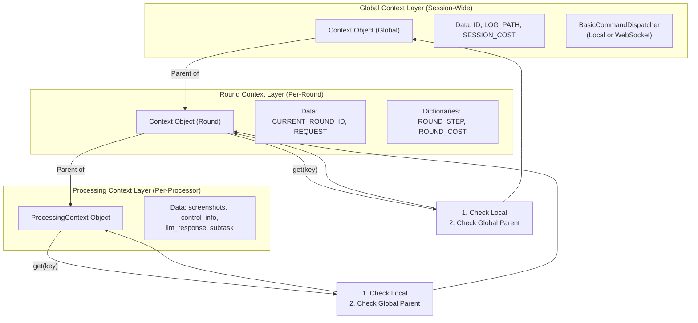
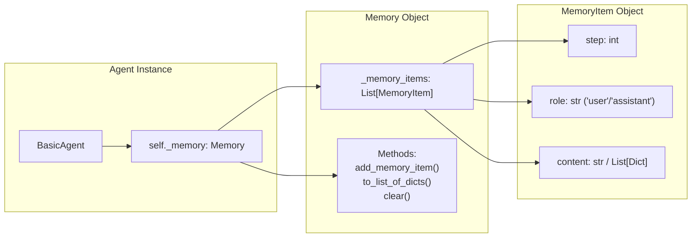
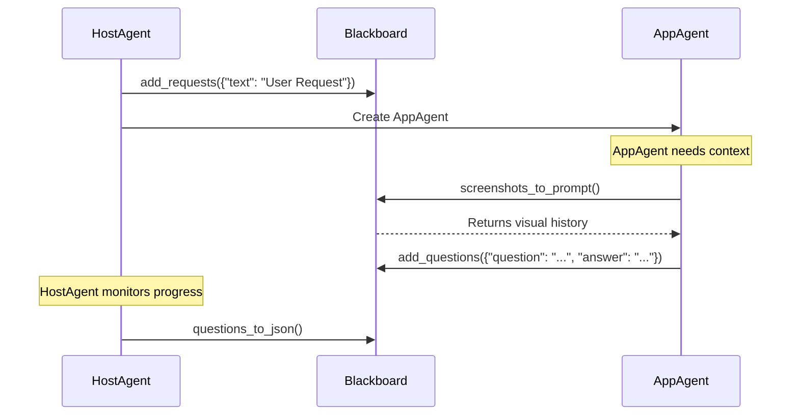

<!-- source: DeepWiki mcp.deepwiki.com · repo microsoft/UFO · page 10 Memory and Context Management · fetched 2026-10-26 -->

# Memory and Context Management

Relevant source files

The following files were used as context for generating this wiki page:

- [documents/docs/infrastructure/agents/design/blackboard.md](documents/docs/infrastructure/agents/design/blackboard.md)
- [documents/docs/infrastructure/agents/design/command.md](documents/docs/infrastructure/agents/design/command.md)
- [documents/docs/infrastructure/agents/design/memory.md](documents/docs/infrastructure/agents/design/memory.md)
- [documents/docs/infrastructure/agents/design/processor.md](documents/docs/infrastructure/agents/design/processor.md)
- [documents/docs/infrastructure/agents/design/prompter.md](documents/docs/infrastructure/agents/design/prompter.md)
- [documents/docs/infrastructure/agents/design/state.md](documents/docs/infrastructure/agents/design/state.md)
- [documents/docs/infrastructure/agents/design/strategy.md](documents/docs/infrastructure/agents/design/strategy.md)
- [ufo/agents/memory/blackboard.py](ufo/agents/memory/blackboard.py)
- [ufo/agents/memory/memory.py](ufo/agents/memory/memory.py)
- [ufo/agents/states/evaluaton_agent_state.py](ufo/agents/states/evaluaton_agent_state.py)
- [ufo/client/client.py](ufo/client/client.py)
- [ufo/client/mcp/http_servers/hardware_mcp_server.py](ufo/client/mcp/http_servers/hardware_mcp_server.py)
- [ufo/client/mcp/mcp_registry.py](ufo/client/mcp/mcp_registry.py)
- [ufo/client/mcp/mcp_server_manager.py](ufo/client/mcp/mcp_server_manager.py)
- [ufo/client/ufo_client.py](ufo/client/ufo_client.py)
- [ufo/client/websocket.py](ufo/client/websocket.py)
- [ufo/module/context.py](ufo/module/context.py)
- [ufo/module/dispatcher.py](ufo/module/dispatcher.py)
- [ufo/module/sessions/service_session.py](ufo/module/sessions/service_session.py)
- [ufo/server/app.py](ufo/server/app.py)
- [ufo/server/services/api.py](ufo/server/services/api.py)
- [ufo/server/services/client_connection_manager.py](ufo/server/services/client_connection_manager.py)
- [ufo/server/services/session_manager.py](ufo/server/services/session_manager.py)
- [ufo/server/ws/handler.py](ufo/server/ws/handler.py)

The Memory and Context Management subsystem provides the shared state infrastructure for UFO's multi-agent execution model. It implements three key patterns: hierarchical context layers for scoped data access via the `Context` class, agent memory for conversation history using the `Memory` and `MemoryItem` classes, and the blackboard pattern for cross-agent communication.

---

## Context Architecture

UFO implements a hierarchical context system with type-safe access keys and multiple scoped layers. The `Context` class serves as the primary data container, while the `ContextNames` enum provides compile-time guarantees for context key usage.

### Context Class and ContextNames Enum

The context system uses an enumeration-based key scheme in `ufo/module/context.py` to prevent typos and enable IDE autocomplete. The `ContextNames` enum defines keys for session, round, and agent-level data [ufo/module/context.py:24-73]().

**Type-Safe Context Keys (ContextNames)**

| Category | Enum Keys | Purpose |
|:---|:---|:---|
| **Session** | `ID`, `LOG_PATH`, `SESSION_COST`, `SESSION_STEP`, `MODE` | Global session identifiers and metrics [ufo/module/context.py:29-96]() |
| **Round** | `CURRENT_ROUND_ID`, `ROUND_STEP`, `ROUND_COST`, `ROUND_RESULT` | State tracking for the current execution round [ufo/module/context.py:41-57]() |
| **Application** | `APPLICATION_WINDOW`, `APPLICATION_PROCESS_NAME`, `APPLICATION_ROOT_NAME` | Handles for the targeted UI automation [ufo/module/context.py:44-65]() |
| **Agent** | `SUBTASK`, `PREVIOUS_SUBTASKS`, `HOST_MESSAGE`, `CONTROL_REANNOTATION` | Inter-agent communication and task state [ufo/module/context.py:33-50]() |
| **Galaxy** | `DEVICE_INFO`, `CONSTELLATION`, `WEAVING_MODE` | Multi-device orchestration context [ufo/module/context.py:70-72]() |

**Sources:** [ufo/module/context.py:24-136]()

### Hierarchical Context Layers

UFO implements three distinct context layers with clear ownership and lifetime semantics. The `Context` class maintains a `local_data` dictionary and a reference to a `global_context` [ufo/module/context.py:228-232]().

**Context Data Flow and Entity Association**

**Sources:** [ufo/module/context.py:228-268](), [ufo/module/basic.py:95-144]()

---

## Context Lifecycle Management

### Session-Level Context Initialization

The `BaseSession` class initializes the global context that persists for the entire session lifecycle [ufo/module/basic.py:557-586](). In service mode, `ServiceSession` specifically attaches a `WebSocketCommandDispatcher` to the context to enable remote execution [ufo/module/sessions/service_session.py:50-53]().

**Initialization in `ServiceSession`**

| Step | Code Entity | Action |
|:---|:---|:---|
| 1 | `super()._init_context()` | Base initialization of logs and IDs [ufo/module/sessions/service_session.py:47]() |
| 2 | `Context.set(ContextNames.MODE, "normal")` | Set execution mode [ufo/module/sessions/service_session.py:49]() |
| 3 | `WebSocketCommandDispatcher` | Create dispatcher with `TaskExecutionProtocol` [ufo/module/sessions/service_session.py:50-52]() |
| 4 | `Context.attach_command_dispatcher()` | Link dispatcher for agent use [ufo/module/sessions/service_session.py:53]() |

**Sources:** [ufo/module/sessions/service_session.py:43-53](), [ufo/module/basic.py:557-586]()

### Processing-Level Context Lifecycle

Processors create ephemeral local contexts that are merged back after processing. The `ProcessorTemplate` uses `_initialize_processing_context` to set up the local environment and `_finalize_processing_context` to promote results to the global scope [ufo/agents/processors/host_agent_processor.py:127-174]().

**Sources:** [ufo/agents/processors/app_agent_processor.py:106-120](), [ufo/agents/processors/host_agent_processor.py:127-174]()

---

## Agent Memory System

### Memory and MemoryItem Architecture

Each agent maintains a conversation history using the `Memory` class, which stores a list of `MemoryItem` objects [ufo/agents/memory/memory.py]().

**Memory Structure Diagram**

**Sources:** [ufo/agents/agent/basic.py:87-104](), [ufo/agents/memory/memory.py]()

### Memory Usage in Agent Lifecycle

Agents interact with memory at key points in their execution. The `MemoryUpdateStrategy` is responsible for appending new interactions to the agent's history after an action is executed [ufo/agents/processors/core/processor_framework.py]().

**Sources:** [ufo/agents/agent/basic.py:214-230](), [ufo/agents/memory/memory.py]()

---

## Blackboard Pattern for Cross-Agent Communication

### Blackboard Architecture

UFO implements the `Blackboard` class to store data and images that are visible to all agents, facilitating coordination between the `HostAgent` and its spawned `AppAgent` instances [ufo/agents/memory/blackboard.py:36-39]().

**Blackboard Data Stores**

| Store | Type | Purpose |
|:---|:---|:---|
| `_questions` | `Memory` | Q&A pairs for agent clarification [ufo/agents/memory/blackboard.py:45]() |
| `_requests` | `Memory` | History of user requests in the session [ufo/agents/memory/blackboard.py:46]() |
| `_trajectories` | `Memory` | Execution paths and logs [ufo/agents/memory/blackboard.py:47]() |
| `_screenshots` | `Memory` | Shared visual context (encoded as base64) [ufo/agents/memory/blackboard.py:48, 146]() |

**Sources:** [ufo/agents/memory/blackboard.py:41-48](), [ufo/agents/agent/basic.py:112-117]()

### Blackboard Communication Flow

AppAgents access the blackboard through their `host` reference, allowing them to read plans or write results that the `HostAgent` can then inspect [ufo/agents/agent/basic.py:112-117]().

**Entity Association: Agent to Blackboard**

**Sources:** [ufo/agents/memory/blackboard.py:109-137](), [ufo/agents/agent/basic.py:270-307]()

---

## Context and Memory Reference

### Key ContextNames Fields

| ContextName | Default Value | Type | Purpose |
|:---|:---|:---|:---|
| `ID` | `0` | `int` | Unique session identifier [ufo/module/context.py:95]() |
| `MODE` | `""` | `str` | Session mode (normal/follower) [ufo/module/context.py:85]() |
| `SESSION_COST` | `0.0` | `float` | Total LLM API cost for session [ufo/module/context.py:99]() |
| `ROUND_STEP` | `{}` | `dict` | Step counter per round ID [ufo/module/context.py:103]() |
| `APPLICATION_WINDOW`| `None` | `UIAWrapper`| Active UI handle [ufo/module/context.py:123]() |
| `TOOL_INFO` | `{}` | `dict` | Available MCP tools [ufo/module/context.py:106]() |

**Sources:** [ufo/module/context.py:75-136]()

---

