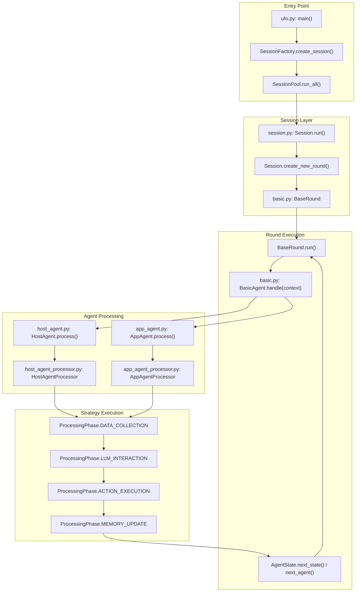
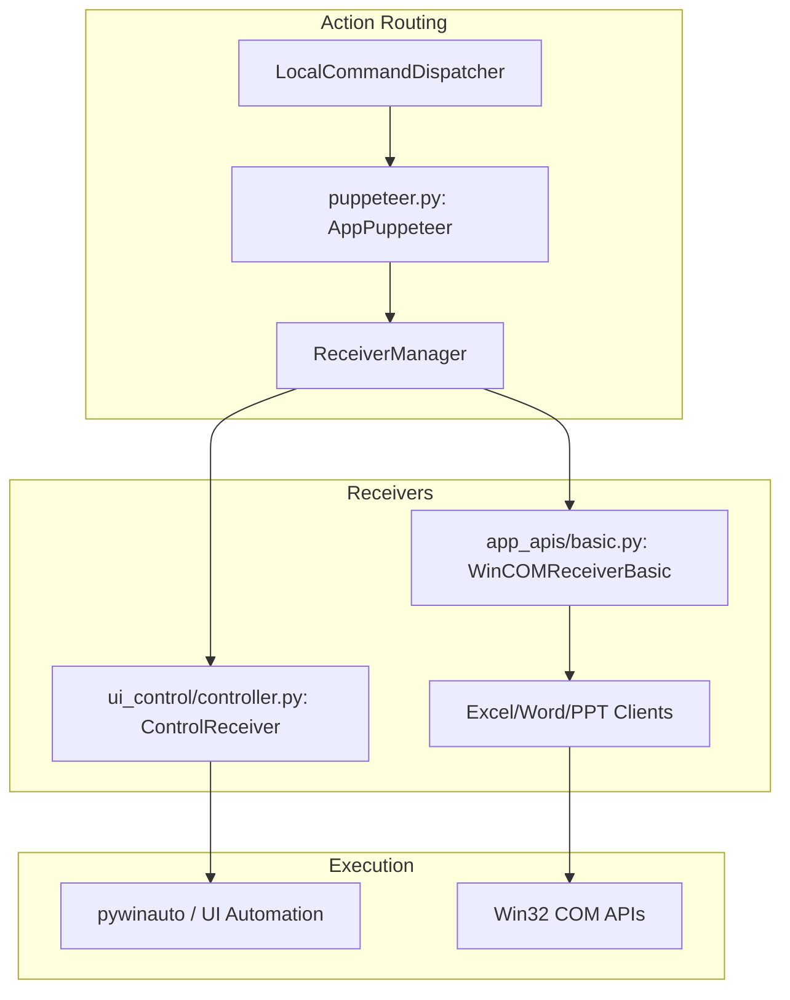

<!-- source: DeepWiki mcp.deepwiki.com · repo microsoft/UFO · page 11 Execution and Data Flow · fetched 2026-10-26 -->

# Execution and Data Flow

Relevant source files

The following files were used as context for generating this wiki page:

- [ufo/__main__.py](ufo/__main__.py)
- [ufo/agents/agent/app_agent.py](ufo/agents/agent/app_agent.py)
- [ufo/agents/agent/basic.py](ufo/agents/agent/basic.py)
- [ufo/agents/agent/evaluation_agent.py](ufo/agents/agent/evaluation_agent.py)
- [ufo/agents/agent/host_agent.py](ufo/agents/agent/host_agent.py)
- [ufo/agents/processors/app_agent_processor.py](ufo/agents/processors/app_agent_processor.py)
- [ufo/agents/processors/host_agent_processor.py](ufo/agents/processors/host_agent_processor.py)
- [ufo/agents/states/app_agent_state.py](ufo/agents/states/app_agent_state.py)
- [ufo/agents/states/basic.py](ufo/agents/states/basic.py)
- [ufo/agents/states/host_agent_state.py](ufo/agents/states/host_agent_state.py)
- [ufo/agents/states/operator_state.py](ufo/agents/states/operator_state.py)
- [ufo/automator/app_apis/basic.py](ufo/automator/app_apis/basic.py)
- [ufo/automator/app_apis/excel/excelclient.py](ufo/automator/app_apis/excel/excelclient.py)
- [ufo/automator/app_apis/factory.py](ufo/automator/app_apis/factory.py)
- [ufo/automator/app_apis/powerpoint/__init__.py](ufo/automator/app_apis/powerpoint/__init__.py)
- [ufo/automator/app_apis/powerpoint/powerpointclient.py](ufo/automator/app_apis/powerpoint/powerpointclient.py)
- [ufo/automator/app_apis/web/webclient.py](ufo/automator/app_apis/web/webclient.py)
- [ufo/automator/app_apis/word/wordclient.py](ufo/automator/app_apis/word/wordclient.py)
- [ufo/automator/basic.py](ufo/automator/basic.py)
- [ufo/automator/puppeteer.py](ufo/automator/puppeteer.py)
- [ufo/llm/llm_call.py](ufo/llm/llm_call.py)
- [ufo/llm/openai.py](ufo/llm/openai.py)
- [ufo/module/basic.py](ufo/module/basic.py)
- [ufo/module/sessions/plan_reader.py](ufo/module/sessions/plan_reader.py)
- [ufo/module/sessions/session.py](ufo/module/sessions/session.py)
- [ufo/rag/retriever.py](ufo/rag/retriever.py)
- [ufo/ufo.py](ufo/ufo.py)

This page documents the end-to-end execution and data flow in UFO, tracing how user requests are processed from initial input through context building, LLM interaction, action extraction, command execution, and feedback collection. The system implements a multi-phase pipeline that coordinates agent behavior, state transitions, and action execution.

For details on the specific entry points, see [Application Entry Points](#11.1). For the internal agent logic, see [Request Processing Pipeline](#11.2). For the command execution layer, see [Action Execution](#11.3). For the learning loop, see [Feedback and Learning](#11.4).

## Execution Flow Architecture

The UFO execution system implements a hierarchical pipeline that processes user requests through multiple layers: Session → Round → Agent → Processor → Strategy.

### High-Level Execution Flow

**Sources:** [ufo/ufo.py:51-74](), [ufo/module/basic.py:156-182](), [ufo/agents/processors/host_agent_processor.py:66-113](), [ufo/agents/processors/app_agent_processor.py:54-109]()

## Application Entry Points {#11.1}

The system starts through `ufo.py` which initializes sessions based on command-line arguments. The `SessionFactory` creates the appropriate session type (Normal, Follower, or Batch) based on the `--mode` flag.

| Argument | Description | Code Reference |
|----------|-------------|----------------|
| `--task` | Name of the current task for logging. | [ufo/ufo.py:10-16]() |
| `--mode` | 'normal', 'follower', 'batch_normal', or 'operator'. | [ufo/ufo.py:17-22]() |
| `--plan` | Path to plan file (required for follower/batch). | [ufo/ufo.py:23-29]() |
| `--request` | Direct string description of the user request. | [ufo/ufo.py:30-36]() |

For details, see [Application Entry Points](#11.1).

**Sources:** [ufo/ufo.py:9-42](), [ufo/module/sessions/session.py:41-61]()

## Request Processing Pipeline {#11.2}

Once a session starts, it enters a loop of `BaseRound` executions. Each round coordinates agent interactions using a State Machine pattern. Agents use `ProcessorTemplate` subclasses to execute a standardized four-phase pipeline:

1.  **DATA_COLLECTION**: Captures screenshots and UI control information via `PhotographerFacade` and `ControlInspectorFacade`.
2.  **LLM_INTERACTION**: Constructs prompts using `Prompter` classes and calls `llm_call.get_completion()`.
3.  **ACTION_EXECUTION**: Dispatches commands to the `AppPuppeteer` or `Computer` tool system.
4.  **MEMORY_UPDATE**: Synchronizes the agent's `Memory` and the `Blackboard`.

For details, see [Request Processing Pipeline](#11.2).

**Sources:** [ufo/agents/processors/app_agent_processor.py:65-73](), [ufo/agents/processors/host_agent_processor.py:95-113](), [ufo/module/basic.py:156-182]()

## Action Execution {#11.3}

Actions decided by the LLM are routed through a `CommandDispatcher`. In local mode, the `LocalCommandDispatcher` uses `AppPuppeteer` to manage application-specific receivers.

For details, see [Action Execution](#11.3).

**Sources:** [ufo/automator/puppeteer.py:22-56](), [ufo/module/dispatcher.py](), [ufo/automator/ui_control/controller.py]()

## Feedback and Learning {#11.4}

At the end of a session, UFO can summarize the trajectory into "Experiences". The `ExperienceSummarizer` processes logs and screenshots to create indexed knowledge for the RAG system.

| Component | Role | Code Reference |
|-----------|------|----------------|
| `ExperienceSummarizer` | Uses LLM to summarize a round's success/failure. | [ufo/experience/summarizer.py]() |
| `Trajectory` | Parses raw logs into a structured sequence of actions. | [ufo/trajectory/parser.py]() |
| `RetrieverFactory` | Indexes experiences into FAISS for future retrieval. | [ufo/rag/retriever.py]() |

For details, see [Feedback and Learning](#11.4).

**Sources:** [ufo/module/sessions/session.py:76-92](), [ufo/module/basic.py:719-748]()

## Snapshot and Artifact Capture

The system captures visual and structural snapshots at key points to facilitate debugging and evaluation.

| Artifact | Format | Purpose | Source |
|----------|--------|---------|--------|
| UI trees | JSON | Structural inspection of the application state. | [ufo/module/basic.py:303-377]() |
| Screenshots | PNG | Visual feedback for the LLM and user logs. | [ufo/module/basic.py:893-973]() |
| Trajectory | MD | A human-readable summary of the session steps. | [ufo/trajectory/parser.py]() |

**Sources:** [ufo/module/basic.py:177-180](), [ufo/module/basic.py:303-377]()

---

