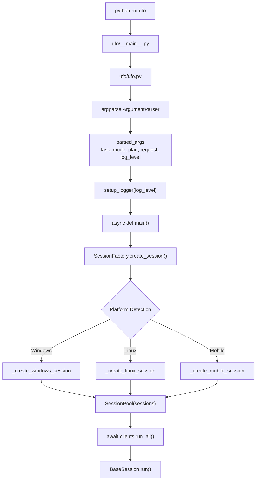
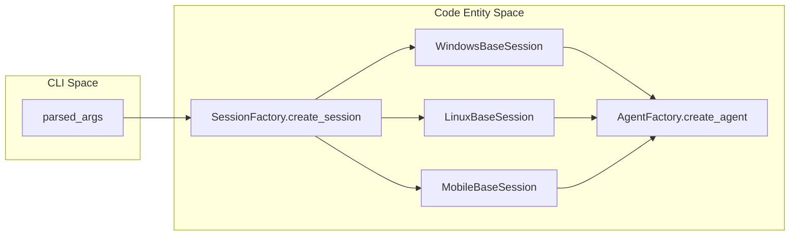
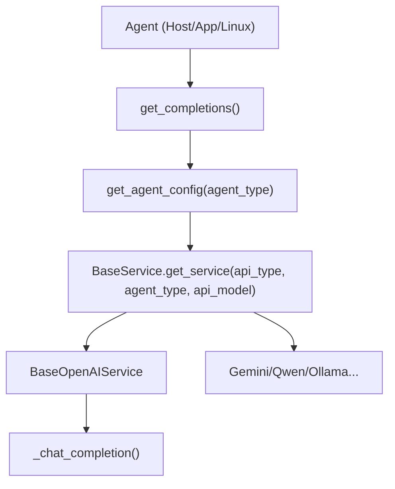

<!-- source: DeepWiki mcp.deepwiki.com · repo microsoft/UFO · page 11.1 Application Entry Points · fetched 2026-10-26 -->

# Application Entry Points

<details>
<summary>Relevant source files</summary>

The following files were used as context for generating this wiki page:

- [ufo/__main__.py](ufo/__main__.py)
- [ufo/agents/agent/customized_agent.py](ufo/agents/agent/customized_agent.py)
- [ufo/agents/processors/strategies/linux_agent_strategy.py](ufo/agents/processors/strategies/linux_agent_strategy.py)
- [ufo/client/mcp/http_servers/linux_mcp_server.py](ufo/client/mcp/http_servers/linux_mcp_server.py)
- [ufo/llm/llm_call.py](ufo/llm/llm_call.py)
- [ufo/llm/openai.py](ufo/llm/openai.py)
- [ufo/module/session_pool.py](ufo/module/session_pool.py)
- [ufo/module/sessions/linux_session.py](ufo/module/sessions/linux_session.py)
- [ufo/module/sessions/platform_session.py](ufo/module/sessions/platform_session.py)
- [ufo/rag/retriever.py](ufo/rag/retriever.py)
- [ufo/ufo.py](ufo/ufo.py)

</details>


## Purpose and Scope

Application entry points define how UFO and Galaxy are launched, configured, and initialized. This page documents the main entry point modules (`ufo.py` and `__main__.py`), command-line argument parsing, mode selection, session initialization via the `SessionFactory`, and the async execution model that orchestrates agent execution through the `SessionPool`.

UFO supports multiple operational modes and platforms (Windows, Linux, Mobile) accessible through command-line arguments. The entry points handle argument validation, logger initialization, and the transition from a CLI request to a stateful session.

## Entry Point Architecture

UFO provides a unified entry point for the Desktop AgentOS layer. The execution flow transitions from a synchronous CLI call to an asynchronous multi-session environment.

**UFO Entry Point Flow**



*Sources: [ufo/__main__.py:1-9](), [ufo/ufo.py:9-80](), [ufo/module/session_pool.py:72-112]()*

The entry point uses Python's async execution model with `asyncio.run(main())` to handle concurrent agent operations and I/O-bound tasks like LLM API calls efficiently.

## UFO Entry Point: ufo.py

The `ufo.py` module is the primary CLI implementation. It defines the arguments and the high-level logic for session orchestration.

### Command-Line Arguments

| Argument | Short | Type | Default | Description |
|----------|-------|------|---------|-------------|
| `--task` | `-t` | string | timestamp | Task name/identifier used for logging and result organization. [ufo/ufo.py:10-16]() |
| `--mode` | `-m` | string | `"normal"` | Execution mode: `normal`, `follower`, `batch_normal`, `operator`, or `service`. [ufo/ufo.py:17-22]() |
| `--plan` | `-p` | string | `""` | Path to plan file/folder (required for `follower` and `batch_normal` modes). [ufo/ufo.py:24-29]() |
| `--request` | `-r` | string | `""` | Task description. If empty, UFO prompts the user. [ufo/ufo.py:31-36]() |
| `--log-level` | | string | `"WARNING"` | Logging level (DEBUG, INFO, WARNING, ERROR, CRITICAL). [ufo/ufo.py:37-42]() |

*Sources: [ufo/ufo.py:9-45]()*

### SessionFactory Implementation

The `SessionFactory` is a creational pattern that abstracts the complexity of cross-platform session initialization. It detects the operating system using `platform.system().lower()` and routes to specialized creation methods.

| Method | Platform | Supported Modes |
|--------|----------|-----------------|
| `_create_windows_session` | Windows | `normal`, `service`, `follower`, `batch_normal`, `operator` |
| `_create_linux_session` | Linux | `normal`, `service` |
| `_create_mobile_session` | Mobile | `normal`, `service` |

*Sources: [ufo/module/session_pool.py:101-112](), [ufo/module/session_pool.py:114-179](), [ufo/module/session_pool.py:180-217]()*

**Data Flow: CLI to Session Object**



*Sources: [ufo/module/session_pool.py:80-112](), [ufo/module/sessions/platform_session.py:27-40](), [ufo/module/sessions/platform_session.py:56-72]()*

### SessionPool Execution

The `SessionPool` manages a list of `BaseSession` objects. It provides a `run_all()` method that iterates through the sessions and executes them.

```python
class SessionPool:
    async def run_all(self) -> None:
        for session in self.session_list:
            await session.run()
```

*Sources: [ufo/module/session_pool.py:29-47]()*

While the current implementation executes sessions sequentially in a loop, the use of `async` allows individual sessions to perform non-blocking operations (like LLM requests) internally.

## Platform-Specific Entry Logic

UFO handles different platforms by varying the agent hierarchy initialized within the session.

### Windows Sessions
Windows sessions utilize a two-tier architecture. The `WindowsBaseSession` initializes a `HostAgent` as the primary orchestrator.
*   **Agent**: `HostAgent` (created via `AgentFactory`).
*   **Role**: Desktop-level planning and application switching.
*   *Sources: [ufo/module/sessions/platform_session.py:20-40]()*

### Linux and Mobile Sessions
Linux and Mobile sessions use a single-tier architecture, working directly with specialized application agents.
*   **Linux Agent**: `LinuxAgent` (initialized in `LinuxBaseSession`).
*   **Mobile Agent**: `MobileAgent` (initialized in `MobileBaseSession`).
*   **Orchestration**: These sessions do not use a `HostAgent`. They create rounds directly for the specialized agent.
*   *Sources: [ufo/module/sessions/platform_session.py:49-72](), [ufo/module/sessions/platform_session.py:98-124]()*

## LLM Service Initialization

During the entry point execution, agents are initialized with specific LLM configurations. This is facilitated by the `BaseService` factory and `get_completions` facade.

**LLM Integration Flow**



*Sources: [ufo/llm/llm_call.py:34-98](), [ufo/llm/openai.py:28-62]()*

The `BaseOpenAIService` performs a "startup probe" during initialization to check if the configured model supports Structured JSON Output (`json_schema`). If the probe fails with a `BadRequestError`, it automatically falls back to text mode.

*Sources: [ufo/llm/openai.py:65-91]()*

## Summary of Entry Point Files

| File Path | Role | Key Functions/Classes |
|-----------|------|-----------------------|
| `ufo/__main__.py` | Python module execution hook | Calls `ufo.main()` |
| `ufo/ufo.py` | CLI Argument definition and `main` loop | `main()`, `argparse` setup |
| `ufo/module/session_pool.py` | Session creation and management | `SessionFactory`, `SessionPool` |
| `ufo/module/sessions/platform_session.py` | Platform-specific agent setup | `WindowsBaseSession`, `LinuxBaseSession`, `MobileBaseSession` |
| `ufo/llm/llm_call.py` | LLM interaction entry point | `get_completion()`, `get_completions()` |

*Sources: [ufo/__main__.py:1-9](), [ufo/ufo.py:1-80](), [ufo/module/session_pool.py:1-217](), [ufo/module/sessions/platform_session.py:1-147](), [ufo/llm/llm_call.py:1-112]()*

---

