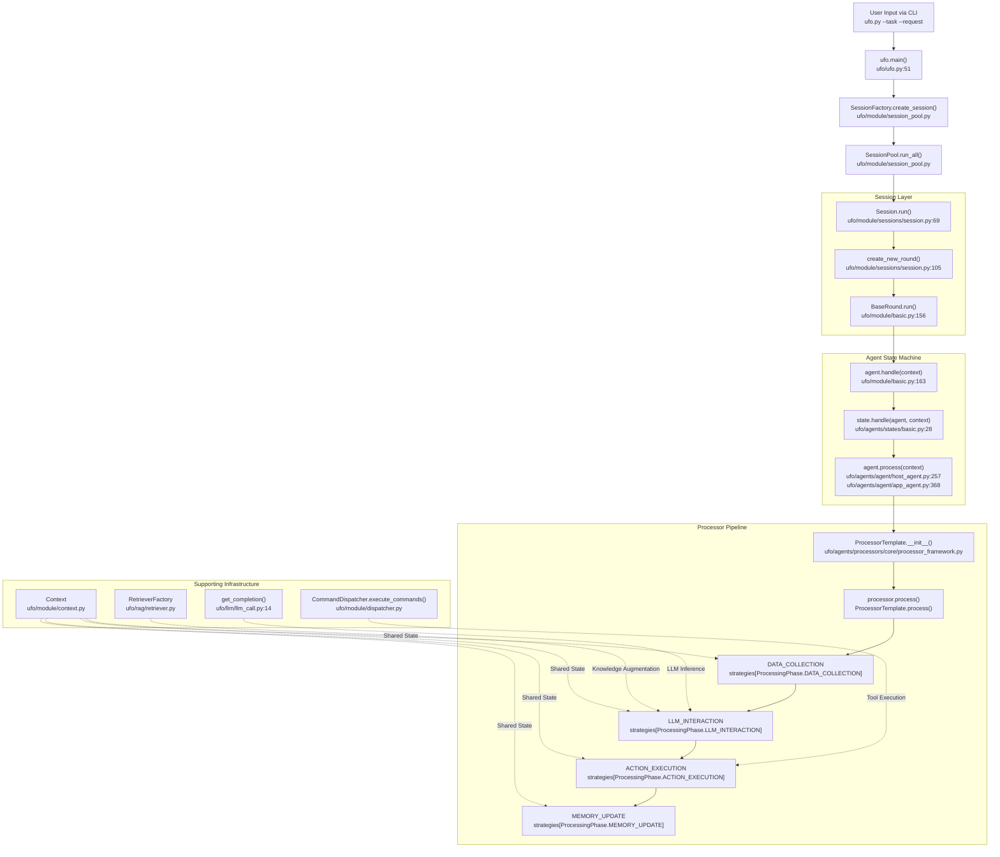
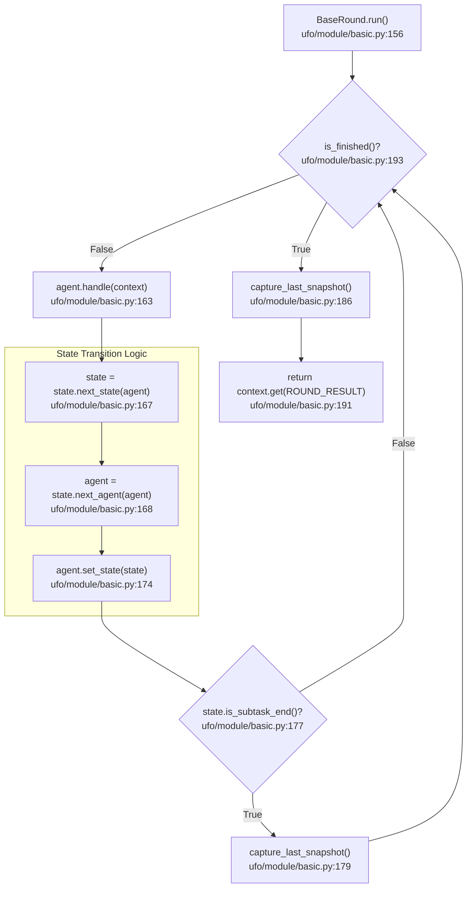
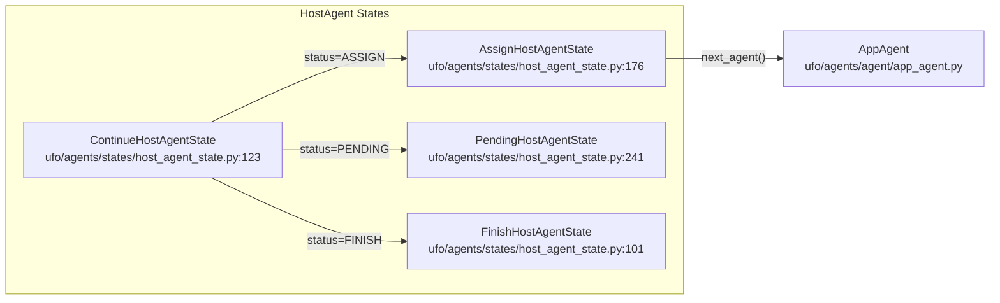

<!-- source: DeepWiki mcp.deepwiki.com · repo microsoft/UFO · page 11.2 Request Processing Pipeline · fetched 2026-10-26 -->

# Request Processing Pipeline

Relevant source files

The following files were used as context for generating this wiki page:

- [ufo/__main__.py](ufo/__main__.py)
- [ufo/agents/agent/app_agent.py](ufo/agents/agent/app_agent.py)
- [ufo/agents/agent/basic.py](ufo/agents/agent/basic.py)
- [ufo/agents/agent/evaluation_agent.py](ufo/agents/agent/evaluation_agent.py)
- [ufo/agents/agent/host_agent.py](ufo/agents/agent/host_agent.py)
- [ufo/agents/processors/app_agent_processor.py](ufo/agents/processors/app_agent_processor.py)
- [ufo/agents/processors/host_agent_processor.py](ufo/agents/processors/host_agent_processor.py)
- [ufo/agents/states/app_agent_state.py](ufo/agents/states/app_agent_state.py)
- [ufo/agents/states/basic.py](ufo/agents/states/basic.py)
- [ufo/agents/states/host_agent_state.py](ufo/agents/states/host_agent_state.py)
- [ufo/agents/states/operator_state.py](ufo/agents/states/operator_state.py)
- [ufo/llm/llm_call.py](ufo/llm/llm_call.py)
- [ufo/llm/openai.py](ufo/llm/openai.py)
- [ufo/module/basic.py](ufo/module/basic.py)
- [ufo/module/sessions/plan_reader.py](ufo/module/sessions/plan_reader.py)
- [ufo/module/sessions/session.py](ufo/module/sessions/session.py)
- [ufo/rag/retriever.py](ufo/rag/retriever.py)
- [ufo/trajectory/parser.py](ufo/trajectory/parser.py)
- [ufo/ufo.py](ufo/ufo.py)

## Purpose and Scope

This document describes the end-to-end request processing pipeline in UFO², tracing the flow from user input through session creation, round execution, agent state transitions, and the four-phase processor pipeline. The architecture utilizes a Strategy-Processor pattern to transform natural language requests into executable UI automation or API commands.

For details on how actions are executed after extraction, see [Action Execution](#11.3). For session lifecycle management, see [Session and Round Management](#3.2).

## Pipeline Architecture Overview

The request processing pipeline transforms natural language requests into executable commands through a hierarchical flow: Session → Round → Agent → Processor → Processing Phases.

**Pipeline Architecture: Session → Round → Agent → Processor → Strategies**

**Sources**: [ufo/ufo.py:51-74](), [ufo/module/basic.py:156-181](), [ufo/agents/processors/host_agent_processor.py:66-112](), [ufo/agents/processors/app_agent_processor.py:54-104](), [ufo/agents/agent/basic.py:251-262]()

## Session and Round Lifecycle

The processing pipeline begins with the `Session`, which manages the overall task, and `BaseRound`, which manages a single request/interaction cycle.

### Session Initialization

The entry point is `ufo/ufo.py:51` where `main()` parses arguments and uses `SessionFactory` to create session objects.

| Session Type | File Path | Purpose |
|-------------|-----------|---------|
| `Session` | [ufo/module/sessions/session.py:41]() | Standard interactive session using `interactor.first_request()` [ufo/module/sessions/session.py:144](). |
| `FollowerSession` | [ufo/module/sessions/session.py:160]() | Executes tasks based on a pre-defined plan file via `PlanReader`. |

**Sources**: [ufo/ufo.py:51-81](), [ufo/module/sessions/session.py:41-254]()

### Round Execution Flow

A `BaseRound` executes a loop until `is_finished()` returns true. In each iteration, it calls the agent's `handle` method and transitions states.

**Round Execution: BaseRound.run() Flow**

**Sources**: [ufo/module/basic.py:156-191](), [ufo/agents/states/basic.py:28-40]()

## Agent Processing Pipeline

When an agent's `process()` method is called, it instantiates a `ProcessorTemplate` (e.g., `HostAgentProcessor` or `AppAgentProcessor`) which coordinates the execution strategies.

### Processor Initialization

Processors define their strategies and middleware during initialization:
- **HostAgentProcessor**: Uses `DesktopDataCollectionStrategy`, `HostLLMInteractionStrategy`, `HostActionExecutionStrategy`, and `HostMemoryUpdateStrategy` [ufo/agents/processors/host_agent_processor.py:95-112]().
- **AppAgentProcessor**: Uses a `ComposedStrategy` for data collection (Screenshot + Control Info), `AppLLMInteractionStrategy`, `AppActionExecutionStrategy`, and `AppMemoryUpdateStrategy` [ufo/agents/processors/app_agent_processor.py:82-109]().

### The Four-Phase Pipeline

The `ProcessorTemplate.process()` method executes the following phases:

#### 1. DATA_COLLECTION
The strategy collects environment state. For `HostAgent`, this involves desktop screenshots and window listing [ufo/agents/processors/strategies/host_agent_processing_strategy.py](). For `AppAgent`, it captures the application window and inspects UI controls [ufo/agents/processors/strategies/app_agent_processing_strategy.py]().

#### 2. LLM_INTERACTION
The processor calls the agent's `message_constructor` to build the prompt.
- **HostAgent**: Constructs messages with `image_list`, `os_info`, `plan`, and `request` [ufo/agents/agent/host_agent.py:219-255]().
- **AppAgent**: Includes `control_info`, `dynamic_knowledge` (from RAG), and `subtask` [ufo/agents/agent/app_agent.py:104-163]().

The LLM call is routed through `ufo/llm/llm_call.py:14` which uses `BaseService.get_service()` to select the provider (OpenAI, Gemini, etc.) [ufo/llm/llm_call.py:93]().

#### 3. ACTION_EXECUTION
The LLM response is parsed into a structured format (e.g., `HostAgentResponse` or `AppAgentResponse`). The processor then extracts the `function` and `arguments` to create `Command` objects, which are executed via the `CommandDispatcher` [ufo/agents/processors/strategies/app_agent_processing_strategy.py]().

#### 4. MEMORY_UPDATE
The final phase updates the agent's internal memory and the global `Blackboard` with the results of the action and any new information learned during the step [ufo/agents/processors/strategies/app_agent_processing_strategy.py]().

**Sources**: [ufo/agents/processors/core/processor_framework.py](), [ufo/agents/processors/host_agent_processor.py:66-112](), [ufo/agents/processors/app_agent_processor.py:54-109](), [ufo/agents/agent/host_agent.py:219-255](), [ufo/agents/agent/app_agent.py:104-163](), [ufo/llm/llm_call.py:14-111]()

## Agent State Machine Transitions

Agents transition between states (defined in `ufo/agents/states/`) based on the `status` returned by the processor.

**State Transition Example (HostAgent)**

**Sources**: [ufo/agents/states/host_agent_state.py:101-241](), [ufo/agents/states/app_agent_state.py:128-218]()

## Middleware and Logging

The pipeline is wrapped in a middleware chain (e.g., `AppAgentLoggingMiddleware`) that provides structured logging and performance monitoring.
- `before_process`: Logs the start of a round/step with Rich panels [ufo/agents/processors/app_agent_processor.py:148-182]().
- `after_process`: Logs execution summaries and cost [ufo/agents/processors/app_agent_processor.py:204-225]().

**Sources**: [ufo/agents/processors/app_agent_processor.py:132-253](), [ufo/agents/processors/core/processing_middleware.py]()

---

