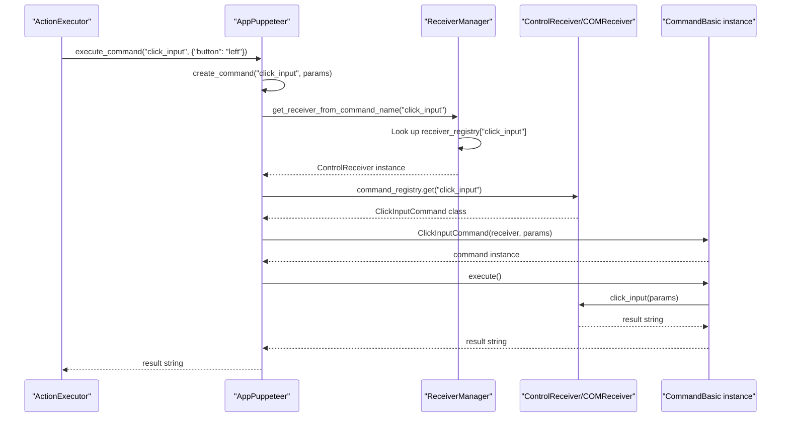

<!-- source: DeepWiki mcp.deepwiki.com · repo microsoft/UFO · page 11.3 Action Execution · fetched 2026-10-26 -->

# Action Execution

<details>
<summary>Relevant source files</summary>

The following files were used as context for generating this wiki page:

- [ufo/automator/action_execution.py](ufo/automator/action_execution.py)
- [ufo/automator/app_apis/basic.py](ufo/automator/app_apis/basic.py)
- [ufo/automator/app_apis/excel/excelclient.py](ufo/automator/app_apis/excel/excelclient.py)
- [ufo/automator/app_apis/factory.py](ufo/automator/app_apis/factory.py)
- [ufo/automator/app_apis/powerpoint/__init__.py](ufo/automator/app_apis/powerpoint/__init__.py)
- [ufo/automator/app_apis/powerpoint/powerpointclient.py](ufo/automator/app_apis/powerpoint/powerpointclient.py)
- [ufo/automator/app_apis/web/webclient.py](ufo/automator/app_apis/web/webclient.py)
- [ufo/automator/app_apis/word/wordclient.py](ufo/automator/app_apis/word/wordclient.py)
- [ufo/automator/basic.py](ufo/automator/basic.py)
- [ufo/automator/puppeteer.py](ufo/automator/puppeteer.py)
- [ufo/automator/ui_control/controller.py](ufo/automator/ui_control/controller.py)
- [ufo/automator/ui_control/screenshot.py](ufo/automator/ui_control/screenshot.py)
- [ufo/client/mcp/local_servers/__init__.py](ufo/client/mcp/local_servers/__init__.py)
- [ufo/client/mcp/local_servers/excel_wincom_mcp_server.py](ufo/client/mcp/local_servers/excel_wincom_mcp_server.py)
- [ufo/client/mcp/local_servers/ppt_wincom_mcp_server.py](ufo/client/mcp/local_servers/ppt_wincom_mcp_server.py)
- [ufo/client/mcp/local_servers/word_wincom_mcp_server.py](ufo/client/mcp/local_servers/word_wincom_mcp_server.py)
- [ufo/utils/__init__.py](ufo/utils/__init__.py)

</details>


Action Execution is the phase where LLM action decisions are translated into concrete operations on applications. This page details the flow from LLM responses through Puppeteer command creation, receiver routing, and actual execution via UI automation (pywinauto) or COM API calls.

UFO implements a **Command Pattern** architecture where `AppPuppeteer` orchestrates command execution through a `ReceiverManager` that routes commands to appropriate receivers (`ControlReceiver` for UI automation, `WinCOMReceiverBasic` subclasses for COM APIs). This abstraction enables hybrid automation strategies where agents can choose between UI control and programmatic API access.

For upstream processing that generates actions, see page 3.1. For MCP tool execution, see page 3.10.

## Puppeteer Architecture

The `AppPuppeteer` class orchestrates application automation by managing a command queue and delegating execution to specialized receivers through the `ReceiverManager`.

**Diagram: Puppeteer Command Orchestration**

```mermaid
flowchart TB
    subgraph "AppPuppeteer"
        direction TB
        [CmdQueue] --> [command_queue: Deque[CommandBasic]]
        [RecvMgr] --> [receiver_manager: ReceiverManager]
        
        [create_command(command_name, params)] --> [CreateCmd]
        [execute_command(command_name, params)] --> [ExecuteCmd]
        [add_command(command_name, params)] --> [AddCmd]
        [execute_all_commands()] --> [ExecuteAll]
    end
    
    subgraph "ReceiverManager"
        direction TB
        [RecvRegistry] --> [receiver_registry: Dict[str, ReceiverBasic]]
        [UICtrlRecv] --> [ui_control_receiver: ControlReceiver]
        [RecvList] --> [_receiver_list: List[ReceiverBasic]]
        
        [create_ui_control_receiver(control, application)] --> [CreateUIRecv]
        [create_api_receiver(app_root_name, process_name)] --> [CreateAPIRecv]
        [get_receiver_from_command_name(command_name)] --> [GetRecv]
    end
    
    subgraph "Receivers"
        direction LR
        [CtrlRecv] --> [ControlReceiver]
        [ExcelRecv] --> [ExcelWinCOMReceiver]
        [WordRecv] --> [WordWinCOMReceiver]
        [PPTRecv] --> [PowerPointWinCOMReceiver]
        [WebRecv] --> [WebReceiver]
    end
    
    [CreateCmd] --> [GetRecv]
    [GetRecv] --> [RecvRegistry]
    [RecvRegistry] --> [CtrlRecv]
    [RecvRegistry] --> [ExcelRecv]
    [RecvRegistry] --> [WordRecv]
    [RecvRegistry] --> [PPTRecv]
    [RecvRegistry] --> [WebRecv]
    
    [CreateUIRecv] --> [UICtrlRecv]
    [CreateAPIRecv] --> [RecvList]
    [UICtrlRecv] --> [RecvList]
    [RecvList] --> [RecvRegistry]
    
    [ExecuteCmd] --> [CreateCmd]
    [AddCmd] --> [CreateCmd]
    [AddCmd] --> [CmdQueue]
    [ExecuteAll] --> [CmdQueue]
```

**Sources:** [ufo/automator/puppeteer.py:22-183](), [ufo/automator/puppeteer.py:185-309]()

### AppPuppeteer Responsibilities

The `AppPuppeteer` class [ufo/automator/puppeteer.py:22-37]() provides the following capabilities:

| Method | Purpose |
|--------|---------|
| `create_command(command_name, params)` | Creates a `CommandBasic` instance by querying the receiver's command registry [ufo/automator/puppeteer.py:39-56]() |
| `execute_command(command_name, params)` | Creates and immediately executes a command, returning the result [ufo/automator/puppeteer.py:73-85]() |
| `add_command(command_name, params)` | Adds a command to the queue for batch execution [ufo/automator/puppeteer.py:99-108]() |
| `execute_all_commands()` | Executes all queued commands and clears the queue [ufo/automator/puppeteer.py:87-97]() |
| `list_commands()` | Returns the set of all available command names across receivers [ufo/automator/puppeteer.py:110-120]() |
| `get_command_types(command_name)` | Returns the receiver type (e.g., "UIControl", "COM/WORD") for a command [ufo/automator/puppeteer.py:58-71]() |

### ReceiverManager and Receiver Registry

The `ReceiverManager` [ufo/automator/puppeteer.py:185-190]() maintains a registry mapping command names to receivers. During initialization:

1. UI control receiver is created via `create_ui_control_receiver(control, application)` [ufo/automator/puppeteer.py:202-220]()
2. API receivers are created via `create_api_receiver(app_root_name, process_name)` [ufo/automator/puppeteer.py:222-243]() by iterating through registered factory classes.
3. The `receiver_registry` is updated to map each command name to its owning receiver [ufo/automator/puppeteer.py:245-254]().

### Receiver Factory Registration

Receiver factories are registered using the `@ReceiverManager.register` decorator [ufo/automator/app_apis/factory.py:32-33]():

```python
@ReceiverManager.register
class COMReceiverFactory(APIReceiverFactory):
    def create_receiver(self, app_root_name: str, process_name: str):
        # Maps app_root_name to appropriate WinCOMReceiver subclass
        # e.g., "WINWORD.EXE" -> WordWinCOMReceiver
```

The factory pattern enables dynamic receiver instantiation based on the target application's executable name [ufo/automator/app_apis/factory.py:38-55]().

**Sources:** [ufo/automator/app_apis/factory.py:32-94]()

## Command Pattern Implementation

UFO implements the Command Pattern through abstract `CommandBasic` and `ReceiverBasic` classes. Each receiver maintains a command registry that maps command names to command classes.

### CommandBasic Abstract Interface

```python
class CommandBasic(ABC):
    def __init__(self, receiver: ReceiverBasic, params: Dict = None):
        self.receiver = receiver
        self.params = params if params is not None else {}
    
    @abstractmethod
    def execute(self):
        """Execute the command."""
        pass
```

Commands encapsulate both the action to perform and the receiver that will perform it [ufo/automator/basic.py:68-86]().

### ReceiverBasic and Command Registration

Receivers register their supported commands using a class decorator pattern [ufo/automator/basic.py:53-60]():

```python
class ReceiverBasic(ABC):
    _command_registry: Dict[str, Type[CommandBasic]] = {}
    
    @classmethod
    def register(cls, command_class: Type[CommandBasic]):
        """Decorator to register command classes."""
        cls._command_registry[command_class.name()] = command_class
        return command_class
```

Example command registration for PowerPoint [ufo/automator/app_apis/powerpoint/powerpointclient.py:153-154]():

```python
@PowerPointWinCOMReceiver.register
class SetBackgroundColorCommand(WinCOMCommand):
    def execute(self):
        return self.receiver.set_background_color(...)
```

**Sources:** [ufo/automator/basic.py:10-66](), [ufo/automator/app_apis/powerpoint/powerpointclient.py:153-174]()

### Command Creation Flow

**Diagram: Command Creation and Execution**



**Sources:** [ufo/automator/puppeteer.py:39-86](), [ufo/automator/action_execution.py:85-134]()

## Receiver Routing and Selection

The `ReceiverManager` routes commands to receivers based on command name lookup. Multiple receivers can coexist, each handling different command types.

### Receiver Types and Command Mapping

| Receiver Type | Factory Class | Supported Commands | Registration Condition |
|---------------|---------------|-------------------|------------------------|
| `ControlReceiver` | `UIControlReceiverFactory` | `click_input`, `set_edit_text`, `keyboard_input`, `wheel_mouse_input`, etc. | Always created for UI automation [ufo/automator/puppeteer.py:202-220]() |
| `ExcelWinCOMReceiver` | `COMReceiverFactory` | `table2markdown`, `insert_excel_table`, `select_table_range`, `reorder_columns` | `app_root_name == "EXCEL.EXE"` [ufo/automator/app_apis/factory.py:64-71]() |
| `WordWinCOMReceiver` | `COMReceiverFactory` | `insert_table`, `select_text`, `select_paragraph`, `set_font`, `save_as` | `app_root_name == "WINWORD.EXE"` [ufo/automator/app_apis/factory.py:64-71]() |
| `PowerPointWinCOMReceiver` | `COMReceiverFactory` | `set_background_color`, `save_as` | `app_root_name == "POWERPNT.EXE"` [ufo/automator/app_apis/factory.py:64-71]() |
| `WebReceiver` | `WebReceiverFactory` | `web_crawler`, `navigate_to_url`, `get_page_content` | `app_root_name in ["msedge.exe", "chrome.exe"]` [ufo/automator/app_apis/factory.py:123]() |

**Sources:** [ufo/automator/app_apis/factory.py:19-161](), [ufo/automator/ui_control/controller.py:45-138]()

### ReceiverManager Initialization Flow

**Diagram: ReceiverManager Initialization**

```mermaid
flowchart TB
    [Init] --> [ReceiverManager.__init__()]
    [Init] --> [CreateUI] --> [create_ui_control_receiver(control, application)]
    [Init] --> [CreateAPI] --> [create_api_receiver(app_root_name, process_name)]
    
    [CreateUI] --> [UIFactory] --> [UIControlReceiverFactory.create_receiver()]
    [UIFactory] --> [UICtrlRecv] --> [ControlReceiver(control, application)]
    [UICtrlRecv] --> [UICtrlRecv_Focus] --> [control.set_focus()]
    [UICtrlRecv_Focus] --> [UICtrlRecv_Wait] --> [wait_enabled()]
    [UICtrlRecv] --> [AppendUI] --> [Append to receiver_list]
    
    [CreateAPI] --> [IterFactories] --> [Iterate _receiver_factory_registry]
    [IterFactories] --> [CheckAPI] --> {is_api() == True?}
    [CheckAPI] -->|Yes| [COMFactory] --> [COMReceiverFactory.create_receiver()]
    
    [COMFactory] --> [MapApp] --> [__app_root_mappping(app_root_name)]
    [MapApp] --> [GetCLSID] --> [e.g., 'EXCEL.EXE' -> 'Excel.Application']
    [GetCLSID] --> [InstCOM] --> [ExcelWinCOMReceiver(app_root_name, process_name, clsid)]
    [InstCOM] --> [COMClient] --> [win32com.client.Dispatch(clsid)]
    [COMClient] --> [GetObject] --> [get_object_from_process_name()]
    [InstCOM] --> [AppendCOM] --> [Append to receiver_list]
    
    [AppendUI] --> [UpdateRegistry] --> [_update_receiver_registry()]
    [AppendCOM] --> [UpdateRegistry]
    
    [UpdateRegistry] --> [BuildMapping] --> [Build receiver_registry: Dict[str, ReceiverBasic]]
    [BuildMapping] --> [Complete] --> [ReceiverManager ready]
```

**Sources:** [ufo/automator/puppeteer.py:192-250](), [ufo/automator/app_apis/factory.py:32-161]()

## UI Automation Execution via ControlReceiver

The `ControlReceiver` class executes UI automation commands using pywinauto and pyautogui. It wraps UI controls and provides methods for clicking, typing, scrolling, and other interactions.

### ControlReceiver Initialization

```python
class ControlReceiver(ReceiverBasic):
    def __init__(self, control: Optional[UIAWrapper], application: Optional[UIAWrapper]):
        self.control = control  # Target UI element
        self.application = application  # Application window
        
        if control:
            self.control.set_focus()
            self.wait_enabled()
        elif application:
            self.application.set_focus()
```

The receiver maintains references to both the specific control element and the parent application window [ufo/automator/ui_control/controller.py:52-69]().

### Core UI Automation Methods

| Method | Purpose | Implementation |
|--------|---------|----------------|
| `click_input(params)` | Click a UI control | Uses `control.click_input()` or `control.click()` based on configuration [ufo/automator/ui_control/controller.py:98-111]() |
| `click_on_coordinates(params)` | Click at specific window coordinates | Transforms fractional coordinates to absolute screen coordinates via `transform_point()`, then uses `pyautogui.click()` [ufo/automator/ui_control/controller.py:113-138]() |
| `set_edit_text(params)` | Type text into input fields | Uses `control.type_keys()` or `control.set_edit_text()` [ufo/automator/ui_control/controller.py:182-208]() |
| `keyboard_input(params)` | Send keyboard shortcuts | Uses `control.type_keys()` with key sequences [ufo/automator/ui_control/controller.py:240-256]() |
| `drag_on_coordinates(params)` | Drag from start to end coordinates | Uses `pyautogui.dragTo()` with optional key hold [ufo/automator/ui_control/controller.py:140-172]() |

### Coordinate Transformation

The `ControlReceiver` transforms fractional coordinates (0.0-1.0 range relative to application window) to absolute screen coordinates [ufo/automator/ui_control/controller.py:388-404]():

```python
def transform_point(self, fraction_x: float, fraction_y: float) -> Tuple[int, int]:
    application_rect: RECT = self.application.rectangle()
    # Calculation using application_rect.left, top, width, height
    # ...
    return x, y
```

This enables LLMs to output coordinates in a normalized format independent of screen resolution.

**Sources:** [ufo/automator/ui_control/controller.py:388-404]()

## Specialized COM API Execution

Specialized receivers like `WordWinCOMReceiver` or `ExcelWinCOMReceiver` expose application-specific APIs as commands.

### Word COM Execution Example
The `WordWinCOMReceiver` provides high-level programmatic access to Word documents [ufo/automator/app_apis/word/wordclient.py:11-30]():

| Method | Action | Implementation |
|--------|--------|----------------|
| `insert_table` | Add a table | `self.com_object.Tables.Add(end_range, rows, columns)` [ufo/automator/app_apis/word/wordclient.py:32-52]() |
| `select_text` | Find and select text | `self.com_object.Range().Find` [ufo/automator/app_apis/word/wordclient.py:54-66]() |
| `set_font` | Format selection | `self.client.Selection.Range.Font` [ufo/automator/app_apis/word/wordclient.py:114-145]() |

### MCP Integration
UFO also exposes these actions through the Model Context Protocol (MCP). The `create_word_mcp_server` factory creates an MCP server that uses `ActionExecutor` and `AppPuppeteer` to run COM commands [ufo/client/mcp/local_servers/word_wincom_mcp_server.py:58-89]().

```python
@mcp.tool(tags={"AppAgent"})
def insert_table(rows: int, columns: int):
    action = ActionCommandInfo(function="insert_table", arguments={"rows": rows, "columns": columns})
    return _execute_action(action)
```

**Sources:** [ufo/client/mcp/local_servers/word_wincom_mcp_server.py:58-108](), [ufo/automator/action_execution.py:19-134]()

---

