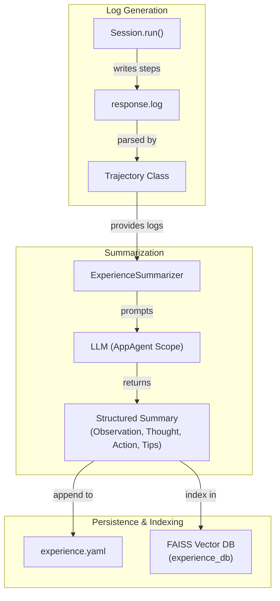
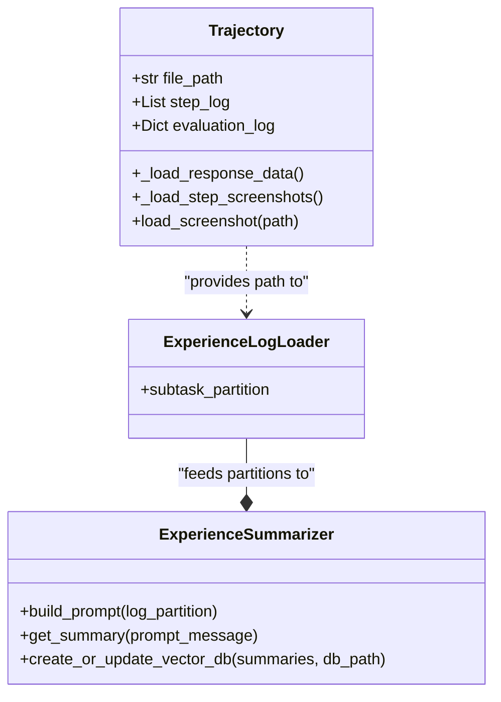

<!-- source: DeepWiki mcp.deepwiki.com · repo microsoft/UFO · page 11.4 Feedback and Learning · fetched 2026-10-26 -->

# Feedback and Learning

Relevant source files

The following files were used as context for generating this wiki page:

- [assets/record_processor/add_comment.png](assets/record_processor/add_comment.png)
- [learner/__init__.py](learner/__init__.py)
- [learner/__main__.py](learner/__main__.py)
- [learner/basic.py](learner/basic.py)
- [learner/indexer.py](learner/indexer.py)
- [learner/learner.py](learner/learner.py)
- [learner/xml_loader.py](learner/xml_loader.py)
- [record_processor/README.md](record_processor/README.md)
- [record_processor/__init__.py](record_processor/__init__.py)
- [record_processor/__main__.py](record_processor/__main__.py)
- [record_processor/example/sample_record.zip](record_processor/example/sample_record.zip)
- [record_processor/parser/demonstration_record.py](record_processor/parser/demonstration_record.py)
- [record_processor/parser/psr_record_parser.py](record_processor/parser/psr_record_parser.py)
- [record_processor/record_processor.py](record_processor/record_processor.py)
- [record_processor/summarizer/summarizer.py](record_processor/summarizer/summarizer.py)
- [record_processor/utils/__init__.py](record_processor/utils/__init__.py)
- [ufo/automator/ui_control/grounding/basic.py](ufo/automator/ui_control/grounding/basic.py)
- [ufo/automator/ui_control/grounding/omniparser.py](ufo/automator/ui_control/grounding/omniparser.py)
- [ufo/automator/ui_control/inspector.py](ufo/automator/ui_control/inspector.py)
- [ufo/experience/summarizer.py](ufo/experience/summarizer.py)
- [ufo/llm/grounding_model/omniparser_service.py](ufo/llm/grounding_model/omniparser_service.py)
- [ufo/rag/__init__.py](ufo/rag/__init__.py)
- [ufo/rag/web_search.py](ufo/rag/web_search.py)
- [ufo/trajectory/parser.py](ufo/trajectory/parser.py)

## Purpose and Scope

This page documents the feedback and learning mechanisms in UFO that enable continuous improvement through execution experience. The system captures execution results, updates agent memory, logs successful interactions for future retrieval, and evaluates task completion. A key component is the **Experience Learning** loop, which utilizes the `ExperienceSummarizer` to transform raw execution trajectories into structured knowledge indexed in vector databases.

---

## Experience Saving Mechanism

Experience saving is the process of converting a completed session's logs into reusable knowledge. This is managed by the `experience_saver` method in the session lifecycle, which is governed by the `save_experience` configuration.

### Data Flow for Experience Saving

The following diagram illustrates how execution data from `response.log` is transformed into indexed experience.

**Sources**: [ufo/trajectory/parser.py:22-52](), [ufo/experience/summarizer.py:18-40](), [ufo/experience/summarizer.py:129-191]()

---

## ExperienceSummarizer Operation

The `ExperienceSummarizer` class is responsible for the logic of "learning" from a trajectory. It uses an LLM to distill complex step-by-step logs into a concise "example" that can be used for RAG (Retrieval-Augmented Generation) in future tasks.

### Key Functions and Implementation

| Function | Role | Implementation |
| :--- | :--- | :--- |
| `read_logs` | Uses `ExperienceLogLoader` to partition logs into subtasks. | [ufo/experience/summarizer.py:120-126]() |
| `build_prompt` | Constructs a prompt using `ExperiencePrompter` to ask the LLM for a summary. | [ufo/experience/summarizer.py:42-62]() |
| `get_summary` | Calls `get_completion` and parses the JSON response into a structured dict. | [ufo/experience/summarizer.py:64-98]() |
| `create_or_update_yaml` | Persists the summary to a human-readable YAML file. | [ufo/experience/summarizer.py:129-162]() |
| `create_or_update_vector_db` | Converts the request text into embeddings and stores it in a FAISS index. | [ufo/experience/summarizer.py:165-191]() |

**Sources**: [ufo/experience/summarizer.py:18-191]()

---

## Trajectory Logging and Parsing

The `Trajectory` class in `ufo/trajectory/parser.py` serves as the technical bridge between the raw file system and the learning modules. It structures multi-modal data including text logs and screenshots.

### Trajectory Structure

The system maintains a specific directory structure for each task execution:
- `response.log`: JSON-per-line records of every agent step. [ufo/trajectory/parser.py:27-27]()
- `evaluation.log`: The final success/failure assessment. [ufo/trajectory/parser.py:28-28]()
- `action_round_{n}_final.png`: Visual state at the end of a round. [ufo/trajectory/parser.py:181-183]()

### Class Relationship: Trajectory to Code Entities

**Sources**: [ufo/trajectory/parser.py:22-170](), [ufo/experience/summarizer.py:120-126]()

---

## Demonstration Learning (Human-in-the-loop)

UFO also supports learning from manual user demonstrations recorded via the Windows Steps Recorder (PSR). The `DemonstrationSummarizer` handles this specialized flow.

### Demonstration Processing Pipeline

1.  **Parsing**: `PSRRecordParser` converts the `.zip` output of Steps Recorder into a `DemonstrationRecord`. [record_processor/record_processor.py:41-43]()
2.  **Summarization**: `DemonstrationSummarizer` generates multiple candidate plans (default `n=3`). [record_processor/record_processor.py:46-54]()
3.  **User Feedback**: The `__asker` function presents plans to the user for selection. [record_processor/record_processor.py:85-108]()
4.  **Indexing**: The chosen plan is saved to `demonstration.yaml` and `demonstration_db`. [record_processor/record_processor.py:70-76]()

### Comparison of Learning Types

| Feature | Execution Experience | User Demonstration |
| :--- | :--- | :--- |
| **Source** | Automated UFO Trajectory | Windows Steps Recorder (PSR) |
| **Summarizer** | `ExperienceSummarizer` | `DemonstrationSummarizer` |
| **Storage** | `experience_db` | `demonstration_db` |
| **Trigger** | End of `Session.run()` | `python -m record_processor` |

**Sources**: [record_processor/record_processor.py:33-80](), [record_processor/summarizer/summarizer.py:18-38](), [ufo/experience/summarizer.py:18-21]()

---

## Indexing and Retrieval

Learned experiences are indexed using **FAISS** (Facebook AI Similarity Search) and **HuggingFace Embeddings**.

### Indexing Process
When `create_or_update_vector_db` is called:
1.  The "request" or "subtask" string is extracted as the `page_content`. [ufo/experience/summarizer.py:175-176]()
2.  The full summary (Observation, Thought, Action, etc.) is stored as `metadata`. [ufo/experience/summarizer.py:176-176]()
3.  A `Document` object is created and added to the FAISS index. [ufo/experience/summarizer.py:178-178]()
4.  If an index already exists at the `db_path`, the new documents are merged into the existing index using `db.merge_from(prev_db)`. [ufo/experience/summarizer.py:182-187]()

### Knowledge Retrieval for Agents
During the `DATA_COLLECTION` phase of an `AppAgent`, the `RetrieverFactory` creates an experience retriever. It searches the FAISS index for the $K$ most similar previous tasks. These are then injected into the `AppAgentPrompter` to provide "few-shot" examples of how to handle the current request.

**Sources**: [ufo/experience/summarizer.py:165-191](), [learner/indexer.py:24-86](), [record_processor/summarizer/summarizer.py:173-199]()

---

