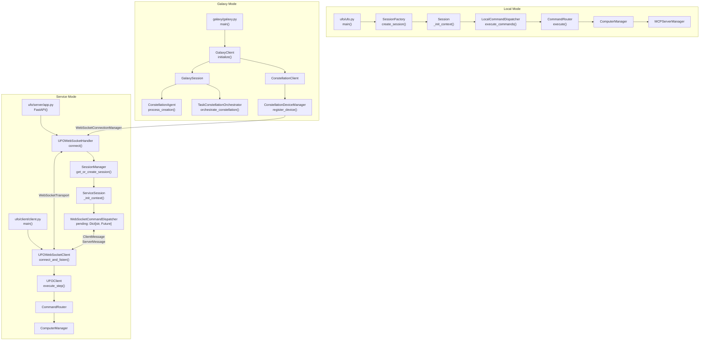

<!-- source: DeepWiki mcp.deepwiki.com · repo microsoft/UFO · page 12 Deployment Modes · fetched 2026-10-26 -->

# Deployment Modes

<details>
<summary>Relevant source files</summary>

The following files were used as context for generating this wiki page:

- [README.md](README.md)
- [README_ZH.md](README_ZH.md)
- [assets/orchestrator.png](assets/orchestrator.png)
- [assets/task_constellation.png](assets/task_constellation.png)
- [documents/docs/choose_path.md](documents/docs/choose_path.md)
- [documents/docs/faq.md](documents/docs/faq.md)
- [documents/docs/galaxy/overview.md](documents/docs/galaxy/overview.md)
- [documents/docs/getting_started/more_guidance.md](documents/docs/getting_started/more_guidance.md)
- [documents/docs/getting_started/quick_start_galaxy.md](documents/docs/getting_started/quick_start_galaxy.md)
- [documents/docs/getting_started/quick_start_linux.md](documents/docs/getting_started/quick_start_linux.md)
- [documents/docs/getting_started/quick_start_ufo2.md](documents/docs/getting_started/quick_start_ufo2.md)
- [documents/docs/index.md](documents/docs/index.md)
- [documents/docs/project_directory_structure.md](documents/docs/project_directory_structure.md)
- [documents/mkdocs.yml](documents/mkdocs.yml)
- [galaxy/README.md](galaxy/README.md)
- [galaxy/README_ZH.md](galaxy/README_ZH.md)
- [ufo/README.md](ufo/README.md)
- [ufo/README_ZH.md](ufo/README_ZH.md)
- [ufo/__main__.py](ufo/__main__.py)
- [ufo/client/client.py](ufo/client/client.py)
- [ufo/client/mcp/http_servers/hardware_mcp_server.py](ufo/client/mcp/http_servers/hardware_mcp_server.py)
- [ufo/client/mcp/mcp_registry.py](ufo/client/mcp/mcp_registry.py)
- [ufo/client/mcp/mcp_server_manager.py](ufo/client/mcp/mcp_server_manager.py)
- [ufo/client/ufo_client.py](ufo/client/ufo_client.py)
- [ufo/client/websocket.py](ufo/client/websocket.py)
- [ufo/llm/llm_call.py](ufo/llm/llm_call.py)
- [ufo/llm/openai.py](ufo/llm/openai.py)
- [ufo/module/context.py](ufo/module/context.py)
- [ufo/module/dispatcher.py](ufo/module/dispatcher.py)
- [ufo/module/sessions/service_session.py](ufo/module/sessions/service_session.py)
- [ufo/rag/retriever.py](ufo/rag/retriever.py)
- [ufo/server/app.py](ufo/server/app.py)
- [ufo/server/services/api.py](ufo/server/services/api.py)
- [ufo/server/services/client_connection_manager.py](ufo/server/services/client_connection_manager.py)
- [ufo/server/services/session_manager.py](ufo/server/services/session_manager.py)
- [ufo/server/ws/handler.py](ufo/server/ws/handler.py)
- [ufo/ufo.py](ufo/ufo.py)

</details>


This page documents the three operational deployment modes supported by the UFO system: **Local Mode**, **Service Mode**, and **Galaxy Mode**. Each mode provides different architectures for task execution, ranging from single-device local automation to distributed multi-device orchestration.

**Scope**: This document covers the deployment architectures, command dispatcher implementations, session types, and configuration requirements for each mode. For details on the Agent Interaction Protocol (AIP) used in Service and Galaxy modes, see [Agent Interaction Protocol](#5). For Galaxy-specific orchestration features, see [UFO³ Galaxy Framework](#4).

---

## Operational Modes Overview

UFO supports three distinct deployment modes, each designed for different use cases:

| Mode | Architecture | Network Required | Primary Use Case | Entry Points |
|------|-------------|------------------|------------------|--------------|
| **Local** | Single-process | No | Personal productivity, development, testing | `python -m ufo --mode normal` [ufo/ufo.py:55-56]() |
| **Service** | Client-Server | Yes (WebSocket) | Remote execution, headless servers | Server: `python -m ufo.server.app` [ufo/server/app.py:10-41]()<br/>Client: `python -m ufo.client.client --ws` [ufo/client/client.py:81-121]() |
| **Galaxy** | Multi-tier orchestration | Yes (WebSocket) | Cross-device workflows, complex automation | `python -m galaxy --webui` [galaxy/README.md:410-485]() |

**Sources**: [README.md:40-89](), [ufo/ufo.py:17-22](), [ufo/server/app.py:10-41](), [ufo/client/client.py:81-121](), [galaxy/README.md:125-154]()

---

## Architecture Comparison

**Diagram: Deployment Mode Architecture Comparison with Code Entities**

The three modes differ in command dispatch and session management:



**Sources**: [ufo/ufo.py:64-71](), [ufo/server/ws/handler.py:19-100](), [ufo/module/sessions/service_session.py:43-53](), [ufo/server/app.py:80-92](), [galaxy/README.md:169-202]()

---

## Local Mode

### Architecture

Local Mode executes UFO in a single process without network communication. The entry point is `ufo/ufo.py` [ufo/ufo.py:51-80]() which calls `SessionFactory().create_session()` [ufo/ufo.py:66-71]() to instantiate a session object.

#### Command Dispatcher Implementation

**Diagram: Local Mode Command Execution Flow**

```mermaid
graph LR
    Session["Session<br/>ufo/module/sessions/session.py"]
    InitContext["Session._init_context()"]
    LocalDispatcher["LocalCommandDispatcher<br/>ufo/module/dispatcher.py"]
    ExecCommands["execute_commands()"]
    CommandRouter["CommandRouter<br/>ufo/client/computer.py"]
    RouterExec["CommandRouter.execute()"]
    ComputerManager["ComputerManager<br/>ufo/client/computer.py"]
    MCPServerMgr["MCPServerManager<br/>ufo/client/mcp/mcp_server_manager.py"]
    
    Session --> InitContext
    InitContext -->|"attach_command_dispatcher()"| LocalDispatcher
    LocalDispatcher --> ExecCommands
    ExecCommands -->|"self.command_router.execute()"| CommandRouter
    CommandRouter --> RouterExec
    RouterExec -->|"self.computer_manager"| ComputerManager
    ComputerManager -->|"self.mcp_server_manager"| MCPServerMgr
```



The `LocalCommandDispatcher` provides direct access to the local system:

- **Direct Execution**: `execute_commands()` directly calls the `CommandRouter` without network serialization.
- **In-Process MCP**: `MCPServerManager` manages servers (HTTP, Local, Stdio) within the same process [ufo/client/mcp/mcp_server_manager.py:1-266]().
- **Context Initialization**: The dispatcher is attached to the session context during initialization.

#### Session Type

Local Mode supports several session modes via the `--mode` argument [ufo/ufo.py:17-22]():
- `normal`: Standard standalone operation.
- `follower`: Executes a pre-defined plan file or folder [ufo/ufo.py:58-59]().
- `batch_normal`: Batch processing mode [ufo/ufo.py:61-62]().
- `operator`: Uses the OpenAI Operator agent separately [ufo/ufo.py:20]().

#### Entry Point

```bash
# Basic local execution
python -m ufo --mode normal --task "my_task"

# With a specific request
python -m ufo --request "Create a PowerPoint presentation about UFOs"
```

The argument parsing is handled in `ufo/ufo.py` [ufo/ufo.py:9-45]().

**Sources**: [ufo/ufo.py:9-71](), [ufo/client/mcp/mcp_server_manager.py:1-266]()

---

## Service Mode

### Architecture

Service Mode separates UFO into a **server** (managing state and LLM interaction) and a **client** (executing actions on the device) connected via the Agent Interaction Protocol (AIP).

#### Server Component

The server is built with FastAPI [ufo/server/app.py:80](). It manages WebSocket connections and session lifecycles.

**Key Server Classes**:
- `UFOWebSocketHandler` [ufo/server/ws/handler.py:19-47](): Handles the AIP protocol stack (Registration, Heartbeat, DeviceInfo, TaskExecution) and manages client connections [ufo/server/ws/handler.py:59-65]().
- `SessionManager` [ufo/server/services/session_manager.py](): Manages background session execution and results.
- `ClientConnectionManager` [ufo/server/services/client_connection_manager.py](): Tracks online clients and their capabilities.

**Server Startup** [ufo/server/app.py:135-146]():
```bash
python -m ufo.server.app --port 5000 --api-key "my-secret-key"
```

#### Client Component

The client connects to the server and waits for task assignments or action requests.

**Key Client Classes**:
- `UFOWebSocketClient` [ufo/client/websocket.py](): Manages the persistent WebSocket connection with auto-reconnection.
- `UFOClient` [ufo/client/ufo_client.py:14-165](): The core execution engine on the client side that routes actions to the `CommandRouter`.

#### WebSocket Command Dispatcher

The `WebSocketCommandDispatcher` [ufo/module/dispatcher.py]() implements an asynchronous execution pattern:
1. **Request**: The dispatcher sends a `ServerMessage` of type `ACTION_REQUEST` via the `TaskExecutionProtocol`.
2. **Pending**: It creates a `Future` object indexed by a unique `response_id`.
3. **Response**: When the client returns results via a `COMMAND_RESULTS` message, the server's `UFOWebSocketHandler` calls `set_result()` on the dispatcher to resolve the `Future`.

#### Communication Protocol

Service Mode uses the **Agent Interaction Protocol (AIP)** [ufo/server/ws/handler.py:8-13](). It defines structured messages like `ClientMessage` and `ServerMessage` [ufo/server/ws/handler.py:13]().

**Sources**: [ufo/server/app.py:80-146](), [ufo/server/ws/handler.py:19-123](), [ufo/client/ufo_client.py:14-165](), [ufo/server/services/api.py:45-96]()

---

## Galaxy Mode

### Architecture

Galaxy Mode (UFO³) is a multi-device orchestration framework. It treats individual UFO² instances as "Device Agents" within a "Task Constellation".

#### Orchestration Layer

**Diagram: Galaxy Task Orchestration Flow**

```mermaid
sequenceDiagram
    participant User
    participant GalaxyClient["GalaxyClient<br/>galaxy/galaxy_client.py"]
    participant ConstellationAgent["ConstellationAgent<br/>galaxy/agents/constellation_agent.py"]
    participant TaskOrchestrator["TaskOrchestrator<br/>galaxy/constellation/orchestrator"]
    participant DeviceManager["DeviceManager<br/>galaxy/client/device_manager.py"]
    participant DeviceAgent["UFO² Device Agent<br/>(Service Mode Client)"]

    User->>GalaxyClient: Submit Multi-Device Request
    GalaxyClient->>ConstellationAgent: process_creation()
    ConstellationAgent-->>GalaxyClient: TaskConstellation (DAG)
    GalaxyClient->>TaskOrchestrator: orchestrate()
    
    loop For Ready Tasks
        TaskOrchestrator->>DeviceManager: dispatch(task, device_id)
        DeviceManager->>DeviceAgent: AIP TASK Message
        DeviceAgent->>DeviceAgent: Execute actions
        DeviceAgent-->>DeviceManager: Task Result
        DeviceManager->>TaskOrchestrator: mark_completed(task)
    end
    
    TaskOrchestrator-->>GalaxyClient: Final Report
```

#### Device Pool Configuration

Galaxy uses `config/galaxy/devices.yaml` to register available devices [galaxy/README.md:302-363]().

**Critical Requirements**:
- `device_id`: Must match the `--client-id` provided to the device agent [galaxy/README_ZH.md:314]().
- `server_url`: The WebSocket URL of the UFO² server the device is connected to [galaxy/README_ZH.md:315]().
- `capabilities`: List of tasks the device can handle (e.g., "excel", "web_browsing") [galaxy/README_ZH.md:317-324]().

#### ConstellationAgent

The `ConstellationAgent` [galaxy/agents/constellation_agent.py]() is the "brain" of Galaxy. It uses LLMs to:
1. **Creation Mode**: Decompose natural language requests into a Directed Acyclic Graph (DAG) of `TaskStars` [galaxy/README.md:66-75]().
2. **Editing Mode**: Dynamically adapt the DAG based on execution feedback or failures [galaxy/README.md:82-93]().

**Sources**: [galaxy/README.md:27-108](), [galaxy/README_ZH.md:120-148](), [galaxy/README_ZH.md:302-330]()

---

## Configuration Comparison

| Configuration | Local Mode | Service Mode | Galaxy Mode |
|--------------|------------|--------------|-------------|
| **Agents Config** (`agents.yaml`) | Required for Host/App Agents | Required on Server | Required on Device Agents |
| **Galaxy Agent** (`agent.yaml`) | Not Used | Not Used | Required for ConstellationAgent |
| **Device Registry** (`devices.yaml`) | Not Used | Not Used | Required for Orchestration |

**Sources**: [README.md:139-154](), [galaxy/README_ZH.md:233-239](), [galaxy/README_ZH.md:276-281]()

---

## Summary of Deployment Options

1. **Local Mode**: Best for single-device Windows automation and quick setup [README.md:68-83]().
2. **Service Mode**: Enables remote control of devices via WebSocket, providing a foundation for headless automation [ufo/server/app.py:95-106]().
3. **Galaxy Mode**: Recommended for complex, cross-platform workflows involving multiple devices (Windows, Linux, Android) [README.md:46-63]().

For detailed implementation of these modes, see:
- [Local Mode](#12.1)
- [Service Mode](#12.2)
- [Galaxy Mode](#12.3)

**Sources**: [README.md:40-89](), [ufo/server/app.py:95-106](), [galaxy/README.md:131-143]()

---

