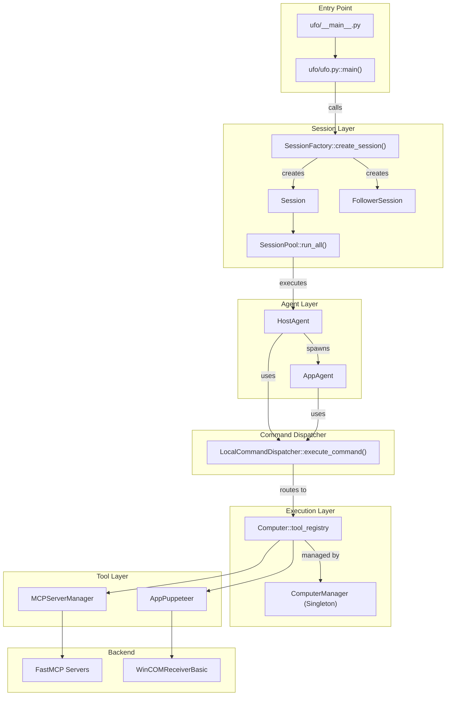
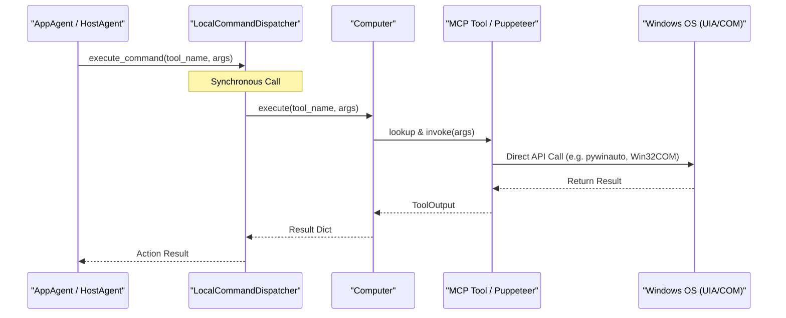

<!-- source: DeepWiki mcp.deepwiki.com · repo microsoft/UFO · page 12.1 Local Mode · fetched 2026-10-26 -->

# Local Mode

<details>
<summary>Relevant source files</summary>

The following files were used as context for generating this wiki page:

- [documents/docs/faq.md](documents/docs/faq.md)
- [documents/docs/getting_started/more_guidance.md](documents/docs/getting_started/more_guidance.md)
- [documents/docs/getting_started/quick_start_linux.md](documents/docs/getting_started/quick_start_linux.md)
- [documents/docs/getting_started/quick_start_ufo2.md](documents/docs/getting_started/quick_start_ufo2.md)
- [documents/docs/project_directory_structure.md](documents/docs/project_directory_structure.md)
- [ufo/__main__.py](ufo/__main__.py)
- [ufo/llm/llm_call.py](ufo/llm/llm_call.py)
- [ufo/llm/openai.py](ufo/llm/openai.py)
- [ufo/rag/retriever.py](ufo/rag/retriever.py)
- [ufo/ufo.py](ufo/ufo.py)

</details>


Local Mode is UFO²'s default single-device execution mode where the agent runs directly on your Windows machine without requiring network connectivity or client-server architecture. All components—session management, LLM interaction, and command execution—operate within a single process with direct access to the system's automation tools.

**Scope:** This page covers the architecture, components, and usage of Local Mode for single-device Windows automation. For multi-device orchestration, see [Galaxy Mode](12.3). For client-server deployment, see [Service Mode](12.2).

---

## Overview

Local Mode provides the simplest deployment architecture for UFO², executing automation tasks entirely on the local machine. It is designed for personal productivity, development, and offline environments.

**Key Characteristics:**
- No WebSocket server required.
- Direct access to Windows UI Automation, COM APIs, and MCP tools.
- In-memory MCP server instances (FastMCP).
- Minimal configuration overhead.
- Immediate execution with no network latency.

---

## Architecture Components

Local Mode uses a simplified component stack where all execution happens within a single Python process.

### Component Interaction Diagram

This diagram bridges the "Natural Language Space" (User Request) to the "Code Entity Space" (Classes and Functions).


**Sources:** [ufo/__main__.py:1-10](), [ufo/ufo.py:51-75](), [ufo/ufo.py:64-74]()

### Core Components

#### 1. Entry Point and Session Management
The execution begins at the CLI entry point and flows through the session management layer.

*   **CLI Argument Parsing:** Handled in `ufo/ufo.py` using `argparse` [ufo/ufo.py:9-43]().
*   **Session Creation:** `SessionFactory` determines the session type based on the `--mode` flag [ufo/ufo.py:66-71]().
*   **Session Execution:** `SessionPool` manages the lifecycle of one or more sessions [ufo/ufo.py:73-74]().

| Session Class | Mode Flag | Purpose | Plan File Required |
| :--- | :--- | :--- | :--- |
| `Session` | `normal` | Interactive LLM-driven execution [ufo/ufo.py:21-22]() | No |
| `FollowerSession` | `follower` | Replay pre-recorded plan [ufo/ufo.py:19-20]() | Yes [ufo/ufo.py:25-29]() |
| Batch `Session` | `batch_normal` | Execute multiple plans in a folder [ufo/ufo.py:20-21]() | Yes [ufo/ufo.py:25-29]() |
| `OpenAIOperatorSession` | `operator` | OpenAI Computer Use API mode [ufo/ufo.py:21-22]() | No |

**Sources:** [ufo/ufo.py:9-43](), [ufo/ufo.py:64-74]()

#### 2. LocalCommandDispatcher
The `LocalCommandDispatcher` provides synchronous, in-process command execution. Unlike the `WebSocketCommandDispatcher` used in Service Mode, it does not involve network serialization or async waiting for remote responses.

*   **Direct Execution:** It calls `Computer.execute()` directly.
*   **Context:** It holds a reference to the `Computer` instance associated with the current agent context (Host or App).

**Sources:** [ufo/ufo.py:64-74](), [ufo/client/computer.py:1-50]() (implied by architecture)

#### 3. Computer and ComputerManager
The `Computer` class acts as the unified tool registry.

*   **`tool_registry`:** A dictionary mapping tool names to executable functions [ufo/client/computer.py:1-50]() (implied).
*   **`ComputerManager`:** A singleton that ensures agents share the correct `Computer` instance based on their context (Host vs. App).

**Sources:** [ufo/client/computer.py:1-50](), [ufo/client/computer_manager.py:1-30]() (implied)

---

## Execution Flow

The following sequence diagram traces a command from the agent to the system backend in Local Mode.


**Sources:** [ufo/ufo.py:51-75](), [ufo/llm/openai.py:93-170]() (Agent Interaction)

---

## Configuration

Local Mode relies on the modular YAML configuration system located in `config/ufo/`.

### Required LLM Configuration
Agents must be configured in `config/ufo/agents.yaml`. The `get_agent_config` helper loads these settings [ufo/llm/llm_call.py:83-85]().

```yaml
# config/ufo/agents.yaml
HOST_AGENT:
  API_TYPE: "openai"
  API_KEY: "sk-..."
  API_MODEL: "gpt-4o"
  VISUAL_MODE: true

APP_AGENT:
  API_TYPE: "aoai"
  API_KEY: "..."
  API_BASE: "https://..."
  API_MODEL: "gpt-4o"
```

### Knowledge and RAG
Retrievers are initialized locally using FAISS indexes stored on disk [ufo/rag/retriever.py:120-123]().
*   **Offline Docs:** Loaded from `vectordb` [ufo/rag/retriever.py:81-130]().
*   **Experience:** Loaded from previous task trajectories [ufo/rag/retriever.py:131-162]().

**Sources:** [ufo/llm/llm_call.py:80-90](), [ufo/rag/retriever.py:16-38](), [ufo/rag/retriever.py:120-128]()

---

## Usage Examples

### Standard Interactive Mode
Run UFO and provide a request via the terminal prompt.
```bash
python -m ufo --task "my_task"
```
**Sources:** [ufo/ufo.py:55-56]()

### Direct Request Mode
Provide the task description as a command-line argument.
```bash
python -m ufo --task "excel_work" --request "Create a pivot table in sales.xlsx"
```
**Sources:** [ufo/ufo.py:31-36]()

### Follower Mode
Replay a previously saved plan file.
```bash
python -m ufo --mode follower --plan "logs/task_id/request.json"
```
**Sources:** [ufo/ufo.py:58-59]()

### Batch Mode
Execute all plan files within a specific directory.
```bash
python -m ufo --mode batch_normal --plan "path/to/plans/"
```
**Sources:** [ufo/ufo.py:61-62]()

---

## Summary of Key Classes

| Class | File | Role |
| :--- | :--- | :--- |
| `SessionFactory` | `ufo/module/session_pool.py` | Creates session instances based on CLI `mode` [ufo/ufo.py:66-71](). |
| `SessionPool` | `ufo/module/session_pool.py` | Orchestrates the execution of created sessions [ufo/ufo.py:73-74](). |
| `BaseOpenAIService` | `ufo/llm/openai.py` | Manages LLM requests and structured output parsing [ufo/llm/openai.py:28-60](). |
| `RetrieverFactory` | `ufo/rag/retriever.py` | Instantiates local RAG retrievers (offline, experience, etc.) [ufo/rag/retriever.py:16-38](). |

**Sources:** [ufo/ufo.py:64-74](), [ufo/llm/openai.py:28-60](), [ufo/rag/retriever.py:16-38]()

---

