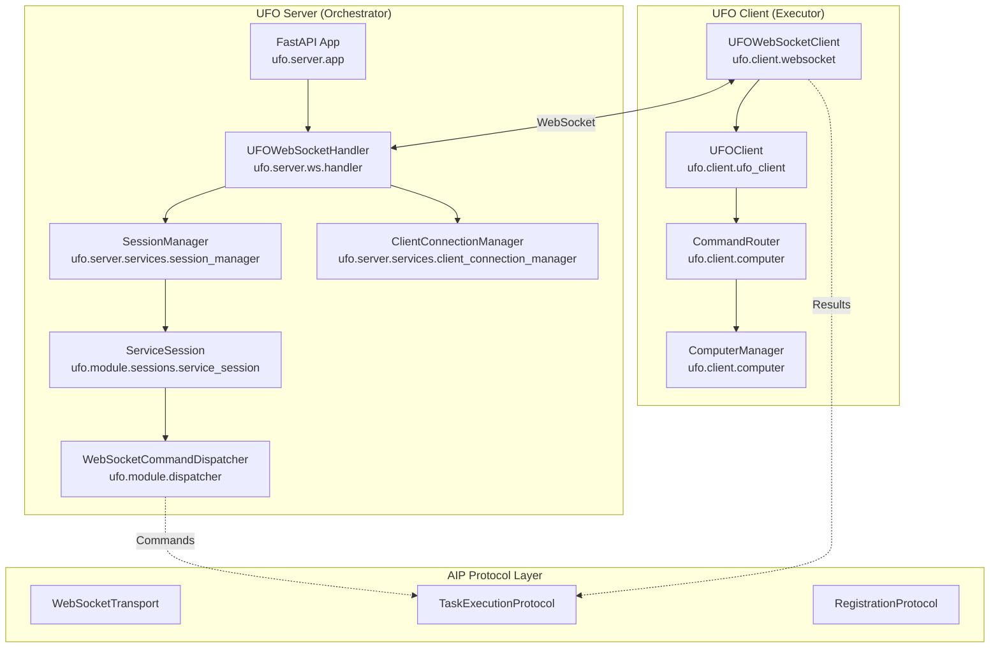
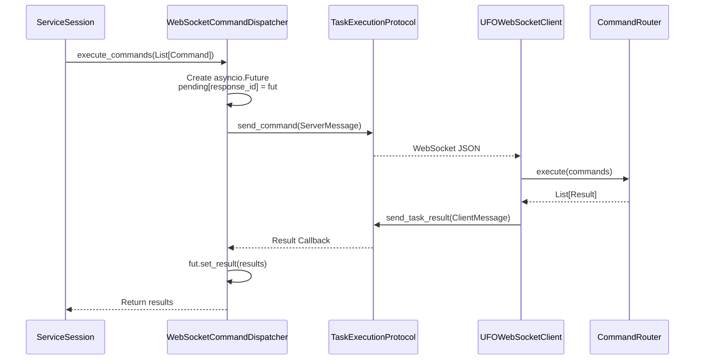

<!-- source: DeepWiki mcp.deepwiki.com · repo microsoft/UFO · page 12.2 Service Mode · fetched 2026-10-26 -->

# Service Mode

Relevant source files

The following files were used as context for generating this wiki page:

- [ufo/client/client.py](ufo/client/client.py)
- [ufo/client/mcp/http_servers/hardware_mcp_server.py](ufo/client/mcp/http_servers/hardware_mcp_server.py)
- [ufo/client/mcp/mcp_registry.py](ufo/client/mcp/mcp_registry.py)
- [ufo/client/mcp/mcp_server_manager.py](ufo/client/mcp/mcp_server_manager.py)
- [ufo/client/ufo_client.py](ufo/client/ufo_client.py)
- [ufo/client/websocket.py](ufo/client/websocket.py)
- [ufo/module/context.py](ufo/module/context.py)
- [ufo/module/dispatcher.py](ufo/module/dispatcher.py)
- [ufo/module/sessions/service_session.py](ufo/module/sessions/service_session.py)
- [ufo/server/app.py](ufo/server/app.py)
- [ufo/server/services/api.py](ufo/server/services/api.py)
- [ufo/server/services/client_connection_manager.py](ufo/server/services/client_connection_manager.py)
- [ufo/server/services/session_manager.py](ufo/server/services/session_manager.py)
- [ufo/server/ws/handler.py](ufo/server/ws/handler.py)

## Purpose and Scope

Service Mode is a client-server deployment architecture for UFO² that separates the automation orchestrator (Server) from execution agents (Clients) via WebSocket communication. This mode enables remote task execution, headless server deployments, and distributed automation across networked devices. The server coordinates session logic and LLM interactions, while clients perform the actual UI automation and tool execution.

**Key Capabilities:**
- **Remote Control**: Execute desktop automation over WebSocket connections using the Agent Interaction Protocol (AIP) [[ufo/server/ws/handler.py:19-23]]().
- **Async Execution**: Tasks run in background `asyncio` tasks on the server, ensuring the WebSocket remains responsive for heartbeats and status queries [[ufo/server/services/session_manager.py:151-178]]().
- **Platform Agnostic**: Supports Windows, Linux, and Mobile clients through a unified `ServiceSession` and `SessionFactory` pattern [[ufo/server/services/session_manager.py:20-32]]().
- **Robust Connectivity**: Automatic reconnection with exponential backoff and configurable retry limits [[ufo/client/websocket.py:65-85]]().

---

## Architecture Overview

Service Mode implements a distributed architecture where the **UFO Server** manages the "Brain" (LLM reasoning and session state) and the **UFO Client** manages the "Body" (UI inspection and action execution).

### Component Architecture

**Sources:** [ufo/server/app.py:67-93](), [ufo/server/ws/handler.py:19-47](), [ufo/module/dispatcher.py:134-160](), [ufo/client/websocket.py:26-63]()

---

## Server Components

### 1. UFOWebSocketHandler
The `UFOWebSocketHandler` is the primary entry point for WebSocket connections. It initializes the AIP protocol stack (Registration, Heartbeat, DeviceInfo, and TaskExecution) for every new connection [[ufo/server/ws/handler.py:59-64]]().

- **Registration**: Validates client identity and platform metadata [[ufo/server/ws/handler.py:67-91]]().
- **Message Dispatching**: Routes incoming `COMMAND_RESULTS` to the active session's dispatcher and handles `HEARTBEAT` messages to maintain connection health [[ufo/server/ws/handler.py:496-515]](), [[ufo/server/ws/handler.py:517-531]]().

### 2. SessionManager
The `SessionManager` tracks all active sessions and manages their lifecycle. It uses a `SessionFactory` to create platform-specific `ServiceSession` instances [[ufo/server/services/session_manager.py:49-51]]().

- **Background Execution**: The `execute_task_async` method wraps the session execution in an `asyncio.Task`, preventing long-running LLM steps from blocking the server's main loop [[ufo/server/services/session_manager.py:151-178]]().
- **Task Control**: Provides methods to `cancel_task` if a client disconnects or if an external abort is requested [[ufo/server/services/session_manager.py:197-236]]().

### 3. ServiceSession
A specialized session type (`ServiceSession`) that overrides the standard initialization to attach a `WebSocketCommandDispatcher` [[ufo/module/sessions/service_session.py:16-19]]().

- **Context Initialization**: Attaches the dispatcher which uses the AIP `TaskExecutionProtocol` to send commands to the remote client [[ufo/module/sessions/service_session.py:43-53]]().
- **Request Handling**: Simplifies the request loop by returning the initial remote request and marking completion after the round finishes [[ufo/module/sessions/service_session.py:55-64]]().

**Sources:** [ufo/server/services/session_manager.py:89-97](), [ufo/module/sessions/service_session.py:43-53](), [ufo/server/ws/handler.py:19-47]()

---

## Client Components

### 1. UFOWebSocketClient
The client-side implementation of the AIP protocol. It manages the persistent connection to the UFO Server [[ufo/client/websocket.py:26-31]]().

- **Connection Lifecycle**: Implements `connect_and_listen` with error handling for connection refusals and timeouts [[ufo/client/websocket.py:65-108]]().
- **Task Listener**: Runs a `handle_messages` loop that waits for `ServerMessageType.COMMAND` or `ServerMessageType.TASK` assignments [[ufo/client/websocket.py:204-245]]().

### 2. UFOClient & CommandRouter
Once a command is received, the `UFOClient` passes it to the `CommandRouter` [[ufo/client/ufo_client.py:14-18]]().

- **Action Execution**: `execute_actions` processes the list of commands (e.g., click, type, MCP tool call) and returns a list of `Result` objects [[ufo/client/ufo_client.py:69-88]]().
- **State Management**: Maintains the `session_id`, `agent_name`, and application context (process/root name) during execution [[ufo/client/ufo_client.py:90-107]]().

**Sources:** [ufo/client/websocket.py:101-104](), [ufo/client/ufo_client.py:53-67](), [ufo/client/ufo_client.py:81-86]()

---

## Data Flow: Command Dispatch

Service Mode uses a **Future-based correlation pattern** to match commands sent by the server with results returned by the client.

### Command Execution Sequence

**Implementation Details:**
- **Dispatcher Pending Dict**: The `WebSocketCommandDispatcher` maintains a `pending` dictionary mapping `response_id` to `asyncio.Future` [[ufo/module/dispatcher.py:152]]().
- **Timeout Handling**: The dispatcher uses `asyncio.wait_for` to ensure sessions don't hang indefinitely if a client fails to respond [[ufo/module/dispatcher.py:221-224]]().
- **Error Generation**: If a timeout or exception occurs, `generate_error_results` creates synthetic failure results to inform the LLM of the communication breakdown [[ufo/module/dispatcher.py:43-64]]().

**Sources:** [ufo/module/dispatcher.py:134-160](), [ufo/module/dispatcher.py:206-234](), [ufo/server/ws/handler.py:496-515]()

---

## Remote Orchestration via API

The UFO Server exposes a REST API to allow remote orchestrators (like a web UI or a custom script) to trigger tasks on specific connected clients [[ufo/server/services/api.py:26-30]]().

| Endpoint | Method | Description |
| :--- | :--- | :--- |
| `/api/clients` | GET | Lists all currently online device and constellation clients [[ufo/server/services/api.py:41-43]](). |
| `/api/dispatch` | POST | Dispatches a task request to a specific `client_id` [[ufo/server/services/api.py:45-46]](). |
| `/api/task_result/{name}` | GET | Polls for the completion status and results of a specific task [[ufo/server/services/api.py:98-103]](). |

**Dispatch Logic:**
When `/api/dispatch` is called, the server uses the `TaskExecutionProtocol` to send a `send_task_assignment` message to the targeted client. This bypasses the local prompt loop and initiates automation directly on the remote device [[ufo/server/services/api.py:84-89]]().

**Sources:** [ufo/server/services/api.py:41-109](), [ufo/server/app.py:87-89]()

---

## Integration with MCP Tools

In Service Mode, the client acts as the host for MCP (Model Context Protocol) servers. This allows the server to request hardware-level or specialized application-level tools that only the client can access [[ufo/client/mcp/mcp_server_manager.py:171-174]]().

- **MCPServerManager**: Managed by the client, it can start `http`, `local`, or `stdio` based MCP servers [[ufo/client/mcp/mcp_server_manager.py:178-182]]().
- **Hardware Access**: For example, a client might run a `hardware_mcp_server` to control mock hardware components, which the remote UFO Server can then utilize by sending command requests [[ufo/client/mcp/http_servers/hardware_mcp_server.py:32-46]]().

**Sources:** [ufo/client/client.py:88-97](), [ufo/client/mcp/mcp_server_manager.py:200-218](), [ufo/client/ufo_client.py:34-38]()

---

