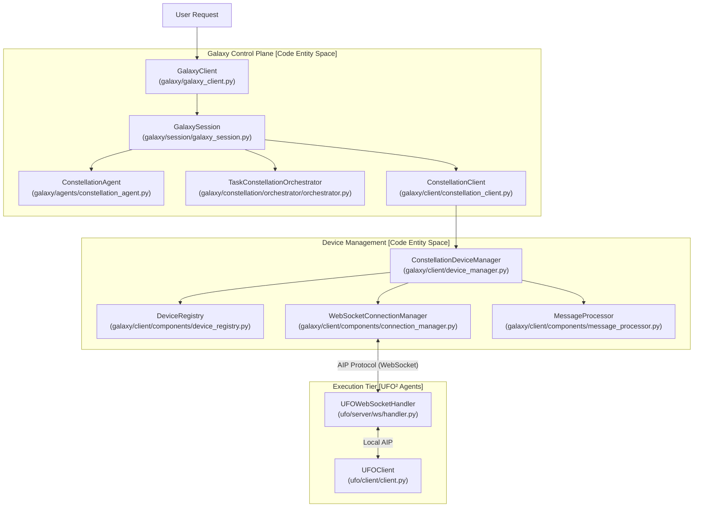
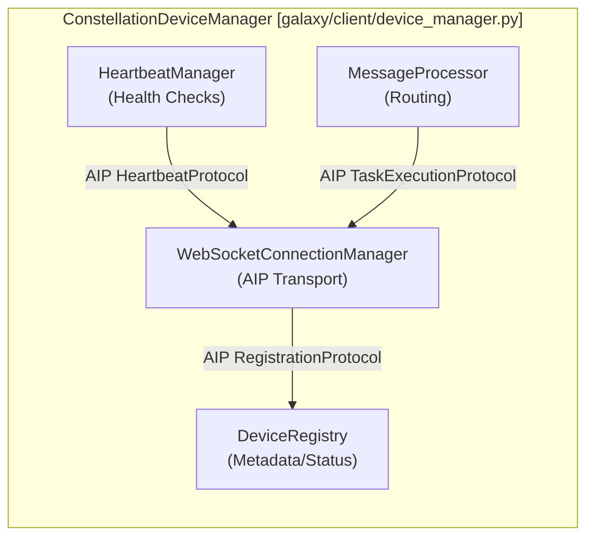

<!-- source: DeepWiki mcp.deepwiki.com · repo microsoft/UFO · page 12.3 Galaxy Mode · fetched 2026-10-26 -->

# Galaxy Mode

<details>
<summary>Relevant source files</summary>

The following files were used as context for generating this wiki page:

- [README.md](README.md)
- [README_ZH.md](README_ZH.md)
- [assets/orchestrator.png](assets/orchestrator.png)
- [assets/task_constellation.png](assets/task_constellation.png)
- [documents/docs/choose_path.md](documents/docs/choose_path.md)
- [documents/docs/client/computer.md](documents/docs/client/computer.md)
- [documents/docs/client/computer_manager.md](documents/docs/client/computer_manager.md)
- [documents/docs/client/device_info.md](documents/docs/client/device_info.md)
- [documents/docs/client/mcp_integration.md](documents/docs/client/mcp_integration.md)
- [documents/docs/client/overview.md](documents/docs/client/overview.md)
- [documents/docs/client/quick_start.md](documents/docs/client/quick_start.md)
- [documents/docs/client/ufo_client.md](documents/docs/client/ufo_client.md)
- [documents/docs/client/websocket_client.md](documents/docs/client/websocket_client.md)
- [documents/docs/configuration/system/galaxy_devices.md](documents/docs/configuration/system/galaxy_devices.md)
- [documents/docs/galaxy/overview.md](documents/docs/galaxy/overview.md)
- [documents/docs/getting_started/quick_start_galaxy.md](documents/docs/getting_started/quick_start_galaxy.md)
- [documents/docs/getting_started/quick_start_mobile.md](documents/docs/getting_started/quick_start_mobile.md)
- [documents/docs/index.md](documents/docs/index.md)
- [documents/docs/server/api.md](documents/docs/server/api.md)
- [documents/mkdocs.yml](documents/mkdocs.yml)
- [galaxy/README.md](galaxy/README.md)
- [galaxy/README_ZH.md](galaxy/README_ZH.md)
- [galaxy/client/components/connection_manager.py](galaxy/client/components/connection_manager.py)
- [galaxy/client/components/device_registry.py](galaxy/client/components/device_registry.py)
- [galaxy/client/components/message_processor.py](galaxy/client/components/message_processor.py)
- [galaxy/client/constellation_client.py](galaxy/client/constellation_client.py)
- [galaxy/client/device_manager.py](galaxy/client/device_manager.py)
- [galaxy/constellation/orchestrator/orchestrator.py](galaxy/constellation/orchestrator/orchestrator.py)
- [galaxy/galaxy_client.py](galaxy/galaxy_client.py)
- [galaxy/session/galaxy_session.py](galaxy/session/galaxy_session.py)
- [tests/debug_observer_output.py](tests/debug_observer_output.py)
- [ufo/README.md](ufo/README.md)
- [ufo/README_ZH.md](ufo/README_ZH.md)

</details>


## Purpose and Scope

Galaxy Mode is the **multi-device orchestration** deployment configuration for UFO³ that enables complex workflows spanning heterogeneous devices (Windows, Linux, Mobile). In this mode, the system operates as a **control plane** that decomposes user requests into Task Constellations (DAGs), assigns tasks to optimal devices based on capabilities, and coordinates parallel execution across the device pool via the Agent Interaction Protocol (AIP) [README.md:125-154]().

This page covers Galaxy Mode deployment architecture, configuration, and execution flow. For single-device Windows automation, see [Local Mode](#12.1). For client-server architecture with remote execution on a single device, see [Service Mode](#12.2). For details on the constellation planning system, see [Constellation Agent](#4.2). For device management internals, see [Device Management](#4.5).

**Sources:** [README.md:1-154](), [galaxy/README.md:27-110](), [documents/docs/index.md:81-110]()

---

## Architecture Overview

Galaxy Mode implements a **two-tier orchestration architecture** where the Galaxy layer acts as the control plane and UFO² instances serve as execution agents on individual devices [galaxy/README.md:169-201]().

### System Component Map
The following diagram bridges the natural language concepts of "Galaxy" to the specific code entities implementing them.



**Key Characteristics:**

| Component | Role | Lifecycle |
|-----------|------|-----------|
| **GalaxyClient** | Entry point, UI management [galaxy/galaxy_client.py:40-49]() | Created at startup |
| **GalaxySession** | Workflow session management [galaxy/session/galaxy_session.py:170-176]() | Created per request |
| **ConstellationAgent** | DAG synthesis and evolution [galaxy/README.md:66-71]() | Within GalaxySession |
| **TaskConstellationOrchestrator** | Parallel task execution [galaxy/constellation/orchestrator/orchestrator.py:31-38]() | Orchestrates DAG |
| **ConstellationDeviceManager** | Device pool registry and connections [galaxy/client/device_manager.py:33-43]() | Persistent |

**Sources:** [galaxy/galaxy_client.py:40-49](), [galaxy/session/galaxy_session.py:170-176](), [galaxy/client/device_manager.py:33-43](), [galaxy/README.md:169-201]()

---

## Core Components

### GalaxyClient Initialization
The `GalaxyClient` class serves as the primary entry point. It initializes the `ConstellationClient` which in turn sets up the `ConstellationDeviceManager` [galaxy/galaxy_client.py:107-132]().

**Initialization Flow:**
1. **Config Loading**: Loads `devices.yaml` via `ConstellationConfig` [galaxy/galaxy_client.py:92-94]().
2. **Client Setup**: Instantiates `ConstellationClient` with the loaded configuration [galaxy/galaxy_client.py:126-128]().
3. **Device Registration**: The `ConstellationDeviceManager` registers devices from the config into the `DeviceRegistry` [galaxy/client/device_manager.py:194-197]().
4. **Connection**: If `auto_connect` is true, it initiates WebSocket connections to each device server [galaxy/client/device_manager.py:199-200]().

**Sources:** [galaxy/galaxy_client.py:107-149](), [galaxy/client/device_manager.py:174-203]()

### GalaxySession and GalaxyRound
`GalaxySession` manages the lifecycle of a multi-device task. It utilizes `GalaxyRound` to drive the `ConstellationAgent` through its state machine (START → MONITOR → FINISH) [galaxy/session/galaxy_session.py:43-112]().

**Sources:** [galaxy/session/galaxy_session.py:43-112](), [galaxy/session/galaxy_session.py:170-220]()

---

## Device Management & AIP

The relationship between the Galaxy orchestrator and device agents is governed by the **Agent Interaction Protocol (AIP)**.

### Device Registration in devices.yaml
Devices must be defined in `config/galaxy/devices.yaml`. The `device_id` here must match the `--client-id` provided to the device-side `UFOClient` [galaxy/README_ZH.md:311-330]().

```yaml
devices:
  - device_id: "windows_device_1"
    server_url: "ws://localhost:5000/ws"
    os: "windows"
    capabilities: ["desktop_automation", "excel"]
```

### ConstellationDeviceManager Architecture
The `ConstellationDeviceManager` delegates logic to specialized components [galaxy/client/device_manager.py:33-43]():



**Key Implementation Details:**
- **WebSocketConnectionManager**: Uses `WebSocketTransport` to connect to device servers and manages `RegistrationProtocol`, `TaskExecutionProtocol`, and `DeviceInfoProtocol` [galaxy/client/components/connection_manager.py:84-106]().
- **MessageProcessor**: Handles incoming WebSocket messages and dispatches them to appropriate handlers (e.g., updating device status or resolving task futures) [galaxy/client/components/message_processor.py:67-71]().
- **HeartbeatManager**: Periodically sends heartbeat messages to ensure devices are still reachable [galaxy/client/device_manager.py:64-66]().

**Sources:** [galaxy/client/device_manager.py:33-73](), [galaxy/client/components/connection_manager.py:37-114](), [galaxy/README_ZH.md:311-330]()

---

## Task Orchestration Flow

The `TaskConstellationOrchestrator` manages the execution of the Task DAG [galaxy/constellation/orchestrator/orchestrator.py:31-38]().

1. **Validation**: Checks DAG consistency and device assignments [galaxy/constellation/orchestrator/orchestrator.py:161-164]().
2. **Execution Loop**: Continuously polls for "ready" tasks (those whose dependencies are met) [galaxy/constellation/orchestrator/orchestrator.py:172-173]().
3. **Dispatch**: Sends `TaskRequest` messages to assigned devices via the `DeviceManager` [galaxy/constellation/orchestrator/orchestrator.py:78-85]().
4. **Synchronization**: Uses `ConstellationModificationSynchronizer` to safely update the DAG if the `ConstellationAgent` decides to rewrite the workflow based on intermediate results [galaxy/constellation/orchestrator/orchestrator.py:87-98]().

**Sources:** [galaxy/constellation/orchestrator/orchestrator.py:143-195](), [galaxy/constellation/orchestrator/orchestrator.py:31-98]()

---

## Summary Table: Galaxy Mode vs Device Agent

| Feature | Galaxy Orchestrator (UFO³) | Device Agent (UFO²) |
| :--- | :--- | :--- |
| **Scope** | Multi-device, Cross-platform | Single device, Multi-app |
| **Planning** | DAG-based Constellation [galaxy/README.md:66-71]() | Sequential ReAct Loop [README.md:142]() |
| **Coordination** | ConstellationAgent + Orchestrator | HostAgent + AppAgents |
| **Communication** | AIP (WebSocket) [galaxy/README.md:115-128]() | Local API/GUI Actions |
| **Role** | Global Control Plane | Local Executor |

**Sources:** [README.md:139-154](), [galaxy/README.md:66-145]()

---

