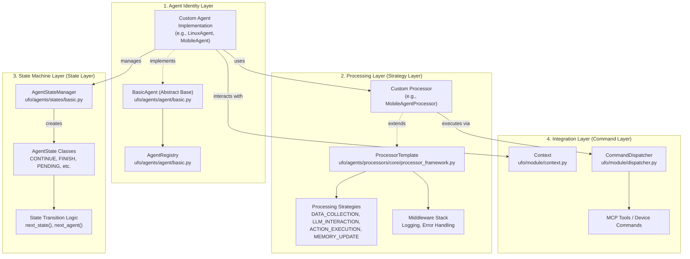
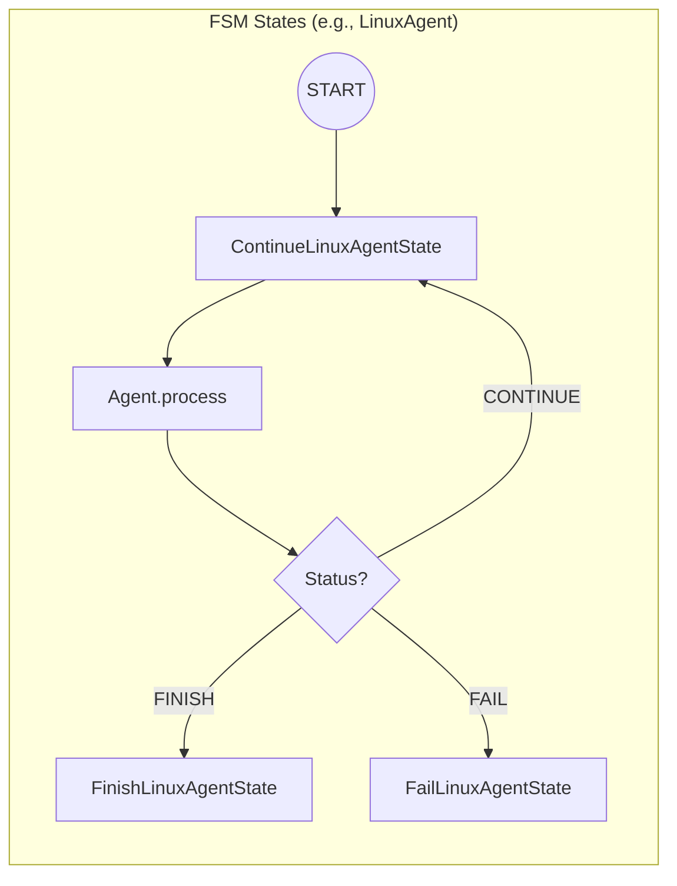

<!-- source: DeepWiki mcp.deepwiki.com · repo microsoft/UFO · page 13.1 Creating Custom Agents · fetched 2026-10-26 -->

# Creating Custom Agents

<details>
<summary>Relevant source files</summary>

The following files were used as context for generating this wiki page:

- [documents/docs/tutorials/creating_device_agent/client_setup.md](documents/docs/tutorials/creating_device_agent/client_setup.md)
- [documents/docs/tutorials/creating_device_agent/configuration.md](documents/docs/tutorials/creating_device_agent/configuration.md)
- [documents/docs/tutorials/creating_device_agent/core_components.md](documents/docs/tutorials/creating_device_agent/core_components.md)
- [documents/docs/tutorials/creating_device_agent/example_mobile_agent.md](documents/docs/tutorials/creating_device_agent/example_mobile_agent.md)
- [documents/docs/tutorials/creating_device_agent/mcp_server.md](documents/docs/tutorials/creating_device_agent/mcp_server.md)
- [documents/docs/tutorials/creating_device_agent/overview.md](documents/docs/tutorials/creating_device_agent/overview.md)
- [documents/docs/tutorials/creating_device_agent/testing.md](documents/docs/tutorials/creating_device_agent/testing.md)
- [tests/test_agents_config_migration.py](tests/test_agents_config_migration.py)
- [ufo/agents/agent/customized_agent.py](ufo/agents/agent/customized_agent.py)
- [ufo/agents/processors/core/processor_framework.py](ufo/agents/processors/core/processor_framework.py)
- [ufo/agents/processors/customized/customized_agent_processor.py](ufo/agents/processors/customized/customized_agent_processor.py)
- [ufo/agents/processors/strategies/customized_agent_processing_strategy.py](ufo/agents/processors/strategies/customized_agent_processing_strategy.py)
- [ufo/agents/processors/strategies/linux_agent_strategy.py](ufo/agents/processors/strategies/linux_agent_strategy.py)
- [ufo/client/mcp/http_servers/linux_mcp_server.py](ufo/client/mcp/http_servers/linux_mcp_server.py)
- [ufo/module/session_pool.py](ufo/module/session_pool.py)
- [ufo/module/sessions/linux_session.py](ufo/module/sessions/linux_session.py)
- [ufo/module/sessions/platform_session.py](ufo/module/sessions/platform_session.py)
- [ufo/prompts/third_party/linux_agent.yaml](ufo/prompts/third_party/linux_agent.yaml)
- [ufo/prompts/third_party/linux_agent_example.yaml](ufo/prompts/third_party/linux_agent_example.yaml)

</details>


This page provides a comprehensive guide to extending UFO by creating custom agents. Custom agents enable automation of new application types, integration with third-party systems, or implementation of specialized automation behaviors beyond the built-in HostAgent and AppAgent capabilities.

For information about the built-in agent hierarchy and their default behaviors, see [UFO² Desktop AgentOS]() and [Agent Processing System](). For MCP tool integration, see [Creating Custom MCP Servers]().

---

## Agent Architecture Overview

UFO agents are built on a four-layer architecture that separates concerns between agent identity, behavior, execution, and state management. Device agents (like `LinuxAgent` or `MobileAgent`) specifically follow a unified three-layer internal architecture within this framework.

**Agent Architecture Layers**



**Sources:** [ufo/agents/agent/basic.py:34-408](), [ufo/agents/processors/core/processor_framework.py:45-193](), [ufo/agents/states/basic.py:49-115](), [documents/docs/tutorials/creating_device_agent/overview.md:97-142]()

---

## Implementing the BasicAgent Interface

The `BasicAgent` abstract class defines the core interface. For most custom device agents, you should inherit from `CustomizedAgent` (which extends `AppAgent`).

**Required Methods and Properties**

| Entity | Purpose | Implementation Example |
|--------|---------|------------------------|
| `get_prompter()` | Return prompter for constructing LLM messages | `return LinuxAgentPrompter(main_prompt, example_prompt)` [ufo/agents/agent/customized_agent.py:81-91]() |
| `message_constructor()` | Build LLM prompt from context | Calls `self.prompter.system_prompt_construction` and `user_content_construction` [ufo/agents/agent/customized_agent.py:100-139]() |
| `default_state` | Property returning initial FSM state | `return ContinueLinuxAgentState()` [ufo/agents/agent/customized_agent.py:93-98]() |
| `blackboard` | Property for multi-agent coordination memory | `return self._blackboard` [ufo/agents/agent/customized_agent.py:141-148]() |

**Basic Agent Structure (Reference: LinuxAgent)**

```python
@AgentRegistry.register(
    agent_name="LinuxAgent", 
    third_party=True, 
    processor_cls=LinuxAgentProcessor
)
class LinuxAgent(CustomizedAgent):
    def __init__(self, name: str, main_prompt: str, example_prompt: str) -> None:
        super().__init__(
            name=name,
            main_prompt=main_prompt,
            example_prompt=example_prompt,
            process_name=None,
            is_visual=None,
        )
        self._blackboard = Blackboard()
        self.set_state(self.default_state)
```

**Sources:** [ufo/agents/agent/customized_agent.py:43-148](), [documents/docs/tutorials/creating_device_agent/core_components.md:68-162]()

---

## Agent Registration System

The `AgentRegistry` provides a decorator-based registration mechanism. For an agent to be discoverable by the `AgentFactory` and usable in sessions, it must be registered.

**Registration Decorator Parameters**

| Parameter | Type | Description |
|-----------|------|-------------|
| `agent_name` | str | Unique identifier used in configs and factory [ufo/agents/agent/basic.py:421-421]() |
| `third_party` | bool | If True, requires enablement in `third_party.yaml` [ufo/agents/agent/basic.py:422-422]() |
| `processor_cls` | Type | The class responsible for the agent's processing logic [ufo/agents/agent/basic.py:423-423]() |

**Configuration Integration**
For third-party agents, registration must be mirrored in `config/ufo/third_party.yaml`:
1. Add the name to `ENABLED_THIRD_PARTY_AGENTS` [documents/docs/tutorials/creating_device_agent/configuration.md:83-83]().
2. Define the agent configuration (prompts, visual mode, introduction) [documents/docs/tutorials/creating_device_agent/configuration.md:89-131]().

**Sources:** [ufo/agents/agent/basic.py:410-477](), [documents/docs/tutorials/creating_device_agent/configuration.md:75-131]()

---

## Creating Custom Processors and Strategies

Processors implement the execution pipeline using a strategy-based architecture. A `CustomizedProcessor` typically orchestrates four phases: `DATA_COLLECTION`, `LLM_INTERACTION`, `ACTION_EXECUTION`, and `MEMORY_UPDATE`.

**Processor Implementation (Reference: MobileAgentProcessor)**

```python
class MobileAgentProcessor(CustomizedProcessor):
    def _setup_strategies(self) -> None:
        # Compose multiple data collection strategies
        self.strategies[ProcessingPhase.DATA_COLLECTION] = ComposedStrategy(
            strategies=[
                MobileScreenshotCaptureStrategy(fail_fast=True),
                MobileAppsCollectionStrategy(fail_fast=False),
                MobileControlsCollectionStrategy(fail_fast=False),
            ],
            name="MobileDataCollectionStrategy",
            fail_fast=True,
        )
        self.strategies[ProcessingPhase.LLM_INTERACTION] = MobileLLMInteractionStrategy(fail_fast=True)
        self.strategies[ProcessingPhase.ACTION_EXECUTION] = MobileActionExecutionStrategy(fail_fast=False)
        self.strategies[ProcessingPhase.MEMORY_UPDATE] = AppMemoryUpdateStrategy(fail_fast=False)

    def _setup_middleware(self) -> None:
        self.middleware_chain = [MobileLoggingMiddleware()]
```

**Custom Strategy Logic**
Strategies use the `CommandDispatcher` to interact with the target environment (e.g., via MCP tools).

```python
# Example from CustomizedScreenshotCaptureStrategy
result = await command_dispatcher.execute_commands([
    Command(
        tool_name="take_screenshot",
        parameters={},
        tool_type="data_collection",
    )
])
```

**Sources:** [ufo/agents/processors/customized/customized_agent_processor.py:142-196](), [ufo/agents/processors/strategies/customized_agent_processing_strategy.py:117-154](), [ufo/agents/processors/core/processor_framework.py:80-93]()

---

## Implementing State Machines

Agents use a Finite State Machine (FSM) to control their lifecycle. Each state inherits from `AgentState` and defines how to handle the current step and what the next state should be.

**State Transition Flow**



**State Implementation (Reference: ContinueLinuxAgentState)**
States are registered with a specific State Manager (e.g., `LinuxAgentStateManager`) and implement the `handle` method which triggers the agent's processor [ufo/agents/agent/customized_agent.py:12-13]().

**Sources:** [ufo/agents/states/basic.py:49-115](), [ufo/agents/agent/customized_agent.py:93-98](), [documents/docs/tutorials/creating_device_agent/core_components.md:104-134]()

---

## Integration with Session Lifecycle

Custom agents are integrated into the system via platform-specific sessions. For example, `LinuxSession` and `MobileSession` bypass the `HostAgent` and interact directly with the custom agent.

**Session Agent Initialization**

```python
# ufo/module/sessions/platform_session.py
class MobileBaseSession(BaseSession):
    def _init_agents(self) -> None:
        self._host_agent = None  # Mobile sessions use single-tier architecture
        self._agent: MobileAgent = AgentFactory.create_agent(
            "MobileAgent",
            "MobileAgent",
            # ... prompt configs from third_party_agent_config ...
        )
```

**Round Execution**
In `LinuxSession`, each round is created using the specialized `LinuxAgent` instance [ufo/module/sessions/linux_session.py:67-86]().

**Sources:** [ufo/module/sessions/platform_session.py:98-123](), [ufo/module/sessions/linux_session.py:26-86]()

---

## Complete Implementation Checklist

To create a fully functional custom device agent, complete the following steps:

1.  **Agent Class**: Inherit `CustomizedAgent`, register with `@AgentRegistry`, and implement `get_prompter` and `message_constructor` [ufo/agents/agent/customized_agent.py:153-177]().
2.  **Processor**: Inherit `CustomizedProcessor` and define strategies for the four processing phases [ufo/agents/processors/customized/customized_agent_processor.py:142-176]().
3.  **Strategies**: Implement custom logic for data collection and action execution, utilizing `command_dispatcher` [ufo/agents/processors/strategies/customized_agent_processing_strategy.py:47-110]().
4.  **Prompter**: Create a custom prompter to handle specialized system and user prompt construction [ufo/agents/agent/customized_agent.py:188-198]().
5.  **State Manager**: Define the FSM states (Continue, Finish, Fail) and register them [ufo/agents/agent/customized_agent.py:200-205]().
6.  **Configuration**: 
    *   Register in `config/ufo/third_party.yaml` [documents/docs/tutorials/creating_device_agent/configuration.md:83-131]().
    *   Create YAML prompt templates in `ufo/prompts/third_party/` [ufo/prompts/third_party/linux_agent.yaml:1-63]().
    *   Register device instances in `config/galaxy/devices.yaml` for multi-device support [documents/docs/tutorials/creating_device_agent/configuration.md:166-200]().

**Sources:** [documents/docs/tutorials/creating_device_agent/core_components.md:47-54](), [documents/docs/tutorials/creating_device_agent/configuration.md:57-64]()

---

