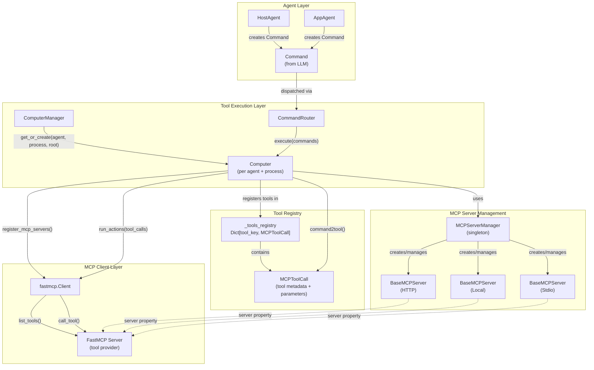
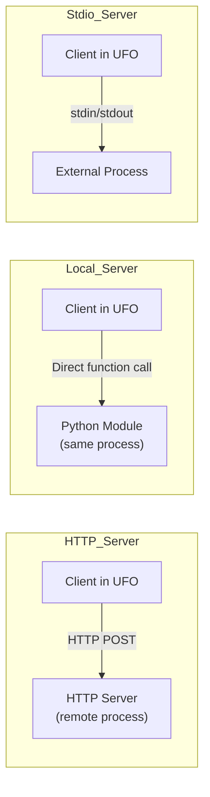
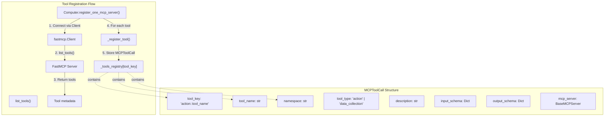
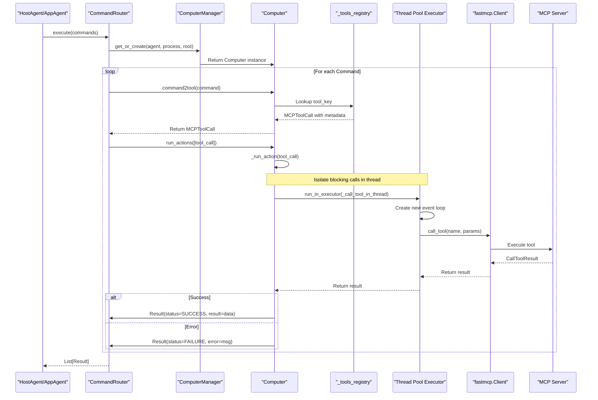

<!-- source: DeepWiki mcp.deepwiki.com · repo microsoft/UFO · page 13.2 Creating Custom MCP Servers · fetched 2026-10-26 -->

# Creating Custom MCP Servers

<details>
<summary>Relevant source files</summary>

The following files were used as context for generating this wiki page:

- [config/config_loader.py](config/config_loader.py)
- [config/config_schemas.py](config/config_schemas.py)
- [config/ufo/agents.yaml.template](config/ufo/agents.yaml.template)
- [config/ufo/system.yaml](config/ufo/system.yaml)
- [tests/image.png](tests/image.png)
- [ufo/agents/presenters/rich_presenter.py](ufo/agents/presenters/rich_presenter.py)
- [ufo/agents/processors/schemas/actions.py](ufo/agents/processors/schemas/actions.py)
- [ufo/agents/processors/strategies/app_agent_processing_strategy.py](ufo/agents/processors/strategies/app_agent_processing_strategy.py)
- [ufo/agents/processors/strategies/host_agent_processing_strategy.py](ufo/agents/processors/strategies/host_agent_processing_strategy.py)
- [ufo/automator/app_apis/shell/__init__.py](ufo/automator/app_apis/shell/__init__.py)
- [ufo/automator/app_apis/shell/shell_client.py](ufo/automator/app_apis/shell/shell_client.py)
- [ufo/client/computer.py](ufo/client/computer.py)
- [ufo/client/mcp/local_servers/ui_mcp_server.py](ufo/client/mcp/local_servers/ui_mcp_server.py)
- [ufo/config/__init__.py](ufo/config/__init__.py)

</details>


## Purpose and Scope

This document provides a comprehensive guide for developers to create custom Model Context Protocol (MCP) servers that extend UFO's automation capabilities. MCP servers expose tools (functions) that agents can invoke to perform actions or collect data from the environment. This page covers server types, tool definition, registration mechanisms, and integration with the `Computer` and `CommandRouter` systems.

---

## MCP Integration Architecture

UFO uses the **Model Context Protocol (MCP)** as a standardized interface for exposing external tools to LLM agents. MCP servers register collections of tools that are dynamically loaded and made available to agents during task execution.

### System Components

Title: MCP Integration and Tool Execution Architecture


**Key Relationships:**

- **ComputerManager** [ufo/client/computer.py:595-676]() creates `Computer` instances per agent/process/root combination.
- **Computer** [ufo/client/computer.py:22-593]() manages two categories of MCP servers: `data_collection` and `action`.
- **MCPServerManager** creates and manages `BaseMCPServer` instances (HTTP, Local, Stdio types).
- **CommandRouter** [ufo/client/computer.py:679-787]() converts `Command` objects from agents into `MCPToolCall` objects and executes them.
- Tools are registered in `_tools_registry` [ufo/client/computer.py:54]() with unique keys in format `tool_type::tool_name`.

**Sources:** [ufo/client/computer.py:1-868](), [ufo/agents/processors/strategies/app_agent_processing_strategy.py:114-131]()

---

## MCP Server Types

UFO supports three types of MCP servers, each suited for different use cases:

| Server Type | Transport | Use Case | Configuration |
|-------------|-----------|----------|---------------|
| **HTTP** | HTTP REST API | Remote servers, microservices | `server_type: "http"`, `url: "http://..."` |
| **Local** | In-process Python | Custom Python tools, no external process | `server_type: "local"`, `module: "module.path"` |
| **Stdio** | Standard I/O pipes | External executables, isolated processes | `server_type: "stdio"`, `command: "python server.py"` |

Title: Transport Layer Mapping


**Sources:** [ufo/client/computer.py:111-154](), [ufo/client/computer.py:280-298]()

---

## Tool Definition and Registration

### Tool Metadata Structure

Each MCP tool must provide metadata conforming to the MCP specification. When a `Computer` instance registers an MCP server, it queries the server for available tools and stores metadata in `MCPToolCall` objects.

Title: Tool Registration and Metadata Mapping


**MCPToolCall Properties** [ufo/client/computer.py:398-411]():

- `tool_key`: Unique identifier in format `{tool_type}::{tool_name}` [ufo/client/computer.py:562-569]().
- `tool_name`: The function/tool name.
- `namespace`: Server namespace (from config).
- `tool_type`: Either `data_collection` (namespace: `data_collection`) or `action` (namespace: `action`) [ufo/client/computer.py:27-28]().
- `input_schema`: JSON schema for parameters.
- `mcp_server`: Reference to the `BaseMCPServer` instance.

**Sources:** [ufo/client/computer.py:300-368](), [ufo/client/computer.py:369-411](), [ufo/client/computer.py:54-58]()

---

## Creating a Custom Local MCP Server

Local MCP servers are Python modules loaded directly into the UFO process.

### Step 1: Define Tool Functions

Create a Python module that uses the `@mcp.tool()` decorator from FastMCP. UFO includes several built-in local servers in `ufo/client/mcp/local_servers/`.

**Example: UI MCP Server Implementation** [ufo/client/mcp/local_servers/ui_mcp_server.py:191-205]():
The `create_host_action_mcp_server` function uses `MCPRegistry.register_factory_decorator` to define a server that provides UI automation tools like `select_application_window` [ufo/client/mcp/local_servers/ui_mcp_server.py:201]().

**Tool Function Pattern:**
Tools use type hints for parameters (e.g., `Annotated[str, "description"]`) which FastMCP uses to generate JSON schemas for the LLM [ufo/client/mcp/local_servers/ui_mcp_server.py:202-205]().

**Sources:** [ufo/client/mcp/local_servers/ui_mcp_server.py:1-205](), [ufo/client/computer.py:18-19]()

### Step 2: Register in Module Loader

The module must be importable from `ufo.client.mcp.local_servers`. The `load_all_servers()` function [ufo/client/computer.py:19]() imports all modules in this package to trigger registration in the `MCPRegistry`.

### Step 3: Configure in mcp.yaml

Add your server configuration to the MCP configuration file. The primary location is `config/ufo/mcp.yaml` [ufo/config/__init__.py:64-69]().

**Configuration Schema:**
```yaml
HostAgent:
  default:
    action:
      - namespace: "ui_automation"
        server_type: "local"
        module: "ufo.client.mcp.local_servers.ui_mcp_server"
        auto_start: true
```

**Sources:** [ufo/config/__init__.py:64-74](), [ufo/client/computer.py:111-154]()

---

## Tool Execution Lifecycle

### Execution Flow

Title: Command Execution Data Flow


**Key Execution Details:**

1. **Thread Isolation**: MCP tool calls are executed in a `ThreadPoolExecutor` [ufo/client/computer.py:65-67]() to prevent blocking operations (like `time.sleep`) from freezing the main event loop and causing WebSocket disconnections [ufo/client/computer.py:196-198]().
2. **Timeout Protection**: Tools have a default timeout of 6000 seconds [ufo/client/computer.py:70]().
3. **Meta Tools**: The `Computer` class can define "meta tools" using the `@meta_tool` decorator [ufo/client/computer.py:98-109](). These are intercepted in `_run_action` [ufo/client/computer.py:175-189]() and executed directly on the `Computer` instance (e.g., `list_tools` [ufo/client/computer.py:467]()).

**Sources:** [ufo/client/computer.py:64-70](), [ufo/client/computer.py:156-205](), [ufo/client/computer.py:679-787]()

---

## Meta Tools

Meta tools are special functions implemented directly in the `Computer` class rather than via an external MCP server.

**Built-in Meta Tool: list_tools** [ufo/client/computer.py:467-510]():
This tool allows agents to query the `_tools_registry` to see what capabilities are available in the current context.

**Creating Custom Meta Tools:**
1. Define a method in `Computer` or a subclass.
2. Decorate it with `@meta_tool("tool_name")` [ufo/client/computer.py:98-109]().
3. The method will be automatically registered in `_meta_tools` during initialization [ufo/client/computer.py:72-77]().

**Sources:** [ufo/client/computer.py:72-77](), [ufo/client/computer.py:98-109](), [ufo/client/computer.py:467-510]()

---

## Best Practices

- **Typed Parameters**: Always use Pydantic or Python type hints for tool parameters. This ensures the LLM receives a valid JSON schema [ufo/client/mcp/local_servers/ui_mcp_server.py:201-205]().
- **Error Handling**: Use `ToolError` from `fastmcp.exceptions` to return descriptive errors to the agent [ufo/client/mcp/local_servers/ui_mcp_server.py:173-186]().
- **Thread Safety**: Since tools run in a thread pool, ensure any shared state (like `UIServerState` [ufo/client/mcp/local_servers/ui_mcp_server.py:129-152]()) is handled safely.
- **Platform Checks**: If a server requires specific OS features (e.g., Windows UI automation), include platform checks at the module level [ufo/client/mcp/local_servers/ui_mcp_server.py:17-24]().

**Sources:** [ufo/client/mcp/local_servers/ui_mcp_server.py:1-205](), [ufo/client/computer.py:196-205]()

---

