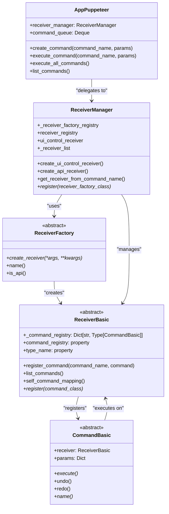
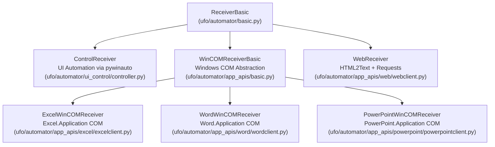
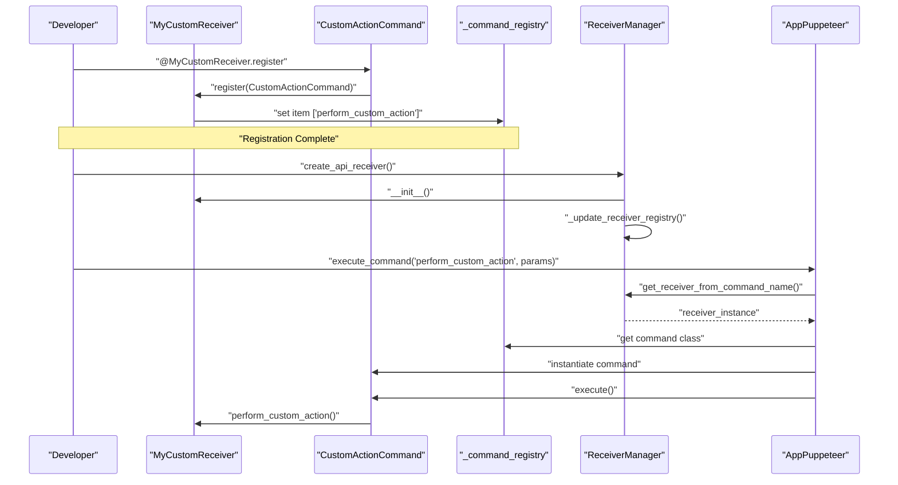

<!-- source: DeepWiki mcp.deepwiki.com · repo microsoft/UFO · page 13.3 Creating Custom Automation Receivers · fetched 2026-10-26 -->

# Creating Custom Automation Receivers

<details>
<summary>Relevant source files</summary>

The following files were used as context for generating this wiki page:

- [documents/docs/img/add_comment.png](documents/docs/img/add_comment.png)
- [ufo/automator/app_apis/basic.py](ufo/automator/app_apis/basic.py)
- [ufo/automator/app_apis/excel/excelclient.py](ufo/automator/app_apis/excel/excelclient.py)
- [ufo/automator/app_apis/factory.py](ufo/automator/app_apis/factory.py)
- [ufo/automator/app_apis/powerpoint/__init__.py](ufo/automator/app_apis/powerpoint/__init__.py)
- [ufo/automator/app_apis/powerpoint/powerpointclient.py](ufo/automator/app_apis/powerpoint/powerpointclient.py)
- [ufo/automator/app_apis/web/webclient.py](ufo/automator/app_apis/web/webclient.py)
- [ufo/automator/app_apis/word/wordclient.py](ufo/automator/app_apis/word/wordclient.py)
- [ufo/automator/basic.py](ufo/automator/basic.py)
- [ufo/automator/puppeteer.py](ufo/automator/puppeteer.py)

</details>


This document provides comprehensive guidance for extending UFO's automation capabilities by implementing custom receivers. Receivers are the execution backends that translate high-level commands into actual system interactions—whether through UI automation, COM APIs, web protocols, or any other mechanism.

For information about the overall automation framework and command orchestration, see [3.8 Automation Framework](). For details on COM-specific receivers for Office applications, see [3.9 COM Application Receivers](). For MCP-based tool integration, see [3.10 MCP Tool System]().

## Receiver Architecture

UFO's automation system is built on three core abstractions that implement the Command pattern:

### Core Abstractions

"Natural Language Space" to "Code Entity Space" mapping:

| Concept | Code Entity | Role |
| :--- | :--- | :--- |
| **Action Target** | `ReceiverBasic` | The object that knows how to perform the work. [ufo/automator/basic.py:10-66]() |
| **Atomic Action** | `CommandBasic` | Encapsulates a request as an object with `execute()`. [ufo/automator/basic.py:68-104]() |
| **Object Creator** | `ReceiverFactory` | Creates instances of receivers based on app context. [ufo/automator/basic.py:106-128]() |
| **Orchestrator** | `AppPuppeteer` | Manages the command queue and execution flow. [ufo/automator/puppeteer.py:22-183]() |
| **Router** | `ReceiverManager` | Dispatches commands to the correct receiver instance. [ufo/automator/puppeteer.py:185-309]() |

**Sources:** [ufo/automator/basic.py:1-128](), [ufo/automator/puppeteer.py:1-309]()

### System Class Diagram

Title: "Automation Command Pattern Architecture"

**Sources:** [ufo/automator/basic.py:10-128](), [ufo/automator/puppeteer.py:22-183]()

## Receiver Types

UFO includes several built-in receiver types that serve as reference implementations:

### Receiver Hierarchy

Title: "Receiver Inheritance and Implementation Map"

**Sources:** [ufo/automator/app_apis/basic.py:21-165](), [ufo/automator/app_apis/excel/excelclient.py:13-521](), [ufo/automator/app_apis/word/wordclient.py:11-336](), [ufo/automator/app_apis/powerpoint/powerpointclient.py:11-199](), [ufo/automator/app_apis/web/webclient.py:14-278]()

## Creating a Custom Receiver

### Step 1: Define the Receiver Class

Create a new receiver by inheriting from `ReceiverBasic`. For Windows applications with COM interfaces, inherit from `WinCOMReceiverBasic` [ufo/automator/app_apis/basic.py:21-26]().

```python
from ufo.automator.basic import ReceiverBasic, CommandBasic
from typing import Dict, Type, Any

class MyCustomReceiver(ReceiverBasic):
    # Class-level command registry
    _command_registry: Dict[str, Type[CommandBasic]] = {}
    
    def __init__(self, config_param: str) -> None:
        self.config_param = config_param
        self.client = self._initialize_client()
    
    @property
    def type_name(self) -> str:
        return "CUSTOM"
```
**Sources:** [ufo/automator/basic.py:10-66](), [ufo/automator/app_apis/excel/excelclient.py:13-23]()

### Step 2: Implement Core Methods

Add functionality your receiver will expose to the LLM. For example, `ExcelWinCOMReceiver` implements `table2markdown` [ufo/automator/app_apis/excel/excelclient.py:34-83]() and `insert_excel_table` [ufo/automator/app_apis/excel/excelclient.py:84-109]().

### Step 3: Create Command Classes

Define command classes that wrap your receiver's methods. Inherit from `CommandBasic` [ufo/automator/basic.py:68-104]().

```python
class CustomActionCommand(CommandBasic):
    def execute(self) -> str:
        return self.receiver.perform_custom_action(self.params)
    
    @classmethod
    def name(cls) -> str:
        return "perform_custom_action"
```

### Step 4: Register Commands

Use the class decorator pattern to register commands. The `@MyCustomReceiver.register` decorator calls the `register` class method defined in `ReceiverBasic` [ufo/automator/basic.py:53-60]().

```python
@MyCustomReceiver.register
class CustomActionCommand(CommandBasic):
    pass
```
**Sources:** [ufo/automator/app_apis/excel/excelclient.py:373-392](), [ufo/automator/app_apis/word/wordclient.py:200-201]()

## Command Registration and Execution Flow

Title: "Command Lifecycle from Registration to Execution"

**Sources:** [ufo/automator/basic.py:52-60](), [ufo/automator/puppeteer.py:39-86](), [ufo/automator/puppeteer.py:243-261]()

## Creating a Receiver Factory

To integrate your receiver with UFO's management system, create a `ReceiverFactory` [ufo/automator/basic.py:106-128]().

```python
from ufo.automator.basic import ReceiverFactory
from ufo.automator.puppeteer import ReceiverManager

@ReceiverManager.register
class CustomReceiverFactory(ReceiverFactory):
    def create_receiver(self, app_root_name: str, process_name: str) -> ReceiverBasic:
        if app_root_name == "myapp.exe":
            return MyCustomReceiver(process_name)
        return None

    @classmethod
    def name(cls) -> str:
        return "CustomTool"
```
**Sources:** [ufo/automator/app_apis/factory.py:19-94](), [ufo/automator/puppeteer.py:293-308]()

## Built-in Implementation Examples

### Office COM Receivers
The `ExcelWinCOMReceiver`, `WordWinCOMReceiver`, and `PowerPointWinCOMReceiver` inherit from `WinCOMReceiverBasic` [ufo/automator/app_apis/basic.py:21-26](). They use `win32com.client.Dispatch` to control Office applications [ufo/automator/app_apis/basic.py:41-43]().

- **Excel**: Features `table2markdown` [ufo/automator/app_apis/excel/excelclient.py:34-83]() and `reorder_columns` [ufo/automator/app_apis/excel/excelclient.py:157-219]().
- **Word**: Features `insert_table` [ufo/automator/app_apis/word/wordclient.py:32-52]() and `set_font` [ufo/automator/app_apis/word/wordclient.py:114-144]().
- **PowerPoint**: Features `set_background_color` [ufo/automator/app_apis/powerpoint/powerpointclient.py:35-65]() and `save_as` [ufo/automator/app_apis/powerpoint/powerpointclient.py:66-142]().

### Web Receiver
The `WebReceiver` [ufo/automator/app_apis/web/webclient.py:14-278]() provides a non-COM example using `requests` and `html2text` [ufo/automator/app_apis/web/webclient.py:8-9](). It implements commands like `navigate_to_url` [ufo/automator/app_apis/web/webclient.py:58-70]() and `get_page_content` [ufo/automator/app_apis/web/webclient.py:100-136]().

## Best Practices

1.  **Unique Naming**: Ensure `type_name` is unique for logging [ufo/automator/app_apis/excel/excelclient.py:364-367]().
2.  **Error Handling**: Wrap automation calls in try-except blocks to provide clear failure messages to the LLM [ufo/automator/app_apis/excel/excelclient.py:149-155]().
3.  **Command Registration**: Always use the `@Receiver.register` decorator on command classes to ensure they are available to the `AppPuppeteer` [ufo/automator/app_apis/powerpoint/powerpointclient.py:153-154]().
4.  **Factory Registration**: Register your factory with `ReceiverManager` to enable automatic discovery during session initialization [ufo/automator/app_apis/factory.py:32-33]().

**Sources:** [ufo/automator/basic.py:1-128](), [ufo/automator/puppeteer.py:1-309](), [ufo/automator/app_apis/factory.py:1-161]()

---

