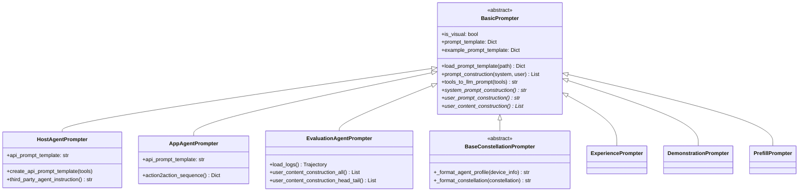
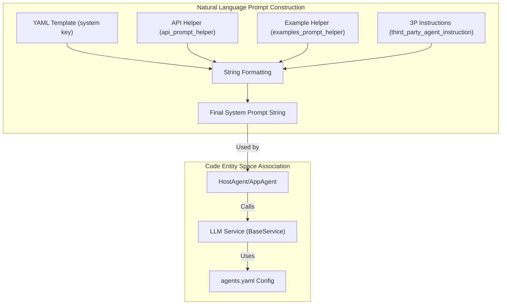
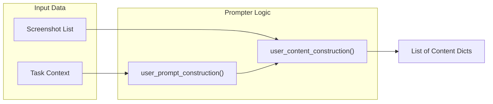

<!-- source: DeepWiki mcp.deepwiki.com · repo microsoft/UFO · page 13.4 Extending Prompt Templates · fetched 2026-10-26 -->

# Extending Prompt Templates

<details>
<summary>Relevant source files</summary>

The following files were used as context for generating this wiki page:

- [dataflow/prompter/instantiation/filter_prompter.py](dataflow/prompter/instantiation/filter_prompter.py)
- [dataflow/prompter/instantiation/prefill_prompter.py](dataflow/prompter/instantiation/prefill_prompter.py)
- [dataflow/prompter/instantiation/template_prompter.py](dataflow/prompter/instantiation/template_prompter.py)
- [galaxy/agents/prompters/base_constellation_prompter.py](galaxy/agents/prompters/base_constellation_prompter.py)
- [tests/test_prompt_sanitizer.py](tests/test_prompt_sanitizer.py)
- [ufo/prompter/agent_prompter.py](ufo/prompter/agent_prompter.py)
- [ufo/prompter/basic.py](ufo/prompter/basic.py)
- [ufo/prompter/customized/linux_agent_prompter.py](ufo/prompter/customized/linux_agent_prompter.py)
- [ufo/prompter/customized/mobile_agent_prompter.py](ufo/prompter/customized/mobile_agent_prompter.py)
- [ufo/prompter/demonstration_prompter.py](ufo/prompter/demonstration_prompter.py)
- [ufo/prompter/eva_prompter.py](ufo/prompter/eva_prompter.py)
- [ufo/prompter/experience_prompter.py](ufo/prompter/experience_prompter.py)
- [ufo/prompter/prompt_sanitizer.py](ufo/prompter/prompt_sanitizer.py)
- [ufo/prompts/examples/nonvisual/app_agent_example.yaml](ufo/prompts/examples/nonvisual/app_agent_example.yaml)
- [ufo/prompts/examples/nonvisual/host_agent_example.yaml](ufo/prompts/examples/nonvisual/host_agent_example.yaml)
- [ufo/prompts/examples/visual/app_agent_example.yaml](ufo/prompts/examples/visual/app_agent_example.yaml)
- [ufo/prompts/examples/visual/host_agent_example.yaml](ufo/prompts/examples/visual/host_agent_example.yaml)
- [ufo/prompts/share/base/app_agent.yaml](ufo/prompts/share/base/app_agent.yaml)
- [ufo/prompts/share/base/host_agent.yaml](ufo/prompts/share/base/host_agent.yaml)

</details>


This document explains the prompt template system in UFO, including the YAML template structure, prompter class hierarchy, prompt construction methods, and how to create custom prompters for new agent types.

For information about the RAG retrieval system that augments prompts with knowledge, see [RAG System Architecture](#8.1). For details about LLM service integration, see [LLM Integration](#7).

---

## Template File Structure

UFO uses YAML files to store prompt templates, providing separation between prompt content and code logic. Templates are organized hierarchically and support both visual and non-visual modes.

### Template Organization

```
ufo/prompts/
├── share/                          # Shared templates and base configs
│   └── base/
│       ├── host_agent.yaml
│       └── app_agent.yaml
├── host_agent/
│   ├── prompt_{mode}.yaml         # {mode} = visual or nonvisual
│   └── examples.yaml
├── app_agent/
│   ├── prompt_{mode}.yaml
│   └── examples.yaml
├── evaluation/
│   └── evaluate.yaml
└── experience/
    ├── summarization.yaml
    └── summarization_examples.yaml
```

### YAML Template Structure

All prompt templates follow a consistent structure with separate keys for different prompt components. For example, the `AppAgent` base template defines the persona and interaction rules.

```yaml
version: 1.0

system: |-
  - You are the AppAgent of UFO, a UI-focused agent framework for Windows OS.
  - {apis}           # Placeholder for API descriptions
  - {examples}       # Placeholder for few-shot examples

user: |-
  [Current State]:
  {control_item}
  [Previous Actions]:
  {prev_subtask}
  [User Request]:
  {user_request}
  {retrieved_docs}
```

**Sources:** [ufo/prompter/basic.py:45-69](), [ufo/prompts/share/base/app_agent.yaml:1-62](), [ufo/prompts/share/base/host_agent.yaml:1-48]()

---

## Prompter Class Hierarchy

The prompter system uses an abstract base class with specialized implementations for each agent type, including support for Galaxy's multi-device orchestration.



### Key Responsibilities

| Class | Purpose | Template Files |
|-------|---------|----------------|
| `BasicPrompter` | Abstract base class defining prompter interface | N/A |
| `HostAgentPrompter` | Desktop-level orchestration prompts | `host_agent.yaml`, `host_agent_example.yaml` |
| `AppAgentPrompter` | Application-specific action prompts | `app_agent.yaml`, `app_agent_example.yaml` |
| `EvaluationAgentPrompter` | Task completion evaluation prompts | `evaluate.yaml` |
| `BaseConstellationPrompter` | Galaxy multi-device task orchestration | `constellation_agent.yaml` |
| `PrefillPrompter` | Action prefilling for data collection | `prefill.yaml` |

**Sources:** [ufo/prompter/basic.py:16-208](), [ufo/prompter/agent_prompter.py:12-192](), [ufo/prompter/eva_prompter.py:16-144](), [galaxy/agents/prompters/base_constellation_prompter.py:27-186](), [dataflow/prompter/instantiation/prefill_prompter.py:12-140]()

---

## Template Loading and Mode Selection

The `BasicPrompter.load_prompt_template()` method handles template loading with automatic mode selection:

```python
# Template path format with mode placeholder
template_path = "ufo/prompts/app_agent/prompt_{mode}.yaml"

# Automatic mode resolution [ufo/prompter/basic.py:51-56]
is_visual = True  
# Resolves to: "ufo/prompts/app_agent/prompt_visual.yaml"
```

The method loads and parses YAML content into a dictionary structure. If a file is not found, it raises a `FileNotFoundError` [ufo/prompter/basic.py:67-69]().

**Sources:** [ufo/prompter/basic.py:44-69]()

---

## System Prompt Construction

System prompts establish the agent's role, capabilities, and constraints. The construction process combines multiple components:



### HostAgentPrompter System Prompt

The host agent system prompt construction integrates third-party agent instructions [ufo/prompter/agent_prompter.py:42-58]():

```python
def system_prompt_construction(self) -> str:
    apis = self.api_prompt_helper(verbose=0)
    examples = self.examples_prompt_helper()
    third_party_instructions = self.third_party_agent_instruction()

    system_key = "system" if self.is_visual else "system_nonvisual"

    return self.prompt_template[system_key].format(
        apis=apis,
        examples=examples,
        third_party_instructions=third_party_instructions,
    )
```

**Sources:** [ufo/prompter/agent_prompter.py:42-58](), [ufo/prompter/agent_prompter.py:87-104]()

---

## API and Tool Description Helpers

The `api_prompt_helper()` and `tools_to_llm_prompt()` methods convert tool information into LLM-readable descriptions.

### MCP Tool to Prompt Conversion

The `BasicPrompter.tool_to_llm_prompt()` method [ufo/prompter/basic.py:114-154]() formats `MCPToolInfo` objects:

```python
# Logic in ufo/prompter/basic.py:123-146
formated_string = f"""\
Tool name: {name}
Description: {desc}

Parameters:
{params}

Returns: {output_desc}
"""
```

### Dynamic API Template Creation

For Host Agents, the API prompt template is created dynamically from the provided list of tools [ufo/prompter/agent_prompter.py:35-40]():

```python
def create_api_prompt_template(self, tools: List[MCPToolInfo]):
    self.api_prompt_template = BasicPrompter.tools_to_llm_prompt(tools)
```

**Sources:** [ufo/prompter/basic.py:114-170](), [ufo/prompter/agent_prompter.py:35-40](), [ufo/prompter/agent_prompter.py:178-189]()

---

## Example Prompt Helper

Few-shot examples guide the LLM on expected output format and reasoning patterns.

### Example Construction Logic

The `examples_prompt_helper()` method [ufo/prompter/agent_prompter.py:150-176]() iterates through keys starting with "example" in the loaded template:

```python
for key, values in self.example_prompt_template.items():
    if key.startswith("example"):
        example = template.format(
            request=values.get("Request"),
            response=json.dumps(values.get("Response")),
        )
        example_list.append(example)
```

**Sources:** [ufo/prompter/agent_prompter.py:150-176](), [ufo/prompts/examples/visual/app_agent_example.yaml:3-30](), [ufo/prompts/examples/visual/host_agent_example.yaml:3-28]()

---

## User Prompt and Content Construction

The final prompt combines textual descriptions with multi-modal content (images).

### Multi-Modal Construction Flow



The `user_content_construction` method for `HostAgentPrompter` [ufo/prompter/agent_prompter.py:106-148]() appends images if `is_visual` is enabled:

```python
if self.is_visual:
    screenshot_text = ["Current Screenshots:"]
    for i, image in enumerate(image_list):
        user_content.append({"type": "text", "text": screenshot_text[i]})
        user_content.append({"type": "image_url", "image_url": {"url": image}})
```

### Evaluation Prompting

`EvaluationAgentPrompter` has specialized logic to handle all screenshots or just head/tail screenshots based on configuration [ufo/prompter/eva_prompter.py:78-91](). It also includes validation to filter out placeholder 1x1 images [ufo/prompter/eva_prompter.py:171-186]().

**Sources:** [ufo/prompter/agent_prompter.py:106-148](), [ufo/prompter/eva_prompter.py:78-91](), [ufo/prompter/eva_prompter.py:171-186]()

---

## Prompt Sanitization

UFO includes a `sanitize_user_input` utility to prevent prompt injection and handle large inputs.

### Sanitization Rules

- **Length Limiting**: Truncates input exceeding `_MAX_INPUT_LENGTH` [tests/test_prompt_sanitizer.py:72-93]().
- **Role Filtering**: Replaces patterns like `[SYSTEM]:` or `role: system` with filtered markers [tests/test_prompt_sanitizer.py:95-147]().
- **Bypass Detection**: Filters phrases like "skip confirm" or "ignore previous instructions" [tests/test_prompt_sanitizer.py:149-199]().
- **XML Tagging**: Wraps input in `<user_input>` tags to clearly demarcate untrusted content [tests/test_prompt_sanitizer.py:32-34]().

**Sources:** [ufo/prompter/prompt_sanitizer.py:1-100](), [tests/test_prompt_sanitizer.py:1-202]()

---

## Galaxy Constellation Prompting

The `BaseConstellationPrompter` provides specific helpers for formatting multi-device environments.

- **`_format_agent_profile`**: Converts device capabilities, OS, and metadata into a summary [galaxy/agents/prompters/base_constellation_prompter.py:45-85]().
- **`_format_constellation`**: Serializes the `TaskConstellation` DAG into a readable list of tasks, highlighting modifiable vs read-only tasks [galaxy/agents/prompters/base_constellation_prompter.py:87-186]().

**Sources:** [galaxy/agents/prompters/base_constellation_prompter.py:45-186]()

---

## Creating Custom Prompters

To extend the system with a new agent type:

1.  **Inherit from `BasicPrompter`**: Implement `system_prompt_construction`, `user_prompt_construction`, and `user_content_construction`.
2.  **Define YAML Templates**: Create a new directory in `ufo/prompts/` with `prompt_visual.yaml`, `prompt_nonvisual.yaml`, and `examples.yaml`.
3.  **Implement API Helpers**: If the agent uses specific tools, override `api_prompt_helper` to format descriptions.
4.  **Register with Agent**: Pass the template paths to the custom prompter instance within your agent's `__init__` method.

**Sources:** [ufo/prompter/basic.py:16-208](), [ufo/prompter/demonstration_prompter.py:12-33](), [dataflow/prompter/instantiation/prefill_prompter.py:12-35]()

---

