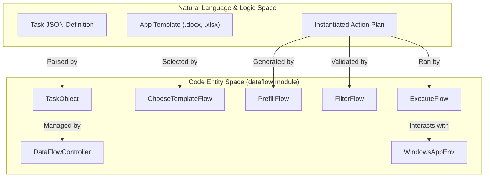
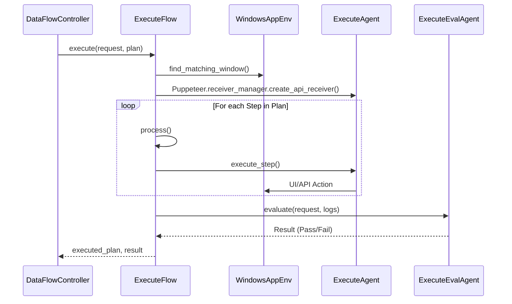

<!-- source: DeepWiki mcp.deepwiki.com · repo microsoft/UFO · page 13.5 Dataflow and LAM Data Collection · fetched 2026-10-26 -->

# Dataflow and LAM Data Collection

Relevant source files

The following files were used as context for generating this wiki page:

- [dataflow/.gitignore](dataflow/.gitignore)
- [dataflow/README.md](dataflow/README.md)
- [dataflow/config/config.yaml.template](dataflow/config/config.yaml.template)
- [dataflow/config/config_dev.yaml](dataflow/config/config_dev.yaml)
- [dataflow/data_flow_controller.py](dataflow/data_flow_controller.py)
- [dataflow/dataflow.py](dataflow/dataflow.py)
- [dataflow/env/env_manager.py](dataflow/env/env_manager.py)
- [dataflow/execution/workflow/execute_flow.py](dataflow/execution/workflow/execute_flow.py)
- [dataflow/instantiation/agent/filter_agent.py](dataflow/instantiation/agent/filter_agent.py)
- [dataflow/instantiation/agent/prefill_agent.py](dataflow/instantiation/agent/prefill_agent.py)
- [dataflow/instantiation/agent/template_agent.py](dataflow/instantiation/agent/template_agent.py)
- [dataflow/instantiation/workflow/choose_template_flow.py](dataflow/instantiation/workflow/choose_template_flow.py)
- [dataflow/instantiation/workflow/prefill_flow.py](dataflow/instantiation/workflow/prefill_flow.py)
- [dataflow/prompts/instantiation/visual/prefill.yaml](dataflow/prompts/instantiation/visual/prefill.yaml)
- [dataflow/prompts/instantiation/visual/prefill_example.yaml](dataflow/prompts/instantiation/visual/prefill_example.yaml)
- [dataflow/schema/execution_schema.json](dataflow/schema/execution_schema.json)
- [dataflow/templates/word/description.json](dataflow/templates/word/description.json)
- [dataflow/templates/word/images/1.png](dataflow/templates/word/images/1.png)
- [dataflow/templates/word/images/2.png](dataflow/templates/word/images/2.png)
- [learner/utils.py](learner/utils.py)

The Dataflow module implements a specialized pipeline for Large Action Model (LAM) training data collection and task processing. It streamlines the lifecycle of a task from initial setup to final execution and evaluation, ensuring that high-quality interaction data is captured for model training.

## Overview and Purpose

The Dataflow module extends the core UFO framework to support automated data generation and batch processing. It is designed to bridge the gap between high-level natural language instructions and executable action sequences.

The process is divided into three primary phases:
1.  **Instantiation**: Preparing a task by selecting a template, prefilling parameters, and filtering for correctness.
2.  **Execution**: Running the instantiated task within a live application environment and capturing screenshots and control metadata.
3.  **Dataflow**: The end-to-end pipeline combining both instantiation and execution into a single workflow.

Sources: [dataflow/README.md:19-47](), [dataflow/data_flow_controller.py:111-133]()

## System Architecture and Key Components

The Dataflow system is orchestrated by the `DataFlowController`, which manages the transitions between instantiation and execution.

### Dataflow Entity Mapping

The following diagram maps the logical components of the data collection process to the specific code entities that implement them.

Sources: [dataflow/data_flow_controller.py:62-133](), [dataflow/instantiation/workflow/choose_template_flow.py:21-43](), [dataflow/execution/workflow/execute_flow.py:19-53]()

## Instantiation Pipeline

Instantiation transforms a raw task description into a structured sequence of actions tailored to a specific document or application state.

### 1. Template Selection (`ChooseTemplateFlow`)
The system selects an appropriate starting document based on the task. It supports two methods:
*   **SemanticSimilarity**: Uses `HuggingFaceEmbeddings` and `FAISS` to find templates with descriptions matching the task.
*   **LLM**: Uses a `TemplateAgent` to reason about which template is best suited for the request.

Sources: [dataflow/instantiation/workflow/choose_template_flow.py:152-176](), [dataflow/config/config_dev.yaml:14-16]()

### 2. Action Prefilling (`PrefillFlow`)
The `PrefillAgent` generates the specific sequence of UI steps. It uses the `ControlInspectorFacade` and `PhotographerFacade` to understand the current application state before generating the `instantiated_plan`.

Sources: [dataflow/instantiation/workflow/prefill_flow.py:21-60](), [dataflow/instantiation/workflow/prefill_flow.py:174-187]()

### 3. Filtering and Validation (`FilterFlow`)
The `FilterAgent` evaluates the generated plan to ensure it is correct and achievable within the target application.

Sources: [dataflow/instantiation/agent/filter_agent.py:10-13](), [dataflow/data_flow_controller.py:11-12]()

## Execution Pipeline (`ExecuteFlow`)

The execution phase carries out the actions defined in the instantiation plan. It inherits from `AppAgentProcessor` and utilizes a specialized `ExecuteAgent`.

### Execution Workflow

Sources: [dataflow/execution/workflow/execute_flow.py:98-127](), [dataflow/execution/workflow/execute_flow.py:129-161]()

### Key Execution Functions
*   **`_get_or_create_execute_agent`**: Manages a singleton-like dictionary of `ExecuteAgent` instances per application to maintain state across steps. [dataflow/execution/workflow/execute_flow.py:54-66]()
*   **`execute_plan`**: Iterates through the `instantiated_plan`, calling `self.process()` for each step. It tracks success/failure and captures screenshots for each action. [dataflow/execution/workflow/execute_flow.py:129-185]()
*   **`WindowsAppEnv`**: Manages the lifecycle of the target Windows application, including starting the process with a specific template and finding the window via title matching strategies (`contains`, `fuzzy`, `regex`). [dataflow/env/env_manager.py:32-113]()

## Data Collection Workflows

Dataflow supports both single-task processing and high-throughput batch processing.

### Batch Processing Logic
When a directory path is provided to the `dataflow.py` entry point, the system invokes `process_batch`. This iterates through all JSON files in the directory, creating a new `DataFlowController` for each.

Sources: [dataflow/dataflow.py:81-96](), [dataflow/dataflow.py:118-124]()

### Data Reformatting
The system can reformat collected data into the UFO batch format for further evaluation or training.
*   **`REFORMAT_TO_BATCH`**: Config toggle to enable reformatting. [dataflow/config/config_dev.yaml:19]()
*   **`reformat_json_file`**: Utility that converts the `instantiation_result` into a format compatible with the `datasUFO` hub, provided the evaluation agent marked the task as successful. [learner/utils.py:95-118]()

## Configuration and Schema

The Dataflow module uses a dedicated configuration hierarchy.

| Config Key | Description | Default/Source |
| :--- | :--- | :--- |
| `CONTROL_BACKEND` | UI Automation backend (`uia` or `win32`) | `uia` [dataflow/config/config_dev.yaml:3]() |
| `MATCH_STRATEGY` | Strategy for window and control matching | `fuzzy` [dataflow/config/config_dev.yaml:7]() |
| `MAX_STEPS` | Maximum execution steps allowed per task | `30` [dataflow/config/config_dev.yaml:43]() |
| `PREFILL_PROMPT` | Path to the YAML prompt for action prefilling | [dataflow/config/config_dev.yaml:9]() |

### Result Schemas
The output data is validated against JSON schemas to ensure consistency for LAM training.
*   **Instantiation Schema**: `dataflow/schema/instantiation_schema.json` [dataflow/config/config_dev.yaml:28]()
*   **Execution Schema**: `dataflow/schema/execution_schema.json` [dataflow/config/config_dev.yaml:29]()

Sources: [dataflow/config/config_dev.yaml:1-44](), [dataflow/data_flow_controller.py:161-172]()

---

