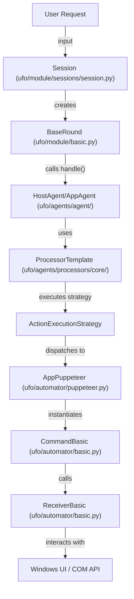
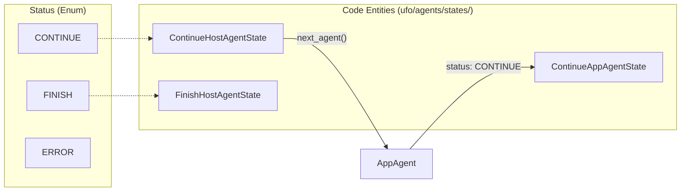

<!-- source: DeepWiki mcp.deepwiki.com · repo microsoft/UFO · page 13.6 Best Practices and Patterns · fetched 2026-10-26 -->

# Best Practices and Patterns

Relevant source files

The following files were used as context for generating this wiki page:

- [documents/docs/infrastructure/agents/design/blackboard.md](documents/docs/infrastructure/agents/design/blackboard.md)
- [documents/docs/infrastructure/agents/design/command.md](documents/docs/infrastructure/agents/design/command.md)
- [documents/docs/infrastructure/agents/design/memory.md](documents/docs/infrastructure/agents/design/memory.md)
- [documents/docs/infrastructure/agents/design/processor.md](documents/docs/infrastructure/agents/design/processor.md)
- [documents/docs/infrastructure/agents/design/prompter.md](documents/docs/infrastructure/agents/design/prompter.md)
- [documents/docs/infrastructure/agents/design/state.md](documents/docs/infrastructure/agents/design/state.md)
- [documents/docs/infrastructure/agents/design/strategy.md](documents/docs/infrastructure/agents/design/strategy.md)
- [ufo/agents/agent/app_agent.py](ufo/agents/agent/app_agent.py)
- [ufo/agents/agent/basic.py](ufo/agents/agent/basic.py)
- [ufo/agents/agent/evaluation_agent.py](ufo/agents/agent/evaluation_agent.py)
- [ufo/agents/agent/host_agent.py](ufo/agents/agent/host_agent.py)
- [ufo/agents/processors/app_agent_processor.py](ufo/agents/processors/app_agent_processor.py)
- [ufo/agents/processors/host_agent_processor.py](ufo/agents/processors/host_agent_processor.py)
- [ufo/agents/states/app_agent_state.py](ufo/agents/states/app_agent_state.py)
- [ufo/agents/states/basic.py](ufo/agents/states/basic.py)
- [ufo/agents/states/host_agent_state.py](ufo/agents/states/host_agent_state.py)
- [ufo/agents/states/operator_state.py](ufo/agents/states/operator_state.py)
- [ufo/automator/app_apis/basic.py](ufo/automator/app_apis/basic.py)
- [ufo/automator/app_apis/excel/excelclient.py](ufo/automator/app_apis/excel/excelclient.py)
- [ufo/automator/app_apis/factory.py](ufo/automator/app_apis/factory.py)
- [ufo/automator/app_apis/powerpoint/__init__.py](ufo/automator/app_apis/powerpoint/__init__.py)
- [ufo/automator/app_apis/powerpoint/powerpointclient.py](ufo/automator/app_apis/powerpoint/powerpointclient.py)
- [ufo/automator/app_apis/web/webclient.py](ufo/automator/app_apis/web/webclient.py)
- [ufo/automator/app_apis/word/wordclient.py](ufo/automator/app_apis/word/wordclient.py)
- [ufo/automator/basic.py](ufo/automator/basic.py)
- [ufo/automator/puppeteer.py](ufo/automator/puppeteer.py)
- [ufo/module/basic.py](ufo/module/basic.py)
- [ufo/module/sessions/plan_reader.py](ufo/module/sessions/plan_reader.py)
- [ufo/module/sessions/session.py](ufo/module/sessions/session.py)

This page outlines the architectural patterns and engineering principles employed in the UFO framework. The system is designed for extensibility and robustness, utilizing classic design patterns to decouple decision-making from execution and to manage complex agentic workflows.

## Architectural Patterns

UFO leverages several established software design patterns to maintain a clean separation of concerns between the LLM-driven intelligence and the underlying OS/Application automation layer.

### 1. Command Pattern
The Command pattern is the backbone of UFO's automation. It encapsulates a request as an object, thereby letting users parameterize agents with different actions.

*   **Implementation**: `CommandBasic` is the abstract base class for all actions [ufo/automator/basic.py:10-10](). Concrete implementations like `WinCOMCommand` [ufo/automator/app_apis/basic.py:9-9]() wrap specific API calls.
*   **Execution**: The `AppPuppeteer` creates commands via `create_command` [ufo/automator/puppeteer.py:39-41]() and executes them [ufo/automator/puppeteer.py:73-85](). This allows for queuing, logging, and replaying actions.

### 2. Factory Pattern
UFO uses factories to instantiate complex objects based on configuration or runtime context, ensuring that the core logic remains agnostic of specific implementations.

*   **AgentFactory**: Creates different types of agents (Host, App, Operator) based on the `agent_type` string [ufo/agents/agent/host_agent.py:115-140]().
*   **ReceiverFactory**: Dynamically creates receivers (e.g., `ControlReceiver`, `WinCOMReceiver`) that handle the actual UI or API interaction [ufo/automator/basic.py:16-17]().
*   **RetrieverFactory**: Instantiates different RAG retrievers (Offline, Online, Experience) [ufo/agents/agent/basic.py:49-49]().

### 3. State Machine Pattern
Agents in UFO operate as Finite State Machines (FSM). This manages the lifecycle of a task and transitions between different agents (e.g., HostAgent to AppAgent).

*   **Logic**: The `AgentStateManager` [ufo/agents/states/basic.py:9-9]() manages the transition logic. Each state (e.g., `ContinueHostAgentState`, `FinishAppAgentState`) implements a `handle` method [ufo/agents/states/host_agent_state.py:55-63]().
*   **Flow**: The `BaseRound` execution loop calls `agent.handle()` and then updates the state via `agent.state.next_state(agent)` [ufo/module/basic.py:161-168]().

### 4. Strategy Pattern
The `ProcessorTemplate` utilizes the Strategy pattern to define the phases of agent processing. This allows the behavior of an agent (like how it captures screenshots or interacts with LLMs) to be swapped out without changing the processor's structure.

*   **Composition**: The `AppAgentProcessor` composes strategies for `DATA_COLLECTION`, `LLM_INTERACTION`, and `ACTION_EXECUTION` [ufo/agents/processors/app_agent_processor.py:82-109]().
*   **Flexibility**: Multiple strategies can be combined into a `ComposedStrategy` [ufo/agents/processors/app_agent_processor.py:87-94]().

### 5. Decorator / Middleware Pattern
The processing pipeline uses a middleware chain to inject cross-cutting concerns like logging, performance monitoring, and error handling.

*   **Implementation**: `ProcessorTemplate` maintains a `middleware_chain` [ufo/agents/processors/app_agent_processor.py:111-114]().
*   **Logging**: `AppAgentLoggingMiddleware` decorates the process with rich console output and step tracking [ufo/agents/processors/app_agent_processor.py:132-146]().

---

## Data Flow: Natural Language to Code Entity Space

The following diagrams illustrate how high-level user requests are transformed into executable code entities within the UFO framework.

### Task Execution Flow
This diagram shows the path from a User Request to the specific `Command` execution.

**Sources:** [ufo/module/sessions/session.py:41-41](), [ufo/module/basic.py:98-98](), [ufo/agents/agent/app_agent.py:43-43](), [ufo/automator/puppeteer.py:22-22]().

### Agent State Transition Mapping
This diagram bridges the conceptual "Agent Status" to the concrete `AgentState` classes.

**Sources:** [ufo/agents/states/host_agent_state.py:21-33](), [ufo/agents/states/app_agent_state.py:30-43](), [ufo/agents/states/basic.py:9-11]().

---

## Error Handling Strategies

UFO employs a multi-layered error handling strategy to ensure system resilience:

| Layer | Strategy | Implementation |
| :--- | :--- | :--- |
| **Strategy Level** | `fail_fast` Flag | If `fail_fast=True`, the processor stops immediately on strategy failure to trigger recovery [ufo/agents/processors/app_agent_processor.py:93-98](). |
| **LLM Level** | Backup Engine | Uses a secondary LLM provider if the primary one fails or returns an invalid format [ufo/agents/agent/basic.py:163-175](). |
| **Action Level** | Graceful Failure | Action execution strategies often set `fail_fast=False` to allow the agent to observe the error in the next step and self-correct [ufo/agents/processors/host_agent_processor.py:107-109](). |
| **UI Level** | Re-annotation | If control detection fails, the system can trigger a `SCREENSHOT` state to re-annotate the UI [ufo/agents/states/app_agent_state.py:219-248](). |

**Sources:** [ufo/agents/processors/app_agent_processor.py:82-110](), [ufo/agents/agent/basic.py:158-176](), [ufo/agents/states/app_agent_state.py:219-248]().

---

## Performance Considerations

1.  **Lazy Loading**: Expensive modules like the `RetrieverFactory` are imported lazily to reduce initial startup time [ufo/agents/agent/basic.py:21-22]().
2.  **Context Management**: The `Blackboard` pattern allows agents to share information without passing massive objects, reducing memory overhead [ufo/agents/agent/host_agent.py:212-218]().
3.  **Screenshot Optimization**: The system captures "last snapshots" only when subtasks end to minimize I/O and processing [ufo/module/basic.py:177-180]().
4.  **Token Management**: Structured logging and specific context pruning in `_finalize_processing_context` help keep LLM prompt sizes within limits [ufo/agents/processors/host_agent_processor.py:137-147]().

**Sources:** [ufo/agents/agent/basic.py:21-22](), [ufo/module/basic.py:177-180](), [ufo/agents/processors/host_agent_processor.py:137-183]().

---

## Recommended Extension Points

Developers looking to extend UFO should focus on these primary interfaces:

1.  **Custom Agents**: Inherit from `BasicAgent` [ufo/agents/agent/basic.py:34-34]() and register via `@AgentRegistry.register`.
2.  **New Application APIs**: Inherit from `WinCOMReceiverBasic` [ufo/automator/app_apis/basic.py:15-15]() to add deep API support for new Windows applications (similar to Excel [ufo/automator/app_apis/excel/excelclient.py:13-13]()).
3.  **Processing Middleware**: Add new classes to the `middleware_chain` in `_setup_middleware` to implement custom telemetry or safety filters [ufo/agents/processors/app_agent_processor.py:111-114]().
4.  **Custom Strategies**: Create new strategies by implementing the `Strategy` interface for specialized data collection or execution logic [ufo/agents/processors/strategies/app_agent_processing_strategy.py]().

**Sources:** [ufo/agents/agent/basic.py:34-34](), [ufo/agents/agent/app_agent.py:42-42](), [ufo/automator/app_apis/basic.py:15-15](), [ufo/agents/processors/app_agent_processor.py:111-114]().

---

