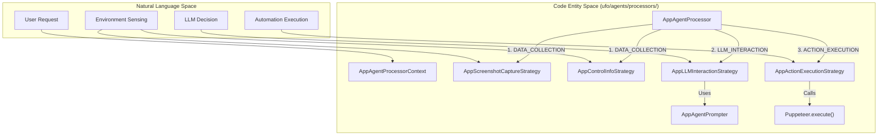
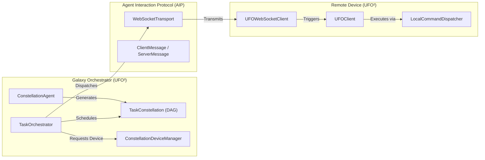

<!-- source: DeepWiki mcp.deepwiki.com · repo microsoft/UFO · page 14 Glossary · fetched 2026-10-26 -->

# Glossary

Relevant source files

The following files were used as context for generating this wiki page:

- [.gitignore](.gitignore)
- [README.md](README.md)
- [README_ZH.md](README_ZH.md)
- [aip/endpoints/base.py](aip/endpoints/base.py)
- [aip/endpoints/client_endpoint.py](aip/endpoints/client_endpoint.py)
- [aip/messages.py](aip/messages.py)
- [aip/protocol/base.py](aip/protocol/base.py)
- [aip/protocol/heartbeat.py](aip/protocol/heartbeat.py)
- [aip/transport/adapters.py](aip/transport/adapters.py)
- [aip/transport/base.py](aip/transport/base.py)
- [aip/transport/websocket.py](aip/transport/websocket.py)
- [assets/orchestrator.png](assets/orchestrator.png)
- [assets/task_constellation.png](assets/task_constellation.png)
- [assets/ufo.png](assets/ufo.png)
- [config/galaxy/constellation.yaml](config/galaxy/constellation.yaml)
- [config/galaxy/devices.yaml](config/galaxy/devices.yaml)
- [config/ufo/mcp.yaml](config/ufo/mcp.yaml)
- [config/ufo/prices.yaml](config/ufo/prices.yaml)
- [config/ufo/third_party.yaml](config/ufo/third_party.yaml)
- [dataflow/prompter/instantiation/filter_prompter.py](dataflow/prompter/instantiation/filter_prompter.py)
- [dataflow/prompter/instantiation/prefill_prompter.py](dataflow/prompter/instantiation/prefill_prompter.py)
- [dataflow/prompter/instantiation/template_prompter.py](dataflow/prompter/instantiation/template_prompter.py)
- [documents/docs/choose_path.md](documents/docs/choose_path.md)
- [documents/docs/galaxy/overview.md](documents/docs/galaxy/overview.md)
- [documents/docs/getting_started/quick_start_galaxy.md](documents/docs/getting_started/quick_start_galaxy.md)
- [documents/docs/index.md](documents/docs/index.md)
- [documents/mkdocs.yml](documents/mkdocs.yml)
- [galaxy/README.md](galaxy/README.md)
- [galaxy/README_ZH.md](galaxy/README_ZH.md)
- [galaxy/agents/prompters/base_constellation_prompter.py](galaxy/agents/prompters/base_constellation_prompter.py)
- [tests/aip/test_binary_transfer.py](tests/aip/test_binary_transfer.py)
- [tests/image.png](tests/image.png)
- [tests/test_prompt_sanitizer.py](tests/test_prompt_sanitizer.py)
- [ufo/README.md](ufo/README.md)
- [ufo/README_ZH.md](ufo/README_ZH.md)
- [ufo/agents/agent/app_agent.py](ufo/agents/agent/app_agent.py)
- [ufo/agents/agent/basic.py](ufo/agents/agent/basic.py)
- [ufo/agents/agent/evaluation_agent.py](ufo/agents/agent/evaluation_agent.py)
- [ufo/agents/agent/host_agent.py](ufo/agents/agent/host_agent.py)
- [ufo/agents/processors/app_agent_processor.py](ufo/agents/processors/app_agent_processor.py)
- [ufo/agents/processors/host_agent_processor.py](ufo/agents/processors/host_agent_processor.py)
- [ufo/agents/states/app_agent_state.py](ufo/agents/states/app_agent_state.py)
- [ufo/agents/states/basic.py](ufo/agents/states/basic.py)
- [ufo/agents/states/host_agent_state.py](ufo/agents/states/host_agent_state.py)
- [ufo/agents/states/operator_state.py](ufo/agents/states/operator_state.py)
- [ufo/automator/app_apis/basic.py](ufo/automator/app_apis/basic.py)
- [ufo/automator/app_apis/excel/excelclient.py](ufo/automator/app_apis/excel/excelclient.py)
- [ufo/automator/app_apis/factory.py](ufo/automator/app_apis/factory.py)
- [ufo/automator/app_apis/powerpoint/__init__.py](ufo/automator/app_apis/powerpoint/__init__.py)
- [ufo/automator/app_apis/powerpoint/powerpointclient.py](ufo/automator/app_apis/powerpoint/powerpointclient.py)
- [ufo/automator/app_apis/web/webclient.py](ufo/automator/app_apis/web/webclient.py)
- [ufo/automator/app_apis/word/wordclient.py](ufo/automator/app_apis/word/wordclient.py)
- [ufo/automator/basic.py](ufo/automator/basic.py)
- [ufo/automator/puppeteer.py](ufo/automator/puppeteer.py)
- [ufo/client/computer.py](ufo/client/computer.py)
- [ufo/config/__init__.py](ufo/config/__init__.py)
- [ufo/module/basic.py](ufo/module/basic.py)
- [ufo/module/sessions/plan_reader.py](ufo/module/sessions/plan_reader.py)
- [ufo/module/sessions/session.py](ufo/module/sessions/session.py)
- [ufo/prompter/agent_prompter.py](ufo/prompter/agent_prompter.py)
- [ufo/prompter/basic.py](ufo/prompter/basic.py)
- [ufo/prompter/customized/linux_agent_prompter.py](ufo/prompter/customized/linux_agent_prompter.py)
- [ufo/prompter/customized/mobile_agent_prompter.py](ufo/prompter/customized/mobile_agent_prompter.py)
- [ufo/prompter/demonstration_prompter.py](ufo/prompter/demonstration_prompter.py)
- [ufo/prompter/eva_prompter.py](ufo/prompter/eva_prompter.py)
- [ufo/prompter/experience_prompter.py](ufo/prompter/experience_prompter.py)
- [ufo/prompter/prompt_sanitizer.py](ufo/prompter/prompt_sanitizer.py)

This glossary defines technical terms, architectural concepts, and domain-specific jargon used across the UFO³ (Galaxy) and UFO² (Desktop AgentOS) codebases. It serves as a reference for onboarding engineers to understand the implementation details and data flow within the system.

## 1. Core Architecture Terms

### UFO² (Desktop AgentOS)
The single-device automation framework designed for Windows. It operates using a hierarchical agent structure (HostAgent and AppAgent) to execute tasks through a hybrid of GUI manipulation and API calls [README.md:68-83](). It can function as a standalone tool or as a "Device Agent" within a Galaxy constellation [ufo/module/sessions/session.py:41-61]().

### UFO³ Galaxy
The multi-device orchestration tier that coordinates multiple agents across heterogeneous platforms (Windows, Linux, Android). It uses a DAG-based task model called a **Constellation** to manage cross-device dependencies [README.md:46-59]().

### AIP (Agent Interaction Protocol)
A unified, WebSocket-based communication layer that enables secure coordination between the Galaxy orchestrator and distributed device agents [README.md:135-136](). It handles registration, heartbeats, and task dispatching [aip/protocol/base.py:1-20]().

### MCP (Model Context Protocol)
An integration layer that allows agents to use external tools and servers. UFO uses `MCPServerManager` to manage local, HTTP, or Stdio-based tool servers, exposing their capabilities to the LLM [ufo/client/computer.py:56-71]().

**Sources:** [README.md:41-154](), [ufo/module/sessions/session.py:41-61](), [ufo/client/computer.py:1-71]()

---

## 2. UFO² Subsystem Glossary

| Term | Definition | Code Pointer |
| :--- | :--- | :--- |
| **HostAgent** | The "Manager" agent responsible for desktop-level orchestration, application selection, and sub-agent creation. | [ufo/agents/agent/host_agent.py:143-176]() |
| **AppAgent** | An application-specific agent that performs fine-grained automation within a target window using RAG and UI inspection. | [ufo/agents/agent/app_agent.py:43-88]() |
| **Blackboard** | A shared memory component used for cross-agent communication and storing global request history. | [ufo/agents/memory/blackboard.py:1-20]() |
| **ProcessorTemplate** | A base class defining the four-phase pipeline: Data Collection, LLM Interaction, Action Execution, and Memory Update. | [ufo/agents/processors/core/processor_framework.py:26-40]() |
| **Puppeteer** | The orchestration component that translates LLM-decided actions into concrete UI or COM API commands. | [ufo/automator/puppeteer.py:1-30]() |
| **Context** | A type-safe container (using `ContextNames` enums) for passing state like screenshots, UI trees, and costs through the pipeline. | [ufo/module/context.py:35-45]() |

### UFO² Agent Processing Pipeline
The diagram below illustrates the flow of data through the `ProcessorTemplate` implementation used by both Host and App agents.

**Natural Language to Code Entity Mapping: UFO² Pipeline**

**Sources:** [ufo/agents/processors/app_agent_processor.py:54-110](), [ufo/agents/processors/core/processor_framework.py:26-73](), [ufo/prompter/agent_prompter.py:192-202]()

---

## 3. Galaxy & AIP Glossary

### Constellation
A Directed Acyclic Graph (DAG) representing a complex multi-device task. Nodes are **TaskStars** (individual tasks) and edges are **TaskStarLines** (dependencies) [README.md:129-130]().

### TaskOrchestrator
The engine responsible for the lifecycle of a Constellation. It identifies "ready" tasks, matches them to devices based on capabilities, and dispatches them via AIP [README.md:144-147]().

### CommandDispatcher
An abstraction for executing commands. `LocalCommandDispatcher` runs commands on the current machine, while `WebSocketCommandDispatcher` sends them to remote agents via AIP [ufo/module/sessions/session.py:101-103]().

### HeartbeatProtocol
A sub-protocol of AIP used to maintain connection persistence and monitor device health status [aip/protocol/base.py:10-25]().

**Natural Language to Code Entity Mapping: Galaxy Orchestration**

**Sources:** [README.md:125-138](), [ufo/module/sessions/session.py:101-103](), [aip/protocol/base.py:1-20]()

---

## 4. Automation & Tooling Terms

### COM (Component Object Model) Receivers
Specialized classes in UFO² that interact with Microsoft Office applications (Word, Excel, PowerPoint) via their native COM APIs rather than just GUI simulation [ufo/automator/app_apis/factory.py:1-20]().
* **File:** `ufo/automator/app_apis/excel/excelclient.py`
* **File:** `ufo/automator/app_apis/word/wordclient.py`

### Meta Tools
Internal functions within the `Computer` class decorated with `@meta_tool`. These are used for system-level operations like listing available MCP tools or managing server states [ufo/client/computer.py:98-109]().

### RAG (Retrieval-Augmented Generation)
The system used to augment agent prompts with external knowledge.
* **Offline Doc Retriever:** Indexes local help files [ufo/agents/agent/app_agent.py:75]().
* **Experience Retriever:** Uses `ExperienceSummarizer` to learn from previous successful trajectories [ufo/module/basic.py:40-41]().
* **Demonstration Retriever:** Retrieves human-provided examples of how to perform a task [ufo/agents/agent/app_agent.py:78]().

### Agent States (FSM)
Agents operate as Finite State Machines.
* **ContinueState:** The agent is still working on the current subtask [ufo/agents/states/app_agent_state.py:28]().
* **FinishState:** The agent has completed the task or subtask [ufo/agents/states/basic.py:37-38]().
* **HostAgentStatus:** Enums like `HOST_AGENT_CONTINUE` or `APP_SELECTION` [ufo/agents/states/host_agent_state.py:22]().

**Sources:** [ufo/automator/app_apis/factory.py:1-20](), [ufo/client/computer.py:98-109](), [ufo/agents/agent/app_agent.py:71-85](), [ufo/module/basic.py:160-180]()