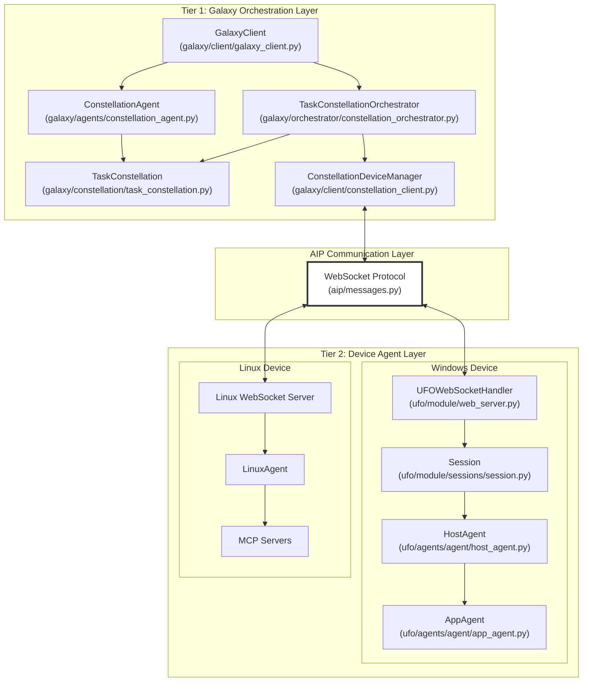
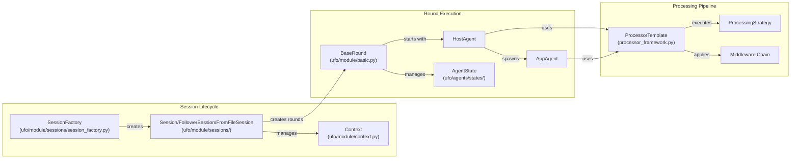
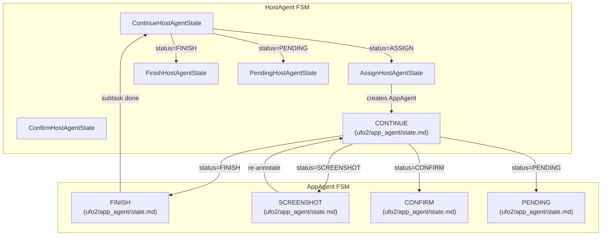
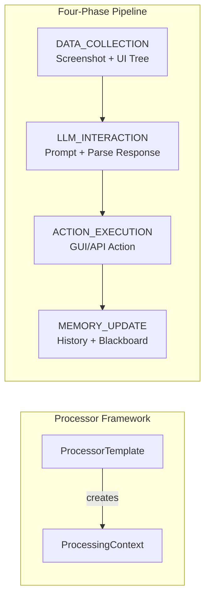
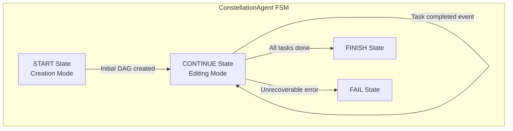
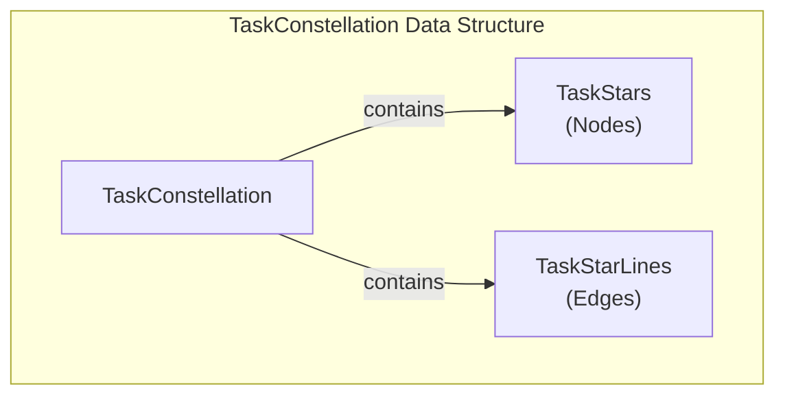
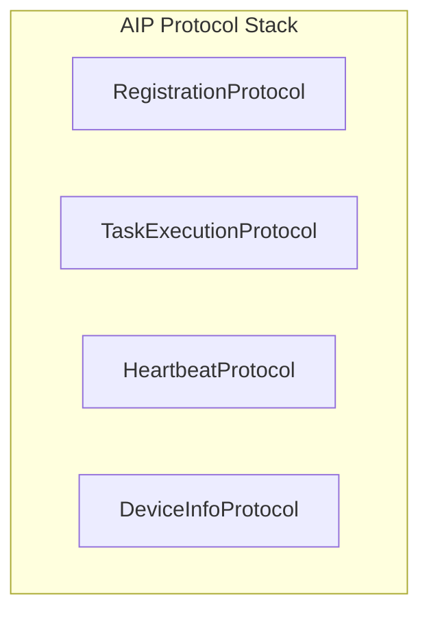
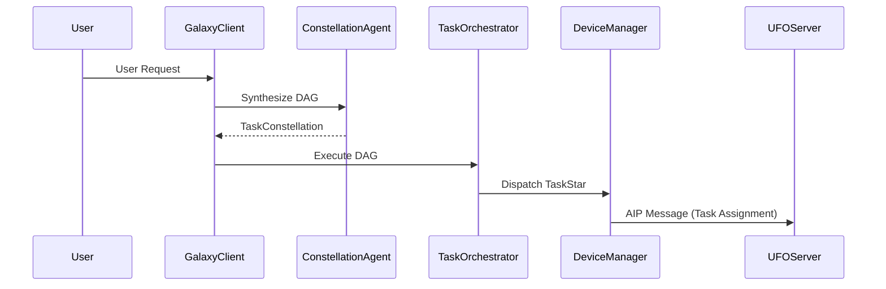
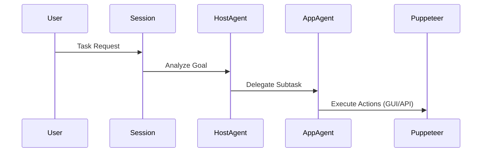

<!-- source: DeepWiki mcp.deepwiki.com · repo microsoft/UFO · page 2 System Architecture Overview · fetched 2026-10-26 -->

# System Architecture Overview

Relevant source files

The following files were used as context for generating this wiki page:

- [README.md](README.md)
- [README_ZH.md](README_ZH.md)
- [assets/orchestrator.png](assets/orchestrator.png)
- [assets/task_constellation.png](assets/task_constellation.png)
- [documents/docs/choose_path.md](documents/docs/choose_path.md)
- [documents/docs/galaxy/overview.md](documents/docs/galaxy/overview.md)
- [documents/docs/getting_started/quick_start_galaxy.md](documents/docs/getting_started/quick_start_galaxy.md)
- [documents/docs/img/aip_new.png](documents/docs/img/aip_new.png)
- [documents/docs/img/decomposition.png](documents/docs/img/decomposition.png)
- [documents/docs/index.md](documents/docs/index.md)
- [documents/docs/infrastructure/agents/agent_types.md](documents/docs/infrastructure/agents/agent_types.md)
- [documents/docs/infrastructure/agents/overview.md](documents/docs/infrastructure/agents/overview.md)
- [documents/docs/infrastructure/agents/server_client_architecture.md](documents/docs/infrastructure/agents/server_client_architecture.md)
- [documents/docs/infrastructure/modules/context.md](documents/docs/infrastructure/modules/context.md)
- [documents/docs/infrastructure/modules/dispatcher.md](documents/docs/infrastructure/modules/dispatcher.md)
- [documents/docs/infrastructure/modules/overview.md](documents/docs/infrastructure/modules/overview.md)
- [documents/docs/infrastructure/modules/platform_sessions.md](documents/docs/infrastructure/modules/platform_sessions.md)
- [documents/docs/infrastructure/modules/round.md](documents/docs/infrastructure/modules/round.md)
- [documents/docs/infrastructure/modules/session.md](documents/docs/infrastructure/modules/session.md)
- [documents/docs/infrastructure/modules/session_pool.md](documents/docs/infrastructure/modules/session_pool.md)
- [documents/docs/ufo2/app_agent/commands.md](documents/docs/ufo2/app_agent/commands.md)
- [documents/docs/ufo2/app_agent/overview.md](documents/docs/ufo2/app_agent/overview.md)
- [documents/docs/ufo2/app_agent/state.md](documents/docs/ufo2/app_agent/state.md)
- [documents/docs/ufo2/app_agent/strategy.md](documents/docs/ufo2/app_agent/strategy.md)
- [documents/docs/ufo2/core_features/hybrid_actions.md](documents/docs/ufo2/core_features/hybrid_actions.md)
- [documents/docs/ufo2/host_agent/commands.md](documents/docs/ufo2/host_agent/commands.md)
- [documents/docs/ufo2/host_agent/overview.md](documents/docs/ufo2/host_agent/overview.md)
- [documents/docs/ufo2/host_agent/state.md](documents/docs/ufo2/host_agent/state.md)
- [documents/docs/ufo2/host_agent/strategy.md](documents/docs/ufo2/host_agent/strategy.md)
- [documents/docs/ufo2/overview.md](documents/docs/ufo2/overview.md)
- [documents/mkdocs.yml](documents/mkdocs.yml)
- [galaxy/README.md](galaxy/README.md)
- [galaxy/README_ZH.md](galaxy/README_ZH.md)
- [ufo/README.md](ufo/README.md)
- [ufo/README_ZH.md](ufo/README_ZH.md)

## Purpose and Scope

This document provides a comprehensive overview of the UFO³ system architecture, explaining how the two-tier framework operates and how its major components interact. It covers the architectural layers from user request to task execution across heterogeneous devices.

**Scope of this document:**
- Two-tier architecture: Galaxy orchestration layer and UFO² device agent layer
- Agent hierarchy and processing pipeline
- Session and round lifecycle management
- Agent Interaction Protocol (AIP) communication layer
- Data flow from natural language to device execution

**Related pages:**
- For detailed information on UFO² agent processing, see [Agent Processing System](#3.1)
- For Galaxy-specific orchestration details, see [Galaxy Architecture](#4.1)
- For AIP protocol details, see [Agent Interaction Protocol](#5)
- For configuration management, see [Configuration System](#6)

---

## Two-Tier Architecture

UFO³ employs a **hierarchical two-tier architecture** that separates global orchestration from local execution, enabling scalable cross-device automation while maintaining operational independence of device agents.

### High-Level Architecture

**Sources:**
- [README.md:125-154]()
- [galaxy/README.md:27-57]()
- [documents/docs/index.md:81-109]()

### Tier 1: Galaxy Orchestration Layer

The **Galaxy layer** provides multi-device orchestration capabilities through LLM-driven task decomposition and DAG-based scheduling:

| Component | Class/Module | Responsibility |
|-----------|--------------|----------------|
| **GalaxyClient** | `galaxy.client.galaxy_client.GalaxyClient` | Entry point for multi-device sessions, manages ConstellationClient and session lifecycle [galaxy/README.md:180-186]() |
| **ConstellationAgent** | `galaxy.agents.constellation_agent.ConstellationAgent` | LLM-driven agent that decomposes user requests into DAG structures (Creation mode) and adapts DAGs based on execution feedback (Editing mode) [galaxy/README.md:66-71]() |
| **TaskConstellation** | `galaxy.constellation.task_constellation.TaskConstellation` | Dynamic DAG data structure with TaskStars (nodes) and TaskStarLines (edges) representing distributed workflow [galaxy/README.md:82-92]() |
| **TaskOrchestrator** | `galaxy.orchestrator.constellation_orchestrator.TaskConstellationOrchestrator` | Asynchronous execution engine that schedules ready tasks, dispatches to devices, and manages completion events [galaxy/README.md:144-147]() |
| **DeviceManager** | `galaxy.client.constellation_client.ConstellationDeviceManager` | Maintains device registry (AgentProfile), manages WebSocket connections, routes tasks, monitors heartbeats [documents/docs/galaxy/overview.md:44-51]() |

**Sources:**
- [galaxy/README.md:170-201]()
- [documents/docs/galaxy/overview.md:32-89]()

### Tier 2: Device Agent Layer

The **device agent layer** executes tasks locally on individual devices using platform-specific automation capabilities:

| Component | Class/Module | Responsibility |
|-----------|--------------|----------------|
| **Session** | `ufo.module.sessions.session.Session` | Manages multi-round user interaction lifecycle on a single device [ufo/README.md:76-80]() |
| **BaseRound** | `ufo.module.basic.BaseRound` | Encapsulates a single user request with step-by-step agent processing [ufo/README.md:142-147]() |
| **HostAgent** | `ufo.agents.agent.host_agent.HostAgent` | Desktop-level orchestrator that analyzes environment and spawns AppAgents [ufo/README.md:76-80]() |
| **AppAgent** | `ufo.agents.agent.app_agent.AppAgent` | Application-specific agent that executes fine-grained actions within apps [documents/docs/ufo2/app_agent/overview.md:1-22]() |
| **ProcessorTemplate** | `ufo.agents.processors.core.processor_framework.ProcessorTemplate` | Abstract base for agent processing pipeline with middleware support [documents/docs/ufo2/app_agent/overview.md:105-121]() |

**Sources:**
- [documents/docs/ufo2/overview.md:52-64]()
- [documents/docs/ufo2/app_agent/overview.md:9-22]()

---

## UFO² Desktop AgentOS Architecture

UFO² implements a **hierarchical multi-agent system** with state machines, processing pipelines, and hybrid GUI/API execution capabilities.

### Session and Round Lifecycle

**Sources:**
- [documents/docs/ufo2/overview.md:42-49]()
- [documents/docs/ufo2/app_agent/overview.md:56-83]()

### Agent Hierarchy and State Machines

UFO² agents follow a **finite state machine** pattern for robust workflow control:

**Key State Transitions:**

| State | Agent | Trigger | Action | Next State |
|-------|-------|---------|--------|------------|
| `CONTINUE` | HostAgent | Desktop analysis needed | Executes `HostAgentProcessor.process()` | `ASSIGN` or `FINISH` |
| `ASSIGN` | HostAgent | Application selected | Calls `create_subagent()` | AppAgent's `CONTINUE` |
| `CONTINUE` | AppAgent | Action execution needed | Executes `AppAgentProcessor.process()` | `FINISH`, `CONFIRM`, or `SCREENSHOT` |
| `FINISH` | AppAgent | Subtask completed | Returns to HostAgent | HostAgent's `CONTINUE` |
| `CONFIRM` | AppAgent | Safety check required | Prompts user confirmation | `CONTINUE` or `FINISH` |

**Sources:**
- [documents/docs/ufo2/app_agent/overview.md:91-103]()
- [documents/docs/ufo2/host_agent/overview.md:52-64]()

### Processing Pipeline Architecture

Both HostAgent and AppAgent utilize the **ProcessorTemplate pattern** with a four-phase pipeline:

**AppAgent Processor:**
- Class: `ufo.agents.processors.app_agent_processor.AppAgentProcessor`
- Phases defined in: [documents/docs/ufo2/app_agent/overview.md:105-121]()

**Sources:**
- [documents/docs/ufo2/app_agent/overview.md:105-121]()
- [documents/docs/ufo2/host_agent/overview.md:52-64]()

---

## Galaxy Orchestration Layer

The Galaxy layer provides **LLM-driven multi-device orchestration** through dynamic DAG decomposition and event-driven scheduling.

### ConstellationAgent: LLM-Driven Planning

**ConstellationAgent** operates in two modes:

| Mode | Purpose | Input | Output |
|------|---------|-------|--------|
| **Creation** | Initial task decomposition | User request + device capabilities | New `TaskConstellation` DAG [documents/docs/galaxy/overview.md:128-130]() |
| **Editing** | Runtime adaptation | Task results + current DAG | `ConstellationEditor` commands to modify DAG [documents/docs/galaxy/overview.md:131-132]() |

**Sources:**
- [galaxy/README.md:66-92]()
- [documents/docs/galaxy/overview.md:118-132]()

### TaskConstellation: Dynamic DAG Structure

The **TaskConstellation** represents the distributed workflow as a directed acyclic graph:

**DAG Invariants**:
1. **Acyclicity**: No cycles in dependency graph [documents/docs/galaxy/overview.md:28]()
2. **Safety Guarantees**: Formal invariants ensuring DAG consistency [galaxy/README.md:51-53]()

**Sources:**
- [galaxy/README.md:66-74]()
- [documents/docs/galaxy/overview.md:93-116]()

---

## Agent Interaction Protocol (AIP)

AIP provides **WebSocket-based bidirectional communication** between Galaxy orchestrator and device agents with automatic reconnection and fault tolerance.

### Protocol Stack

**Sources:**
- [galaxy/README.md:115-127]()
- [documents/docs/galaxy/overview.md:71-85]()

---

## Data Flow and Execution Path

### End-to-End Request Flow (Galaxy Mode)

**Sources:**
- [documents/docs/galaxy/overview.md:60-69]()
- [galaxy/README.md:193-201]()

### Local Execution Flow (UFO² Standalone)

**Sources:**
- [documents/docs/ufo2/overview.md:42-64]()
- [documents/docs/ufo2/app_agent/overview.md:64-83]()

---

## Configuration System

UFO³ uses a **modular YAML-based configuration** system.

| File | Purpose |
|------|---------|
| `config/ufo/agents.yaml` | LLM configuration for Host/App agents [ufo/README.md:127-130]() |
| `config/galaxy/agent.yaml` | LLM configuration for ConstellationAgent [galaxy/README.md:233-239]() |
| `config/galaxy/devices.yaml` | Device registry and capabilities [galaxy/README.md:302-310]() |

**Sources:**
- [ufo/README.md:120-130]()
- [galaxy/README.md:222-239]()
- [documents/docs/getting_started/quick_start_galaxy.md:40-58]()

---

