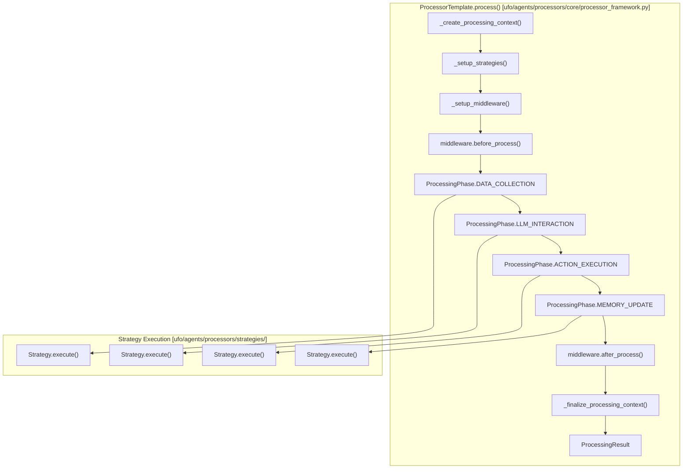
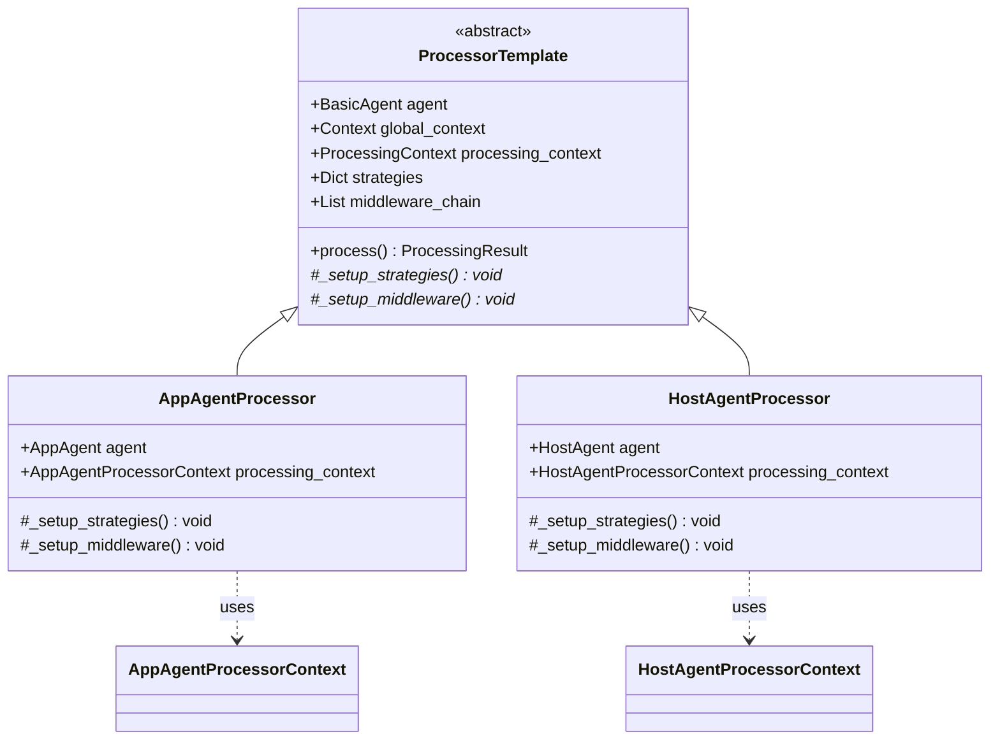
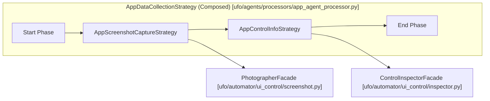
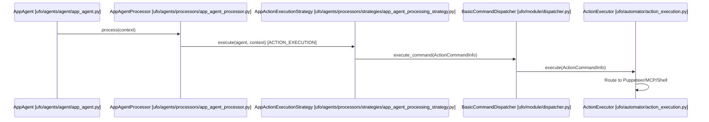

<!-- source: DeepWiki mcp.deepwiki.com · repo microsoft/UFO · page 3.1 Agent Processing System · fetched 2026-10-26 -->

# Agent Processing System

Relevant source files

The following files were used as context for generating this wiki page:

- [config/config_loader.py](config/config_loader.py)
- [config/config_schemas.py](config/config_schemas.py)
- [config/ufo/agents.yaml.template](config/ufo/agents.yaml.template)
- [config/ufo/system.yaml](config/ufo/system.yaml)
- [documents/docs/infrastructure/agents/design/blackboard.md](documents/docs/infrastructure/agents/design/blackboard.md)
- [documents/docs/infrastructure/agents/design/command.md](documents/docs/infrastructure/agents/design/command.md)
- [documents/docs/infrastructure/agents/design/memory.md](documents/docs/infrastructure/agents/design/memory.md)
- [documents/docs/infrastructure/agents/design/processor.md](documents/docs/infrastructure/agents/design/processor.md)
- [documents/docs/infrastructure/agents/design/prompter.md](documents/docs/infrastructure/agents/design/prompter.md)
- [documents/docs/infrastructure/agents/design/state.md](documents/docs/infrastructure/agents/design/state.md)
- [documents/docs/infrastructure/agents/design/strategy.md](documents/docs/infrastructure/agents/design/strategy.md)
- [ufo/agents/agent/app_agent.py](ufo/agents/agent/app_agent.py)
- [ufo/agents/agent/basic.py](ufo/agents/agent/basic.py)
- [ufo/agents/agent/evaluation_agent.py](ufo/agents/agent/evaluation_agent.py)
- [ufo/agents/agent/host_agent.py](ufo/agents/agent/host_agent.py)
- [ufo/agents/presenters/rich_presenter.py](ufo/agents/presenters/rich_presenter.py)
- [ufo/agents/processors/app_agent_processor.py](ufo/agents/processors/app_agent_processor.py)
- [ufo/agents/processors/host_agent_processor.py](ufo/agents/processors/host_agent_processor.py)
- [ufo/agents/processors/schemas/actions.py](ufo/agents/processors/schemas/actions.py)
- [ufo/agents/processors/strategies/app_agent_processing_strategy.py](ufo/agents/processors/strategies/app_agent_processing_strategy.py)
- [ufo/agents/processors/strategies/host_agent_processing_strategy.py](ufo/agents/processors/strategies/host_agent_processing_strategy.py)
- [ufo/agents/states/app_agent_state.py](ufo/agents/states/app_agent_state.py)
- [ufo/agents/states/basic.py](ufo/agents/states/basic.py)
- [ufo/agents/states/host_agent_state.py](ufo/agents/states/host_agent_state.py)
- [ufo/agents/states/operator_state.py](ufo/agents/states/operator_state.py)
- [ufo/automator/app_apis/shell/__init__.py](ufo/automator/app_apis/shell/__init__.py)
- [ufo/automator/app_apis/shell/shell_client.py](ufo/automator/app_apis/shell/shell_client.py)
- [ufo/client/mcp/local_servers/ui_mcp_server.py](ufo/client/mcp/local_servers/ui_mcp_server.py)
- [ufo/module/basic.py](ufo/module/basic.py)
- [ufo/module/sessions/plan_reader.py](ufo/module/sessions/plan_reader.py)
- [ufo/module/sessions/session.py](ufo/module/sessions/session.py)
- [ufo/trajectory/parser.py](ufo/trajectory/parser.py)

The Agent Processing System implements UFO's core execution pipeline through a **Processor-Strategy-Middleware architecture**. This modular design separates agent workflow orchestration (processors), phase-specific logic (strategies), and cross-cutting concerns (middleware) to enable flexible, maintainable agent behavior.

The system standardizes how `HostAgent` and `AppAgent` instances execute tasks through a phase-based pipeline:
1. **DATA_COLLECTION** - Capture screenshots and UI control information.
2. **LLM_INTERACTION** - Context-aware prompting and response parsing.
3. **ACTION_EXECUTION** - UI automation and control interaction.
4. **MEMORY_UPDATE** - Agent memory and state synchronization.

All processors inherit from `ProcessorTemplate` and implement their behavior through composable strategies and middleware chains.

## Architecture Overview

The processing system uses three architectural layers that work together to bridge high-level agent logic with low-level system execution.

**Phase-Based Processing Pipeline:**

**Processing Phases (ProcessingPhase):**

| Phase | Purpose | Strategy Examples |
|-------|---------|-------------------|
| `DATA_COLLECTION` | Capture screenshots, UI controls, system state | `DesktopDataCollectionStrategy`, `AppScreenshotCaptureStrategy` + `AppControlInfoStrategy` |
| `LLM_INTERACTION` | Build prompts, call LLM, parse responses | `HostLLMInteractionStrategy`, `AppLLMInteractionStrategy` |
| `ACTION_EXECUTION` | Execute commands via Puppeteer or MCP tools | `HostActionExecutionStrategy`, `AppActionExecutionStrategy` |
| `MEMORY_UPDATE` | Update agent memory and global context | `HostMemoryUpdateStrategy`, `AppMemoryUpdateStrategy` |

Sources: [ufo/agents/processors/core/processor_framework.py:26-110](), [ufo/agents/processors/app_agent_processor.py:65-73](), [ufo/agents/processors/host_agent_processor.py:95-113]()

## ProcessorTemplate Architecture

`ProcessorTemplate` serves as the abstract base class that orchestrates the phase-based execution pipeline for all agent processors. It defines the lifecycle of a single agent step.

**Class Hierarchy and Data Flow:**

**Core Responsibilities:**

| Component | Purpose | Implementation |
|-----------|---------|----------------|
| `ProcessorTemplate` | Orchestrates phase execution and middleware invocation. | [ufo/agents/processors/core/processor_framework.py:26-35]() |
| `ProcessingContext` | Type-safe context container for phase-local data. | [ufo/agents/processors/context/processing_context.py:24-30]() |
| `strategies` | Maps `ProcessingPhase` enums to concrete `BaseProcessingStrategy` objects. | [ufo/agents/processors/app_agent_processor.py:82-109]() |
| `middleware_chain` | Ordered list of `EnhancedLoggingMiddleware` or custom hooks. | [ufo/agents/processors/app_agent_processor.py:111-114]() |

Sources: [ufo/agents/processors/core/processor_framework.py:26-110](), [ufo/agents/processors/app_agent_processor.py:54-76](), [ufo/agents/processors/host_agent_processor.py:66-83]()

## Strategy System

The strategy pattern separates phase-specific logic into composable units. Each strategy implements the `BaseProcessingStrategy` interface.

**Strategy Composition for AppAgent:**

**Key Strategies:**

| Strategy | Agent | Phase | Role |
|----------|-------|-------|------|
| `AppScreenshotCaptureStrategy` | App | DATA_COLLECTION | Captures window screenshots via `command_dispatcher`. |
| `AppControlInfoStrategy` | App | DATA_COLLECTION | Filters UI elements and annotates screenshots. |
| `AppLLMInteractionStrategy` | App | LLM_INTERACTION | Constructs messages via `agent.message_constructor`. |
| `DesktopDataCollectionStrategy`| Host| DATA_COLLECTION | Enumerates open windows and desktop state. |
| `HostActionExecutionStrategy` | Host| ACTION_EXECUTION | Handles application selection and shell commands. |

**Composed Strategy Implementation:**
The `ComposedStrategy` class allows multiple strategies to execute sequentially in a single phase. For example, `AppAgentProcessor` uses it to combine visual capture and UI tree inspection.

Sources: [ufo/agents/processors/strategies/app_agent_processing_strategy.py:79-172](), [ufo/agents/processors/strategies/host_agent_processing_strategy.py:38-43](), [ufo/agents/processors/app_agent_processor.py:87-94](), [ufo/agents/processors/strategies/processing_strategy.py:34-47]()

## Middleware Chain

Middleware provides hooks for cross-cutting concerns like logging, performance tracking, and error recovery without modifying the core pipeline.

**Middleware Lifecycle:**

| Method | Purpose | Implementation Example |
|--------|---------|------------------------|
| `before_process` | Setup logging/UI panels. | `AppAgentLoggingMiddleware` prints the "Round/Step" panel. |
| `after_process` | Summarize execution/cost. | `EnhancedLoggingMiddleware` logs the final `ProcessingResult`. |
| `on_error` | Handle exceptions. | Logs stack traces and triggers recovery logic. |

Sources: [ufo/agents/processors/core/processing_middleware.py:25-30](), [ufo/agents/processors/app_agent_processor.py:132-182](), [ufo/agents/processors/host_agent_processor.py:186-210]()

## Execution and Data Flow

The processor acts as the bridge between the high-level `BasicAgent` logic and the low-level `AppPuppeteer` or `ComputerManager` automation.

**Bridging Agent Logic to Code Execution:**

**Context Promotion:**
After processing, the `_finalize_processing_context` method promotes local data to the `global_context` (`Context` class). This ensures that decisions made in one step (like a selected application) are available to subsequent steps and other agents via the `ContextNames` enum.

Sources: [ufo/agents/processors/core/processor_framework.py:100-110](), [ufo/agents/processors/host_agent_processor.py:137-183](), [ufo/agents/processors/strategies/app_agent_processing_strategy.py:102-172](), [ufo/module/context.py:35-45]()

---

