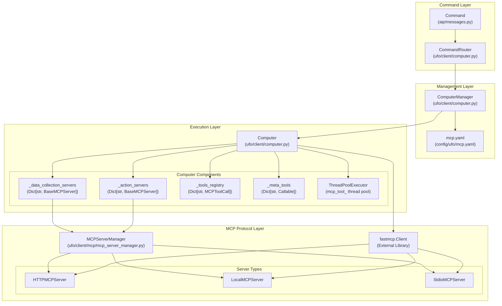
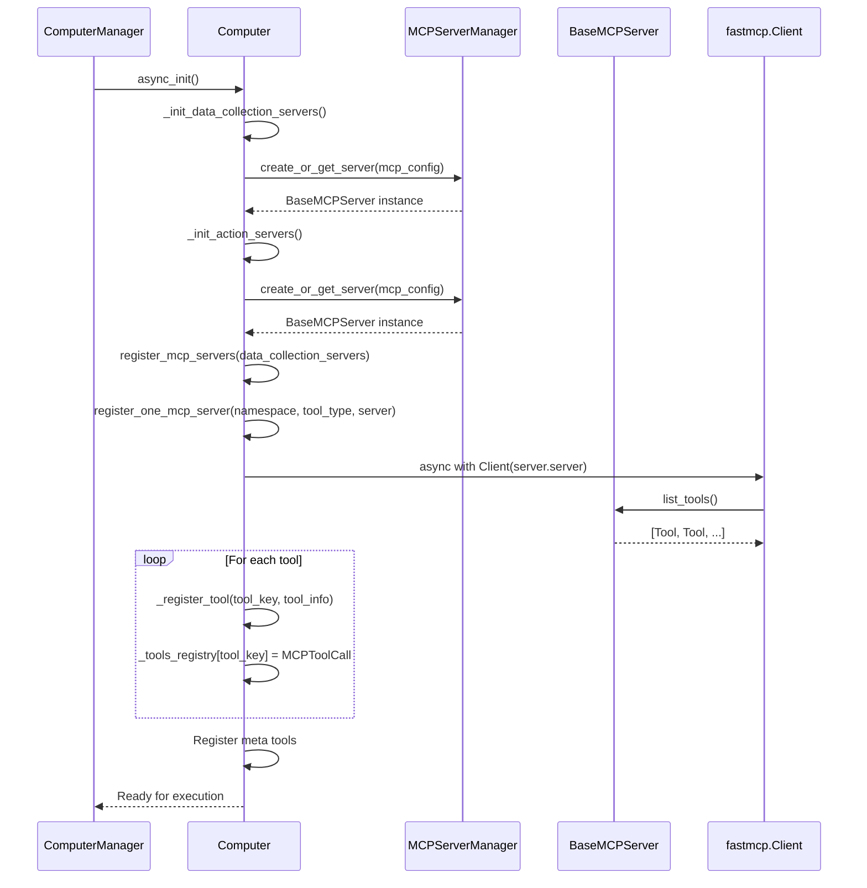
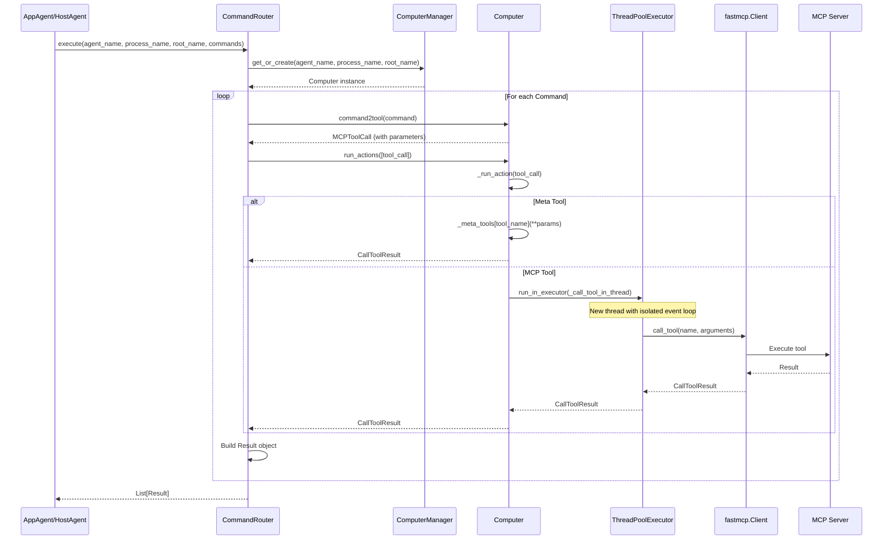
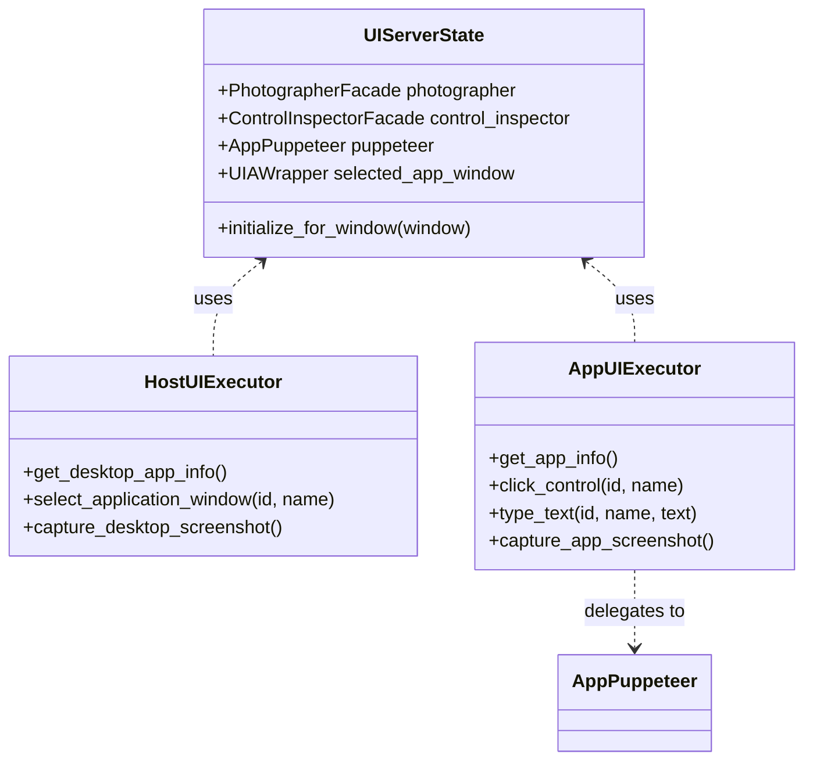

<!-- source: DeepWiki mcp.deepwiki.com · repo microsoft/UFO · page 3.10 MCP Tool System · fetched 2026-10-26 -->

# MCP Tool System

<details>
<summary>Relevant source files</summary>

The following files were used as context for generating this wiki page:

- [config/config_loader.py](config/config_loader.py)
- [config/config_schemas.py](config/config_schemas.py)
- [config/ufo/agents.yaml.template](config/ufo/agents.yaml.template)
- [config/ufo/system.yaml](config/ufo/system.yaml)
- [documents/docs/mcp/servers/command_line_executor.md](documents/docs/mcp/servers/command_line_executor.md)
- [documents/docs/mcp/servers/host_ui_executor.md](documents/docs/mcp/servers/host_ui_executor.md)
- [tests/image.png](tests/image.png)
- [ufo/agents/presenters/rich_presenter.py](ufo/agents/presenters/rich_presenter.py)
- [ufo/agents/processors/schemas/actions.py](ufo/agents/processors/schemas/actions.py)
- [ufo/agents/processors/strategies/app_agent_processing_strategy.py](ufo/agents/processors/strategies/app_agent_processing_strategy.py)
- [ufo/agents/processors/strategies/host_agent_processing_strategy.py](ufo/agents/processors/strategies/host_agent_processing_strategy.py)
- [ufo/automator/app_apis/shell/__init__.py](ufo/automator/app_apis/shell/__init__.py)
- [ufo/automator/app_apis/shell/shell_client.py](ufo/automator/app_apis/shell/shell_client.py)
- [ufo/client/computer.py](ufo/client/computer.py)
- [ufo/client/mcp/local_servers/ui_mcp_server.py](ufo/client/mcp/local_servers/ui_mcp_server.py)
- [ufo/config/__init__.py](ufo/config/__init__.py)

</details>


## Purpose and Scope

This document describes UFO²'s **Model Context Protocol (MCP) integration system**, which enables agents to execute actions and collect data through standardized tool servers. The MCP Tool System provides a unified abstraction for agent capabilities, replacing traditional hardcoded automation methods with dynamically discoverable, configuration-driven tools.

**Scope:** This page covers the `Computer`, `ComputerManager`, and `CommandRouter` classes that form the core of MCP tool execution in UFO². For information about:
- Traditional UI automation and COM APIs, see [Automation Framework](#3.8) and [COM Application Receivers](#3.9)
- MCP server implementations and lifecycle management, see the `MCPServerManager` documentation.
- Agent-level processing that invokes these tools, see [Agent Processing System](#3.1)
- Galaxy's use of MCP tools on remote devices, see [Task Execution Protocol](#5.4)

---

## System Architecture

The MCP Tool System follows a **three-tier architecture** for command routing, computer management, and tool execution. It bridges the gap between high-level agent requests and low-level system operations.

### Architecture Overview Diagram

Title: MCP Tool System Architecture

**Sources:** [ufo/client/computer.py:22-68]() | [ufo/client/mcp/mcp_server_manager.py:1-200]()

---

## Computer Class

The `Computer` class is the **central abstraction** for managing MCP tools. Each `Computer` instance represents a **logical execution context** with its own set of MCP servers and tool registry.

### Key Responsibilities

| Responsibility | Implementation |
|---------------|---------------|
| **Namespace Separation** | Maintains two tool namespaces: `data_collection` and `action` [ufo/client/computer.py:27-28]() |
| **Tool Registry** | Stores all discovered tools in `_tools_registry` with unique keys [ufo/client/computer.py:54]() |
| **Server Management** | Initializes and manages MCP server connections [ufo/client/computer.py:79-95]() |
| **Tool Execution** | Routes tool calls to appropriate MCP servers via `fastmcp.Client` [ufo/client/computer.py:191-248]() |
| **Meta Tools** | Provides built-in tools like `list_tools` for runtime introspection [ufo/client/computer.py:467-510]() |
| **Async Execution** | Uses thread pool isolation to prevent blocking operations [ufo/client/computer.py:64-70]() |

### Dual Namespace Design

The system separates tools into two namespaces to allow agents to clearly distinguish between observation and interaction.

- **`data_collection`**: Tools for observation, such as `get_desktop_app_info`, `take_screenshot`, or `get_control_info`. [ufo/client/computer.py:27]()
- **`action`**: Tools for interaction, such as `click_control`, `type_text`, or `select_application_window`. [ufo/client/computer.py:28]()

**Sources:** [ufo/client/computer.py:22-154]()

### Tool Key Format

Tools are uniquely identified by **tool keys** in the format `tool_type::tool_name`. This is constructed by `Computer.make_tool_key()`.
- Example: `data_collection::get_desktop_app_info`
- Example: `action::click_control`

**Sources:** [ufo/client/computer.py:561-569]()

---

## Tool Registration and Discovery

### Registration Lifecycle

Title: MCP Tool Registration Sequence

**Sources:** [ufo/client/computer.py:79-154]() | [ufo/client/computer.py:283-348]()

### Registration Process Details

1. **Initialization Phase** (`async_init`): Calls `_init_data_collection_servers()` and `_init_action_servers()` to create server instances via `MCPServerManager`. [ufo/client/computer.py:79-95]()
2. **Server Registration** (`register_mcp_servers`): Runs registration tasks concurrently using `asyncio.gather`. [ufo/client/computer.py:283-298]()
3. **Tool Discovery** (`register_one_mcp_server`): Connects to the MCP server via `fastmcp.Client` and calls `client.list_tools()`. [ufo/client/computer.py:300-348]()
4. **Tool Registration** (`_register_tool`): Creates `MCPToolCall` objects with complete tool metadata and stores them in `_tools_registry`. [ufo/client/computer.py:369-411]()
5. **Meta Tool Registration**: Automatically registers methods decorated with `@meta_tool`. [ufo/client/computer.py:349-367]()

**Sources:** [ufo/client/computer.py:79-411]()

---

## Tool Execution

### Execution Flow Diagram

Title: Tool Execution Logic

**Sources:** [ufo/client/computer.py:679-787]() | [ufo/client/computer.py:156-264]()

### Thread Pool Isolation

To prevent blocking operations in MCP tools from affecting the main event loop (which could cause WebSocket disconnections), tool execution is isolated in separate threads via `ThreadPoolExecutor`. [ufo/client/computer.py:64-70]()

The `_call_tool_in_thread` function:
1. Creates a new event loop using `asyncio.new_event_loop()`. [ufo/client/computer.py:202]()
2. Executes the MCP tool call using `fastmcp.Client`. [ufo/client/computer.py:205]()
3. Returns the result to the main loop. [ufo/client/computer.py:214]()

**Sources:** [ufo/client/computer.py:196-248]()

---

## ComputerManager

The `ComputerManager` is a **factory and registry** for `Computer` instances. It ensures that agents with the same configuration share the same `Computer` instance.

### Instance Key Format

Computer instances are cached using a composite key: `{agent_name}::{process_name}::{root_name}`. [ufo/client/computer.py:624]()

### Configuration Loading

The manager reads configurations from the `mcp` section of the system configuration. [ufo/client/computer.py:612-669]()
- It looks for `agent_name` (e.g., `HostAgent`, `AppAgent`).
- It selects a configuration root based on `root_name` (e.g., `EXCEL.EXE`, `default`).
- It extracts `data_collection` and `action` server lists.

**Sources:** [ufo/client/computer.py:602-677]() | [config/ufo/system.yaml:106-113]()

---

## CommandRouter

The `CommandRouter` provides the **high-level interface** for executing commands on `Computer` instances. It handles command batching, error propagation, and early exit logic.

### execute Method

```python
async def execute(
    self,
    agent_name: str,
    process_name: Optional[str],
    root_name: Optional[str],
    commands: List[Command],
    early_exit: bool = True,
) -> List[Result]
```
[ufo/client/computer.py:693-709]()

**Key behaviors:**
1. **Early exit**: When `early_exit` is True, it skips remaining commands after the first failure. [ufo/client/computer.py:743-747]()
2. **Command conversion**: Uses `computer.command2tool()` to map AIP `Command` objects to `MCPToolCall`. [ufo/client/computer.py:750]()
3. **Sequential execution**: Commands execute in order with a `0.1s` delay between calls. [ufo/client/computer.py:785]()

**Sources:** [ufo/client/computer.py:679-787]()

---

## Meta Tools

Meta tools are **built-in Computer methods** that provide runtime introspection. They are decorated with `@meta_tool`. [ufo/client/computer.py:98-109]()

### list_tools

The `list_tools` meta tool provides dynamic tool discovery. It allows an agent to query what tools are currently registered in the computer's registry.

**Parameters:**
- `tool_type`: Optional filter for "data_collection" or "action".
- `namespace`: Optional filter for a specific server namespace.
- `remove_meta`: If True, excludes meta tools from the listing.

**Sources:** [ufo/client/computer.py:467-510]()

---

## Local UI MCP Servers

UFO provides specialized local MCP servers for UI automation, defined in `ufo/client/mcp/local_servers/ui_mcp_server.py`.

### UI Server Architecture

Title: UI MCP Server Components

**Sources:** [ufo/client/mcp/local_servers/ui_mcp_server.py:129-169]() | [ufo/client/mcp/local_servers/ui_mcp_server.py:191-230]()

### Key Tools

- **`select_application_window`**: Initializes the `AppPuppeteer` for a specific window handle. [ufo/client/mcp/local_servers/ui_mcp_server.py:201-230]()
- **`click_control`**: Executes a click action via the `AppPuppeteer`. [ufo/client/mcp/local_servers/ui_mcp_server.py:408-444]()
- **`get_desktop_app_info`**: Uses `ControlInspectorFacade` to list all visible application windows. [ufo/client/mcp/local_servers/ui_mcp_server.py:270-295]()

**Sources:** [ufo/client/mcp/local_servers/ui_mcp_server.py:1-500]()

---

