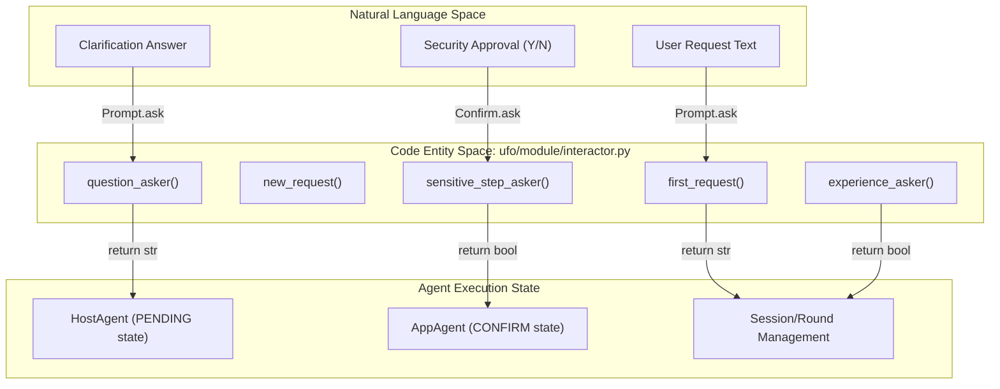
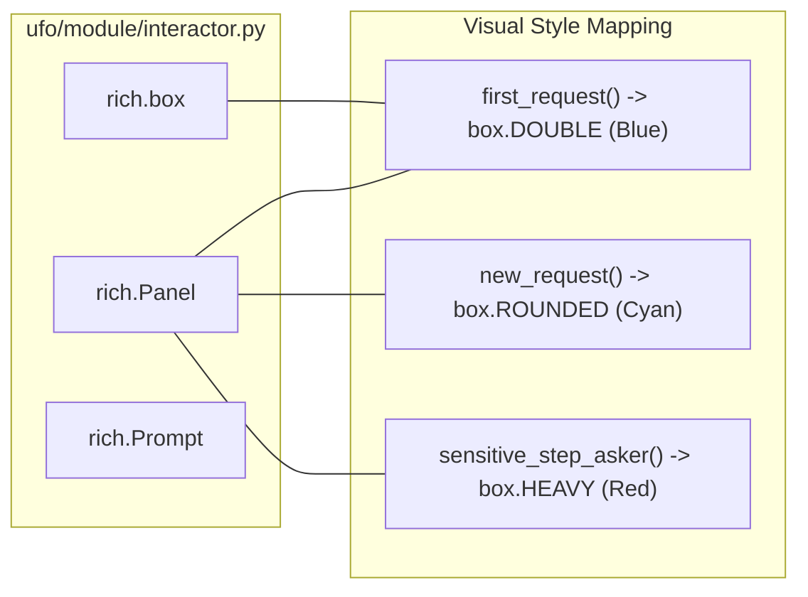

<!-- source: DeepWiki mcp.deepwiki.com · repo microsoft/UFO · page 3.11 User Interaction Module · fetched 2026-10-26 -->

# User Interaction Module

<details>
<summary>Relevant source files</summary>

The following files were used as context for generating this wiki page:

- [ufo/__main__.py](ufo/__main__.py)
- [ufo/automator/ui_control/control_filter.py](ufo/automator/ui_control/control_filter.py)
- [ufo/llm/llm_call.py](ufo/llm/llm_call.py)
- [ufo/llm/openai.py](ufo/llm/openai.py)
- [ufo/module/interactor.py](ufo/module/interactor.py)
- [ufo/rag/retriever.py](ufo/rag/retriever.py)
- [ufo/ufo.py](ufo/ufo.py)

</details>


## Purpose and Scope

The User Interaction Module provides a rich console-based interface for gathering user input, displaying information, and managing conversational flow during UFO task execution. This module handles all direct user-facing prompts including initial requests, follow-up questions, sensitive action confirmations, and experience saving preferences.

This module focuses specifically on **interactive console-based user input** during agent execution. For the broader agent state machine logic that uses these prompts, see [Agent State Machines](). For the web-based Galaxy UI, see [Galaxy Web UI]().

**Sources:** [ufo/module/interactor.py:1-220]()

---

## Architecture Overview

The User Interaction Module is implemented as a collection of stateless prompter functions that are invoked at specific points during agent execution. All functions utilize the `rich` library for enhanced console presentation with styled panels, colors, and formatted output.

### System Interaction Diagram

The following diagram shows how the interaction functions bridge the gap between user input and code execution states.

Title: User Interaction Data Flow


**Key Design Principles:**

1. **Stateless Functions**: All interactor functions are pure, stateless utilities that take input parameters and return user responses [ufo/module/interactor.py:26-220]().
2. **Rich Library Integration**: Leverages `rich` for professional console UI with panels, colors, and formatting [ufo/module/interactor.py:8-13]().
3. **Separation of Concerns**: UI presentation logic is isolated from agent business logic.
4. **Return-Based Flow Control**: Functions return values that determine execution flow (e.g., `complete` flag, user answers).

**Sources:** [ufo/module/interactor.py:1-16](), [ufo/module/interactor.py:26-220]()

---

## Console UI Framework

The module uses the `rich` library extensively to create an aesthetically pleasing and informative console interface.

### Core Components

| Component | Purpose | Usage in Module |
|-----------|---------|-----------------|
| `Console` | Central output manager | Global singleton for all print operations [ufo/module/interactor.py:16]() |
| `Panel` | Bordered content containers | Welcome messages, questions, warnings [ufo/module/interactor.py:33-46]() |
| `Prompt.ask()` | Text input with styling | Collecting user requests and answers [ufo/module/interactor.py:52-55]() |
| `Confirm.ask()` | Yes/No questions | Boolean confirmations [ufo/module/interactor.py:132-136]() |
| `Text` | Styled text objects | Colored, formatted inline text [ufo/module/interactor.py:58-62]() |
| `box` styles | Border visual styles | `DOUBLE`, `ROUNDED`, `HEAVY` for different contexts [ufo/module/interactor.py:44,82,195]() |

### Visual Styling Patterns

Title: Visual Component Association


**Color and Emoji Conventions:**

- **Cyan/Blue**: General information and prompts.
- **Green**: Confirmations and success messages.
- **Yellow**: Warnings and important notices.
- **Red**: Security warnings and errors.
- **Dim**: Secondary information.
- **Emojis**: Visual anchors (🛸, ✨, 🎯, ⚠️, ✅, ❌).

**Sources:** [ufo/module/interactor.py:6-16](), [ufo/module/interactor.py:32-46](), [ufo/module/interactor.py:186-219]()

---

## Request Lifecycle Functions

### Initial Request: `first_request()`

The entry point for user interaction, presenting a welcome screen and collecting the initial task request.

**Function Signature:**
```python
def first_request() -> str
```

**Behavior:**
- Creates a `Panel` with UFO ASCII art using `text2art("UFO", font='small')` [ufo/module/interactor.py:33-46]().
- Displays example tasks to guide users.
- Uses `Prompt.ask()` with green styling for input [ufo/module/interactor.py:52-55]().
- Shows confirmation message with the captured request [ufo/module/interactor.py:58-63]().
- Returns the user's request string [ufo/module/interactor.py:67]().

**Sources:** [ufo/module/interactor.py:26-67]()

---

### Follow-up Request: `new_request()`

Prompts for additional requests after completing a task, enabling multi-turn conversations.

**Function Signature:**
```python
def new_request() -> Tuple[str, bool]
```

**Return Values:**
- `request` (str): The new request or "N" for exit.
- `complete` (bool): `True` if user wants to exit, `False` to continue.

**Behavior:**
- Displays a `Panel` prompting for next action [ufo/module/interactor.py:77-83]().
- Special handling for "N" input to exit [ufo/module/interactor.py:91-99]().
- Shows goodbye panel when exiting.
- Returns tuple for flow control [ufo/module/interactor.py:105]().

**Sources:** [ufo/module/interactor.py:70-105]()

---

### Experience Saving: `experience_asker()`

Prompts the user to save the conversation trajectory for future learning.

**Function Signature:**
```python
def experience_asker() -> bool
```

**Behavior:**
- Displays educational panel explaining benefits of saving experiences [ufo/module/interactor.py:115-126]().
- Lists benefits: faster execution, better accuracy, personalization.
- Uses `Confirm.ask()` with default=`True` [ufo/module/interactor.py:132-136]().
- Returns boolean indicating user's choice [ufo/module/interactor.py:145]().

**Integration:** This result is used by the experience learning system to decide whether to save the trajectory to the experience database.

**Sources:** [ufo/module/interactor.py:108-145]()

---

## Question and Confirmation Flow

### Clarification Questions: `question_asker()`

Used by agents when they need additional information from the user to proceed.

**Function Signature:**
```python
def question_asker(question: str, index: int) -> str
```

**Parameters:**
- `question`: The question text generated by the LLM.
- `index`: Question number for display purposes.

**Behavior:**
- Creates numbered question panel with `box.ROUNDED` border [ufo/module/interactor.py:157-162]().
- Displays question prominently in white text.
- Prompts for answer with cyan styling [ufo/module/interactor.py:168-170]().
- Shows confirmation of recorded answer.
- Returns the user's answer as a string [ufo/module/interactor.py:175]().

**Usage Context:** Invoked when `HostAgent` enters the `PENDING` state, typically when the LLM determines it needs additional information to complete the task.

**Sources:** [ufo/module/interactor.py:148-175]()

---

### Sensitive Action Confirmation: `sensitive_step_asker()`

Provides a security checkpoint for potentially dangerous operations.

**Function Signature:**
```python
def sensitive_step_asker(action: str, control_text: str) -> bool
```

**Parameters:**
- `action`: The action type (e.g., "SetText", "Click").
- `control_text`: The target control identifier.

**Security Features:**
- **Heavy visual emphasis**: Uses `box.HEAVY` and red styling [ufo/module/interactor.py:187-196]().
- **Default to deny**: `Confirm.ask()` defaults to `False` [ufo/module/interactor.py:208-212]().
- **Explicit warning**: "🚨 IMPORTANT" message about data modification [ufo/module/interactor.py:203-205]().
- **Clear action details**: Shows both action type and target.

**Behavior:**
- Creates prominent red warning panel.
- Displays action and target information.
- Requires explicit user approval.
- Returns boolean indicating approval [ufo/module/interactor.py:219]().

**Integration:** Invoked when `AppAgent` enters the `CONFIRM` state, which occurs when the action is marked as sensitive.

**Sources:** [ufo/module/interactor.py:178-219]()

---

## Integration with Agent System

The User Interaction Module integrates with the agent execution pipeline at specific state transition points.

### State-Specific Usage

| Agent State | Interactor Function | Purpose | Return Handling |
|-------------|---------------------|---------|-----------------|
| Session Init | `first_request()` | Collect initial task | Stored in session context |
| `PENDING` (Host) | `question_asker()` | Get clarification | Added to conversation history |
| `CONFIRM` (App) | `sensitive_step_asker()` | Security approval | If `False`, action skipped/replanned |
| Round Complete | `new_request()` | Continue or exit | `complete=True` ends session |
| Session End | `experience_asker()` | Save learning | If `True`, trajectory saved to DB |

**Sources:** [ufo/module/interactor.py:26-220]()

---

## Implementation Details

### Module Structure

The module is organized as a flat collection of functions in a single file:

```
ufo/module/interactor.py
├── WELCOME_TEXT (constant)
├── console (global Console instance)
├── first_request() → str
├── new_request() → Tuple[str, bool]
├── experience_asker() → bool
├── question_asker(question, index) → str
└── sensitive_step_asker(action, control_text) → bool
```

### Dependencies

| Dependency | Purpose | Usage |
|------------|---------|-------|
| `rich.console.Console` | Output management | Global `console` instance [ufo/module/interactor.py:16]() |
| `rich.panel.Panel` | Bordered containers | All display functions [ufo/module/interactor.py:9]() |
| `rich.prompt.Prompt` | Text input | `first_request()`, `new_request()`, `question_asker()` [ufo/module/interactor.py:10]() |
| `rich.prompt.Confirm` | Boolean input | `experience_asker()`, `sensitive_step_asker()` [ufo/module/interactor.py:10]() |
| `rich.text.Text` | Styled text | Confirmation messages [ufo/module/interactor.py:11]() |
| `rich.box` | Border styles | `DOUBLE`, `ROUNDED`, `HEAVY` [ufo/module/interactor.py:13]() |
| `art.text2art` | ASCII art generation | Welcome screen UFO logo [ufo/module/interactor.py:6]() |

**Sources:** [ufo/module/interactor.py:1-13]()

---

