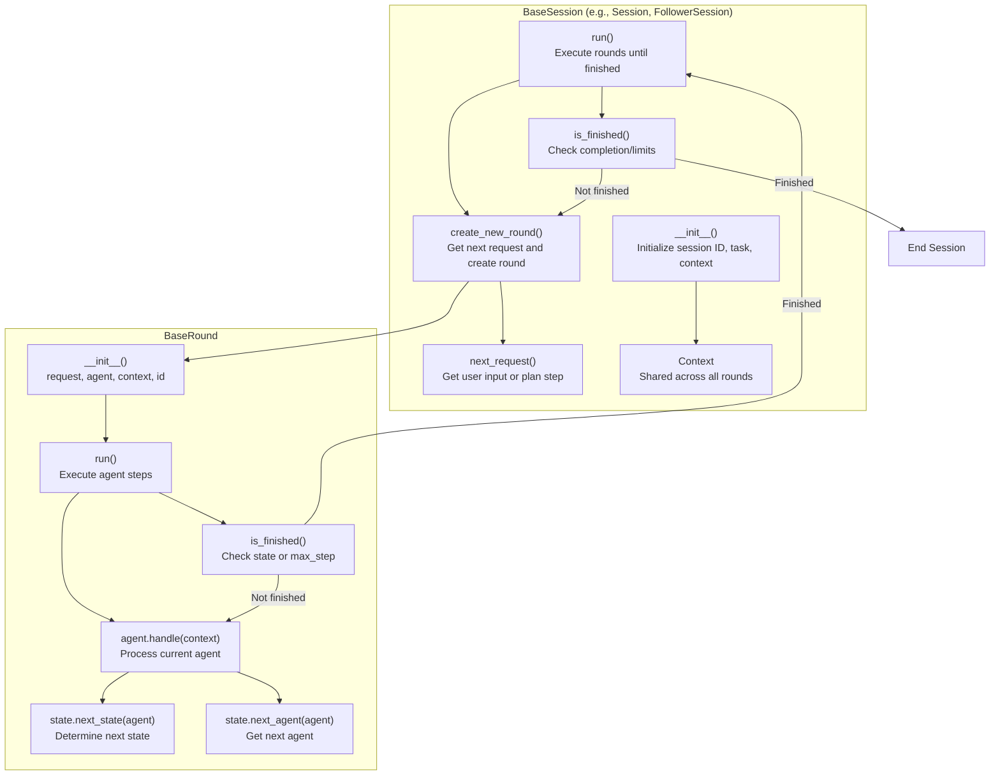
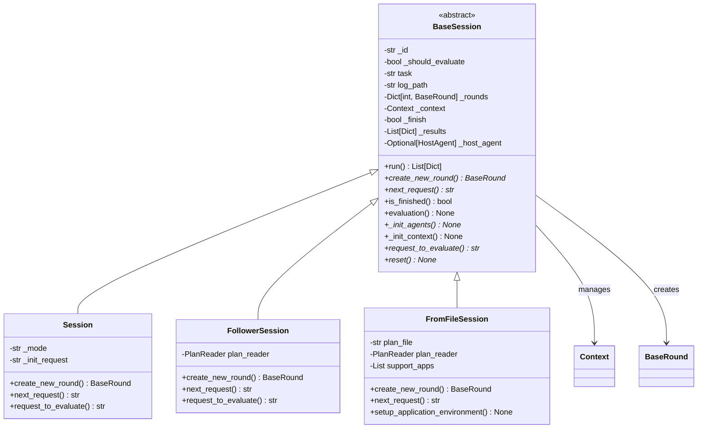
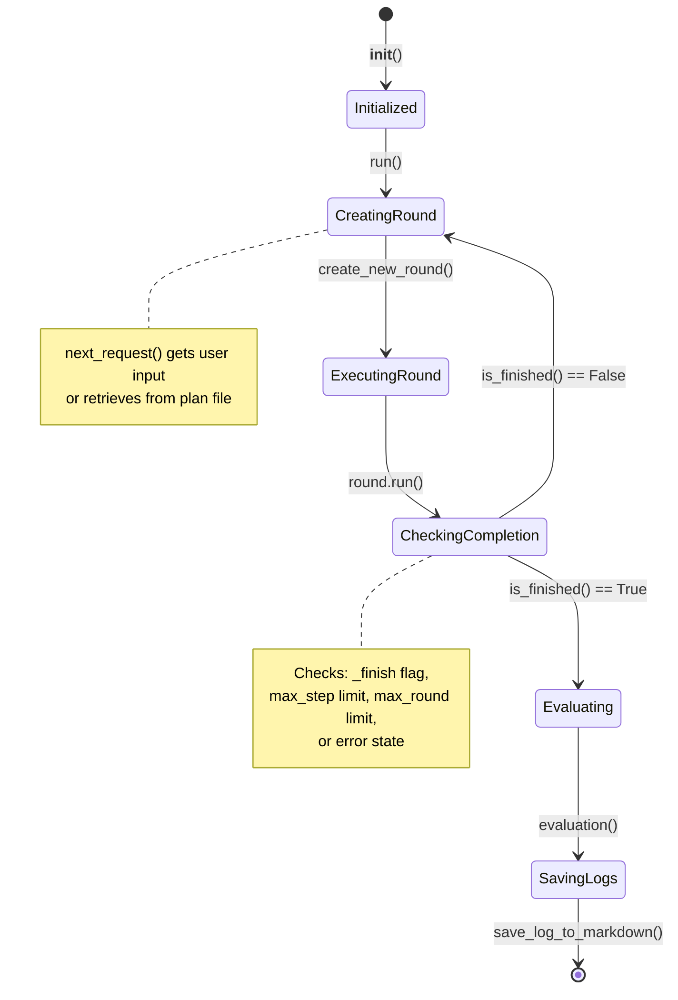
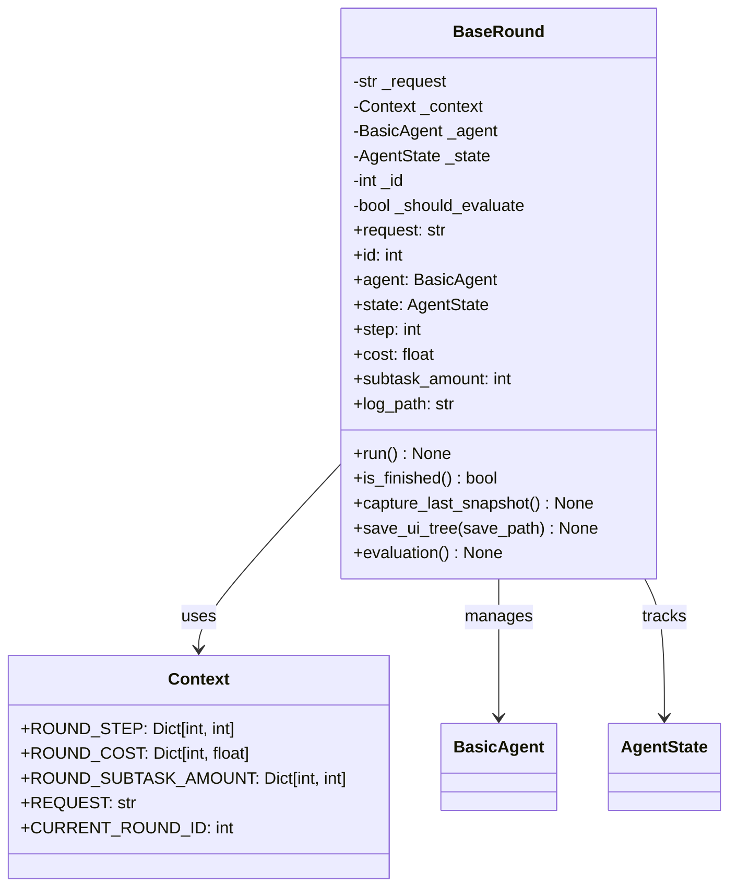
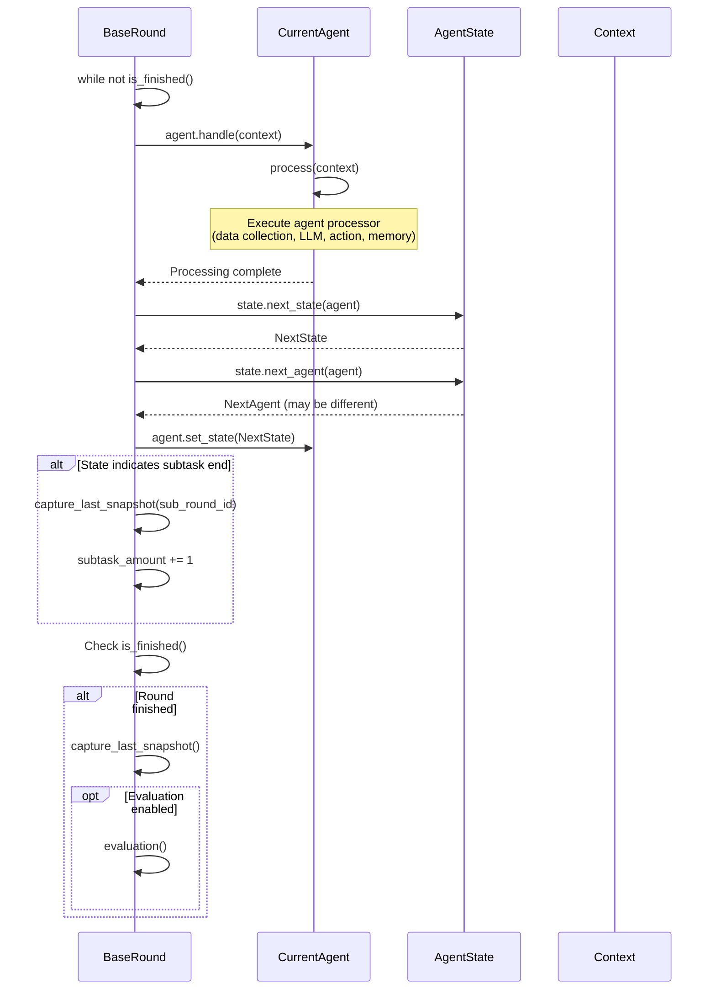
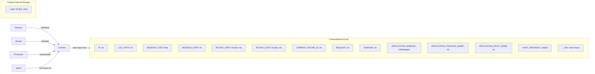
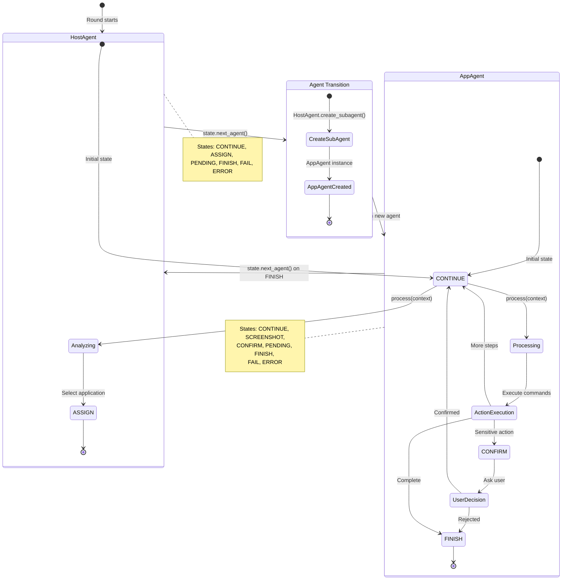
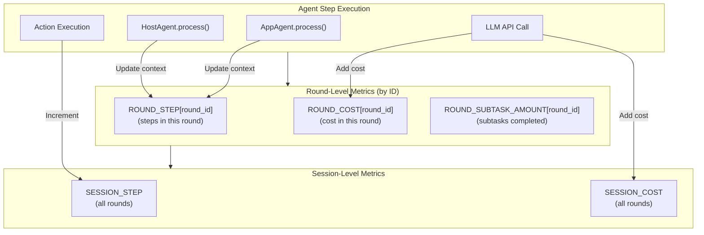

<!-- source: DeepWiki mcp.deepwiki.com · repo microsoft/UFO · page 3.2 Session and Round Management · fetched 2026-10-26 -->

# Session and Round Management

<details>
<summary>Relevant source files</summary>

The following files were used as context for generating this wiki page:

- [documents/docs/img/app_agent_creation.png](documents/docs/img/app_agent_creation.png)
- [documents/docs/img/app_state_machine.png](documents/docs/img/app_state_machine.png)
- [documents/docs/img/host_state_machine.png](documents/docs/img/host_state_machine.png)
- [documents/docs/img/session.png](documents/docs/img/session.png)
- [ufo/__main__.py](ufo/__main__.py)
- [ufo/agents/agent/app_agent.py](ufo/agents/agent/app_agent.py)
- [ufo/agents/agent/basic.py](ufo/agents/agent/basic.py)
- [ufo/agents/agent/evaluation_agent.py](ufo/agents/agent/evaluation_agent.py)
- [ufo/agents/agent/host_agent.py](ufo/agents/agent/host_agent.py)
- [ufo/agents/processors/app_agent_processor.py](ufo/agents/processors/app_agent_processor.py)
- [ufo/agents/processors/host_agent_processor.py](ufo/agents/processors/host_agent_processor.py)
- [ufo/agents/states/app_agent_state.py](ufo/agents/states/app_agent_state.py)
- [ufo/agents/states/basic.py](ufo/agents/states/basic.py)
- [ufo/agents/states/host_agent_state.py](ufo/agents/states/host_agent_state.py)
- [ufo/agents/states/operator_state.py](ufo/agents/states/operator_state.py)
- [ufo/llm/llm_call.py](ufo/llm/llm_call.py)
- [ufo/llm/openai.py](ufo/llm/openai.py)
- [ufo/module/basic.py](ufo/module/basic.py)
- [ufo/module/sessions/plan_reader.py](ufo/module/sessions/plan_reader.py)
- [ufo/module/sessions/session.py](ufo/module/sessions/session.py)
- [ufo/rag/retriever.py](ufo/rag/retriever.py)
- [ufo/ufo.py](ufo/ufo.py)

</details>


## Purpose and Scope

This document describes the session and round management system in UFO² Desktop AgentOS, which provides the execution model for organizing agent workflows into hierarchical units of work. A **session** represents a complete task execution lifecycle spanning multiple user requests, while a **round** represents the processing of a single user request through multiple agent steps. For information about agent processing within rounds, see [Agent Processing System](#3.1). For agent state transitions during round execution, see [Agent State Machines](#3.5).

## Overview

UFO uses a two-tier execution model:

- **Session**: Top-level execution unit that manages multiple rounds, tracks overall cost and progress, handles evaluation, and maintains persistent context across user interactions.
- **Round**: Individual request processing unit that executes agent steps until completion, manages state transitions between agents, and captures execution snapshots.



**Session and Round Execution Flow**

Sources: [ufo/module/basic.py:98-192](), [ufo/module/basic.py:444-997]()

## BaseSession Class

### Class Definition and Initialization

The `BaseSession` class is the abstract base class for all session types in UFO². It manages the lifecycle of a complete task execution, which may span multiple user requests (rounds).



**BaseSession Class Hierarchy**

Sources: [ufo/module/basic.py:444-524](), [ufo/module/sessions/session.py:41-158]()

### Session Lifecycle

The session lifecycle follows this pattern:

1.  **Initialization** (`__init__`): Sets up session ID, task name, logging paths, context, and platform-specific agents.
2.  **Execution** (`run`): Iteratively creates and executes rounds until completion.
3.  **Evaluation** (optional): Evaluates task completion using `EvaluationAgent`.
4.  **Cleanup**: Saves logs, trajectories, and experience data.



**Session State Machine**

Sources: [ufo/module/basic.py:478-506](), [ufo/module/basic.py:776-791]()

### Context Initialization

The `_init_context` method sets up the shared `Context` object that persists across all rounds:

| Context Field | Type | Purpose |
| :--- | :--- | :--- |
| `ContextNames.ID` | str | Unique session identifier |
| `ContextNames.LOG_PATH` | str | Directory for logs and screenshots |
| `ContextNames.LOGGER` | FileWriter | Response log writer |
| `ContextNames.REQUEST_LOGGER` | FileWriter | Request log writer |
| `ContextNames.EVALUATION_LOGGER` | FileWriter | Evaluation log writer |
| `ContextNames.SESSION_COST` | float | Accumulated LLM API costs |
| `ContextNames.SESSION_STEP` | int | Total steps across all rounds |

Sources: [ufo/module/basic.py:557-586]()

### Key Properties and Methods

**Properties:**

*   `id`: Session identifier (string) [ufo/module/basic.py:587-593]()
*   `context`: Shared `Context` object [ufo/module/basic.py:630-636]()
*   `cost`: Total LLM API cost (updated via `ContextNames.SESSION_COST`) [ufo/module/basic.py:604-617]()
*   `step`: Total steps executed (via `ContextNames.SESSION_STEP`) [ufo/module/basic.py:619-628]()
*   `total_rounds`: Number of rounds created [ufo/module/basic.py:646-652]()
*   `current_round`: Most recent `BaseRound` instance [ufo/module/basic.py:654-663]()
*   `host_agent`: Optional `HostAgent` for Windows sessions [ufo/module/basic.py:665-671]()
*   `results`: List of evaluation results per round [ufo/module/basic.py:638-644]()

**Abstract Methods (must be implemented by subclasses):**

*   `_init_agents()`: Initialize platform-specific agents (e.g., `HostAgent` for Windows) [ufo/module/basic.py:552-555]()
*   `create_new_round()`: Create and configure a new round [ufo/module/basic.py:793-797]()
*   `next_request()`: Obtain the next user request [ufo/module/basic.py:799-803]()
*   `request_to_evaluate()`: Format request(s) for evaluation [ufo/module/basic.py:805-809]()
*   `reset()`: Reset session to initial state [ufo/module/basic.py:516-524]()

Sources: [ufo/module/basic.py:587-806]()

## BaseRound Class

### Class Definition

The `BaseRound` class represents a single request-response cycle within a session. Each round processes one user request through multiple agent steps until completion.



**BaseRound Structure**

Sources: [ufo/module/basic.py:98-120]()

### Round Execution Flow

The `run` method implements the core round execution loop:



**Round Execution Sequence**

Sources: [ufo/module/basic.py:156-192]()

### Round Context Management

Each round initializes per-round tracking in the shared context via `_init_context()` [ufo/module/basic.py:132-154]():

```python
# Round-specific context keys (all indexed by round ID)
round_step = {self.id: 0}          # Steps within this round
round_cost = {self.id: 0}          # LLM cost for this round  
round_subtask_amount = {self.id: 0} # Number of subtasks completed
```

The round also sets:
*   `ContextNames.REQUEST`: Current user request [ufo/module/basic.py:152]()
*   `ContextNames.CURRENT_ROUND_ID`: This round's ID [ufo/module/basic.py:154]()

Sources: [ufo/module/basic.py:122-154]()

### Completion Checking

The `is_finished` method determines when a round completes:

```python
def is_finished(self) -> bool:
    return (
        self.state.is_round_end()  # State indicates completion (FINISH, ERROR, FAIL)
        or self.context.get(ContextNames.SESSION_STEP) >= ufo_config.system.max_step
    )
```

Sources: [ufo/module/basic.py:193-201]()

### Snapshot Capture

Rounds capture screenshots and UI trees at critical points via `capture_last_snapshot()` [ufo/module/basic.py:303-348]():

| Snapshot Type | Trigger | File Pattern |
| :--- | :--- | :--- |
| Subtask final | `state.is_subtask_end()` returns True | `action_round_{id}_sub_round_{sub_id}_final.png` |
| Round final | Round completes | `action_round_{id}_final.png` |
| UI tree | `ufo_config.system.save_ui_tree` enabled | `ui_trees/ui_tree_round_{id}_final.json` |
| Full desktop | `ufo_config.system.save_full_screen` enabled | `desktop_round_{id}_sub_round_{sub_id}_final.png` |

Sources: [ufo/module/basic.py:303-378]()

## Context and ContextNames

### Context Class Architecture

The `Context` class provides a shared data store that persists across the entire session lifecycle. It uses a key-value structure with predefined keys in `ContextNames`.



**Context Data Flow**

Sources: [ufo/module/context.py:1-200](), [ufo/module/basic.py:132-154]()

### Key Context Fields

The context stores session-wide and round-specific data:

**Session-Level Fields:**

| Field | Type | Description |
| :--- | :--- | :--- |
| `ID` | str | Unique session identifier |
| `LOG_PATH` | str | Base directory for logs and artifacts |
| `SESSION_COST` | float | Cumulative LLM API cost |
| `SESSION_STEP` | int | Total steps executed across all rounds |
| `LOGGER` | FileWriter | Response log file writer |
| `REQUEST_LOGGER` | FileWriter | Request log file writer |
| `EVALUATION_LOGGER` | FileWriter | Evaluation log file writer |
| `MODE` | str | Execution mode (normal, follower, batch_normal) |
| `command_dispatcher` | CommandDispatcher | Command execution interface (Local or WebSocket) |

**Round-Level Fields:**

| Field | Type | Description |
| :--- | :--- | :--- |
| `ROUND_STEP` | Dict[int, int] | Steps per round, keyed by round ID |
| `ROUND_COST` | Dict[int, float] | Cost per round, keyed by round ID |
| `ROUND_SUBTASK_AMOUNT` | Dict[int, int] | Subtasks per round, keyed by round ID |
| `CURRENT_ROUND_ID` | int | Active round identifier |
| `REQUEST` | str | Current user request being processed |
| `ROUND_RESULT` | Any | Result of the current round |

**Application Context Fields:**

| Field | Type | Description |
| :--- | :--- | :--- |
| `APPLICATION_WINDOW` | UIAWrapper | Active application window handle (Windows) |
| `APPLICATION_WINDOW_INFO` | Dict | Application window metadata |
| `APPLICATION_PROCESS_NAME` | str | Process name (e.g., "EXCEL.EXE") |
| `APPLICATION_ROOT_NAME` | str | Root application name (e.g., "Excel") |

**Agent Communication Fields:**

| Field | Type | Description |
| :--- | :--- | :--- |
| `SUBTASK` | str | Current subtask assigned to AppAgent |
| `HOST_MESSAGE` | List[str] | Tips from HostAgent to AppAgent |
| `PREVIOUS_SUBTASKS` | List[Dict] | Completed subtasks with results |

Sources: [ufo/module/basic.py:128-143](), [ufo/module/basic.py:557-586](), [ufo/module/sessions/session.py:94-103]()

### Context Usage Patterns

**Reading from Context:**

```python
# In processors and agents
round_step = context.get(ContextNames.ROUND_STEP)
current_request = context.get(ContextNames.REQUEST)
app_window = context.get(ContextNames.APPLICATION_WINDOW)
```

**Writing to Context:**

```python
# Simple values
context.set(ContextNames.SUBTASK, subtask)
context.set(ContextNames.REQUEST, request)

# Dictionary updates (for round-indexed data)
round_step = {self.id: step_value}
context.update_dict(ContextNames.ROUND_STEP, round_step)
```

**Processor Context Access:**

Processors receive the global context and can access it during processing phases:

```python
# In HostAgentProcessor._get_processor_specific_context_data()
context_data = {
    "previous_subtasks": self.global_context.get(ContextNames.PREVIOUS_SUBTASKS)
}

# Update after processing in _finalize_processing_context()
self.global_context.set(ContextNames.SUBTASK, subtask)
self.global_context.set(ContextNames.HOST_MESSAGE, host_message)
```

Sources: [ufo/agents/processors/host_agent_processor.py:124-183](), [ufo/agents/processors/app_agent_processor.py:116-129]()

## Session Types

UFO² provides concrete session implementations for different execution modes:

### Session (Interactive Mode)

The standard `Session` class handles interactive user workflows where requests are provided dynamically.

**Key Features:**
*   Prompts user for requests via `interactor.first_request()` [ufo/module/sessions/session.py:144]() and `interactor.new_request()` [ufo/module/sessions/session.py:146]().
*   Supports `mode` parameter: "normal", "batch_normal", "operator" [ufo/module/sessions/session.py:63]().
*   Initializes `LocalCommandDispatcher` for direct tool execution [ufo/module/sessions/session.py:102]().
*   Optional experience saving based on `ufo_config.system.save_experience` [ufo/module/sessions/session.py:76-92]().

Sources: [ufo/module/sessions/session.py:41-158]()

### FollowerSession (Plan Execution Mode)

The `FollowerSession` executes a predefined plan from a JSON file, following scripted steps without user interaction.

**Key Features:**
*   Uses `PlanReader` to parse plan files [ufo/module/sessions/session.py:179]().
*   First round: HostAgent processes the initial request [ufo/module/sessions/session.py:208]().
*   Subsequent rounds: AppAgent executes subtasks derived from the plan [ufo/module/sessions/session.py:212]().
*   Automatically clears agent memory between subtasks [ufo/module/sessions/session.py:215]().

Sources: [ufo/module/sessions/session.py:160-255]()

### FromFileSession (Batch Processing Mode)

The `FromFileSession` handles batch automation on Office files, managing application lifecycle automatically.

**Key Features:**
*   Opens target application with COM automation via `setup_application_environment()` [ufo/module/sessions/session.py:317]().
*   Closes applications after execution based on `close` flag [ufo/module/sessions/session.py:438]().
*   Records task completion status to JSON file via `record_task_done()` [ufo/module/sessions/session.py:400]().

Sources: [ufo/module/sessions/session.py:257-444]()

### OpenAIOperatorSession (Operator Mode)

The `OpenAIOperatorSession` integrates with OpenAI's Operator model for computer use.

**Key Features:**
*   Uses `OpenAIOperatorAgent` instead of HostAgent [ufo/module/sessions/session.py:511]().
*   Operates on desktop-level.
*   Refines requests to disable consent prompts via `refine_request()` [ufo/module/sessions/session.py:539]().

Sources: [ufo/module/sessions/session.py:446-556]()

## Round-Based Execution Model

### Agent Transitions Within Rounds

Rounds facilitate transitions between different agent types as the workflow progresses:



**Agent State Transitions in Round**

Sources: [ufo/module/basic.py:163-168](), [ufo/agents/states/host_agent_state.py:122-237](), [ufo/agents/states/app_agent_state.py:127-183]()

### Step Counting and Cost Tracking

UFO tracks execution metrics at multiple granularities:



**Metrics Tracking Hierarchy**

**Step Increment:**
*   Session step increases with every agent action across all rounds.
*   Round step tracks steps within the current round via `ROUND_STEP` context key [ufo/module/basic.py:138]().
*   Checked against `ufo_config.system.max_step` for termination [ufo/module/basic.py:200]().

**Cost Accumulation:**
*   Per-round cost tracked separately: `context.get(ContextNames.ROUND_COST)[round_id]` [ufo/module/basic.py:142]().
*   Session cost accumulates all rounds: `context.get(ContextNames.SESSION_COST)` [ufo/module/basic.py:575]().

Sources: [ufo/module/basic.py:132-154](), [ufo/module/basic.py:557-586]()

### Subtask Management

Rounds can be subdivided into subtasks, typically when HostAgent assigns work to an AppAgent:

**Subtask Lifecycle:**

1.  **Creation**: HostAgent assigns subtask via `ContextNames.SUBTASK` [ufo/agents/processors/host_agent_processor.py:152]().
2.  **Execution**: AppAgent processes subtask over multiple steps.
3.  **Completion**: AppAgent reaches FINISH state [ufo/agents/states/app_agent_state.py:128]().
4.  **Archiving**: State handler calls `archive_subtask()` to record result [ufo/agents/states/app_agent_state.py:147]().
5.  **Snapshot**: Round captures final screenshot for subtask via `capture_last_snapshot()` [ufo/module/basic.py:179]().

**Subtask Archiving:**

```python
# In AppAgentState.archive_subtask()
subtask = context.get(ContextNames.SUBTASK)
previous_subtasks = context.get(ContextNames.PREVIOUS_SUBTASKS)

if subtask:
    subtask_info = {"subtask": subtask, "status": self.name(), "result": result}
    previous_subtasks.append(subtask_info)
    context.set(ContextNames.PREVIOUS_SUBTASKS, previous_subtasks)
```

Sources: [ufo/agents/states/app_agent_state.py:102-118](), [ufo/module/basic.py:177-180]()

## Logging and File Management

### FileWriter Class

Sessions use `FileWriter` [ufo/module/basic.py:58-97]() to bypass global logging settings and ensure file writes succeed even when logging is disabled:

```python
class FileWriter:
    """Simple file writer that bypasses global logging settings."""
    
    def __init__(self, file_path: str, mode: str = "a"):
        self.file_path = file_path
        self.mode = mode
        # Creates directory and file if needed
        
    def write(self, message: str) -> None:
        # Writes to file with flush, handles errors gracefully
```

**Usage in Context:**
```python
# Session initialization in WindowsBaseSession._init_context()
response_writer = FileWriter(os.path.join(self.log_path, "response.log"), mode="a")
request_writer = FileWriter(os.path.join(self.log_path, "request.log"), mode="a")
eval_writer = FileWriter(os.path.join(self.log_path, "evaluation.log"), mode="a")

context.set(ContextNames.LOGGER, response_writer)
context.set(ContextNames.REQUEST_LOGGER, request_writer)
context.set(ContextNames.EVALUATION_LOGGER, eval_writer)
```

Sources: [ufo/module/basic.py:58-97](), [ufo/module/basic.py:569-581]()

### Log Directory Structure

Each session creates a structured log directory [ufo/module/basic.py:494-504]():

```
logs/{task_name}/
├── response.log              # Agent responses and LLM outputs
├── request.log               # User requests and agent inputs
├── evaluation.log            # Evaluation results (if enabled)
├── output.md                 # Markdown trajectory (if enabled)
├── action_round_0_step_1.png      # Per-step screenshots
├── action_round_0_final.png       # Round final screenshots
├── action_round_0_sub_round_0_final.png  # Subtask final screenshots
├── desktop_final.png              # Full desktop screenshot
└── ui_trees/
    ├── ui_tree_round_0_step_1.json
    └── ui_tree_round_0_final.json
```

Sources: [ufo/module/basic.py:303-378](), [ufo/module/basic.py:494-504]()

### Trajectory and Markdown Export

If `ufo_config.system.log_to_markdown` is enabled, sessions export execution trajectories via `save_log_to_markdown()` [ufo/module/basic.py:547-555]():

```python
def save_log_to_markdown(self) -> None:
    file_path = self.log_path
    trajectory = Trajectory(file_path)
    trajectory.to_markdown(file_path + "/output.md")
```

The `Trajectory` class parses log files and generates a human-readable markdown report.

Sources: [ufo/module/basic.py:547-555]()

## Evaluation System

### Evaluation Execution

If `should_evaluate` is True, sessions invoke the evaluation system via `evaluation()` [ufo/module/basic.py:808-860]():

```python
def evaluation(self) -> None:
    """Evaluate the session using EvaluationAgent."""
    evaluator = EvaluationAgent(...)
    
    requests = self.request_to_evaluate()
    
    result, cost = evaluator.evaluate(...)
    
    self._results.append(result)
    self.cost += cost
    
    self.evaluation_logger.write(json.dumps(result))
```

**Evaluation Trigger Points:**
*   After each round if `ufo_config.system.eva_round` is True [ufo/module/basic.py:189]().
*   After session completion if `should_evaluate` is True [ufo/module/basic.py:511]().

Sources: [ufo/module/basic.py:808-860](), [ufo/module/basic.py:188-190]()

### Request Formatting for Evaluation

Different session types format requests differently:

| Session Type | `request_to_evaluate()` Implementation |
| :--- | :--- |
| Session | `self._host_agent.blackboard.requests.to_json()` [ufo/module/sessions/session.py:157]() |
| FollowerSession | `self.plan_reader.get_task()` [ufo/module/sessions/session.py:253]() |
| FromFileSession | `self.plan_reader.get_task()` [ufo/module/sessions/session.py:424]() |

Sources: [ufo/module/sessions/session.py:151-157](), [ufo/module/sessions/session.py:248-254](), [ufo/module/sessions/session.py:420-425]()

---

