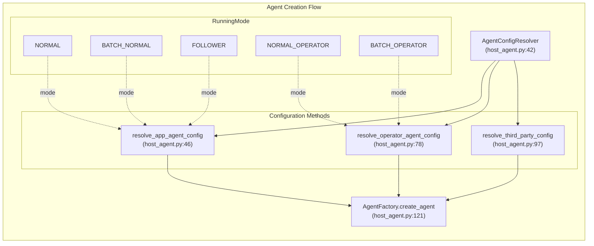
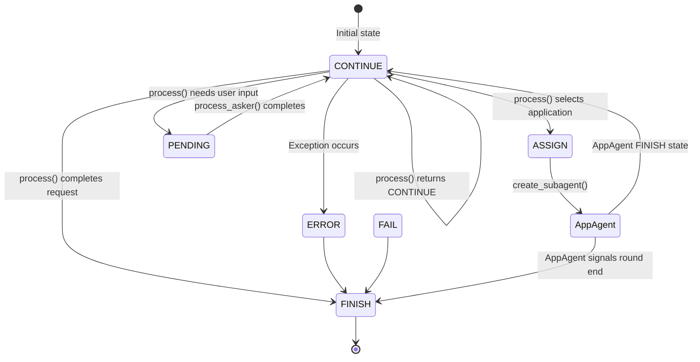
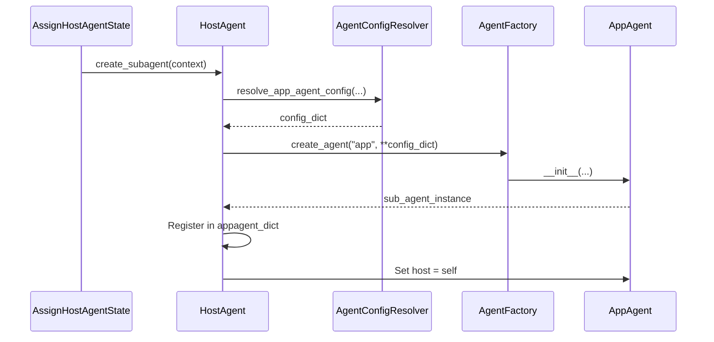
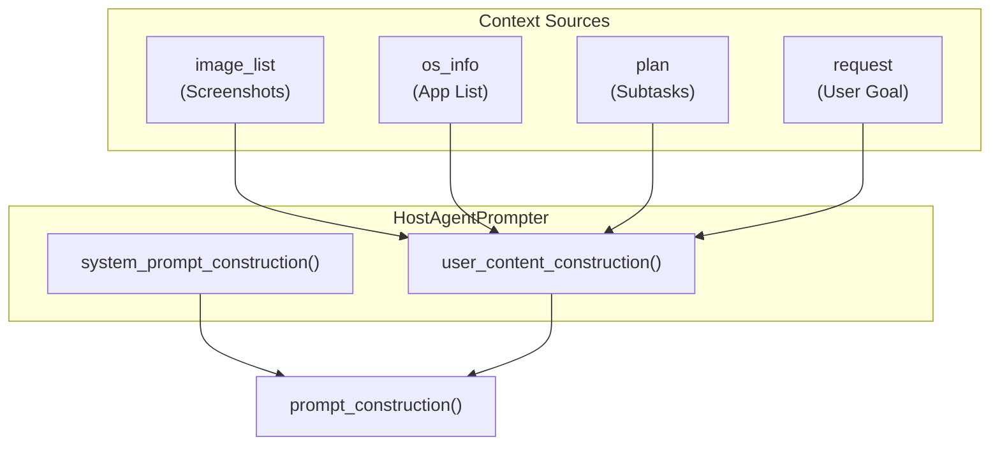

<!-- source: DeepWiki mcp.deepwiki.com · repo microsoft/UFO · page 3.3 Host Agent · fetched 2026-10-26 -->

# Host Agent

Relevant source files

The following files were used as context for generating this wiki page:

- [documents/docs/img/app_agent_creation.png](documents/docs/img/app_agent_creation.png)
- [documents/docs/img/app_state_machine.png](documents/docs/img/app_state_machine.png)
- [documents/docs/img/host_state_machine.png](documents/docs/img/host_state_machine.png)
- [documents/docs/img/session.png](documents/docs/img/session.png)
- [ufo/agents/agent/app_agent.py](ufo/agents/agent/app_agent.py)
- [ufo/agents/agent/basic.py](ufo/agents/agent/basic.py)
- [ufo/agents/agent/evaluation_agent.py](ufo/agents/agent/evaluation_agent.py)
- [ufo/agents/agent/host_agent.py](ufo/agents/agent/host_agent.py)
- [ufo/agents/processors/app_agent_processor.py](ufo/agents/processors/app_agent_processor.py)
- [ufo/agents/processors/host_agent_processor.py](ufo/agents/processors/host_agent_processor.py)
- [ufo/agents/states/app_agent_state.py](ufo/agents/states/app_agent_state.py)
- [ufo/agents/states/basic.py](ufo/agents/states/basic.py)
- [ufo/agents/states/host_agent_state.py](ufo/agents/states/host_agent_state.py)
- [ufo/agents/states/operator_state.py](ufo/agents/states/operator_state.py)
- [ufo/automator/ui_control/control_filter.py](ufo/automator/ui_control/control_filter.py)
- [ufo/module/basic.py](ufo/module/basic.py)
- [ufo/module/interactor.py](ufo/module/interactor.py)
- [ufo/module/sessions/plan_reader.py](ufo/module/sessions/plan_reader.py)
- [ufo/module/sessions/session.py](ufo/module/sessions/session.py)

The **Host Agent** is the desktop-level orchestrator in the UFO² Desktop AgentOS. It serves as the primary entry point for user requests, analyzes user intent, decomposes requests into subtasks, and manages the lifecycle of application-specific agents. The Host Agent operates as a finite state machine (FSM) that coordinates task execution across multiple applications on the desktop.

For information about application-specific automation, see [App Agent](#3.4). For details on the agent processing framework, see [Agent Processing System](#3.1). For state machine implementation details, see [Agent State Machines](#3.5).

## Core Responsibilities

The Host Agent performs four primary functions:

1. **Request Analysis**: Interprets natural language user requests and determines the appropriate application or third-party agent to handle the task.
2. **Application Selection**: Identifies and selects the target application window or third-party agent for task execution.
3. **Sub-Agent Management**: Creates and manages `AppAgent` instances (or `OpenAIOperatorAgent`, third-party agents) for application-specific automation.
4. **Task Orchestration**: Coordinates the execution flow between multiple agents through state transitions.

The Host Agent does not directly interact with application UI controls. Instead, it delegates application-specific tasks to `AppAgent` instances it creates and manages.

**Sources**: [ufo/agents/agent/host_agent.py:143-177]()

## Class Structure and Architecture

### HostAgent Class

The `HostAgent` class is registered with the `AgentRegistry` using the decorator pattern at [ufo/agents/agent/host_agent.py:142](). Key components include:

| Component | Type | Purpose |
|-----------|------|---------|
| `_name` | `str` | Agent identifier (e.g., "HostAgent") |
| `prompter` | `HostAgentPrompter` | Constructs LLM prompts for request analysis [ufo/agents/agent/host_agent.py:165-167]() |
| `_blackboard` | `Blackboard` | Shared memory for inter-agent communication [ufo/agents/agent/host_agent.py:175]() |
| `agent_factory` | `AgentFactory` | Factory for creating sub-agents [ufo/agents/agent/host_agent.py:172]() |
| `appagent_dict` | `Dict[str, AppAgent]` | Registry of created sub-agents [ufo/agents/agent/host_agent.py:173]() |
| `_active_appagent` | `Optional[AppAgent]` | Currently active sub-agent [ufo/agents/agent/host_agent.py:174]() |
| `_state` | `HostAgentState` | Current FSM state [ufo/agents/agent/basic.py:53]() |
| `_processor` | `HostAgentProcessor` | Processing pipeline executor [ufo/agents/agent/basic.py:52]() |

**Sources**: [ufo/agents/agent/host_agent.py:148-177](), [ufo/agents/agent/basic.py:34-62]()

### Agent Factory and Configuration

The `AgentFactory` class and `AgentConfigResolver` manage the creation of different agent types based on the `RunningMode`:

Title: Agent Creation Flow

The configuration resolution follows logic defined in `AgentConfigResolver`. For instance, `resolve_app_agent_config` determines if the agent should be a standard `AppAgent` or a `BatchAgent` based on the session mode [ufo/agents/agent/host_agent.py:46-76]().

**Sources**: [ufo/agents/agent/host_agent.py:42-140](), [ufo/module/sessions/session.py:41-68]()

## State Machine (FSM)

The Host Agent operates as a finite state machine with states defined in the `HostAgentStatus` enum at [ufo/agents/states/host_agent_state.py:21-33]().

### State Definitions

Title: Host Agent FSM Transitions

### State Classes and Transitions

| State Class | Status Value | Purpose | Next State Transition |
|-------------|--------------|---------|----------------------|
| `ContinueHostAgentState` | `CONTINUE` | Processes user request via `agent.process(context)` [ufo/agents/states/host_agent_state.py:136]() | Status-dependent |
| `AssignHostAgentState` | `ASSIGN` | Triggers `agent.create_subagent(context)` [ufo/agents/states/host_agent_state.py:189]() | Transitions to `AppAgentState` |
| `PendingHostAgentState` | `PENDING` | Requests user input via `question_asker` [ufo/agents/states/host_agent_state.py:254-263]() | Returns to `CONTINUE` |
| `FinishHostAgentState` | `FINISH` | Marks round completion [ufo/agents/states/host_agent_state.py:101-120]() | Terminal state |

**Sources**: [ufo/agents/states/host_agent_state.py:21-270](), [ufo/module/basic.py:157-187]()

## Processing Pipeline

The `HostAgentProcessor` implements a phase-based processing pipeline using the `ProcessorTemplate` framework.

### Processor Architecture

Title: HostAgentProcessor Strategy Mapping

```mermaid
graph TB
    subgraph "HostAgentProcessor Pipeline"
        Entry["process()<br/>(processor_framework.py)"]
        
        subgraph "Phase 1: DATA_COLLECTION"
            DataPhase["ProcessingPhase.DATA_COLLECTION"]
            DesktopStrategy["DesktopDataCollectionStrategy<br/>(host_agent_processing_strategy.py)"]
        end
        
        subgraph "Phase 2: LLM_INTERACTION"
            LLMPhase["ProcessingPhase.LLM_INTERACTION"]
            HostLLMStrategy["HostLLMInteractionStrategy<br/>(host_agent_processing_strategy.py)"]
        end
        
        subgraph "Phase 3: ACTION_EXECUTION"
            ActionPhase["ProcessingPhase.ACTION_EXECUTION"]
            HostActionStrategy["HostActionExecutionStrategy<br/>(host_agent_processing_strategy.py)"]
        end
        
        subgraph "Phase 4: MEMORY_UPDATE"
            MemoryPhase["ProcessingPhase.MEMORY_UPDATE"]
            HostMemoryStrategy["HostMemoryUpdateStrategy<br/>(host_agent_processing_strategy.py)"]
        end
    end
    
    Entry --> DataPhase
    DataPhase --> DesktopStrategy
    DesktopStrategy --> LLMPhase
    LLMPhase --> HostLLMStrategy
    HostLLMStrategy --> ActionPhase
    ActionPhase --> HostActionStrategy
    HostActionStrategy --> MemoryPhase
    MemoryPhase --> HostMemoryStrategy
```

### Strategy Setup

The processor configures strategies at [ufo/agents/processors/host_agent_processor.py:95-113]():

| Strategy | Fail Fast | Purpose |
|----------|-----------|---------|
| `DesktopDataCollectionStrategy` | Yes | Captures desktop screenshots and detects application windows. |
| `HostLLMInteractionStrategy` | Yes | Constructs prompt with desktop context and parses response into `HostAgentResponse`. |
| `HostActionExecutionStrategy` | No | Executes selected action (application selection or finish). |
| `HostMemoryUpdateStrategy` | No | Updates agent memory and blackboard. |

**Context Finalization**: After processing, the processor promotes local context data to global context (e.g., `ContextNames.SUBTASK`, `ContextNames.APPLICATION_PROCESS_NAME`) at [ufo/agents/processors/host_agent_processor.py:137-184]().

**Sources**: [ufo/agents/processors/host_agent_processor.py:66-184](), [ufo/agents/processors/core/processor_framework.py]()

## Sub-Agent Creation and Management

The Host Agent creates sub-agents when it enters the `ASSIGN` state. The creation flow is triggered at [ufo/agents/states/host_agent_state.py:189]().

### Sub-Agent Creation Flow

Title: Sub-Agent Initialization Sequence

The `appagent_dict` at [ufo/agents/agent/host_agent.py:173]() maintains a registry of created agents, indexed by a unique name (e.g., `"AppAgent/Word/WINWORD.EXE"`).

**Sources**: [ufo/agents/agent/host_agent.py:313-363](), [ufo/agents/states/host_agent_state.py:176-238]()

## Message Construction and LLM Interaction

The Host Agent constructs LLM prompts using `HostAgentPrompter`.

### Prompt Construction Flow

Title: HostAgent Prompt Assembly

The `message_constructor` method at [ufo/agents/agent/host_agent.py:219-255]() produces a message list compatible with LLM APIs, incorporating desktop visual state and task history.

**Sources**: [ufo/agents/agent/host_agent.py:219-311](), [ufo/prompter/agent_prompter.py]()

## Integration with Sessions and Rounds

The Host Agent is the root agent for most session types. In `Session.create_new_round()`, the Host Agent is assigned as the initial agent for the round [ufo/module/sessions/session.py:118-126]().

### Round Context Initialization

When a round starts, the context is initialized with round-specific tracking keys at [ufo/module/basic.py:132-154]():
- `ContextNames.ROUND_STEP`: Current step in the round.
- `ContextNames.ROUND_COST`: Cumulative LLM cost for the round.
- `ContextNames.ROUND_SUBTASK_AMOUNT`: Number of subtasks completed.

**Sources**: [ufo/module/basic.py:98-192](), [ufo/module/sessions/session.py:41-158]()

## Blackboard and Memory Management

The Host Agent maintains a `Blackboard` instance at [ufo/agents/agent/host_agent.py:175]() which acts as a shared scratchpad for all agents in the current session.

- **Access**: Sub-agents (like `AppAgent`) access the blackboard via their `host` reference [ufo/agents/agent/basic.py:112-117]().
- **Persistence**: Round results and user requests are added to the blackboard at the end of each round [ufo/module/basic.py:182-184]().

**Sources**: [ufo/agents/agent/host_agent.py:213-217](), [ufo/agents/agent/basic.py:112-117](), [ufo/agents/memory/blackboard.py]()

---

